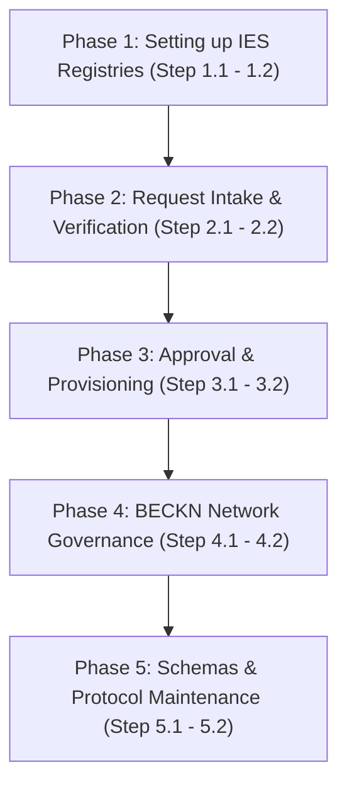

> For the complete documentation index, see [llms.txt](https://india-energy-stack.gitbook.io/docs/llms.txt). Markdown versions of documentation pages are available by appending `.md` to page URLs; this page is available as [Markdown](https://india-energy-stack.gitbook.io/docs/pathways/secretariat.md).

# Secretariat Pathway

A checklist for the India Energy Stack (IES) Secretariat, Network Facilitator Organisation (NFO), or network operators: set up registries, process participant registration requests, govern the network, and manage schemas and protocols.

***

## Roadmap Overview



***

## Phase 1: Setting up IES-Specific Authoritative Registries

In this phase, the Secretariat establishes the core authoritative registries that govern identity, trust, and communication across the India Energy Stack network.

<details>

<summary>Step 1.1: Initialize the Core Authoritative Registries</summary>

### 💡 Phase Advice

> Secure the root DeDi namespace key — every verification depends on it.

### Execution Guidance

Under the IES operator namespace (verified against `indiaenergystack.in`), initialize:

1. **`ies-discoms-reference-registry`**: DISCOM allow-list.
2. **`ies-regulators-reference-registry`**: regulator allow-list (SERCs, CERC, etc.).
3. **`ies-service-providers-reference-registry`**: recognised service providers.
4. **`ies-data-sharing-network` & `test-ies-data-sharing-network`** (tag: `beckn_subscriber_reference`): prod/test Beckn network membership registries. The same pattern applies to the other IES networks (`ies-p2p-trading-network`, `ies-der-integration-network`).
5. **`ies-schemas`** (operational, not part of the registry set documented in [Register](/docs/concepts/setup-register/register.md#the-ies-networks-today)): a DeDi mirror of the published schema versions (see Phase 5).

### References & Anchors

* [Register — The IES networks today](/docs/concepts/setup-register/register.md#the-ies-networks-today)
* [DeDi primer (Appendix A)](/docs/concepts/setup-register/register.md#the-directory-dedi)

</details>

<details>

<summary>Step 1.2: Establish Key Custody &#x26; Namespace DID</summary>

### 💡 Phase Advice

> Restrict namespace-key write access via multi-sig validation or HSM storage.

### Execution Guidance

1. Secure the namespace controller key for the IES operator namespace. Operationally, the hosted DeDi runtime addresses this namespace by an assigned namespace ID (`did:web:did.cord.network:76EU9AJNL25X4LAxgb92rA8op4co7n892oeySAuEk9gAay2N28ctma`) — this value is runtime-assigned rather than published in this reference, so confirm it against the live `indiaenergystack.in` namespace before relying on it.
2. Log key access and restrict admin roles.

### References & Anchors

* [Setup Register — claim a namespace and create registries](/docs/concepts/setup-register.md)

</details>

***

## Phase 2: Request Intake & Verification

In this phase, you receive onboarding requests from utilities or regulators and validate their operational and technical parameters.

<details>

<summary>Step 2.1: Onboarding Request Intake Checklist</summary>

### Execution Guidance

When a registration package arrives via <IES.Secretariat@fsrglobal.org> or <ies@recindia.com>, verify it includes:

* **Legal Name & Short Code**: e.g., `Example Distribution Utility Limited` (`discom`).
* **Issuer DID**: `did:web:<domain>` (production) or `did:key:<key>` (testbed).
* **Public Verification Key**: NIST P-256 public key in JWK format.
* **Service Areas**: List of state/regional codes (e.g. `["DL"]`).
* **Beckn & OpenCred Endpoints**: Target HTTPS service URLs for their integrations.
* **Digital Signature Certificate (DSC)**: optional, and beyond the documented [§1.7 application list](https://india-energy-stack.gitbook.io/docs/pathways/pages/x4JXc2x9ljke9mGdzMbp#id-1.7-beckn-participants-get-referenced-into-an-ies-network) — some applicants include an `x5c` certificate chain when their keys anchor in a CA hierarchy.

### References & Anchors

* [Before you build — getting-started checklist](/docs/concepts/how-you-implement-ies.md)
* [How to apply for an IES listing](https://india-energy-stack.gitbook.io/docs/pathways/pages/x4JXc2x9ljke9mGdzMbp#id-1.7-beckn-participants-get-referenced-into-an-ies-network)

</details>

<details>

<summary>Step 2.2: Technical Validation Checks</summary>

### ⚠️ Caution

> Ensure `did.json` exposes no private keys and serves correctly over HTTPS, with no redirect loops or private-IP targets.

### Execution Guidance

1. **Validate domain ownership**: confirm the requester controls the `did:web` domain.
2. **Resolve the public DID**: verify it resolves and key parameters match:

   ```bash
   curl -s https://<utility-domain>/.well-known/did.json
   ```
3. **Verify DeDi namespace registries**: confirm `opencred-key-registry`, `vc-revocation-registry`, `subscribers-test` are initialized under their namespace.

### References & Anchors

* [Setup Register — keypair and did.json](https://india-energy-stack.gitbook.io/docs/pathways/pages/x4JXc2x9ljke9mGdzMbp#id-1.2-generate-your-credential-signing-keypair)
* [Issue Credentials — Verify a credential you received](/docs/concepts/issue-credentials.md#verify-a-credential-you-received-the-verifiers-walkthrough)

</details>

***

## Phase 3: Approval & Provisioning

In this phase, you whitelist the verified participant inside the authoritative network registries.

<details>

<summary>Step 3.1: Whitelist the Participant inside the Reference Registry</summary>

### Execution Guidance

Append the verified participant's metadata to the reference registry:

1. Compile the verified record payload per the registry schema (`id`, `did`, `legalName`, `publicKeys`, `serviceAreas`, `endpoints`), and publish the record in the `live` state (DeDi records carry explicit `live` / `inactive` / `draft` states).
2. Sign with the namespace controller key and write to: `indiaenergystack.in/ies-discoms-reference-registry/<discom-id>`
3. Confirm the entry resolves publicly over the DeDi read API (the hosted runtime addresses the namespace by the runtime-assigned namespace ID from Step 1.2, URL-encoded, rather than the `indiaenergystack.in` label):

   ```bash
   curl https://api.dedi.global/dedi/lookup/did%3Aweb%3Adid.cord.network%3A76EU9AJNL25X4LAxgb92rA8op4co7n892oeySAuEk9gAay2N28ctma/ies-discoms-reference-registry/<discom-id>
   ```

### References & Anchors

* [Setup Register — Get referenced into an IES network](https://india-energy-stack.gitbook.io/docs/pathways/pages/x4JXc2x9ljke9mGdzMbp#id-1.7-beckn-participants-get-referenced-into-an-ies-network)

</details>

<details>

<summary>Step 3.2: Reference the Participant inside the Beckn Network Registry</summary>

### Execution Guidance

Link the participant's subscriber registry to the Beckn networks:

1. Obtain the DeDi lookup URL of their `subscribers-test` or `subscribers-prod` registry.
2. Write a subscriber reference record (tag `beckn_subscriber_reference`) to `indiaenergystack.in/test-ies-data-sharing-network` or `indiaenergystack.in/ies-data-sharing-network`.
3. Confirm it's active so ONIX adapters can resolve its keys and endpoints.

### References & Anchors

* [How to apply for an IES listing](https://india-energy-stack.gitbook.io/docs/pathways/pages/x4JXc2x9ljke9mGdzMbp#id-1.7-beckn-participants-get-referenced-into-an-ies-network)
* [ONIX Registry Setup Guide](https://india-energy-stack.gitbook.io/docs/pathways/pages/jI43MtQpeJlqcWi0JPQr#id-2.3-swap-in-your-real-identity)

</details>

***

## Phase 4: BECKN Network Governance

In this phase, you monitor network activity, coordinate changes, and enforce network-wide policies.

<details>

<summary>Step 4.1: Manage Network Membership &#x26; Revocation</summary>

### 💡 Phase Advice

> Alert on signature failures or invalid certificates across BAP/BPP nodes to catch key compromises early.

### Execution Guidance

1. **Handle Key Compromises**: on report, revoke the participant's subscriber reference in `ies-data-sharing-network`.
2. **Handle Suspension**: on violation or termination, set the reference record's state to `inactive` (the documented DeDi record states are `live` / `inactive` / `draft`).

### References & Anchors

* [Register — The registries IES uses, by role](/docs/concepts/setup-register/register.md#the-registries-ies-uses-by-role)

</details>

<details>

<summary>Step 4.2: Enforce Network-Wide Policies</summary>

### Execution Guidance

1. Enforce transport security baselines (e.g. TLS 1.3 for ONIX endpoints).
2. Publish node timeout guidelines (the ONIX sandbox config defaults to 30 seconds) to prevent cascading latency.

### References & Anchors

* [Discover — The lifecycle at a glance](/docs/concepts/setup-exchange/discover.md#the-lifecycle-at-a-glance)

</details>

***

## Phase 5: Schemas & Protocol Maintenance

In this phase, you manage the publication, versioning, and migration of canonical schemas.

<details>

<summary>Step 5.1: Publish and Version Schemas</summary>

### Execution Guidance

1. For approved schema shapes (e.g. `MeterData` v0.6), compile the Draft 2020-12 JSON Schema and JSON-LD contexts from `attributes.yaml`.
2. Publish to the canonical hosting path — this repository's `schemas/<Family>/<version>/` folder, served at `india-energy-stack.github.io/ies-accelerator/schemas/...` — following the versioning rules in [How versions work](/docs/schemas/schemas-ies.md#how-versions-work).
3. Optionally mirror published versions into the `ies-schemas` DeDi registry under `indiaenergystack.in` (Step 1.1) so schema versions resolve through the same directory as everything else; the GitHub Pages path above remains canonical.

### References & Anchors

* [Schemas catalog — How versions work](/docs/schemas/schemas-ies.md#how-versions-work)
* [Register — The registries IES uses, by role](/docs/concepts/setup-register/register.md#the-registries-ies-uses-by-role)

</details>

<details>

<summary>Step 5.2: Coordinate Schema Migrations</summary>

### ⚠️ Caution

> Schedule deprecations with ample lead time before marking old versions unsupported.

### Execution Guidance

1. Release changelogs with before/after comparisons of structural changes (e.g. ToU bucket mapping, compact representations).
2. Provide migration scripts so utilities can map legacy formats to newer versions without data loss.

### References & Anchors

* [MeterData v0.6 Changelog](https://github.com/India-Energy-Stack/ies-accelerator/tree/main/schemas/MeterData/v0.6/CHANGELOG.md)

</details>


---

# Agent Instructions
This documentation is published with GitBook. GitBook is the documentation platform designed so that both humans and AI agents can read, navigate, and reason over technical content effectively. Learn more at gitbook.com.

## Querying This Documentation
If you need additional information that is not directly available in this page, you can query the documentation dynamically by asking a question.

Perform an HTTP GET request on the current page URL with the `ask` query parameter, and the optional `goal` query parameter:

```
GET https://india-energy-stack.gitbook.io/docs/pathways/secretariat.md?ask=<question>&goal=<endgoal>
```

`ask` is the immediate question: it should be specific, self-contained, and written in natural language.
`goal` is optional and describes the broader end goal you are ultimately trying to accomplish on behalf of the user. GitBook uses it to tailor the answer towards what is most useful for that goal.

The response will contain a direct answer to the question and relevant excerpts and sources from the documentation.

Use this mechanism when the answer is not explicitly present in the current page, you need clarification or additional context, or you want to retrieve related documentation sections.
