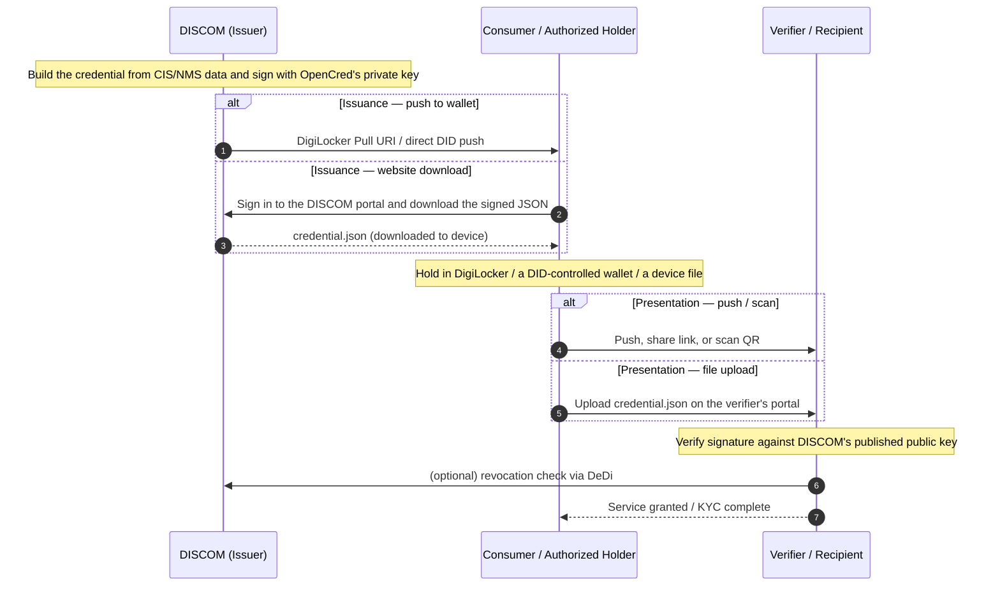
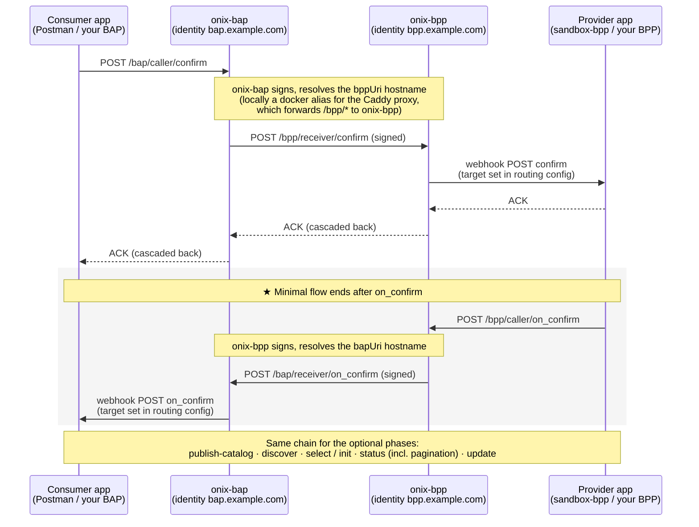
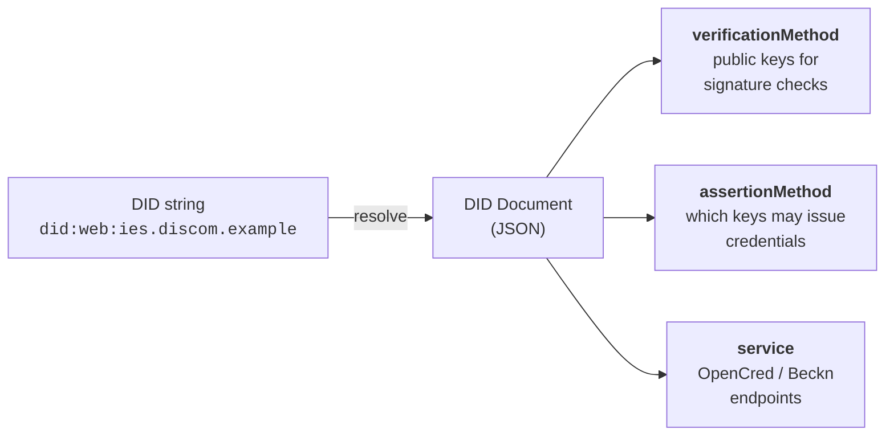
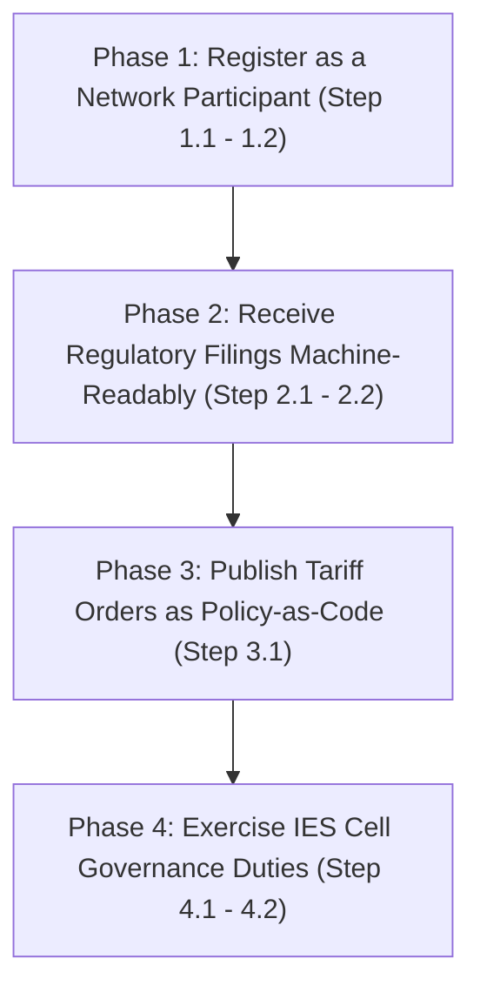
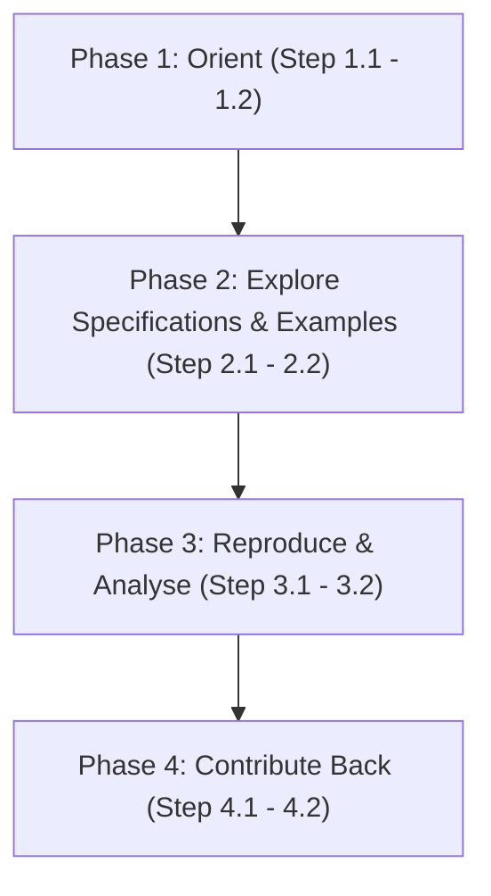
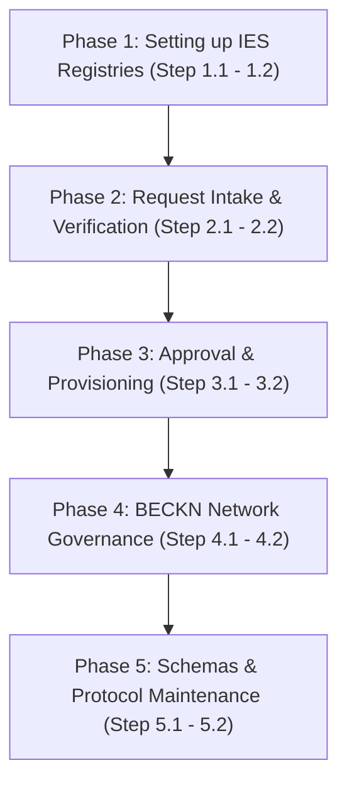
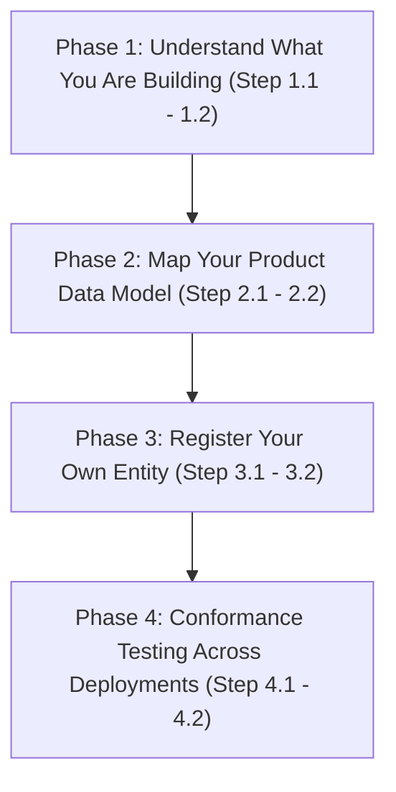
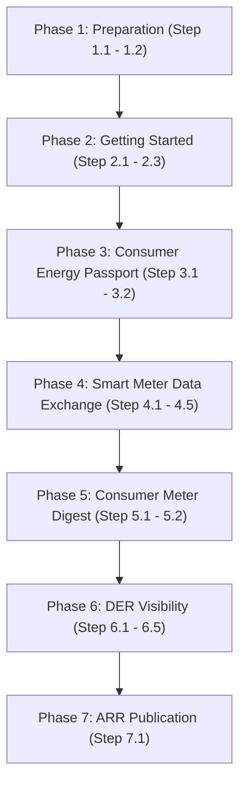
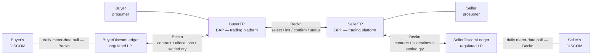
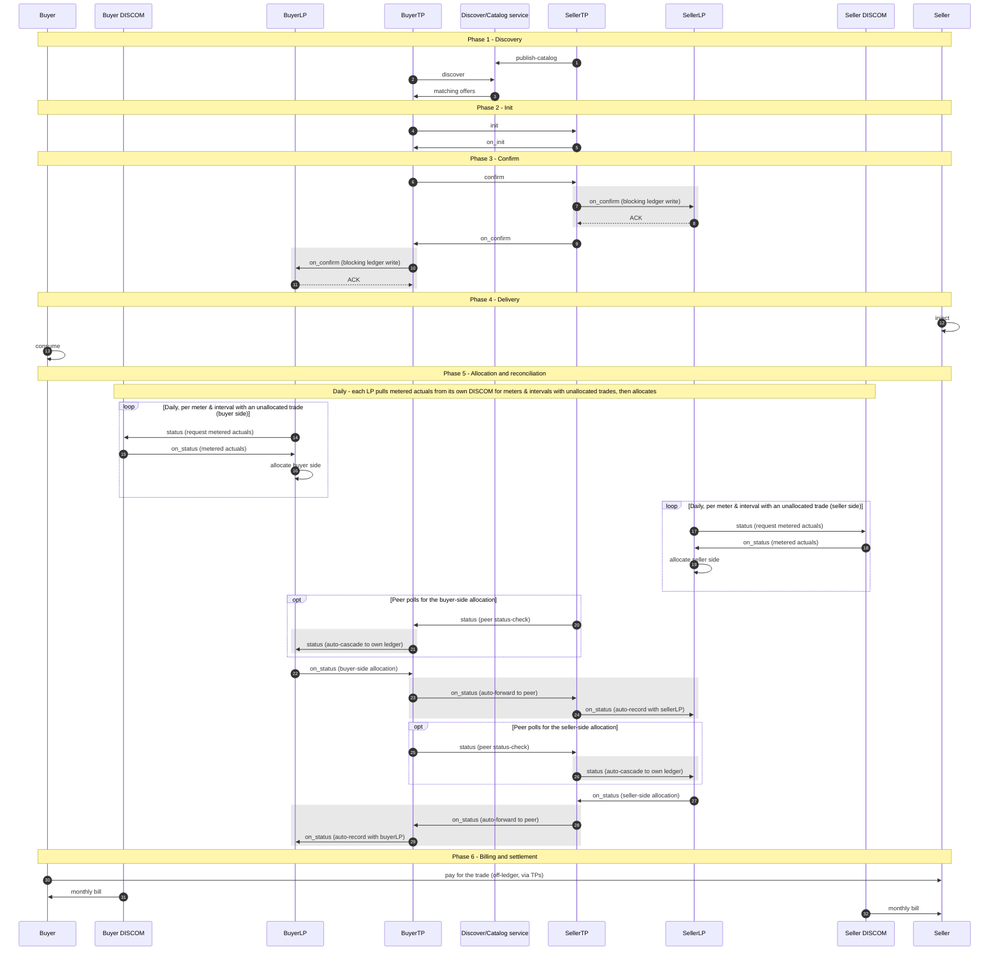

===== SOURCE: https://india-energy-stack.gitbook.io/docs/concepts/build-adapter.md =====

> For the complete documentation index, see [llms.txt](https://india-energy-stack.gitbook.io/docs/llms.txt). Markdown versions of documentation pages are available by appending `.md` to page URLs; this page is available as [Markdown](https://india-energy-stack.gitbook.io/docs/concepts/build-adapter.md).

# Build your Internal-facing Adapter

> Write the **Part-2 mapping** between your internal systems and the IES schemas. This is the only IES work where you write code — the rest is configuration. About 1–3 weeks for the first use case; subsequent use cases add only a few days each.

This is where the engines — OpenCred and/or ONIX — get fed from your internal systems. Per-use-case adapter shapes are in the individual Use Case Implementation Guides, linked from the [table below](#pick-your-first-use-case).

***

## Before you start

* [Setting up Register](/docs/concepts/setup-register.md) complete — your `did:web` resolves and your DeDi namespace is verified.
* The engine your first use case needs is running: **OpenCred** for credential use cases ([Issuing Credentials](/docs/concepts/issue-credentials.md)) and/or **ONIX** for data-exchange use cases ([Setting up Discover & Exchange](/docs/concepts/setup-exchange.md)). You wire your mapping into whichever you set up.
* Read access to the internal system that holds the data (CIS, MDM, HES, DERMS, ERP) and a developer who can write \~200–1,000 lines of glue code.

***

## What the adapter is

The IES adapter has two parts: a ready-made **engine** and your **mapping**. There is one engine per capability — **ONIX** for use cases that run over a Beckn network ([Setting up Discover & Exchange](/docs/concepts/setup-exchange.md)), **OpenCred** for credential use cases ([Issuing Credentials](/docs/concepts/issue-credentials.md)) — and you build an internal-facing mapping for each engine your use cases need.

| Part                                                | What it does                                                                       | You build it?                                        |
| --------------------------------------------------- | ---------------------------------------------------------------------------------- | ---------------------------------------------------- |
| **Part 1 — ONIX** *(Beckn-network use cases)*       | Finds other systems, exchanges messages, signs and verifies, routes callbacks      | **No** — ready-made, the same for everyone           |
| **Part 1 — OpenCred** *(credential-only use cases)* | Issues, verifies and revokes W3C Verifiable Credentials with your signing key      | **No** — ready-made, the same for everyone           |
| **Part 2 — your mapping(s)**                        | Translates between your data format and the IES specs, feeding the engine(s) above | **Yes** — specific to your organisation, set up once |

The mapping is small. For a single use case it is typically 200–1,000 lines of code. It is the only piece that knows about your internal field names, your tariff codes, your meter SLNO format, your CIS schema.

***

## Where the mapping lives

For Beckn-network use cases, the mapping plugs into ONIX as one or more **BPP handlers** (provider side) and **BAP callbacks** (buyer side). ONIX delivers a typed Beckn message to your handler; your handler talks to your CIS / MDM / DERMS / ERP and returns a typed Beckn response. For credential-only use cases the same pattern applies with **OpenCred** in place of ONIX: your mapping sits between your internal systems and OpenCred's issue API (see [Task 4](#task-4-wire-into-your-engine-onix-and-or-opencred)).

```
        ┌─────────────────────────────────────────────────────────────┐
        │                         ONIX                                │
        │  (Beckn protocol, signing, verification, routing — Part 1)  │
        └─────────────────────────────────────────────────────────────┘
                          ▲                            ▲
                          │ BPP request                │ BAP callback
                          │ (typed Beckn msg)          │ (typed Beckn msg)
                          ▼                            ▼
        ┌─────────────────────────────────────────────────────────────┐
        │                Your Part-2 mapping                          │
        │  (200–1,000 lines per use case — the only thing you write)  │
        └─────────────────────────────────────────────────────────────┘
                          ▲                            ▲
                          │ SQL / REST / SFTP          │ SQL / REST / file write
                          ▼                            ▼
        ┌─────────────────────────────────────────────────────────────┐
        │             Your internal systems (unchanged)               │
        │       CIS · MDM · HES · DERMS · ERP · billing · web         │
        └─────────────────────────────────────────────────────────────┘
```

***

## Pick your first use case

The pilot DISCOMs each picked one use case to ship first, then layered the rest on the same identity, network and adapter foundation. The natural first choice depends on what data is easiest for you to expose:

| First use case                                                                                                    | Internal system you'll touch         | Schema                                                                                                                      | Why first                                                |
| ----------------------------------------------------------------------------------------------------------------- | ------------------------------------ | --------------------------------------------------------------------------------------------------------------------------- | -------------------------------------------------------- |
| [**Consumer Energy Passport**](/docs/use-case-implementation-guides/consumer-energy-passport.md)                  | CIS / billing master                 | [ElectricityCredential v1.2](https://india-energy-stack.gitbook.io/docs/schemas/electricitycredential/v1.2)                 | Smallest schema; consumer-facing value is immediate      |
| [**Smart Meter Data Exchange**](/docs/use-case-implementation-guides/smart-meter-data-exchange.md)                | HES / MDM                            | [MeterData v0.6](https://india-energy-stack.gitbook.io/docs/schemas/meterdata/v0.6)                                         | Solves a tangible AMISP-DISCOM pain; mostly DataOps work |
| [**Consumer Meter Digest**](/docs/use-case-implementation-guides/consumer-meter-digest.md)                        | MDM (read path)                      | [MeterDataCredential v0.6](https://india-energy-stack.gitbook.io/docs/schemas/meterdatacredential/v0.6)                     | Builds on the Passport adapter; small extra surface      |
| [**DER Visibility**](/docs/use-case-implementation-guides/der-visibility.md)                                      | DER / inverter registration database | [ElectricityCredential v1.2](https://india-energy-stack.gitbook.io/docs/schemas/electricitycredential/v1.2) energyResources | If rooftop / EV registrations are your priority          |
| [**DISCOM Regulatory Filing**](/docs/draft-work-in-progress/discom-regulatory-filing/discom-regulatory-filing.md) | Regulatory affairs / finance         | [ArrFiling v0.5](https://india-energy-stack.gitbook.io/docs/schemas/arrfiling/v0.5)                                         | If you have an ARR due                                   |

***

## The five tasks for any use case

The shape is the same regardless of which use case you pick first.

### Task 1 — Map fields

For each IES field in the schema, identify the corresponding column / API field / file format in your internal systems. Write it down as a table:

| IES field                                    | Your source                                     | Notes                                               |
| -------------------------------------------- | ----------------------------------------------- | --------------------------------------------------- |
| `customerProfile.customerNumber`             | CIS `CA_NUMBER`                                 | Plain string, no transformation                     |
| `consumptionProfiles[].sanctionedLoad.value` | CIS `SANC_LOAD_KW`                              | Multiplied by 1.0; unit always `kW` for residential |
| `consumptionProfiles[].sanctionedLoad.unit`  | hardcoded `"kW"`                                | LT-Domestic always reported in kW                   |
| `consumptionProfiles[].tariffCategoryCode`   | CIS `TARIFF_CAT` → translate via a small lookup | Your codes (`LT1A`, `HT2C` etc.) → IES codes        |
| `customerProfile.energyResources[].id`       | `did:web:<your-domain>:assets:meter:<MET_SLNO>` | Compose at issuance time                            |

This table **is** the mapping. The code that follows is mechanical.

### Task 2 — Write the field transformations

Most fields are pass-through. A few need:

* **Unit packaging** — your `5` becomes `{ "value": 5, "unit": "kW" }` per [QuantitativeValue](https://india-energy-stack.gitbook.io/docs/schemas/electricitycredential/v1.2#field-reference).
* **Tariff code translation** — your internal `LT1A` becomes a stable IES code; keep the lookup in one place.
* **Date formatting** — ISO 8601 with timezone offset (`2026-01-10T00:00:00+05:30`).
* **DID composition** — `did:web:<your-domain>:assets:meter:<existing-serial>` (your serial is preserved verbatim).

### Task 3 — Validate against the schema

Use the canonical JSON Schema for the use case you're shipping:

```bash
python3 scripts/validate_schema.py \
  schemas/ElectricityCredential/v1.2/schema.json \
  my-test-output.json
```

The repo ships this validator and a `make validate` target. Examples to validate against live in `schemas/<family>/<version>/examples/`.

This proves repository-local structural conformance against the schema shown above — see [Conformance Checklist — What this checklist proves](/docs/concepts/conformance.md#what-this-checklist-proves-and-what-it-doesnt) for exactly what it does and doesn't establish before you call a use case done.

### Task 4 — Wire into your engine (ONIX and/or OpenCred)

**Beckn-network use cases — wire into ONIX.** ONIX delivers a typed Beckn message to a handler endpoint you register. The handler does Tasks 1–3 in real time:

1. Receive the inbound message.
2. Extract scope (which meter, which date range, which credential).
3. Query your internal systems.
4. Build the IES-shaped response.
5. Validate against the schema.
6. Return.

The Beckn wiring (subscriber id, callback URL, route registration) is in ONIX config; the handler endpoint is your code.

**Credential use cases — wire into OpenCred.** Your mapping assembles the credential subject from CIS / MDM data (Tasks 1–3) and POSTs it to OpenCred's `/v1/credentials/issue`; OpenCred signs with your key and returns the credential for delivery to the holder. The issue / verify / revoke walkthrough is in [**Issuing Credentials**](https://india-energy-stack.gitbook.io/docs/concepts/pages/k7VFUhitVQpU3DjtCj7A#id-3.6-issue-your-first-credential).

### Task 5 — Test end-to-end

**Beckn-network use cases.** Use the [Data Exchange devkit](https://india-energy-stack.gitbook.io/docs/concepts/pages/jI43MtQpeJlqcWi0JPQr#id-2.1-deploy-the-local-sandbox) to send your handler real Beckn messages from a sandbox counterparty. Iterate until all required schema fields are populated correctly, signatures verify on the receiving side, and the end-to-end round trip succeeds for at least one realistic record.

**Credential use cases.** There is no Beckn counterparty — test the issuance path directly: have your mapping assemble the subject from a real record and POST it to OpenCred's `/v1/credentials/issue`, then run the [§3.9 smoke test](https://india-energy-stack.gitbook.io/docs/concepts/pages/k7VFUhitVQpU3DjtCj7A#id-3.9-smoke-test) (issue → resolve your `did:web` → verify → revoke → re-check). Iterate until it issues a schema-valid, signature-verifiable credential for at least one realistic record.

Then graduate from sandbox → testnet → prod with the same adapter.

***

## Reuse across use cases

The biggest win comes from doing this once. After your first use case is live, adding the next typically means:

* A new mapping table (Task 1) — usually one page of YAML
* A few new transformations (Task 2) — units, codes, identifier composition
* A new handler endpoint (Task 4) — \~50 lines of code
* A new schema validator config (Task 3) — one line

No new identity. No new ONIX deployment. No new DeDi namespace. No new network onboarding.

***

## Checklist

For the first use case:

* [ ] Use case picked (from the table above)
* [ ] Schema field → internal-system mapping table written
* [ ] Field transformations implemented (units, codes, dates, DIDs)
* [ ] Output validates against the schema for at least three real records
* [ ] Mapping wired into its engine — BPP handler registered with ONIX (Beckn-network use case) or issuance feed calling OpenCred (credential-only use case)
* [ ] One realistic record exchanged or issued end-to-end with a counterparty / verifier

When all six are ticked, the adapter for your first use case is done. Move on to the [**Conformance Checklist**](/docs/concepts/conformance.md), then publish.

For the second and subsequent use cases, only Tasks 1–4 repeat. The sandbox test (Task 5) reruns quickly, and conformance and all the identity / network setup are reused.


---

# Agent Instructions
This documentation is published with GitBook. GitBook is the documentation platform designed so that both humans and AI agents can read, navigate, and reason over technical content effectively. Learn more at gitbook.com.

## Querying This Documentation
If you need additional information that is not directly available in this page, you can query the documentation dynamically by asking a question.

Perform an HTTP GET request on the current page URL with the `ask` query parameter, and the optional `goal` query parameter:

```
GET https://india-energy-stack.gitbook.io/docs/concepts/build-adapter.md?ask=<question>&goal=<endgoal>
```

`ask` is the immediate question: it should be specific, self-contained, and written in natural language.
`goal` is optional and describes the broader end goal you are ultimately trying to accomplish on behalf of the user. GitBook uses it to tailor the answer towards what is most useful for that goal.

The response will contain a direct answer to the question and relevant excerpts and sources from the documentation.

Use this mechanism when the answer is not explicitly present in the current page, you need clarification or additional context, or you want to retrieve related documentation sections.


===== SOURCE: https://india-energy-stack.gitbook.io/docs/concepts/conformance.md =====

> For the complete documentation index, see [llms.txt](https://india-energy-stack.gitbook.io/docs/llms.txt). Markdown versions of documentation pages are available by appending `.md` to page URLs; this page is available as [Markdown](https://india-energy-stack.gitbook.io/docs/concepts/conformance.md).

# Conformance Checklist

> **The final check before you publish.** Verify your interface is correct end-to-end and (for Beckn participants) submit for IES network membership in production. About 1 day.

## Before you start

* [Setting up Register](/docs/concepts/setup-register.md) complete for your role.
* The engine(s) your use cases need are running: [Issuing Credentials](/docs/concepts/issue-credentials.md) (B2C) and/or [Setting up Discover & Exchange](/docs/concepts/setup-exchange.md) (B2B).
* At least one use case wired through [Build your Internal-facing Adapter](/docs/concepts/build-adapter.md).

**Only the checks for the rails you actually use apply.** The checklist below is tagged: **\[all]** applies to everyone, **\[credential]** only to credential issuers (B2C), **\[beckn]** only to Beckn-network participants (B2B). A credential-only issuer skips every **\[beckn]** item and the production-network submission at the end; a pure data-exchange participant skips every **\[credential]** item.

***

## What this checklist proves — and what it doesn't

Every item below is either something you can run and check yourself, or a step in a documented network-membership process. Neither is the same thing as full conformance. Three boundaries matter beyond schema validation (see [What schema validation proves](#what-schema-validation-proves-and-what-it-doesnt) further down for that boundary specifically):

* **JSON-LD conformance** — that your `@context` resolves and the payload expands as valid JSON-LD, not merely valid JSON — is a separate check from JSON Schema validation and is not asserted by anything on this page.
* **Beckn/network protocol interoperability** — a real `discover`/`confirm` round-trip against a live counterparty on a reachable network — is only as good as the sandbox peer you actually reach it against, and is distinct from schema validation.
* **Certification and production participation** are a dated determination made by the IES Secretariat (see "Submitting for production" below), not something any local script or checklist item confers by itself. Whether that process, the sandbox, or any IES network is currently reachable is not something this repository can verify — see where things stand on the [Getting Started](/docs/readme.md) page.

Clearing every box below means your interface is well-formed and internally consistent by the checks this repository can run. It is not, on its own, proof of external-schema conformance, JSON-LD conformance, protocol interoperability, certification, or production readiness.

***

## What conformance means

### Identity is correctly published **\[all]**

* [ ] `did:web` resolves from outside your network (`curl https://<your-domain>/.well-known/did.json` returns valid JSON)
* [ ] The DID document declares your current signing key
* [ ] Key rotation procedure documented (who, how, on what trigger)
* [ ] DeDi namespace verified (DNS TXT proof) and listed on `explore.dedi.global`

### Network membership is in place **\[beckn]**

* [ ] Beckn subscriber record published in your DeDi namespace (Ed25519 key, callback URL, BAP/BPP role)
* [ ] Reference entry written by the IES Secretariat into the IES network registry
* [ ] Sandbox loop succeeds (`discover` or `confirm` round-trip with a peer)

### At least one use case is wired and validates **\[all]**

* [ ] One use-case implementation guide (e.g. [Consumer Energy Passport](/docs/use-case-implementation-guides/consumer-energy-passport.md) or [Smart Meter Data Exchange](/docs/use-case-implementation-guides/smart-meter-data-exchange.md)) implemented end-to-end
* [ ] Output validates against the canonical JSON Schema (`make validate` or `python3 scripts/validate_schema.py …`)
* [ ] **\[beckn]** At least one real record exchanged with a counterparty on the testnet, **or \[credential]** at least one credential issued, verified, and revoked (the [§3.9 smoke test](https://india-energy-stack.gitbook.io/docs/concepts/pages/k7VFUhitVQpU3DjtCj7A#id-3.9-smoke-test))
* [ ] Schema validation enforced on every outgoing payload

### Signatures and trust chain check out

* [ ] **\[credential]** Every credential you issue carries a valid signature (W3C VC Data Model 2.0 proof block)
* [ ] **\[credential]** Revocation registry (`vc-revocation-registry`) exists in your DeDi namespace (OpenCred auto-creates it; if not using OpenCred, create it manually)
* [ ] **\[credential]** Verification rehearsed by at least one relying party (peer DISCOM, bank, marketplace) resolving your `did:web`
* [ ] **\[beckn]** Every Beckn message you send carries a valid Ed25519 signature
* [ ] **\[beckn]** Signature verification rehearsed by at least one counterparty (peer DISCOM, AMISP)

### Operations

* [ ] Logging captures every inbound and outbound Beckn message (subscriber, action, message id, timestamp)
* [ ] Monitoring / alerting on adapter health
* [ ] Key rotation runbook
* [ ] Incident escalation path defined (within IES Secretariat process)

### Security and privacy

* [ ] Signing keys held in KMS / HSM where available; never in source control
* [ ] TLS on all callback endpoints
* [ ] For consumer-facing credentials: identity-proofing procedure documented and privacy-reviewed
* [ ] For consumer-facing credentials: explicit consent capture on every issuance / disclosure

***

## What schema validation proves — and what it doesn't

`scripts/validate_schema.py` (and `make validate`) check **repository-local structural and semantic validation** — your payload against the IES-authored `schema.json` for that family, under Draft 2020-12. For schema families that are fully self-contained — every `ElectricityCredential` version, `MeterDataRequest`, `ArrFiling`, `MeterData/v0.5` — that check is complete against everything this repository defines.

Other families reference externally-hosted Beckn/DEG structures that are not mirrored in this repository, and the local validator resolves every one of them through a permissive stub (`{"type": "object"}`) rather than the real upstream schema — so a passing result does not check the stubbed structure against its actual definition. The unchecked surface differs by family, and is not uniformly small:

* **`MeterData/v0.6`** references two external substructures, `Address` and `GeoJSONGeometry`, both stubbed.
* **`OutageNotification/v0.1`** references one external substructure, `GeoJSONGeometry`, stubbed.
* **`MeterDataCredential/v0.6`** and **`MeterDataRequestCredential/v0.1`** each reference the external `EnergyCredential/v2.0` credential envelope — the entire Beckn VC wrapper (`issuer`, `proof`, `credentialSubject` shape, and everything else it constrains) — and that whole envelope is stubbed permissively. A passing result on these two families only checks the local `meterData` / `meterDataRequest` payload nested inside the credential; it does not check the envelope fields against their actual upstream definitions at all. Both families also nest a local `$ref` to `MeterData/v0.6` or `MeterDataRequest/v0.6` respectively, so `MeterDataCredential/v0.6` additionally inherits `MeterData/v0.6`'s own unchecked `Address`/`GeoJSONGeometry` substructures.

Passing local validation on any of these families means "well-formed except for the unchecked externally-hosted structure(s) listed above for that family," not full external-schema conformance.

Treat a schema-validation pass as scoped to what this repository defines — see [What this checklist proves](#what-this-checklist-proves-and-what-it-doesnt) above for the JSON-LD, protocol, and certification boundaries that sit outside schema validation entirely.

***

## How to confirm conformance

### Beckn participants (B2B)

Run the conformance suite that ships with the devkit you cloned in [Setting up Discover & Exchange](https://india-energy-stack.gitbook.io/docs/concepts/pages/jI43MtQpeJlqcWi0JPQr#id-2.1-deploy-the-local-sandbox):

```bash
cd DEG/devkits/data-exchange/conformance
./run.sh --subscriber did:web:ies.discom.example --usecase consumer-energy-passport
```

The script exercises every path on the checklist above against a sandbox peer and emits a signed report. For use cases not yet in the suite, do the equivalent manually: generate one record with your adapter, validate it against the canonical JSON Schema (`scripts/validate_schema.py`), send it to a sandbox counterparty, and have them verify the signature and contents.

### Credential-only issuers (B2C)

You have no Beckn devkit and no counterparty, so these checks are self-contained — run the [§3.9 smoke test](https://india-energy-stack.gitbook.io/docs/concepts/pages/k7VFUhitVQpU3DjtCj7A#id-3.9-smoke-test) end-to-end:

1. Issue a credential with your adapter (or OpenCred directly).
2. Validate the credential document (`out.json`) against the canonical credential-root JSON Schema (`python3 scripts/validate_schema.py schemas/<Credential>/<version>/schema.json out.json`) — repository-local structural validation, per the [scope note above](#what-this-checklist-proves-and-what-it-doesnt).
3. Resolve your own `did:web` over HTTPS and confirm the published key verifies the credential's `proof`.
4. Check revocation status (not revoked), revoke, re-check (revoked).

If all four pass, your issuance has cleared the B2C checks on this page: it is schema-valid within the scope described above, and independently verifiable by anyone who resolves your `did:web`. There is nothing to submit to a network — verification happens bilaterally, whenever a relying party checks your `did:web`, not through a central certification step. This is not, by itself, a claim of JSON-LD conformance or of conformance against externally-hosted schema substructures your payload references.

***

## Submitting for production **(Beckn participants only)**

This is the documented network-membership process. Whether the IES Secretariat, the sandbox, and the production/test network registries referenced below are currently staffed and reachable is not something this repository can verify on its own — see where things stand on the [Getting Started](/docs/readme.md) page before relying on this as a live, working pipeline.

When all the above pass on the sandbox / testnet:

1. Email the IES Secretariat (<IES.Secretariat@fsrglobal.org>, alternate <ies@recindia.com>) with: your `did:web`, your DeDi namespace, your testnet conformance report, and the use cases you have implemented.
2. The Secretariat re-runs spot checks on your sandbox endpoints.
3. The Secretariat writes a production reference entry pointing at your subscriber record.

Once that reference entry is written, your subscriber record is queryable as in-network by any counterparty that looks it up, without a further bilateral arrangement — that is what "referenced into the network" means (see [Setting up Register §1.7](https://india-energy-stack.gitbook.io/docs/concepts/pages/x4JXc2x9ljke9mGdzMbp#id-1.7-beckn-participants-get-referenced-into-an-ies-network)). That determination is made by the Secretariat; it is not something this checklist, `scripts/validate_schema.py`, or any other local script confers by itself, and it is a statement about network registration — not, on its own, a statement about JSON-LD conformance or protocol interoperability with every possible counterparty. (Credential-only issuers skip this step — there is no central network registry in the credential-only path; the B2C checks above are what make your issuances independently verifiable.)

***

## After conformance

* **Add new use cases** by repeating only [Build your Internal-facing Adapter](/docs/concepts/build-adapter.md) for the new schema. Identity, engines, network membership and trust foundation are reused.
* **Stay current with schema versions.** New versions are announced via the [ies-accelerator repository](https://github.com/India-Energy-Stack/ies-accelerator); migration guides ship alongside.
* **Contribute** — propose a new schema or a change to an existing one by raising a discussion on the repository (see [Propose a Schema](/docs/propose-a-schema.md)). The IES Cell governance process handles ratification.


---

# Agent Instructions
This documentation is published with GitBook. GitBook is the documentation platform designed so that both humans and AI agents can read, navigate, and reason over technical content effectively. Learn more at gitbook.com.

## Querying This Documentation
If you need additional information that is not directly available in this page, you can query the documentation dynamically by asking a question.

Perform an HTTP GET request on the current page URL with the `ask` query parameter, and the optional `goal` query parameter:

```
GET https://india-energy-stack.gitbook.io/docs/concepts/conformance.md?ask=<question>&goal=<endgoal>
```

`ask` is the immediate question: it should be specific, self-contained, and written in natural language.
`goal` is optional and describes the broader end goal you are ultimately trying to accomplish on behalf of the user. GitBook uses it to tailor the answer towards what is most useful for that goal.

The response will contain a direct answer to the question and relevant excerpts and sources from the documentation.

Use this mechanism when the answer is not explicitly present in the current page, you need clarification or additional context, or you want to retrieve related documentation sections.


===== SOURCE: https://india-energy-stack.gitbook.io/docs/concepts/how-you-implement-ies.md =====

> For the complete documentation index, see [llms.txt](https://india-energy-stack.gitbook.io/docs/llms.txt). Markdown versions of documentation pages are available by appending `.md` to page URLs; this page is available as [Markdown](https://india-energy-stack.gitbook.io/docs/concepts/how-you-implement-ies.md).

# Before you build

Every IES participant completes the same setup once, before any use case ships. It is deliberately small — a domain, a few keys, Docker containers, one sign-off — and everything you build afterwards reuses it. The sequence:

1. **Register your organisation.** Claim and domain-verify a namespace in the DeDi directory, and publish a `did:web` identity — the cryptographic name counterparties and verifiers resolve to check your signatures. Beckn participants also publish a subscriber record. → [**Setting up Register**](/docs/concepts/setup-register.md)
2. **Stand up the Beckn ONIX adapter.** Deploy the ready-made adapter that signs, verifies, and routes messages, and complete a signed `confirm` → `on_confirm` round-trip on the IES network. → [**Setting up Discover & Exchange**](/docs/concepts/setup-exchange.md)
3. **Pass the conformance check.** Run the conformance checks end-to-end and sign off — that page states exactly what a self-run sign-off does and doesn't prove. → [**Conformance Checklist**](/docs/concepts/conformance.md)

Two more pieces slot in between, depending on what you're building:

* [**Issuing Credentials**](/docs/concepts/issue-credentials.md) — for consumer-facing (B2C) credential use cases: run OpenCred and issue, verify, and revoke W3C Verifiable Credentials. A credential is signed once by you and verified by *any* third party against your published `did:web`, over any delivery channel — no network membership involved. A credentials-only participant can defer the ONIX step until a data-exchange use case calls for it; a pure Beckn participant (e.g. a trading platform) skips this one.
* [**Build your Internal-facing Adapter**](/docs/concepts/build-adapter.md) — the only place you write code: a small mapping (typically 200–1,000 lines per use case) between your internal systems and the IES schemas, feeding OpenCred and/or ONIX. Your existing CIS / MDM / billing / DERMS / ERP stays exactly as it is.

**How this section is organised.** The "Setting up …" pages (and Issuing Credentials) are do-guides — prerequisites first, then numbered copy-pasteable steps, then a checklist. Nested under each is an *in depth* page — [Register & Identifiers](/docs/concepts/setup-register/register.md), [Discover](/docs/concepts/setup-exchange/discover.md), [Exchange](/docs/concepts/setup-exchange/exchange.md), [Verifiable Credentials](/docs/concepts/issue-credentials/energy-credentials.md) — that explains the concepts behind the steps: what a DID is, how the DeDi directory is structured, why Beckn, the credential trust model. Work through the setup page; open the in-depth page when you want to know why a step is what it is.

| Setup                             | Page                                                                  | Time      | What you get                                                                                                                                 |
| --------------------------------- | --------------------------------------------------------------------- | --------- | -------------------------------------------------------------------------------------------------------------------------------------------- |
| **Register** *(everyone)*         | [Setting up Register](/docs/concepts/setup-register.md)               | 1–2 days  | A verifiable `did:web`, a verified DeDi namespace — plus, for Beckn participants, a published subscriber record and an IES network reference |
| **Exchange** *(B2B use cases)*    | [Setting up Discover & Exchange](/docs/concepts/setup-exchange.md)    | 1–2 days  | A running Beckn adapter (ONIX) exchanging signed messages on the IES network                                                                 |
| **Credentials** *(B2C use cases)* | [Issuing Credentials](/docs/concepts/issue-credentials.md)            | ½ day     | A running OpenCred signing service: issue, verify, revoke W3C Verifiable Credentials                                                         |
| **Adapter**                       | [Build your Internal-facing Adapter](/docs/concepts/build-adapter.md) | 1–3 weeks | Small mapping layers between your internal systems and the IES schemas                                                                       |
| **Conformance**                   | [Conformance Checklist](/docs/concepts/conformance.md)                | 1 day     | A self-run conformance sign-off, end-to-end — scope explained on that page                                                                   |

***

## What you need

* **A domain you control.** Most DISCOMs use a dedicated subdomain like `ies.<discom>.in`. A bare apex domain works too.
* **DNS access.** To add a TXT record once (DeDi namespace verification).
* **One Linux host** that can run Docker (for OpenCred and/or ONIX) and serve HTTPS. Cloud VM is fine. Air-gapped works too.
* **One engineer.** Total effort is small; you do not need a team.
* **A vendor or in-house developer** to write the adapter mapping. The same person can do everything above.

## What you do NOT need

* ❌ A new database. Your existing CIS / MDM / billing / DERMS / ERP stays exactly as is.
* ❌ A new compliance filing.
* ❌ A new procurement contract.
* ❌ A licence fee.
* ❌ Approval from anyone before starting on the sandbox. Get something working, then talk to the IES Secretariat about going to production.

## Who needs to be involved

| Role                               | Why                                                                            | Time commitment      |
| ---------------------------------- | ------------------------------------------------------------------------------ | -------------------- |
| **DNS / web admin**                | Publish `did.json` on your domain; add DeDi TXT record                         | 15 minutes, once     |
| **IT / security admin**            | Generate signing keys (KMS preferred); deploy Docker containers                | A few hours, once    |
| **Application developer / vendor** | Write the mapping (your data → IES schema)                                     | The bulk of the work |
| **Authorised signatory**           | Submit your subscriber record for IES network whitelisting                     | Email/form, once     |
| **Customer-ops / compliance**      | (For consumer credentials only) Identity-proofing procedure and privacy review | One review pass      |

***

## How long the whole thing takes

The four pilot DISCOMs each went from cold start to four demonstrated use cases in **30 days** during the (now completed) DISCOM Challenge. The bulk of that time went into the adapter mapping and the customer-ops procedures for consumer-facing credentials.

| Phase                           | Calendar time (typical) |
| ------------------------------- | ----------------------- |
| Register (identity + directory) | 1–2 days                |
| Engines (OpenCred and/or ONIX)  | 1–3 days                |
| Adapter for the first use case  | 1–3 weeks               |
| Conformance                     | 1–2 days                |
| Each subsequent use case        | A few days to a week    |

## After you're set up

You only do the setup once. Adding new use cases on top only adds a small bit to the adapter mapping — the identity, the engines, the network membership are all reused. Pick your first from the Use Case Implementation Guides: [Consumer Energy Passport](/docs/use-case-implementation-guides/consumer-energy-passport.md), [Consumer Meter Digest](/docs/use-case-implementation-guides/consumer-meter-digest.md), [Smart Meter Data Exchange](/docs/use-case-implementation-guides/smart-meter-data-exchange.md), [DER Visibility](/docs/use-case-implementation-guides/der-visibility.md), or [P2P Energy Transaction](/docs/use-case-implementation-guides/p2p-energy-trading.md).


---

# Agent Instructions
This documentation is published with GitBook. GitBook is the documentation platform designed so that both humans and AI agents can read, navigate, and reason over technical content effectively. Learn more at gitbook.com.

## Querying This Documentation
If you need additional information that is not directly available in this page, you can query the documentation dynamically by asking a question.

Perform an HTTP GET request on the current page URL with the `ask` query parameter, and the optional `goal` query parameter:

```
GET https://india-energy-stack.gitbook.io/docs/concepts/how-you-implement-ies.md?ask=<question>&goal=<endgoal>
```

`ask` is the immediate question: it should be specific, self-contained, and written in natural language.
`goal` is optional and describes the broader end goal you are ultimately trying to accomplish on behalf of the user. GitBook uses it to tailor the answer towards what is most useful for that goal.

The response will contain a direct answer to the question and relevant excerpts and sources from the documentation.

Use this mechanism when the answer is not explicitly present in the current page, you need clarification or additional context, or you want to retrieve related documentation sections.


===== SOURCE: https://india-energy-stack.gitbook.io/docs/concepts/issue-credentials.md =====

> For the complete documentation index, see [llms.txt](https://india-energy-stack.gitbook.io/docs/llms.txt). Markdown versions of documentation pages are available by appending `.md` to page URLs; this page is available as [Markdown](https://india-energy-stack.gitbook.io/docs/concepts/issue-credentials.md).

# Issuing Credentials

> **The B2C rail — set up + operate.** Run the OpenCred signing container and issue, verify, and revoke W3C Verifiable Credentials. A credential is signed once by you and can then be trusted by *any* third party — a bank, a marketplace, a housing society — that resolves your `did:web`, and delivered over any channel (DigiLocker, web portal, email, SMS, chat). **No Beckn network is involved.** About half a day.

The concepts — what a credential is, the trust model, the credential variants and when to use each — are in [**Verifiable Credentials in depth**](/docs/concepts/issue-credentials/energy-credentials.md). This page is the do-guide.

> **About the walkthrough.** The commands use [**OpenCred**](https://opencred.gitbook.io/docs), the reference credential-signing service — W3C VC 2.0 compliant, with built-in DeDi integration. Any W3C-compliant signing pipeline that publishes the same `did.json` and VC-2.0 proofs is a drop-in replacement.

***

## Before you start

From [**Setting up Register**](/docs/concepts/setup-register.md) you need §1.1–1.4 complete:

* `OPENCRED_ISSUER_DOMAIN` exported, and `did.json` published and resolvable from outside (§1.1–1.3).
* The EC P-256 signing key at `~/opencred/keys/issuer-key.pem` (§1.2).
* A **verified DeDi namespace** and a **DeDi API key** (§1.4) — these enable revocation.

On this machine:

* **Docker 24+**, plus `curl`, `jq`, `openssl`, and \~2 GB free disk.
* *(Optional, recommended for licensed utilities)* your regulator's `did:web` and your licence identifier, to quote in `issuer.idRef`. Omit for pilots / non-regulated issuers.
* **A payload schema in mind.** Default: [ElectricityCredential v1.2](https://india-energy-stack.gitbook.io/docs/schemas/electricitycredential/v1.2). For telemetry, [MeterDataCredential v0.6](https://india-energy-stack.gitbook.io/docs/schemas/meterdatacredential/v0.6).

> **No IES-side DISCOM-registry entry is required to issue credentials.** Verifiers fetch your `did.json` directly to check signatures. The IES network registries are the Beckn-side trust boundary — a separate concern ([Setting up Register §1.7](https://india-energy-stack.gitbook.io/docs/concepts/pages/x4JXc2x9ljke9mGdzMbp#id-1.7-beckn-participants-get-referenced-into-an-ies-network)).

***

## 3.1 — Pull the OpenCred image

```bash
docker pull ghcr.io/nfh-trust-labs/opencred/opencred-server:latest
docker tag  ghcr.io/nfh-trust-labs/opencred/opencred-server:latest opencred:bootcamp
```

## 3.2 — Generate the OpenCred API token

This token is the only auth on OpenCred's HTTP API — whoever holds it can issue credentials in your name. Generate and save it:

```bash
export OPENCRED_API_KEY="$(openssl rand -base64 32)"
echo "Save this: $OPENCRED_API_KEY"
```

## 3.3 — Run OpenCred in `did:web` mode

First set the two DeDi variables (in addition to `OPENCRED_ISSUER_DOMAIN` from Setting up Register §1.1 — re-export it if this is a fresh shell):

```bash
export OPENCRED_DEDI_NAMESPACE="discom.example"
export OPENCRED_DEDI_API_KEY="paste-your-dedi-api-key-here"
```

* **`OPENCRED_DEDI_NAMESPACE`** — the **domain** your DeDi namespace is linked to and verified with (the same domain you domain-verified in [Setting up Register §1.4](https://india-energy-stack.gitbook.io/docs/concepts/pages/x4JXc2x9ljke9mGdzMbp#id-1.4-claim-a-dedi-namespace-and-verify-your-domain)) — *not* a free-text namespace name. Set it to that domain, so that `https://api.dedi.global/dedi/lookup/<namespace-domain>` resolves.
* **`OPENCRED_DEDI_API_KEY`** — the key you created in the DeDi UI at [publish.dedi.global](https://publish.dedi.global) (avatar in the top-right corner → **Manage API key**).

The `OPENCRED_DEDI_*` variables connect the container to DeDi at startup. That is what enables **revocation** (§3.8) and lets OpenCred auto-create the four registries it needs in your namespace on first boot.

Now start the container:

```bash
docker run -d \
  --name opencred \
  -p 3100:3100 \
  -e OPENCRED_API_KEY="$OPENCRED_API_KEY" \
  -e OPENCRED_KEY_PATH=/secrets/issuer-key.pem \
  -e OPENCRED_ISSUER_DID_METHOD=web \
  -e OPENCRED_ISSUER_DOMAIN="$OPENCRED_ISSUER_DOMAIN" \
  -e OPENCRED_DEDI_BASE_URL=https://api.dedi.global \
  -e OPENCRED_DEDI_AUTH_TYPE=api-key \
  -e OPENCRED_DEDI_API_KEY="$OPENCRED_DEDI_API_KEY" \
  -e OPENCRED_DEDI_NAMESPACE="$OPENCRED_DEDI_NAMESPACE" \
  -v "$HOME/opencred/keys/issuer-key.pem:/secrets/issuer-key.pem:ro" \
  --read-only --cap-drop ALL \
  opencred:bootcamp
```

Check it came up healthy:

```bash
curl -s http://localhost:3100/v1/health | jq
```

Expected: the JSON includes `"signingKeyLoaded": true`. If it is `false`, see [Troubleshooting](#troubleshooting).

> **Want offline-verifiable identity instead?** Drop `OPENCRED_ISSUER_DID_METHOD` and `OPENCRED_ISSUER_DOMAIN` and OpenCred runs in `did:key` mode by default. The same key, the same API — only the `did:` string the container reports changes. This is the right choice for first-deploy testing, demos, and consumer wallets. You can also drop the four `OPENCRED_DEDI_*` variables while testing — the container still issues and verifies, but revocation stays disabled until you add them back.

## 3.4 — Confirm your DeDi namespace is live

Credential **revocation** rides on your DeDi namespace, so before issuing anything, confirm the namespace side is in order. Two checks, both in a browser:

1. **Is the namespace verified?** Open [explore.dedi.global](https://explore.dedi.global) and search for your namespace. Only verified namespaces show up in explore results — if yours appears, it is verified. (In [publish.dedi.global](https://publish.dedi.global), where you log in and manage the namespace, verification shows as a green **verified** label.) Namespace not in explore? The DNS TXT record hasn't propagated or wasn't added; revisit [Setting up Register §1.4](https://india-energy-stack.gitbook.io/docs/concepts/pages/x4JXc2x9ljke9mGdzMbp#id-1.4-claim-a-dedi-namespace-and-verify-your-domain).
2. **Did OpenCred create its registries?** Log in at [publish.dedi.global](https://publish.dedi.global) and open your namespace. Can you see the four registries OpenCred auto-created on first boot — `vc-revocation-registry`, `opencred-key-registry`, `schema_registry`, `context_registry`? If they are there, revocation is wired up and you're ready to issue. If not, the container couldn't reach DeDi — check `docker logs opencred` and re-check the `OPENCRED_DEDI_*` values from §3.3 (a wrong API key or namespace name is the usual cause).

## 3.5 — Confirm the issuer DID OpenCred reports

```bash
export ISSUER_DID="$(curl -s http://localhost:3100/v1/keys \
  -H "Authorization: Bearer $OPENCRED_API_KEY" | jq -r '.keys[0].id | split("#")[0]')"
echo "$ISSUER_DID"
```

Expected: your DID, e.g. `did:web:ies.yourdiscom.in`. If you ran the container in `did:key` mode (for early dev), this prints `did:key:z…` instead — the rest of the flow is identical, only the issuer string changes.

## 3.6 — Issue your first credential

Default: **bearer-style** (no `credentialSubject.id`) — anyone holding the JSON is treated as the subject. This mirrors the [OpenCred bootcamp](https://opencred.gitbook.io/docs/bootcamp/local-docker). For consumer-facing flows where the presenter must be the legitimate subject, bind to a holder identifier — see [Appendix — Holder binding](#appendix-binding-the-credential-to-a-holder-identity).

```bash
curl -s http://localhost:3100/v1/credentials/issue \
  -H "Authorization: Bearer $OPENCRED_API_KEY" \
  -H "Content-Type: application/json" \
  -d "{
    \"schemaId\":    \"ies/electricity-credential/v1.2\",
    \"issuerDid\":   \"$ISSUER_DID\",
    \"proofFormat\": \"vc-jwt\",
    \"validFrom\":   \"2026-04-01T00:00:00+05:30\",
    \"validUntil\":  \"2031-04-01T00:00:00+05:30\",
    \"revocationRegistryUrl\": \"https://api.dedi.global/dedi/query/$OPENCRED_DEDI_NAMESPACE/vc-revocation-registry\",
    \"credentialSubject\": {
      \"customerProfile\": {
        \"customerNumber\": \"DISCOM-2025-00987654\",
        \"energyResources\": [{
          \"id\":   \"did:web:${OPENCRED_ISSUER_DOMAIN}:assets:meter:MET-IMPORT-001\",
          \"type\": \"METER\",
          \"attributes\": {\"meterCapability\": \"AMI\", \"energyDirection\": \"Forward\"}
        }],
        \"consumptionProfiles\": [{
          \"meterId\":            \"did:web:${OPENCRED_ISSUER_DOMAIN}:assets:meter:MET-IMPORT-001\",
          \"sanctionedLoad\":     {\"value\": 10, \"unit\": \"kW\"},
          \"tariffCategoryCode\": \"DS-I\",
          \"premisesType\":       \"Residential\",
          \"connectionType\":     \"Single-phase\"
        }]
      },
      \"customerDetails\": {
        \"fullName\":              \"Arjun Mehra\",
        \"installationAddress\": {
          \"geo\": {
            \"type\": \"Point\",
            \"coordinates\": [77.5946, 12.9716]
          },
          \"address\": {
            \"streetAddress\": \"12, 4th Cross, Indiranagar\",
            \"addressLocality\": \"Bengaluru\",
            \"addressRegion\": \"Karnataka\",
            \"postalCode\": \"560038\",
            \"addressCountry\": \"IN\"
          }
        },
        \"serviceConnectionDate\": \"2018-07-15T00:00:00+05:30\"
      }
    }
  }" | tee credential.json | jq .credential
```

Four things worth noting:

* **Asset IDs are `did:web` under your own domain**, with colon-path segments (`did:web:<your-domain>:assets:meter:<slno>` — the command above builds them from `$OPENCRED_ISSUER_DOMAIN`). Same pattern for transformers, feeders, substations — see [Register & Identifiers — Identifier patterns](/docs/concepts/setup-register/register.md#identifier-patterns). No per-asset `did.json` hosting required for the pragmatic case.
* **`issuer.idRef` is optional.** OpenCred fills `issuer` with the DID string only. Your integration service appends `name` and (if you have a regulator to cite) `idRef` on egress, then re-signs if your flow requires a single signed artefact.
* **`credentialSubject.id` is absent here.** That's the bearer-style default. Set it to a wallet `did:key` or `tel:+91...` URI for holder-bound issuance — see [Appendix — Holder binding](#appendix-binding-the-credential-to-a-holder-identity).
* **This credential is revocable — it carries a `credentialStatus`.** The `revocationRegistryUrl` line points OpenCred at your DeDi revocation registry (built from `$OPENCRED_DEDI_NAMESPACE`), so it stamps a `credentialStatus` block onto both the credential and its JWT payload:

  ```json
  "credentialStatus": {
    "id": "https://api.dedi.global/dedi/lookup/<namespace>/vc-revocation-registry/<credential-hash>",
    "type": "dedi",
    "statusPurpose": "revocation",
    "statusListCredential": "https://api.dedi.global/dedi/lookup/<namespace>/vc-revocation-registry"
  }
  ```

  You pass the **`query`** (whole-registry) URL at issue; OpenCred writes back the **`lookup`** (per-credential record) URL into `credentialStatus.id` — the [two URL shapes are deliberate](#id-3.8-revoke). The stamping happens at issue and needs no live DeDi connection; the actual revocation write in §3.8 does, so make sure the `OPENCRED_DEDI_*` variables from §3.3 are set before you rely on it.

  **To issue&#x20;*****without*****&#x20;revocation** — bearer-style, no `credentialStatus`, e.g. for `did:key` demos or throwaway testing — drop the `revocationRegistryUrl` line from the request body. The credential then can't be revoked, which is fine for those cases but not for anything a verifier will trust in production.

> **The credential is W3C VC Data Model 2.0** — its `@context` is `https://www.w3.org/ns/credentials/v2` (single context, no `credentials/v1`). Point third parties at a **VC-2.0-aware verifier**. Libraries still pinned to VC Data Model 1.1 reject the `v2` context outright (e.g. an error like `@context is missing default context "https://www.w3.org/2018/credentials/v1"`) even though the signature is valid. This is a verifier-version mismatch, not a defect in the credential: do **not** add the `credentials/v1` context to "fix" it — a v2 credential must not carry the v1 context. If you must interoperate with a v1.1-only consumer, issue that consumer a separate v1.1 credential rather than downgrading the v2 one.

## 3.7 — Verify

```bash
jq -n --arg c "$(jq -r '.credential.proof.jwt' credential.json)" '{credential: $c}' | \
  curl -s http://localhost:3100/v1/credentials/verify \
    -H "Authorization: Bearer $OPENCRED_API_KEY" \
    -H "Content-Type: application/json" \
    -d @- | jq
```

Expected: the response includes `"valid": true`.

For `vc-jwt`, the verify endpoint takes the compact JWS string (`.credential.proof.jwt`), not the JSON envelope. For `data-integrity` proofs, send the full credential JSON. What a *third-party* verifier checks — signature, licensing assertion, revocation, validity window — is walked through in [Verify a credential you received](#verify-a-credential-you-received-the-verifiers-walkthrough) below.

## 3.8 — Revoke

OpenCred publishes revocation as a hash entry into your DeDi revocation registry; the verifier reads `credentialStatus` and looks up the hash. DeDi stores **only revoked** hashes — the per-credential lookup returns `200` when revoked and `404` when not (record existence is the signal). For the credential to carry that `credentialStatus`, pass `revocationRegistryUrl` at issue — the §3.6 issue and the [variant examples](#issue-the-credential-variants) below all do; drop that line and the credential cannot be revoked.

> **Two URL shapes, on purpose.** `revocationRegistryUrl` at issue points at the *registry* (`…/dedi/query/<namespace>/vc-revocation-registry`); a verifier checking one credential reads the *record* (`…/dedi/lookup/<namespace>/vc-revocation-registry/<hash>`). `query` addresses the whole registry, `lookup` a single record inside it — not a typo.

Compute the revocation hash of the credential you issued:

```bash
HASH=$(jq '{credential: .credential}' credential.json | \
  curl -s http://localhost:3100/v1/credentials/revocation-hash \
    -H "Authorization: Bearer $OPENCRED_API_KEY" \
    -H "Content-Type: application/json" -d @- | jq -r .revocationHash)
echo "$HASH"
```

Revoke it:

```bash
curl -s http://localhost:3100/v1/credentials/revoke \
  -H "Authorization: Bearer $OPENCRED_API_KEY" \
  -H "Content-Type: application/json" \
  -d "{\"hash\": \"$HASH\", \"reason\": \"connection-terminated\"}" | jq
```

Check its status:

```bash
curl -s http://localhost:3100/v1/credentials/revocation-status \
  -H "Authorization: Bearer $OPENCRED_API_KEY" \
  -H "Content-Type: application/json" \
  -d "{\"hash\": \"$HASH\"}" | jq
```

Expected: the status response reports the credential as revoked, with the reason you supplied.

Revocation works here because the container was started with the `OPENCRED_DEDI_*` variables in §3.3 — if you dropped them for early testing, add them back and restart before trying this section. See [OpenCred Revocation](https://opencred.gitbook.io/docs/concepts/revocation) for the conceptual model.

## 3.9 — Smoke test

A passing integration test should:

1. Issue a credential.
2. Resolve `issuer.id` (`did.json` over HTTPS) and confirm the public key matches the one that signed `proof`.
3. *(If `issuer.idRef` is present)* Resolve `issuer.idRef.issuedBy` and confirm the regulator vouches for your DISCOM.
4. `POST /v1/credentials/verify` — expect `valid: true`.
5. Check `revocation-status` — expect not revoked.
6. Revoke.
7. Re-check `revocation-status` — expect revoked.

Run on every release. It exercises every leg of the trust chain.

## 3.10 — Package the credential as a PDF / QR code

A signed VC is a JSON blob — fine for machine-to-machine, awkward to hand to a consumer. OpenCred renders the same credential into a printable **PDF certificate** with an embedded **QR code**, so a DISCOM can email or DigiLocker-share a document a person can actually read, and a field verifier can scan the QR to recover the credential verbatim. This mirrors the [OpenCred bootcamp — Package the credential as a PDF / QR code](https://opencred.gitbook.io/docs/bootcamp/local-docker#id-6c.-package-the-credential-as-a-pdf-qr-code).

Packaging is a **rendering** step, not a signing step — no signature is added or checked. The integrity guarantee stays in the credential you issued in §3.6, which is preserved byte-for-byte inside the QR and the JSON output.

```bash
curl -s http://localhost:3100/v1/credentials/package \
  -H "Authorization: Bearer $OPENCRED_API_KEY" \
  -H "Content-Type: application/json" \
  -d "{
    \"credential\": $(jq '.credential' credential.json),
    \"formats\": [\"pdf\", \"qr-png\", \"json\"],
    \"customization\": {
      \"primaryColor\":      \"#003366\",
      \"issuerDisplayName\": \"Example DISCOM\",
      \"footerText\":        \"Issued under IES ElectricityCredential v1.2\"
    }
  }" | tee packaged.json | jq '{outputs: [.outputs[] | {format, mimeType, suggestedFileName}], errors: .errors}'
```

* **`credential`** takes either the signed VC JSON object (as above — `data-integrity` and `vc-jwt` both work) or the bare compact token string (the `.credential.proof.jwt` from a `vc-jwt` issue, or an `sd-jwt-vc` token). For `vc-jwt` the QR embeds the VC with the JWT in `proof.jwt`; the PDF layout is driven by the decoded payload.
* **`formats`** is the field the endpoint reads — `qr-png`, `qr-svg`, `pdf`, `json`, `json-compact`. It defaults to `["json"]`, so **a misspelled or omitted key silently gives you JSON only** (there is no error — an unknown top-level field like `packageFormats` is ignored and the default applies).
* **`customization`** is entirely optional. All fields: `primaryColor`, `secondaryColor`, `textColor`, `labelColor`, `backgroundColor`, `issuerDisplayName` (≤200 chars), `logoDataUri` + `logoWidth`/`logoHeight` (10–200), `sealDataUri`, `footerText` (≤500 chars). Colours are `#rrggbb`; logo/seal are `data:` URIs.

Per-format failures land in `errors[]` without failing the whole call — the response is still `200` with whatever rendered.

Extract the files. **PDF** data is pure base64; **QR PNG** data is a `data:` URL (strip the prefix first); **SVG** and **JSON** are UTF-8 text:

```bash
jq -r '.outputs[] | select(.format=="pdf") | .data' packaged.json | base64 -d > certificate.pdf

jq -r '.outputs[] | select(.format=="qr-png") | .data | sub("^data:image/png;base64,"; "")' packaged.json | base64 -d > qr.png

jq -r '.outputs[] | select(.format=="json") | .data' packaged.json > credential-packaged.json
```

Expected: `certificate.pdf` is a two-page PDF — page 1 is the credential rendered as a certificate with the "Scan to verify" QR, page 2 is the digital-signature block (proof type, algorithm, verification method). `qr.png` is a 400×400 PNG that decodes back to the credential you issued.

***

## Issue the credential variants

The walkthrough above issued an ElectricityCredential. The other two IES credentials use the same `POST /v1/credentials/issue` flow with different schemas — what each variant is *for* is described in [Verifiable Credentials — Credential variants](/docs/concepts/issue-credentials/energy-credentials.md#credential-variants).

### MeterDataCredential v0.6 — telemetry signing

The `schemaId` is the OpenCred registry id **`ies/meter-data-credential/v0.6`**, and `credentialSubject.meterData` carries the `MeterData` payload (a profile object or array — see the [v0.6 examples](https://india-energy-stack.gitbook.io/docs/schemas/meterdata/v0.6)). Pass `revocationRegistryUrl` so the credential carries a `credentialStatus` verifiers can check (§3.8):

```bash
curl -s http://localhost:3100/v1/credentials/issue \
  -H "Authorization: Bearer $OPENCRED_API_KEY" \
  -H "Content-Type: application/json" \
  -d "{
    \"schemaId\":     \"ies/meter-data-credential/v0.6\",
    \"issuerDid\":    \"$ISSUER_DID\",
    \"proofFormat\":  \"vc-jwt\",
    \"validFrom\":    \"2026-06-28T00:00:00+05:30\",
    \"validUntil\":   \"2026-07-05T00:00:00+05:30\",
    \"revocationRegistryUrl\": \"https://api.dedi.global/dedi/query/$OPENCRED_DEDI_NAMESPACE/vc-revocation-registry\",
    \"credentialSubject\": {
      \"meterData\": { \"@type\": \"DailyProfile\", \"profileType\": \"DAILY\", \"…\": \"a MeterData v0.6 profile or array\" }
    }
  }" | tee credential.json | jq .credential
```

### MeterDataRequestCredential v0.1 — proof of right-to-ask

This schema is **not** in OpenCred's built-in registry, so issue it with an **`inlineSchema`** rather than a `schemaId`: pass the JSON Schema in the request and OpenCred validates `credentialSubject` against it, writes the schema `$id`, and signs. Here we reuse the published MeterDataRequest `$defs` so the inline schema stays canonical — the first command pulls them, the second wraps them as the `credentialSubject` schema and issues:

```bash
REQ_DEFS=$(curl -s https://india-energy-stack.github.io/ies-accelerator/schemas/MeterDataRequest/v0.6/schema.json | jq '.["$defs"]')

jq -n --argjson defs "$REQ_DEFS" --arg iss "$ISSUER_DID" \
  --arg reg "https://api.dedi.global/dedi/query/$OPENCRED_DEDI_NAMESPACE/vc-revocation-registry" '{
  inlineSchema: {
    "$id": "https://india-energy-stack.github.io/ies-accelerator/schemas/MeterDataRequestCredential/v0.1/schema.json",
    type: "object", required: ["meterDataRequest"],
    properties: {
      id: { type: "string", format: "uri" },
      meterDataRequest: { "$ref": "#/$defs/MeterDataRequestObject" }
    },
    "$defs": $defs
  },
  issuerDid: $iss,
  proofFormat: "vc-jwt",
  validFrom: "2026-06-28T00:00:00+05:30",
  validUntil: "2026-12-28T00:00:00+05:30",
  revocationRegistryUrl: $reg,
  credentialSubject: {
    meterDataRequest: {
      "@context": "https://india-energy-stack.github.io/ies-accelerator/schemas/MeterDataRequest/v0.6/context.jsonld",
      "@type": "MeterDataRequest",
      scope: "ResourceOnly",
      from: "2026-06-04T00:00:00Z",
      duration: "P6M",
      maxRecordsShared: 10000,
      capabilitiesRequested: { profiles: [ { profileType: "CustomerProfile" }, { profileType: "IntervalProfile" } ] }
    }
  }
}' | curl -s http://localhost:3100/v1/credentials/issue \
  -H "Authorization: Bearer $OPENCRED_API_KEY" -H "Content-Type: application/json" -d @- | jq .credential
```

`scope` must be one of the `ScopeType` enum (`ResourceOnly`, `ResourceAndChildren`, `ChildrenOnly`). The seeker embeds the resulting credential in the Beckn `confirm` message's receiver participant; the provider's adapter verifies it before fulfilling. Ready-to-send `confirm` payloads live in the [DEG data-exchange devkit](https://github.com/beckn/DEG/tree/main/devkits/data-exchange/uc1-meter-data).

***

## Verify a credential you received (the verifier's walkthrough)

The flip side: a wallet or a counterparty hands you a signed credential. What to check, in order:

1. **Parse** the credential JSON. Read `issuer.id` (e.g. `did:web:ies.discom.example`).
2. **Resolve `issuer.id`** over HTTPS — fetch `https://<issuer-domain>/.well-known/did.json` and extract the `verificationMethod` public key.
3. **Verify the credential's `proof`** signature against that key. If it fails, stop — the credential is forged or corrupted.
4. **(Optional) Check `issuer.idRef`** if present. Resolve `issuer.idRef.issuedBy` (the regulator's `did:web`) and confirm the regulator vouches for this DISCOM under the cited `subjectId`. This is the licensing leg of the trust chain; skip when `idRef` is absent.
5. **Check revocation.** GET the URL in `credentialStatus.id` — typically `https://api.dedi.global/dedi/lookup/<discom>/vc-revocation-registry/<credential-hash>`. A `404` (or `status: not_revoked`) means valid; a record with `status: revoked` means rejected.
6. **Check the validity window.** Confirm `validFrom <= now <= validUntil`.
7. **(Holder-bound credentials only)** Challenge the presenter to prove control of `credentialSubject.id` — see [Appendix — Holder binding](#appendix-binding-the-credential-to-a-holder-identity).

A verifier that caches the issuer's `did.json` and the regulator's `did.json` (e.g. refresh every 10 minutes) can complete steps 2–4 entirely offline; only step 5 needs a live DeDi lookup.

***

## Operational notes

The bare minimum to run OpenCred in production.

### Key rotation

1. Generate a new signing key in your KMS.
2. Publish the new key in `did.json` (keep the old key listed for a transition window).
3. Restart OpenCred pointing at the new key.
4. After the transition window, remove the old key from `did.json`.

Existing credentials signed by the old key keep verifying as long as the old key remains in `did.json`. Once you drop it, those credentials stop validating — schedule re-issuance before dropping.

### Signing-key sources

OpenCred loads exactly one signing key from one of:

| Source                                | Env var                                                  | When to use         |
| ------------------------------------- | -------------------------------------------------------- | ------------------- |
| Software file (PEM, JWK, PKCS#8, PFX) | `OPENCRED_KEY_PATH`                                      | Dev, small DISCOMs  |
| AWS KMS                               | `OPENCRED_KMS_PROVIDER=aws`, `OPENCRED_KMS_KEY_ARN`      | Production on AWS   |
| Azure Key Vault                       | `OPENCRED_KMS_PROVIDER=azure`, `OPENCRED_AZURE_*`        | Production on Azure |
| GCP Cloud KMS                         | `OPENCRED_KMS_PROVIDER=gcp`, `OPENCRED_GCP_KMS_KEY_NAME` | Production on GCP   |

The private key never leaves the container; in KMS modes it never leaves the HSM at all. There is no shared signing service and no key escrow.

### Schema validation

Validate the body of every `POST /v1/credentials/issue` against the schema **before** sending it. OpenCred validates server-side too, but a client-side check catches integration bugs earlier and avoids logging PII into OpenCred's error trail. Use the JSON Schema at `schemas/ElectricityCredential/v1.2/schema.json` (or the matching version).

### Batch issuance

For high-volume flows (annual re-issue, bulk Passport rollout):

* Process in batches of 100–1000; respect `Retry-After` if OpenCred returns 429.
* Sign in-process; do not externalise to a queue that buffers credentials in the clear.
* Persist `(credentialId, customerNumber, status)` after each successful issue so retries are idempotent.
* Run integration tests against `test-` networks before flipping the prod flag.

OpenCred's [API reference](https://opencred.gitbook.io/docs/docker-image/api-reference) covers concurrency, rate limits, and error shapes for production scale.

### Reverse proxy + TLS

Never expose OpenCred's `:3100` directly. Terminate TLS at nginx / Envoy / your existing edge; forward to OpenCred over an internal network. The `OPENCRED_API_KEY` is the only auth — leaking it gives the bearer full issuance powers.

### Troubleshooting

| Symptom                                                                              | Likely cause                                                               | Action                                                                                                                                          |
| ------------------------------------------------------------------------------------ | -------------------------------------------------------------------------- | ----------------------------------------------------------------------------------------------------------------------------------------------- |
| `/v1/health` returns `signingKeyLoaded: false`                                       | Key path wrong, key file permission denied, or KMS creds missing           | Check the container logs; verify the mount and the env vars                                                                                     |
| `POST /v1/credentials/issue` returns `400 schema_validation_error`                   | Body doesn't match the schema for the declared `schemaId`                  | Diff against `schemas/<Credential>/<version>/schema.json`                                                                                       |
| `POST /v1/credentials/verify` returns `valid: false` for a freshly issued credential | You sent the JSON envelope instead of the compact JWS for a `vc-jwt` proof | Send `.credential.proof.jwt`, not the whole envelope                                                                                            |
| `/v1/keys/publish` fails with a validation error                                     | A pre-existing DeDi registry has an incompatible schema                    | Either let OpenCred recreate, or align the registry schema; see [OpenCred Deployment](https://opencred.gitbook.io/docs/docker-image/deployment) |
| `revoke` succeeds but verifiers still see `not_revoked`                              | DeDi cache; OpenCred's local cache                                         | Wait 5–10 minutes; verify the registry directly via `curl https://api.dedi.global/dedi/lookup/<ns>/vc-revocation-registry/<hash>`               |

***

## Appendix — Binding the credential to a holder identity

A credential signed by you proves *who issued it*. It does **not** by itself prove *who is allowed to present it*. Without an explicit holder binding, the credential is a **bearer token** — whoever has the JSON is treated as the subject. That's fine for paper-style issuance, demos, and counter-issued attestations, but for consumer-facing flows (Consumer Energy Passport, Consumer Meter Digest, anything a bank or marketplace will read) you usually want presentation-time proof that the presenter is the same person the credential was issued to.

The W3C [VC Data Model 2.0 § Presentations](https://www.w3.org/TR/vc-data-model-2.0/#presentations) handles this through `credentialSubject.id`: set it to an identifier the subject controls, and require a proof-of-control at presentation time. The v1.2 schema makes `credentialSubject.id` optional, so you can pick the pattern that fits the consumer's situation.

### Before you bind anything: identity-proofing at issuance

This is the easy-to-miss step. The holder identifier (a DID, a phone number, anything) lands inside `credentialSubject.id` because **you put it there**. If you copy it verbatim from an unauthenticated request, an attacker can submit their own DID or their own phone and you will happily bind a Passport to it. Holder binding only works if you verify, **at issue time**, that the consumer controls the identifier you're about to embed.

So before any `POST /v1/credentials/issue` call that sets `credentialSubject.id`:

| Holder identifier      | What to verify at issue time                                                                                                                                                                     |
| ---------------------- | ------------------------------------------------------------------------------------------------------------------------------------------------------------------------------------------------ |
| `did:key:...` (wallet) | The wallet signs a fresh nonce you send it; you verify the signature against the public key in the DID. This proves the requester holds the wallet's private key.                                |
| `tel:+91XXXXXXXXXX`    | You confirm the number is the one already on file for that `customerNumber` in your CIS, **and** you send a fresh OTP to that number and confirm the requester reads it back.                    |
| DigiLocker-mediated    | DigiLocker has already done the Aadhaar-backed identity check before issuing the access grant; you can rely on that for the identity binding, and just record DigiLocker as the binding channel. |

Without that check, holder binding adds zero security; with it, the wallet/phone/DigiLocker identifier becomes a real second factor at presentation time.

### Pattern 1 — Wallet DID (cryptographic, recommended where a wallet exists)

Set `credentialSubject.id` to a DID the consumer's wallet controls — typically `did:key`, sometimes `did:jwk`. Both are offline-resolvable (the public key is encoded in the DID string), so the verifier needs no network call to fetch the holder's key.

```json
"credentialSubject": {
  "id": "did:key:z6MkjVQ8r4f3rPuY7CG2D6Lf8WJxJBs5sjkR8d3v2Bv4nP4Z",
  "customerProfile": { "customerNumber": "DISCOM-2025-00987654", ... },
  "customerDetails": { ... }
}
```

**The presentation-time flow.** When the consumer presents the credential to a verifier (a bank, a marketplace, a housing society):

1. The verifier asks the wallet for the credential.
2. The wallet wraps the credential in a **Verifiable Presentation (VP)** — a small JSON envelope that can carry one or more credentials and add a fresh signature from the holder.
3. The verifier sends a **challenge** (a random nonce, often a UUID) and a **domain** (an identifier for the verifier itself, e.g. `bank.example.com`) — these go into `proof.challenge` and `proof.domain` on the VP.
4. The wallet signs the VP with the private key matching `credentialSubject.id`, embedding the challenge and domain inside the signature.
5. The verifier:
   * Resolves `credentialSubject.id`. For `did:key` this means decoding the multibase-encoded public key out of the DID string itself — no network call needed.
   * Verifies the VP's `proof.signature` against that public key.
   * Confirms `proof.challenge` matches the nonce the verifier just sent (rules out replays).
   * Confirms `proof.domain` matches the verifier's own identifier (rules out a presentation captured from another verifier).
   * Separately verifies the embedded credential's `proof` against the issuer DISCOM's `did:web` key (this is the standard issuer-side check).
6. If all checks pass, the presenter has demonstrated control of the wallet's private key — they are the subject the credential was issued to.

A stolen credential JSON does not pass step 5: the attacker doesn't have the wallet's private key, so they cannot produce a VP signature that matches the public key embedded in `credentialSubject.id`.

This is the model OpenID for Verifiable Presentations (OID4VP), DIDComm, and most W3C wallet ecosystems implement.

**Wallet rotation.** A wallet `did:key` cannot rotate (rotating means a new DID). If a consumer's wallet is lost or compromised, they generate a new `did:key` and you re-issue the credential bound to it. The old credential is revoked through your DeDi revocation registry (§3.8).

### Pattern 2 — Phone-number URI (out-of-band, when there is no wallet)

If the consumer doesn't have a wallet — and many Indian consumers won't, at least initially — you can still bind the credential to a channel they control: a phone number. Use the [RFC 3966](https://datatracker.ietf.org/doc/html/rfc3966) `tel:` URI scheme so the identifier is a proper URI rather than a bare string:

```json
"credentialSubject": {
  "id": "tel:+919876543210",
  "customerProfile": { "customerNumber": "DISCOM-2025-00987654", ... },
  "customerDetails": { ... }
}
```

The URI form is strict: **`tel:` + full E.164** (country code + national number, no spaces, hyphens, parentheses, or leading zeros). For India that is `tel:+91` followed by the ten-digit mobile number. This is the only form a verifier can compare unambiguously across systems.

**The presentation-time flow.**

1. The consumer presents the credential to a verifier (often via QR scan, email attachment, or a DigiLocker share).
2. The verifier reads `credentialSubject.id` and extracts the phone number.
3. The verifier sends a fresh OTP to that number through SMS, IVR, or a push notification on a known app.
4. The presenter reads the OTP back to the verifier.
5. If the OTP matches and is unexpired, the presenter has demonstrated control of the phone number.
6. The verifier independently verifies the credential's `proof` against the issuer's `did:web` key.

Compared to Pattern 1, this is weaker security: phone numbers can be ported, SIM-swapped, or temporarily shared, and the OTP channel itself can be phished. It is also slower (out-of-band OTP delivery). It is the right pragmatic choice when the consumer has no wallet and the verifier already runs phone-OTP plumbing.

**Phone-number changes.** Phone numbers change far more often than wallet DIDs. Either keep `validUntil` short (e.g. annual re-issue) so a stale number doesn't outlive its accuracy, or re-issue the credential whenever the consumer updates their number in your CIS.

### Pattern 3 — DigiLocker-mediated (Indian-context shortcut)

For consumers who already use DigiLocker, the identity binding is largely solved before the credential reaches the consumer: DigiLocker performs an Aadhaar-backed identity check before granting access, and the credential is delivered into the consumer's DigiLocker vault. A verifier consuming a credential out of DigiLocker can rely on DigiLocker's own access-control rather than re-running a presentation-time challenge.

In this case you may issue the credential without a `credentialSubject.id` (bearer style) and document DigiLocker as the binding channel, **or** set `credentialSubject.id` to the consumer's DigiLocker-resident `did:key` if their wallet exposes one. The first is simpler; the second future-proofs the credential for re-presentation outside DigiLocker. Delivery mechanics: [DigiLocker delivery](/docs/concepts/issue-credentials/digilocker.md).

### Pattern 4 — DISCOM-assigned consumer DID (stable subject reference)

When the consumer has no wallet and you still want a **stable, resolvable subject identifier** on the Passport, mint one under your own domain from the consumer number:

```json
"credentialSubject": {
  "id": "did:web:ies.discom.example:consumers:DISCOM-2025-00987654",
  "customerProfile": { "customerNumber": "DISCOM-2025-00987654", ... },
  "customerDetails": { ... }
}
```

This is the same `did:web` path grammar used for assets and connections ([Register & Identifiers — Identifier patterns](/docs/concepts/setup-register/register.md#identifier-patterns)), scoped to `consumers:<consumer-number>`. Its value: every credential you issue for that consumer carries the **same subject id**, so a verifier (or the consumer's own history) can correlate the Passport, a Meter Digest, and a re-issued Passport as being about one subject — without exposing a wallet key or a phone number.

**What it does and doesn't give you.** The DID resolves under *your* domain, so it is a stable name you control — not proof the *presenter* controls it. It does **not** replace holder proof-of-control: for presentation-time proof, layer Pattern 1 (a wallet `did:key` the consumer signs a VP with) or Pattern 2 (phone OTP) on top, or deliver via DigiLocker (Pattern 3). Use Pattern 4 as the default subject id for bearer/counter-issued Passports and DigiLocker-delivered Passports where the channel supplies the identity binding and you still want a durable, correlatable subject reference. It carries no PII — the consumer number is already inside `customerProfile.customerNumber`.

### Where does the contact identifier live in the schema?

The `customerDetails` block in [ElectricityCredential v1.2](https://india-energy-stack.gitbook.io/docs/schemas/electricitycredential/v1.2) (which references the shared [`CustomerDetails/v1.0`](https://schema.nfh.global/CustomerDetails/v1.0) shape) currently carries **`fullName`, `installationAddress`, and `serviceConnectionDate`** — there is **no telephone field**. So if you choose Pattern 2 today, the `tel:` URI lives in `credentialSubject.id`, not in `customerDetails`. If a future schema revision adds a `telephone` field, the canonical URI form there should be `tel:+<E.164>` so that the two locations agree.

### Picking a pattern

| Consumer situation                                    | Pattern                             | `credentialSubject.id` value                                |
| ----------------------------------------------------- | ----------------------------------- | ----------------------------------------------------------- |
| Has a digital wallet (DID-capable)                    | **Pattern 1** — wallet DID          | `did:key:z6Mkj...`                                          |
| Has only a phone number on record                     | **Pattern 2** — `tel:` URI          | `tel:+919876543210`                                         |
| Uses DigiLocker, no separate wallet                   | **Pattern 3** — DigiLocker-mediated | *Omit, or use DigiLocker's `did:key` if exposed*            |
| No wallet, but you want a stable correlatable subject | **Pattern 4** — DISCOM-assigned DID | `did:web:ies.discom.example:consumers:DISCOM-2025-00987654` |
| Paper / counter issuance, presented in person         | None — bearer                       | *Omit*                                                      |

Patterns are not exclusive, and Pattern 4 composes with the others: a Passport can carry a `did:web:...:consumers:...` subject id for correlation **and** be presented with a wallet-signed VP (Pattern 1) or phone OTP (Pattern 2) for proof-of-control. Credentials sharing the same `customerProfile.customerNumber` (or the same Pattern-4 subject id) share the same revocation handle, so revoking one does the right thing operationally.

### Quick consistency checklist for adopters

* [ ] Issuer-side identity proof in place before any `credentialSubject.id` is set (challenge-sign for wallet DIDs, OTP for phones, DigiLocker grant otherwise).
* [ ] `tel:` URIs use full E.164 — `tel:+91` + ten digits — no spaces, hyphens, parentheses, or leading zeros.
* [ ] Verifier flow documented: how the verifier will challenge the holder at presentation time (VP-with-challenge for Pattern 1, OTP for Pattern 2, DigiLocker grant for Pattern 3).
* [ ] Revocation tested: revoking a credential invalidates **all** presentations of it, regardless of which binding pattern is in use.
* [ ] `validUntil` set with the binding's churn rate in mind (years for wallet DIDs, months-to-a-year for phone bindings).

***

## Checklist

* [ ] OpenCred running; `/v1/health` reports `signingKeyLoaded: true`
* [ ] Namespace visible on `explore.dedi.global`; four OpenCred registries visible in `publish.dedi.global`
* [ ] `ISSUER_DID` matches your published `did:web`
* [ ] One credential issued, verified (`valid: true`), revoked, and re-checked as revoked
* [ ] Smoke test (§3.9) scripted into your release pipeline
* [ ] For consumer-facing credentials: identity-proofing procedure in place before any holder binding

When all boxes are ticked, you can issue production credentials: each one is schema-valid and independently verifiable by anyone who resolves your `did:web` — there is no separate credential-issuer certification step, because verification is bilateral rather than centrally gated. That is a narrower claim than full JSON-LD or external-schema conformance; see [Conformance — What this checklist proves](/docs/concepts/conformance.md#what-this-checklist-proves-and-what-it-doesnt) for the boundary. To feed OpenCred from your CIS / MDM automatically, continue to [**Build your Internal-facing Adapter**](/docs/concepts/build-adapter.md). To exchange data over a Beckn network as well, do [**Setting up Register §1.5–1.7**](https://india-energy-stack.gitbook.io/docs/concepts/pages/x4JXc2x9ljke9mGdzMbp#id-1.5-beckn-participants-generate-your-beckn-signing-keypair) then [**Setting up Discover & Exchange**](/docs/concepts/setup-exchange.md).


---

# Agent Instructions
This documentation is published with GitBook. GitBook is the documentation platform designed so that both humans and AI agents can read, navigate, and reason over technical content effectively. Learn more at gitbook.com.

## Querying This Documentation
If you need additional information that is not directly available in this page, you can query the documentation dynamically by asking a question.

Perform an HTTP GET request on the current page URL with the `ask` query parameter, and the optional `goal` query parameter:

```
GET https://india-energy-stack.gitbook.io/docs/concepts/issue-credentials.md?ask=<question>&goal=<endgoal>
```

`ask` is the immediate question: it should be specific, self-contained, and written in natural language.
`goal` is optional and describes the broader end goal you are ultimately trying to accomplish on behalf of the user. GitBook uses it to tailor the answer towards what is most useful for that goal.

The response will contain a direct answer to the question and relevant excerpts and sources from the documentation.

Use this mechanism when the answer is not explicitly present in the current page, you need clarification or additional context, or you want to retrieve related documentation sections.


===== SOURCE: https://india-energy-stack.gitbook.io/docs/concepts/issue-credentials/digilocker.md =====

> For the complete documentation index, see [llms.txt](https://india-energy-stack.gitbook.io/docs/llms.txt). Markdown versions of documentation pages are available by appending `.md` to page URLs; this page is available as [Markdown](https://india-energy-stack.gitbook.io/docs/concepts/issue-credentials/digilocker.md).

# DigiLocker delivery

This guide covers everything your DISCOM needs to build the DigiLocker Pull URI endpoint — the single piece of custom code required to make IES energy credentials available to consumers in DigiLocker.

Two document types flow into DigiLocker through the **same Pull URI mechanism**:

| DocType | Credential                                                  | What it carries                                                                                                                                                                              | Keyed on                     |
| ------- | ----------------------------------------------------------- | -------------------------------------------------------------------------------------------------------------------------------------------------------------------------------------------- | ---------------------------- |
| `NYCER` | **Consumer Energy Passport** (`ElectricityCredential` v1.2) | Slow-changing facts — who holds the connection and every typed asset behind the meter (meter, solar, battery, EV, inverter, load, network), each power/capacity value a `{value, unit}` pair | Consumer number              |
| `MPLTR` | **Consumer Meter Digest** (`MeterDataCredential` v0.6)      | The consumer's own meter readings for a chosen period — a signed energy *statement*, not a bill                                                                                              | Consumer number **+ period** |

> **DocType confirmed.** NeGD has allotted `MPLTR` (Meter Document) as the DocType for the Consumer Meter Digest. `NYCER` stays unchanged for the Consumer Energy Passport — same DocType, same Pull URI flow; only the payload schema moves to v1.2.

The Digest reuses the connection-credential flow almost unchanged. The one structural difference is the document key: the Digest puts the **period into the URI** so every period coexists instead of overwriting — exactly the difference between a statement and a bill.

***

## What DigiLocker Does

DigiLocker is India's national digital document wallet. When a consumer searches for one of these credentials in DigiLocker, DigiLocker calls your endpoint, your endpoint calls IES (OpenCred) to issue a signed credential, and DigiLocker stores it — all in real time.

```
Consumer                 DigiLocker              Your Endpoint           IES
   │                         │                        │                    │
   │── search NYCER/MPLTR ──>│                        │                    │
   │   (consumer no. + …)    │                        │                    │
   │                         │── PullURIRequest ─────>│                    │
   │                         │   (XML, HMAC signed)   │                    │
   │                         │                        │── /issue ─────────>│
   │                         │                        │<─ signed VC ───────│
   │                         │                        │── /package ───────>│
   │                         │                        │<─ PDF ─────────────│
   │                         │<── PullURIResponse ────│                    │
   │                         │   (XML + base64 PDF    │                    │
   │                         │    + base64 VC)         │                    │
   │<── credential saved ────│                        │                    │
```

A credential only has value once it reaches a use case — a lender assessing the consumer, an analytics app, a subsidy portal. DigiLocker is that bridge: it carries the consent and sharing rails (QR scan in person, OAuth consent pull for third-party apps) that make a credential useful beyond the wallet.

***

## Flow Overview

The integration has three phases:

* **Phase 0 — One-time setup:** Register on API Setu, create issuer DID, register the DocTypes
* **Phase 1 — Pull URI endpoint:** Build and host the HTTPS endpoint DigiLocker calls (one handler, both DocTypes)
* **Phase 2 — Consumer sharing:** Consumers share the credential with verifiers via DigiLocker OAuth (no DISCOM involvement)

***

## Phase 0 — One-Time Setup

### Step 1 — Register on API Setu

Go to <https://apisetu.gov.in> and register as a document issuer. You receive:

* `issuer_id` (e.g. `in.gov.discom`)
* `api_key` — store this securely; used for HMAC verification

> If your DISCOM already issues electricity bills (ELBIL) on DigiLocker, contact NeGD to add the `NYCER` and `MPLTR` document types to your existing account. Do not re-register.

Alongside the DocTypes, register your **credential issuer** with NeGD so DigiLocker can resolve and trust it. NeGD asks for a small block:

```json
{
  "credential_type": "UtilityElectricityCredential",
  "issuer_did": "did:web:www.discom.example:energystack",
  "resource_schema": []
}
```

The `issuer_did` is the one from [Step 2](#step-2-stand-up-opencred-and-your-issuer-did) — it may live on your own domain, or in a DigiLocker-hosted issuer namespace (e.g. `did:web:vc.dl6.in:issuers:in.gov.<state>electricity`) if NeGD hosts it for you.

> **Keep the org id consistent across registration and every URI.** The org segment of each Pull URI (`in.gov.<orgId>-<DocType>-<consumerNo>`, e.g. `in.gov.discom-NYCER-100000012345`) must equal the `issuer_id` / `orgId` you registered on API Setu. A URI whose org segment doesn't match the registered issuer fails at DigiLocker with an *org id / issuer id mismatch* — the response is accepted but its document data is rejected, which is easy to misread as a payload problem.

### Step 2 — Stand Up OpenCred and Your Issuer DID

Follow [Setting up Register — keypair and did.json](https://india-energy-stack.gitbook.io/docs/concepts/issue-credentials/pages/x4JXc2x9ljke9mGdzMbp#id-1.2-generate-your-credential-signing-keypair) and [Issuing Credentials — run OpenCred](https://india-energy-stack.gitbook.io/docs/concepts/issue-credentials/pages/k7VFUhitVQpU3DjtCj7A#id-3.3-run-opencred-in-did-web-mode) end-to-end. By the time you reach this page you should have:

* OpenCred running with `signingKeyLoaded: true`
* An issuer DID — `did:web:ies.discom.example` (recommended) or `did:key:…` (from an imported DSC)
* (Optional, recommended) DeDi configured for revocation

Save your issuer DID — it goes into every `POST /v1/credentials/issue` call.

> **Gotcha — the DID host must serve `did.json`** ***without*****&#x20;a redirect.** A `did:web` DID resolves by fetching `https://<host>/<path>/did.json`. If that host 301-redirects — e.g. `https://discom.example/energystack/did.json` → `https://www.discom.example/energystack/did.json` — lenient verifiers follow the redirect, but strict resolvers (OpenCred among them) reject it, and a consumer's credential then fails to verify. Name the **canonical host that answers directly** in your DID: if `www.` is where `did.json` is served, the issuer DID is `did:web:www.discom.example:energystack`, not `did:web:discom.example:energystack`. Confirm with `curl -sSL -o /dev/null -w '%{http_code} %{url_effective}\n' https://<host>/<path>/did.json` — a `200` with an unchanged URL, not a `301`.

### Step 3 — Register the Pull URI Endpoints on API Setu

Register both DocTypes against the same Pull URI endpoint. They differ only in the UDF fields and the URI key.

**NYCER — Electricity Credential v1.2**

| Field        | Value                                      |
| ------------ | ------------------------------------------ |
| Endpoint URL | `https://{your-domain}/digilocker/pulluri` |
| HTTP Method  | `POST`                                     |
| Content-Type | `application/xml`                          |
| DocType      | `NYCER`                                    |
| UDF1 Label   | `Consumer Number`                          |
| UDF2 Label   | `Registered Mobile Number`                 |

**MPLTR — Consumer Meter Digest**

| Field        | Value                                                   |
| ------------ | ------------------------------------------------------- |
| Endpoint URL | `https://{your-domain}/digilocker/pulluri`              |
| HTTP Method  | `POST`                                                  |
| Content-Type | `application/xml`                                       |
| DocType      | `MPLTR`                                                 |
| UDF1 Label   | `Consumer Number`                                       |
| UDF2 Label   | `Statement Period` (e.g. `2026-05` or `last-12-months`) |
| UDF3 Label   | `Registered Mobile Number`                              |

> **MPLTR registers as an additional record on the same endpoint already registered for NYCER** — one Pull URI handler, branched by `DocType`. One item is still pending **written** confirmation from DigiLocker even though it was agreed in principle on the 12 June 2026 call: treating each **period-keyed URI** as a distinct, independently listable/deletable document (see [The Consumer Meter Digest](#the-consumer-meter-digest-doctype-mpltr)). **Configurable rendering** of the statement card remains an open ask. Everything else reuses the NYCER flow unchanged.

***

## Phase 1 — The Pull URI Endpoint

This is the **only endpoint your DISCOM builds**. DigiLocker calls it; you respond. A single handler serves both DocTypes — branch on `DocType` (see [Routing by DocType](#routing-by-doctype)).

### Endpoint Specification

```
POST https://{your-domain}/digilocker/pulluri
Content-Type: application/xml
x-digilocker-hmac: <Base64(HMAC-SHA256(api_key, request_body))>
```

### Step 1 — Verify the Inbound HMAC

**Always verify the HMAC before doing anything else. Reject with HTTP 401 if invalid.**

```python
import hmac, hashlib, base64

def verify_digilocker_hmac(request_body: bytes, api_key: str, received_hmac: str) -> bool:
    expected = base64.b64encode(
        hmac.new(api_key.encode(), request_body, hashlib.sha256).digest()
    ).decode()
    return hmac.compare_digest(expected, received_hmac)  # constant-time comparison
```

### Step 2 — Parse the Inbound Request

DigiLocker sends a `PullURIRequest` XML v3.0. For NYCER:

```xml
<?xml version="1.0" encoding="UTF-8" standalone="yes"?>
<PullURIRequest ver="3.0"
                ts="2026-04-01T10:30:00+05:30"
                txn="TXN-20260401-001"
                orgId="discom">
  <DocDetails>
    <DocType>NYCER</DocType>
    <DigiLockerId>7a3f9b2c-1e4d-4f8a-b6c2-0d5e8f1a2b3c</DigiLockerId>
    <UDF1>DISCOM-2025-001234567</UDF1>   <!-- consumer number -->
    <UDF2>9876543210</UDF2>             <!-- registered mobile number -->
    <FullName>Priya Sharma</FullName>    <!-- optional, from DigiLocker profile -->
  </DocDetails>
</PullURIRequest>
```

For MPLTR the period travels as a UDF, so the consumer can pull a chosen window:

```xml
<?xml version="1.0" encoding="UTF-8" standalone="yes"?>
<PullURIRequest ver="3.0"
                ts="2026-05-15T10:00:00+05:30"
                txn="TXN-20260515-042"
                orgId="discom">
  <DocDetails>
    <DocType>MPLTR</DocType>
    <DigiLockerId>7a3f9b2c-1e4d-4f8a-b6c2-0d5e8f1a2b3c</DigiLockerId>
    <UDF1>DISCOM-2025-001234567</UDF1>   <!-- consumer number -->
    <UDF2>last-12-months</UDF2>          <!-- statement period: YYYY-MM, a range, or a keyword -->
    <UDF3>9876543210</UDF3>             <!-- registered mobile number -->
    <FullName>Priya Sharma</FullName>
  </DocDetails>
</PullURIRequest>
```

| Field          | Description                                                                                                                                                                                                          |
| -------------- | -------------------------------------------------------------------------------------------------------------------------------------------------------------------------------------------------------------------- |
| `ts`           | Request timestamp — echo in response                                                                                                                                                                                 |
| `txn`          | Transaction ID — echo in response                                                                                                                                                                                    |
| `DigiLockerId` | The consumer's DigiLocker-registered ID. Carry this into the issued credential's identity binding (`idRef`) for **both** DocTypes — see [Identity Binding — the DigiLocker ID](#identity-binding-the-digilocker-id). |
| `UDF1`         | Consumer number — primary CIS lookup key                                                                                                                                                                             |
| `UDF2` (NYCER) | Registered mobile number — secondary verification                                                                                                                                                                    |
| `UDF2` (MPLTR) | Statement period — `YYYY-MM`, a range, or a keyword like `last-12-months`. A recurring pull with the current month fetches the latest statement.                                                                     |
| `UDF3` (MPLTR) | Registered mobile number — secondary verification                                                                                                                                                                    |
| `FullName`     | DigiLocker profile name — DigiLocker validates name match against your response                                                                                                                                      |

### Step 3 — Look Up Consumer in CIS

```python
consumer = cis.lookup(consumer_number=udf1, mobile=mobile)
if not consumer:
    return pulluri_error_response(ts, txn, status=0, message="Consumer not found")
```

### Identity Binding — the DigiLocker ID

NeGD's requirement, confirmed and accepted: the `DigiLockerId` received in the `PullURIRequest` must be carried inside the issued credential as part of the subject's identity binding, for **both** `NYCER` and `MPLTR`. Populate `customerProfile.idRef` (Passport) / the subject-level identity reference (Digest) with it:

```python
holder_idref = {
    "issuedBy":  "did:web:digilocker.gov.in",
    "subjectId": f"digilocker.gov.in:{digilocker_id}",   # the <DigiLockerId> from the request
}
```

The rendered certificate (`DocContent`) should also show this in human-readable form — e.g. *"Identity Binding: binding method DIGILOCKER\_PULL, binding date …"* — the pattern APEPDCL's pilot implementation followed.

> **Schema gap.** `customerProfile.idRef` exists on the [ElectricityCredential v1.2](https://india-energy-stack.gitbook.io/docs/schemas/electricitycredential/v1.2) schema, so the Passport can carry this binding today. `MeterDataCredential` v0.6's `credentialSubject` does **not** yet define an `idRef` (or equivalent) property — until the schema adds one, the Digest cannot carry this binding as a structured VC field, only in the rendered `DocContent`. Track this as an open schema item alongside the MPLTR rollout.

### Step 4 — Call OpenCred to Issue the Credential

This step differs by DocType — see [Issuing NYCER (v1.2)](https://india-energy-stack.gitbook.io/docs/concepts/issue-credentials/pages/k7VFUhitVQpU3DjtCj7A#id-3.6-issue-your-first-credential) and [Issuing the Digest (MPLTR)](#issuing-the-digest-meterdatacredential-v0.6) below. Both return a signed VC, then render the PDF with a **separate** `POST /v1/credentials/package` call (see [Step 5](#step-5-package-the-pdf-and-vc-for-the-response)).

### Step 5 — Package the PDF and VC for the response

Rendering the PDF is a **separate call** — `POST /v1/credentials/package` with `formats: ["pdf"]` (the DocType handlers in Step 4 make it). An inline `packageFormats` field on the *issue* body is silently ignored, so this call is not optional — see [Issuing Credentials §3.10](https://india-energy-stack.gitbook.io/docs/concepts/issue-credentials/pages/k7VFUhitVQpU3DjtCj7A#id-3.10-package-the-credential-as-a-pdf-qr-code). The PDF carries the signed credential payload in its info dictionary and embeds a scannable QR — DigiLocker stores the PDF, and verifiers can later re-extract the credential from the PDF itself.

```python
import base64, json

# pdf_bytes came back from the /v1/credentials/package call in Step 4
pdf_b64 = base64.b64encode(pdf_bytes).decode()
vc_b64  = base64.b64encode(json.dumps(vc_json).encode()).decode()
```

For a custom PDF design (branded letterhead, regional language, a consumption-ladder or time-of-day card), render server-side with your own template engine and embed the QR + credential JSON as you prefer. `VcContent` is what verifiers actually parse — the PDF is for human display only and can't be checked against the issuer's signature.

### Step 6 — Return the PullURIResponse

```python
def build_pulluri_response(ts, txn, doc_type, uri, issued_to, valid_from, valid_to, pdf_b64, vc_b64):
    return f"""<?xml version="1.0" encoding="UTF-8" standalone="yes"?>
<PullURIResponse ver="3.0" ts="{ts}" txn="{txn}" orgId="discom">
  <ResponseStatus Status="1" ts="{ts}" txn="{txn}"/>
  <DocDetails>
    <DocType>{doc_type}</DocType>
    <URI>{uri}</URI>
    <IssuedTo>{issued_to}</IssuedTo>
    <ValidFrom>{valid_from}</ValidFrom>
    <ValidTo>{valid_to}</ValidTo>
    <DocContent format="pdf">{pdf_b64}</DocContent>
    <VcContent format="json-ld">{vc_b64}</VcContent>
    <VcType>application/ld+json</VcType>
  </DocDetails>
</PullURIResponse>"""
```

| Field        | Description                                                                                                                                                                                                                                                                                                                                                                                                                                                                                                                                                                               |
| ------------ | ----------------------------------------------------------------------------------------------------------------------------------------------------------------------------------------------------------------------------------------------------------------------------------------------------------------------------------------------------------------------------------------------------------------------------------------------------------------------------------------------------------------------------------------------------------------------------------------- |
| `Status="1"` | Success. Use `Status="0"` for errors.                                                                                                                                                                                                                                                                                                                                                                                                                                                                                                                                                     |
| `URI`        | Unique identifier for this document in DigiLocker — `{issuer_id}-{DocType}-{docId}`. The final **doc-id** segment is **required**: NeGD rejects a URI that ends at the DocType with no doc-id. Form it the same way your existing electricity-bill (`ELBIL`) integration forms its doc-id; for a connection-keyed credential the CA / consumer number serves this role. NYCER: `{issuer_id}-NYCER-{consumerNo}`. MPLTR: `{issuer_id}-MPLTR-{consumerNo}-{period}` — **the period makes each statement a distinct document** (see [The document key](#the-one-real-gap-the-document-key)). |
| `IssuedTo`   | Consumer's full name — DigiLocker validates this against the user's profile                                                                                                                                                                                                                                                                                                                                                                                                                                                                                                               |
| `DocContent` | Base64-encoded PDF (the rendered statement / certificate card)                                                                                                                                                                                                                                                                                                                                                                                                                                                                                                                            |
| `VcContent`  | Base64-encoded W3C VC JSON-LD — the signed credential, proof intact                                                                                                                                                                                                                                                                                                                                                                                                                                                                                                                       |
| `VcType`     | Media type of the `VcContent` payload — **`application/ld+json`**. Required by NeGD immediately after `VcContent`; a response without it is rejected.                                                                                                                                                                                                                                                                                                                                                                                                                                     |

### Handler Logic Summary

```
1. Read raw request body (keep bytes for HMAC)
2. Verify x-digilocker-hmac → HTTP 401 if invalid
3. Parse XML → extract DocType, UDF1..n, ts, txn
4. Lookup consumer in CIS → error response if not found
5. Resolve / generate the consumer's holder DID
6. Branch on DocType:
     NYCER → build v1.2 credentialSubject (energyResources[])
     MPLTR → build MeterData v0.6 payload for the requested period
7. POST /v1/credentials/issue → signed VC; then POST /v1/credentials/package (formats=["pdf"]) → PDF
8. Base64-encode PDF and VC
9. Return PullURIResponse XML with Status=1 and the DocType-appropriate URI
```

### Routing by DocType

```python
doc_type = request_xml.find(".//DocType").text
if doc_type == "ELBIL":
    return handle_elbil(request_xml)   # existing electricity bill, if you serve it
elif doc_type == "NYCER":
    return handle_nycer(request_xml)   # Electricity Credential v1.2
elif doc_type == "MPLTR":
    return handle_mpltr(request_xml)   # Consumer Meter Digest
else:
    return pulluri_error_response(ts, txn, status=0, message="Unsupported DocType")
```

***

## Issuing NYCER — the Consumer Energy Passport (Electricity Credential v1.2)

`NYCER` is the existing, unchanged DocType; only its payload schema is upgraded. Today's NYCER credential carries a flat set of customer-and-connection fields. The IES Electricity Credential, finalised at **v1.2** as the **Consumer Energy Passport**, carries far more: every physical asset behind the connection — meter, solar, battery, EV, inverter, controllable load — as one typed resource model with unit-bearing quantities.

### What changed from the flat shape

|                            | Today (flat)                       | v1.2 Electricity Credential                                                               |
| -------------------------- | ---------------------------------- | ----------------------------------------------------------------------------------------- |
| Customer & connection      | Flat fields on `credentialSubject` | Non-PII `customerProfile` + PII `customerDetails`                                         |
| Meter                      | `meterNumber` / `meterType` fields | `energyResources` entry, `type` `METER`, `attributes.meterCapability` + `energyDirection` |
| Generation, storage, EV, … | Not carried                        | Typed resources — `SOLAR_PV`, `BESS`, `EV_CHARGER`, `INVERTER`, …                         |
| Power & capacity values    | n/a                                | `QuantitativeValue` `{value, unit}` — e.g. `maxExport {10, kW}`                           |
| Asset topology             | Not carried                        | `parentResources` / `subResources` — submetering, parallel metering                       |
| Consumption / tariff       | Not carried                        | `consumptionProfiles[]`, `sanctionedLoad` as `{value, unit}`                              |

### credentialSubject shape

```
credentialSubject
├─ id                       (optional)  customer DID
├─ customerProfile          (required)  non-PII
│  ├─ customerNumber        (required)  utility CA number
│  ├─ idRef                 (optional)  identity binding — the DigiLocker ID from the pull request
│  ├─ energyResources[]     (required)  typed assets, min 1 (at least one METER)
│  └─ consumptionProfiles[] (optional)  tariff / load per meter (QV units)
└─ customerDetails          (optional)  PII: fullName, address, connection date
```

**Seven typed `EnergyResource` kinds**, each aligned to CIM classes (IEC 61968 / 61970):

| Kind       | `type` values                                             | CIM alignment                     |
| ---------- | --------------------------------------------------------- | --------------------------------- |
| Meter      | `METER`                                                   | `cim:Meter` / `EndDevice`         |
| Generator  | `SOLAR_PV`, `WIND`, `HYDRO`, `BIOGAS`, `CHP`, `FUEL_CELL` | `cim:GeneratingUnit`              |
| Storage    | `BESS`                                                    | `cim:BatteryUnit`                 |
| EV Charger | `EV_CHARGER`, `EV_V2G`                                    | `cim:EVChargingStation`           |
| Inverter   | `INVERTER`                                                | `cim:PowerElectronicsConnection`  |
| Load       | `SMART_HVAC`, `SMART_WATER_HEATER`, `CONTROLLABLE_LOAD`   | `cim:EnergyConsumer`              |
| Network    | `DT`, `BUS`, `FEEDER`, `MICROGRID`                        | `cim:PowerTransformer` / `Feeder` |

Common attributes (all kinds): `make`, `model`, `maxExport`, `maxImport`, `commissioningDate`, `location`. Per-kind adds, e.g. Storage → `storageCapacity`, `storageType`, `stateOfHealthPct`; Meter → `meterCapability`, `energyDirection`, `functions[]`. Every power or capacity figure is a `QuantitativeValue` — a `{value, unit}` pair with short unit aliases (`kW`, `kWh`, `kVA`, `kVAR`, `kV`) mapped to QUDT IRIs in the JSON-LD context.

> Only the meter is mandatory — a consumer with no DERs has one `METER` entry. PII (the name) lives only in `customerDetails`, so a verifier needing asset facts but not identity can be given `customerProfile` alone. The v1.1 type aliases `SOLAR` and `BATTERY` remain valid for backward compatibility, but `SOLAR_PV` / `BESS` are preferred.

### The OpenCred issue call

```python
import requests
from datetime import datetime, timezone, timedelta

IST = timezone(timedelta(hours=5, minutes=30))

credential_response = requests.post(
    "http://opencred:3100/v1/credentials/issue",
    headers={"Authorization": f"Bearer {OPENCRED_API_KEY}"},
    json={
        "issuerDid":  ISSUER_DID,                # e.g. "did:web:ies.discom.example"
        "schemaId":   "ies/electricity-credential/v1.2",
        "additionalTypes": ["ElectricityCredential"],
        "proofFormat": "vc-jwt",
        "validFrom":  datetime.now(IST).isoformat(),
        "validUntil": (datetime.now(IST) + timedelta(days=365 * 5)).isoformat(),
        "subjectDid": holder_did,
        "credentialSubject": {
            "id": holder_did,
            "customerProfile": {
                "customerNumber": consumer.consumer_number,
                "idRef": {
                    "issuedBy":  "did:web:digilocker.gov.in",
                    "subjectId": f"digilocker.gov.in:{digilocker_id}",  # <DigiLockerId> from Step 2 — NeGD's identity-binding requirement
                },
                "energyResources": [
                    {
                        "id":   consumer.meter_id,
                        "type": "METER",
                        "attributes": {
                            "meterCapability":   consumer.meter_capability,   # e.g. "AMI"
                            "energyDirection":   consumer.energy_direction,    # e.g. "Bidirectional"
                            "functions":         consumer.meter_functions,     # ["NetMetering", "ToU"]
                            "applicationProtocol": "DLMS_COSEM",
                        },
                    },
                    # … append SOLAR_PV / BESS / EV_CHARGER / INVERTER entries as present,
                    #    each power/capacity field a {"value": …, "unit": "kW"|"kWh"|…} pair,
                    #    each linked to the meter via "parentResources": [meter_id]
                ],
                "consumptionProfiles": [
                    {
                        "meterId":           consumer.meter_id,
                        "sanctionedLoad":    {"value": consumer.sanctioned_load_kw, "unit": "kW"},
                        "tariffCategoryCode": consumer.tariff_code,
                        "premisesType":      consumer.premises_type,
                        "connectionType":    consumer.connection_type,
                        "paymentMode":       consumer.payment_mode,
                    }
                ],
            },
            "customerDetails": {
                "fullName": consumer.full_name,
                "installationAddress": {
                    "geo": {"type": "Point",
                            "coordinates": [consumer.longitude, consumer.latitude]},
                    "address": {
                        "streetAddress":   consumer.address_line,
                        "addressLocality": consumer.city,
                        "addressRegion":   consumer.state,
                        "postalCode":      consumer.pincode,
                        "addressCountry":  "IN",
                    },
                },
                "serviceConnectionDate": consumer.connection_date.isoformat(),
            },
        },
        "revocationRegistryUrl": DEDI_REVOCATION_URL,
    }
).json()

vc_json = credential_response["credential"]

# Render the PDF with a SEPARATE packaging call. Packaging is a distinct
# rendering step, not part of issue — an inline `packageFormats` field on the
# issue body is silently ignored (see Issuing Credentials §3.10). Package the
# credential as issued, proof intact, so the QR embedded in the PDF stays
# independently verifiable.
package_response = requests.post(
    "http://opencred:3100/v1/credentials/package",
    headers={"Authorization": f"Bearer {OPENCRED_API_KEY}"},
    json={"credential": vc_json, "formats": ["pdf"]},
).json()
pdf_bytes = base64.b64decode(
    next(o for o in package_response["outputs"] if o["format"] == "pdf")["data"]
)

# Inject the schema-required issuer object before delivery — OpenCred returns
# issuer as the DID string, but the ElectricityCredential schema requires the
# full object with name and (optional) idRef. This invalidates the original
# proof; re-sign downstream if you need a single signed-and-conformant artifact.
vc_json["issuer"] = {
    "id":   ISSUER_DID,
    "name": ISSUER_NAME,
    "idRef": {
        "issuedBy":  IES_REGISTRY_DID,         # DID of the indiaenergystack.in namespace on dedi.global
        "subjectId": IES_REGISTRY_SUBJECT_ID,  # e.g. indiaenergystack.in:discom
    },
}
```

The URI for NYCER stays keyed on the consumer number — a refresh overwrites the last, which is correct for a slow-changing connection credential:

```python
uri = f"in.gov.discom-NYCER-{consumer.consumer_number}"   # trailing segment is the required doc-id (see URI note in Step 6)
```

### What DigiLocker needs to accept for v1.2

1. **Accept the v1.2 schema for NYCER.** Validate against the published v1.2 context and JSON Schema — a `customerProfile` with `energyResources[]` (min one `METER`), optional `consumptionProfiles[]`, and `customerDetails` for PII. Power/capacity fields are `{value, unit}` objects, not bare numbers.
2. **Pass `VcContent` through unchanged.** The signed JSON-LD is the v1.2 credential as issued, proof intact — no reshaping. The proof is over the canonical form, and the QUDT unit context is part of it.
3. **Carry resource fields into the Certificate XML.** Extend the `DataContent` block so meter and DER resources (`type`, key attributes with value+unit) appear for DigiLocker-native parsers, alongside the existing connection and address fields.
4. **Render whatever resources are present.** Drive the card from `energyResources[]` as a list, showing each value with its unit. A meter-only consumer shows one row; a prosumer shows meter, solar, battery, EV. New kinds and unit types need no card change.
5. **Store and surface the DigiLocker identity binding.** `customerProfile.idRef` carries the `DigiLockerId` from the pull request (see [Identity Binding](#identity-binding-the-digilocker-id)) — reflect it on the rendered certificate alongside the binding date.

***

## The Consumer Meter Digest (DocType `MPLTR`)

The **Consumer Meter Digest** is a DISCOM-issued, digitally signed credential carrying a consumer's own meter readings for a chosen window of time. Where NYCER attests to slow-changing facts — who holds the connection, what assets sit behind the meter — the Digest is the consumer's **energy statement**: the meter records a reading roughly every fifteen minutes (\~96 blocks a day), and the Digest packages those readings for a requested period into a signed document the consumer can hold and present.

**A statement, not a bill.** A bill is the latest snapshot, overwriting the last. A statement is a series the consumer can pull by period ("April, May, last twelve months"), each one kept rather than replaced — the whole point of the `MPLTR` integration, and why the document key carries the period (see [The one real gap](#the-one-real-gap-the-document-key)).

### Schema compliance — `MeterDataCredential` v0.6

The Digest is **not a new schema**. It is a consumer-facing issuance of the standard `MeterDataCredential` v0.6 — a W3C VC 2.0 subclassing `EnergyCredential` v2.0 and wrapping a `MeterData` v0.6 payload — the same credential AMISPs and MDMs issue provider-to-DISCOM in the Beckn data-exchange flow. Only the trigger differs: the consumer requests it for a period.

The envelope — `issuer` (with regulatory `licenseNumber`), `validFrom` / `validUntil`, DeDi `credentialStatus`, `proof` — is inherited from `EnergyCredential` v2.0. What the Digest defines is `credentialSubject.meterData`: a `MeterData` v0.6 payload of one or more typed profiles.

```
MeterDataCredential  (W3C VC 2.0  ·  subclass of EnergyCredential v2.0)
├─ @context        W3C credentials/v2 + EnergyCredential v2.0 + MeterDataCredential v0.6
├─ type            ["VerifiableCredential", "MeterDataCredential"]
├─ issuer          id, name, licenseNumber  (DISCOM / AMISP / MDM DID)
├─ validFrom / validUntil                  (inherited envelope)
├─ credentialStatus  DeDi revocation registry  (inherited)
├─ credentialSubject
│  ├─ id           consumer / asset DID
│  └─ meterData    MeterData v0.6 payload — single profile OR array of profiles
│                  profileType ∈ CUSTOMER | INTERVAL | DAILY | MONTHLY |
│                  BILL_DETAILS | INSTANTANEOUS | EVENT | ALARM | DESCRIPTOR
└─ proof           Ed25519Signature2020
```

The **period and shape** the consumer chose are expressed by the profiles themselves:

* A **twelve-month statement** is an array of `MONTHLY` profiles — one `MonthlyProfile` object per month, each with a `timePeriod` (`P1M`) and its `readings`.
* **Raw analytics data** is an `INTERVAL` profile (`PT15M` / `PT30M` intervals, \~96 readings a day), preceded by a `DESCRIPTOR` profile that the interval profile references via `payloadDescriptorSetRef` / `compactSequenceRef`.

A monthly-bill view and a 15-minute analytics feed are the **same credential type** with different `meterData` profiles. The consumer's requested window simply bounds which profiles the DISCOM returns — within the scope authorised by the originating request.

### Example — a twelve-month statement (`MONTHLY` profile)

The JSON-LD that travels in `VcContent`, per the canonical MeterDataCredential v0.6 monthly example — one `MonthlyProfile` per month, carried as an array (trimmed proof; first month shown in full):

```json
{
  "@context": [
    "https://www.w3.org/ns/credentials/v2",
    "https://schema.nfh.global/EnergyCredential/v2.0/context.jsonld",
    "https://india-energy-stack.github.io/ies-accelerator/schemas/MeterDataCredential/v0.6/context.jsonld"
  ],
  "id": "urn:uuid:9b3c1f0a-2d4e-4ba8-9f1c-1e7a90c8a5d2",
  "type": ["VerifiableCredential", "MeterDataCredential"],
  "issuer": {
    "id": "did:web:ies.discom.example",
    "name": "Example State Distribution Company Limited",
    "licenseNumber": "SERC-DISCOM-2025-007"
  },
  "validFrom": "2026-05-15T10:00:00+05:30",
  "validUntil": "2027-05-15T10:00:00+05:30",
  "credentialStatus": {
    "id": "https://dedi.global/dedi/query/did:web:ies.discom.example/vc-revocation-registry",
    "type": "dediregistry",
    "statusPurpose": "revocation",
    "statusListCredential": "https://dedi.global/dedi/lookup/did:web:ies.discom.example/vc-revocation-registry"
  },
  "credentialSubject": {
    "id": "did:key:z6MkjVQ8r4f3rPuY7CG2D6Lf8WJxJBs5sjkR8d3v2Bv4nP4Z",
    "meterData": [
      {
        "@context": "https://india-energy-stack.github.io/ies-accelerator/schemas/MeterData/v0.6/context.jsonld",
        "@type": "MonthlyProfile",
        "profileType": "MONTHLY",
        "meterRefs": [
          { "scheme": "DID", "value": "did:web:ies.discom.example:assets:meter:DISCOM-SM-2025-654321" }
        ],
        "serviceDeliveryPointRefs": [
          { "scheme": "DID", "value": "did:web:ies.discom.example:connections:SDP-A-12345" }
        ],
        "timePeriod": { "start": "2025-05-01T00:00:00+05:30", "duration": "P1M" },
        "readings": [
          { "readingType": "kWh imp", "value": 391.0, "validationStatus": "VALID", "source": "METER" }
        ]
      },
      { "@type": "MonthlyProfile", "profileType": "MONTHLY", "meterRefs": [{ "scheme": "DID", "value": "did:web:ies.discom.example:assets:meter:DISCOM-SM-2025-654321" }], "timePeriod": { "start": "2025-06-01T00:00:00+05:30", "duration": "P1M" }, "readings": [{ "readingType": "kWh imp", "value": 412.0 }] },
      { "@type": "MonthlyProfile", "profileType": "MONTHLY", "meterRefs": [{ "scheme": "DID", "value": "did:web:ies.discom.example:assets:meter:DISCOM-SM-2025-654321" }], "timePeriod": { "start": "2025-07-01T00:00:00+05:30", "duration": "P1M" }, "readings": [{ "readingType": "kWh imp", "value": 478.0 }] },
      { "@type": "MonthlyProfile", "profileType": "MONTHLY", "meterRefs": [{ "scheme": "DID", "value": "did:web:ies.discom.example:assets:meter:DISCOM-SM-2025-654321" }], "timePeriod": { "start": "2025-08-01T00:00:00+05:30", "duration": "P1M" }, "readings": [{ "readingType": "kWh imp", "value": 463.0 }] },
      { "@type": "MonthlyProfile", "profileType": "MONTHLY", "meterRefs": [{ "scheme": "DID", "value": "did:web:ies.discom.example:assets:meter:DISCOM-SM-2025-654321" }], "timePeriod": { "start": "2025-09-01T00:00:00+05:30", "duration": "P1M" }, "readings": [{ "readingType": "kWh imp", "value": 421.0 }] },
      { "@type": "MonthlyProfile", "profileType": "MONTHLY", "meterRefs": [{ "scheme": "DID", "value": "did:web:ies.discom.example:assets:meter:DISCOM-SM-2025-654321" }], "timePeriod": { "start": "2025-10-01T00:00:00+05:30", "duration": "P1M" }, "readings": [{ "readingType": "kWh imp", "value": 384.0 }] },
      { "@type": "MonthlyProfile", "profileType": "MONTHLY", "meterRefs": [{ "scheme": "DID", "value": "did:web:ies.discom.example:assets:meter:DISCOM-SM-2025-654321" }], "timePeriod": { "start": "2025-11-01T00:00:00+05:30", "duration": "P1M" }, "readings": [{ "readingType": "kWh imp", "value": 352.0 }] },
      { "@type": "MonthlyProfile", "profileType": "MONTHLY", "meterRefs": [{ "scheme": "DID", "value": "did:web:ies.discom.example:assets:meter:DISCOM-SM-2025-654321" }], "timePeriod": { "start": "2025-12-01T00:00:00+05:30", "duration": "P1M" }, "readings": [{ "readingType": "kWh imp", "value": 339.0 }] },
      { "@type": "MonthlyProfile", "profileType": "MONTHLY", "meterRefs": [{ "scheme": "DID", "value": "did:web:ies.discom.example:assets:meter:DISCOM-SM-2025-654321" }], "timePeriod": { "start": "2026-01-01T00:00:00+05:30", "duration": "P1M" }, "readings": [{ "readingType": "kWh imp", "value": 367.0 }] },
      { "@type": "MonthlyProfile", "profileType": "MONTHLY", "meterRefs": [{ "scheme": "DID", "value": "did:web:ies.discom.example:assets:meter:DISCOM-SM-2025-654321" }], "timePeriod": { "start": "2026-02-01T00:00:00+05:30", "duration": "P1M" }, "readings": [{ "readingType": "kWh imp", "value": 358.0 }] },
      { "@type": "MonthlyProfile", "profileType": "MONTHLY", "meterRefs": [{ "scheme": "DID", "value": "did:web:ies.discom.example:assets:meter:DISCOM-SM-2025-654321" }], "timePeriod": { "start": "2026-03-01T00:00:00+05:30", "duration": "P1M" }, "readings": [{ "readingType": "kWh imp", "value": 405.0 }] },
      { "@type": "MonthlyProfile", "profileType": "MONTHLY", "meterRefs": [{ "scheme": "DID", "value": "did:web:ies.discom.example:assets:meter:DISCOM-SM-2025-654321" }], "timePeriod": { "start": "2026-04-01T00:00:00+05:30", "duration": "P1M" }, "readings": [{ "readingType": "kWh imp", "value": 437.0 }] }
    ]
  },
  "proof": { "type": "Ed25519Signature2020", "proofValue": "z5wQ…" }
}
```

### Example — raw analytics (`INTERVAL` profile + `DESCRIPTOR`)

For raw analytics data the same wrapper carries an `INTERVAL` profile — `PT15M` intervals, around 96 readings a day — preceded by a `DESCRIPTOR` profile the interval profile references via `payloadDescriptorSetRef` and `compactSequenceRef`. The `meterData` value is an **array of profiles** (fragment, per the canonical v0.6 interval example; envelope as in the statement example above):

```json
{
  "credentialSubject": {
    "id": "did:key:z6MkjVQ8r4f3rPuY7CG2D6Lf8WJxJBs5sjkR8d3v2Bv4nP4Z",
    "meterData": [
      {
        "@context": "https://india-energy-stack.github.io/ies-accelerator/schemas/MeterData/v0.6/context.jsonld",
        "@type": "PayloadDescriptorProfile",
        "profileType": "DESCRIPTOR",
        "id": "DESC-INTERVAL-2026Q2",
        "payloadDescriptorSets": [
          {
            "name": "IntervalLoadSurveySet",
            "payloadDescriptors": [
              { "readingType": "kWh imp block", "name": "Active energy import – block incremental", "unit": "kWh", "flowDirection": "IMPORT", "reportedMode": "USAGE", "obis": "1.0.1.29.0.255" }
            ],
            "compactSequences": [
              { "name": "IntervalSeq", "sequenceItems": [{ "readingType": "kWh imp block" }] }
            ]
          }
        ]
      },
      {
        "@context": "https://india-energy-stack.github.io/ies-accelerator/schemas/MeterData/v0.6/context.jsonld",
        "@type": "IntervalProfile",
        "profileType": "INTERVAL",
        "meterRefs": [
          { "scheme": "DID", "value": "did:web:ies.discom.example:assets:meter:DISCOM-SM-2025-654321" }
        ],
        "payloadDescriptorSetRef": "DESC-INTERVAL-2026Q2",
        "compactSequenceRef": "IntervalSeq",
        "intervalPeriod": { "start": "2026-05-01T00:00:00+05:30", "duration": "PT15M" },
        "intervals": [
          { "id": 0, "payloads": [0.18] },
          { "id": 1, "payloads": [0.16] }
        ]
      }
    ]
  }
}
```

### Mapping to DigiLocker as it works today

DigiLocker already does everything the Digest needs — the **same Pull URI mechanism** the electricity-connection credential uses. The Digest is a new document type returned through the same response, with the signed `MeterDataCredential` in `VcContent` and a rendered statement in `DocContent` / `DataContent`. The one change that matters is the document key.

| DigiLocker mechanism (today)             | How the Digest uses it                                                                                                                                                                                                                                                           |
| ---------------------------------------- | -------------------------------------------------------------------------------------------------------------------------------------------------------------------------------------------------------------------------------------------------------------------------------- |
| Pull URI endpoint + DocType              | `MPLTR` registered as an additional record for the Digest; DigiLocker calls the **same Pull URI** the connection credential uses.                                                                                                                                                |
| URI — the document key                   | Put the period into the URI: `in.gov.{discom}-MPLTR-{consumerNo}-{YYYY-MM}`. This is the composite key that lets every period coexist instead of overwriting — **confirmed on the 12 June 2026 call**: URI uniqueness is managed on the issuer side, DigiLocker needs no change. |
| UDF request fields                       | Consumer number as `UDF1`; the period (or month) as a UDF — so the consumer pulls a chosen window, and a recurring pull fetches the current one.                                                                                                                                 |
| `VcContent` (JSON-LD)                    | The signed `MeterDataCredential` as-is — proof intact — for verifiers to parse and check.                                                                                                                                                                                        |
| `DocContent` (PDF) / `DataContent` (XML) | A rendered statement card — consumption ladder or time-of-day — built from a configurable template, with a summary the consumer reads on screen.                                                                                                                                 |
| OAuth consent pull (`/xml/{uri}`)        | A third-party app pulls a chosen period directly with consumer consent — no app-switching.                                                                                                                                                                                       |

### The one real gap — the document key

The electricity bill and NYCER are keyed on the consumer number alone, so each refresh overwrites the last. The Digest must be keyed on **consumer number plus period**, so April's and May's statements sit side by side as distinct documents.

```python
# NYCER — overwrite on refresh (correct for a connection credential)
uri = f"in.gov.discom-NYCER-{consumer.consumer_number}"   # trailing segment is the required doc-id (see URI note in Step 6)

# MPLTR — period in the key, so every statement coexists
uri = f"in.gov.discom-MPLTR-{consumer.consumer_number}-{period}"   # period e.g. "2026-05" or "2025-05_2026-04"
```

### Issuing the Digest (`MeterDataCredential` v0.6)

Inside `handle_mpltr`, resolve the requested window from `UDF2`, query MDMS/MDM for the matching readings, build the `MeterData` v0.6 payload, and call OpenCred. For a consumer-pulled Digest, `validUntil` may be set **shorter than the v0.6 default** where a verifier wants freshness (loan applications often want fresh; subsidy portals tolerate a week).

```python
import requests
from datetime import datetime, timezone, timedelta

IST = timezone(timedelta(hours=5, minutes=30))

# 1. Resolve the requested window from UDF2 → (start, end, profile_type, uri_period)
window = resolve_period(udf2)            # e.g. "last-12-months" → MONTHLY, 2025-05..2026-04
readings = mdm.query(consumer.meter_id, window.start, window.end, window.granularity)

# 2. Build the MeterData v0.6 payload — an array of profile objects
#    (one MonthlyProfile per month for a statement; DESCRIPTOR + INTERVAL for analytics).
#    Every profile carries the required meterRefs; readings use the v0.6 Reading shape
#    (readingType / value / openingValue / closingValue / validationStatus / source).
meter_data = [
    {
        "@context": "https://india-energy-stack.github.io/ies-accelerator/schemas/MeterData/v0.6/context.jsonld",
        "@type": "MonthlyProfile",
        "profileType": "MONTHLY",
        "meterRefs": [{"scheme": "DID", "value": consumer.meter_did}],
        "serviceDeliveryPointRefs": [{"scheme": "DID", "value": consumer.sdp_did}],
        "timePeriod": {"start": month.start.isoformat(), "duration": "P1M"},
        "readings": [
            {"readingType": "kWh imp", "value": month.kwh_import,
             "validationStatus": "VALID", "source": "METER"}
        ],
    }
    for month in readings.by_month()
]

# 3. Issue via OpenCred — same instance, MeterDataCredential schema, short validUntil
credential_response = requests.post(
    "http://opencred:3100/v1/credentials/issue",
    headers={"Authorization": f"Bearer {OPENCRED_API_KEY}"},
    json={
        "issuerDid":  ISSUER_DID,
        "schemaId":   "ies/meter-data-credential/v0.6",
        "additionalTypes": ["MeterDataCredential"],
        "proofFormat": "vc-jwt",
        "validFrom":  datetime.now(IST).isoformat(),
        "validUntil": (datetime.now(IST) + timedelta(days=7)).isoformat(),   # freshness window
        "subjectDid": holder_did,
        "credentialSubject": {
            "id": holder_did,
            "meterData": meter_data,
            # NeGD's identity-binding requirement applies here too, but MeterDataCredential v0.6
            # has no idRef (or equivalent) field on credentialSubject yet — see the schema-gap
            # note under Identity Binding. Until the schema adds one, render the DigiLocker ID
            # binding into DocContent only (see Step 6 below).
        },
        "revocationRegistryUrl": DEDI_REVOCATION_URL,
    }
).json()

vc_json = credential_response["credential"]

# Render the PDF with a separate packaging call (same pattern as NYCER, and
# Issuing Credentials §3.10) — package the credential as issued, proof intact.
package_response = requests.post(
    "http://opencred:3100/v1/credentials/package",
    headers={"Authorization": f"Bearer {OPENCRED_API_KEY}"},
    json={"credential": vc_json, "formats": ["pdf"]},
).json()
pdf_bytes = base64.b64decode(
    next(o for o in package_response["outputs"] if o["format"] == "pdf")["data"]
)

# Inject the schema-required issuer object (with licenseNumber) — same pattern as NYCER.
vc_json["issuer"] = {
    "id":   ISSUER_DID,
    "name": ISSUER_NAME,
    "licenseNumber": DISCOM_LICENSE_NUMBER,      # e.g. "SERC-DISCOM-2025-007"
}

# 4. Period-keyed URI — this is the one structural difference from NYCER
uri = f"in.gov.discom-MPLTR-{consumer.consumer_number}-{window.uri_period}"
```

Revocations are rare in practice — Digests are usually short-lived enough to expire before any revoke would matter — but when a revoke is needed, pass an optional `reason` such as `"data-correction"` or `"holder-request"` on `POST /v1/credentials/revoke`; see [Issuing Credentials → Revoke](https://india-energy-stack.gitbook.io/docs/concepts/issue-credentials/pages/k7VFUhitVQpU3DjtCj7A#id-3.8-revoke).

### What the consumer can do with it

Three actions, all on DigiLocker's existing rails:

1. **View** a readable statement card (rendered from `DocContent` / `DataContent`) — a consumption ladder or time-of-day profile, with a summary the consumer reads on screen.
2. **Download** the signed document locally.
3. **Share** it — by **QR scan** in person, or by granting **OAuth consent** so a third-party app pulls the chosen period directly, with no app-switching.

In every mode the signed JSON moves as-is (see [Step 5](#step-5-package-the-pdf-and-vc-for-the-response) above). Where DigiLocker adds the holder's own signature (e.g. on a QR-scan share), it must be an **envelope over the credential** — a verifiable-presentation pattern, not a reshaping of the credential body — so the issuer's proof stays intact and independently verifiable.

### The ask to DigiLocker (MPLTR)

| Capability                                              | Status                                                                            | What it means                                                                                                                                                                                                                                |
| ------------------------------------------------------- | --------------------------------------------------------------------------------- | -------------------------------------------------------------------------------------------------------------------------------------------------------------------------------------------------------------------------------------------- |
| Introduce the Digest document type                      | **Done** — NeGD has allotted `MPLTR` (Meter Document)                             | Register the Consumer Meter Digest (a `MeterDataCredential`) as `MPLTR` on API Setu, alongside the existing `NYCER` endpoint.                                                                                                                |
| Key the URI on consumer + period                        | **Agreed in principle** on the 12 June 2026 call; written confirmation still owed | Put the period into the URI so multiple periods coexist rather than overwriting. URI uniqueness is managed issuer-side — DigiLocker needs no change, only to treat each unique URI as a distinct, independently listable/deletable document. |
| Accept period as a pull parameter                       | Open ask                                                                          | Let the consumer pull a chosen historical window via `UDF2`, and let a recurring pull with the current period fetch the latest statement.                                                                                                    |
| Render from a configurable template                     | Open ask                                                                          | Drive the `DocContent` / `DataContent` card from an externalised, per-DocType renderer — not hardcoded fields — so the card need not change when a parameter does.                                                                           |
| Position on optional `DocContent` for time-series types | Open ask — IES provides a simplified PDF meanwhile                                | Whether `DocContent` may be made optional for VC-only / time-series DocTypes in future, since the full \~96-blocks-a-day series lives only in `VcContent`.                                                                                   |

> Everything else reuses the connection-credential flow unchanged. Format is **W3C VC 2.0 JSON-LD** for both DocTypes (not SD-JWT) — selective disclosure via SD-JWT is a joint roadmap item once this initial integration is stable.

***

## Error Response Format

```xml
<?xml version="1.0" encoding="UTF-8" standalone="yes"?>
<PullURIResponse ver="3.0" ts="{ts}" txn="{txn}" orgId="discom">
  <ResponseStatus Status="0" ts="{ts}" txn="{txn}">Consumer not found</ResponseStatus>
</PullURIResponse>
```

***

## Phase 2 — Consumer Shares Credential with a Verifier

Phase 2 requires no DISCOM involvement. Consumers share their NYCER credential or Meter Digest from DigiLocker using the standard DigiLocker OAuth flow. See [Issuing Credentials → Verify](https://india-energy-stack.gitbook.io/docs/concepts/issue-credentials/pages/k7VFUhitVQpU3DjtCj7A#id-3.7-verify) for the verifier-side implementation.

***

## Security Checklist

* [ ] HMAC verified on every inbound request before any processing
* [ ] `hmac.compare_digest` used (not `==`) to prevent timing attacks
* [ ] Raw request bytes used for HMAC computation (not re-serialised XML)
* [ ] `customerProfile.idRef` carries the `DigiLockerId` from the request (identity binding, per NeGD) — logged only where necessary, never alongside the full Aadhaar / government ID
* [ ] Digest `meterData` carries readings only — no PII beyond the consumer/meter identifiers needed to bind the statement
* [ ] Period UDF validated and bounded to the scope authorised by the originating request (no arbitrary historical ranges)
* [ ] API key stored in environment variable / secrets manager, not in code
* [ ] Endpoint accessible only over HTTPS (TLS 1.2+)
* [ ] Rate limiting applied (DigiLocker can retry aggressively on timeout)

***

## Reference

* [Consumer Meter Digest — use-case guide](/docs/use-case-implementation-guides/consumer-meter-digest.md)
* [Electricity Credential — schema reference](https://india-energy-stack.gitbook.io/docs/schemas/electricitycredential/v1.2)
* [OpenCred Documentation](https://opencred.gitbook.io/docs) — credential service API reference
* [API Setu](https://apisetu.gov.in) — DigiLocker issuer registration and partner documentation
* DigiLocker Technical Specification v1.0.5 (the former partner-portal download, `partners.digitallocker.gov.in`, is offline; obtain the current spec through your API Setu / NeGD contact)


---

# Agent Instructions
This documentation is published with GitBook. GitBook is the documentation platform designed so that both humans and AI agents can read, navigate, and reason over technical content effectively. Learn more at gitbook.com.

## Querying This Documentation
If you need additional information that is not directly available in this page, you can query the documentation dynamically by asking a question.

Perform an HTTP GET request on the current page URL with the `ask` query parameter, and the optional `goal` query parameter:

```
GET https://india-energy-stack.gitbook.io/docs/concepts/issue-credentials/digilocker.md?ask=<question>&goal=<endgoal>
```

`ask` is the immediate question: it should be specific, self-contained, and written in natural language.
`goal` is optional and describes the broader end goal you are ultimately trying to accomplish on behalf of the user. GitBook uses it to tailor the answer towards what is most useful for that goal.

The response will contain a direct answer to the question and relevant excerpts and sources from the documentation.

Use this mechanism when the answer is not explicitly present in the current page, you need clarification or additional context, or you want to retrieve related documentation sections.


===== SOURCE: https://india-energy-stack.gitbook.io/docs/concepts/issue-credentials/energy-credentials.md =====

> For the complete documentation index, see [llms.txt](https://india-energy-stack.gitbook.io/docs/llms.txt). Markdown versions of documentation pages are available by appending `.md` to page URLs; this page is available as [Markdown](https://india-energy-stack.gitbook.io/docs/concepts/issue-credentials/energy-credentials.md).

# Verifiable Credentials in depth

The trust layer. W3C Verifiable Credentials, signed by a DISCOM's `did:web`, delivered through wallets (DigiLocker or DID-aware), a web portal, or any channel the issuer already runs. Credential flows stand on their own — issuing, holding and verifying a credential requires **no Beckn network**. This page is the **reference** for the credential lifecycle, the variants IES uses, and the trust model. The operational commands — run OpenCred, issue, verify, revoke — are in [**Issuing Credentials**](/docs/concepts/issue-credentials.md); identity prerequisites are in [**Setting up Register**](/docs/concepts/setup-register.md).

***

## Why credentials

When a DISCOM hands a consumer a digital electricity attestation, or shares meter readings with a regulator or a marketplace, the receiver needs to answer one question on their own: *"Is this really from the DISCOM, intact, and still valid?"* If they have to call you, the system does not scale and is not really verifiable.

A **Verifiable Credential** is a small JSON object you sign with the private key behind your `did:web`. Anyone — a wallet, another DISCOM, a bank, a regulator — can fetch your `did.json` over HTTPS, check the signature, and consult a public revocation list. No callback to you required. That is what makes this the **B2C rail**: the verifier can be *anyone*, known to you or not, and the credential can travel over *any* channel — DigiLocker, a portal download, email, SMS, chat — because the trust is inside the object, not the pipe.

Three credentials cover almost everything IES does:

| Credential                                                                                                                | What it attests                                                                                                                  | Who signs                   | Typical receiver                                                                                |
| ------------------------------------------------------------------------------------------------------------------------- | -------------------------------------------------------------------------------------------------------------------------------- | --------------------------- | ----------------------------------------------------------------------------------------------- |
| [**ElectricityCredential v1.2**](https://india-energy-stack.gitbook.io/docs/schemas/electricitycredential/v1.2)           | A service connection — customer number, sanctioned load, tariff, meter info, energy resources (rooftop solar, BESS, EV chargers) | DISCOM                      | The consumer's wallet, or a verifier (bank, marketplace, regulator) the consumer shares it with |
| [**MeterDataCredential v0.6**](https://india-energy-stack.gitbook.io/docs/schemas/meterdatacredential/v0.6)               | A signed meter-reading payload (raw `MeterData` profiles or derived summaries) for a specified period                            | AMISP, MDM, or DISCOM       | DISCOM (B2B telemetry) or the consumer (their own readings)                                     |
| [**MeterDataRequestCredential v0.1**](https://india-energy-stack.gitbook.io/docs/schemas/meterdatarequestcredential/v0.1) | A signed request for meter data — proves the requester has the right to ask                                                      | Seeker (typically a DISCOM) | Provider (typically an AMISP) at Beckn `confirm` time                                           |

### Lifecycle at a glance



```
Issued ─► Held / presented ─► Verified ─► (eventually) Revoked or expired
```

* **Issued**: the issuer signs and emits the credential JSON.
* **Held**: a wallet or DigiLocker stores it.
* **Presented**: the holder shares it (raw or in a Verifiable Presentation) with a verifier.
* **Verified**: the verifier checks the issuer's signature, the regulator's `idRef` if present, revocation status, and the validity window.
* **Revoked**: the issuer publishes a hash in the DeDi revocation registry. Verifiers reject revoked credentials.
* **Expired**: `validUntil` passes. Issue a fresh credential on material change (rate revision, meter swap, ownership transfer) rather than relying on long expiry windows.

## Pick your role

| If you are…                                                          | Read                                                                                                                          | Then                                                                                                                                                                          |
| -------------------------------------------------------------------- | ----------------------------------------------------------------------------------------------------------------------------- | ----------------------------------------------------------------------------------------------------------------------------------------------------------------------------- |
| **A DISCOM / issuer** (you sign and emit credentials)                | [Setting up Register §1.1–1.4](/docs/concepts/setup-register.md) → [Issuing Credentials](/docs/concepts/issue-credentials.md) | [Credential variants](#credential-variants) below, [Build your Internal-facing Adapter](/docs/concepts/build-adapter.md)                                                      |
| **An AMISP / MDM / aggregator** (you sign telemetry)                 | Same, issuing `MeterDataCredential`                                                                                           | [Smart Meter Data Exchange use case](/docs/use-case-implementation-guides/smart-meter-data-exchange.md)                                                                       |
| **A holder / wallet** (you hold credentials on behalf of a consumer) | [Holder binding](#holder-binding) → [DigiLocker delivery](/docs/concepts/issue-credentials/digilocker.md)                     | [Issuing Credentials — Holder binding](/docs/concepts/issue-credentials.md#appendix-binding-the-credential-to-a-holder-identity) for binding patterns                         |
| **A verifier** (you receive and check credentials)                   | [Trust model](#trust-model) below                                                                                             | [Issuing Credentials — Verify a credential you received](/docs/concepts/issue-credentials.md#verify-a-credential-you-received-the-verifiers-walkthrough) for the step-by-step |

***

## Credential variants

The same schemas cover several use cases. **No new VC `type` values are introduced** — the variants are issuance configurations over the existing schemas. The issuance commands for each are in [Issuing Credentials](/docs/concepts/issue-credentials.md#issue-the-credential-variants).

### ElectricityCredential v1.2 — the default

A DISCOM-signed attestation about a service connection. Carries `customerProfile` (non-PII: customer number, energy resources, consumption profile), `customerDetails` (optional PII: name, address, service-connection date), and the issuer block. Two common shapes:

* **Bearer / counter-issued** (no `credentialSubject.id`). Anyone holding the JSON is treated as the subject. Used for paper-style attestations, demos, or in-person verification.
* **Holder-bound, consumer-presentable** — the **Consumer Energy Passport** pattern. Same schema, but `credentialSubject.id` is the consumer's wallet `did:key` (or `did:jwk`), `customerProfile.idRef` carries a verifiable government-ID *reference* (never the raw number), and at presentation time the wallet proves control of the key via a challenge-signed Verifiable Presentation. The [Consumer Energy Passport use case](/docs/use-case-implementation-guides/consumer-energy-passport.md) is about *who*, *when*, and *why* this shape is issued; the credential itself is an ElectricityCredential v1.2.

### MeterDataCredential v0.6 — telemetry signing

A signed VC wrapping a [MeterData v0.6](https://india-energy-stack.gitbook.io/docs/schemas/meterdata/v0.6) payload (raw `INTERVAL`/`DAILY`/`MONTHLY` profiles or derived summaries) for a specified period. Two common shapes:

* **B2B**, typically without `credentialSubject.id`. The AMISP signs; the DISCOM consumes the payload.
* **Holder-bound, consumer-presentable** — the **Consumer Meter Digest** pattern. `credentialSubject.id` is the consumer's wallet DID, `validUntil` is short (hours to days), and the readings cover a period the consumer asked for. Delivered into the consumer's wallet / DigiLocker; verifiers (banks, marketplaces) check it without phoning the DISCOM. Use case: [Consumer Meter Digest](/docs/use-case-implementation-guides/consumer-meter-digest.md).

### MeterDataRequestCredential v0.1 — proof of right-to-ask

A signed VC carried at Beckn `confirm` time by a seeker (typically a DISCOM) when an AMISP's offer policy requires it — the one credential that rides *inside* a Beckn message. Proves the seeker has been authorised to request the data they're confirming. Schema: [MeterDataRequestCredential v0.1](https://india-energy-stack.gitbook.io/docs/schemas/meterdatarequestcredential/v0.1); ready-to-send `confirm` payloads live in the [DEG data-exchange devkit](https://github.com/beckn/DEG/tree/main/devkits/data-exchange/uc1-meter-data).

### Summary

| Pattern                      | Schema                            | `credentialSubject.id`                       | `validUntil`                                    | Issued by                   |
| ---------------------------- | --------------------------------- | -------------------------------------------- | ----------------------------------------------- | --------------------------- |
| Bearer ElectricityCredential | `ElectricityCredential/v1.2`      | absent                                       | years                                           | DISCOM                      |
| Consumer Energy Passport     | `ElectricityCredential/v1.2`      | wallet `did:key` (+ `customerProfile.idRef`) | years                                           | DISCOM                      |
| B2B MeterDataCredential      | `MeterDataCredential/v0.6`        | absent                                       | days to a year                                  | AMISP / MDM                 |
| Consumer Meter Digest        | `MeterDataCredential/v0.6`        | wallet `did:key`                             | hours to days                                   | DISCOM (on consumer demand) |
| Meter-data request           | `MeterDataRequestCredential/v0.1` | absent                                       | weeks to months (the authorised request window) | Seeker (typically DISCOM)   |

***

## Holder binding

Holder binding turns a credential from a bearer token into something only the consumer's wallet can present. Choose a pattern (wallet DID, `tel:+91...` URI, or DigiLocker-mediated) based on the consumer's situation. **Identity-proofing at issuance is mandatory** — you must verify the consumer controls the identifier before embedding it.

Full patterns, presentation-time flows, and the adopter checklist: [**Issuing Credentials — Binding the credential to a holder identity**](/docs/concepts/issue-credentials.md#appendix-binding-the-credential-to-a-holder-identity).

***

## DigiLocker delivery

DigiLocker is the dominant consumer wallet in India. Once issued, an ElectricityCredential or MeterDataCredential can be delivered into a consumer's DigiLocker via a Pull URI, and any verifier reading from DigiLocker inherits DigiLocker's Aadhaar-mediated identity binding.

Walkthrough (Pull URI endpoint, DocType registration, HMAC verification, issuing both DocTypes): [**DigiLocker delivery**](/docs/concepts/issue-credentials/digilocker.md).

***

## Trust model

A credential's trust chain has at most two legs, plus two freshness checks:

1. **Mandatory** — the issuer's `did:web` signature. A verifier resolves `issuer.id` over HTTPS to `did.json`, extracts the public key, and verifies `proof`. If this fails, stop — the credential is forged or corrupted.
2. **Optional** — the regulator's licensing assertion in `issuer.idRef`. When present, the verifier resolves `issuer.idRef.issuedBy` (the regulator's `did:web`) and confirms the regulator vouches for the DISCOM under the cited `subjectId`. When absent (pilots, non-regulated issuers), the verifier falls back to whatever out-of-band recognition they have of your `did:web`.
3. **Revocation status** — the URL in `credentialStatus.id`, resolved against the issuer's DeDi revocation registry.
4. **Validity window** — `validFrom <= now <= validUntil`.

Holder-bound variants add a fifth check at presentation time: the wallet signs a Verifiable Presentation with the key matching `credentialSubject.id`, embedding a fresh `challenge` and `domain`.

The verifier's step-by-step (with URLs and expected responses) is in [Issuing Credentials — Verify a credential you received](/docs/concepts/issue-credentials.md#verify-a-credential-you-received-the-verifiers-walkthrough). No IES-curated registry sits between the credential and the verifier — the IES network registries are the Beckn-side (B2B) trust boundary only; see [Register & Identifiers — Two identities](/docs/concepts/setup-register/register.md#two-identities-youll-set-up-and-why).

### Proof formats

| Format             | When to choose                          | Where it shines                                              |
| ------------------ | --------------------------------------- | ------------------------------------------------------------ |
| `vc-jwt` (default) | Most flows                              | Compact wire form, easy to embed in headers, fast to verify  |
| `data-integrity`   | Custom-registered clean-context schemas | Linked-data-friendly, supports selective disclosure variants |
| `sd-jwt-vc`        | Selective disclosure                    | The holder presents only chosen fields to each verifier      |

***

## Core concepts

For readers new to verifiable credentials. Skip if you're mid-deployment.

### What's a Verifiable Credential

A **Verifiable Credential (VC)** is a JSON object with three properties:

* Who made the statement (`issuer`).
* The statement itself (`credentialSubject`).
* A cryptographic proof (`proof`) so anyone can verify the issuer signed it.

The IES profile uses the [W3C VC Data Model 2.0](https://www.w3.org/TR/vc-data-model-2.0/). Required top-level fields: `@context`, `id`, `type`, `issuer`, `validFrom`, `credentialSubject`. Optional: `validUntil`, `credentialStatus`, `evidence`, `name`, `description`. The `proof` is added by the signing step.

### What's a DID

A **Decentralized Identifier (DID)** is a globally unique string that resolves to a DID document — a small JSON object listing the subject's current public keys. IES uses three standard W3C methods (`did:web` for institutions, `did:key` / `did:jwk` for consumer wallets); there is no `did:dedi` method — DeDi is a key-discovery and registry layer over `did:web`. Full treatment: [Register & Identifiers — The DID methods IES uses](/docs/concepts/setup-register/register.md#the-did-methods-ies-uses).

***

## References

* [Register & Identifiers in depth](/docs/concepts/setup-register/register.md) — DIDs, identifier patterns, DeDi, holder identifiers
* [Issuing Credentials](/docs/concepts/issue-credentials.md) — the operational walkthrough: run OpenCred, issue, verify, revoke
* [IES Schemas](/docs/schemas/schemas-ies.md) — canonical schema mirrors for ElectricityCredential, MeterData(Credential), MeterDataRequest(Credential)
* [DigiLocker delivery](/docs/concepts/issue-credentials/digilocker.md) — Pull URI endpoint, HMAC verification, both DocTypes
* [Use cases — Consumer Energy Passport](/docs/use-case-implementation-guides/consumer-energy-passport.md), [Consumer Meter Digest](/docs/use-case-implementation-guides/consumer-meter-digest.md), [Smart Meter Data Exchange](/docs/use-case-implementation-guides/smart-meter-data-exchange.md)
* [OpenCred upstream documentation](https://opencred.gitbook.io/docs)


---

# Agent Instructions
This documentation is published with GitBook. GitBook is the documentation platform designed so that both humans and AI agents can read, navigate, and reason over technical content effectively. Learn more at gitbook.com.

## Querying This Documentation
If you need additional information that is not directly available in this page, you can query the documentation dynamically by asking a question.

Perform an HTTP GET request on the current page URL with the `ask` query parameter, and the optional `goal` query parameter:

```
GET https://india-energy-stack.gitbook.io/docs/concepts/issue-credentials/energy-credentials.md?ask=<question>&goal=<endgoal>
```

`ask` is the immediate question: it should be specific, self-contained, and written in natural language.
`goal` is optional and describes the broader end goal you are ultimately trying to accomplish on behalf of the user. GitBook uses it to tailor the answer towards what is most useful for that goal.

The response will contain a direct answer to the question and relevant excerpts and sources from the documentation.

Use this mechanism when the answer is not explicitly present in the current page, you need clarification or additional context, or you want to retrieve related documentation sections.


===== SOURCE: https://india-energy-stack.gitbook.io/docs/concepts/security.md =====

> For the complete documentation index, see [llms.txt](https://india-energy-stack.gitbook.io/docs/llms.txt). Markdown versions of documentation pages are available by appending `.md` to page URLs; this page is available as [Markdown](https://india-energy-stack.gitbook.io/docs/concepts/security.md).

# Security Model

*How IES treats security: as a first-class design concern, layered on top of the power sector's existing operational-security standards, with software-layer guarantees — signed services, verifiable endpoints, cryptographic agility — that the specifications require of every participant.*

This page states the security posture of the IES specifications in three parts. Detailed, testable requirements live with the building blocks they secure — [Register](/docs/concepts/setup-register/register.md), [Discover](/docs/concepts/setup-exchange/discover.md), [Exchange](/docs/concepts/setup-exchange/exchange.md) and [Verifiable Credentials](/docs/concepts/issue-credentials/energy-credentials.md) — and in the schema definitions themselves.

***

## 1. Security is a first-class citizen

Security in IES is not a hardening step applied after the fact; it is built into the architecture's core primitives. Every participant's identity is a cryptographic identity (a W3C DID) before it is anything else. Every interaction between participants — a discovery call, a data exchange, a credential issued to a consumer — is signed by construction, so every message is attributable to a registered, verifiable actor. There is no anonymous or unauthenticated path through the stack: the same Register → Discover → Exchange sequence that makes data flow possible is also what makes each flow authenticated, authorised and auditable.

## 2. IES builds on the sector's existing security — it does not replace it

The power sector already operates under established operational- and device-level security regimes: **IEC 62351** (security for power-system communication protocols), **IEC 62443** (security for industrial automation and control systems), the **DLMS/COSEM security suites** protecting meter communications, and the **CEA cyber-security guidelines** that regulate Indian power-sector IT and OT systems. IES does not reimplement, weaken or bypass any of these.

IES operates one layer above: at the point where structured data, already produced inside a utility's secured perimeter, is shared with another organisation or with a consumer. A DISCOM's HES/MDM chain, SCADA systems and meter fleet keep their existing protections; the IES adapter sits at the utility's edge and adds interoperable, verifiable exchange on top of them. Sector security standards govern how data is produced and held; IES governs how it is shared.

## 3. What IES adds at the software layer

On top of the sector's existing controls, the IES specifications bring the security techniques of modern digital public infrastructure to every exchange:

* **Every service is signed.** There are no unsigned APIs in IES. Beckn-protocol messages carry participant signatures, and credentials carry W3C proofs — a receiver can always verify who sent a payload and that it was not altered in transit.
* **Every endpoint is verifiable.** A participant's `did:web` identity and its DeDi directory entry let any counterparty resolve, and cryptographically check, who it is talking to before any data moves — trust is established by lookup and verification, not by bilateral arrangement.
* **Verifiability travels with the data.** A verifiable credential can be checked by a bank, a marketplace or a regulator that has never met the issuer, because the proof is inside the artifact itself rather than dependent on a trusted channel.
* **Cryptographic agility.** Signature suites and key material are referenced indirectly (through DID documents and proof metadata), not hard-coded, so algorithms can be rotated and upgraded — including migration to post-quantum schemes as standards mature — without redesigning the stack.


---

# Agent Instructions
This documentation is published with GitBook. GitBook is the documentation platform designed so that both humans and AI agents can read, navigate, and reason over technical content effectively. Learn more at gitbook.com.

## Querying This Documentation
If you need additional information that is not directly available in this page, you can query the documentation dynamically by asking a question.

Perform an HTTP GET request on the current page URL with the `ask` query parameter, and the optional `goal` query parameter:

```
GET https://india-energy-stack.gitbook.io/docs/concepts/security.md?ask=<question>&goal=<endgoal>
```

`ask` is the immediate question: it should be specific, self-contained, and written in natural language.
`goal` is optional and describes the broader end goal you are ultimately trying to accomplish on behalf of the user. GitBook uses it to tailor the answer towards what is most useful for that goal.

The response will contain a direct answer to the question and relevant excerpts and sources from the documentation.

Use this mechanism when the answer is not explicitly present in the current page, you need clarification or additional context, or you want to retrieve related documentation sections.


===== SOURCE: https://india-energy-stack.gitbook.io/docs/concepts/setup-exchange.md =====

> For the complete documentation index, see [llms.txt](https://india-energy-stack.gitbook.io/docs/llms.txt). Markdown versions of documentation pages are available by appending `.md` to page URLs; this page is available as [Markdown](https://india-energy-stack.gitbook.io/docs/concepts/setup-exchange.md).

# Setting up Discover & Exchange

> **The B2B rail.** Stand up the Beckn adapter — the ready-made "ONIX" reference software — run a local end-to-end exchange, then swap in your real identity and go live on the IES network. Structured datasets move between registered organisations over a trust-bounded open network. About 1–2 days.

Registering on Beckn and being discoverable — your subscriber record, the network reference — is already done in [**Setting up Register §1.5–1.7**](/docs/concepts/setup-register.md). This page is what comes after: standing up the adapter that actually runs the exchange. The concepts — why Beckn, what the network provides, the protocol lifecycle — are in [**Discover in depth**](/docs/concepts/setup-exchange/discover.md) and [**Exchange in depth**](/docs/concepts/setup-exchange/exchange.md); the wire-level reference (message envelope, pagination, architecture) is in the [appendices](#appendices) below.

> **About the walkthrough.** The commands use the [DEG Data Exchange devkit](https://github.com/beckn/DEG/tree/main/devkits/data-exchange) — a ready-to-run Docker stack that bundles the **ONIX** Beckn protocol adapter (signing, verification, registry lookup), a sandbox BAP/BPP pair, and a Caddy router. ONIX is the recommended adapter for IES; if you already run one, swap it in — the wire format and registry contracts are the same.

***

## What you'll have at the end

* A running ONIX container that speaks Beckn (`confirm` / `status` / `discover` / `on_*`).
* A verified local `confirm` → `on_confirm` round-trip, then the same over the public internet.
* ONIX configured with your own subscriber identity and network boundary (`allowedNetworkIDs`).
* A clear picture of the two places your own application plugs in.

After this you can issue and respond to requests on the IES network. You still need [**Build your Internal-facing Adapter**](/docs/concepts/build-adapter.md) before you can return real data from your internal systems.

## Before you start

From [**Setting up Register**](/docs/concepts/setup-register.md) you need, for the real-network sections (§2.3 onward; the local sandbox §2.1–3.2 needs none of it):

* A verified DeDi namespace (§1.4).
* Your Ed25519 keypair (§1.5), published subscriber record with its **record ID** (§1.6), and the IES network reference written by the Secretariat (§1.7).

On this machine:

* **Docker 24+**, **Docker Compose**, **Git**, **Python 3**, and **Postman** *(or `curl`)*. \~2 GB free disk.

**Domains to whitelist** — if your organisation restricts outbound traffic, allow these before starting:

| Purpose                                               | Domain                                                                                        |
| ----------------------------------------------------- | --------------------------------------------------------------------------------------------- |
| Devkit and related repos                              | `https://github.com/beckn`                                                                    |
| Discovery service (DS) — where ONIX routes `discover` | `https://34.93.165.42.sslip.io`                                                               |
| Catalog service (CS) + DeDi registry lookups          | `https://fabric.nfh.global`                                                                   |
| DeDi publishing                                       | `https://publish.dedi.global`                                                                 |
| Schema contexts                                       | `https://schema.nfh.global`, `https://schema.nfh.global`, `https://raw.githubusercontent.com` |
| IES docs and hosted schemas                           | `https://india-energy-stack.gitbook.io/docs`, `https://india-energy-stack.github.io`          |

The devkit ships pre-configured sandbox identities (`bap.example.com` / `bpp.example.com`) — no real credentials needed for the local walkthrough.

***

## 2.1 — Deploy the local sandbox

```bash
git clone https://github.com/beckn/DEG.git
cd DEG/devkits/data-exchange/install
docker compose up -d
```

This brings up two ONIX adapters (`onix-bap`, `onix-bpp`), two sandbox stand-in apps (`sandbox-bap`, `sandbox-bpp`), a Caddy router, and a Redis per side — pre-wired with placeholder identities so you can test end-to-end on your laptop before plugging in your own. What each container does is in [Appendix C — Architecture](#appendix-c-architecture-at-a-glance).

Verify the services:

```bash
docker compose ps
curl -s http://localhost:8081/health
curl -s http://localhost:8082/health
curl -s http://localhost:9000/
```

Expected: `docker compose ps` shows all 7 containers running (redis/sandbox: healthy); the two `/health` endpoints return `{"status":"ok"}` (onix-bap on 8081, onix-bpp on 8082); port 9000 returns `beckn-router ok`.

If checks fail, give ONIX \~15 s after `docker compose up` to initialise, then re-curl. Persistent `connection refused` usually means a container isn't running — `docker compose logs onix-bap` / `onix-bpp` shows why.

## 2.2 — Run your first exchange

**Import the Postman collection** for your use case. Each use case ships matching BAP and BPP collections; import the **BAP** one:

```
devkits/data-exchange/uc1-meter-data/postman/data-exchange-uc1-meter-data.BAP-DEG.postman_collection.json
devkits/data-exchange/uc2-regulatory-data/postman/data-exchange-uc2-regulatory-data.BAP-DEG.postman_collection.json
devkits/data-exchange/uc3-tariff-policy/postman/data-exchange-uc3-tariff-policy.BAP-DEG.postman_collection.json
```

Defaults are correct for local runs — don't change `beckn_adapter_url` (`http://localhost:8081/bap/caller`) or the `bap_host_root` / `bpp_host_root` docker hostnames. The two layers of URL are explained in [Appendix E — Hostnames](#appendix-e-hostnames-sandbox-vs-production).

**Send `confirm`.** Open the `confirm` request in Postman and click **Send**.

Expected: the synchronous response is the **ACK envelope** — `{"message":{"status":"ACK","messageId":<id>}}` — meaning *"accepted, async callback pending"*. The ACK originates at the provider's webhook and cascades back through the adapters to Postman.

**Watch `on_confirm` land.** Tail the BAP sandbox logs:

```bash
docker logs sandbox-bap 2>&1 | grep on_confirm | tail -5
```

Expected: an `on_confirm` entry. Its body carries the dataset (inline) or a handle pointing to a later `on_status`. Either way, seeing `on_confirm` in `sandbox-bap` is your end-to-end signal.

If nothing arrives: (a) check `bap_host_root` / `bpp_host_root` are still the docker hostnames, (b) `docker logs onix-bap | grep -i error` and the same for `onix-bpp`, (c) host-alias DNS — see [beckn/DEG#319](https://github.com/beckn/DEG/issues/319).

**BPP path.** Same sanity check in reverse — import the **BPP** collection, trigger `on_confirm`, and tail `docker logs sandbox-bpp 2>&1 | grep -E 'confirm|status' | tail -5`. To replace the sandbox with your own provider, see [§2.6](#id-2.6-make-the-sandbox-your-own).

**Stop the stack** when done:

```bash
docker compose down
```

## 2.3 — Swap in your real identity

**Prerequisite:** Setting up Register §1.5–1.7 — your Ed25519 keypair, subscriber record + record ID, and network reference.

The walkthrough so far ran on the shipped sandbox identities. To join the IES networks, replace them with yours in [`config/local-simple-bap.yaml`](https://github.com/beckn/DEG/blob/main/devkits/data-exchange/config/local-simple-bap.yaml) (and the matching `local-simple-bpp.yaml`):

```yaml
modules:
  - name: bapTxnReceiver
    handler:
      plugins:
        registry:
          id: dediregistry
          config:
            url: "https://fabric.nfh.global/registry/dedi"
            allowedNetworkIDs: "indiaenergystack.in/test-ies-data-sharing-network"
            timeout: 30
            retry_max: 3
        keyManager:
          config:
            networkParticipant: your.subscriber.id
            keyId: <recordId-from-DeDi>
            signingPrivateKey: <base64-ed25519-private>
            signingPublicKey:  <base64-ed25519-public>
```

| Value from Setting up Register          | ONIX YAML path                                                                      |
| --------------------------------------- | ----------------------------------------------------------------------------------- |
| Your `subscriber_id` (§1.6)             | `plugins.keyManager.config.networkParticipant`                                      |
| Your record ID (§1.6)                   | `plugins.keyManager.config.keyId`                                                   |
| Your Ed25519 **private** key (§1.5)     | `plugins.keyManager.config.signingPrivateKey` *(Base64, 32-byte seed)*              |
| Your Ed25519 **public** key (§1.5)      | `plugins.keyManager.config.signingPublicKey` *(matches what you published in DeDi)* |
| Network you were referenced into (§1.7) | `plugins.registry.config.allowedNetworkIDs` *(comma-separated string)*              |

**`allowedNetworkIDs` is your trust boundary.** A subscriber record on DeDi carries a `network_memberships[]` field listing every network the subscriber has been referenced into. On each inbound message, ONIX's [`dediregistry`](https://github.com/beckn/beckn-onix/tree/main/pkg/plugin/implementation/dediregistry) plugin looks the sender up and intersects their memberships with this list — a sender outside it is rejected with `registry entry with subscriber_id '...' does not belong to any configured networks`. Rules of thumb:

* **Use full network IDs**, not bare registry names — `indiaenergystack.in/ies-data-sharing-network`, not `ies-data-sharing-network`.
* **Leaving `allowedNetworkIDs` unset accepts everything.** Useful for a discovery / catalogue node; never the right setting for a transactional BAP / BPP.
* **One ONIX instance per environment** — see [§2.5](#id-2.5-two-registries-two-onix-deployments). Configure the prod instance with prod-network IDs and the test instance with `test-` IDs only.
* The older config key `allowedParentNamespaces` is **deprecated**; the plugin errors until you migrate to `allowedNetworkIDs`.

After the config swap, restart the stack and re-import the same Postman collection — only the identity ONIX signs with and the network it claims change. Use the same network ID in every payload's `context.networkId`: ONIX rejects messages whose `networkId` isn't in its `allowedNetworkIDs`. Stay on the **test network** (`indiaenergystack.in/test-ies-data-sharing-network`) until certified — see [Conformance](/docs/concepts/conformance.md).

## 2.4 — Go over the public internet (ngrok)

Once the local exchange is green, prove the same stack interoperates through a real public tunnel — typically with another participant's laptop or a cloud host:

1. Create a free [ngrok](https://ngrok.com) account; copy the devkit's tunnel config and add your authtoken:

   ```bash
   cd DEG/devkits/data-exchange/install
   cp ngrok.yml.example ngrok.yml
   ngrok start --all --config ngrok.yml
   ```

   (Edit `ngrok.yml` to paste your authtoken before starting.)
2. In Postman, set `bap_host_root` / `bpp_host_root` to the HTTPS URL ngrok prints (e.g. `https://abc123.ngrok-free.dev`) — docker-only dummy hostnames aren't reachable from outside, so the payload URIs must carry your public tunnel URL.
3. Fire `confirm` again; watch the hops in the ngrok inspector at <http://localhost:4040>.
4. For two-party interop, each side runs its own tunnel and points `bpp_host_root` (or `bap_host_root`) at the *other side's* URL. Revert the host variables to `http://beckn-router:9000` to return to local-only.

Full recipe: [devkit README — Over-the-internet notes](https://github.com/beckn/DEG/blob/main/devkits/README.md#over-the-internet-notes).

## 2.5 — Two registries, two ONIX deployments

The recommended production pattern — keep test and prod cleanly separated:

1. **Run two ONIX deployments — test and prod — on separate hostnames** (e.g. `test.example-np.com` and `beckn.example-np.com`). Each has its own TLS cert, its own keypair, its own DeDi subscriber record under your namespace, in two separate subscriber registries (`subscribers-test` / `subscribers-prod` from [Setting up Register §1.6](https://india-energy-stack.gitbook.io/docs/concepts/pages/x4JXc2x9ljke9mGdzMbp#id-1.6-beckn-participants-publish-your-beckn-subscriber-record)) so they cannot be confused.
2. **`allowedNetworkIDs` is set narrowly on each side.** Test ONIX accepts only `indiaenergystack.in/test-ies-data-sharing-network`; prod ONIX accepts only `indiaenergystack.in/ies-data-sharing-network`. Cross-network traffic is rejected at the adapter — no stray test message can reach a prod counterparty.
3. **Phased onboarding:** start in test → certification ([Conformance](/docs/concepts/conformance.md)) → IES references your *prod* subscriber DeDi URL into the prod network → from that moment your prod ONIX is allowed to transact with production NPs. Test stays useful for staging upgrades and certifying new use cases.

To run two devkit stacks side-by-side on the same host: copy `install/` to `install-prod/`, edit the published ports (`8081→8181`, `8082→8182`, `9000→9100`), adjust the `Caddyfile` listener, and use separate compose project names:

```bash
docker compose -p ies-test -f install/docker-compose.yml      up -d
docker compose -p ies-prod -f install-prod/docker-compose.yml up -d
```

In real production each stack would typically run on a separate host or VM with its own TLS termination. See [devkit README — Hosting the site](https://github.com/beckn/DEG/blob/main/devkits/README.md#hosting-the-site-beyond-the-devkit) for the patterns.

## 2.6 — Make the sandbox your own

When you outgrow the sandbox, your app connects to ONIX in exactly two places — `bapUri` / `bppUri` are *not* one of them (those always point at ONIX receivers):

* **Inbound** — after verifying a message, ONIX forwards it to the **webhook URL set in the routing config** ([`config/local-simple-routing-BAPReceiver.yaml`](https://github.com/beckn/DEG/blob/main/devkits/data-exchange/config/local-simple-routing-BAPReceiver.yaml) / `…-BPPReceiver.yaml`). Take over that URL and you've replaced the sandbox.
* **Outbound** — your app POSTs messages to ONIX's `caller` endpoint.

**BAP.** Stand up a service with a webhook endpoint for the `on_*` callbacks your flow needs, reachable from `onix-bap`. Change `target.url` in `local-simple-routing-BAPReceiver.yaml` from `http://sandbox-bap:3001/api/bap-webhook` to your service, restart `onix-bap`, then stop `sandbox-bap`.

**BPP.** Your provider receives requests (`confirm`, `status`, …) on the webhook set in `local-simple-routing-BPPReceiver.yaml` (devkit default: `http://sandbox-bpp:3002/api/webhook`). Acknowledge each with the ACK envelope, then respond asynchronously by POSTing the matching callback to `http://onix-bpp:8082/bpp/caller/on_<action>` — copy the wire shape from `uc*/examples/on-*-response*.json` and swap in your real data.

You can also build the bundled [beckn/sandbox](https://github.com/beckn/sandbox) image yourself, modify the canned fixtures and handlers in `src/`, and use `sandbox-2.0:local` as a stepping stone before swapping in your own service.

This is where [**Build your Internal-facing Adapter**](/docs/concepts/build-adapter.md) picks up — the webhook service you wire in here is the Part-2 mapping you build there.

## 2.7 — Test the end-to-end loop

With your real identity configured, run a `discover` (or `confirm`) from your BAP to a sandbox BPP or a peer's BPP on the test network. Verify:

* Your message signature is accepted (your Ed25519 key resolves through DeDi).
* The counterparty's response signature verifies (their key resolves through DeDi).
* Discovery returns a catalogue / `on_confirm` returns data.
* ONIX's network-membership check passes (both subscribers are referenced into the same IES network registry).

If all four pass, this setup is done.

***

## Checklist

* [ ] Local sandbox up; `confirm` → `on_confirm` round-trip observed in `sandbox-bap` logs
* [ ] Same round-trip over a public tunnel (ngrok) with a second party
* [ ] ONIX configured with your subscriber ID, record ID, Ed25519 keypair, and `allowedNetworkIDs`
* [ ] End-to-end loop on the **test** network succeeds against a counterparty (all four §2.7 checks)
* [ ] Test/prod separation planned: two ONIX deployments, two subscriber registries, narrow `allowedNetworkIDs` each

When all five are ticked, move on to [**Build your Internal-facing Adapter**](/docs/concepts/build-adapter.md).

***

## Appendices

Wire-level reference for implementers. Skip on first read; come back when you're building the adapter or debugging.

### Appendix A — Message envelope and correlation rules

Every Beckn message shares the same envelope (v2.0 wire format, camelCase):

```json
{
  "context": {
    "networkId": "indiaenergystack.in/test-ies-data-sharing-network",
    "version": "2.0.0",
    "action": "confirm",
    "bapId": "bap.example.com",
    "bapUri": "https://bap.example.com/bap/receiver",
    "bppId": "bpp.example.com",
    "bppUri": "https://bpp.example.com/bpp/receiver",
    "transactionId": "b2c3d4e5-f6a7-8901-bcde-f12345678901",
    "messageId": "1e2f3a4b-5c6d-7890-4567-890123456789",
    "timestamp": "2026-04-01T09:25:00Z",
    "schemaContext": ["https://schema.nfh.global/DatasetItem/v1.1/context.jsonld"]
  },
  "message": { /* action-specific payload */ }
}
```

Two correlation rules from the Beckn v2.0 spec — every implementation honours them so participants and audit trails can stitch related messages together:

* **`transactionId` is constant** across every message in one exchange. From the first `discover` / `select` / `confirm` to the final `on_status` / `on_update`, the same UUID flows through.
* **`messageId` is shared** by a request and its paired `on_*` callback; each new request gets a new one. Treat the pair as one logical message with two hops.

Authoritative reference: [beckn/protocol-specifications-v2 — `api/v2.0.0`](https://github.com/beckn/protocol-specifications-v2/tree/main/api/v2.0.0).

#### `DatasetItem` and `accessMethod`

The resource a data exchange agrees on is a **dataset**. **`DatasetItem`** (from DDM, Beckn's Decentralized Data Marketplace schema family) is the per-dataset record shape that rides inside `message.contract.commitments[].resources[]`, qualified by `resourceAttributes`:

```json
"resources": [{
  "id": "ds-ami-meter-data-blr-zone-a-q1-2026",
  "descriptor": { "name": "IntelliGrid AMI Meter Data — Bengaluru Zone A — Q1 2026" },
  "resourceAttributes": {
    "@context": "https://schema.nfh.global/DatasetItem/v1.1/context.jsonld",
    "@type": "DatasetItem",
    "accessMethod": "INLINE",
    "dataPayload": { /* inline MeterData, ArrFiling, ... */ }
  }
}]
```

`accessMethod` values:

| Mode                                   | Description                                                                                       |
| -------------------------------------- | ------------------------------------------------------------------------------------------------- |
| `INLINE`                               | Embedded in the Beckn callback message (typically `on_confirm` or paged `on_status`)              |
| `DOWNLOAD`                             | BPP provides a signed download URL + checksum                                                     |
| `MQTT` / `KAFKA` / `API` / `DATA_LAKE` | Streaming transports — connection credentials in `on_confirm.performance[].performanceAttributes` |
| `DATA_ENCLAVE`                         | Data accessible only within a secure compute environment                                          |
| `OFF_CHANNEL`                          | Delivery through an agreed out-of-band channel                                                    |

IES Data Exchange today primarily uses `INLINE` (often paged via [Appendix B](#appendix-b-pagination-large-datasets-across-multiple-status-on_status-messages)) — data arrives as part of the protocol message, making the exchange end-to-end verifiable.

### Appendix B — Pagination: large datasets across multiple `status` / `on_status` messages

When a dataset is too large to fit in a single `on_confirm` (e.g. a quarter of AMI interval reads for a 500-meter feeder), the BAP and BPP exchange the payload across multiple `on_status` messages — one **page** per message. Two complementary patterns are in active use in the devkit:

#### BAP-PULL — the BAP drives the cadence

1. **First page.** The BAP sends `status` **without** a `pageCursor` (or omits the `pagination` tag entirely). The BPP treats a missing cursor as page 0.
2. **Subsequent pages.** The BPP's `on_status` carries `pageInfo.nextCursor` (and `pageInfo.isLast: false`). The BAP issues a new `status` with that cursor.
3. **Done.** The BAP keeps pulling until `pageInfo.nextCursor` is null **and** `pageInfo.isLast` is `true`. It then assembles all `dataPayload` slices and runs downstream processing.

**Where the cursor lives on the request.** Beckn v2 `Contract` is a closed schema and cannot host tags directly; `context.tags` is reserved for routing / transaction state. The pagination cursor therefore rides on `message.tags`:

```json
{
  "context": {"action": "status", "transactionId": "...", "messageId": "...", "timestamp": "..."},
  "message": {
    "tags": [{
      "descriptor": {"code": "pagination"},
      "list": [
        {"descriptor": {"code": "pageCursor"},   "value": "ami-meter-blr-zone-a-q1-p2"},
        {"descriptor": {"code": "collectionId"}, "value": "ami-meter-blr-zone-a-q1-2026"}
      ]
    }],
    "contract": { "id": "<contract-id>" }
  }
}
```

**Where `pageInfo` lives on the response.** The BPP's `on_status` carries the slice in `message.contract.performance[].performanceAttributes`, alongside a `pageInfo` block:

```json
"performanceAttributes": {
  "@context":  "https://schema.nfh.global/DatasetItem/v1.1/context.jsonld",
  "@type":     "DatasetItem",
  "dataPayload": [ /* this page's slice of CustomerProfile / IntervalProfile entries */ ],
  "pageInfo": {
    "@type":        "PageInfo",
    "sequence":     1,
    "pageSize":     167,
    "total":        500,
    "isLast":       false,
    "cursor":       "ami-meter-blr-zone-a-q1-p2",
    "nextCursor":   "ami-meter-blr-zone-a-q1-p3",
    "collectionId": "ami-meter-blr-zone-a-q1-2026"
  }
}
```

The cursor is **opaque** to the BAP — it's the BPP's internal identifier for the next slice. Echo it back unchanged.

#### BPP-PUSH — the BPP drives the cadence

1. **The BPP fires several back-to-back `on_status` messages**, each with its own slice of `dataPayload` and a `pageInfo` carrying `sequence`, `isLast`, and `collectionId`. The BAP accumulates entries across all messages with the same `(transactionId, collectionId)`.
2. **Done.** The BAP only triggers downstream processing once it sees `pageInfo.isLast: true`.

`pageInfo.cursor` / `nextCursor` are unused in push mode (the BAP isn't requesting anything); `sequence` and `isLast` are what matter.

#### Worked examples in the devkit

The on-the-wire payloads (with sample interval reads and the full `pageInfo` block) live next to each use case:

* BAP-PULL: [`uc1-meter-data/.../status-request-paged-pull.json`](https://github.com/beckn/DEG/tree/main/devkits/data-exchange/uc1-meter-data) + matching `on-status-response-paged-pull.json`.
* BPP-PUSH: `on-status-response-paged-push-p1.json`, `…-p2.json`, `…-p3.json` (with `isLast: true` on the last one).

Both patterns share the same `transactionId` across every message in the exchange — see [Appendix A](#appendix-a-message-envelope-and-correlation-rules).

### Appendix C — Architecture at a glance

Your application never speaks Beckn directly — it talks to **ONIX**, which exposes a `caller` endpoint (where your app hands it outbound messages to sign and dispatch) and a `receiver` endpoint (where the network delivers inbound messages, which ONIX verifies and forwards to your app's webhook). One caller / receiver pair per role — `/bap/caller`, `/bap/receiver`, `/bpp/caller`, `/bpp/receiver` — and one ONIX deployment can host any combination under one identity. **Roles are configuration, not separate software.**

The devkit simulates **two participants** (`bap.example.com` and `bpp.example.com`), so it runs two ONIX containers on mutually isolated docker networks:

```
                    beckn-router :9000   (Caddy reverse proxy — stands in for
                    /                  \    the internet + public hostnames)
        /bap/*    <                      >    /bpp/*
                  /                      \
   ─── bap_side ──┘                        └── bpp_side ───
   onix-bap     :8081                       onix-bpp     :8082
   sandbox-bap  :3001                       sandbox-bpp  :3002
   redis                                    redis
```

| Component               | Role                                                                                                                                                                                                  |
| ----------------------- | ----------------------------------------------------------------------------------------------------------------------------------------------------------------------------------------------------- |
| `onix-bap` / `onix-bpp` | Beckn protocol adapter — signs, verifies, validates `dataPayload`, dispatches, forwards inbound to the app webhook                                                                                    |
| `sandbox-bap`           | Consumer-side stand-in app — receives `on_*` callbacks on its webhook and logs them                                                                                                                   |
| `sandbox-bpp`           | Provider-side stand-in app — receives requests on its webhook and auto-responds with example payloads via `/bpp/caller`                                                                               |
| `beckn-router`          | Plain Caddy reverse proxy — routes by path (`/bap/*` → `onix-bap`, `/bpp/*` → `onix-bpp`) and carries the dummy participant hostnames as docker aliases. **Not a Beckn entity** — deployment plumbing |
| `redis`                 | Per-side message cache used by ONIX                                                                                                                                                                   |

#### The four ONIX endpoints

| Endpoint        | Role | Direction | Who calls it                                                                                                                    |
| --------------- | ---- | --------- | ------------------------------------------------------------------------------------------------------------------------------- |
| `/bap/caller`   | BAP  | outbound  | **Your consumer app** hands ONIX a request (`confirm`, `discover`, …) to sign and dispatch                                      |
| `/bap/receiver` | BAP  | inbound   | **The network** (the counterparty's ONIX) delivers `on_*` callbacks here; ONIX verifies and forwards them to your app's webhook |
| `/bpp/caller`   | BPP  | outbound  | **Your provider app** hands ONIX an `on_*` response to sign and dispatch                                                        |
| `/bpp/receiver` | BPP  | inbound   | **The network** delivers requests (`confirm`, `status`, …) here; ONIX verifies and forwards them to your provider's webhook     |

What happens after a `receiver` verifies a message is defined in the [routing configs](https://github.com/beckn/DEG/tree/main/devkits/data-exchange/config) (`local-simple-routing-{BAPReceiver,BPPReceiver,BAPCaller,BPPCaller}.yaml`). The receiver routing config controls the webhook URL inbound messages are forwarded to — that's where you wire in your own app (§2.6).

#### Identity resolution

When a message arrives, ONIX:

1. Reads the sender from the message context (`bapId` on a forward request, `bppId` on a callback).
2. Looks the sender up in the **DeDi registry**: `GET https://fabric.nfh.global/registry/dedi/lookup/<subscriber_id>/subscribers.beckn.one/<record_id>`. The response carries the sender's callback URL, signing public key, and network memberships.
3. Cross-checks those memberships against the local `allowedNetworkIDs` config (§2.3). A sender outside the boundary of trust is rejected.
4. Verifies the signature.

Two participants on different (or non-overlapping) networks cannot reach each other through their ONIX adapters.

### Appendix D — Schema validation on the wire

The wire envelope accepts arbitrary JSON inside `dataPayload`; validation is **opt-in per object**, driven by JSON-LD self-description:

* **Payload declares `@context` + `@type` → ONIX validates it.** ONIX fetches the OpenAPI 3.x **`attributes.yaml` that sits next to the `context.jsonld`** named in `@context` (same URL, different filename — every IES / Beckn schema family publishes the pair side by side), and validates the object against the `components.schemas` entry whose name matches `@type` exactly (`DatasetItem`, `MeterData`, `ArrFiling`, …). A failed validation rejects the message.
* **Payload omits `@context` → ONIX passes it through.** Useful for prototyping a new dataset shape.

ONIX only fetches `@context` URLs from **allow-listed hosts** (default: `raw.githubusercontent.com`, `schema.nfh.global`). To validate payloads from your own schema repo, add the host to `extendedSchema` in your ONIX config.

#### Failure modes

* `no schema found for @type: XYZ` — the `attributes.yaml` doesn't define a schema with that name. Either `@type` is wrong, or the schema file at the resolved URL doesn't include it.
* Schema validation error — the object is missing a required field, has the wrong type, or otherwise doesn't match the OpenAPI definition. ONIX includes the JSON path of the failure in the error.

#### Publishing your own schema for ONIX to validate

1. Author an OpenAPI 3.x `attributes.yaml` with your schemas in `components.schemas`.
2. Author a JSON-LD `context.jsonld` mapping your field names to URIs.
3. Host both at a URL ONIX is allowed to reach — they must sit at the same path (`<base>/context.jsonld` and `<base>/attributes.yaml`).
4. In your payload, set `@context` to the context URL and `@type` to the matching schema name.

No code change in ONIX — the dispatch is purely URL-driven. The families under [IES Schemas](/docs/schemas/schemas-ies.md) and [beckn/DDM](https://github.com/beckn/DDM/tree/main/specification/schema/DatasetItem/v1.1) are working references for how to lay out the pair.

### Appendix E — Hostnames: sandbox vs production

The hostnames in `bapUri` / `bppUri` represent **participant identities**. In production they are your real public URLs, published in your DeDi subscriber record. In the devkit they are **dummy aliases that only resolve inside the docker network**: compose attaches `bap.example.com` and `bpp.example.com` as aliases of `beckn-router`, so dispatch lands on the Caddy proxy, which path-routes to the right ONIX `receiver`.

That gives two kinds of URL at different layers:

| Concern                                                                                                                                        | Devkit sandbox                                                                                    | Real network                                                                           |
| ---------------------------------------------------------------------------------------------------------------------------------------------- | ------------------------------------------------------------------------------------------------- | -------------------------------------------------------------------------------------- |
| **HTTP target** — where your client (Postman, your app) POSTs `confirm`, `discover`, etc.                                                      | `http://localhost:8081/bap/caller` *(port-mapped to `onix-bap`)*                                  | Your ONIX deployment URL behind TLS                                                    |
| **HTTP target** — where your provider POSTs `on_confirm` / `on_status`                                                                         | `http://localhost:8082/bpp/caller` *(port-mapped to `onix-bpp`)*                                  | Your ONIX deployment URL behind TLS                                                    |
| **Payload hostnames** — `bapUri` / `bppUri` in each message's `context`; resolved by the *sending* ONIX to reach the counterparty's `receiver` | `http://beckn-router:9000/{bap,bpp}/receiver` (or the docker aliases — both resolve to the proxy) | Your public callback URLs (matching what you published in your DeDi subscriber record) |
| `networkId`, `bapId` / `bppId`, `allowedNetworkIDs`                                                                                            | placeholder values shipped in `config/`                                                           | Your values (§2.3)                                                                     |

Your Postman client never connects to `beckn-router` — it POSTs to the port-mapped `caller` endpoints (`:8081` / `:8082`); the payload variables substitute the docker-resolvable hostnames into the message body for ONIX to use.

### Appendix F — Generic Beckn flow (sequence diagram)



`beckn-router` is intentionally not a participant in this diagram — it's a path-only Caddy reverse proxy, not a Beckn entity. In production it's replaced by your own TLS-terminating reverse proxy.

***

### References

* [DEG Data Exchange devkit](https://github.com/beckn/DEG/tree/main/devkits/data-exchange) — the source for the walkthrough above (Postman collections, fixtures, configs)
* [Beckn ONIX](https://github.com/beckn/beckn-onix) — the protocol adapter; [`install/generate-ed25519-keys.go`](https://github.com/beckn/beckn-onix/blob/main/install/generate-ed25519-keys.go) for the Ed25519 keypair
* [Beckn Protocol v2.0.0 spec](https://github.com/beckn/protocol-specifications-v2/tree/main/api/v2.0.0)
* [Discover in depth](/docs/concepts/setup-exchange/discover.md) — the concepts this page implements
* [Smart Meter Data Exchange](/docs/use-case-implementation-guides/smart-meter-data-exchange.md) and [P2P Energy Transaction](/docs/use-case-implementation-guides/p2p-energy-trading.md) — end-to-end use-case flows that exercise this protocol


---

# Agent Instructions
This documentation is published with GitBook. GitBook is the documentation platform designed so that both humans and AI agents can read, navigate, and reason over technical content effectively. Learn more at gitbook.com.

## Querying This Documentation
If you need additional information that is not directly available in this page, you can query the documentation dynamically by asking a question.

Perform an HTTP GET request on the current page URL with the `ask` query parameter, and the optional `goal` query parameter:

```
GET https://india-energy-stack.gitbook.io/docs/concepts/setup-exchange.md?ask=<question>&goal=<endgoal>
```

`ask` is the immediate question: it should be specific, self-contained, and written in natural language.
`goal` is optional and describes the broader end goal you are ultimately trying to accomplish on behalf of the user. GitBook uses it to tailor the answer towards what is most useful for that goal.

The response will contain a direct answer to the question and relevant excerpts and sources from the documentation.

Use this mechanism when the answer is not explicitly present in the current page, you need clarification or additional context, or you want to retrieve related documentation sections.


===== SOURCE: https://india-energy-stack.gitbook.io/docs/concepts/setup-exchange/discover.md =====

> For the complete documentation index, see [llms.txt](https://india-energy-stack.gitbook.io/docs/llms.txt). Markdown versions of documentation pages are available by appending `.md` to page URLs; this page is available as [Markdown](https://india-energy-stack.gitbook.io/docs/concepts/setup-exchange/discover.md).

# Discover in depth

> **The second of the three IES steps — Register, Discover, Exchange.** Interaction protocol. Before every exchange, both systems look each other up, confirm the other is genuine, and agree on what will be exchanged and on what terms. *No bilateral arrangement is needed.*

Once participants are [Registered](/docs/concepts/setup-register/register.md) (Step 1), they need a way to **find each other, negotiate terms, and produce a signed audit trail** of what was agreed — without anyone phoning anyone. IES uses the open [**Beckn Protocol v2**](https://github.com/beckn/protocol-specifications-v2) for this — and the same signed Beckn channel then carries the [Exchange](/docs/concepts/setup-exchange/exchange.md) payloads, so Beckn is the rail for both steps, with Discover as its look-up-and-contract stage.

Discover belongs to the **data exchange** capability — B2B exchange of structured datasets between registered organisations. The other IES capability, [**Verifiable Credentials**](/docs/concepts/issue-credentials/energy-credentials.md), does not need this step: a credential is issued and verified against the issuer's published key, with no Beckn network involved.

***

## Two rails, two kinds of trust

|                       | **B2B data exchange** (this page + [Exchange](/docs/concepts/setup-exchange/exchange.md))                                                                                                                                                                                         | **B2C credentials** ([Issuing Credentials](/docs/concepts/issue-credentials.md))                                                                                                                                                |
| --------------------- | --------------------------------------------------------------------------------------------------------------------------------------------------------------------------------------------------------------------------------------------------------------------------------- | ------------------------------------------------------------------------------------------------------------------------------------------------------------------------------------------------------------------------------- |
| **What moves**        | Structured datasets — meter telemetry, regulatory filings, tariff data, trade offers                                                                                                                                                                                              | Signed attestations — a consumer's connection record, a meter digest                                                                                                                                                            |
| **Between whom**      | Two **registered organisations** that know who they are transacting with                                                                                                                                                                                                          | An issuer and **any third party** — a bank, a marketplace, a housing society — that the issuer has never met                                                                                                                    |
| **Trust layer**       | **Bilateral, anchored in DeDi.** Each side resolves the other's subscriber record, verifies its message signature, and checks that both belong to the same curated network. The network operator (NFO) maintains that membership boundary.                                        | **Unilateral, anchored in `did:web`.** The issuer signs once; any verifier, anywhere, fetches the issuer's published key over HTTPS and checks the signature — no membership, no prior relationship, no callback to the issuer. |
| **Channel**           | Must ride a **trust-bounded open network** — IES uses [Beckn Protocol v2](https://github.com/beckn/protocol-specifications-v2) — because discovery, negotiation, consent and the signed audit trail are part of the exchange itself                                               | **Any channel** — DigiLocker, a web portal, email, SMS, chat. The trust travels inside the credential, not the pipe.                                                                                                            |
| **Typical use cases** | [Smart Meter Data Exchange](/docs/use-case-implementation-guides/smart-meter-data-exchange.md), [Regulatory Filing](/docs/draft-work-in-progress/discom-regulatory-filing/discom-regulatory-filing.md), [P2P Trading](/docs/use-case-implementation-guides/p2p-energy-trading.md) | [Consumer Energy Passport](/docs/use-case-implementation-guides/consumer-energy-passport.md), [Consumer Meter Digest](/docs/use-case-implementation-guides/consumer-meter-digest.md)                                            |

The rest of this page covers how the B2B rail's two registered parties find each other, agree terms, and sign — the *Discover* step. What they actually exchange once agreed — the schemas and, where needed, verifiable credentials — is *Exchange*, covered on its own page.

***

## Find, agree, and sign without a pre-negotiated integration

Energy data in India moves through bespoke point-to-point channels today — PDF filings, vendor-locked exports, one-off API integrations. A bespoke REST API per counterparty is exactly the n×m problem IES is solving. (Note: the *trust* here is still bilateral — each side verifies the other — but the wiring is not; you build to the protocol once, not to each partner.) Beckn is a single, open, **asynchronous and peer-to-peer** interaction protocol that any party builds to once and uses against every counterparty:

| Concern             | What Beckn provides                                                                                                                 |
| ------------------- | ----------------------------------------------------------------------------------------------------------------------------------- |
| Discovery           | Either party can publish a catalogue of what it offers (datasets, credentials, dispatch programmes) and other parties can query it. |
| Negotiation         | A standard `select` / `init` round-trip lets the two sides agree on quantity, price, SLA, delivery method.                          |
| Commitment          | A signed `confirm` / `on_confirm` round-trip **is the contract**. The signed envelope is the non-repudiable record of agreement.    |
| Status and delivery | `status` / `on_status` carry asynchronous fulfilment — including payload delivery, pagination, settlement updates.                  |
| Consent and audit   | Every message is signed; every leg leaves a tamper-evident receipt.                                                                 |

There is no central broker: the network operator curates the membership list, but every message flows directly between participants. The wire and the lifecycle are the same whether the payload is meter telemetry, a regulatory filing, a tariff order, or a peer-to-peer energy trade.

### The lifecycle at a glance

| Phase           | BAP — the consumer side (Beckn Application Platform) calls | BPP — the provider side (Beckn Provider Platform) responds | When you need it                                            |
| --------------- | ---------------------------------------------------------- | ---------------------------------------------------------- | ----------------------------------------------------------- |
| Discovery       | `discover`                                                 | `on_discover`                                              | Consumer doesn't yet know which provider to contract with   |
| Negotiation     | `select` / `init`                                          | `on_select` / `on_init`                                    | Terms need agreeing before commitment                       |
| Commitment      | `confirm`                                                  | `on_confirm`                                               | **The minimal flow** — payload can be delivered inline here |
| Delivery        | `status`                                                   | `on_status`                                                | Payload prepared asynchronously, or paged across messages   |
| Post-fulfilment | `update`                                                   | `on_update`                                                | Amendments, credential rotation                             |

**Minimal viable exchange:** `confirm` → `on_confirm`, with the dataset embedded in the callback. Everything else is optional; each use-case implementation guide lists which actions it actually exercises. Small datasets ride **inline** in the message (the IES default — end-to-end verifiable); large ones hand off to an established channel (signed URL, MQTT, Kafka, SFTP) agreed inside the same contract, so every exchange gets the same signed-audit story. Wire-level detail — message envelope, correlation rules, pagination, `accessMethod` values — is in the [Setting up Discover & Exchange appendices](/docs/concepts/setup-exchange.md#appendices).

## The IES networks

IES currently operates three Beckn networks (each with a `test-` twin for onboarding and certification) under the `indiaenergystack.in` namespace: **data sharing**, **P2P trading**, and **DER integration**. Membership is per-network and per-environment; the adapter rejects messages from outside the configured boundary. The registry mechanics are in [Register — The directory: DeDi](/docs/concepts/setup-register/register.md#the-directory-dedi); how to get listed is [Setting up Register §1.7](https://india-energy-stack.gitbook.io/docs/concepts/setup-exchange/pages/x4JXc2x9ljke9mGdzMbp#id-1.7-beckn-participants-get-referenced-into-an-ies-network).

***

## What you set up under Discover

For an IES participant, Discover means registering on Beckn and becoming findable — before anyone can exchange anything with you, they need to be able to look you up and verify who you are:

1. **Beckn signing keypair** — an Ed25519 keypair used to sign and verify messages (separate from the EC P-256 keypair used for credentials).
2. **Beckn subscriber record** — a small entry in your DeDi namespace declaring your callback URL, role (`BAP` / `BPP`), and Ed25519 message-signing public key. Other Beckn nodes look this up to verify your signatures.
3. **Network reference** — the IES network operator (acting as Network Facilitator Organisation, NFO) writes a *reference* into the network registry pointing at your subscriber record. This is the membership boundary.

These three are covered by [**Setting up Register §1.5–1.7**](https://india-energy-stack.gitbook.io/docs/concepts/setup-exchange/pages/x4JXc2x9ljke9mGdzMbp#id-1.5-beckn-participants-generate-your-beckn-signing-keypair). Standing up the adapter that actually runs an exchange against this registration — ONIX, the sandbox walkthrough, wire mechanics — is [**Setting up Discover & Exchange**](/docs/concepts/setup-exchange.md).

***

## Where this fits

| Step                                                           | Page                                                             |
| -------------------------------------------------------------- | ---------------------------------------------------------------- |
| Step 1 — [Register](/docs/concepts/setup-register/register.md) | Identity + directory                                             |
| Step 2 — Discover *(this page)*                                | —                                                                |
| Step 3 — [Exchange](/docs/concepts/setup-exchange/exchange.md) | Signed Beckn payload delivery — schemas + verifiable credentials |

To register on Beckn hands-on: [**Setting up Register §1.5–1.7**](/docs/concepts/setup-register.md). To run the adapter and exchange data: [**Setting up Discover & Exchange**](/docs/concepts/setup-exchange.md).


---

# Agent Instructions
This documentation is published with GitBook. GitBook is the documentation platform designed so that both humans and AI agents can read, navigate, and reason over technical content effectively. Learn more at gitbook.com.

## Querying This Documentation
If you need additional information that is not directly available in this page, you can query the documentation dynamically by asking a question.

Perform an HTTP GET request on the current page URL with the `ask` query parameter, and the optional `goal` query parameter:

```
GET https://india-energy-stack.gitbook.io/docs/concepts/setup-exchange/discover.md?ask=<question>&goal=<endgoal>
```

`ask` is the immediate question: it should be specific, self-contained, and written in natural language.
`goal` is optional and describes the broader end goal you are ultimately trying to accomplish on behalf of the user. GitBook uses it to tailor the answer towards what is most useful for that goal.

The response will contain a direct answer to the question and relevant excerpts and sources from the documentation.

Use this mechanism when the answer is not explicitly present in the current page, you need clarification or additional context, or you want to retrieve related documentation sections.


===== SOURCE: https://india-energy-stack.gitbook.io/docs/concepts/setup-exchange/exchange.md =====

> For the complete documentation index, see [llms.txt](https://india-energy-stack.gitbook.io/docs/llms.txt). Markdown versions of documentation pages are available by appending `.md` to page URLs; this page is available as [Markdown](https://india-energy-stack.gitbook.io/docs/concepts/setup-exchange/exchange.md).

# Exchange in depth

> **The third of the three IES steps — Register, Discover, Exchange.** The schemas and verifiable credentials. Data moves using agreed field names and structure, following the public standard for that domain. Where the use case needs a durable record, a **verifiable credential** is issued that the holder keeps and can re-present anywhere.

Once two parties have [Registered](/docs/concepts/setup-register/register.md) and [Discovered](/docs/concepts/setup-exchange/discover.md) each other (or, for credentials, once the issuer alone is registered), the data itself moves using agreed field names and structure — the **schemas**. Exchange has two parts:

| Part                                        | Purpose                                                                                                                                                                                                                                                                          | IES choice                                                                                                           |
| ------------------------------------------- | -------------------------------------------------------------------------------------------------------------------------------------------------------------------------------------------------------------------------------------------------------------------------------- | -------------------------------------------------------------------------------------------------------------------- |
| [**Schemas**](/docs/schemas/schemas-ies.md) | The master vocabulary of IES — every domain object, what it is for, which use cases combine it, how it evolves and how new ones are proposed. The shape of each object is described by its **schema**: field names, types, units, optionality — one canonical schema per object. | IES-published JSON Schema + JSON-LD context, built on public standards (DLMS/COSEM, IEEE 2030.5, OpenADR, CIM, etc.) |
| **Verifiable Credentials**                  | Where the use case needs a durable record — a Passport, a Digest — a W3C Verifiable Credential is issued that the holder keeps in DigiLocker or an EntityLocker.                                                                                                                 | W3C VC Data Model 2.0; W3C DID Core                                                                                  |

**IES does not write new standards.** It picks the right open standard for each domain — DLMS/COSEM for meter data, IEEE 2030.5 for solar and storage, OpenADR for demand response — and publishes a faithful schema on top. A schema is valid whether or not the payload ever travels over Beckn: the same `MeterData` object can ride a Beckn `on_confirm`, sit inside a signed `MeterDataCredential`, or be validated standalone.

Exchange happens over two kinds of rail, and a use case picks whichever fits:

* **B2B data exchange** — structured payloads moving between organisations, after the parties are **Registered** and have [**Discovered**](/docs/concepts/setup-exchange/discover.md) each other. IES uses the Beckn protocol here — the same signed channel carries discovery, consent, contract, payload delivery and the audit trail.
* **Credential flows** — issued with OpenCred (the reference credential-signing service) and verified offline against the issuer's published key, credentials stand on their own and **do not require a Beckn network**. Consumer-facing (B2C) delivery happens over DigiLocker, a web portal, or any channel the issuer already runs.

***

## Don't hand-map schemas to use cases here

That lives in one place: the [**IES Schemas**](/docs/schemas/schemas-ies.md) developer catalog (every schema, its purpose, current version, field reference) and the plain-language [**Schemas Overview**](/docs/schemas-overview/schemas-overview.md) pages (the *why* before the field-level reference). The wire envelope itself accepts any JSON payload; validation is opt-in per object, driven by the payload's own `@context` / `@type` declaration.

## Verifiable Credentials

A subset of Exchange payloads are issued as W3C Verifiable Credentials — durable, holder-bound records the consumer or another stakeholder keeps independently of IES and can re-present anywhere. A credential is verified against the issuer's published key, so issuing, holding and verifying one involves no Beckn network at all. One credential, `MeterDataRequestCredential`, is the exception that rides *inside* a Beckn message (a seeker's proof-of-right-to-ask). The three credential schemas today:

| Credential                                                                                                            | What it carries                                                                            |
| --------------------------------------------------------------------------------------------------------------------- | ------------------------------------------------------------------------------------------ |
| [ElectricityCredential v1.2](https://india-energy-stack.gitbook.io/docs/schemas/electricitycredential/v1.2)           | Static facts of a consumer's connection — sanctioned load, tariff, assets behind the meter |
| [MeterDataCredential v0.6](https://india-energy-stack.gitbook.io/docs/schemas/meterdatacredential/v0.6)               | A signed envelope around a MeterData payload — consumer's own readings for a window        |
| [MeterDataRequestCredential v0.1](https://india-energy-stack.gitbook.io/docs/schemas/meterdatarequestcredential/v0.1) | A signed proof-of-right-to-ask that a seeker presents to a meter-data provider             |

For the concept, trust model and issuance operations, see [**Verifiable Credentials**](/docs/concepts/issue-credentials/energy-credentials.md); to issue them, [**Issuing Credentials**](/docs/concepts/issue-credentials.md).

***

## What you set up under Exchange

For an IES participant, Exchange means standing up the adapter that runs the exchange and then wiring your own data into it:

1. **Deploy ONIX** (the reference Beckn protocol adapter) and run a sandbox `confirm` → `on_confirm` round-trip end to end, then over the public internet — the Beckn stack that actually moves a payload once Discover's registration is in place.
2. **Write the Part-2 mapping** — the small adapter layer that translates between your internal systems and the IES schemas:
   1. Pick the use case you want to ship first.
   2. Map each IES field to the corresponding column / API field / file format in your internal systems (CIS, MDM, billing, DERMS, etc.).
   3. Hook the mapping into your ONIX as a BPP handler (or BAP callback), and/or into OpenCred as an issuance feed if your use case issues credentials.
   4. Validate the output against the canonical JSON Schema.

For the step-by-step setup, follow [**Setting up Discover & Exchange**](/docs/concepts/setup-exchange.md) first, then [**Build your Internal-facing Adapter**](/docs/concepts/build-adapter.md). If your use case issues credentials, also see [**Issuing Credentials**](/docs/concepts/issue-credentials.md).

The schema canonical references — JSON Schema, JSON-LD context, RDF vocabulary, example payloads — are in [**IES Schemas**](/docs/schemas/schemas-ies.md).

***

## Detail pages

* [**Verifiable Credentials**](/docs/concepts/issue-credentials/energy-credentials.md) — issuance / verification / revocation operations using OpenCred; credential variants; trust model; DigiLocker delivery.
* [**IES Schemas**](/docs/schemas/schemas-ies.md) — the developer catalog: every schema's purpose, versions, field reference and example payloads.
* [**External Schemas**](/docs/schemas/external.md) — DEG-published schemas (P2PTrade, DemandFlex\*) referenced by IES use cases.

***

## Where this fits

| Step                                                           | Page                                                  |
| -------------------------------------------------------------- | ----------------------------------------------------- |
| Step 1 — [Register](/docs/concepts/setup-register/register.md) | Identity + directory                                  |
| Step 2 — [Discover](/docs/concepts/setup-exchange/discover.md) | Beckn-protocol interaction                            |
| Step 3 — Exchange *(this page)*                                | Signed Beckn payload delivery — schemas + credentials |

To set up the Part-2 mapping hands-on: [**Build your Internal-facing Adapter**](/docs/concepts/build-adapter.md).

For how schemas evolve and how to propose a new one: [**Propose a Schema**](/docs/propose-a-schema.md).


---

# Agent Instructions
This documentation is published with GitBook. GitBook is the documentation platform designed so that both humans and AI agents can read, navigate, and reason over technical content effectively. Learn more at gitbook.com.

## Querying This Documentation
If you need additional information that is not directly available in this page, you can query the documentation dynamically by asking a question.

Perform an HTTP GET request on the current page URL with the `ask` query parameter, and the optional `goal` query parameter:

```
GET https://india-energy-stack.gitbook.io/docs/concepts/setup-exchange/exchange.md?ask=<question>&goal=<endgoal>
```

`ask` is the immediate question: it should be specific, self-contained, and written in natural language.
`goal` is optional and describes the broader end goal you are ultimately trying to accomplish on behalf of the user. GitBook uses it to tailor the answer towards what is most useful for that goal.

The response will contain a direct answer to the question and relevant excerpts and sources from the documentation.

Use this mechanism when the answer is not explicitly present in the current page, you need clarification or additional context, or you want to retrieve related documentation sections.


===== SOURCE: https://india-energy-stack.gitbook.io/docs/concepts/setup-register.md =====

> For the complete documentation index, see [llms.txt](https://india-energy-stack.gitbook.io/docs/llms.txt). Markdown versions of documentation pages are available by appending `.md` to page URLs; this page is available as [Markdown](https://india-energy-stack.gitbook.io/docs/concepts/setup-register.md).

# Setting up Register

> **The first setup every participant completes.** Get your organisation a verifiable digital identity, list it in the shared directory, and — if your use cases need a Beckn network — publish your network identity too. *Done once.* Hands-on work is under 30 minutes; allow 1–2 days elapsed for DNS verification and (for Beckn participants) the network reference.

The concepts behind every artefact on this page — DIDs, DeDi, namespaces, subscriber records — are in [**Register & Identifiers in depth**](/docs/concepts/setup-register/register.md). This page is the do-guide.

***

## Who does what

Registration is role-based. Everyone does §1.1–1.4; the rest depends on what you plan to run.

| You are…                                                                                                                    | Do                            | Then go to                                                         |
| --------------------------------------------------------------------------------------------------------------------------- | ----------------------------- | ------------------------------------------------------------------ |
| **A DISCOM / AMISP issuing credentials only** (Consumer Energy Passport, Meter Digest)                                      | §1.1 – §1.4                   | [Issuing Credentials](/docs/concepts/issue-credentials.md)         |
| **Any organisation joining a Beckn network** (data exchange, P2P trading — DISCOMs, AMISPs, trading platforms, aggregators) | §1.1 – §1.4, then §1.5 – §1.7 | [Setting up Discover & Exchange](/docs/concepts/setup-exchange.md) |
| **A network operator (NFO)** running your own Beckn network                                                                 | §1.1 – §1.4, then §1.8        | NFH network-operator docs (linked in §1.8)                         |

Trading platforms and other pure Beckn participants who never issue credentials still need §1.1–1.4: the domain, `did.json`, and the verified DeDi namespace are the root of trust that the Beckn subscriber record hangs off.

## What you'll have at the end

* A resolvable `did:web` for your organisation.
* Your public signing key published at a well-known URL under your domain.
* A verified DeDi namespace anchored to your domain, plus a DeDi API key.
* *(Beckn participants)* An Ed25519 message-signing keypair, a published Beckn subscriber record, and a reference entry in an IES network registry.

## Before you start

* **A domain or subdomain you control**, with the ability to host one small static file under it.
* **DNS access** — to add one TXT record (DeDi domain verification).
* **`openssl`, `python3`, `curl`, `jq`** on the machine where you generate keys.
* *(Beckn participants, §1.5 only)* **Go 1.21+** — see [the official Go install guide](https://go.dev/doc/install).

***

## 1.1 — Pick a domain (or subdomain) you control

Either works. Most DISCOMs use a dedicated subdomain so the credential-issuing identity is cleanly separated from the marketing site:

* `ies.discom.example` (subdomain)
* `discom.example` (apex domain — equally valid)

The host you pick becomes the host portion of your `did:web`. Your DID document will live at `https://<your-host>/.well-known/did.json`.

Once picked, record it in an environment variable — the copy-pasteable commands in this guide and in [Issuing Credentials](/docs/concepts/issue-credentials.md) all reference `$OPENCRED_ISSUER_DOMAIN`, so you set your domain once here and never hand-edit a command:

```bash
export OPENCRED_ISSUER_DOMAIN="ies.yourdiscom.in"
```

> **Hosting `did.json` in a subfolder instead of the domain root?** `did:web` encodes sub-paths with colons, and `OPENCRED_ISSUER_DOMAIN` accepts the same form: set `OPENCRED_ISSUER_DOMAIN="<discom-domain>:subfolder"` and your DID becomes `did:web:<discom-domain>:subfolder`. The generator in §1.3 works unchanged, but the hosting path changes: a path-form DID resolves to `https://<discom-domain>/subfolder/did.json` — **no `.well-known/`** — so in §1.3 replace the colon with a slash and drop `.well-known/` when uploading and verifying. Variant table in [Register & Identifiers — DID and DID document](/docs/concepts/setup-register/register.md#the-did-methods-ies-uses).

***

## 1.2 — Generate your credential-signing keypair

You will sign every credential with this key. Treat it as a production credential — KMS / HSM where possible, otherwise a securely backed-up file on a hardened host. The key is **EC P-256** (matches W3C VC Data Model 2.0 defaults):

```bash
mkdir -p ~/opencred/keys
cd ~/opencred

openssl genpkey -algorithm EC -pkeyopt ec_paramgen_curve:P-256 \
  -out keys/issuer-key.pem
chmod 600 keys/issuer-key.pem
```

Keep `issuer-key.pem` in your KMS in production. Treat it like a TLS private key. [Issuing Credentials](/docs/concepts/issue-credentials.md) mounts this exact file into the OpenCred signing container, so keep the `~/opencred/keys/` path (or adjust consistently later).

> This key signs **credentials**. Beckn messages use a different key (Ed25519, §1.5). The two identities intentionally use separate keys, live in different registries, and serve different verifiers, so a compromise of one does not compromise the other.

***

## 1.3 — Generate and publish `did.json`

The DID document is one small JSON file: your DID string plus the public half of the key from §1.2. The block below is a complete generator — paste it as-is and it writes a finished `did.json`, with the DID `id`, `controller`, and JWK `x`/`y` coordinates all filled in from `$OPENCRED_ISSUER_DOMAIN` and `~/opencred/keys/issuer-key.pem`. Nothing to hand-edit.

```bash
python3 - > did.json <<'PY'
import subprocess, base64, json, os, sys
domain = os.environ.get("OPENCRED_ISSUER_DOMAIN")
if not domain:
    sys.exit("OPENCRED_ISSUER_DOMAIN is not set - run the export in 1.1 first")
key = os.path.expanduser("~/opencred/keys/issuer-key.pem")
der = subprocess.run(["openssl", "pkey", "-in", key, "-pubout", "-outform", "DER"],
                     capture_output=True, check=True).stdout
pt = der[-65:]  # uncompressed EC point: 0x04 || X(32) || Y(32)
b64u = lambda b: base64.urlsafe_b64encode(b).rstrip(b"=").decode()
did = f"did:web:{domain}"
print(json.dumps({
    "@context": [
        "https://www.w3.org/ns/did/v1",
        "https://w3id.org/security/suites/jws-2020/v1"
    ],
    "id": did,
    "verificationMethod": [{
        "id": f"{did}#key-0",
        "type": "JsonWebKey2020",
        "controller": did,
        "publicKeyJwk": {"kty": "EC", "crv": "P-256",
                         "x": b64u(pt[1:33]), "y": b64u(pt[33:65])}
    }],
    "authentication":  [f"{did}#key-0"],
    "assertionMethod": [f"{did}#key-0"],
}, indent=2))
PY
cat did.json
```

Expected: `cat did.json` prints a complete DID document with your domain in `id` and real `x`/`y` coordinates in `publicKeyJwk`.

> **On Windows?** The Python itself is cross-platform, but this block is written for a POSIX shell — the `python3 - <<'PY' … PY` heredoc, the `python3` command name, and `cat` don't work in native `cmd.exe`/PowerShell. Run it from **WSL** or **Git Bash**, where it works as-is (and where `openssl`, `curl`, and `jq` from §1.1 are also available). If you must stay in PowerShell, save the Python between `<<'PY'` and `PY` to a file (e.g. `gen-did.py`), then run `python gen-did.py > did.json` (use `python` or `py`, not `python3`).

Three fields matter, and you can ignore the rest until later:

* **`verificationMethod`** is the public key. Verifiers use it to check your signatures.
* **`assertionMethod`** says which key is allowed to issue credentials.
* **`authentication`** says which key can sign requests on behalf of the DID.

> **Keep the verification-method `type` as `JsonWebKey2020`.** It is the type defined by the `jws-2020` context already listed in `@context`, and it is the type that mainstream verifier libraries (did-jwt / Veramo, Spruce, `jose`-based stacks) map to your P-256 key for `ES256`. The plain `JsonWebKey` name is valid did-core, but several widely used verifiers do **not** resolve it to an `ES256` key and reject the signature with a "no suitable keys" error — a genuine, correctly signed credential then fails to verify. Publish `JsonWebKey2020` so any verifier can find your key.

You can add a `service` array later when your Beckn and OpenCred endpoints are publicly addressable; the DID is valid without it.

**Publish it.** Upload the file so this URL returns the JSON:

```
https://$OPENCRED_ISSUER_DOMAIN/.well-known/did.json
```

The `.well-known/` path is a standard convention; verifiers know to look there. A normal TLS cert is enough — the same one that already terminates your subdomain — and there must be **no redirect** on that URL.

**Verify it from outside your network:**

```bash
curl -s "https://$OPENCRED_ISSUER_DOMAIN/.well-known/did.json" | jq .id
```

Expected: your DID, e.g. `"did:web:ies.yourdiscom.in"`. If that prints, identity setup is done from the wire-protocol side — any participant can now resolve your `did:web` to your public key and verify anything you sign.

***

## 1.4 — Claim a DeDi namespace and verify your domain

DeDi is the public registry mechanism IES uses for namespaces, credential revocation, and Beckn subscriber membership. Claiming a namespace ties your organisation's records to your domain in a way anyone can verify.

1. **Sign up at** [**publish.dedi.global**](https://publish.dedi.global) using an organisational role mailbox (`registry-admin@discom.example`).
2. **Create a namespace** — use a short name that maps to your organisation (`discom`, `np.example.com`).
3. **Verify your domain** — DeDi issues a DNS TXT record; add it to your DNS zone and click *Verify*. Wait for DNS propagation (usually 15 minutes; can take up to 48 hours). Once verification completes, a green **verified** label appears on your namespace in [publish.dedi.global](https://publish.dedi.global), and the namespace becomes publicly visible on [explore.dedi.global](https://explore.dedi.global) — only verified namespaces are listed there, so appearing in explore results is itself the public verification signal.
4. **Create an API key** — in the DeDi UI, click your avatar in the top-right corner, then **Manage API key**. Tools that write into your namespace (OpenCred for revocation entries, your registry publisher) authenticate with this key. Store it alongside your other secrets.

You create the empty namespace here. What goes inside it depends on your role:

* **For credential issuance**, you do **not** need to create the registries by hand — when you run OpenCred in [Issuing Credentials](/docs/concepts/issue-credentials.md), it auto-creates the four it needs on first boot (`vc-revocation-registry`, `opencred-key-registry`, `schema_registry`, `context_registry`).
* **As a participant on a Beckn network**, you create **subscriber registries** by hand (§1.6) — one record per role/environment declaring your callback URL and message-signing key.
* **As a network operator (NFO)**, you create a **directory of participants** — a Beckn *subscriber-reference* registry (§1.8) that curates which subscribers belong to your network.

DeDi itself is documented at [**docs.nfh.global**](https://docs.nfh.global/); the IES-specific registry map is in [**Register & Identifiers — The directory: DeDi**](/docs/concepts/setup-register/register.md#the-directory-dedi).

> **Checkpoint — issuing credentials only?** You are done with registration. Continue to [**Issuing Credentials**](/docs/concepts/issue-credentials.md), which runs the OpenCred signing container against the domain, key, namespace and API key you just set up (and auto-creates those four registries). The remaining sections of this page are for Beckn-network participants.

***

## 1.5 — *(Beckn participants)* Generate your Beckn signing keypair

**Prerequisite:** §1.1–1.4 complete; Go installed.

Beckn message signing uses **Ed25519** keys — a different key from the P-256 credential key in §1.2. Beckn ONIX ships a small generator that prints the two Base64 values the subscriber record and your ONIX config need:

```bash
git clone https://github.com/beckn/beckn-onix.git
cd beckn-onix
go run install/generate-ed25519-keys.go
```

Expected output — two lines:

```
signingPrivateKey: <Base64, 32-byte seed>
signingPublicKey:  <Base64, 32-byte public key>
```

* **`signingPrivateKey`** — store in your secret manager; ONIX loads it to sign outgoing messages ([Setting up Discover & Exchange §2.3](https://india-energy-stack.gitbook.io/docs/concepts/pages/jI43MtQpeJlqcWi0JPQr#id-2.3-swap-in-your-real-identity)). Never commit it.
* **`signingPublicKey`** — publish in your subscriber record (§1.6). Other Beckn nodes fetch it to verify your message signatures.

The generator source is [`install/generate-ed25519-keys.go`](https://github.com/beckn/beckn-onix/blob/main/install/generate-ed25519-keys.go); any other Ed25519 keypair generator works as long as it produces the same two Base64 artefacts (raw 32-byte seed and raw public key, no PEM headers).

***

## 1.6 — *(Beckn participants)* Publish your Beckn subscriber record

**Prerequisite:** verified namespace (§1.4), Ed25519 public key (§1.5), and the public HTTPS URL where your Beckn adapter will receive messages (you can publish first and deploy the adapter in [Setting up Discover & Exchange](/docs/concepts/setup-exchange.md); the URL just has to be the one you will use).

1. **Create a subscriber registry** under your verified namespace in [publish.dedi.global](https://publish.dedi.global), with the built-in **`beckn_subscriber`** tag. Create **one registry per environment** — `subscribers-test` and `subscribers-prod` — so a misconfigured test run can never pollute a production lookup.
2. **Add a record** with these fields:

   | Field                   | What to fill                                                                                                                                                                  | Example                                   |
   | ----------------------- | ----------------------------------------------------------------------------------------------------------------------------------------------------------------------------- | ----------------------------------------- |
   | `subscriber_id`         | Your **`did:web`** — the same org identity you published in §1.3. Using the DID (not a bare hostname) keeps your Beckn identity and your credential identity the same string. | `did:web:ies.discom.example`              |
   | `subscriber_url`        | Your Beckn ONIX receiver endpoint                                                                                                                                             | `https://ies.discom.example/bpp/receiver` |
   | `type`                  | Your role on the network                                                                                                                                                      | `BAP` (consumer) or `BPP` (provider)      |
   | `signing_public_key`    | The Ed25519 public key from §1.5, Base64, no header/footer                                                                                                                    | `eyAeqGFtAuks...`                         |
   | `encryption_public_key` | *(Optional)* encryption public key                                                                                                                                            | `lCI84I0Q0U0w...`                         |
   | `countries`             | Countries where you operate                                                                                                                                                   | `["IND"]`                                 |

   If you operate in both roles (BAP *and* BPP), publish a separate record per role. That `did:web` `subscriber_id` is what you set as `networkParticipant` in your ONIX config ([Setting up Discover & Exchange §2.3](https://india-energy-stack.gitbook.io/docs/concepts/pages/jI43MtQpeJlqcWi0JPQr#id-2.3-swap-in-your-real-identity)).
3. **Note the record ID** DeDi assigns — you will configure it into ONIX as the `keyId` in [Setting up Discover & Exchange §2.3](https://india-energy-stack.gitbook.io/docs/concepts/pages/jI43MtQpeJlqcWi0JPQr#id-2.3-swap-in-your-real-identity).
4. **Verify the lookup.** Other nodes resolve your record through the Beckn fabric lookup URL. Substitute `<your-subscriber-id>` (your DeDi namespace from §1.4 — the path is addressed by this subscriber id, not by the `did:web` value of the `subscriber_id` record field) and `<your_record_id>` (from step 3); `subscribers.beckn.one` is the fixed fabric schema keyword — leave it literal, it is not your registry name. Allow 5–10 minutes for the cache, then:

   ```bash
   curl -s "https://fabric.nfh.global/registry/dedi/lookup/<your-subscriber-id>/subscribers.beckn.one/<your_record_id>" | jq
   ```

   Expected: the record you just published, including your `signing_public_key`. At this point `network_memberships` is empty — the NFO fills it in §1.7.

***

## 1.7 — *(Beckn participants)* Get referenced into an IES network

**Prerequisite:** subscriber record published and resolvable (§1.6).

A subscriber record alone does not put you on a network. Each IES network is a curated registry operated by the IES network operator (the Network Facilitator Organisation, NFO — currently REC / IES Secretariat under the `indiaenergystack.in` namespace). To join, the NFO writes a **reference entry** pointing at your subscriber record; your identity stays self-owned, nothing is copied.

This section describes the documented application process. Whether the Secretariat and these network registries are currently staffed and reachable is not something this repository can verify on its own — see where things stand on the [Getting Started](/docs/readme.md) page before treating it as a live pipeline.

The networks you can apply to:

| Network registry                         | Env         | Purpose                                                        |
| ---------------------------------------- | ----------- | -------------------------------------------------------------- |
| `ies-data-sharing-network` / `test-…`    | prod / test | Energy data sharing (DISCOM ↔ DISCOM, regulators, aggregators) |
| `ies-p2p-trading-network` / `test-…`     | prod / test | P2P energy trading between consumers, prosumers, aggregators   |
| `ies-der-integration-network` / `test-…` | prod / test | DER (rooftop solar, BESS, EV) integration with DISCOMs         |

**Apply by email** to the IES Secretariat — <IES.Secretariat@fsrglobal.org> (alternate: <ies@recindia.com>; web: [ies.fsrglobal.org](https://ies.fsrglobal.org/#footer)) — with:

* Your short identifier (`<discom-short-code>` for DISCOMs, FQDN for other participants).
* Your verified DeDi namespace (e.g. `discom`, `np.example.com`).
* The DeDi lookup URL of either your **whole subscriber registry** (typically `subscribers-prod`) or a **single record** inside it.
* Whether that URL is a `Registry` or a `Record` (one of those two values).
* Which network(s) you want to join, including the `test-` variant if you want sandbox first (recommended — you must certify on test before prod; see [Conformance](/docs/concepts/conformance.md)).
* Role: `BAP`, `BPP`, or both.
* Service areas / countries (`IND` for India).
* A point of contact (name, email, phone).

Before approving, the Secretariat validates that your namespace is domain-verified, your callback URL is reachable, your signing public key is present and valid, and your declared role matches the network's expectations. Once the reference entry is written, your record is queryable as in-network by every counterparty — no separate bilateral handshake.

**Confirm the reference landed.** Re-run the same lookup from §1.6 and check the `network_memberships` array — it should now list the network(s) you were added to:

```bash
curl -s "https://fabric.nfh.global/registry/dedi/lookup/<your-subscriber-id>/subscribers.beckn.one/<your_record_id>" | jq '.data.network_memberships'
```

Expected: the parent network IDs appear, e.g. `["indiaenergystack.in/test-ies-data-sharing-network"]`. Empty or missing means the NFO hasn't written the reference yet (or wrote it against a different record) — this is exactly the value your ONIX checks against `allowedNetworkIDs` in [Setting up Discover & Exchange §2.3](https://india-energy-stack.gitbook.io/docs/concepts/pages/jI43MtQpeJlqcWi0JPQr#id-2.3-swap-in-your-real-identity).

Membership in the test network does **not** imply membership in prod; each is referenced separately.

***

## 1.8 — *(NFOs)* Run your own Beckn network

**Prerequisite:** §1.1–1.4 complete for your own organisation.

If you operate a network rather than joining one, create a registry under your namespace with the built-in **`beckn_subscriber_reference`** tag — one registry per network you facilitate (typically separate `test-` and prod variants). The `network_id` becomes `<your-domain>/<registry-name>`. You curate membership by writing reference records that point at participant-owned subscriber records — you never copy participant data.

The NFO operational details (network manifest, policies, key rotation) are in the NFH docs: [setting up the network environment](https://docs.nfh.global/build/creating-a-network/environment) and [configuring network policies](https://docs.nfh.global/build/creating-a-network/network-policies).

***

## Troubleshooting

| Symptom                                                        | Likely cause                                                                          | Action                                                                                               |
| -------------------------------------------------------------- | ------------------------------------------------------------------------------------- | ---------------------------------------------------------------------------------------------------- |
| `curl` of `did.json` fails or redirects                        | File not at the exact path, or a `www.`/HTTPS redirect in front of it                 | The DID document URL must return the JSON directly, status 200, no redirect                          |
| DNS TXT verification stuck on "pending" for > 1 hour           | Propagation delay (normal up to 48 h) or wrong record in zone                         | Check with `dig +short TXT <your-domain>`; ensure the record matches what DeDi issued                |
| `404` on `GET /dedi/lookup/<namespace>/<registry>/<record-id>` | Wrong record-id (case-sensitive), or the record was never published (left as `draft`) | Verify in [publish.dedi.global](https://publish.dedi.global); re-publish with the correct id         |
| `403 / signature invalid` on a DeDi write                      | Namespace controller key changed, or wrong API key                                    | Confirm the API key belongs to the account controlling the namespace                                 |
| Beckn counterparty cannot find your subscriber                 | Network reference not yet written (§1.7), or you're looking at the wrong environment  | Verify the lookup URL the NFO wrote; check that `test-` vs prod matches the network you're targeting |

***

## Checklist

Everyone:

* [ ] Domain picked (typically a dedicated subdomain like `ies.<discom>.in`); `OPENCRED_ISSUER_DOMAIN` exported
* [ ] EC P-256 signing keypair generated, stored in KMS / HSM where available
* [ ] `did.json` generated and published at `https://<domain>/.well-known/did.json`
* [ ] `curl` of the DID document from outside returns your DID
* [ ] DeDi namespace claimed at `publish.dedi.global` and verified via DNS TXT (green **verified** label; listed on `explore.dedi.global`)
* [ ] DeDi API key created (avatar menu → **Manage API key**) and stored alongside your other secrets

Beckn participants additionally:

* [ ] Ed25519 keypair generated (`go run install/generate-ed25519-keys.go`); private key in secret manager
* [ ] `subscribers-test` / `subscribers-prod` registries created; subscriber record(s) published with public key, callback URL, role
* [ ] Fabric lookup URL returns your record
* [ ] IES Secretariat emailed; reference entry written into the network registry you applied for

When your role's boxes are ticked, registration is done. Beckn participants: continue to [**Setting up Discover & Exchange**](/docs/concepts/setup-exchange.md). Credential issuers: continue to [**Issuing Credentials**](/docs/concepts/issue-credentials.md).


---

# Agent Instructions
This documentation is published with GitBook. GitBook is the documentation platform designed so that both humans and AI agents can read, navigate, and reason over technical content effectively. Learn more at gitbook.com.

## Querying This Documentation
If you need additional information that is not directly available in this page, you can query the documentation dynamically by asking a question.

Perform an HTTP GET request on the current page URL with the `ask` query parameter, and the optional `goal` query parameter:

```
GET https://india-energy-stack.gitbook.io/docs/concepts/setup-register.md?ask=<question>&goal=<endgoal>
```

`ask` is the immediate question: it should be specific, self-contained, and written in natural language.
`goal` is optional and describes the broader end goal you are ultimately trying to accomplish on behalf of the user. GitBook uses it to tailor the answer towards what is most useful for that goal.

The response will contain a direct answer to the question and relevant excerpts and sources from the documentation.

Use this mechanism when the answer is not explicitly present in the current page, you need clarification or additional context, or you want to retrieve related documentation sections.


===== SOURCE: https://india-energy-stack.gitbook.io/docs/concepts/setup-register/register.md =====

> For the complete documentation index, see [llms.txt](https://india-energy-stack.gitbook.io/docs/llms.txt). Markdown versions of documentation pages are available by appending `.md` to page URLs; this page is available as [Markdown](https://india-energy-stack.gitbook.io/docs/concepts/setup-register/register.md).

# Register & Identifiers in depth

> **The first of the three IES steps — Register, Discover, Exchange.** Verifiable digital identity. Every participant gets a digital identity and is listed in a shared directory, and every meter, asset, connection and dataset gets a stable identifier under the same root. *Done once.*

Register is the foundation. Before any two systems can exchange data — and before any third party can trust a credential — both sides must be able to **name** each other and **prove** they are who they claim to be. IES does this with two cooperating pieces:

| Piece          | What it is                                                                                                                                | Standard                                                                |
| -------------- | ----------------------------------------------------------------------------------------------------------------------------------------- | ----------------------------------------------------------------------- |
| **Identifier** | A cryptographic name for an organisation, a regulator, a meter, a consumer, an asset, a credential or a dataset.                          | [W3C Decentralised Identifiers (DIDs)](https://www.w3.org/TR/did-core/) |
| **Directory**  | A public registry that lists records that go with those identifiers — signing keys, callback URLs, revocation status, network membership. | DeDi (Decentralised Directory Protocol)                                 |

Anyone can resolve an IES identifier in milliseconds, with no callback to the publisher, and check that a signature matches the registered key.

**Hands-on setup:** [Setting up Register](/docs/concepts/setup-register.md) — domain, keys, `did.json`, DeDi namespace, and (for Beckn participants) subscriber records, as numbered copy-pasteable steps.

***

## Why a verifiable identity, not a username

When a DISCOM hands a consumer a digital electricity credential, or shares meter data with a regulator, the recipient needs to answer one question on their own: *"Is this really from the DISCOM?"* If they have to call you, email your IT team, or trust a screenshot, the system does not scale and it is not really verifiable.

A username on a central platform is only as trustworthy as the platform — and IES has no central platform. Instead, every IES participant publishes a small JSON file on a web address it controls, listing the public key it signs things with. Anyone — a wallet, another DISCOM, a regulator, a bank — can fetch that file over plain HTTPS and check signatures on their own. No central authority, no API key, no special middleware. You need two things: **a domain you own** and **a key your IT team can generate**.

The same model covers the organisation (`did:web` on its domain), the consumer (`did:key` in a wallet), the asset (a `did:web` path that reuses the existing meter serial), and the dataset. One method family, one resolution flow, every actor.

***

## Two identities you'll set up (and why)

An organisation on IES needs up to **two** identifier setups. They exist for different reasons, use **different keys** generated by different procedures, live in different registries, and serve different verifiers. They share only the organisational root — your domain.

|                  | (a) Org identity                                                     | (b) Beckn network identity                                                                              |
| ---------------- | -------------------------------------------------------------------- | ------------------------------------------------------------------------------------------------------- |
| **Proves**       | *"This credential / payload was issued by us"* — content-level trust | *"This Beckn message was sent by us, and we belong to this network"* — transport-level trust            |
| **Identifier**   | `did:web:<your-domain>`                                              | Your `subscriber_id` (your `did:web` — the same string as the org identity) in a DeDi subscriber record |
| **Key**          | EC P-256 (credential signing)                                        | Ed25519 (Beckn message signing)                                                                         |
| **Published in** | `did.json` at `https://<your-domain>/.well-known/did.json`           | Your DeDi namespace (`beckn_subscriber` registry), plus an NFO-side network reference                   |
| **Verified by**  | Credential verifiers — banks, regulators, marketplaces, wallets      | Other Beckn nodes on the network                                                                        |
| **Who needs it** | Anyone issuing credentials or signing payloads                       | Anyone joining a Beckn network (data exchange, P2P trading)                                             |

The (a) identity is the issuer string on every credential you sign, and the root that all the IDs you reference inside payloads — meter DIDs, transformer DIDs, connection DIDs — extend by adding path segments. Verifiers resolve only this one DID to check your signature; the asset DIDs ride inside the signed payload as stable references. **You do not need to be listed in any IES-side registry to issue credentials** — verifiers fetch your `did.json` directly; that is the only mandatory leg of the trust chain. If a regulator can vouch for your licence, cite them in the optional `issuer.idRef` and verifiers gain a second, licence-anchored leg.

The (b) identity exists because Beckn is a **trust-bounded network**: a Network Facilitator Organisation (NFO) curates who is on the network, and counterparties verify every message against that membership boundary — your own subscriber record (callback URL, role, Ed25519 public key) plus the NFO's reference entry that marks you in-network.

Separate keys mean a compromise of one identity does not automatically compromise the other.

***

## The DID methods IES uses

A DID string by itself is just a name. The useful part is the **DID document** it resolves to — a small JSON object carrying the public keys a verifier needs, and optionally the service endpoints where the network can reach you.



IES uses three standard W3C DID methods, all listed in the [W3C DID Spec Registries](https://www.w3.org/TR/did-spec-registries/), so any standards-compliant verifier already knows how to resolve them. **There is no separate `did:dedi` method** — where DeDi appears, it is a key-discovery and registry layer over `did:web`, not a new method.

| Subject                                                                                     | Method                   | Why                                                                                                                                           |
| ------------------------------------------------------------------------------------------- | ------------------------ | --------------------------------------------------------------------------------------------------------------------------------------------- |
| DISCOM / regulator / AMISP (Advanced Metering Infrastructure Service Provider) — any issuer | `did:web`                | Trust roots in the domain and its existing TLS certificate; key rotation is one file replace; no new infrastructure beyond a static-file host |
| Consumer (holder)                                                                           | `did:key` (or `did:jwk`) | Wallet-generated, no domain needed, verifies offline — the public key *is* the identifier                                                     |

**`did:web`** is a URL in disguise: `did:web:ies.discom.example` resolves to `https://ies.discom.example/.well-known/did.json`, and path segments encode with colons:

| DID string                          | DID document URL                                                           |
| ----------------------------------- | -------------------------------------------------------------------------- |
| `did:web:ies.discom.example`        | `https://ies.discom.example/.well-known/did.json`                          |
| `did:web:discom.example:ies`        | `https://discom.example/ies/did.json`                                      |
| `did:web:discom.example:ies:issuer` | `https://discom.example/ies/issuer/did.json`                               |
| `did:web:discom.example%3A8443`     | `https://discom.example:8443/.well-known/did.json` (port encoded as `%3A`) |

Its main limitation: domain hijack would mean issuer-key hijack. Mitigations layer on top — the regulator's `issuer.idRef` licensing assertion on credentials (an attacker cannot forge the regulator's vouching record), and, on the Beckn side, the NFO's curated network registry. In addition to self-hosting `did.json`, an issuer can publish its key (and optionally a frozen `did.json` snapshot) into DeDi's key registry under its verified namespace — a second discovery path for the same key, useful as a fallback when the domain is unreachable. The method is still `did:web`.

**`did:key`** encodes the public key in the DID string itself — no network call, no website. Exactly right for consumers, who don't own domains; also handy for dev/test before a real subdomain exists. The price: the key cannot rotate (rotating means a new DID), so it is inappropriate for long-lived institutional issuers. **`did:jwk`** is the same idea with JWK encoding — IES accepts it for holders; default to `did:key` unless you have a reason.

### Identifier vs. record

Think of a DID like a **vehicle's licence plate**. The plate stays the same for the life of the registration; the RTO record it resolves to — owner, insurance, address — changes over time. A cop reads the plate and queries the RTO for the *current* record; they never try to guess the owner from the digits. Likewise:

* **Don't parse a DID for business logic.** Resolve it and read the record's fields. Code that routes on substrings of a DID breaks the day a character needs percent-encoding or an asset hierarchy is restructured.
* **Records update without re-issuing identifiers.** Key rotation, meter replacement, address correction — the record changes, the identifier stays, and everything ever signed against that identifier keeps verifying (verifiers fetch the current document). DeDi additionally keeps full version history, so `?as_on=<date>` answers "what was the public key when this was signed?".

***

## Identifier patterns

Internal numbering — CIS account numbers, meter SLNOs, SAP codes — is preserved verbatim as the tail of the DID. Nothing renames.

| Subject                                                                                 | Pattern                                                                                                  | Example                                                       |
| --------------------------------------------------------------------------------------- | -------------------------------------------------------------------------------------------------------- | ------------------------------------------------------------- |
| Your organisation (issuer)                                                              | `did:web:<domain>`                                                                                       | `did:web:ies.discom.example`                                  |
| A regulator                                                                             | `did:web:<their-domain>`                                                                                 | `did:web:ies.serc.example`                                    |
| A consumer (holder, optional)                                                           | `did:key:…` (wallet-generated) or `tel:+91…` ([RFC 3966](https://datatracker.ietf.org/doc/html/rfc3966)) | `did:key:z6MkjVQ8r4f3rPuY…`                                   |
| A consumer (DISCOM-assigned stable DID, when no wallet)                                 | `did:web:<domain>:consumers:<consumer-number>`                                                           | `did:web:ies.discom.example:consumers:DISCOM-2025-00987654`   |
| The consumer's CIS account number                                                       | Plain string, kept verbatim in the credential                                                            | `DISCOM-2025-00987654`                                        |
| Meter                                                                                   | `did:web:<domain>:assets:meter:<slno>`                                                                   | `did:web:ies.discom.example:assets:meter:MET-IMPORT-001`      |
| Other asset (transformer, feeder, substation, solar-plant, wind-farm, bess, ev-charger) | `did:web:<domain>:assets:<class>:<id>` (kebab-case class)                                                | `did:web:ies.discom.example:assets:feeder:FDR-11KV-NDL-072`   |
| Service connection                                                                      | `did:web:<domain>:connections:<id>`                                                                      | `did:web:ies.discom.example:connections:CONN-2025-001234567`  |
| Dataset (Beckn `DatasetItem`)                                                           | `did:web:<domain>:datasets:<class>:<id>`                                                                 | `did:web:ies.discom.example:datasets:meter-telemetry:2026-01` |

Three notes that head off most confusion:

* **You do not assign wallet DIDs.** The consumer's wallet (or DigiLocker) generates the `did:key` and sends it to you; you verify the consumer controls it, then include it verbatim. Binding patterns and the identity-proofing that must precede them: [Issuing Credentials — Holder binding](/docs/concepts/issue-credentials.md#appendix-binding-the-credential-to-a-holder-identity).
* **Asset DIDs are stable identifiers, not necessarily resolvable documents.** Trust on an asset DID inside a credential comes from the *issuer's* signature; the asset DID rides inside the signed payload as a stable reference. Three hosting patterns exist, in increasing effort: **pragmatic** (host only your top-level `did.json` — right for most internal assets), **programmatic** (one small service synthesises DID documents for any `assets/<class>/<id>` path — strict `did:web` compliance without per-asset files), **per-asset documents** (for high-value public assets other networks resolve independently). Start pragmatic.
* **Replace any characters outside `[A-Za-z0-9._-]`** in path segments with `%xx` percent-encoding.

### Where each ID goes in a credential

One filled-in ElectricityCredential v1.2 showing every identifier in place:

```json
{
  "@context": [
    "https://www.w3.org/ns/credentials/v2",
    "https://india-energy-stack.github.io/ies-accelerator/schemas/ElectricityCredential/v1.2/context.jsonld"
  ],
  "id": "urn:uuid:b2c3d4e5-0000-0000-0000-aabbccdd0001",
  "type": ["VerifiableCredential", "ElectricityCredential"],

  "issuer": {
    "id":   "did:web:ies.discom.example",
    "name": "Example State Distribution Company Limited",
    "idRef": {
      "_comment":  "optional — include only when citing a regulator",
      "issuedBy":  "did:web:ies.serc.example",
      "subjectId": "serc.example:DISCOM-REG-0042"
    }
  },

  "validFrom":  "2025-03-01T00:00:00+05:30",
  "validUntil": "2026-03-01T00:00:00+05:30",

  "credentialSubject": {
    "customerProfile": {
      "customerNumber": "DISCOM-2025-00987654",
      "energyResources": [{
        "id":   "did:web:ies.discom.example:assets:meter:MET-IMPORT-001",
        "type": "METER",
        "attributes": {"meterCapability": "AMI", "energyDirection": "Forward"}
      }]
    },
    "customerDetails": {
      "fullName": "Arjun Mehra"
    }
  },

  "proof": {
    "type": "JsonWebSignature2020",
    "verificationMethod": "did:web:ies.discom.example#key-0",
    "proofPurpose": "assertionMethod",
    "jws": "eyJhbGciOiJFUzI1NiJ9..UAF...g"
  }
}
```

| Field                               | What it carries                                                                                                                               | Set by                                        |
| ----------------------------------- | --------------------------------------------------------------------------------------------------------------------------------------------- | --------------------------------------------- |
| `issuer.id`                         | Your `did:web`                                                                                                                                | You                                           |
| `issuer.idRef` *(optional)*         | A pointer the regulator gave you confirming you are a licensed DISCOM in their area. Optional per both the v1.2 schema and W3C VC 2.0.        | Regulator + you                               |
| `customerProfile.customerNumber`    | Your existing CIS number, unchanged                                                                                                           | You                                           |
| `energyResources[].id`              | A `did:web` per meter / asset, built from your domain plus a path segment                                                                     | You                                           |
| `proof.verificationMethod`          | A pointer back into your `did.json` saying which key did the signing                                                                          | Your signing pipeline                         |
| `credentialSubject.id` *(optional)* | A holder identifier (wallet `did:key` or `tel:` URI) — set when you want presentation-time proof that the presenter is the legitimate subject | You, after verifying the consumer controls it |

Notice what is *not* required: no central registry of consumers, no national ID, no identifier system competing with your CIS. Everything cross-references your DID document plus (optionally) the regulator's — static files on websites you each control.

***

## The directory: DeDi

DeDi is the open registry runtime IES uses to anchor namespaces, publish subscriber records, and check credential revocation. When two organisations exchange data without a central middleman, the receiver needs to answer three questions — and DeDi answers all three through cryptography rather than calls to the publisher:

| Question                                                  | What DeDi gives you                                                                                                                                            |
| --------------------------------------------------------- | -------------------------------------------------------------------------------------------------------------------------------------------------------------- |
| **Integrity** — has this data changed since publication?  | Every record carries a BLAKE2 H256 digest anchored on the CORD blockchain. Recompute, compare, done — tampering is detectable.                                 |
| **Validity** — is this data still current?                | Version history per record, optional `valid_till`, a `state` field (`live` / `inactive` / `draft`), and revocation registries with `as_on=<date>` time-travel. |
| **Authenticity** — is the publisher who they claim to be? | A namespace is bound to a domain via a DNS TXT-record proof. Only the namespace controller can write under it.                                                 |

DeDi is open-source ([Linux Foundation Decentralized Trust labs](https://github.com/LF-Decentralized-Trust-labs/decentralized-directory-protocol)); the hosted runtime IES uses is dedi.global — you publish at [publish.dedi.global](https://publish.dedi.global), the public read API is `api.dedi.global`, and verified namespaces are browsable at [explore.dedi.global](https://explore.dedi.global). Upstream docs: [docs.nfh.global](https://docs.nfh.global/).

### The three-coordinate model

```
api.dedi.global
└── <namespace>              ← owned by one verified domain; only the controller can write
    └── <registry>           ← a typed collection of records (schema = built-in tag or custom)
        └── <record-id>      ← a specific record — the resolvable end-point
```

**Namespace + registry + record-id** uniquely address any record. The namespace is the unit of governance; the registry is the unit of schema; the record is the unit of data. Any record resolves over a public read API, and records never disappear silently — every update creates a version (queryable at a point in time), and registries and records carry explicit `live` / `inactive` / `draft` states. The exact endpoints and how to publish are in [Setting up Register](/docs/concepts/setup-register.md).

### The registries IES uses, by role

| Role                                                                               | Registries you operate                                                                                                                                                                                                                    | Registries operated for you                                                                    |
| ---------------------------------------------------------------------------------- | ----------------------------------------------------------------------------------------------------------------------------------------------------------------------------------------------------------------------------------------- | ---------------------------------------------------------------------------------------------- |
| **DISCOM / issuer running OpenCred** *(the reference credential-issuance service)* | `vc-revocation-registry`, `opencred-key-registry`, `schema_registry`, `context_registry` — all four **auto-created by OpenCred on first boot** (tags `revocation`, `public_key`, custom ×2). That's everything credential issuance needs. | —                                                                                              |
| **Beckn network participant** (BAP / BPP, aggregator, AMISP, trading platform)     | `subscribers-test` and `subscribers-prod` (tag `beckn_subscriber`) — your identity + Ed25519 key + callback URL per environment                                                                                                           | The NFO writes a **reference entry** (tag `beckn_subscriber_reference`) marking you in-network |
| **NFO** (network operator)                                                         | One `beckn_subscriber_reference` registry per network you facilitate — reference records pointing at participant-owned subscriber records; nothing copied                                                                                 | —                                                                                              |
| **Verifier / wallet**                                                              | Nothing — read-only. Resolve the issuer's `did:web` for the key; check the issuer's `vc-revocation-registry` for revocation.                                                                                                              | —                                                                                              |

You do not create these four by hand — [Issuing Credentials](/docs/concepts/issue-credentials.md) covers running OpenCred and confirming the registries appeared.

### The IES networks today

The IES network operator publishes its registries under the namespace `indiaenergystack.in` — anyone can list them through the public DeDi read API. They fall into two groups:

| Group                                                     | Registries                                                                                                        | Purpose                                                                                                                                              |
| --------------------------------------------------------- | ----------------------------------------------------------------------------------------------------------------- | ---------------------------------------------------------------------------------------------------------------------------------------------------- |
| **Beckn networks** (NFO-curated, prod + `test-` variants) | `ies-data-sharing-network`, `ies-p2p-trading-network`, `ies-der-integration-network`                              | The membership boundary for each IES Beckn network — energy data sharing, P2P trading, DER integration                                               |
| **Reference allow-lists** (industry coordination)         | `ies-discoms-reference-registry`, `ies-regulators-reference-registry`, `ies-service-providers-reference-registry` | Curated lists of recognised DISCOMs, regulators (SERCs, CERC), and service providers, referenced into network registries to enforce a trust boundary |

Membership in a test network does not imply membership in prod — each is referenced separately. Credential issuance requires **no entry in any of these** — they are the Beckn-side trust boundary only. How to apply for a listing (what to email the IES Secretariat, what they validate): [**Setting up Register §1.7**](https://india-energy-stack.gitbook.io/docs/concepts/setup-register/pages/x4JXc2x9ljke9mGdzMbp#id-1.7-beckn-participants-get-referenced-into-an-ies-network).

***

## Setup

Everything on this page turns into action in [**Setting up Register**](/docs/concepts/setup-register.md): domain → keypair → `did.json` → DeDi namespace (§1.1–1.4 for everyone), then subscriber records and network references for Beckn participants (§1.5–1.7) and network registries for NFOs (§1.8). From there: [**Issuing Credentials**](/docs/concepts/issue-credentials.md) (B2C rail) or [**Setting up Discover & Exchange**](/docs/concepts/setup-exchange.md) (B2B rail).

***

## Where this fits

| Step                                                           | Page                                                             |
| -------------------------------------------------------------- | ---------------------------------------------------------------- |
| Step 1 — Register *(this page)*                                | —                                                                |
| Step 2 — [Discover](/docs/concepts/setup-exchange/discover.md) | Beckn-protocol interaction — look up, negotiate, contract        |
| Step 3 — [Exchange](/docs/concepts/setup-exchange/exchange.md) | Signed Beckn payload delivery — schemas + verifiable credentials |


---

# Agent Instructions
This documentation is published with GitBook. GitBook is the documentation platform designed so that both humans and AI agents can read, navigate, and reason over technical content effectively. Learn more at gitbook.com.

## Querying This Documentation
If you need additional information that is not directly available in this page, you can query the documentation dynamically by asking a question.

Perform an HTTP GET request on the current page URL with the `ask` query parameter, and the optional `goal` query parameter:

```
GET https://india-energy-stack.gitbook.io/docs/concepts/setup-register/register.md?ask=<question>&goal=<endgoal>
```

`ask` is the immediate question: it should be specific, self-contained, and written in natural language.
`goal` is optional and describes the broader end goal you are ultimately trying to accomplish on behalf of the user. GitBook uses it to tailor the answer towards what is most useful for that goal.

The response will contain a direct answer to the question and relevant excerpts and sources from the documentation.

Use this mechanism when the answer is not explicitly present in the current page, you need clarification or additional context, or you want to retrieve related documentation sections.


===== SOURCE: https://india-energy-stack.gitbook.io/docs/draft-work-in-progress/discom-regulatory-filing.md =====

> For the complete documentation index, see [llms.txt](https://india-energy-stack.gitbook.io/docs/llms.txt). Markdown versions of documentation pages are available by appending `.md` to page URLs; this page is available as [Markdown](https://india-energy-stack.gitbook.io/docs/draft-work-in-progress/discom-regulatory-filing.md).

# DISCOM Regulatory Filing (WIP)

*A DISCOM's Aggregate Revenue Requirement (ARR), true-up, FPPCA or compliance filing submitted to its SERC as a structured, signed object — the* [*ArrFiling v0.5*](https://india-energy-stack.gitbook.io/docs/schemas/arrfiling/v0.5) *payload carried over* [*IES Data Exchange*](/docs/concepts/setup-exchange/discover.md)*.*


🚧 **Work in progress.** This section is still being finalised and may change before sign-off.


[**Implementation Guide →**](/docs/draft-work-in-progress/discom-regulatory-filing/discom-regulatory-filing.md)

| Field         | Value                                                                                                                                        |
| ------------- | -------------------------------------------------------------------------------------------------------------------------------------------- |
| Document      | IES/DRF-PROFILE/0.5                                                                                                                          |
| Status        | 🚧 Work in progress (WIP)                                                                                                                    |
| Applicability | All distribution licensees and SERCs                                                                                                         |
| This version  | Built on ArrFiling v0.5 over Beckn. Replaces PDF/Excel submission with a machine-verifiable JSON-LD object signed by the DISCOM's `did:web`. |

***

## 1. Scope and Purpose

The stakeholders are the DISCOM and the SERC. Every DISCOM files an ARR petition each year — a detailed cost projection justifying the tariff it wants approved — plus true-ups, FPPCA reconciliations, MYT petitions and compliance returns through the year.

Today these arrive as **PDFs and Excel workbooks**; SERC staff manually re-key the numbers. No canonical machine-readable form means no cross-DISCOM comparison and no automated validation.

This document defines the **DISCOM Regulatory Filing** — a structured `ArrFiling` payload, signed by the DISCOM, delivered to the SERC over Beckn. The signed envelope is the non-repudiable record of submission. It does not change what is filed or when — it standardises the **shape on the wire** and the **trust path**.

## 2. What It Records / Covers

| Records         | Detail                                                                                                                                                                      | Source         |
| --------------- | --------------------------------------------------------------------------------------------------------------------------------------------------------------------------- | -------------- |
| Filing identity | `filingId`, `licensee`, `regulatoryCommission`, `filingType` (`MYT` / `ANNUAL` / `TRUE_UP` / `REVISED`), `controlPeriodStart/End`, `currency`, `unitScale`                  | ArrFiling v0.5 |
| Fiscal years    | One or more `fiscalYears[]`, tagged `yearType` (`BASE_YEAR` / `CONTROL_PERIOD` / `HISTORICAL`) and `amountBasis` (`AUDITED` / `APPROVED` / `PROPOSED` / `TRUED_UP`)         | ArrFiling v0.5 |
| Line items      | Per-year `lineItems[]` — `category` (`VARIABLE` / `FIXED` / `INCOME` / `SUB_TOTAL` / `ARR` / `ADJUSTMENT`), `subCategory`, `head`, `amount`, `formReference`, `componentOf` | ArrFiling v0.5 |

Supporting workbooks ride as separate signed datasets in the same exchange, linked by `filingId`.

## 3. How Each Item is Identified

| Subject          | Identifier method                              | Example                      |
| ---------------- | ---------------------------------------------- | ---------------------------- |
| DISCOM (filer)   | `did:web` on owned domain                      | `did:web:ies.discom.example` |
| SERC (recipient) | `did:web` on owned domain                      | `did:web:ies.serc.example`   |
| Filing           | `filingId` — DISCOM-minted, stable             | `DISCOM-ARR-2026-27`         |
| Line item        | `lineItemId` — kebab-case, stable across years | `power-purchase-cost`        |

Subscriber records resolve through the [IES DISCOMs](/docs/concepts/setup-register/register.md#the-directory-dedi) and [Regulators reference registries](/docs/concepts/setup-register/register.md#the-directory-dedi). Resubmissions reuse the same `filingId`; versioning lives on the Beckn envelope.

## 4. Definitions

* **ARR** — Aggregate Revenue Requirement.
* **True-up** — reconciliation of actuals against SERC-approved amounts.
* **FPPCA** — Fuel and Power Purchase Cost Adjustment, a periodic pass-through reconciliation.
* **MYT** — Multi-Year Tariff framework; **control period** — the fiscal-year span it covers.
* **Line item** — one costed row in the regulatory form.

## 5. Basis of Standards

Fixed order of preference: **IS → CEA → IEC → IEEE** — none apply directly, as filings are SERC instruments. IES adds:

| Standard                            | Role here                                                                   |
| ----------------------------------- | --------------------------------------------------------------------------- |
| **Electricity Act 2003, §61–62/64** | Statutory basis                                                             |
| **SERC tariff regulations**         | Form and category source (`ArrFiling` is a superset with per-state mapping) |
| **Beckn Protocol v2**               | The wire                                                                    |
| **W3C VC / DID Core**               | Issuer key and signature                                                    |

## 6. Where Indian Standards Do Not Yet Exist

The JSON shape carrying a filing is an IES specification. SERCs' cost taxonomies vary; `ArrFiling`'s category enums are an IES superset with per-SERC mapping — the live area of work.

## 7. The Records

Three signed artefacts per submission: a **signed Beckn contract** (parties, scope, consent), a **signed `ArrFiling` payload** (inline, or signed URL with workbooks), and a **signed receipt**. Together: a non-repudiable audit trail. Not a holder-bound credential — if public-disclosure norms require it, the SERC republishes via its own BPP, same schema, settlement value `0`.

## 8. Schedule I — Static Fields of the Filing

Schedule I is a field-and-status view over the real [ArrFiling v0.5](https://india-energy-stack.gitbook.io/docs/schemas/arrfiling/v0.5#field-reference) schema. **Normative Path** is an actual JSON path and **Schema Requires** reflects the current schema. Standards and filing guidance are informative; they do not add fields to this WIP contract.

### 8.1 Filing Identity and Control Period

| **Normative Path**                        | **Type / Allowed Value**                                     | **Schema Requires** | **Regulatory Basis** *(informative)*     | **Filing Guidance** *(informative)*                                      |
| ----------------------------------------- | ------------------------------------------------------------ | ------------------- | ---------------------------------------- | ------------------------------------------------------------------------ |
| `@context`                                | text                                                         | Optional            | JSON-LD 1.1                              | Use the ArrFiling v0.5 context when publishing JSON-LD                   |
| `objectType`                              | constant `ARR_FILING`                                        | Required            | ArrFiling v0.5                           | Identifies the payload family                                            |
| `id`                                      | text                                                         | Optional            | IES identifier                           | Unique version/object identifier where the transport does not supply one |
| `filingId`                                | text                                                         | Required            | SERC filing reference                    | Stable filing reference used across submission artefacts                 |
| `filingDate`                              | date                                                         | Optional            | SERC procedure                           | Date the filing is submitted                                             |
| `filingType`                              | `MYT`, `ANNUAL`, `TRUE_UP`, `REVISED`                        | Optional            | Electricity Act; SERC tariff regulations | Populate to distinguish the filing process                               |
| `licensee`                                | text                                                         | Required            | Electricity Act licence                  | Full distribution-licensee name                                          |
| `licenseeCode` / `stateProvince`          | text / text                                                  | Optional            | SERC register                            | Use the regulator-recognised code and state                              |
| `regulatoryCommission`                    | text                                                         | Required            | Electricity Act; SERC register           | Commission receiving the filing                                          |
| `controlPeriodStart` / `controlPeriodEnd` | fiscal-year labels                                           | Optional            | MYT regulations                          | Populate for MYT/control-period submissions                              |
| `currency`                                | constant `INR`                                               | Required            | ISO 4217                                 | All monetary rows use this currency                                      |
| `unitScale`                               | `CRORE`, `LAKH`, `ABSOLUTE`                                  | Required            | Indian regulatory filing convention      | Applies to every `amount` in the filing                                  |
| `status`                                  | `DRAFT`, `SUBMITTED`, `UNDER_REVIEW`, `APPROVED`, `REJECTED` | Optional            | SERC workflow                            | Do not infer approval from transport success                             |
| `formReference`                           | text                                                         | Optional            | State-specific SERC form                 | Identifies the principal regulatory form                                 |
| `notes[]`                                 | array of text                                                | Optional            | SERC filing notes                        | Carry explanatory footnotes and order references                         |
| `fiscalYears[]`                           | non-empty array of `ArrFiscalYear`                           | Required            | MYT / annual / true-up structure         | Include every fiscal year in scope                                       |

### 8.2 Fiscal-year Classification

| **Normative Path**          | **Type / Allowed Value**                                   | **Schema Requires** | **Filing Guidance** *(informative)*                                          |
| --------------------------- | ---------------------------------------------------------- | ------------------- | ---------------------------------------------------------------------------- |
| `fiscalYears[].fiscalYear`  | text label                                                 | Required            | Use the SERC's fiscal-year label consistently                                |
| `fiscalYears[].yearType`    | `BASE_YEAR`, `CONTROL_PERIOD`, `HISTORICAL`                | Optional            | Distinguishes reference, projected/control-period and historical rows        |
| `fiscalYears[].amountBasis` | `AUDITED`, `APPROVED`, `PROPOSED`, `TRUED_UP`, `NOT_FILED` | Required            | States what the year's amounts represent; do not infer it from filing status |
| `fiscalYears[].lineItems[]` | non-empty array of `ArrLineItem`                           | Required            | Preserve stable `lineItemId` values across years for comparison              |

### 8.3 ARR Line Items

| **Normative Path**          | **Type / Allowed Value**                                        | **Schema Requires** | **Regulatory Basis** *(informative)* | **Filing Guidance** *(informative)*                                                              |
| --------------------------- | --------------------------------------------------------------- | ------------------- | ------------------------------------ | ------------------------------------------------------------------------------------------------ |
| `lineItems[].lineItemId`    | stable text identifier                                          | Required            | IES cross-year mapping               | Use stable kebab-case identifiers across filings                                                 |
| `lineItems[].serialNumber`  | integer ≥ 1                                                     | Optional            | SERC form order                      | Preserve display order from the source form                                                      |
| `lineItems[].category`      | `VARIABLE`, `FIXED`, `INCOME`, `SUB_TOTAL`, `ARR`, `ADJUSTMENT` | Required            | IES superset of SERC categories      | Required analytical class                                                                        |
| `lineItems[].subCategory`   | governed enum                                                   | Optional            | State-to-common taxonomy mapping     | Use the nearest common category without discarding the original heading                          |
| `lineItems[].head`          | text                                                            | Required            | Source SERC form                     | Preserve the filing's original row heading                                                       |
| `lineItems[].particulars`   | text                                                            | Optional            | Source SERC form                     | Add detail when the heading alone is ambiguous                                                   |
| `lineItems[].amount`        | number or `null`                                                | Required            | `currency` + `unitScale` at root     | `null` means present but not filed/not applicable; it is not zero                                |
| `lineItems[].formReference` | text                                                            | Optional            | Supporting form/schedule             | Points to the supporting sub-form, not a URL attachment field                                    |
| `lineItems[].componentOf`   | parent `lineItemId`                                             | Optional            | IES roll-up mapping                  | Links a component row to its subtotal                                                            |
| `lineItems[].formula`       | human-readable expression                                       | Optional            | Filing computation                   | Use on subtotal/ARR rows to disclose the roll-up; consumers must not treat it as executable code |

## 9. Schedule II

**Not applicable.** A regulatory filing is complete when it is filed. Every field in Schedule I — including the per-year amounts in `fiscalYears[]` — is fixed at submission and changes only through a revised or trued-up filing, which is a new record with its own `filingId`. Nothing in this use case keeps arriving after issuance, so there is no live half to map.

Year-tagged data is not live data: `fiscalYear` and `amountBasis` say which period an amount describes, not that the amount is still being measured.

Artefacts that travel alongside the filing, and their binding, are in [Annexure D](#annexure-d-related-artefacts-and-derived-views).

## 10. How It Fits Together

```
Today: DISCOM ── PDF/Excel ── email ── SERC ── re-key by hand ──► tariff analysis
With IES: DISCOM ── ArrFiling v0.5 (signed) ──► Beckn ──► SERC ── ingest directly ──► database / archive / analysis
```

The DISCOM is the **BPP**; the SERC is the **BAP** — the inverse of Smart Meter Data Exchange, but Beckn is symmetric and the same ONIX stack, identity and registry are reused. Only the `ArrFiling` payload is new per filing. A SERC ingesting from multiple DISCOMs sees one schema, not n bespoke spreadsheets.

## 11. Points for Confirmation

1. **Cost-category superset** — `category`/`subCategory` enums are converging across SERCs; expect additions, not renames.
2. **Workbook attachments** — the convention (separate dataset vs. embedded) is being agreed.
3. **Cross-filing references** — aligning with the [Policy as Code](/docs/draft-work-in-progress/tariff-intelligence.md) `policyID` pattern.
4. **Public-disclosure republication** — being formalised with the Forum of Regulators.

***

## Schemas Used in This Use Case

| Schema                                                                              | Role                                                                                   |
| ----------------------------------------------------------------------------------- | -------------------------------------------------------------------------------------- |
| [ArrFiling v0.5](https://india-energy-stack.gitbook.io/docs/schemas/arrfiling/v0.5) | The payload — identity, fiscal years, line items                                       |
| DatasetItem (DDM)                                                                   | The Beckn envelope (`accessMethod: INLINE` for the filing; `SIGNED_URL` for workbooks) |

## Value Unlock

**SERCs** — direct ingest replaces manual re-keying; comparable analysis becomes a single query; a non-repudiable submission record. **DISCOMs** — one canonical shape across every SERC; clean versioning for resubmissions. **Consumer-rep parties / researchers** — public-disclosure republication gives everyone the same machine-readable record.

***

## Annexure A — Standards Referenced

| Standard                                              | Scope                                |
| ----------------------------------------------------- | ------------------------------------ |
| Electricity Act 2003 (§61–62, 64)                     | Statutory basis for tariff petitions |
| SERC MYT / Annual Tariff Regulations (state-specific) | Form, cost categories, timetable     |
| Beckn Protocol v2                                     | Discovery, contracting, signed audit |
| W3C VC Data Model 2.0; W3C DID Core                   | Issuer key; envelope signature       |
| JSON-LD 1.1                                           | Wire format and semantic resolution  |

## Annexure B — Example Payloads

→ [**`schemas/ArrFiling/v0.5/examples/`**](https://github.com/India-Energy-Stack/ies-accelerator/tree/main/schemas/ArrFiling/v0.5/examples/README.md)

## Annexure C — JSON Schema

Canonical: `https://india-energy-stack.github.io/ies-accelerator/schemas/ArrFiling/v0.5/` — [`schema.json`](https://india-energy-stack.github.io/ies-accelerator/schemas/ArrFiling/v0.5/schema.json) (Draft 2020-12), [`context.jsonld`](https://india-energy-stack.github.io/ies-accelerator/schemas/ArrFiling/v0.5/context.jsonld), [`vocab.jsonld`](https://india-energy-stack.github.io/ies-accelerator/schemas/ArrFiling/v0.5/vocab.jsonld).

## Annexure D — Related Artefacts and Derived Views

Artefacts bound to the filing, and views computed from it downstream. None is a field of ArrFiling v0.5.

| **Related Artefact / Relationship**  | **Inside ArrFiling v0.5?**            | **How it is Bound**                                                                    | **Status / Treatment**                                                              |
| ------------------------------------ | ------------------------------------- | -------------------------------------------------------------------------------------- | ----------------------------------------------------------------------------------- |
| Structured filing                    | Yes                                   | `filingId` plus the Schedule I fields                                                  | Authoritative machine-readable payload                                              |
| Signed Beckn contract                | No                                    | Exchange transaction identifiers and parties                                           | Transport/audit envelope; ArrFiling defines no VC wrapper or `proof` field          |
| Signed exchange receipt              | No                                    | Beckn request/response transaction                                                     | Evidence that the SERC received the payload, not evidence of approval               |
| Supporting workbook or dataset       | No                                    | Operationally linked by `filingId`; row-level `formReference` may name the source form | Separate signed dataset or signed URL; no attachment field exists in ArrFiling v0.5 |
| Prior-year filing / true-up source   | No explicit cross-filing field        | Stable `lineItemId` values and filing metadata support comparison                      | A future explicit relationship field requires schema governance                     |
| Tariff order / Policy as Code record | No `policyID` field in ArrFiling v0.5 | May be cited in `notes[]` or exchange metadata                                         | Reference is informative until a governed cross-schema field exists                 |
| Public-disclosure copy               | Same ArrFiling payload                | SERC republishes through its own channel/BPP                                           | Publication does not turn the payload into a holder-bound credential                |


---

# Agent Instructions
This documentation is published with GitBook. GitBook is the documentation platform designed so that both humans and AI agents can read, navigate, and reason over technical content effectively. Learn more at gitbook.com.

## Querying This Documentation
If you need additional information that is not directly available in this page, you can query the documentation dynamically by asking a question.

Perform an HTTP GET request on the current page URL with the `ask` query parameter, and the optional `goal` query parameter:

```
GET https://india-energy-stack.gitbook.io/docs/draft-work-in-progress/discom-regulatory-filing.md?ask=<question>&goal=<endgoal>
```

`ask` is the immediate question: it should be specific, self-contained, and written in natural language.
`goal` is optional and describes the broader end goal you are ultimately trying to accomplish on behalf of the user. GitBook uses it to tailor the answer towards what is most useful for that goal.

The response will contain a direct answer to the question and relevant excerpts and sources from the documentation.

Use this mechanism when the answer is not explicitly present in the current page, you need clarification or additional context, or you want to retrieve related documentation sections.


===== SOURCE: https://india-energy-stack.gitbook.io/docs/draft-work-in-progress/discom-regulatory-filing/discom-regulatory-filing.md =====

> For the complete documentation index, see [llms.txt](https://india-energy-stack.gitbook.io/docs/llms.txt). Markdown versions of documentation pages are available by appending `.md` to page URLs; this page is available as [Markdown](https://india-energy-stack.gitbook.io/docs/draft-work-in-progress/discom-regulatory-filing/discom-regulatory-filing.md).

# Implementation Guide (WIP)

**In a hurry?** Jump to the [Checklist](#checklist). For the standards basis and full field schedule, see the [**Overview**](/docs/draft-work-in-progress/discom-regulatory-filing.md).

**A DISCOM submits its Aggregate Revenue Requirement (ARR), tariff petition, true-up, or other compliance filing to a State Electricity Regulatory Commission (SERC) as a structured, signed, machine-verifiable** [**ArrFiling v0.5**](/docs/schemas/arrfiling/v0.5.md) **object.**


🚧 **Work in progress.** This guide is still being finalised and may change before sign-off.


***

## Scenario

Every year, every DISCOM in India submits an ARR filing to its state regulator — a detailed projection of power-purchase, transmission, O\&M, depreciation, and return-on-equity costs that justifies the tariff it wants the SERC to approve. The same DISCOMs file true-up petitions, FPPCA reconciliations, multi-year tariff petitions, and various compliance returns through the year.

Today these arrive as **PDFs and Excel sheets**. SERC staff manually re-key the numbers into their analysis spreadsheets. There is no canonical machine-readable form, so no cross-DISCOM comparison, no automated trend analysis, no straight-through validation.

This use case replaces the PDF round-trip with a structured `ArrFiling` payload delivered over IES Data Exchange — signed by the DISCOM, ingested directly by the SERC, archived with a non-repudiable audit trail.

***

## Actors and Roles

| Role                             | Organisation (example)                                   | What they do                                                                         |
| -------------------------------- | -------------------------------------------------------- | ------------------------------------------------------------------------------------ |
| **BPP** — data provider          | DISCOM                                                   | Generates and submits the filing                                                     |
| **BAP** — data consumer          | SERC                                                     | Receives, validates, and archives the filing                                         |
| **Optional secondary consumers** | Consumer-rep parties, research orgs, Forum of Regulators | Receive the published filing via the same protocol, gated by public-disclosure norms |

Unlike Smart Meter Data Exchange, here the **DISCOM is the BPP** (data provider) and the **regulator is the BAP**. The Beckn protocol is symmetric — the same ONIX adapter runs both directions.

***

## Building Blocks Used

| Block                                                                      | Role in this use case                                                                                                                                                                                                                                                                                                         |
| -------------------------------------------------------------------------- | ----------------------------------------------------------------------------------------------------------------------------------------------------------------------------------------------------------------------------------------------------------------------------------------------------------------------------- |
| [Identifiers](/docs/concepts/setup-register/register.md)                   | The DISCOM and SERC each have a `did:web` identity. The filing carries identifiers for the filing (`filingId`), each fiscal year, and each cost line item.                                                                                                                                                                    |
| [Registries](/docs/concepts/setup-register/register.md#the-directory-dedi) | For Beckn message-signature verification: DISCOM and SERC subscriber records resolved via DeDi. The [IES DISCOMs](/docs/concepts/setup-register/register.md#the-directory-dedi) and [Regulators reference registries](/docs/concepts/setup-register/register.md#the-directory-dedi) provide the Beckn network trust boundary. |
| [Data Exchange](/docs/concepts/setup-exchange/discover.md)                 | Carries the `ArrFiling` payload from BPP (DISCOM) to BAP (SERC), with the same `confirm` / `on_confirm` / `status` / `on_status` lifecycle as the meter-data flow.                                                                                                                                                            |

***

## The Dataset — `ArrFiling v0.5`

The [`ArrFiling`](/docs/schemas/arrfiling/v0.5.md) schema carries structured cost data for one or more fiscal years. Root fields: `filingId`, `filingType` (`MYT` / `ANNUAL` / `TRUE_UP` / `REVISED`), `licensee`, `regulatoryCommission`, `controlPeriodStart` / `controlPeriodEnd`, `currency`, `unitScale` (`CRORE` / `LAKH` / `ABSOLUTE`), `status`, and `fiscalYears[]`.

Each fiscal year (`ArrFiscalYear`) carries `yearType` (`BASE_YEAR` / `CONTROL_PERIOD` / `HISTORICAL`), `amountBasis` (`AUDITED` / `APPROVED` / `PROPOSED` / `TRUED_UP` / `NOT_FILED`), and `lineItems[]`. Each line item (`ArrLineItem`) carries `lineItemId`, `category` (`VARIABLE` / `FIXED` / `INCOME` / `SUB_TOTAL` / `ARR` / `ADJUSTMENT`), `subCategory` (e.g. `POWER_PURCHASE`, `NETWORK_COST`, `O_AND_M`, `DEPRECIATION`), `head`, `amount`, and a `formReference` back to the source regulatory form.

```json
{
  "objectType": "ARR_FILING",
  "filingId": "ABRC/ARR/XXDCL/MYT/2024-29",
  "filingType": "MYT",
  "licensee": "Alpha State Distribution Company Limited",
  "regulatoryCommission": "ABERC",
  "controlPeriodStart": "FY 2024-25",
  "controlPeriodEnd": "FY 2028-29",
  "currency": "INR",
  "unitScale": "CRORE",
  "status": "SUBMITTED",
  "fiscalYears": [{
    "fiscalYear": "FY 2023-24",
    "yearType": "BASE_YEAR",
    "amountBasis": "AUDITED",
    "lineItems": [
      { "lineItemId": "transmission-cost", "category": "FIXED", "subCategory": "NETWORK_COST",
        "head": "Transmission Cost", "amount": 873.52, "formReference": "Form 1.1" }
    ]
  }]
}
```

The `category` / `subCategory` enums follow the standard ARR cost categories most SERCs use, converging on a superset with per-state mapping notes.

> **Status — `ArrFiling` schema is a draft for technical review.** The category enumeration is the open item: SERCs use slightly different cost taxonomies and the schema is converging on a superset. Integrate against the schema's own example (`arr_filings.json`); expect small enum additions, not breaking renames.

***

## Setup: Register → Discover → Exchange

### 1. Register — both parties

* DISCOM in the [IES DISCOMs reference registry](/docs/concepts/setup-register/register.md#the-directory-dedi); SERC in the [Regulators reference registry](/docs/concepts/setup-register/register.md#the-directory-dedi) → [**Setup Register**](/docs/concepts/setup-register.md).
* Mint a single canonical `filingId` per submission (typical pattern: `<COMMISSION>/ARR/<DISCOM>/<TYPE>/<FY-range>`). The same `filingId` should appear on any resubmissions — versioning lives on the data-exchange envelope, not the ID.
* If the filing responds to a specific tariff order, reference the `policyID` of that order (see [Policy as Code](/docs/draft-work-in-progress/tariff-intelligence/tariff-intelligence.md)).

### 2. Discover — stand up the data-exchange adapters

The DISCOM runs a BPP adapter; the SERC runs a BAP adapter → [**Setup Exchange**](/docs/concepts/setup-exchange.md).

```bash
git clone https://github.com/beckn/DEG.git
cd DEG/devkits/data-exchange/install
docker compose up -d
```

### 3. Exchange — catalogue and submit

The DISCOM publishes the filing through its BPP catalogue with `descriptor.name`, `category` (`ARR` / `TRUE_UP` / `FPPCA` / `COMPLIANCE`), `accessMethod` (`INLINE` for filings; `SIGNED_URL` if supporting workbooks accompany it), and `policyContext` (the SERC orders the filing responds to). The regulator (BAP) initiates `confirm` against the catalogue entry; both messages are signed, and the SERC's archive stores the original signed envelope as the non-repudiable record of submission.

### 4. (Optional) Open the filing for public consumption

If the SERC mandates public disclosure, the same dataset is republished from the SERC's BPP under a public-disclosure catalogue, settlement value `0` — see [Policy as Code](/docs/draft-work-in-progress/tariff-intelligence/tariff-intelligence.md) for the pattern.

***

## Why This Matters

ARR filings arrive today as PDFs/Excel sheets that regulators manually re-key. Delivering them as structured `ArrFiling` JSON — signed, timestamped, schema-validated — replaces re-keying with direct ingest, gives a non-repudiable audit trail, and lets every DISCOM submit in the same canonical shape.

***

## Open Items

* **`ArrFiling` cost-category enumeration** is converging across SERCs — expect additions, not breaking renames.
* **Workbook attachments.** The convention for supporting Excel models (separate dataset per workbook vs. embedded) is being agreed.
* **Cross-filing references.** A standard shape for *"this filing responds to SERC Order X"* is being aligned with the [Policy as Code](/docs/draft-work-in-progress/tariff-intelligence/tariff-intelligence.md) `policyID` pattern.

***

## Checklist

For the DISCOM (filing) and the SERC (receiving). Role: ☐ DISCOM ☐ SERC ☐ Both.

**1. Decide which filings to start with.**

* [ ] Filing types selected (`ARR` / `TRUE_UP` / `FPPCA` / `COMPLIANCE`); source system identified for each

**2. Register both parties on the IES network.**

* [ ] DISCOM in the DISCOMs reference registry; SERC in the Regulators reference registry

**3. Agree the cost-category mapping.**

* [ ] Categories mapped to `ArrFiling` enums and signed off by regulatory affairs + finance
* [ ] Tariff-order references (`policyID`) tracked so each filing cites the order it answers

**4. Generate a sample filing as structured data.**

* [ ] One prior-year filing converted to `ArrFiling` and schema-validated against [`schema.json`](https://github.com/India-Energy-Stack/ies-accelerator/tree/main/schemas/ArrFiling/v0.5/schema.json)
* [ ] Line-item parity confirmed against the source PDF

**5. Stand up the data-exchange adapters** — prove on the devkit first.

* [ ] Test `confirm` → `on_status` with the sample filing succeeds; both sides verify signatures

**6. Catalogue the filing and submit.**

* [ ] Catalogue entry published; SERC archives the signed envelope as the non-repudiation record
* [ ] Re-submission policy agreed (same `filingId`, new version on the envelope)

**7. (Optional) Open the filing for public consumption.**

* [ ] Public-disclosure catalogue entry published (settlement `0`), if mandated

**8. Production deployment and go-live.**

* [ ] One real production submission completed and verified

**9. Team.** \[ ] Regulatory / finance SPOC · \[ ] IT SPOC · \[ ] Authorised Signatory

***

## References

* [`ArrFiling v0.5` schema](/docs/schemas/arrfiling/v0.5.md)
* [Example payload](https://github.com/India-Energy-Stack/ies-accelerator/tree/main/schemas/ArrFiling/v0.5/examples/arr_filings.json)
* [Overview — DISCOM Regulatory Filing](/docs/draft-work-in-progress/discom-regulatory-filing.md) — standards basis, definitions, full field schedule
* [Data Exchange chapter](/docs/concepts/setup-exchange/discover.md)
* [Registries and Directories](/docs/concepts/setup-register/register.md#the-directory-dedi)
* [Identifiers and Addressing](/docs/concepts/setup-register/register.md)


---

# Agent Instructions
This documentation is published with GitBook. GitBook is the documentation platform designed so that both humans and AI agents can read, navigate, and reason over technical content effectively. Learn more at gitbook.com.

## Querying This Documentation
If you need additional information that is not directly available in this page, you can query the documentation dynamically by asking a question.

Perform an HTTP GET request on the current page URL with the `ask` query parameter, and the optional `goal` query parameter:

```
GET https://india-energy-stack.gitbook.io/docs/draft-work-in-progress/discom-regulatory-filing/discom-regulatory-filing.md?ask=<question>&goal=<endgoal>
```

`ask` is the immediate question: it should be specific, self-contained, and written in natural language.
`goal` is optional and describes the broader end goal you are ultimately trying to accomplish on behalf of the user. GitBook uses it to tailor the answer towards what is most useful for that goal.

The response will contain a direct answer to the question and relevant excerpts and sources from the documentation.

Use this mechanism when the answer is not explicitly present in the current page, you need clarification or additional context, or you want to retrieve related documentation sections.


===== SOURCE: https://india-energy-stack.gitbook.io/docs/draft-work-in-progress/draft.md =====

> For the complete documentation index, see [llms.txt](https://india-energy-stack.gitbook.io/docs/llms.txt). Markdown versions of documentation pages are available by appending `.md` to page URLs; this page is available as [Markdown](https://india-energy-stack.gitbook.io/docs/draft-work-in-progress/draft.md).

# About this section

> 🚧 **Everything under this section is a draft.** These pages were not finalised during the IES Task Force period. They are preserved here so the work is not lost and a future phase can pick them up, but they are **not part of the IES deliverable**, are excluded from the published PDF, and should not be relied on: names, fields, flows and conclusions are all subject to change.

## Contents

| Page                                                                                                                                       | What it is                                                                     |
| ------------------------------------------------------------------------------------------------------------------------------------------ | ------------------------------------------------------------------------------ |
| [DISCOM Regulatory Filing (WIP) — Overview](/docs/draft-work-in-progress/discom-regulatory-filing.md)                                      | Draft use-case overview: structured ARR/tariff filings from DISCOMs to SERCs.  |
| [Policy as Code (WIP) — Overview](/docs/draft-work-in-progress/tariff-intelligence.md)                                                     | Draft use-case overview: tariff and policy published as machine-readable code. |
| [DISCOM Regulatory Filing (WIP) — Implementation Guide](/docs/draft-work-in-progress/discom-regulatory-filing/discom-regulatory-filing.md) | Draft developer build for the filing use case.                                 |
| [Policy as Code (WIP) — Implementation Guide](/docs/draft-work-in-progress/tariff-intelligence/tariff-intelligence.md)                     | Draft developer build for the policy-as-code use case.                         |

The [ArrFiling schema family](/docs/schemas/arrfiling.md) referenced by the filing use case remains published under `schemas/` at **Work in progress** status.


---

# Agent Instructions
This documentation is published with GitBook. GitBook is the documentation platform designed so that both humans and AI agents can read, navigate, and reason over technical content effectively. Learn more at gitbook.com.

## Querying This Documentation
If you need additional information that is not directly available in this page, you can query the documentation dynamically by asking a question.

Perform an HTTP GET request on the current page URL with the `ask` query parameter, and the optional `goal` query parameter:

```
GET https://india-energy-stack.gitbook.io/docs/draft-work-in-progress/draft.md?ask=<question>&goal=<endgoal>
```

`ask` is the immediate question: it should be specific, self-contained, and written in natural language.
`goal` is optional and describes the broader end goal you are ultimately trying to accomplish on behalf of the user. GitBook uses it to tailor the answer towards what is most useful for that goal.

The response will contain a direct answer to the question and relevant excerpts and sources from the documentation.

Use this mechanism when the answer is not explicitly present in the current page, you need clarification or additional context, or you want to retrieve related documentation sections.


===== SOURCE: https://india-energy-stack.gitbook.io/docs/draft-work-in-progress/tariff-intelligence.md =====

> For the complete documentation index, see [llms.txt](https://india-energy-stack.gitbook.io/docs/llms.txt). Markdown versions of documentation pages are available by appending `.md` to page URLs; this page is available as [Markdown](https://india-energy-stack.gitbook.io/docs/draft-work-in-progress/tariff-intelligence.md).

# Policy as Code (WIP)

*Any authority policy — tariff orders, time-of-day surcharges, dispatch guides, deviation penalties, and data-exchange rules — published once, as signed machine-readable code by the issuing authority, and consumed directly by billing systems, consumer apps, smart meters and analytics agents over* [*IES Data Exchange*](/docs/concepts/setup-exchange/discover.md)*.*


🚧 **Work in progress.** This section is still being finalised and may change before sign-off.


[**Implementation Guide →**](/docs/draft-work-in-progress/tariff-intelligence/tariff-intelligence.md)

| Field         | Value                                                                                                                                                                                                                                                       |
| ------------- | ----------------------------------------------------------------------------------------------------------------------------------------------------------------------------------------------------------------------------------------------------------- |
| Document      | IES/TI-PROFILE/0.5                                                                                                                                                                                                                                          |
| Status        | 🚧 Work in progress (WIP)                                                                                                                                                                                                                                   |
| Applicability | All SERCs and DISCOMs publishing tariff or programme rules                                                                                                                                                                                                  |
| This version  | Built on the `IES_Policy` family ([upstream](https://github.com/beckn/DEG/tree/ies-specs/specification/external/schema/ies/core)) over Beckn. Live for `TARIFF` and `DISPATCH_GUIDE` types. A first-class `Tariff/v0.x` schema in this repo is in progress. |

***

## 1. Scope and Purpose

The stakeholders are the policy authority (a SERC, the CEA, a load-despatch centre or a programme administrator) and every downstream system that must interpret its rules. Today an authority issues a policy — most commonly a tariff order — as a PDF; every DISCOM transcribes rate slabs, surcharges and category definitions by hand into billing systems, and consumer apps each interpret the order independently. Drift and bugs are inevitable.

This document defines **Policy as Code** — the authority publishes machine-readable, signed `IES_Policy` artefacts alongside the order; DISCOMs, apps and meters ingest the same object and evaluate it locally. The same envelope carries any policy the sector must apply consistently.

### Sub-use-cases

Policy as Code is a family; each sub-use-case publishes a different kind of authority policy through the same `IES_Policy` envelope, identity and signing.

| Sub-use-case                         | Policy published as code                                                       | Status         |
| ------------------------------------ | ------------------------------------------------------------------------------ | -------------- |
| **Tariff Intelligence** *(flagship)* | Tariff orders, telescopic slabs, time-of-day surcharges (`policyType: TARIFF`) | Live or staged |
| **Dispatch guides**                  | Merit-order / dispatch rules (`policyType: DISPATCH_GUIDE`)                    | Live or staged |
| **Deviation penalties**              | Sanctioned-load / schedule deviation charges                                   | Draft          |
| **DR programme rules**               | Demand-response participation and incentive rules                              | Draft          |
| **Data-exchange SLAs**               | Data-quality and public-disclosure thresholds                                  | Draft          |

The rest of this page details the **Tariff Intelligence** sub-use-case — the first published; the other policy types reuse the same envelope and identity described below.

## 2. What It Records / Covers

| Records               | Detail                                                                                                                                                              | Source                         |
| --------------------- | ------------------------------------------------------------------------------------------------------------------------------------------------------------------- | ------------------------------ |
| Policy identity       | `id`, `policyID` (stable handle), `policyName`, `policyType` (`TARIFF` / `DISPATCH_GUIDE` / …), `programID`                                                         | IES\_Policy                    |
| Validity window       | `samplingInterval` as an ISO 8601 recurrence (e.g. `R/2026-04-10T00:00:00Z/P1M`)                                                                                    | IES\_Policy (ISO 8601)         |
| Energy slabs          | For a tariff, `energySlabs[]` — progressive tiers `{ id, start, end, price }`                                                                                       | IES\_Policy                    |
| Surcharge tariffs     | For a tariff, `surchargeTariffs[]` — time-of-day adjustments `{ id, recurrence, interval, value, unit }`                                                            | IES\_Policy                    |
| Publisher & signature | Publisher identity and cryptographic proof are carried by the signed publication/exchange envelope; they are not fields in the current upstream `IES_Policy` source | Beckn signing / DID resolution |

## 3. How Each Item is Identified

| Subject                   | Identifier method                                                                | Example                              |
| ------------------------- | -------------------------------------------------------------------------------- | ------------------------------------ |
| Publisher (SERC / DISCOM) | `did:web` on owned domain                                                        | `did:web:ies.serc.example`           |
| Policy (stable handle)    | `policyID` — issuer-minted                                                       | `RES-T1`                             |
| Policy (version)          | `id` — URN, unique per version                                                   | `urn:ies:policy:serc:RES-T1:2026-04` |
| Prior version this amends | No current `IES_Policy` field; publication metadata may carry the predecessor ID | `urn:ies:policy:serc:RES-T1:2025-04` |

A new amendment is a new `id` with the same `policyID`; downstream systems reference by `policyID`, pin the version on `id`, and retain any predecessor relationship as publication metadata until the upstream schema governs one.

## 4. Definitions

* **Policy-as-code** — a rule authored, signed and distributed as structured, machine-evaluable data rather than prose.
* **`policyID`** — the stable handle that survives amendments; **`id`** — the per-version URN.
* **`samplingInterval`** — ISO 8601 recurrence defining re-evaluation frequency.
* **Slab** — one tier in a telescopic tariff; **surcharge** — a time-of-day adder/subtractor on the slab rate.

## 5. Basis of Standards

Fixed order of preference: **IS → CEA → IEC → IEEE** — none apply directly, as tariffs are SERC instruments. IES adds:

| Standard                         | Role here                                              |
| -------------------------------- | ------------------------------------------------------ |
| **Electricity Act 2003, §61–62** | Statutory basis                                        |
| **SERC tariff orders**           | Source (`IES_Policy` is a faithful signed restatement) |
| **ISO 8601**                     | Recurrence semantics                                   |
| **Beckn Protocol v2**            | The wire                                               |
| **W3C VC / DID Core**            | Issuer key, signature                                  |

## 6. Where Indian Standards Do Not Yet Exist

The shape carrying a tariff or any policy is an IES specification — `IES_Policy` / `IES_Program` / `EnergySlab` / `SurchargeTariff` is an IES decision, not a sector-mandated one.

## 7. The Record

Each policy version is a separate payload, addressable by `policyID` and pinned by `id`. The current upstream `IES_Policy` source defines neither an issuer/proof block nor a `replaces` field. Authenticity comes from the signed publication or exchange envelope. An amendment keeps the same `policyID` but receives a new `id` and modification timestamp. Any explicit predecessor link remains delivery metadata until the upstream schema governs one. A policy may also ride inline inside a private data exchange, for example as terms attached to a BPP catalogue offer.

## 8. Schedule I — Static Fields of the Policy

Schedule I reflects the current upstream [`IES_Policy` / `IES_Program` / `EnergySlab` / `SurchargeTariff`](https://github.com/beckn/DEG/blob/ies-specs/specification/external/schema/ies/core/attributes.yaml) source on the DEG `ies-specs` branch. These are **upstream WIP fields, not a locally frozen IES schema**. **Upstream Requires** follows that source; the policy guidance is informative. Once an approved schema moves to `schemas/Tariff/v0.x/`, its generated field reference supersedes this table.

### 8.1 Policy Identity, Type and Applicability

| **Upstream Field**     | **Type / Allowed Value**     | **Upstream Requires**                | **Policy Guidance** *(informative)*                                                                               |
| ---------------------- | ---------------------------- | ------------------------------------ | ----------------------------------------------------------------------------------------------------------------- |
| `id`                   | OpenADR object ID            | Required on `IES_Policy`             | Unique identifier for this policy version                                                                         |
| `createdDateTime`      | date-time                    | Required on `IES_Policy`             | Creation timestamp                                                                                                |
| `modificationDateTime` | date-time                    | Required on `IES_Policy`             | Changes with each published version                                                                               |
| `objectType`           | constant `POLICY`            | Required through `IES_PolicyRequest` | Identifies the object family                                                                                      |
| `@context`             | context URI text             | Optional                             | Use the context published with the upstream policy family                                                         |
| `programID`            | OpenADR object ID            | Required                             | Links the policy to its governing programme                                                                       |
| `policyID`             | text                         | Required                             | Stable handle retained across amendments                                                                          |
| `policyName`           | text                         | Optional                             | Human-readable authority title                                                                                    |
| `policyType`           | `TARIFF` or `DISPATCH_GUIDE` | Required                             | These are the only values in the current upstream enum; other sub-use-cases remain draft until the schema expands |
| `samplingInterval`     | ISO 8601 recurrence text     | Optional                             | Defines recurring evaluation/application cadence                                                                  |
| `targets`              | OpenADR programme targets    | Optional                             | Narrows applicability to the intended participant/resource segment                                                |

### 8.2 Tariff Energy Slabs

| **Upstream Field**    | **Type**                          | **Upstream Requires**  | **Tariff Guidance** *(informative)*                                                    |
| --------------------- | --------------------------------- | ---------------------- | -------------------------------------------------------------------------------------- |
| `energySlabs[]`       | array of `EnergySlab`             | Optional on the policy | Populate for a `TARIFF` policy using progressive energy tiers                          |
| `energySlabs[].id`    | text                              | Required per slab      | Stable slab identifier within the policy version                                       |
| `energySlabs[].start` | number (kWh, inclusive)           | Required per slab      | Lower bound of the tier                                                                |
| `energySlabs[].end`   | number or `null` (kWh, exclusive) | Optional               | `null` represents an unbounded final tier                                              |
| `energySlabs[].price` | number                            | Required per slab      | Base energy price; the upstream field currently has no separate currency/unit property |

### 8.3 Time-of-day Surcharges and Discounts

| **Upstream Field**              | **Type / Allowed Value**            | **Upstream Requires**       | **Tariff Guidance** *(informative)*                  |
| ------------------------------- | ----------------------------------- | --------------------------- | ---------------------------------------------------- |
| `surchargeTariffs[]`            | array of `SurchargeTariff`          | Optional on the policy      | Populate for recurring ToD adjustments               |
| `surchargeTariffs[].id`         | text                                | Required per entry          | Stable adjustment identifier                         |
| `surchargeTariffs[].recurrence` | ISO 8601 duration                   | Required per entry          | Recurrence cadence, e.g. `P1D`                       |
| `surchargeTariffs[].interval`   | relative interval object            | Required per entry          | Time-of-day window for the adjustment                |
| `interval.start` / `.duration`  | ISO 8601 local-time text / duration | Both required               | Defines the start and width of the ToD window        |
| `surchargeTariffs[].value`      | number                              | Required per entry          | Signed adjustment value                              |
| `surchargeTariffs[].unit`       | `PERCENT` or `INR_PER_KWH`          | Optional; default `PERCENT` | Makes percentage versus absolute adjustment explicit |

### 8.4 Fields Not Present in the Current Upstream Policy Object

| **Concept Used by This Page**          | **Current Upstream Status**           | **Treatment**                                                                                     |
| -------------------------------------- | ------------------------------------- | ------------------------------------------------------------------------------------------------- |
| Publisher / issuer DID                 | No `issuer` field in `IES_Policy`     | Resolve the signer from the signed publication/exchange envelope                                  |
| Cryptographic `proof`                  | No W3C VC proof block in `IES_Policy` | Verify the Beckn/catalogue or dataset-envelope signature; do not insert an ungoverned proof field |
| Prior-version `replaces` link          | No such field in the current source   | Carry as publication metadata until a governed upstream field exists                              |
| Currency for `EnergySlab.price`        | No slab-level currency/unit field     | The profile assumes the authority's tariff context; a future schema should make currency explicit |
| First-class local `Tariff/v0.x` schema | Not yet present                       | Keep this page WIP and do not claim local schema validation                                       |

## 9. Schedule II

**Not applicable.** A published policy is fixed at publication. Slabs, surcharges and applicability in Schedule I change only by amendment, which is issued as a new policy object with its own `id`. Nothing in this use case keeps arriving after issuance, so there is no live half to map.

`samplingInterval` does not make a policy live: it declares how often the rule should be **re-evaluated** by a consumer of the policy, not that the policy's own values are still changing.

Views computed by applying a policy — flattened rate cards, bill simulations, comparisons — are in [Annexure D](#annexure-d-derived-views).

## 10. How It Fits Together

```
Today: SERC ──► PDF ──► DISCOM-1/-2 billing, consumer apps, meter firmware, analytics — each re-keys
With IES: SERC ──► signed IES_Policy ──► Beckn ──► every consumer evaluates the same signed object
```

The SERC is the **BPP** (publisher); downstream systems are **BAPs**. Publication is typically open (`accessMethod: INLINE`, settlement `0`) — anyone with the issuer's public key can pull and verify. A billing system's job collapses to a small evaluator: find the slab, find the matching ToD surcharge, apply.

## 11. Points for Confirmation

1. **Schema home** — moving from `beckn/DEG ies-specs` to `schemas/Tariff/v0.x/`; no breaking change for integrators, only a new canonical URL.
2. **Policy types beyond `TARIFF` / `DISPATCH_GUIDE`** — deviation-penalty and data-quality-SLA shapes are in draft.
3. **Amendment convention** — new `id`, same `policyID`, explicit `replaces` link — to be formalised.
4. **Policy bundles** — shipping a related set as one signed package is being discussed.

***

## Schemas Used in This Use Case

| Schema                                           | Role                                                                              |
| ------------------------------------------------ | --------------------------------------------------------------------------------- |
| `IES_Policy` (upstream → `schemas/Tariff/v0.x/`) | The signed envelope                                                               |
| `IES_Program`                                    | Programme grouping                                                                |
| `EnergySlab` / `SurchargeTariff`                 | Tariff tiers / ToD adjustments                                                    |
| DatasetItem (DDM)                                | The Beckn envelope (`accessMethod: INLINE`, settlement `0` for public disclosure) |

## Value Unlock

**SERCs** — publish once; amendments are a new signed object, not a memo round. **DISCOMs** — billing stops carrying a hand-coded rate table. **App developers** — one canonical source instead of best-effort PDF parsing. **Smart meters** — local ToD evaluation from a signed policy bundle, agreeing with the bill by construction.

***

## Annexure A — Standards Referenced

| Standard                            | Scope                                    |
| ----------------------------------- | ---------------------------------------- |
| Electricity Act 2003, §61–62        | Statutory basis for tariff determination |
| SERC tariff orders (state-specific) | Authoritative source per policy          |
| ISO 8601                            | Recurrence and interval semantics        |
| Beckn Protocol v2                   | Discovery, contracting, signed audit     |
| W3C VC Data Model 2.0; W3C DID Core | Issuer key; policy signature             |
| JSON-LD 1.1                         | Wire format and semantic resolution      |

## Annexure B — Example Payloads

Mumbai Residential, KA LT2 Industrial ToD, dispatch-guide variants: [**`devkits/data-exchange/uc3-tariff-policy/examples`**](https://github.com/beckn/DEG/tree/main/devkits/data-exchange/uc3-tariff-policy/examples).

## Annexure C — JSON Schema

While the schema lives upstream: [**`beckn/DEG ies-specs core/attributes.yaml`**](https://github.com/beckn/DEG/blob/ies-specs/specification/external/schema/ies/core/attributes.yaml) (source), [`context.jsonld`](https://github.com/beckn/DEG/blob/ies-specs/specification/external/schema/ies/core/context.jsonld) (canonical). Once moved: `https://india-energy-stack.github.io/ies-accelerator/schemas/Tariff/v0.x/`.

## Annexure D — Derived Views

Computed downstream by applying the policy. None is an additional schema object, and none is exchanged as part of the policy.

| **Derived View**             | **Inputs**                                         | **Schema Status**                             | **Treatment**                                                                       |
| ---------------------------- | -------------------------------------------------- | --------------------------------------------- | ----------------------------------------------------------------------------------- |
| Flattened rate card          | `energySlabs[]` × applicable `surchargeTariffs[]`  | Derived                                       | Render for humans; retain the exact policy `id` and `policyID` used                 |
| Bill-calculation trace       | usage quantities, selected slab and ToD adjustment | Derived                                       | Explain each applied rule and preserve the input MeterData reference                |
| Consumer tariff comparison   | multiple policy versions/categories                | Derived                                       | Compare only policies with compatible targets, units and effective periods          |
| Billing-engine configuration | policy fields transformed to implementation rules  | Derived deployment artefact                   | Version and test against the source policy; it is not the authority's signed record |
| Amendment history            | same `policyID`, successive `id`/timestamps        | Derived until a predecessor field is governed | Never overwrite the prior signed publication                                        |
| Non-tariff policy view       | `DISPATCH_GUIDE` or a future governed `policyType` | Depends on upstream enum                      | Do not encode draft policy types as if the current schema accepts them              |


---

# Agent Instructions
This documentation is published with GitBook. GitBook is the documentation platform designed so that both humans and AI agents can read, navigate, and reason over technical content effectively. Learn more at gitbook.com.

## Querying This Documentation
If you need additional information that is not directly available in this page, you can query the documentation dynamically by asking a question.

Perform an HTTP GET request on the current page URL with the `ask` query parameter, and the optional `goal` query parameter:

```
GET https://india-energy-stack.gitbook.io/docs/draft-work-in-progress/tariff-intelligence.md?ask=<question>&goal=<endgoal>
```

`ask` is the immediate question: it should be specific, self-contained, and written in natural language.
`goal` is optional and describes the broader end goal you are ultimately trying to accomplish on behalf of the user. GitBook uses it to tailor the answer towards what is most useful for that goal.

The response will contain a direct answer to the question and relevant excerpts and sources from the documentation.

Use this mechanism when the answer is not explicitly present in the current page, you need clarification or additional context, or you want to retrieve related documentation sections.


===== SOURCE: https://india-energy-stack.gitbook.io/docs/draft-work-in-progress/tariff-intelligence/tariff-intelligence.md =====

> For the complete documentation index, see [llms.txt](https://india-energy-stack.gitbook.io/docs/llms.txt). Markdown versions of documentation pages are available by appending `.md` to page URLs; this page is available as [Markdown](https://india-energy-stack.gitbook.io/docs/draft-work-in-progress/tariff-intelligence/tariff-intelligence.md).

# Implementation Guide (WIP)

**In a hurry?** Jump to the [Checklist](#checklist). For the standards basis and full field schedule, see the [**Overview**](/docs/draft-work-in-progress/tariff-intelligence.md).

**Any authority policy — tariff orders, time-of-day surcharges, dispatch guides, deviation penalties, and data-exchange rules — published as signed machine-readable&#x20;*****policy-as-code*****, consumable by billing systems, consumer apps, smart meters, and analytics agents directly. This guide walks the flagship sub-use-case,** [**Tariff Intelligence**](#scenario)**; the other policy types reuse the same envelope and identity.**


🚧 **Work in progress.** This guide is still being finalised and may change before sign-off.


***

## Scenario

A SERC issues a tariff order today as a PDF. Every DISCOM in that state then manually transcribes the rate slabs, time-of-day surcharges, fixed charges, and category definitions into its billing system. Consumer-side apps (bill estimators, EV charging planners, rooftop-solar payback calculators) each interpret the same order independently. Drift, ambiguity, and bugs are inevitable.

The same problem applies more broadly than tariff orders. Any **policy** the sector needs to interpret consistently — sanctioned-load deviation penalties, peak-hour incentives, DR programme rules, data-quality SLAs, public-disclosure thresholds — benefits from being published once, as code, by the issuing authority.

Policy as Code packages this as `IES_Policy` artefacts. The SERC (or any policy issuer) publishes machine-readable policy alongside the regulatory order; DISCOMs, apps, and meters ingest it directly, with no re-keying and no interpretation drift. Issuers may publish policy in the public data exchange, or hand it inline during a private data exchange to set the terms of that exchange.

***

## Actors and Roles

| Role                       | Organisation (example)                                                      | What they do                                                        |
| -------------------------- | --------------------------------------------------------------------------- | ------------------------------------------------------------------- |
| **BPP** — policy publisher | SERC, or any policy authority                                               | Publishes the signed `IES_Policy` artefact                          |
| **BAP** — policy consumer  | DISCOM billing system, app developer, smart meter firmware, analytics agent | Subscribes to and ingests the policy                                |
| **Identity authority**     | IES registries                                                              | The publisher's `did:web` is the trust anchor for the signed policy |

Publication is typically open under public-disclosure norms (settlement value `0`), so the policy consumer set is unrestricted — every billing implementation in the state can subscribe.

***

## Building Blocks Used

| Block                                                                      | Role in this use case                                                                                                                                                                           |
| -------------------------------------------------------------------------- | ----------------------------------------------------------------------------------------------------------------------------------------------------------------------------------------------- |
| [Identifiers](/docs/concepts/setup-register/register.md)                   | The `policyID` (e.g. `MUM-RES-T1`) is an IES identifier; the policy binds to the publisher's `did:web` and references the `programID` it belongs to.                                            |
| [Registries](/docs/concepts/setup-register/register.md#the-directory-dedi) | The publishing SERC/utility is looked up in the [IES Regulators or DISCOMs reference registry](/docs/concepts/setup-register/register.md#the-directory-dedi) for its public key.                |
| [Data Exchange](/docs/concepts/setup-exchange/discover.md)                 | Policies are distributed over the same Beckn-based protocol used for telemetry and filings — publicly, or carried inline as part of a private data exchange to negotiate that exchange's terms. |

***

## The Dataset — `IES_Policy`

The `IES_Policy` schema captures policy as structured, signed JSON-LD. For tariffs, one object carries:

* **Identity** — `id`, `policyID`, `policyName`, `policyType` (`TARIFF` or `DISPATCH_GUIDE`), `programID`.
* **Validity** — `samplingInterval` as an ISO 8601 recurrence pattern (e.g. `R/2026-04-10T00:00:00Z/P1M`).
* **`energySlabs[]`** — progressive consumption tiers, each `{ id, start (kWh), end (kWh or null), price }`.
* **`surchargeTariffs[]`** — time-of-day adjustments, each `{ id, recurrence, interval, value, unit (PERCENT | INR_PER_KWH) }`.

```json
{
  "@type": "IES_Policy",
  "id": "policy-mumbai-res-001",
  "policyID": "MUM-RES-T1",
  "policyName": "Mumbai Residential Telescopic 2026",
  "policyType": "TARIFF",
  "programID": "program-merashehar-001",
  "samplingInterval": "R/2026-04-10T00:00:00Z/P1M",
  "energySlabs": [
    { "id": "slab-0-100",   "start": 0,   "end": 100,  "price": 4.5 },
    { "id": "slab-301-plus", "start": 301, "end": null, "price": 9.8 }
  ],
  "surchargeTariffs": [
    { "id": "surcharge-evening-peak", "recurrence": "P1D",
      "interval": { "start": "T18:00:00Z", "duration": "PT4H" }, "value": 20, "unit": "PERCENT" }
  ]
}
```

The same envelope, with a different `policyType`, expresses deviation penalties, data-quality SLAs, DR programme rules, and public-disclosure thresholds.

> **Status.** The schema currently lives upstream at [`beckn/DEG ies-specs`](https://github.com/beckn/DEG/tree/ies-specs/specification/external/schema/ies/core) and is moving to `schemas/Tariff/v0.x/` in this repository. Integrators against the upstream shape will not see breaking changes — only a new canonical URL.

***

## Setup: Register → Discover → Exchange

### 1. Register — publisher identity

* Publisher (SERC / DISCOM) in the appropriate [reference registry](/docs/concepts/setup-register/register.md#the-directory-dedi) → [**Setup Register**](/docs/concepts/setup-register.md).
* Mint a canonical `policyID` per policy (the stable handle every downstream system references) and a `programID` grouping related policies — see [Identifiers — Appendix C](/docs/concepts/setup-register/register.md#identifier-patterns).

### 2. Discover — publish via the data exchange

Publisher's BPP exposes one catalogue entry per policy → [**Setup Exchange**](/docs/concepts/setup-exchange.md). Public-disclosure policies typically use `accessMethod: INLINE` and settlement value `0` — anyone can pull them without a contract.

### 3. Exchange — author, sign, evaluate

Author the policy directly in `IES_Policy` JSON-LD against the [upstream schema](https://github.com/beckn/DEG/blob/ies-specs/specification/external/schema/ies/core/attributes.yaml); validate before signing. The publisher's BPP signs with its `did:web` private key. A billing system's consumer-side logic collapses to a small evaluator: look up the applicable slab, look up the matching time-of-day surcharge, apply.

A BPP may also attach a policy alongside its catalogue offer to set the **terms of a private data exchange** — e.g. a refresh-rate or retention SLA a consumer must commit to. The consumer's `confirm` is then evaluated against the inline policy.

***

## Checklist

For a SERC, DISCOM, or other policy authority. Role: ☐ Publisher ☐ Consumer.

**1. Decide which policies to publish** — usually residential and LT-commercial tariff orders first.

* [ ] Policy types selected (`TARIFF`, `DISPATCH_GUIDE`, …); source documents identified

**2. Register on the IES network.**

* [ ] Publisher registered in the appropriate reference registry (Regulators / DISCOMs)

**3. Mint stable identifiers.**

* [ ] `policyID` scheme adopted; `programID`s defined

**4. Author the policy as structured data.**

* [ ] Authored in `IES_Policy` JSON-LD; schema validation passes; parity with the order PDF confirmed

**5. Sign with the publisher's key.**

* [ ] Signing pipeline tested
* [ ] Amendment convention agreed — new `id` per amendment, same `policyID`, `replaces` link

**6. Publish via the data exchange.**

* [ ] Catalogue entry published; public-disclosure access policy documented

**7. Sample-consume in a billing system.**

* [ ] Sample consumer ingests the policy and computes a bill
* [ ] Edge cases tested (open-ended top slab, surcharge-window wrap-around, percent vs absolute adders)

**8. Production deployment and go-live.**

* [ ] First real tariff published alongside the SERC order; amendment / republication runbook in place

**9. Team.** \[ ] Legal / regulatory SPOC (publisher) · \[ ] IT SPOC (publisher) · \[ ] IT SPOC (consumer)

***

## Open Items

* **Policy types beyond `TARIFF` / `DISPATCH_GUIDE`** — deviation-penalty and data-quality-SLA shapes are in draft.
* **Amendment convention** — new `id` per amendment, same `policyID`, `replaces` link — to be formalised once the schema lands in this repository.
* **Policy bundles** — shipping a related set (e.g. all categories for one FY) as one signed package is being discussed.

***

## References

* [`IES_Policy`, `IES_Program`, `EnergySlab`, `SurchargeTariff` (upstream)](https://github.com/beckn/DEG/tree/ies-specs/specification/external/schema/ies/core)
* [Example payloads (devkit)](https://github.com/beckn/DEG/tree/main/devkits/data-exchange/uc3-tariff-policy/examples)
* [Overview — Policy as Code](/docs/draft-work-in-progress/tariff-intelligence.md) — standards basis, definitions, full field schedule
* [Data Exchange chapter](/docs/concepts/setup-exchange/discover.md)
* [Identifiers and Addressing](/docs/concepts/setup-register/register.md)


---

# Agent Instructions
This documentation is published with GitBook. GitBook is the documentation platform designed so that both humans and AI agents can read, navigate, and reason over technical content effectively. Learn more at gitbook.com.

## Querying This Documentation
If you need additional information that is not directly available in this page, you can query the documentation dynamically by asking a question.

Perform an HTTP GET request on the current page URL with the `ask` query parameter, and the optional `goal` query parameter:

```
GET https://india-energy-stack.gitbook.io/docs/draft-work-in-progress/tariff-intelligence/tariff-intelligence.md?ask=<question>&goal=<endgoal>
```

`ask` is the immediate question: it should be specific, self-contained, and written in natural language.
`goal` is optional and describes the broader end goal you are ultimately trying to accomplish on behalf of the user. GitBook uses it to tailor the answer towards what is most useful for that goal.

The response will contain a direct answer to the question and relevant excerpts and sources from the documentation.

Use this mechanism when the answer is not explicitly present in the current page, you need clarification or additional context, or you want to retrieve related documentation sections.


===== SOURCE: https://india-energy-stack.gitbook.io/docs/pathways/authority.md =====

> For the complete documentation index, see [llms.txt](https://india-energy-stack.gitbook.io/docs/llms.txt). Markdown versions of documentation pages are available by appending `.md` to page URLs; this page is available as [Markdown](https://india-energy-stack.gitbook.io/docs/pathways/authority.md).

# Authority / Regulator Pathway

A roadmap for the Ministry of Power, the Central Electricity Authority (CEA), the Central and State Electricity Regulatory Commissions (CERC/SERC), the Forum of Regulators, and State Governments / Union Territory Administrations to adopt the India Energy Stack (IES). Technical specifications are linked, not repeated — expand any step for guidance and prework checkpoints.

***

## Roadmap Overview



***

## Prework & Pre-Alignment Matrix

Align these internal teams and offices before starting:

| Department / Role          | System / Resource Involved                          | Purpose in Pathway                                                                                                  |
| -------------------------- | --------------------------------------------------- | ------------------------------------------------------------------------------------------------------------------- |
| **IT / DNS Administrator** | Regulator's domain controller (e.g. `serc.example`) | Exposing a public `did:web` identity on the regulator's own domain                                                  |
| **Registry / Tariff Cell** | Existing tariff order and filing archives           | Mapping historical ARR filings and tariff orders to the `ArrFiling` and (in-progress) tariff schemas                |
| **Legal / Registrar**      | Statutory filing rules, Electricity Act provisions  | Confirming that machine-readable filings and policy-as-code publication do not alter existing statutory obligations |
| **IES Cell Nominee**       | Representation on the IES Cell (under CEA)          | Reviewing and accepting schema change proposals from across the sector                                              |

***

## Phase 1: Register as a Network Participant (Identity & Addressing)

In this phase, the regulator establishes its own institutional cryptographic identity on the network — the same mechanism a DISCOM uses, so that DISCOMs and other participants can cite and resolve the regulator directly.

<details>

<summary>Step 1.1: Establish Your Institutional Identity ([did:web](../what-ies-provides/register.md#two-identities-youll-set-up-and-why))</summary>

### 💡 Phase Advice

> A regulator sets up its `did:web` exactly like a DISCOM does — there is no separate identity mechanism for authorities. Coordinate with your IT/DNS office early; the regulator example in the IES identifier patterns is `did:web:ies.serc.example`, an identity hosted on the regulator's own domain.

### 📋 Prework Required

* Confirm that your IT/DNS office has write-access to a domain or subdomain (e.g. `ies.serc.example`) to host the verification path.

### Execution Guidance

A [`did:web`](/docs/concepts/setup-register/register.md#two-identities-youll-set-up-and-why) identifier uses your existing DNS and SSL infrastructure to publish your public keys — the same "Org identity" flow documented for DISCOMs applies to regulators.

1. **Assign a Dedicated Domain**: Allocate an institutional subdomain, e.g. `ies.serc.example`.
2. **Expose the DID Document**: Host your verification keys in a standard `did.json` file served over HTTPS under the path `https://ies.serc.example/.well-known/did.json`, following the same steps a DISCOM follows in [Setup Register](/docs/concepts/setup-register.md).
3. **This `did:web` becomes your citable identity**: once published, this is the identifier DISCOMs reference (e.g. as `issuer.idRef` in a credential, or as the recipient in an `ArrFiling`) and the identity your own signatures on published tariff policies resolve back to.

### References & Anchors

* [Identifiers and Addressing — Org identity for credentials and data-exchange payloads](/docs/concepts/setup-register/register.md#two-identities-youll-set-up-and-why)
* [Identifiers and Addressing — ID patterns you'll use day one](/docs/concepts/setup-register/register.md#identifier-patterns) (`did:web:ies.serc.example` as the regulator pattern)
* [Setup Register — step-by-step identity walkthrough](/docs/concepts/setup-register.md) (written for a DISCOM domain; substitute your own)
* [Register overview](/docs/concepts/setup-register/register.md)

</details>

<details>

<summary>Step 1.2: Optionally Claim a DeDi Namespace</summary>

### 💡 Phase Advice

> Claim a DeDi namespace if the regulator will itself issue or verify records — for example, vouching for licensed DISCOMs, or later hosting its own subscriber registry for tariff or filing publication. If the regulator is only receiving filings in Phase 2, this step can be deferred.

### Execution Guidance

Follow the same namespace-claim procedure documented for network participants generally: register a namespace anchored to your domain and verify it via a DNS TXT record.

### References & Anchors

* [Setup Register — Claim a DeDi namespace and verify your domain](/docs/concepts/setup-register.md)
* [Registries and Directories](/docs/concepts/setup-register/register.md#the-directory-dedi)

</details>

***

## Phase 2: Receive Regulatory Filings Machine-Readably

Move from reading DISCOM regulatory filings as PDFs to monitoring them directly as signed, structured data. This is the [DISCOM Regulatory Filing](/docs/draft-work-in-progress/discom-regulatory-filing/discom-regulatory-filing.md) use case from the regulator's side of the exchange.

<details>

<summary>Step 2.1: Understand the ArrFiling Schema</summary>

### 💡 Phase Advice

> An `ArrFiling` arrives already signed by the DISCOM's `did:web`, in a single consistent machine-readable format — there is no PDF or Excel workbook to re-key. This changes the regulator's task from *reading a document* to *monitoring data*.

### Execution Guidance

1. **Review the filing identity fields**: every filing carries `filingId`, `licensee`, `regulatoryCommission`, `currency`, and `unitScale`; most also carry `filingType` (`MYT` / `ANNUAL` / `TRUE_UP` / `REVISED`) and `controlPeriodStart`/`controlPeriodEnd`.
2. **Understand `amountBasis`**: each fiscal year inside a filing (`fiscalYears[]`) is tagged `AUDITED`, `APPROVED`, `PROPOSED`, `TRUED_UP`, or `NOT_FILED` — this tells your staff exactly what stage of the regulatory process each set of numbers represents.
3. **Understand line items**: per-year `lineItems[]` carry `category` (`VARIABLE` / `FIXED` / `INCOME` / `SUB_TOTAL` / `ARR` / `ADJUSTMENT`), `subCategory`, `head`, `particulars`, `amount`, and `formReference` — mapped to the same regulatory form headings your staff already work with.
4. **Verify the DISCOM's signature**: the filing is signed with the filer's `did:web`; resolve that DID to confirm the filing is authentic before ingesting it into your analysis pipeline.

### References & Anchors

* [DISCOM Regulatory Filing — use case overview](/docs/draft-work-in-progress/discom-regulatory-filing/discom-regulatory-filing.md)
* [DISCOM Regulatory Filing — What It Records / Covers](https://india-energy-stack.gitbook.io/docs/pathways/pages/gMic3RWZpHnc6WWCaF1V#id-2.-what-it-records-covers)
* [DISCOM Regulatory Filing — How Each Item is Identified](https://india-energy-stack.gitbook.io/docs/pathways/pages/gMic3RWZpHnc6WWCaF1V#id-3.-how-each-item-is-identified)
* [ArrFiling schema page](/docs/schemas/arrfiling.md)
* [ArrFiling Schema Reference (v0.5)](https://india-energy-stack.gitbook.io/docs/schemas/arrfiling/v0.5)
* [ArrFiling Machine-Readable Example](https://india-energy-stack.github.io/ies-accelerator/schemas/ArrFiling/v0.5/examples/arr_filings.json)
* [Schemas catalog — Data Exchange payloads (ArrFiling entry)](/docs/schemas/schemas-ies.md#data-exchange-payloads)

</details>

<details>

<summary>Step 2.2: Set Up Ingestion of Incoming Filings</summary>

### 💡 Phase Advice

> Because the filing is a signed, structured object rather than a document, comparable analysis across DISCOMs becomes a single query instead of a re-keying exercise. Plan your ingestion pipeline around that — not around parsing PDFs.

### 📋 Prework Required

* Complete [Register](/docs/concepts/setup-register/register.md) (Phase 1) so your `did:web` is resolvable, since DISCOMs will cite it as the filing's recipient.
* List your SERC in the `ies-regulators-reference-registry` (see [Register — The IES networks today](/docs/concepts/setup-register/register.md#the-ies-networks-today)) so DISCOMs can resolve you for subscription and delivery.

### Execution Guidance

1. Confirm the DISCOM's catalogue entry for each filing (`category`, `policyContext` — the tariff order it answers, `accessMethod`) resolves correctly on your side.
2. Archive each incoming signed envelope as your non-repudiable record of submission.
3. Where a pre-agreed bilateral subscription exists, filings can be received directly without a separate discovery step per submission.

### References & Anchors

* [DISCOM Regulatory Filing — Setup: Register → Discover → Exchange](/docs/draft-work-in-progress/discom-regulatory-filing/discom-regulatory-filing.md#setup-register-discover-exchange)
* [DISCOM Regulatory Filing — Value Unlock](/docs/draft-work-in-progress/discom-regulatory-filing.md#value-unlock)
* [Register — reference allow-lists](/docs/concepts/setup-register/register.md#the-ies-networks-today)

</details>

***

## Phase 3: Publish Tariff Orders as Policy-as-Code

Move from issuing tariff orders as PDFs to publishing them as computable objects that DISCOM billing systems, consumer apps, and smart meters can consume directly. This is the [Policy as Code](/docs/draft-work-in-progress/tariff-intelligence/tariff-intelligence.md) use case (its flagship Tariff Intelligence sub-use-case), currently in progress.

<details>

<summary>Step 3.1: Publish Tariff Structures as Signed, Machine-Readable Policy</summary>

### 💡 Phase Advice

> Today every DISCOM manually transcribes slab rates, ToD surcharges, and deviation penalties from a PDF order into its own billing system, and every consumer app interprets it independently — drift and bugs are inevitable. Publishing the order once as signed, structured data lets every downstream system ingest the identical object.

### ⚠️ Caution

> **Schema still in progress.** Policy as Code is built on the `IES_Policy` family (tracked upstream at [`beckn/DEG ies-specs`](https://github.com/beckn/DEG/tree/ies-specs/specification/external/schema/ies/core)) while a first-class `Tariff` schema in this repository is being finalised. Treat this phase as an early-adopter track and expect the schema location to move.

### Execution Guidance

1. **Author the policy**: represent slab billing as `energySlabs[]` (progressive consumption tiers, each with `start`/`end`/`price`), and time-of-day or deviation adjustments as `surchargeTariffs[]` (`recurrence`, `interval`, `value`, `unit`).
2. **Assign stable identifiers**: give the policy a stable `policyID` (survives amendments) and a per-version `id`; amendments are published as a new `id` with the same `policyID` and an explicit `replaces` link back to the prior version.
3. **Sign the policy**: sign with your `did:web` from Phase 1, exactly as a DISCOM signs an `ArrFiling` or credential.
4. **Publish for discovery**: expose one catalogue entry per policy so DISCOMs, billing systems, and apps can subscribe and ingest directly rather than parsing a PDF order.
5. **Confirm parity with the underlying order**: have regulatory affairs staff confirm the published policy-as-code object matches the tariff order's stated rates before publication.

### References & Anchors

* [Policy as Code — use case overview](/docs/draft-work-in-progress/tariff-intelligence/tariff-intelligence.md)
* [Policy as Code — What It Records / Covers](https://india-energy-stack.gitbook.io/docs/pathways/pages/cHCSWbogTWKyrgrq8MZn#id-2.-what-it-records-covers)
* [Policy as Code — How Each Item is Identified](https://india-energy-stack.gitbook.io/docs/pathways/pages/cHCSWbogTWKyrgrq8MZn#id-3.-how-each-item-is-identified)
* [Policy as Code — Setup: Register → Discover → Exchange](/docs/draft-work-in-progress/tariff-intelligence/tariff-intelligence.md#setup-register-discover-exchange)
* [Policy as Code — Value Unlock](/docs/draft-work-in-progress/tariff-intelligence.md#value-unlock)

</details>

***

## Phase 4: Exercise IES Cell Governance Duties

Beyond participating in the network, the regulator side of the ecosystem — through the **IES Cell**, the governance body being constituted under the Central Electricity Authority with representation from across the sector — holds authority over the schemas themselves.

<details>

<summary>Step 4.1: Review and Accept Schema Change Proposals</summary>

### 💡 Phase Advice

> The IES Cell owns the specifications: it decides what is added or changed, and publishes each version. Any participant — a DISCOM, an AMISP, another regulator — can propose a new schema or a change to an existing one; the IES Cell's role is to review and accept it.

### Execution Guidance

When a proposal arrives, the review checks:

1. **No existing overlap**: confirm no existing schema (with optional extension) already covers the proposed domain object.
2. **Standards alignment**: confirm the proposal follows the IES standards precedence order — **Bureau of Indian Standards (IS) → CEA Regulations / Indian Electricity Grid Code (IEGC) → International Electrotechnical Commission (IEC) → Institute of Electrical and Electronics Engineers (IEEE)** — and that it documents any gap where no Indian standard yet exists.
3. **Use-case fit**: confirm the proposal is grounded in a real use case, with example payloads.
4. **Acceptance**: publish a versioned `v0.1` (new schema) or a new minor/major version (change to an existing schema), and add or update the entry in the schema catalog.

### References & Anchors

* [Propose a Schema — the submission flow](/docs/propose-a-schema.md)
* [Schemas Overview — page template, incl. Basis of Standards (BIS → CEA → IEC → IEEE)](/docs/schemas-overview/schemas-overview.md#how-each-page-is-organised)
* [Schemas catalog](/docs/schemas/schemas-ies.md)

</details>

<details>

<summary>Step 4.2: Steward the Published Schemas</summary>

### 💡 Phase Advice

> IES does not change a regulator's relationship with DISCOMs or invent new compliance obligations — it turns existing CEA and CERC rules into a form software can read. If a gap surfaces, IES flags it; only the regulator decides what to do. Governance duties under the IES Cell steward the *representation* of rules, not new regulatory authority.

### Execution Guidance

As the schema steward, the IES Cell is operationally responsible for:

1. **Schema source of truth** — this repository, under `schemas/`.
2. **Canonical hosting** — the published schema files at `india-energy-stack.github.io/ies-accelerator/schemas/...`.
3. **Versioning policy** — semver-light (`v<major>.<minor>`), with non-breaking changes absorbed within a minor version and breaking changes triggering a new version.
4. **Deprecation** — old versions stay reachable; each schema's catalog page flags the currently active version.

### References & Anchors

* [Schemas catalog — How versions work](/docs/schemas/schemas-ies.md#how-versions-work)
* [Exchange — where the schemas fit in the IES spine](/docs/concepts/setup-exchange/exchange.md)

</details>


---

# Agent Instructions
This documentation is published with GitBook. GitBook is the documentation platform designed so that both humans and AI agents can read, navigate, and reason over technical content effectively. Learn more at gitbook.com.

## Querying This Documentation
If you need additional information that is not directly available in this page, you can query the documentation dynamically by asking a question.

Perform an HTTP GET request on the current page URL with the `ask` query parameter, and the optional `goal` query parameter:

```
GET https://india-energy-stack.gitbook.io/docs/pathways/authority.md?ask=<question>&goal=<endgoal>
```

`ask` is the immediate question: it should be specific, self-contained, and written in natural language.
`goal` is optional and describes the broader end goal you are ultimately trying to accomplish on behalf of the user. GitBook uses it to tailor the answer towards what is most useful for that goal.

The response will contain a direct answer to the question and relevant excerpts and sources from the documentation.

Use this mechanism when the answer is not explicitly present in the current page, you need clarification or additional context, or you want to retrieve related documentation sections.


===== SOURCE: https://india-energy-stack.gitbook.io/docs/pathways/pathways.md =====

> For the complete documentation index, see [llms.txt](https://india-energy-stack.gitbook.io/docs/llms.txt). Markdown versions of documentation pages are available by appending `.md` to page URLs; this page is available as [Markdown](https://india-energy-stack.gitbook.io/docs/pathways/pathways.md).

# Overview

A **Pathway** answers one question: *"I am a particular kind of organisation — what do I do, in what order, and where are the docs for each step?"* IES combines several standards (DIDs, DeDi registries, W3C Verifiable Credentials, the Beckn protocol), and adopting them touches IT, commercial, and operational teams at once. Each pathway sequences that work for one role, so you follow a roadmap instead of parsing raw specifications.

## Available Pathways

| Pathway                                                          | Who is it for?                                                                  | What it covers                                                                                                                                                                                       |
| ---------------------------------------------------------------- | ------------------------------------------------------------------------------- | ---------------------------------------------------------------------------------------------------------------------------------------------------------------------------------------------------- |
| [**Utility Pathway**](/docs/pathways/utility.md)                 | Electricity distribution utilities                                              | Identity and registries, issuing Energy Passports, Smart Meter Data Exchange, verifiable bills, DER visibility, ARR publication.                                                                     |
| [**Secretariat Pathway**](/docs/pathways/secretariat.md)         | IES Secretariat and network operators                                           | Registry setup, verifying and whitelisting participants, Beckn network governance, schema publication and migration.                                                                                 |
| [**Authority / Regulator Pathway**](/docs/pathways/authority.md) | Ministry of Power, CEA, CERC/SERC, Forum of Regulators, State Governments / UTs | Registering a regulator identity, receiving DISCOM ARR filings machine-readably, publishing tariff orders as policy-as-code, IES Cell governance duties.                                             |
| [**Technology Service Provider Pathway**](/docs/pathways/tsp.md) | AMISPs, meter/EV-charger/inverter OEMs, system integrators, analytics vendors   | Building the DISCOM-specific adapter mapping, mapping product data into MeterData or ElectricityCredential, registering a distinct multi-DISCOM identity, conformance-testing once per product line. |
| [**Researcher / Analyst Pathway**](/docs/pathways/researcher.md) | Academics, think-tanks, policy researchers, journalists, students               | Read-only: orienting on Register/Discover/Exchange, exploring schemas and examples, reproducing validation and pilot outcomes, contributing a schema proposal.                                       |

## How to use a pathway

* Each pathway is divided into phases; technical detail sits in collapsible panels (`<details>`) — scan the roadmap, expand a step when you're ready to act on it.
* Inline prework checklists tell you what to line up with your IT, commercial, and legal teams before each phase.
* Every step links to the reference page — schema, registry, or setup guide — that carries the full specification.


---

# Agent Instructions
This documentation is published with GitBook. GitBook is the documentation platform designed so that both humans and AI agents can read, navigate, and reason over technical content effectively. Learn more at gitbook.com.

## Querying This Documentation
If you need additional information that is not directly available in this page, you can query the documentation dynamically by asking a question.

Perform an HTTP GET request on the current page URL with the `ask` query parameter, and the optional `goal` query parameter:

```
GET https://india-energy-stack.gitbook.io/docs/pathways/pathways.md?ask=<question>&goal=<endgoal>
```

`ask` is the immediate question: it should be specific, self-contained, and written in natural language.
`goal` is optional and describes the broader end goal you are ultimately trying to accomplish on behalf of the user. GitBook uses it to tailor the answer towards what is most useful for that goal.

The response will contain a direct answer to the question and relevant excerpts and sources from the documentation.

Use this mechanism when the answer is not explicitly present in the current page, you need clarification or additional context, or you want to retrieve related documentation sections.


===== SOURCE: https://india-energy-stack.gitbook.io/docs/pathways/researcher.md =====

> For the complete documentation index, see [llms.txt](https://india-energy-stack.gitbook.io/docs/llms.txt). Markdown versions of documentation pages are available by appending `.md` to page URLs; this page is available as [Markdown](https://india-energy-stack.gitbook.io/docs/pathways/researcher.md).

# Researcher / Analyst Pathway

This guide is for academics, think-tank staff, policy researchers, journalists and students who want to study or analyse the India Energy Stack (IES) from its published, open artefacts.

This is not an operator pathway. Unlike the [Utility Pathway](/docs/pathways/utility.md) or [Secretariat Pathway](/docs/pathways/secretariat.md), you need no `did:web` identity, no adapter, and no credentials. Everything — schemas, vocabularies, worked examples, the pilot record — is public in this repository. The pathway is read-only: orient, explore, reproduce, and (if your work surfaces something worth contributing) close the loop back into the specification.

***

## Roadmap Overview



***

## Phase 1: Orient

Get a correct mental model of what IES is (and is not), and where its published artefacts live. IES publishes open specifications with no licence fee and no central platform to install — your entire "integration" is reading a public GitBook and, if you choose, cloning a public repository.

<details>

<summary>Step 1.1: Understand What IES Is (and Is Not)</summary>

### 💡 Phase Advice

> Read [Getting Started](/docs/readme.md) before anything else. It sets up the **Register → Discover → Exchange** spine that every other page assumes you already know.

### Execution Guidance

1. Read [Getting Started](/docs/readme.md) for the plain-language explanation of the problem IES solves and the UPI-style analogy it uses.
2. Note the three-step spine: **Register** (verifiable digital identity), **Discover** (Beckn-protocol interaction), **Exchange** (schemas and verifiable credentials). Nearly every specification page is filed under one of these three.
3. If your research concerns what IES deliberately does **not** do, note the boundary stated there: IES writes no new standards, and it is not a platform, a database, or a product — see [How IES works](/docs/readme.md#how-ies-works-register-discover-exchange). This heads off a common category of misreading in policy commentary.

### References & Anchors

* [Getting Started](/docs/readme.md)
* [Getting Started — How IES works: Register, Discover, Exchange](/docs/readme.md#how-ies-works-register-discover-exchange)

</details>

<details>

<summary>Step 1.2: Locate the Reference and the Pilot Record</summary>

### 💡 Phase Advice

> There is no account to create and no install step for reading. The specifications are published on this GitBook. Pilot activity — the 30-day DISCOM Challenge and its sandbox — is historical and completed; its documented outcomes are there to study, not a live environment to join.

### 📋 Prework Required

* None. This step is purely orientation — bookmark the two entry points below.

### Execution Guidance

1. **The GitBook** — this repository (`ies-accelerator`) is the canonical, rendered specification set. [Getting Started — What this Documentation is](/docs/readme.md#what-this-documentation-is) indexes the schema catalog, use-case guides, and pathways.
2. **The pilot record** — [Getting Started — The full story](/docs/readme.md#the-full-story) summarises where things stand: four pilot DISCOMs completed the 30-day DISCOM Challenge (see Phase 3 below). The full narrative — architecture, adoption strategy, governance, pilot record — is the IES report at [indiaenergystack.in/report](https://indiaenergystack.in/report).
3. Confirm you can navigate from the [Schemas Overview](/docs/schemas-overview/schemas-overview.md) down into a schema family folder (e.g. `schemas/MeterData/`) so that Phase 2 is a matter of reading, not searching.

### References & Anchors

* [Getting Started — What this Documentation is](/docs/readme.md#what-this-documentation-is)
* [Getting Started — The full story](/docs/readme.md#the-full-story)

</details>

***

## Phase 2: Explore the Specifications & Examples

You do not need to run an adapter to read a schema. Every schema family ships its JSON Schema, JSON-LD context, RDF vocabulary and worked example payloads directly in this repository — no separate SDK or credential is required.

<details>

<summary>Step 2.1: Use the Schema Catalog as Your Index</summary>

### 💡 Phase Advice

> Don't guess which schema covers your research question by browsing folders. Start from the [Schemas catalog](/docs/schemas/schemas-ies.md) — every schema, its domain, and its current version in one place.

### Execution Guidance

1. Open the [Schemas catalog](/docs/schemas/schemas-ies.md) — it groups the schemas into Verifiable Credentials, Data Exchange payloads, and External (DEG) schemas, with a one-line domain description and current version for each.
2. For the *why* before the *what*, read the matching [Schemas Overview](/docs/schemas-overview/schemas-overview.md) page — one plain-language page per schema (what it is, who issues it, what standards it follows, open questions).
3. Note that every schema overview page records its **Basis of Standards** in a fixed precedence order — Bureau of Indian Standards (IS) first, then CEA Regulations/IEGC, then IEC, then IEEE — directly citable if your analysis concerns standards alignment. See [how each page is organised](/docs/schemas-overview/schemas-overview.md#how-each-page-is-organised).

### References & Anchors

* [Schemas catalog](/docs/schemas/schemas-ies.md)
* [Schemas Overview](/docs/schemas-overview/schemas-overview.md)
* [Schemas Overview — how each page is organised](/docs/schemas-overview/schemas-overview.md#how-each-page-is-organised)

</details>

<details>

<summary>Step 2.2: Read a Schema Without Running an Adapter</summary>

### 💡 Phase Advice

> Every schema family follows the same on-disk layout: `attributes.yaml` (source of truth), `schema.json` (compiled JSON Schema), `context.jsonld`, `vocab.jsonld` (RDF, CIM-aligned), an `examples/` folder, and an auto-generated `README.md` field reference. Learn this once and read any of the seven families the same way — see [How versions work](/docs/schemas/schemas-ies.md#how-versions-work).

### Execution Guidance

1. Pick a schema family from the catalog, e.g. `schemas/MeterData/v0.6/`.
2. Read `README.md` in that folder first — the auto-generated, field-by-field reference.
3. Open the `examples/` subfolder (e.g. [`schemas/MeterData/v0.6/examples/`](https://github.com/India-Energy-Stack/ies-accelerator/tree/main/schemas/MeterData/v0.6/examples/README.md)) to see worked, realistic payloads — the fastest way to understand what a real exchange looks like on the wire.
4. If your analysis needs the formal schema rather than the prose reference, open `schema.json` (JSON Schema Draft 2020-12) directly, or `context.jsonld` / `vocab.jsonld` for semantic-web or linked-data analysis.

### References & Anchors

* [Schemas catalog — How versions work](/docs/schemas/schemas-ies.md#how-versions-work)
* [MeterData v0.6 field reference](/docs/schemas/meterdata/v0.6.md)

</details>

***

## Phase 3: Reproduce & Analyse

If your research makes a claim about how a schema behaves, verify it empirically. The repository ships its own validator scripts, and the pilot record is documented and citable.

<details>

<summary>Step 3.1: Run the Repository's Own Validators Against Example Payloads</summary>

### 💡 Phase Advice

> To confirm a claim about a schema's constraints — which fields are required, which enum values are valid, how cumulative readings are checked — run the validator against a shipped example rather than re-deriving the rule by eye.

### ⚠️ Caution

> Validator invocation differs by schema family: `MeterData` ships its own semantic validator under a `validation/` subfolder, while other families are checked with a shared script at the repository root. Use the right command for the family you're studying.

### Execution Guidance

1. **For `MeterData` v0.6** — from `schemas/MeterData/v0.6/validation/`, run:

   ```bash
   python validator.py <path-to-example.json>
   ```

   e.g. `python validator.py ../examples/DailyProfile.json`. This checks structural conformance against `schema.json` plus semantic rules (OBIS code resolution, profile-type restrictions, monotonicity of cumulative readings, and more — see the [validator's README](https://github.com/India-Energy-Stack/ies-accelerator/tree/main/schemas/MeterData/v0.6/validation/README.md) for the full rule list).
2. **For other schema families** — from the repository root, run:

   ```bash
   python scripts/validate_schema.py schemas/<Family>/<version>/schema.json schemas/<Family>/<version>/examples
   ```

   substituting the family and version you are studying (e.g. `ArrFiling`, `MeterDataRequestCredential`).
3. Treat a failing validation as a data point: it may mean the example is intentionally illustrative rather than fully conformant, or it may surface a genuine question worth raising (see Phase 4).

### References & Anchors

* [MeterData v0.6 validator README](https://github.com/India-Energy-Stack/ies-accelerator/tree/main/schemas/MeterData/v0.6/validation/README.md)
* [Schemas catalog — How versions work](/docs/schemas/schemas-ies.md#how-versions-work)

</details>

<details>

<summary>Step 3.2: Study the Documented Pilot Outcomes</summary>

### 💡 Phase Advice

> Don't rely on secondary summaries. [Getting Started — The full story](/docs/readme.md#the-full-story) is this reference's own statement of where things stand; the full pilot record is in the IES report at [indiaenergystack.in/report](https://indiaenergystack.in/report). The Challenge is a completed, historical outcome — not a claim that any pilot is running today.

### Execution Guidance

1. Read [Getting Started — The full story](/docs/readme.md#the-full-story): four pilot DISCOMs — PVVNL (Uttar Pradesh), APEPDCL (Andhra Pradesh), DGVCL (Gujarat) and Tata Power (Maharashtra) — completed a 30-day DISCOM Challenge, each building an IES adapter against the specifications and the pilot sandbox.
2. The four use cases demonstrated were **DER Visibility**, **Consumer Energy Passport**, **Consumer Meter Digest**, and **Smart Meter Data Exchange**.
3. During the Challenge, "demonstrated" meant clearing a fixed evidentiary bar — adapter running, `did:web` identity resolvable, subscriber record present in the network registry, an issued credential or completed exchange, independently verified by a counterparty (recorded in the repository's STATUS.md file) — useful if you need to characterise the rigour of the pilot claims in your own writing. That bar describes what was verified during the dated Challenge, not anything running today.
4. When citing outcomes, name the specific DISCOM(s) and use case(s) your analysis draws on, rather than "the IES pilots" generically, and cite the IES report for the detailed record.

### References & Anchors

* [Getting Started — The full story](/docs/readme.md#the-full-story)
* [The IES report](https://indiaenergystack.in/report)

</details>

***

## Phase 4: Contribute Back

Research sometimes surfaces something IES itself should know about: a domain object that isn't modelled yet, or an inconsistency in an existing schema. There is a documented, public path for exactly this — and your published work should cite the specifications precisely so other researchers can reproduce your reading.

<details>

<summary>Step 4.1: Propose a Schema Change or Extension</summary>

### 💡 Phase Advice

> If your analysis surfaces a genuine gap, don't just note it in a footnote — the [Propose a Schema](/docs/propose-a-schema.md) page carries an actual submission flow with a real review body. Following it turns a research observation into a durable specification improvement.

### Execution Guidance

1. **Check the catalog first** — confirm no existing schema (with an optional extension) already covers the object you think is missing.
2. **Draft the schema** in `attributes.yaml` shape, with example payloads and the standards it builds on (in the IS → CEA → IEC → IEEE precedence order).
3. **Submit it** via the [Propose a Schema](/docs/propose-a-schema.md) form — a public tracking issue is created on the [GitHub issue tracker](https://github.com/India-Energy-Stack/ies-accelerator/issues) for community review; no GitHub account is required.
4. **Review by the IES Cell** — the governance body being constituted under the Central Electricity Authority — which checks standards alignment, field overlap with existing schemas, and use-case fit.
5. **Acceptance** publishes a versioned `v0.1` and adds the schema to the catalog.

### References & Anchors

* [Propose a Schema](/docs/propose-a-schema.md)
* [Schemas catalog](/docs/schemas/schemas-ies.md)

</details>

<details>

<summary>Step 4.2: Cite the Specifications in Published Work</summary>

### 💡 Phase Advice

> Cite a specific schema family and version (e.g. "IES MeterData v0.6"), not just "the India Energy Stack" — schemas are versioned precisely so a citation stays reproducible as later versions are published, since old versions stay reachable.

### Execution Guidance

1. Cite the canonical hosting path: the repository's `schemas/` folder is the source of truth, with canonical published URLs of the form `india-energy-stack.github.io/ies-accelerator/schemas/...` — see [How versions work](/docs/schemas/schemas-ies.md#how-versions-work).
2. When citing pilot outcomes, follow Step 3.2: name the specific DISCOM(s) and use case(s), and cite the IES report for the detailed record.
3. For questions that arise during citation or proposal review, the IES Secretariat is the documented contact point — see [Getting Started — Get in touch](/docs/readme.md#get-in-touch).

### References & Anchors

* [Schemas catalog — How versions work](/docs/schemas/schemas-ies.md#how-versions-work)
* [Getting Started — Get in touch](/docs/readme.md#get-in-touch)

</details>


---

# Agent Instructions
This documentation is published with GitBook. GitBook is the documentation platform designed so that both humans and AI agents can read, navigate, and reason over technical content effectively. Learn more at gitbook.com.

## Querying This Documentation
If you need additional information that is not directly available in this page, you can query the documentation dynamically by asking a question.

Perform an HTTP GET request on the current page URL with the `ask` query parameter, and the optional `goal` query parameter:

```
GET https://india-energy-stack.gitbook.io/docs/pathways/researcher.md?ask=<question>&goal=<endgoal>
```

`ask` is the immediate question: it should be specific, self-contained, and written in natural language.
`goal` is optional and describes the broader end goal you are ultimately trying to accomplish on behalf of the user. GitBook uses it to tailor the answer towards what is most useful for that goal.

The response will contain a direct answer to the question and relevant excerpts and sources from the documentation.

Use this mechanism when the answer is not explicitly present in the current page, you need clarification or additional context, or you want to retrieve related documentation sections.


===== SOURCE: https://india-energy-stack.gitbook.io/docs/pathways/secretariat.md =====

> For the complete documentation index, see [llms.txt](https://india-energy-stack.gitbook.io/docs/llms.txt). Markdown versions of documentation pages are available by appending `.md` to page URLs; this page is available as [Markdown](https://india-energy-stack.gitbook.io/docs/pathways/secretariat.md).

# Secretariat Pathway

A checklist for the India Energy Stack (IES) Secretariat, Network Facilitator Organisation (NFO), or network operators: set up registries, process participant registration requests, govern the network, and manage schemas and protocols.

***

## Roadmap Overview



***

## Phase 1: Setting up IES-Specific Authoritative Registries

In this phase, the Secretariat establishes the core authoritative registries that govern identity, trust, and communication across the India Energy Stack network.

<details>

<summary>Step 1.1: Initialize the Core Authoritative Registries</summary>

### 💡 Phase Advice

> Secure the root DeDi namespace key — every verification depends on it.

### Execution Guidance

Under the IES operator namespace (verified against `indiaenergystack.in`), initialize:

1. **`ies-discoms-reference-registry`**: DISCOM allow-list.
2. **`ies-regulators-reference-registry`**: regulator allow-list (SERCs, CERC, etc.).
3. **`ies-service-providers-reference-registry`**: recognised service providers.
4. **`ies-data-sharing-network` & `test-ies-data-sharing-network`** (tag: `beckn_subscriber_reference`): prod/test Beckn network membership registries. The same pattern applies to the other IES networks (`ies-p2p-trading-network`, `ies-der-integration-network`).
5. **`ies-schemas`** (operational, not part of the registry set documented in [Register](/docs/concepts/setup-register/register.md#the-ies-networks-today)): a DeDi mirror of the published schema versions (see Phase 5).

### References & Anchors

* [Register — The IES networks today](/docs/concepts/setup-register/register.md#the-ies-networks-today)
* [DeDi primer (Appendix A)](/docs/concepts/setup-register/register.md#the-directory-dedi)

</details>

<details>

<summary>Step 1.2: Establish Key Custody &#x26; Namespace DID</summary>

### 💡 Phase Advice

> Restrict namespace-key write access via multi-sig validation or HSM storage.

### Execution Guidance

1. Secure the namespace controller key for the IES operator namespace. Operationally, the hosted DeDi runtime addresses this namespace by an assigned namespace ID (`did:web:did.cord.network:76EU9AJNL25X4LAxgb92rA8op4co7n892oeySAuEk9gAay2N28ctma`) — this value is runtime-assigned rather than published in this reference, so confirm it against the live `indiaenergystack.in` namespace before relying on it.
2. Log key access and restrict admin roles.

### References & Anchors

* [Setup Register — claim a namespace and create registries](/docs/concepts/setup-register.md)

</details>

***

## Phase 2: Request Intake & Verification

In this phase, you receive onboarding requests from utilities or regulators and validate their operational and technical parameters.

<details>

<summary>Step 2.1: Onboarding Request Intake Checklist</summary>

### Execution Guidance

When a registration package arrives via <IES.Secretariat@fsrglobal.org> or <ies@recindia.com>, verify it includes:

* **Legal Name & Short Code**: e.g., `Example Distribution Utility Limited` (`discom`).
* **Issuer DID**: `did:web:<domain>` (production) or `did:key:<key>` (testbed).
* **Public Verification Key**: NIST P-256 public key in JWK format.
* **Service Areas**: List of state/regional codes (e.g. `["DL"]`).
* **Beckn & OpenCred Endpoints**: Target HTTPS service URLs for their integrations.
* **Digital Signature Certificate (DSC)**: optional, and beyond the documented [§1.7 application list](https://india-energy-stack.gitbook.io/docs/pathways/pages/x4JXc2x9ljke9mGdzMbp#id-1.7-beckn-participants-get-referenced-into-an-ies-network) — some applicants include an `x5c` certificate chain when their keys anchor in a CA hierarchy.

### References & Anchors

* [Before you build — getting-started checklist](/docs/concepts/how-you-implement-ies.md)
* [How to apply for an IES listing](https://india-energy-stack.gitbook.io/docs/pathways/pages/x4JXc2x9ljke9mGdzMbp#id-1.7-beckn-participants-get-referenced-into-an-ies-network)

</details>

<details>

<summary>Step 2.2: Technical Validation Checks</summary>

### ⚠️ Caution

> Ensure `did.json` exposes no private keys and serves correctly over HTTPS, with no redirect loops or private-IP targets.

### Execution Guidance

1. **Validate domain ownership**: confirm the requester controls the `did:web` domain.
2. **Resolve the public DID**: verify it resolves and key parameters match:

   ```bash
   curl -s https://<utility-domain>/.well-known/did.json
   ```
3. **Verify DeDi namespace registries**: confirm `opencred-key-registry`, `vc-revocation-registry`, `subscribers-test` are initialized under their namespace.

### References & Anchors

* [Setup Register — keypair and did.json](https://india-energy-stack.gitbook.io/docs/pathways/pages/x4JXc2x9ljke9mGdzMbp#id-1.2-generate-your-credential-signing-keypair)
* [Issue Credentials — Verify a credential you received](/docs/concepts/issue-credentials.md#verify-a-credential-you-received-the-verifiers-walkthrough)

</details>

***

## Phase 3: Approval & Provisioning

In this phase, you whitelist the verified participant inside the authoritative network registries.

<details>

<summary>Step 3.1: Whitelist the Participant inside the Reference Registry</summary>

### Execution Guidance

Append the verified participant's metadata to the reference registry:

1. Compile the verified record payload per the registry schema (`id`, `did`, `legalName`, `publicKeys`, `serviceAreas`, `endpoints`), and publish the record in the `live` state (DeDi records carry explicit `live` / `inactive` / `draft` states).
2. Sign with the namespace controller key and write to: `indiaenergystack.in/ies-discoms-reference-registry/<discom-id>`
3. Confirm the entry resolves publicly over the DeDi read API (the hosted runtime addresses the namespace by the runtime-assigned namespace ID from Step 1.2, URL-encoded, rather than the `indiaenergystack.in` label):

   ```bash
   curl https://api.dedi.global/dedi/lookup/did%3Aweb%3Adid.cord.network%3A76EU9AJNL25X4LAxgb92rA8op4co7n892oeySAuEk9gAay2N28ctma/ies-discoms-reference-registry/<discom-id>
   ```

### References & Anchors

* [Setup Register — Get referenced into an IES network](https://india-energy-stack.gitbook.io/docs/pathways/pages/x4JXc2x9ljke9mGdzMbp#id-1.7-beckn-participants-get-referenced-into-an-ies-network)

</details>

<details>

<summary>Step 3.2: Reference the Participant inside the Beckn Network Registry</summary>

### Execution Guidance

Link the participant's subscriber registry to the Beckn networks:

1. Obtain the DeDi lookup URL of their `subscribers-test` or `subscribers-prod` registry.
2. Write a subscriber reference record (tag `beckn_subscriber_reference`) to `indiaenergystack.in/test-ies-data-sharing-network` or `indiaenergystack.in/ies-data-sharing-network`.
3. Confirm it's active so ONIX adapters can resolve its keys and endpoints.

### References & Anchors

* [How to apply for an IES listing](https://india-energy-stack.gitbook.io/docs/pathways/pages/x4JXc2x9ljke9mGdzMbp#id-1.7-beckn-participants-get-referenced-into-an-ies-network)
* [ONIX Registry Setup Guide](https://india-energy-stack.gitbook.io/docs/pathways/pages/jI43MtQpeJlqcWi0JPQr#id-2.3-swap-in-your-real-identity)

</details>

***

## Phase 4: BECKN Network Governance

In this phase, you monitor network activity, coordinate changes, and enforce network-wide policies.

<details>

<summary>Step 4.1: Manage Network Membership &#x26; Revocation</summary>

### 💡 Phase Advice

> Alert on signature failures or invalid certificates across BAP/BPP nodes to catch key compromises early.

### Execution Guidance

1. **Handle Key Compromises**: on report, revoke the participant's subscriber reference in `ies-data-sharing-network`.
2. **Handle Suspension**: on violation or termination, set the reference record's state to `inactive` (the documented DeDi record states are `live` / `inactive` / `draft`).

### References & Anchors

* [Register — The registries IES uses, by role](/docs/concepts/setup-register/register.md#the-registries-ies-uses-by-role)

</details>

<details>

<summary>Step 4.2: Enforce Network-Wide Policies</summary>

### Execution Guidance

1. Enforce transport security baselines (e.g. TLS 1.3 for ONIX endpoints).
2. Publish node timeout guidelines (the ONIX sandbox config defaults to 30 seconds) to prevent cascading latency.

### References & Anchors

* [Discover — The lifecycle at a glance](/docs/concepts/setup-exchange/discover.md#the-lifecycle-at-a-glance)

</details>

***

## Phase 5: Schemas & Protocol Maintenance

In this phase, you manage the publication, versioning, and migration of canonical schemas.

<details>

<summary>Step 5.1: Publish and Version Schemas</summary>

### Execution Guidance

1. For approved schema shapes (e.g. `MeterData` v0.6), compile the Draft 2020-12 JSON Schema and JSON-LD contexts from `attributes.yaml`.
2. Publish to the canonical hosting path — this repository's `schemas/<Family>/<version>/` folder, served at `india-energy-stack.github.io/ies-accelerator/schemas/...` — following the versioning rules in [How versions work](/docs/schemas/schemas-ies.md#how-versions-work).
3. Optionally mirror published versions into the `ies-schemas` DeDi registry under `indiaenergystack.in` (Step 1.1) so schema versions resolve through the same directory as everything else; the GitHub Pages path above remains canonical.

### References & Anchors

* [Schemas catalog — How versions work](/docs/schemas/schemas-ies.md#how-versions-work)
* [Register — The registries IES uses, by role](/docs/concepts/setup-register/register.md#the-registries-ies-uses-by-role)

</details>

<details>

<summary>Step 5.2: Coordinate Schema Migrations</summary>

### ⚠️ Caution

> Schedule deprecations with ample lead time before marking old versions unsupported.

### Execution Guidance

1. Release changelogs with before/after comparisons of structural changes (e.g. ToU bucket mapping, compact representations).
2. Provide migration scripts so utilities can map legacy formats to newer versions without data loss.

### References & Anchors

* [MeterData v0.6 Changelog](https://github.com/India-Energy-Stack/ies-accelerator/tree/main/schemas/MeterData/v0.6/CHANGELOG.md)

</details>


---

# Agent Instructions
This documentation is published with GitBook. GitBook is the documentation platform designed so that both humans and AI agents can read, navigate, and reason over technical content effectively. Learn more at gitbook.com.

## Querying This Documentation
If you need additional information that is not directly available in this page, you can query the documentation dynamically by asking a question.

Perform an HTTP GET request on the current page URL with the `ask` query parameter, and the optional `goal` query parameter:

```
GET https://india-energy-stack.gitbook.io/docs/pathways/secretariat.md?ask=<question>&goal=<endgoal>
```

`ask` is the immediate question: it should be specific, self-contained, and written in natural language.
`goal` is optional and describes the broader end goal you are ultimately trying to accomplish on behalf of the user. GitBook uses it to tailor the answer towards what is most useful for that goal.

The response will contain a direct answer to the question and relevant excerpts and sources from the documentation.

Use this mechanism when the answer is not explicitly present in the current page, you need clarification or additional context, or you want to retrieve related documentation sections.


===== SOURCE: https://india-energy-stack.gitbook.io/docs/pathways/tsp.md =====

> For the complete documentation index, see [llms.txt](https://india-energy-stack.gitbook.io/docs/llms.txt). Markdown versions of documentation pages are available by appending `.md` to page URLs; this page is available as [Markdown](https://india-energy-stack.gitbook.io/docs/pathways/tsp.md).

# Technology Service Provider Pathway

This guide is for **AMISPs (Advanced Metering Infrastructure Service Providers), meter / EV-charger / inverter OEMs, system integrators, and analytics vendors** — the organisations that typically **build the IES adapter on behalf of a DISCOM client**, or whose products need to interoperate with many DISCOMs at once.

Unlike the [**Utility Pathway**](/docs/pathways/utility.md) (written from the DISCOM's point of view), you are usually the one writing the mapping code, wiring the handler, and testing the payload — for a client who owns the identity but not the engineering effort. And if your product serves more than one DISCOM, you may need an identity of your own for the parts of the flow where you sign or participate in your own right. Expand any step for guidance, prework checkpoints, and the exact schema you'll map against.

***

## Roadmap Overview



***

## Prework & Pre-Alignment Matrix

Align these internal roles before starting. Because a TSP typically serves several DISCOM clients, organise them **per product line**, not per client engagement:

| Department / Role                   | System / Resource Involved                                 | Purpose in Pathway                                                                                                               |
| ----------------------------------- | ---------------------------------------------------------- | -------------------------------------------------------------------------------------------------------------------------------- |
| **Integration / Field Engineering** | HES, MDM, meter firmware, inverter/charger telemetry stack | Owns the Part-2 mapping — the only code a vendor actually writes                                                                 |
| **Product / Platform Architecture** | Multi-tenant deployment topology                           | Decides whether the product needs its own `did:web` or configures inside each client's deployment                                |
| **IT & Security Admin**             | Cloud KMS / HSM, Docker environments                       | Secures signing keypairs where the TSP itself signs credentials (e.g. `MeterDataCredential`)                                     |
| **Client Success / Delivery**       | DISCOM client contracts, SLAs                              | Coordinates which DISCOM-owned identifiers (their `did:web`, their DeDi namespace) the product configures against per deployment |

***

## Phase 1: Understand What You Are Building

Before writing any code, get clear on the shape of the system you are integrating with, and which part of it is actually your job to build.

<details>

<summary>Step 1.1: Learn the Register / Discover / Exchange Spine</summary>

### 💡 Phase Advice

> Read the three spine pages once before opening any schema — most week-one vendor questions map to one of the three.

### Execution Guidance

IES organises every interaction into three steps:

1. [**Register**](/docs/concepts/setup-register/register.md) — verifiable digital identity (`did:web`) and the shared directory (DeDi). See [**Setup Register**](/docs/concepts/setup-register.md).
2. [**Discover**](/docs/concepts/setup-exchange/discover.md) — Beckn-protocol interaction between systems. See [**Setup Exchange**](/docs/concepts/setup-exchange.md).
3. [**Exchange**](/docs/concepts/setup-exchange/exchange.md) — schemas, taxonomy, and verifiable credentials. See [**Build your Internal-facing Adapter**](/docs/concepts/build-adapter.md).

Register and Discover usually belong to your DISCOM client. **Exchange — the Part-2 mapping — is your team's work.**

### References & Anchors

* [Getting Started — how IES works: Register, Discover, Exchange](/docs/readme.md#how-ies-works-register-discover-exchange)
* [Register](/docs/concepts/setup-register/register.md)
* [Discover](/docs/concepts/setup-exchange/discover.md)
* [Exchange](/docs/concepts/setup-exchange/exchange.md)
* [Before you build — the Concepts overview](/docs/concepts/how-you-implement-ies.md)

</details>

<details>

<summary>Step 1.2: Understand the Two-Part Adapter, and Which Part Is Yours</summary>

### 💡 Phase Advice

> Tell your client: *"Your systems don't change. A small adapter sits at each system's edge, in two parts: a ready-made part — Beckn ONIX — that finds other systems and exchanges messages, which you don't build; and a mapping between your data formats and the IES specs, which you do."* That second part is what you're hired to build.

### 📋 Prework Required

* Confirm with your client which system(s) — HES, MDM, DERMS, billing — you will be reading from or writing to for the mapping.
* Confirm whether your client already has ONIX (Part 1) deployed, or whether that deployment is also in your scope.

### Execution Guidance

1. **Part 1 — the engine (ready-made).** One engine per capability: **ONIX** for Beckn-network use cases (discovery, messaging, signing, routing) and **OpenCred** for credential use cases (issue, verify, revoke). You configure and deploy these, not build them.
2. **Part 2 — your mapping (what you build).** The translation between your (or your client's) data format and the IES schema shapes, feeding the engine. Vendors build to one published standard, not a fresh custom integration per client. For a single use case this is typically 200–1,000 lines of code.
3. Scope your engagement around Part 2; treat Part 1 (if in scope) as a one-time infrastructure task, not ongoing cost.

### References & Anchors

* [Build your Internal-facing Adapter — what the adapter is](/docs/concepts/build-adapter.md#what-the-adapter-is)
* [Before you build — the Concepts overview](/docs/concepts/how-you-implement-ies.md)

</details>

***

## Phase 2: Map Your Product Data Model to the Relevant IES Schema

This is the core of the engagement: translating your product's native data model into the compact profile shapes or credential fields IES expects.

<details>

<summary>Step 2.1: AMISPs — Map HES/MDM Output to MeterData v0.6</summary>

### 💡 Phase Advice

> Work profile-by-profile. Most integrations need only a subset of the eight — pull what `MeterDataRequest` asks for.

### Execution Guidance

An AMISP typically maps its HES/MDM output into the **MeterData v0.6 compact profiles**:

| Profile         | What it carries                                                                       |
| --------------- | ------------------------------------------------------------------------------------- |
| `CUSTOMER`      | Slow-changing customer metadata, service points, meter installations                  |
| `INTERVAL`      | Block load survey at high-resolution intervals (15 or 30 min)                         |
| `DAILY`         | Daily accumulated load survey profiles                                                |
| `MONTHLY`       | Monthly billing resets — ToU buckets, MD, cumulative registers                        |
| `BILL_DETAILS`  | Computed billing details — amount, due date, payment status                           |
| `INSTANTANEOUS` | Real-time snapshot of voltages, currents, powers                                      |
| `EVENT`         | IS 15959 diagnostic codes and tamper events                                           |
| `ALARM`         | Active alerts — tamper, low prepayment balance, voltage sag, power threshold exceeded |

1. **Map fields**: map each profile to its HES/MDM export field (DLMS-COSEM registers, IEC 61968-9 interval data, etc.) — this table *is* your Part-2 spec.
2. **Respond to `MeterDataRequest`**: your BPP handler must return only the requested resources, profiles, and time window.
3. **Sign, where required**: wrap payloads needing provenance attestation in a **MeterDataCredential** rather than delivering them bare — see Step 2.2 and Phase 3.

### References & Anchors

* [MeterData schema page](/docs/schemas/meterdata.md)
* [MeterData v0.6 Schema Reference](https://india-energy-stack.gitbook.io/docs/schemas/meterdata/v0.6)
* [Build your Internal-facing Adapter](/docs/concepts/build-adapter.md)

</details>

<details>

<summary>Step 2.2: OEMs — Map Device Attributes into ElectricityCredential energyResources</summary>

### 💡 Phase Advice

> Pick the narrowest correct `energyResources[]` kind for your device rather than a generic one — a solar inverter is `EnergyResourceInverter`, not `EnergyResourceGenerator`. Getting the discriminator right avoids a later schema migration.

### Execution Guidance

A DER/EV-charger/inverter OEM populates the relevant kind in `energyResources[]` in **ElectricityCredential v1.2**:

| `energyResources[]` kind  | Device types                                              | Underlying standard                              |
| ------------------------- | --------------------------------------------------------- | ------------------------------------------------ |
| `EnergyResourceGenerator` | `SOLAR_PV`, `WIND`, `HYDRO`, `BIOGAS`, `CHP`, `FUEL_CELL` | `cim:GeneratingUnit` subtypes (IEC 61970-302)    |
| `EnergyResourceStorage`   | `BESS`                                                    | `cim:BatteryUnit` (IEC 61970-302)                |
| `EnergyResourceEVCharger` | `EV_CHARGER`, `EV_V2G`                                    | `cim:ElectricVehicleChargingStation` (CIM17+)    |
| `EnergyResourceInverter`  | `INVERTER`                                                | `cim:PowerElectronicsConnection` (IEC 61970-302) |

1. Each entry is discriminated by `type` into one of these kinds, with a typed `attributes` bag per device class.
2. Power/capacity fields use `QuantitativeValue { value, unit }` with short unit aliases (`kW`, `kWh`, `kVA`, `kVAR`, `kV`, `MW`, `MWh`, `MVA`, `MVAR`, `V`, `W`).
3. Compose the identifier as a `did:web` path under the **issuing DISCOM's** domain (e.g. `did:web:<discom-domain>:assets:meter:<meter-serial-no>`), preserving serial numbers verbatim — see [Identifier patterns](/docs/concepts/setup-register/register.md#identifier-patterns).
4. The credential is signed by the DISCOM, or by whoever is the actual issuer if you operate signing infrastructure on their behalf — see Phase 3.

### References & Anchors

* [ElectricityCredential schema page](/docs/schemas/electricitycredential.md)
* [ElectricityCredential v1.2 Schema Reference](https://india-energy-stack.gitbook.io/docs/schemas/electricitycredential/v1.2)
* [Build your Internal-facing Adapter](/docs/concepts/build-adapter.md)

</details>

***

## Phase 3: Register Your Own Entity if You Serve Multiple DISCOMs

If you operate a multi-DISCOM platform — for example, an AMISP running metering infrastructure for five different DISCOMs — you need to think about **two separate identity layers**, not one.

<details>

<summary>Step 3.1: Decide Whether You Need Your Own did:web</summary>

### 💡 Phase Advice

> Don't assume a separate deployment per client is enough — if your platform ever signs a credential or publishes a catalogue as a Beckn participant, it needs its own identity.

### ⚠️ Caution

> Conflating your platform's identity with a client's `did:web` breaks the trust chain: `issuer.id` must resolve to whoever actually signed the payload, or verification and audit break down.

### Execution Guidance

Each DISCOM client keeps its own `did:web` and identity. But a TSP acting as a **Beckn network participant in its own right** — e.g. publishing a catalogue or signing a `MeterDataCredential` as the **"provider"** — needs its **own `did:web` and Beckn subscriber registration**.

The `MeterDataCredential` schema names the issuer as a **data provider (e.g. AMISP, MDM, DISCOM)** — a role that can be distinct from the DISCOM. If you sign as that provider, you — not your client — need the identity below.

1. Pick a domain your organisation controls (not a client's domain).
2. Follow the same identity setup as any other participant: publish a `did.json`, generate a signing keypair, and claim your own DeDi namespace.
3. Keep identities distinct per product line — don't reuse one signing key across unrelated product lines.

### References & Anchors

* [Register](/docs/concepts/setup-register/register.md)
* [Register — The registries IES uses, by role](/docs/concepts/setup-register/register.md#the-registries-ies-uses-by-role)
* [MeterDataCredential schema page](/docs/schemas/meterdatacredential.md)

</details>

<details>

<summary>Step 3.2: Set Up Your Own DeDi Namespace and Register with IES</summary>

### 💡 Phase Advice

> Use an institutional role-mailbox for your namespace admin, not a named employee's account — your platform's identity will outlive any one engineer.

### Execution Guidance

1. Follow [**Setup Register**](/docs/concepts/setup-register.md) to publish `did.json`, generate a signing keypair, and claim a DeDi namespace.
2. Create your own subscriber registries (`subscribers-test`, `subscribers-prod`) if participating directly as a provider — see [**Setup Register §1.6**](https://india-energy-stack.gitbook.io/docs/pathways/pages/x4JXc2x9ljke9mGdzMbp#id-1.6-beckn-participants-publish-your-beckn-subscriber-record).
3. Apply for an IES listing like any participant: send your identifier, DeDi namespace, and subscriber registry details to the Secretariat — see [**How to apply for an IES listing**](https://india-energy-stack.gitbook.io/docs/pathways/pages/x4JXc2x9ljke9mGdzMbp#id-1.7-beckn-participants-get-referenced-into-an-ies-network).

### References & Anchors

* [Setup Register](/docs/concepts/setup-register.md)
* [Registries and Directories](/docs/concepts/setup-register/register.md#the-directory-dedi)
* [How to apply for an IES listing](https://india-energy-stack.gitbook.io/docs/pathways/pages/x4JXc2x9ljke9mGdzMbp#id-1.7-beckn-participants-get-referenced-into-an-ies-network)

</details>

***

## Phase 4: Conformance Testing Across Deployments

The payoff of building to one published standard: test your mapping once per product line, and it works unmodified across every DISCOM client — rather than re-testing per client.

<details>

<summary>Step 4.1: Test Once Per Product Line, Not Once Per Client</summary>

### 💡 Phase Advice

> Resist spinning up a bespoke conformance pass per new DISCOM client. Vendors build to one published standard — if your mapping is correct against the schema, it's correct for every client whose data maps to it.

### Execution Guidance

1. Run the conformance checklist against your product's mapping using a sandbox or test counterparty, not every client deployment.
2. Validate your mapped output against the canonical JSON Schema for whichever profile or credential you produce (`MeterData`, `MeterDataCredential`, `ElectricityCredential`).
3. Confirm signatures verify end-to-end, using whichever identity is the actual signer (the client DISCOM's `did:web`, or your own, per Phase 3).
4. Once your product line passes conformance, onboarding a new client should require only configuration — pointing Part-2 mapping at their data source and identity — not new code.

### References & Anchors

* [Conformance Checklist](/docs/concepts/conformance.md)
* [Build your Internal-facing Adapter](/docs/concepts/build-adapter.md)

</details>

<details>

<summary>Step 4.2: Re-Verify Only What Changes Per Client</summary>

### 💡 Phase Advice

> Keep a checklist of what's genuinely client-specific (`did:web`, DeDi namespace, service area, tariff/code lookups) versus what's universal to your product (the schema mapping). Only the first needs a per-client re-check.

### Execution Guidance

Per new DISCOM client, re-confirm only:

1. The client's `did:web` resolves and their signing key is current.
2. The client's DeDi namespace and subscriber registry are correctly referenced in your deployment config.
3. Any client-specific code or tariff-category lookups are correctly wired into your Part-2 mapping's translation tables.
4. One realistic record exchanges end-to-end with that specific client's sandbox before going to production.

### References & Anchors

* [Conformance Checklist](/docs/concepts/conformance.md)
* [Setup Register](/docs/concepts/setup-register.md)

</details>


---

# Agent Instructions
This documentation is published with GitBook. GitBook is the documentation platform designed so that both humans and AI agents can read, navigate, and reason over technical content effectively. Learn more at gitbook.com.

## Querying This Documentation
If you need additional information that is not directly available in this page, you can query the documentation dynamically by asking a question.

Perform an HTTP GET request on the current page URL with the `ask` query parameter, and the optional `goal` query parameter:

```
GET https://india-energy-stack.gitbook.io/docs/pathways/tsp.md?ask=<question>&goal=<endgoal>
```

`ask` is the immediate question: it should be specific, self-contained, and written in natural language.
`goal` is optional and describes the broader end goal you are ultimately trying to accomplish on behalf of the user. GitBook uses it to tailor the answer towards what is most useful for that goal.

The response will contain a direct answer to the question and relevant excerpts and sources from the documentation.

Use this mechanism when the answer is not explicitly present in the current page, you need clarification or additional context, or you want to retrieve related documentation sections.


===== SOURCE: https://india-energy-stack.gitbook.io/docs/pathways/utility.md =====

> For the complete documentation index, see [llms.txt](https://india-energy-stack.gitbook.io/docs/llms.txt). Markdown versions of documentation pages are available by appending `.md` to page URLs; this page is available as [Markdown](https://india-energy-stack.gitbook.io/docs/pathways/utility.md).

# Utility Pathway

A roadmap for an electricity distribution utility adopting the India Energy Stack (IES). Technical specifications are linked, not repeated — expand any step for guidance and prework checkpoints.

***

## Roadmap Overview



***

## Prework & Pre-Alignment Matrix

Align these internal teams and core systems before starting:

| Department / Role       | System / Resource Involved                   | Purpose in Pathway                                                     |
| ----------------------- | -------------------------------------------- | ---------------------------------------------------------------------- |
| **DNS & Web Master**    | Utility domain controller (`discom.example`) | Exposing public `did:web` and verifying DeDi namespaces                |
| **IT & Security Admin** | Cloud KMS / HSM, Docker Environments         | Securing signing keypairs and deploying OpenCred/ONIX services         |
| **Legal / Signatory**   | Corporate credentials, API Setu              | Submitting whitelists to IES Secretariat and registering on DigiLocker |
| **Billing & CRM Teams** | CIS, MDMS, Customer Databases                | Mapping telemetry, tariff profiles, and triggering billing credentials |

***

## Phase 1: Preparation (Identity & Addressing)

In this phase, you will establish your institutional cryptographic identity and define clear naming grammars for your grid resources and consumers.

<details>

<summary>Step 1.1: Establish Your Institutional Identity ([did:web](../what-ies-provides/register.md))</summary>

### 💡 Phase Advice

> Call your DNS admin first — securing a subdomain takes minutes.

### 📋 Prework Required

* Confirm that your web admin has write-access to your target domain (e.g., `ies.discom.example`) to host the verification path.

### Execution Guidance

1. **Assign a Domain**: e.g., `ies.discom.example`.
2. **Generate the signing keypair**: EC P-256, stored in KMS/HSM where available — see [Setup Register §1.2](https://india-energy-stack.gitbook.io/docs/pathways/pages/x4JXc2x9ljke9mGdzMbp#id-1.2-generate-your-credential-signing-keypair).
3. **Publish the DID Document**: `did.json` (W3C DID Core spec) over HTTPS at `https://ies.discom.example/.well-known/did.json` — see [Setup Register §1.3](https://india-energy-stack.gitbook.io/docs/pathways/pages/x4JXc2x9ljke9mGdzMbp#id-1.3-generate-and-publish-did.json).

### References & Anchors

* [Register — Identifiers & Addressing overview](/docs/concepts/setup-register/register.md)
* [The DID methods IES uses](/docs/concepts/setup-register/register.md#the-did-methods-ies-uses) (resolution rules for `did:web`)
* [Setup Register — Checklist](/docs/concepts/setup-register.md#checklist)

</details>

<details>

<summary>Step 1.2: Define Your Naming Grammars ([Identifiers and Addressing](../what-ies-provides/register.md#identifier-patterns))</summary>

### 💡 Phase Advice

> Align IES identifiers with existing SAP/GIS/CIS codes — wrap internal serials, don't replace them.

### Execution Guidance

Map internal customer numbers, SAP codes, and meter serials to the standard [`did:web` naming grammars](/docs/concepts/setup-register/register.md#identifier-patterns). Remember: **an identifier is just a name** with no inherent business meaning — it must resolve to a DID Document. See [Identifier patterns → Identifier vs. record](https://india-energy-stack.gitbook.io/docs/pathways/pages/PR2WC8lT7D8pitlCiI09#identifier-vs.-record).

The reference patterns — all `did:web` under your DISCOM's own domain, except consumers, whose holder DID is wallet-generated:

1. **Consumers (holder DID)**: `did:key:<wallet-generated>` — generated by the wallet, not the DISCOM; the CIS number stays as `customerNumber` in the credential.
2. **Grid Assets**: `did:web:<your-domain>:assets:<asset-class>:<internal id>` *(e.g., `did:web:ies.discom.example:assets:transformer:DT-11KV-F02-452`)*
3. **Smart Meters**: `did:web:<your-domain>:assets:meter:<meter serial no>` *(e.g., `did:web:ies.discom.example:assets:meter:MET-IMPORT-001`)*
4. **Service Connections**: `did:web:<your-domain>:connections:<connection id>` *(e.g., `did:web:ies.discom.example:connections:CON-90234`)*

> \[!NOTE] All identifiers use standard W3C `did:web` — there's no separate `did:dedi` method; even when DeDi is the discovery layer, the method on the wire is `did:web`. See [Appendix A](/docs/concepts/setup-register/register.md#the-did-methods-ies-uses).

### References & Anchors

* [Identifiers and Addressing — How DIDs work, and the three methods IES uses](/docs/concepts/setup-register/register.md#the-did-methods-ies-uses)
* [Identifier vs. record](https://india-energy-stack.gitbook.io/docs/pathways/pages/PR2WC8lT7D8pitlCiI09#identifier-vs.-record)
* [Identifying assets, meters, connections, datasets](/docs/concepts/setup-register/register.md#identifier-patterns)

</details>

***

## Phase 2: Getting Started (Registry Setup)

Establish your administrative namespaces on the public [Decentralized Directory (DeDi)](/docs/concepts/setup-register/register.md#the-directory-dedi) and register your active endpoints with the network.

<details>

<summary>Step 2.1: Setup DeDi Namespace</summary>

### 💡 Phase Advice

> Use an institutional role-mailbox (e.g., `registry-admin@discom.example`), not a personal account, so IT retains control across staff rotations.

### ⚠️ Caution

> **Namespace Domain Verification**: DeDi verifies domain ownership with a standard DNS TXT record — DeDi issues the token, your DNS admin adds it to the existing zone. Propagation is usually about 15 minutes but can take up to 48 hours, so start this before you need the namespace.

### Execution Guidance

1. Register a role-mailbox on the DeDi Portal and create a namespace matching your utility short-code (`<utility>`).
2. Expose the verification token in your DNS TXT records — see [Setup Register §1.4](https://india-energy-stack.gitbook.io/docs/pathways/pages/x4JXc2x9ljke9mGdzMbp#id-1.4-claim-a-dedi-namespace-and-verify-your-domain) for formatting.

### References & Anchors

* [Why DeDi (and the three questions it answers)](/docs/concepts/setup-register/register.md#the-directory-dedi)
* [Setup Register — claim namespace + create registries](/docs/concepts/setup-register.md)
* [Setup Register — Checklist](/docs/concepts/setup-register.md#checklist)

</details>

<details>

<summary>Step 2.2: Create Operational Registries</summary>

### 💡 Phase Advice

> Maintain separation of duties — use separate registries for keys, revocation, and Beckn profiles.

### Execution Guidance

Create these registries under your namespace (OpenCred auto-creates the credential-side ones — see [The registries IES uses, by role](/docs/concepts/setup-register/register.md#the-registries-ies-uses-by-role)):

* `opencred-key-registry` (tag `public_key`) and `vc-revocation-registry` (tag `revocation`): versioned signing keys and real-time credential revocation. **Auto-created by OpenCred on first boot**, along with `schema_registry` and `context_registry`.
* `subscribers-test` & `subscribers-prod` (tag `beckn_subscriber`): Beckn participant identity records. **You create these manually** — see [Setup Register §1.6](https://india-energy-stack.gitbook.io/docs/pathways/pages/x4JXc2x9ljke9mGdzMbp#id-1.6-beckn-participants-publish-your-beckn-subscriber-record).
* **Optional fallback**: publish your key (and optionally a frozen `did.json` snapshot) into DeDi's key registry under your verified namespace, as a second discovery path if your HTTPS endpoint is unreachable — see [The DID methods IES uses](/docs/concepts/setup-register/register.md#the-did-methods-ies-uses).

### References & Anchors

* [The registries IES uses, by role](/docs/concepts/setup-register/register.md#the-registries-ies-uses-by-role)
* [Setup Register — claim namespace, subscriber registries](https://india-energy-stack.gitbook.io/docs/pathways/pages/x4JXc2x9ljke9mGdzMbp#id-1.4-claim-a-dedi-namespace-and-verify-your-domain)
* [Issue Credentials — confirm OpenCred's auto-created registries](https://india-energy-stack.gitbook.io/docs/pathways/pages/k7VFUhitVQpU3DjtCj7A#id-3.4-confirm-your-dedi-namespace-is-live)

</details>

<details>

<summary>Step 2.3: Register with India Energy Stack</summary>

### 💡 Phase Advice

> Pre-verify your package — double-check URLs, service areas, and JWK key formatting before emailing.

### 📋 Prework Required

* Stand up your subscriber registries (from Step 2.2) and prepare your endpoint URL payloads.

### Execution Guidance

Email your application (short identifier, verified DeDi namespace, subscriber-registry lookup URL, target network(s), role, service areas, point of contact — full list in [Setup Register §1.7](https://india-energy-stack.gitbook.io/docs/pathways/pages/x4JXc2x9ljke9mGdzMbp#id-1.7-beckn-participants-get-referenced-into-an-ies-network)) to the IES Secretariat:

* **Primary Email**: <IES.Secretariat@fsrglobal.org>
* **Alternate Email**: <ies@recindia.com>

The Secretariat validates your namespace, callback URL, and signing key, then writes a reference entry for your subscriber record into the IES network registry (e.g. `ies-data-sharing-network`, or its `test-` variant).

### References & Anchors

* [How to apply for an IES listing](https://india-energy-stack.gitbook.io/docs/pathways/pages/x4JXc2x9ljke9mGdzMbp#id-1.7-beckn-participants-get-referenced-into-an-ies-network)
* [Setup Register — Checklist](/docs/concepts/setup-register.md#checklist)

</details>

***

## Phase 3: Consumer Energy Passport (Verifiable Credentials)

Provide citizens with a secure, tamper-evident digital passport of their utility connection parameters, load limits, and registered assets.

<details>

<summary>Step 3.1: Setup Credential Issuance ([Consumer Energy Passport](../use-cases/consumer-energy-passport/README.md))</summary>

### 💡 Phase Advice

> Reuse existing CRM tables — the Passport is a composite of standard customer data, so expose your billing/CIS databases to OpenCred rather than building a new store.

### Execution Guidance

1. **Connect CRM Systems**: Map customer master data (sanctioned load, tariff slabs, connection status) from your CRM (e.g., SAP IS-U) to OpenCred.
2. **Configure Authentication**: Set up OTP or Aadhaar reference authentication gateways on your client portal.
3. **Deploy OpenCred**: Deploy the containerized service using your secured P-256 signing keys.
4. **CRM Status Logging & Issuance**: Store credential UUIDs to coordinate revocations, then issue via `/v1/credentials/issue` using the `ElectricityCredential` shape.
5. **Verify Revocation Handling**: Confirm revocation checks are active — DeDi and OpenCred caching can leave verifiers seeing `not_revoked` for several minutes after a revoke (see [Troubleshooting](/docs/concepts/issue-credentials.md#troubleshooting)).
6. **Validate the Issued Credential**: Call `/v1/credentials/verify` on the issued VC to confirm the verifier resolves the DID and validates the signature (see the [smoke test](https://india-energy-stack.gitbook.io/docs/pathways/pages/k7VFUhitVQpU3DjtCj7A#id-3.9-smoke-test) for DeDi sync caveats).

### References & Anchors

* [Verifiable Credentials in depth](/docs/concepts/issue-credentials/energy-credentials.md)
* [Issue Credentials — smoke test](https://india-energy-stack.gitbook.io/docs/pathways/pages/k7VFUhitVQpU3DjtCj7A#id-3.9-smoke-test)
* [Issue Credentials — Troubleshooting (revocation caching)](/docs/concepts/issue-credentials.md#troubleshooting)
* [Issue Credentials — Batch issuance](/docs/concepts/issue-credentials.md#batch-issuance)
* [Consumer Energy Passport Use Case](/docs/use-case-implementation-guides/consumer-energy-passport.md)
* [ElectricityCredential v1.2 Schema Reference](https://india-energy-stack.gitbook.io/docs/schemas/electricitycredential/v1.2)

</details>

<details>

<summary>Step 3.2: Register with [DigiLocker](../how-you-implement-ies/digilocker.md)</summary>

### 💡 Phase Advice

> [API Setu](/docs/concepts/issue-credentials/digilocker.md) compliance checks take time — start legal registration early in Phase 3 so gateways clear before your code is ready.

### 📋 Prework Required

* Secure authorization letters and corporate certificates from your legal department for [API Setu](/docs/concepts/issue-credentials/digilocker.md) access.

### References & Anchors

* [DigiLocker Integration Guide](/docs/concepts/issue-credentials/digilocker.md)
* [Issue Credentials — issue your first credential](https://india-energy-stack.gitbook.io/docs/pathways/pages/k7VFUhitVQpU3DjtCj7A#id-3.6-issue-your-first-credential)

</details>

***

## Phase 4: Smart Meter Data Exchange (Beckn Data Pipes)

*(See* [*Discover — Core Concepts*](/docs/concepts/setup-exchange/discover.md#the-lifecycle-at-a-glance) *for the underlying Beckn primitives.)*

Enable federated, policy-governed data sharing of smart meter telemetry and master data with authorized third parties.

<details>

<summary>Step 4.1: Setup BPP Nodes ([BECKN Network](../how-you-implement-ies/setup-exchange.md#id-2.1-deploy-the-local-sandbox))</summary>

### 💡 Phase Advice

> Deploying the ONIX adapter as Docker takes under 10 minutes — run the local test sandbox first to verify configs before production.

### Execution Guidance

1. Deploy the standard Docker-based Beckn ONIX container.
2. Generate your Ed25519 node keypair.
3. Register your BPP credentials in DeDi [`subscribers-test`](/docs/concepts/setup-register/register.md#the-directory-dedi).

### References & Anchors

* [Discover Concepts](/docs/concepts/setup-exchange/discover.md#the-lifecycle-at-a-glance)
* [Data Exchange Quick Start](https://india-energy-stack.gitbook.io/docs/pathways/pages/jI43MtQpeJlqcWi0JPQr#id-2.1-deploy-the-local-sandbox)
* [ONIX Registry Setup](https://india-energy-stack.gitbook.io/docs/pathways/pages/jI43MtQpeJlqcWi0JPQr#id-2.3-swap-in-your-real-identity)
* [Setup Exchange — Checklist](/docs/concepts/setup-exchange.md#checklist)

</details>

<details>

<summary>Step 4.2: Establish MDM Integration for Telemetry</summary>

### 💡 Phase Advice

> Protect MDM performance — write query results to a read-only replica or cache intervals to avoid overloading production databases.

### ⚠️ Caution

> **Batch Telemetry Latency**: MDM database queries can be slow and can violate your ONIX adapter's configured transaction timeout (the sandbox config defaults to 30 seconds). Budget your telemetry API's worst-case query time against that limit — pre-computed views or a read replica usually get you there.

### Execution Guidance

Map HES DLMS-COSEM or IEC 61968-9 interval profiles to the standard **`INTERVAL`**, **`DAILY`**, **`INSTANTANEOUS`**, and **`EVENT`** profile shapes of [MeterData v0.6](https://india-energy-stack.gitbook.io/docs/schemas/meterdata/v0.6).

### References & Anchors

* [Smart Meter Data Exchange — implementation guide](/docs/use-case-implementation-guides/smart-meter-data-exchange.md)
  * [How It Fits Together](https://india-energy-stack.gitbook.io/docs/pathways/pages/9y5sfoF2uNliQnQc24NZ#id-10.-how-it-fits-together)
* [IES Meter Data Model](/docs/use-case-implementation-guides/smart-meter-data-exchange/ies-meter-data-model.md)
* [MeterData Schema Specification](https://india-energy-stack.gitbook.io/docs/schemas/meterdata/v0.6)

</details>

<details>

<summary>Step 4.3: Integrate Customer Master Data</summary>

### 💡 Phase Advice

> Billing/customer files map directly to [**CustomerProfile**](https://india-energy-stack.github.io/ies-accelerator/schemas/MeterData/v0.6/attributes.yaml) — ensure your CRM export aligns tariff category, connection status, and sanctioned load.

### References & Anchors

* [MeterData Attributes & Customer Schema](https://india-energy-stack.github.io/ies-accelerator/schemas/MeterData/v0.6/attributes.yaml)

</details>

<details>

<summary>Step 4.4: Establish Data Exchange Authorisation</summary>

### 💡 Phase Advice

> Use [**MeterDataRequestCredential**](https://india-energy-stack.gitbook.io/docs/schemas/meterdatarequestcredential/v0.1) to formalise incoming B2B authorisations — the actual sharing request can be a subset of what's authorised.

### Execution Guidance

Authorisation logic is left to the utility; we suggest requiring the BAP present a [**MeterDataRequestCredential**](https://india-energy-stack.gitbook.io/docs/schemas/meterdatarequestcredential/v0.1) (see [example](https://india-energy-stack.github.io/ies-accelerator/schemas/MeterDataRequestCredential/v0.1/examples/example.json)) or [**Consumer Energy Passport**](/docs/use-case-implementation-guides/consumer-energy-passport.md) **with consent**, verified by your BPP ONIX adapter before dispensing profiles.

### ⚠️ Caution

> **Scoped Access Violations**: Never expose granular consumer interval data without verifying that the presented credential permits that specific access window and profile.

> \[!WARNING] **Clarity Gap**: The [MeterDataRequest](https://india-energy-stack.gitbook.io/docs/schemas/meterdatarequest/v0.6) `authorisation` object gives you a documented shape for carrying the grant, but how a BPP automatically validates consumer-consent tokens is not yet specified anywhere in this reference. Until it is, plan to design your own token-validation logic for consumer-consented exchanges.

### References & Anchors

* [Discover — Beckn protocol lifecycle](/docs/concepts/setup-exchange/discover.md#the-lifecycle-at-a-glance)
* [MeterDataRequestCredential Schema](https://india-energy-stack.gitbook.io/docs/schemas/meterdatarequestcredential/v0.1)
* [MeterDataRequestCredential Example](https://india-energy-stack.github.io/ies-accelerator/schemas/MeterDataRequestCredential/v0.1/examples/example.json)

</details>

<details>

<summary>Step 4.5: Enable Meter Data Exchange Go-Live</summary>

### 💡 Phase Advice

> Run a parallel pilot — trade telemetry with a test consumer or partner BAP to confirm signing, encryption, and logging before going live.

### References & Anchors

* [Setup Exchange — Checklist](/docs/concepts/setup-exchange.md#checklist)

</details>

***

## Phase 5: Consumer Meter Digest (Electricity Bill)

*(See* [*Use cases → Consumer Meter Digest*](/docs/use-case-implementation-guides/consumer-meter-digest.md)*.)*

Move beyond static PDFs to compile and issue verifiable, machine-readable monthly electricity bills.

<details>

<summary>Step 5.1: Create the Consumer Meter Digest Verifiable Credential</summary>

### 💡 Phase Advice

> The Digest is a [**MeterDataCredential**](https://india-energy-stack.gitbook.io/docs/schemas/meterdatacredential/v0.6) wrapping a [**MeterData**](https://india-energy-stack.gitbook.io/docs/schemas/meterdata/v0.6) payload — the canonical Digest example carries one `MonthlyProfile` per billing month; a full-period `IntervalProfile` is recommended for consumption transparency.

### Execution Guidance

1. **Request the Data**: Query Data Exchange nodes with a `MeterDataRequest` spanning the billing duration.

   *Example `MeterDataRequest` for compiling a Digest:*

   ```json
   {
       "@context": "https://india-energy-stack.github.io/ies-accelerator/schemas/MeterDataRequest/v0.6/context.jsonld",
       "@type": "MeterDataRequest",
       "resources": [
           "did:web:ies.discom.example:assets:meter:MET-IMPORT-001"
       ],
       "scope": "ResourceOnly",
       "from": "2026-04-01T00:00:00Z",
       "duration": "P1M",
       "capabilitiesRequested": {
           "profiles": [
               { "profileType": "CustomerProfile" },
               { "profileType": "IntervalProfile" }
           ]
       }
   }
   ```
2. **Structure the Credential**: Package the resulting `MeterData` payload as the data subject of a `MeterDataCredential`.
3. **Sign and Issue**: Sign and issue the credential via your OpenCred service — see [MeterDataCredential v0.6 — telemetry signing](https://india-energy-stack.gitbook.io/docs/pathways/pages/k7VFUhitVQpU3DjtCj7A#meterdatacredential-v0.6-telemetry-signing).

### References & Anchors

* [Electricity Bills and Digest — implementation guide](/docs/use-case-implementation-guides/consumer-meter-digest.md)
  * [How It Fits Together](https://india-energy-stack.gitbook.io/docs/pathways/pages/nRuswdTgm4ndiPADeM6z#id-10.-how-it-fits-together)

</details>

<details>

<summary>Step 5.2: Link Bills to [DigiLocker](../how-you-implement-ies/digilocker.md)</summary>

### 💡 Phase Advice

> Re-use your DigiLocker gateway — since you cleared API Setu in Step 3.2, adding the bill credential is a simple extension of your issuer record.

### References & Anchors

* [DigiLocker Issuer Setup](/docs/concepts/issue-credentials/digilocker.md)

</details>

***

## Phase 6: DER Visibility (Distributed Energy Resources)

Acquire real-time visibility into solar generation, battery storage, and feeder loading to balance the grid.

<details>

<summary>Step 6.1: Establish DER Sources</summary>

### 💡 Phase Advice

> Onboard consumer generation assets dynamically — capture DER parameters (inverter rating, battery capacity) and map to standard DIDs (e.g. `did:web:<your-domain>:assets:inverter:<inverter-serial-no>`).

</details>

<details>

<summary>Step 6.2: Start Receiving Data via Daily Profiles</summary>

### 💡 Phase Advice

> Prioritize your own grid telemetry first — ingest the utility's smart meter consumption/generation profiles, then expand to independent generators and EV charging stations.

### 📋 Prework Required

* Confirm that smart meter generation register reads are active and mapped to standard profiles.

</details>

<details>

<summary>Step 6.3: Grid Topology &#x26; Data Exchange</summary>

### 💡 Phase Advice

> Publish hierarchical relationships — linking substations, feeders, transformers, meters, and DER assets lets operators map downstream loading, shared securely via **Data Exchange**.

### References & Anchors

* [Identifier patterns — assets, meters, connections](/docs/concepts/setup-register/register.md#identifier-patterns)

</details>

<details>

<summary>Step 6.4: Build a Feeder-Level Aggregator</summary>

### 💡 Phase Advice

> Keep customer PII out of grid planning — aggregate telemetry at the transformer or feeder level to share loading profiles without exposing individual details, published via your **Data Exchange** nodes.

> **Associations trace the hierarchy**: Use the optional `parentResources` property in `CustomerProfile`'s `Association` block to trace each meter to its upstream feeder/transformer, letting you sum telemetry into a single `AggregatedFeeder` payload.

### ⚠️ Caution

> **Imputation for Zero Readings**: Decide explicitly how your aggregator handles missing or zero readings (e.g., forward-fill or mean-imputation) — otherwise aggregated peaks show artificial drops wherever one meter failed to report.

> Annotate aggregation datasets with `AccumulationBehaviour`, set to `SUMMATION`. See this [Aggregated Feeder Example](https://india-energy-stack.github.io/ies-accelerator/schemas/MeterData/v0.6/examples/AggregatedFeeder.json) for a feeder-level `IntervalProfile`.

</details>

<details>

<summary>Step 6.5: Build a DER Visualiser Dashboard</summary>

### 💡 Phase Advice

> Keep it visual — query feeder aggregations over your BAP node and plot live timeseries of loading, battery state-of-charge, and reverse solar back-feeding.

</details>

***

## Phase 7: ARR Publication (Annual Revenue Requirement)

Publish your Annual Revenue Requirement data in a standardized, machine-readable format to enable programmatic tariff analysis and regulatory transparency.

<details>

<summary>Step 7.1: Map Existing Data to [ARR Schema](https://india-energy-stack.gitbook.io/docs/schemas/arrfiling/v0.5)</summary>

### 💡 Phase Advice

> Skip new reporting pipelines — map existing regulatory data sets directly to the provided [ARR schema](https://india-energy-stack.gitbook.io/docs/schemas/arrfiling/v0.5).

### Execution Guidance

1. Extract historical, current, and forecasted monetary data from tariff orders and filings.
2. Provide **only machine-readable monetary data** — avoid embedding unstructured text or PDF blobs.
3. Map the data to the canonical [`ArrFiling`](https://india-energy-stack.gitbook.io/docs/schemas/arrfiling/v0.5) schema structure.
4. **Note your experiences**: Treat this as iterative — document friction points or missing fields to inform future refinements.

### References & Anchors

* [ARR Filing Schema Reference](https://india-energy-stack.gitbook.io/docs/schemas/arrfiling/v0.5)
* [ARR Filing Machine-Readable Example](https://india-energy-stack.github.io/ies-accelerator/schemas/ArrFiling/v0.5/examples/arr_filings.json)

</details>


---

# Agent Instructions
This documentation is published with GitBook. GitBook is the documentation platform designed so that both humans and AI agents can read, navigate, and reason over technical content effectively. Learn more at gitbook.com.

## Querying This Documentation
If you need additional information that is not directly available in this page, you can query the documentation dynamically by asking a question.

Perform an HTTP GET request on the current page URL with the `ask` query parameter, and the optional `goal` query parameter:

```
GET https://india-energy-stack.gitbook.io/docs/pathways/utility.md?ask=<question>&goal=<endgoal>
```

`ask` is the immediate question: it should be specific, self-contained, and written in natural language.
`goal` is optional and describes the broader end goal you are ultimately trying to accomplish on behalf of the user. GitBook uses it to tailor the answer towards what is most useful for that goal.

The response will contain a direct answer to the question and relevant excerpts and sources from the documentation.

Use this mechanism when the answer is not explicitly present in the current page, you need clarification or additional context, or you want to retrieve related documentation sections.


===== SOURCE: https://india-energy-stack.gitbook.io/docs/propose-a-schema.md =====

> For the complete documentation index, see [llms.txt](https://india-energy-stack.gitbook.io/docs/llms.txt). Markdown versions of documentation pages are available by appending `.md` to page URLs; this page is available as [Markdown](https://india-energy-stack.gitbook.io/docs/propose-a-schema.md).

# Propose a Schema

The IES ecosystem grows through community-proposed schemas. If you're working on a data model that a use case needs, propose it here — tell us who you are, which use case it supports, the schema itself, and the standards it builds on.

Fill in the form below. Your contact details (email and mobile) are kept **private** — shared only with the IES secretariat. A public tracking issue is created automatically for the proposal itself (schema, use case, standards) so the community can review and discuss it. No GitHub account is required to submit.


Optionally include your GitHub username and we'll tag you on the tracking issue so you can follow the discussion.




If the form above doesn't load, [open it in a new tab](https://forms.gle/ESVk4PDcfEerPo6f7).

After submitting, your proposal is posted to the [GitHub Issue Tracker](https://github.com/India-Energy-Stack/ies-accelerator/issues) — you should see an issue populated with your request, where the community reviews and discusses it.

Not sure which use case yours fits? Browse the use-case overviews first, starting with [Consumer Energy Passport](/docs/use-case-overviews/consumer-energy-passport.md).


---

# Agent Instructions
This documentation is published with GitBook. GitBook is the documentation platform designed so that both humans and AI agents can read, navigate, and reason over technical content effectively. Learn more at gitbook.com.

## Querying This Documentation
If you need additional information that is not directly available in this page, you can query the documentation dynamically by asking a question.

Perform an HTTP GET request on the current page URL with the `ask` query parameter, and the optional `goal` query parameter:

```
GET https://india-energy-stack.gitbook.io/docs/propose-a-schema.md?ask=<question>&goal=<endgoal>
```

`ask` is the immediate question: it should be specific, self-contained, and written in natural language.
`goal` is optional and describes the broader end goal you are ultimately trying to accomplish on behalf of the user. GitBook uses it to tailor the answer towards what is most useful for that goal.

The response will contain a direct answer to the question and relevant excerpts and sources from the documentation.

Use this mechanism when the answer is not explicitly present in the current page, you need clarification or additional context, or you want to retrieve related documentation sections.


===== SOURCE: https://india-energy-stack.gitbook.io/docs/readme.md =====

> For the complete documentation index, see [llms.txt](https://india-energy-stack.gitbook.io/docs/llms.txt). Markdown versions of documentation pages are available by appending `.md` to page URLs; this page is available as [Markdown](https://india-energy-stack.gitbook.io/docs/readme.md).

# Getting Started

The **India Energy Stack (IES)** is an initiative of the **Ministry of Power**, Government of India, to build unified digital rails for the power sector — a common set of open specifications that lets any two systems in the sector share verified energy data without bespoke, pair-by-pair integration. **REC** is the nodal agency and **FSR Global** is the knowledge partner.

IES works the way UPI works for payments: it holds no data of its own. Data stays in the systems that already hold it — DISCOM software, metering platforms, vendor databases — and IES specifies how those systems identify each other, find each other, and exchange data in a common, verifiable form.

***

## How IES works — Register, Discover, Exchange

Every IES interaction follows the same three steps:

* **Register** — every participant gets a verifiable digital identity (a [W3C DID](https://www.w3.org/TR/did-core/)) and a listing in a shared directory (DeDi). Done once.
* **Discover** — before an exchange, the two systems look each other up, verify each other, and agree terms over the [Beckn protocol](https://github.com/beckn/protocol-specifications-v2). No bilateral arrangement needed.
* **Exchange** — data moves over the same signed Beckn channel that Discover established, shaped by published [IES schemas](/docs/schemas/schemas-ies.md) built on open standards (e.g. DLMS/COSEM, IEEE 2030.5, OpenADR etc). Where a durable record is needed, the exchange produces a [W3C Verifiable Credential](https://www.w3.org/TR/vc-data-model/) the holder keeps — in DigiLocker, for consumers. The IES Exchange flows also support bulk data transfer using both paginated inline transfer or via supported channels like signed urls, SFTP, kafka streams etc.

The specifications cover five building blocks: **Identifiers**, **Registries**, **Exchange**, **Verifiable Credentials**, and the **Security**, **Consent**, **Machine Readable Rules** posture that runs through all of them. IES selects the right open standard for each and publishes a specification that builds on it — IES does not write new standards, and it is not a platform, a database, or a product.

## What this Documentation is

This documentation is the **technical reference** for building on IES: the schema definitions with their canonical URLs, per-use-case implementation guides with step-by-step checklists, and role-based adoption pathways. If you are here to build something, go straight to:

* [**Schemas Overview**](/docs/schemas-overview/schemas-overview.md) — what each schema is for, in plain language
* [**Schemas**](/docs/schemas/schemas-ies.md) — the developer catalog: field references, canonical URIs, versions
* **Use Case Implementation Guides** — end-to-end build instructions with checklists: [Consumer Energy Passport](/docs/use-case-implementation-guides/consumer-energy-passport.md), [Consumer Meter Digest](/docs/use-case-implementation-guides/consumer-meter-digest.md), [Smart Meter Data Exchange](/docs/use-case-implementation-guides/smart-meter-data-exchange.md), [DER Visibility](/docs/use-case-implementation-guides/der-visibility.md), [P2P Energy Transaction](/docs/use-case-implementation-guides/p2p-energy-trading.md)
* [**Pathways**](/docs/pathways/pathways.md) — where to start, by the kind of organisation you are

## Before you build

Whatever you are building, every participant completes the same three prerequisites first: **register your organisation in the DeDi directory, create your `did:web` identity, and stand up your Beckn ONIX adapter**. Each implementation guide starts its checklist from these steps, and the [**Concepts**](/docs/concepts/how-you-implement-ies.md) section walks through each one in detail.

## The full story

This reference deliberately stays lean. For a detailed understanding of IES — the concepts, the in-depth architecture, the acceleration and adoption strategy, governance, and the pilot record — read the **IES report** at **REPORT URL TO BE UPDATED**.

**Where things stand:** the specifications are published and versioned in this repository. Four pilot DISCOMs — PVVNL (Uttar Pradesh), APEPDCL (Andhra Pradesh), DGVCL (Gujarat) and Tata Power (Maharashtra) — completed a 30-day DISCOM Challenge, each building an IES adapter and demonstrating the first four use cases (DER Visibility, Consumer Energy Passport, Consumer Meter Digest, Smart Meter Data Exchange) against the specifications and the pilot sandbox.


📄 **Printable version:** the deliverable subset of this reference is published as a single PDF — [**ies-report.pdf**](https://india-energy-stack.github.io/ies-accelerator/ies-report.pdf).


## Get in touch

* **IES Secretariat** — `ies.secretariat@fsrglobal.org`
* **REC (Nodal Agency)** — `ies@recindia.com`
* **Issues, discussions, contributions** — [github.com/India-Energy-Stack/ies-accelerator](https://github.com/India-Energy-Stack/ies-accelerator)

## For more information and Updates on IES

* **IES Homepage** — `ies.smartgridobservatory.org`


---

# Agent Instructions
This documentation is published with GitBook. GitBook is the documentation platform designed so that both humans and AI agents can read, navigate, and reason over technical content effectively. Learn more at gitbook.com.

## Querying This Documentation
If you need additional information that is not directly available in this page, you can query the documentation dynamically by asking a question.

Perform an HTTP GET request on the current page URL with the `ask` query parameter, and the optional `goal` query parameter:

```
GET https://india-energy-stack.gitbook.io/docs/readme.md?ask=<question>&goal=<endgoal>
```

`ask` is the immediate question: it should be specific, self-contained, and written in natural language.
`goal` is optional and describes the broader end goal you are ultimately trying to accomplish on behalf of the user. GitBook uses it to tailor the answer towards what is most useful for that goal.

The response will contain a direct answer to the question and relevant excerpts and sources from the documentation.

Use this mechanism when the answer is not explicitly present in the current page, you need clarification or additional context, or you want to retrieve related documentation sections.


===== SOURCE: https://india-energy-stack.gitbook.io/docs/schemas/arrfiling.md =====

> For the complete documentation index, see [llms.txt](https://india-energy-stack.gitbook.io/docs/llms.txt). Markdown versions of documentation pages are available by appending `.md` to page URLs; this page is available as [Markdown](https://india-energy-stack.gitbook.io/docs/schemas/arrfiling.md).

# ArrFiling (WIP)

*A structured, machine-readable version of the Aggregate Revenue Requirement (ARR) filing a distribution licensee submits to its state electricity regulator.*

> ⚠️ **Work in progress — subject to change.** Field names, enums and interpretation are not final. Do not depend on it for production integrations yet.

|                    |                                                                                                                                |
| ------------------ | ------------------------------------------------------------------------------------------------------------------------------ |
| **Canonical base** | `https://india-energy-stack.github.io/ies-accelerator/schemas/ArrFiling`                                                       |
| **Latest version** | **v0.5**                                                                                                                       |
| **Status**         | Work in progress (current: **v0.5**) · **Filed by** DISCOMs · **Received by** SERCs / Joint Electricity Regulatory Commissions |
| **Category**       | Data Exchange payloads                                                                                                         |
| **Used in**        | [DISCOM Regulatory Filing](/docs/draft-work-in-progress/discom-regulatory-filing/discom-regulatory-filing.md)                  |

What this schema is for, in plain language — standards basis, design rationale, open points: [ArrFiling (Schemas Overview)](/docs/schemas-overview/schemas-overview/arr-filing.md).

## Developer resources — v0.5 (current)

| Resource                 | URL                                                                                                                                                                                                          | Notes                                                        |
| ------------------------ | ------------------------------------------------------------------------------------------------------------------------------------------------------------------------------------------------------------ | ------------------------------------------------------------ |
| Field reference (README) | <https://india-energy-stack.github.io/ies-accelerator/schemas/ArrFiling/v0.5/README.md>                                                                                                                      | human-readable field reference for this version              |
| `attributes.yaml`        | <https://india-energy-stack.github.io/ies-accelerator/schemas/ArrFiling/v0.5/attributes.yaml>                                                                                                                | OpenAPI 3.1 source of truth                                  |
| `schema.json`            | <https://india-energy-stack.github.io/ies-accelerator/schemas/ArrFiling/v0.5/schema.json>                                                                                                                    | compiled JSON Schema (Draft 2020-12) — validate against this |
| `context.jsonld`         | <https://india-energy-stack.github.io/ies-accelerator/schemas/ArrFiling/v0.5/context.jsonld>                                                                                                                 | JSON-LD context for semantic resolution                      |
| `vocab.jsonld`           | <https://india-energy-stack.github.io/ies-accelerator/schemas/ArrFiling/v0.5/vocab.jsonld>                                                                                                                   | RDF vocabulary with standards alignments                     |
| `examples/`              | [https://github.com/India-Energy-Stack/ies-accelerator/tree/main/schemas/ArrFiling/v0.5/examples](https://github.com/India-Energy-Stack/ies-accelerator/tree/main/schemas/ArrFiling/v0.5/examples/README.md) | worked payloads                                              |

## Field reference — v0.5 (current)

*A field name in **bold** with a trailing **\*** is required; all others are optional. **Type** shows units for QuantitativeValue models. Descriptions are simplified to the plain meaning of each field — the per-version pages (see **Versions** below) carry the full text, standards basis and notes.*

**ArrFiling**

| Field                         | Type                                                             | Description                                                                                                                                                                                                                                                        |
| ----------------------------- | ---------------------------------------------------------------- | ------------------------------------------------------------------------------------------------------------------------------------------------------------------------------------------------------------------------------------------------------------------ |
| **`objectType`** \*           | `ARR_FILING`                                                     | —                                                                                                                                                                                                                                                                  |
| `id`                          | text                                                             | Unique identifier for this filing.                                                                                                                                                                                                                                 |
| **`filingId`** \*             | text                                                             | Regulatory filing reference number.                                                                                                                                                                                                                                |
| `filingDate`                  | date                                                             | —                                                                                                                                                                                                                                                                  |
| `filingType`                  | `MYT` / `ANNUAL` / `TRUE_UP` / `REVISED`                         | MYT - Multi-Year Tariff control period filing (multiple years, mix of actual/proposed) ANNUAL - single year or historical year-by-year approved data TRUE\_UP - reconciliation of actuals vs previously approved amounts REVISED - amended filing with corrections |
| **`licensee`** \*             | text                                                             | Full name of the distribution licensee.                                                                                                                                                                                                                            |
| `licenseeCode`                | text                                                             | Short code for the licensee.                                                                                                                                                                                                                                       |
| `stateProvince`               | text                                                             | —                                                                                                                                                                                                                                                                  |
| **`regulatoryCommission`** \* | text                                                             | SERC or Joint ERC that receives the filing.                                                                                                                                                                                                                        |
| `controlPeriodStart`          | text                                                             | Start fiscal year of MYT control period (only for MYT filings).                                                                                                                                                                                                    |
| `controlPeriodEnd`            | text                                                             | End fiscal year of MYT control period.                                                                                                                                                                                                                             |
| **`currency`** \*             | `INR`                                                            | —                                                                                                                                                                                                                                                                  |
| **`unitScale`** \*            | `CRORE` / `LAKH` / `ABSOLUTE`                                    | Scale of all amounts in the filing.                                                                                                                                                                                                                                |
| `status`                      | `DRAFT` / `SUBMITTED` / `UNDER_REVIEW` / `APPROVED` / `REJECTED` | —                                                                                                                                                                                                                                                                  |
| `formReference`               | text                                                             | Regulatory form identifier.                                                                                                                                                                                                                                        |
| `notes`                       | list of text                                                     | Footnotes, regulatory order references, and explanatory notes.                                                                                                                                                                                                     |
| **`fiscalYears`** \*          | list of ArrFiscalYear                                            | —                                                                                                                                                                                                                                                                  |

**ArrFiscalYear**

| Field                | Type                                                           | Description                                                                                                                                                                                                                                                                                               |
| -------------------- | -------------------------------------------------------------- | --------------------------------------------------------------------------------------------------------------------------------------------------------------------------------------------------------------------------------------------------------------------------------------------------------- |
| **`fiscalYear`** \*  | text                                                           | Fiscal year label.                                                                                                                                                                                                                                                                                        |
| `yearType`           | `BASE_YEAR` / `CONTROL_PERIOD` / `HISTORICAL`                  | BASE\_YEAR - reference year in an MYT filing (typically the year before the control period) CONTROL\_PERIOD - a year within the MYT control period being filed for HISTORICAL - a past year with finalized data (used in annual/historical filings)                                                       |
| **`amountBasis`** \* | `AUDITED` / `APPROVED` / `PROPOSED` / `TRUED_UP` / `NOT_FILED` | AUDITED - actual costs verified by auditors APPROVED - amounts approved by the SERC in a tariff order PROPOSED - amounts requested by the DISCOM, pending SERC approval TRUED\_UP - reconciled amounts after comparing actuals to approved NOT\_FILED - placeholder year in a control period, no data yet |
| **`lineItems`** \*   | list of ArrLineItem                                            | —                                                                                                                                                                                                                                                                                                         |

**ArrLineItem**

| Field               | Type                                                                                                                                                                                      | Description                                                                                                                                                                                                                                                                                                                                                                        |
| ------------------- | ----------------------------------------------------------------------------------------------------------------------------------------------------------------------------------------- | ---------------------------------------------------------------------------------------------------------------------------------------------------------------------------------------------------------------------------------------------------------------------------------------------------------------------------------------------------------------------------------- |
| **`lineItemId`** \* | text                                                                                                                                                                                      | Stable identifier for this line item across years.                                                                                                                                                                                                                                                                                                                                 |
| `serialNumber`      | integer                                                                                                                                                                                   | Display order as shown in the regulatory form.                                                                                                                                                                                                                                                                                                                                     |
| **`category`** \*   | `VARIABLE` / `FIXED` / `INCOME` / `SUB_TOTAL` / `ARR` / `ADJUSTMENT`                                                                                                                      | VARIABLE - costs varying with energy volume (power purchase) FIXED - costs independent of volume (O\&M, depreciation, interest, return) INCOME - revenue credits that reduce the ARR (negative amounts) SUB\_TOTAL - computed aggregation of other line items ARR - the final net/aggregate revenue requirement ADJUSTMENT - true-up corrections, pass-throughs, FPPCA adjustments |
| `subCategory`       | `POWER_PURCHASE` / `NETWORK_COST` / `O_AND_M` / `DEPRECIATION` / `INTEREST` / `RETURN_ON_EQUITY` / `PROVISIONAL` / `OTHER` / `NON_TARIFF_INCOME` / `REVENUE_CREDIT` / `TOTAL` / `NET_ARR` | Functional sub-classification for analysis and comparison across DISCOMs.                                                                                                                                                                                                                                                                                                          |
| **`head`** \*       | text                                                                                                                                                                                      | Short heading as used in the regulatory form.                                                                                                                                                                                                                                                                                                                                      |
| `particulars`       | text                                                                                                                                                                                      | Detailed description or the "Particulars" column value.                                                                                                                                                                                                                                                                                                                            |
| **`amount`** \*     | number / null                                                                                                                                                                             | Amount in the filing's currency and unitScale.                                                                                                                                                                                                                                                                                                                                     |
| `formReference`     | text                                                                                                                                                                                      | Reference to the supporting sub-form or schedule.                                                                                                                                                                                                                                                                                                                                  |
| `componentOf`       | text                                                                                                                                                                                      | lineItemId of the parent subtotal this item contributes to.                                                                                                                                                                                                                                                                                                                        |
| `formula`           | text                                                                                                                                                                                      | Human-readable computation formula expressed as references to other lineItemIds.                                                                                                                                                                                                                                                                                                   |

## Versions

Every published version stays reachable at its canonical URL — clients pin a version explicitly. Click a version for its full field reference.

| Version                                 | Status      | Notes                                                          | Files                                                                                                                                                                                                                                                                                                                                           |
| --------------------------------------- | ----------- | -------------------------------------------------------------- | ----------------------------------------------------------------------------------------------------------------------------------------------------------------------------------------------------------------------------------------------------------------------------------------------------------------------------------------------- |
| [v0.5](/docs/schemas/arrfiling/v0.5.md) | **Current** | Three relational models: ArrFiling, ArrFiscalYear, ArrLineItem | [schema.json](https://india-energy-stack.github.io/ies-accelerator/schemas/ArrFiling/v0.5/schema.json) · [attributes.yaml](https://india-energy-stack.github.io/ies-accelerator/schemas/ArrFiling/v0.5/attributes.yaml) · [examples](https://github.com/India-Energy-Stack/ies-accelerator/tree/main/schemas/ArrFiling/v0.5/examples/README.md) |


---

# Agent Instructions
This documentation is published with GitBook. GitBook is the documentation platform designed so that both humans and AI agents can read, navigate, and reason over technical content effectively. Learn more at gitbook.com.

## Querying This Documentation
If you need additional information that is not directly available in this page, you can query the documentation dynamically by asking a question.

Perform an HTTP GET request on the current page URL with the `ask` query parameter, and the optional `goal` query parameter:

```
GET https://india-energy-stack.gitbook.io/docs/schemas/arrfiling.md?ask=<question>&goal=<endgoal>
```

`ask` is the immediate question: it should be specific, self-contained, and written in natural language.
`goal` is optional and describes the broader end goal you are ultimately trying to accomplish on behalf of the user. GitBook uses it to tailor the answer towards what is most useful for that goal.

The response will contain a direct answer to the question and relevant excerpts and sources from the documentation.

Use this mechanism when the answer is not explicitly present in the current page, you need clarification or additional context, or you want to retrieve related documentation sections.


===== SOURCE: https://india-energy-stack.gitbook.io/docs/schemas/arrfiling/v0.5.md =====

> For the complete documentation index, see [llms.txt](https://india-energy-stack.gitbook.io/docs/llms.txt). Markdown versions of documentation pages are available by appending `.md` to page URLs; this page is available as [Markdown](https://india-energy-stack.gitbook.io/docs/schemas/arrfiling/v0.5.md).

# v0.5

> **Files** — [attributes.yaml](https://india-energy-stack.github.io/ies-accelerator/schemas/ArrFiling/v0.5/attributes.yaml) · [schema.json](https://india-energy-stack.github.io/ies-accelerator/schemas/ArrFiling/v0.5/schema.json) · [context.jsonld](https://india-energy-stack.github.io/ies-accelerator/schemas/ArrFiling/v0.5/context.jsonld) · [vocab.jsonld](https://india-energy-stack.github.io/ies-accelerator/schemas/ArrFiling/v0.5/vocab.jsonld) · [examples/](https://github.com/India-Energy-Stack/ies-accelerator/tree/main/schemas/ArrFiling/v0.5/examples/README.md)

## Aggregate Revenue Requirement (ARR) Filing Schema (v0.5)

This directory contains the **Aggregate Revenue Requirement (ARR) Filing** (v0.5) schema definitions and semantic models for utility regulatory data exchange. It is designed to standardize the structure of ARR filings made by distribution licensees (DISCOMs) to State Electricity Regulatory Commissions (SERCs) in India.

### Overview

The `ArrFiling` schema unifies diverse state-level regulatory filing formats by structuring them into three relational classes:

1. **`ArrFiling` (Root)** — Describes global metadata about a filing, including filing ID, licensee/DISCOM details, receiving regulatory commission, control period, currency, and unit scale.
2. **`ArrFiscalYear`** — Connects a specific fiscal year to its baseline/control-period classification and amount basis (e.g., Audited actuals, SERC-Approved values, or proposed projections).
3. **`ArrLineItem`** — Represents a single cost, revenue, subtotal, or true-up adjustment line item matching the regulatory sub-forms (e.g. Power Purchase Cost, O\&M Expenses, Net ARR).

***

### Directory Structure and Files

| File                                                                                                                        | Description                                                                                   |
| --------------------------------------------------------------------------------------------------------------------------- | --------------------------------------------------------------------------------------------- |
| [`attributes.yaml`](https://github.com/India-Energy-Stack/ies-accelerator/tree/main/schemas/ArrFiling/v0.5/attributes.yaml) | Canonical OpenAPI 3.1.0 schema source of truth, describing all attributes, models, and types. |
| [`schema.json`](https://github.com/India-Energy-Stack/ies-accelerator/tree/main/schemas/ArrFiling/v0.5/schema.json)         | Compiled Draft 2020-12 JSON Schema for standard validation of data payloads.                  |
| [`context.jsonld`](https://github.com/India-Energy-Stack/ies-accelerator/tree/main/schemas/ArrFiling/v0.5/context.jsonld)   | Compiled JSON-LD context mapping ARR attributes to semantic terms under the `ies:` prefix.    |
| [`vocab.jsonld`](https://github.com/India-Energy-Stack/ies-accelerator/tree/main/schemas/ArrFiling/v0.5/vocab.jsonld)       | Compiled JSON-LD vocabulary ontology graph defining classes and properties.                   |
| [`examples/`](https://github.com/India-Energy-Stack/ies-accelerator/tree/main/schemas/ArrFiling/v0.5/examples/README.md)    | JSON-LD absolute-linked regulatory example files.                                             |

***

### Schema Generation and Compilation

The JSON Schema and JSON-LD context/vocabulary are compiled automatically from the core `attributes.yaml` using our generic Python build script.

#### To Compile Schemas

To recompile schemas following modifications in `attributes.yaml`, run the following command from the repository root:

```bash
python scripts/generate_schema.py schemas/ArrFiling/v0.5
```

***

### Payload Verification & Validation

Example JSON files are validated for structural compliance against `schema.json` using our dedicated validation script.

#### To Validate Example Payloads

Run the following command from the repository root:

```bash
python scripts/validate_schema.py schemas/ArrFiling/v0.5/schema.json schemas/ArrFiling/v0.5/examples
```

***

### JSON-LD Integration

All example payloads in the `examples/` directory have been augmented to support standard Linked Data semantic resolution:

1. **`@context`** — Points to the canonical absolute URL `https://india-energy-stack.github.io/ies-accelerator/schemas/ArrFiling/v0.5/context.jsonld` to resolve terms.
2. **`@type`** — Indicates the profile class shape (e.g., `ArrFiling`), aligning the regulatory datasets to the broader India Energy Stack ecosystem.

***

### Field reference

*Auto-generated from `schema.json`. A field name in **bold** with a trailing **\*** is required; all others are optional. **Type** shows units for QuantitativeValue models. Where a field is derived from a standard, its description begins with **Based on** and the standard reference (from the field's `x-standard` annotation). One table per object.*

#### ArrFiling

| Field                         | Type                                                             | Description                                                                                                                                                                                                                                                        |
| ----------------------------- | ---------------------------------------------------------------- | ------------------------------------------------------------------------------------------------------------------------------------------------------------------------------------------------------------------------------------------------------------------ |
| **`objectType`** \*           | `ARR_FILING`                                                     | —                                                                                                                                                                                                                                                                  |
| `id`                          | text                                                             | Unique identifier for this filing.                                                                                                                                                                                                                                 |
| **`filingId`** \*             | text                                                             | Regulatory filing reference number.                                                                                                                                                                                                                                |
| `filingDate`                  | date                                                             | —                                                                                                                                                                                                                                                                  |
| `filingType`                  | `MYT` / `ANNUAL` / `TRUE_UP` / `REVISED`                         | MYT - Multi-Year Tariff control period filing (multiple years, mix of actual/proposed) ANNUAL - single year or historical year-by-year approved data TRUE\_UP - reconciliation of actuals vs previously approved amounts REVISED - amended filing with corrections |
| **`licensee`** \*             | text                                                             | Full name of the distribution licensee.                                                                                                                                                                                                                            |
| `licenseeCode`                | text                                                             | Short code for the licensee.                                                                                                                                                                                                                                       |
| `stateProvince`               | text                                                             | —                                                                                                                                                                                                                                                                  |
| **`regulatoryCommission`** \* | text                                                             | SERC or Joint ERC that receives the filing.                                                                                                                                                                                                                        |
| `controlPeriodStart`          | text                                                             | Start fiscal year of MYT control period (only for MYT filings).                                                                                                                                                                                                    |
| `controlPeriodEnd`            | text                                                             | End fiscal year of MYT control period.                                                                                                                                                                                                                             |
| **`currency`** \*             | `INR`                                                            | —                                                                                                                                                                                                                                                                  |
| **`unitScale`** \*            | `CRORE` / `LAKH` / `ABSOLUTE`                                    | Scale of all amounts in the filing.                                                                                                                                                                                                                                |
| `status`                      | `DRAFT` / `SUBMITTED` / `UNDER_REVIEW` / `APPROVED` / `REJECTED` | —                                                                                                                                                                                                                                                                  |
| `formReference`               | text                                                             | Regulatory form identifier.                                                                                                                                                                                                                                        |
| `notes`                       | list of text                                                     | Footnotes, regulatory order references, and explanatory notes.                                                                                                                                                                                                     |
| **`fiscalYears`** \*          | list of ArrFiscalYear                                            | —                                                                                                                                                                                                                                                                  |

#### ArrFiscalYear

| Field                | Type                                                           | Description                                                                                                                                                                                                                                                                                               |
| -------------------- | -------------------------------------------------------------- | --------------------------------------------------------------------------------------------------------------------------------------------------------------------------------------------------------------------------------------------------------------------------------------------------------- |
| **`fiscalYear`** \*  | text                                                           | Fiscal year label.                                                                                                                                                                                                                                                                                        |
| `yearType`           | `BASE_YEAR` / `CONTROL_PERIOD` / `HISTORICAL`                  | BASE\_YEAR - reference year in an MYT filing (typically the year before the control period) CONTROL\_PERIOD - a year within the MYT control period being filed for HISTORICAL - a past year with finalized data (used in annual/historical filings)                                                       |
| **`amountBasis`** \* | `AUDITED` / `APPROVED` / `PROPOSED` / `TRUED_UP` / `NOT_FILED` | AUDITED - actual costs verified by auditors APPROVED - amounts approved by the SERC in a tariff order PROPOSED - amounts requested by the DISCOM, pending SERC approval TRUED\_UP - reconciled amounts after comparing actuals to approved NOT\_FILED - placeholder year in a control period, no data yet |
| **`lineItems`** \*   | list of ArrLineItem                                            | —                                                                                                                                                                                                                                                                                                         |

#### ArrLineItem

| Field               | Type                                                                                                                                                                                      | Description                                                                                                                                                                                                                                                                                                                                                                        |
| ------------------- | ----------------------------------------------------------------------------------------------------------------------------------------------------------------------------------------- | ---------------------------------------------------------------------------------------------------------------------------------------------------------------------------------------------------------------------------------------------------------------------------------------------------------------------------------------------------------------------------------- |
| **`lineItemId`** \* | text                                                                                                                                                                                      | Stable identifier for this line item across years. Use kebab-case, e.g., "power-purchase-cost", "interest-working-cap".                                                                                                                                                                                                                                                            |
| `serialNumber`      | integer                                                                                                                                                                                   | Display order as shown in the regulatory form.                                                                                                                                                                                                                                                                                                                                     |
| **`category`** \*   | `VARIABLE` / `FIXED` / `INCOME` / `SUB_TOTAL` / `ARR` / `ADJUSTMENT`                                                                                                                      | VARIABLE - costs varying with energy volume (power purchase) FIXED - costs independent of volume (O\&M, depreciation, interest, return) INCOME - revenue credits that reduce the ARR (negative amounts) SUB\_TOTAL - computed aggregation of other line items ARR - the final net/aggregate revenue requirement ADJUSTMENT - true-up corrections, pass-throughs, FPPCA adjustments |
| `subCategory`       | `POWER_PURCHASE` / `NETWORK_COST` / `O_AND_M` / `DEPRECIATION` / `INTEREST` / `RETURN_ON_EQUITY` / `PROVISIONAL` / `OTHER` / `NON_TARIFF_INCOME` / `REVENUE_CREDIT` / `TOTAL` / `NET_ARR` | Functional sub-classification for analysis and comparison across DISCOMs.                                                                                                                                                                                                                                                                                                          |
| **`head`** \*       | text                                                                                                                                                                                      | Short heading as used in the regulatory form. Varies by DISCOM — use the original text from the filing.                                                                                                                                                                                                                                                                            |
| `particulars`       | text                                                                                                                                                                                      | Detailed description or the "Particulars" column value. Useful when head alone is ambiguous (e.g., "Others" head with "Incentive/Disincentive on achievement of norms" as particulars).                                                                                                                                                                                            |
| **`amount`** \*     | number / null                                                                                                                                                                             | Amount in the filing's currency and unitScale. Null means the line item exists in the form but was not filed / not applicable. Negative values represent credits, deductions, or adjustments that reduce ARR.                                                                                                                                                                      |
| `formReference`     | text                                                                                                                                                                                      | Reference to the supporting sub-form or schedule.                                                                                                                                                                                                                                                                                                                                  |
| `componentOf`       | text                                                                                                                                                                                      | lineItemId of the parent subtotal this item contributes to.                                                                                                                                                                                                                                                                                                                        |
| `formula`           | text                                                                                                                                                                                      | Human-readable computation formula expressed as references to other lineItemIds. Only present on SUB\_TOTAL and ARR items.                                                                                                                                                                                                                                                         |


---

# Agent Instructions
This documentation is published with GitBook. GitBook is the documentation platform designed so that both humans and AI agents can read, navigate, and reason over technical content effectively. Learn more at gitbook.com.

## Querying This Documentation
If you need additional information that is not directly available in this page, you can query the documentation dynamically by asking a question.

Perform an HTTP GET request on the current page URL with the `ask` query parameter, and the optional `goal` query parameter:

```
GET https://india-energy-stack.gitbook.io/docs/schemas/arrfiling/v0.5.md?ask=<question>&goal=<endgoal>
```

`ask` is the immediate question: it should be specific, self-contained, and written in natural language.
`goal` is optional and describes the broader end goal you are ultimately trying to accomplish on behalf of the user. GitBook uses it to tailor the answer towards what is most useful for that goal.

The response will contain a direct answer to the question and relevant excerpts and sources from the documentation.

Use this mechanism when the answer is not explicitly present in the current page, you need clarification or additional context, or you want to retrieve related documentation sections.


===== SOURCE: https://india-energy-stack.gitbook.io/docs/schemas/electricitycredential.md =====

> For the complete documentation index, see [llms.txt](https://india-energy-stack.gitbook.io/docs/llms.txt). Markdown versions of documentation pages are available by appending `.md` to page URLs; this page is available as [Markdown](https://india-energy-stack.gitbook.io/docs/schemas/electricitycredential.md).

# ElectricityCredential

*A W3C Verifiable Credential, issued per meter or connection by a distribution licensee, that carries the static facts of a consumer's connection and the energy resources behind the meter.*

|                    |                                                                                                                                                                                                              |
| ------------------ | ------------------------------------------------------------------------------------------------------------------------------------------------------------------------------------------------------------ |
| **Canonical base** | `https://india-energy-stack.github.io/ies-accelerator/schemas/ElectricityCredential`                                                                                                                         |
| **Latest version** | **v1.2**                                                                                                                                                                                                     |
| **Status**         | Stable — In Pilot (current: **v1.2**) · **Issued by** DISCOMs · **Consumed by** consumers (holder-bound), grid operators and aggregators (bearer), banks / subsidy portals / DER marketplaces (as verifiers) |
| **Category**       | Verifiable Credentials                                                                                                                                                                                       |
| **Used in**        | [Consumer Energy Passport](/docs/use-case-implementation-guides/consumer-energy-passport.md) · [DER Visibility](/docs/use-case-implementation-guides/der-visibility.md)                                      |

What this schema is for, in plain language — standards basis, design rationale, open points: [ElectricityCredential (Schemas Overview)](/docs/schemas-overview/schemas-overview/electricity-credential.md).

## Developer resources — v1.2 (current)

| Resource                 | URL                                                                                                                                                                                                                                  | Notes                                                        |
| ------------------------ | ------------------------------------------------------------------------------------------------------------------------------------------------------------------------------------------------------------------------------------ | ------------------------------------------------------------ |
| Field reference (README) | <https://india-energy-stack.github.io/ies-accelerator/schemas/ElectricityCredential/v1.2/README.md>                                                                                                                                  | human-readable field reference for this version              |
| `attributes.yaml`        | <https://india-energy-stack.github.io/ies-accelerator/schemas/ElectricityCredential/v1.2/attributes.yaml>                                                                                                                            | OpenAPI 3.1 source of truth                                  |
| `schema.json`            | <https://india-energy-stack.github.io/ies-accelerator/schemas/ElectricityCredential/v1.2/schema.json>                                                                                                                                | compiled JSON Schema (Draft 2020-12) — validate against this |
| `context.jsonld`         | <https://india-energy-stack.github.io/ies-accelerator/schemas/ElectricityCredential/v1.2/context.jsonld>                                                                                                                             | JSON-LD context for semantic resolution                      |
| `vocab.jsonld`           | <https://india-energy-stack.github.io/ies-accelerator/schemas/ElectricityCredential/v1.2/vocab.jsonld>                                                                                                                               | RDF vocabulary with standards alignments                     |
| `examples/`              | [https://github.com/India-Energy-Stack/ies-accelerator/tree/main/schemas/ElectricityCredential/v1.2/examples](https://github.com/India-Energy-Stack/ies-accelerator/tree/main/schemas/ElectricityCredential/v1.2/examples/README.md) | worked payloads                                              |

## Field reference — v1.2 (current)

*A field name in **bold** with a trailing **\*** is required; all others are optional. **Type** shows units for QuantitativeValue models. Descriptions are simplified to the plain meaning of each field — the per-version pages (see **Versions** below) carry the full text, standards basis and notes.*

**ElectricityCredential v1.2**

| Field                      | Type         | Description |
| -------------------------- | ------------ | ----------- |
| **`id`** \*                | uri          | —           |
| **`type`** \*              | list of text | —           |
| **`issuer`** \*            | object       | —           |
| **`validFrom`** \*         | date-time    | —           |
| `validUntil`               | date-time    | —           |
| `credentialStatus`         | object       | —           |
| **`credentialSubject`** \* | object       | —           |
| `proof`                    | object       | —           |

**CustomerDetails**

| Field                          | Type      | Description                                                                                                                                                                |
| ------------------------------ | --------- | -------------------------------------------------------------------------------------------------------------------------------------------------------------------------- |
| **`fullName`** \*              | text      | Full name of the customer as per ID proof.                                                                                                                                 |
| `careOf`                       | object    | Care-of (c/o) reference person used to uniquely identify / disambiguate a customer who may share the same fullName with others in a locality (e.g. a village).             |
| **`installationAddress`** \*   | Location  | Physical location of the metered installation. geo (GeoJSON Point, coordinates \[longitude, latitude]) is required; address (schema.org PostalAddress fields) is optional. |
| **`serviceConnectionDate`** \* | date-time | Date and time the service connection was activated, with timezone offset (ISO 8601).                                                                                       |

**Location**

| Field        | Type            | Description |
| ------------ | --------------- | ----------- |
| **`geo`** \* | GeoJSONGeometry | —           |
| `address`    | Address         | —           |

**GeoJSONGeometry**

| Field         | Type                                                                                                          | Description                                                           |
| ------------- | ------------------------------------------------------------------------------------------------------------- | --------------------------------------------------------------------- |
| `bbox`        | list of number                                                                                                | Optional bounding box `[west, south, east, north]` in degrees.        |
| `coordinates` | list of —                                                                                                     | Coordinates per RFC 7946 for all types **except** GeometryCollection. |
| `geometries`  | list of GeoJSONGeometry                                                                                       | Member geometries when `type` is **GeometryCollection**.              |
| **`type`** \* | `Point` / `LineString` / `Polygon` / `MultiPoint` / `MultiLineString` / `MultiPolygon` / `GeometryCollection` | —                                                                     |

**Address**

| Field             | Type | Description                                       |
| ----------------- | ---- | ------------------------------------------------- |
| `addressCountry`  | text | Country name or ISO-3166-1 alpha-2 code.          |
| `addressLocality` | text | City/locality.                                    |
| `addressRegion`   | text | State/region/province.                            |
| `extendedAddress` | text | Address extension (apt/suite/floor, C/O).         |
| `postalCode`      | text | Postal/ZIP code.                                  |
| `streetAddress`   | text | Street address (building name/number and street). |

**CustomerProfile**

| Field                    | Type                       | Description                                           |
| ------------------------ | -------------------------- | ----------------------------------------------------- |
| **`customerNumber`** \*  | text                       | Utility customer account (CA) number.                 |
| `idRef`                  | IdRef                      | —                                                     |
| **`energyResources`** \* | list of EnergyResource     | All physical energy assets for this account.          |
| `consumptionProfiles`    | list of ConsumptionProfile | Tariff and load characteristics per meter connection. |

**IdRef**

| Field              | Type | Description                                             |
| ------------------ | ---- | ------------------------------------------------------- |
| **`issuedBy`** \*  | uri  | DID or URI of the issuing authority.                    |
| **`subjectId`** \* | text | Subject identifier in authority-domain:id-value format. |

**EnergyResourceMeter**

| Field             | Type                           | Description                                |
| ----------------- | ------------------------------ | ------------------------------------------ |
| **`id`** \*       | text                           | Stable identifier for this resource.       |
| **`type`** \*     | text                           | Asset-class discriminator.                 |
| `subResources`    | list of text or EnergyResource | Topology — child resources.                |
| `parentResources` | list of text                   | Upward topology — ids of parent resources. |
| `attributes`      | EnergyResourceMeterAttributes  | —                                          |

**EnergyResourceCommon**

| Field             | Type                           | Description                                |
| ----------------- | ------------------------------ | ------------------------------------------ |
| `id`              | text                           | Stable identifier for this resource.       |
| `type`            | text                           | Asset class discriminator.                 |
| `subResources`    | list of text or EnergyResource | Topology — child resources.                |
| `parentResources` | list of text                   | Upward topology — ids of parent resources. |
| `attributes`      | EnergyResourceCommonAttributes | Attribute bag.                             |

**EnergyResourceCommonAttributes**

| Field               | Type                        | Description                                                              |
| ------------------- | --------------------------- | ------------------------------------------------------------------------ |
| `make`              | text                        | Manufacturer (free text).                                                |
| `model`             | text                        | Model (free text).                                                       |
| `ratedPower`        | QVPower (`W` / `kW` / `MW`) | Manufacturer-rated peak power (nameplate value in principal direction).  |
| `maxExport`         | QVPower (`W` / `kW` / `MW`) | Maximum power this resource injects to the grid (generates/discharges).  |
| `maxImport`         | QVPower (`W` / `kW` / `MW`) | Maximum power this resource draws from the grid (absorbs/charges).       |
| `telemetryProvider` | text                        | Vendor API / data source identifier for telemetry.                       |
| `commissioningDate` | date-time                   | ISO 8601 date-time the asset was commissioned.                           |
| `location`          | Location                    | Physical location of this asset.                                         |
| `serialNumber`      | text                        | Manufacturer-assigned device serial number from the equipment nameplate. |
| `inspection`        | object                      | Commissioning / safety inspection record for the asset.                  |
| `aggregator`        | object                      | Third-party flexibility / demand-response enrolment for this asset.      |

**QVPower**

| Field          | Type              | Description |
| -------------- | ----------------- | ----------- |
| **`value`** \* | number            | —           |
| **`unit`** \*  | `W` / `kW` / `MW` | —           |

**EnergyResourceMeterAttributes**

| Field                     | Type                                                                                                              | Description                                                              |
| ------------------------- | ----------------------------------------------------------------------------------------------------------------- | ------------------------------------------------------------------------ |
| `make`                    | text                                                                                                              | Manufacturer (free text).                                                |
| `model`                   | text                                                                                                              | Model (free text).                                                       |
| `ratedPower`              | QVPower (`W` / `kW` / `MW`)                                                                                       | Manufacturer-rated peak power (nameplate value in principal direction).  |
| `maxExport`               | QVPower (`W` / `kW` / `MW`)                                                                                       | Maximum power this resource injects to the grid (generates/discharges).  |
| `maxImport`               | QVPower (`W` / `kW` / `MW`)                                                                                       | Maximum power this resource draws from the grid (absorbs/charges).       |
| `telemetryProvider`       | text                                                                                                              | Vendor API / data source identifier for telemetry.                       |
| `commissioningDate`       | date-time                                                                                                         | ISO 8601 date-time the asset was commissioned.                           |
| `location`                | Location                                                                                                          | Physical location of this asset.                                         |
| `serialNumber`            | text                                                                                                              | Manufacturer-assigned device serial number from the equipment nameplate. |
| `inspection`              | object                                                                                                            | Commissioning / safety inspection record for the asset.                  |
| `aggregator`              | object                                                                                                            | Third-party flexibility / demand-response enrolment for this asset.      |
| `meterCapability`         | `Electromechanical` / `CMRI` / `AMR` / `AMI`                                                                      | Communication/automation generation.                                     |
| `energyDirection`         | `Forward` / `Reverse` / `Bidirectional` / `Net`                                                                   | Energy flow direction metered at this point.                             |
| `functions`               | list of `ToU` / `NetMetering` / `MaxDemand` / `LoadControl` / `TamperDetection` / `PowerQuality` / `EventLogging` | Active meter capabilities.                                               |
| `feeder`                  | text                                                                                                              | Feeder identifier this meter is supplied from.                           |
| `bus`                     | text                                                                                                              | Busbar identifier at the meter's connection point.                       |
| `communicationTechnology` | `PLC` / `RF_Mesh` / `GPRS` / `NB-IoT` / `LoRa` / `ZigBee` / `Other`                                               | Last-mile physical-layer communication technology.                       |
| `applicationProtocol`     | `DLMS_COSEM` / `ANSI_C12_18` / `IEC_61850` / `Modbus` / `Other`                                                   | Application-layer protocol for meter data.                               |

**EnergyResourceGenerator**

| Field             | Type                                                                     | Description                                |
| ----------------- | ------------------------------------------------------------------------ | ------------------------------------------ |
| **`id`** \*       | text                                                                     | Stable identifier for this resource.       |
| **`type`** \*     | `SOLAR_PV` / `SOLAR` / `WIND` / `HYDRO` / `BIOGAS` / `CHP` / `FUEL_CELL` | Asset-class discriminator.                 |
| `subResources`    | list of text or EnergyResource                                           | Topology — child resources.                |
| `parentResources` | list of text                                                             | Upward topology — ids of parent resources. |
| `attributes`      | EnergyResourceGeneratorAttributes                                        | —                                          |

**EnergyResourceGeneratorAttributes**

| Field               | Type                        | Description                                                                                            |
| ------------------- | --------------------------- | ------------------------------------------------------------------------------------------------------ |
| `make`              | text                        | Manufacturer (free text).                                                                              |
| `model`             | text                        | Model (free text).                                                                                     |
| `ratedPower`        | QVPower (`W` / `kW` / `MW`) | Manufacturer-rated peak power (nameplate value in principal direction).                                |
| `maxExport`         | QVPower (`W` / `kW` / `MW`) | Maximum power this resource injects to the grid (generates/discharges).                                |
| `maxImport`         | QVPower (`W` / `kW` / `MW`) | Maximum power this resource draws from the grid (absorbs/charges).                                     |
| `telemetryProvider` | text                        | Vendor API / data source identifier for telemetry.                                                     |
| `commissioningDate` | date-time                   | ISO 8601 date-time the asset was commissioned.                                                         |
| `location`          | Location                    | Physical location of this asset.                                                                       |
| `serialNumber`      | text                        | Manufacturer-assigned device serial number from the equipment nameplate.                               |
| `inspection`        | object                      | Commissioning / safety inspection record for the asset.                                                |
| `aggregator`        | object                      | Third-party flexibility / demand-response enrolment for this asset.                                    |
| `nominalPower`      | QVPower (`W` / `kW` / `MW`) | Nominal (nameplate) power output.                                                                      |
| `efficiency`        | number                      | Conversion efficiency as a percentage (0–100).                                                         |
| `dcArrayCapacity`   | QVPower (`W` / `kW` / `MW`) | DC-side nameplate capacity of a photovoltaic array at Standard Test Conditions (industry term: "kWp"). |

**EnergyResourceStorage**

| Field             | Type                            | Description                                |
| ----------------- | ------------------------------- | ------------------------------------------ |
| **`id`** \*       | text                            | Stable identifier for this resource.       |
| **`type`** \*     | `BESS` / `BATTERY`              | Asset-class discriminator.                 |
| `subResources`    | list of text or EnergyResource  | Topology — child resources.                |
| `parentResources` | list of text                    | Upward topology — ids of parent resources. |
| `attributes`      | EnergyResourceStorageAttributes | —                                          |

**EnergyResourceStorageAttributes**

| Field                    | Type                                                                              | Description                                                                                                                                                        |
| ------------------------ | --------------------------------------------------------------------------------- | ------------------------------------------------------------------------------------------------------------------------------------------------------------------ |
| `make`                   | text                                                                              | Manufacturer (free text).                                                                                                                                          |
| `model`                  | text                                                                              | Model (free text).                                                                                                                                                 |
| `ratedPower`             | QVPower (`W` / `kW` / `MW`)                                                       | Manufacturer-rated peak power (nameplate value in principal direction).                                                                                            |
| `maxExport`              | QVPower (`W` / `kW` / `MW`)                                                       | Maximum power this resource injects to the grid (generates/discharges).                                                                                            |
| `maxImport`              | QVPower (`W` / `kW` / `MW`)                                                       | Maximum power this resource draws from the grid (absorbs/charges).                                                                                                 |
| `telemetryProvider`      | text                                                                              | Vendor API / data source identifier for telemetry.                                                                                                                 |
| `commissioningDate`      | date-time                                                                         | ISO 8601 date-time the asset was commissioned.                                                                                                                     |
| `location`               | Location                                                                          | Physical location of this asset.                                                                                                                                   |
| `serialNumber`           | text                                                                              | Manufacturer-assigned device serial number from the equipment nameplate.                                                                                           |
| `inspection`             | object                                                                            | Commissioning / safety inspection record for the asset.                                                                                                            |
| `aggregator`             | object                                                                            | Third-party flexibility / demand-response enrolment for this asset.                                                                                                |
| `storageCapacity`        | QVEnergy (`kWh` / `MWh`)                                                          | Rated stored-energy capacity.                                                                                                                                      |
| `storageType`            | `LithiumIon` / `LeadAcid` / `FlowBattery` / `NaS` / `NiCd` / `Flywheel` / `Other` | Battery storage technology type.                                                                                                                                   |
| `stateOfHealthPct`       | number                                                                            | Battery state-of-health as a percentage (0–100).                                                                                                                   |
| `roundTripEfficiencyPct` | number                                                                            | AC-to-AC round-trip efficiency as a percentage (0–100): the fraction of energy returned to the grid relative to energy drawn during a full charge/discharge cycle. |

**QVEnergy**

| Field          | Type          | Description |
| -------------- | ------------- | ----------- |
| **`value`** \* | number        | —           |
| **`unit`** \*  | `kWh` / `MWh` | —           |

**EnergyResourceEVCharger**

| Field             | Type                              | Description                                |
| ----------------- | --------------------------------- | ------------------------------------------ |
| **`id`** \*       | text                              | Stable identifier for this resource.       |
| **`type`** \*     | `EV_CHARGER` / `EV_V2G`           | Asset-class discriminator.                 |
| `subResources`    | list of text or EnergyResource    | Topology — child resources.                |
| `parentResources` | list of text                      | Upward topology — ids of parent resources. |
| `attributes`      | EnergyResourceEVChargerAttributes | —                                          |

**EnergyResourceEVChargerAttributes**

| Field               | Type                                                                                | Description                                                              |
| ------------------- | ----------------------------------------------------------------------------------- | ------------------------------------------------------------------------ |
| `make`              | text                                                                                | Manufacturer (free text).                                                |
| `model`             | text                                                                                | Model (free text).                                                       |
| `ratedPower`        | QVPower (`W` / `kW` / `MW`)                                                         | Manufacturer-rated peak power (nameplate value in principal direction).  |
| `maxExport`         | QVPower (`W` / `kW` / `MW`)                                                         | Maximum power this resource injects to the grid (generates/discharges).  |
| `maxImport`         | QVPower (`W` / `kW` / `MW`)                                                         | Maximum power this resource draws from the grid (absorbs/charges).       |
| `telemetryProvider` | text                                                                                | Vendor API / data source identifier for telemetry.                       |
| `commissioningDate` | date-time                                                                           | ISO 8601 date-time the asset was commissioned.                           |
| `location`          | Location                                                                            | Physical location of this asset.                                         |
| `serialNumber`      | text                                                                                | Manufacturer-assigned device serial number from the equipment nameplate. |
| `inspection`        | object                                                                              | Commissioning / safety inspection record for the asset.                  |
| `aggregator`        | object                                                                              | Third-party flexibility / demand-response enrolment for this asset.      |
| `connectorType`     | `Type1` / `Type2` / `CCS1` / `CCS2` / `CHAdeMO` / `GB_T` / `NACS` / `Other`         | Physical connector standard.                                             |
| `controlProtocol`   | `OCPP_1.6` / `OCPP_2.0.1` / `OCPP_2.1` / `ISO_15118_2` / `ISO_15118_20` / `Other`   | EVSE control and smart-charging protocol.                                |
| `v2xProtocol`       | `CHAdeMO_V2G` / `CCS_BPT` / `ISO_15118_20_AC_BPT` / `ISO_15118_20_DC_BPT` / `Other` | Vehicle-to-Grid / V2X protocol.                                          |

**EnergyResourceInverter**

| Field             | Type                             | Description                                |
| ----------------- | -------------------------------- | ------------------------------------------ |
| **`id`** \*       | text                             | Stable identifier for this resource.       |
| **`type`** \*     | text                             | Asset-class discriminator.                 |
| `subResources`    | list of text or EnergyResource   | Topology — child resources.                |
| `parentResources` | list of text                     | Upward topology — ids of parent resources. |
| `attributes`      | EnergyResourceInverterAttributes | —                                          |

**EnergyResourceInverterAttributes**

| Field                     | Type                                        | Description                                                              |
| ------------------------- | ------------------------------------------- | ------------------------------------------------------------------------ |
| `make`                    | text                                        | Manufacturer (free text).                                                |
| `model`                   | text                                        | Model (free text).                                                       |
| `ratedPower`              | QVPower (`W` / `kW` / `MW`)                 | Manufacturer-rated peak power (nameplate value in principal direction).  |
| `maxExport`               | QVPower (`W` / `kW` / `MW`)                 | Maximum power this resource injects to the grid (generates/discharges).  |
| `maxImport`               | QVPower (`W` / `kW` / `MW`)                 | Maximum power this resource draws from the grid (absorbs/charges).       |
| `telemetryProvider`       | text                                        | Vendor API / data source identifier for telemetry.                       |
| `commissioningDate`       | date-time                                   | ISO 8601 date-time the asset was commissioned.                           |
| `location`                | Location                                    | Physical location of this asset.                                         |
| `serialNumber`            | text                                        | Manufacturer-assigned device serial number from the equipment nameplate. |
| `inspection`              | object                                      | Commissioning / safety inspection record for the asset.                  |
| `aggregator`              | object                                      | Third-party flexibility / demand-response enrolment for this asset.      |
| `ratedApparentPower`      | QVApparentPower (`kVA` / `MVA`)             | Rated apparent power.                                                    |
| `maxReactivePower`        | QVReactivePower (`kVAR` / `MVAR`)           | Maximum reactive power injection (leading / over-excited).               |
| `minReactivePower`        | QVReactivePower (`kVAR` / `MVAR`)           | Maximum reactive power absorption (lagging / under-excited).             |
| `rideThroughCategory`     | `CategoryI` / `CategoryII` / `CategoryIII`  | Abnormal operating performance category.                                 |
| `operatingMode`           | `GridFollowing` / `GridForming` / `Standby` | Inverter grid-interaction mode.                                          |
| `voltVarEnabled`          | yes / no                                    | Volt-VAr curve active.                                                   |
| `freqDroopEnabled`        | yes / no                                    | Frequency-Watt droop active.                                             |
| `enterServiceRampTimeSec` | number                                      | Seconds to ramp from 0 to rated power after reconnection.                |

**QVApparentPower**

| Field          | Type          | Description |
| -------------- | ------------- | ----------- |
| **`value`** \* | number        | —           |
| **`unit`** \*  | `kVA` / `MVA` | —           |

**QVReactivePower**

| Field          | Type            | Description |
| -------------- | --------------- | ----------- |
| **`value`** \* | number          | —           |
| **`unit`** \*  | `kVAR` / `MVAR` | —           |

**EnergyResourceLoad**

| Field             | Type                                                      | Description                                |
| ----------------- | --------------------------------------------------------- | ------------------------------------------ |
| **`id`** \*       | text                                                      | Stable identifier for this resource.       |
| **`type`** \*     | `SMART_HVAC` / `SMART_WATER_HEATER` / `CONTROLLABLE_LOAD` | Asset-class discriminator.                 |
| `subResources`    | list of text or EnergyResource                            | Topology — child resources.                |
| `parentResources` | list of text                                              | Upward topology — ids of parent resources. |
| `attributes`      | EnergyResourceLoadAttributes                              | —                                          |

**EnergyResourceLoadAttributes**

| Field               | Type                                                                                | Description                                                              |
| ------------------- | ----------------------------------------------------------------------------------- | ------------------------------------------------------------------------ |
| `make`              | text                                                                                | Manufacturer (free text).                                                |
| `model`             | text                                                                                | Model (free text).                                                       |
| `ratedPower`        | QVPower (`W` / `kW` / `MW`)                                                         | Manufacturer-rated peak power (nameplate value in principal direction).  |
| `maxExport`         | QVPower (`W` / `kW` / `MW`)                                                         | Maximum power this resource injects to the grid (generates/discharges).  |
| `maxImport`         | QVPower (`W` / `kW` / `MW`)                                                         | Maximum power this resource draws from the grid (absorbs/charges).       |
| `telemetryProvider` | text                                                                                | Vendor API / data source identifier for telemetry.                       |
| `commissioningDate` | date-time                                                                           | ISO 8601 date-time the asset was commissioned.                           |
| `location`          | Location                                                                            | Physical location of this asset.                                         |
| `serialNumber`      | text                                                                                | Manufacturer-assigned device serial number from the equipment nameplate. |
| `inspection`        | object                                                                              | Commissioning / safety inspection record for the asset.                  |
| `aggregator`        | object                                                                              | Third-party flexibility / demand-response enrolment for this asset.      |
| `controlProtocol`   | `OpenADR_2.0b` / `OCPP_2.0.1` / `SunSpec_Modbus` / `EEBus` / `Modbus` / `Other`     | Demand-response / control protocol supported by this load device.        |
| `loadCategory`      | `Heating` / `Cooling` / `WaterHeating` / `Lighting` / `EV` / `Industrial` / `Other` | Functional category of this load.                                        |

**EnergyResourceNetwork**

| Field             | Type                                  | Description                                |
| ----------------- | ------------------------------------- | ------------------------------------------ |
| **`id`** \*       | text                                  | Stable identifier for this resource.       |
| **`type`** \*     | `DT` / `BUS` / `FEEDER` / `MICROGRID` | Asset-class discriminator.                 |
| `subResources`    | list of text or EnergyResource        | Topology — child resources.                |
| `parentResources` | list of text                          | Upward topology — ids of parent resources. |
| `attributes`      | EnergyResourceNetworkAttributes       | —                                          |

**EnergyResourceNetworkAttributes**

| Field               | Type                        | Description                                                              |
| ------------------- | --------------------------- | ------------------------------------------------------------------------ |
| `make`              | text                        | Manufacturer (free text).                                                |
| `model`             | text                        | Model (free text).                                                       |
| `ratedPower`        | QVPower (`W` / `kW` / `MW`) | Manufacturer-rated peak power (nameplate value in principal direction).  |
| `maxExport`         | QVPower (`W` / `kW` / `MW`) | Maximum power this resource injects to the grid (generates/discharges).  |
| `maxImport`         | QVPower (`W` / `kW` / `MW`) | Maximum power this resource draws from the grid (absorbs/charges).       |
| `telemetryProvider` | text                        | Vendor API / data source identifier for telemetry.                       |
| `commissioningDate` | date-time                   | ISO 8601 date-time the asset was commissioned.                           |
| `location`          | Location                    | Physical location of this asset.                                         |
| `serialNumber`      | text                        | Manufacturer-assigned device serial number from the equipment nameplate. |
| `inspection`        | object                      | Commissioning / safety inspection record for the asset.                  |
| `aggregator`        | object                      | Third-party flexibility / demand-response enrolment for this asset.      |
| `nominalVoltage`    | QVVoltage (`V` / `kV`)      | Nominal operating voltage.                                               |
| `zone`              | text                        | Operating zone or region identifier used by the utility.                 |
| `substationId`      | text                        | Parent substation identifier per utility records.                        |
| `feederCode`        | text                        | Feeder code per utility records.                                         |

**QVVoltage**

| Field          | Type       | Description |
| -------------- | ---------- | ----------- |
| **`value`** \* | number     | —           |
| **`unit`** \*  | `V` / `kV` | —           |

**ConsumptionProfile**

| Field                       | Type                                                         | Description                                                                                                                                                                                                                                                                            |
| --------------------------- | ------------------------------------------------------------ | -------------------------------------------------------------------------------------------------------------------------------------------------------------------------------------------------------------------------------------------------------------------------------------- |
| **`meterId`** \*            | text                                                         | Matches the id of a METER entry in customerProfile.energyResources\[].                                                                                                                                                                                                                 |
| **`sanctionedLoad`** \*     | QVPower (`W` / `kW` / `MW`)                                  | Sanctioned/approved import load.                                                                                                                                                                                                                                                       |
| `sanctionedExportLoad`      | QVPower (`W` / `kW` / `MW`)                                  | Sanctioned/approved grid export limit.                                                                                                                                                                                                                                                 |
| `billingCycleDay`           | integer                                                      | Day of month on which the billing cycle resets.                                                                                                                                                                                                                                        |
| `contractMaxDemand`         | QVPower (`W` / `kW` / `MW`)                                  | Maximum demand contracted with the utility for this connection.                                                                                                                                                                                                                        |
| **`tariffCategoryCode`** \* | text                                                         | Billing/tariff category code assigned by the utility.                                                                                                                                                                                                                                  |
| `premisesType`              | `Residential` / `Commercial` / `Industrial` / `Agricultural` | Type of premises at the metering point.                                                                                                                                                                                                                                                |
| `connectionType`            | `Single-phase` / `Three-phase`                               | Electrical connection type.                                                                                                                                                                                                                                                            |
| `paymentMode`               | `POSTPAID` / `PREPAID`                                       | Billing/payment modality.                                                                                                                                                                                                                                                              |
| `serviceStatus`             | `active` / `suspended` / `closed`                            | Lifecycle state of the service connection (the UsagePoint), not of the meter device itself. 'active' = currently energised and billable; 'suspended' = temporarily disconnected (non-payment, inspection, fault) with the contract still on record; 'closed' = permanently terminated. |

## Versions

Every published version stays reachable at its canonical URL — clients pin a version explicitly. Click a version for its full field reference.

| Version                                             | Status      | Notes                                                                                              | Files                                                                                                                                                                                                                                                                                                                                                                               |
| --------------------------------------------------- | ----------- | -------------------------------------------------------------------------------------------------- | ----------------------------------------------------------------------------------------------------------------------------------------------------------------------------------------------------------------------------------------------------------------------------------------------------------------------------------------------------------------------------------- |
| [v1.2](/docs/schemas/electricitycredential/v1.2.md) | **Current** | Composable EnergyResource kinds (7 typed discriminants); directional power fields; EV charger kind | [schema.json](https://india-energy-stack.github.io/ies-accelerator/schemas/ElectricityCredential/v1.2/schema.json) · [attributes.yaml](https://india-energy-stack.github.io/ies-accelerator/schemas/ElectricityCredential/v1.2/attributes.yaml) · [examples](https://github.com/India-Energy-Stack/ies-accelerator/tree/main/schemas/ElectricityCredential/v1.2/examples/README.md) |
| [v1.1](/docs/schemas/electricitycredential/v1.1.md) | Previous    | Unified `energyResources[]`, multi-meter topology support                                          | [schema.json](https://india-energy-stack.github.io/ies-accelerator/schemas/ElectricityCredential/v1.1/schema.json) · [attributes.yaml](https://india-energy-stack.github.io/ies-accelerator/schemas/ElectricityCredential/v1.1/attributes.yaml) · [examples](https://github.com/India-Energy-Stack/ies-accelerator/tree/main/schemas/ElectricityCredential/v1.1/examples/README.md) |
| [v1.0](/docs/schemas/electricitycredential/v1.0.md) | Deprecated  | Separate consumption/generation/storage profile arrays                                             | [schema.json](https://india-energy-stack.github.io/ies-accelerator/schemas/ElectricityCredential/v1.0/schema.json) · [attributes.yaml](https://india-energy-stack.github.io/ies-accelerator/schemas/ElectricityCredential/v1.0/attributes.yaml) · [examples](https://github.com/India-Energy-Stack/ies-accelerator/tree/main/schemas/ElectricityCredential/v1.0/examples/README.md) |


---

# Agent Instructions
This documentation is published with GitBook. GitBook is the documentation platform designed so that both humans and AI agents can read, navigate, and reason over technical content effectively. Learn more at gitbook.com.

## Querying This Documentation
If you need additional information that is not directly available in this page, you can query the documentation dynamically by asking a question.

Perform an HTTP GET request on the current page URL with the `ask` query parameter, and the optional `goal` query parameter:

```
GET https://india-energy-stack.gitbook.io/docs/schemas/electricitycredential.md?ask=<question>&goal=<endgoal>
```

`ask` is the immediate question: it should be specific, self-contained, and written in natural language.
`goal` is optional and describes the broader end goal you are ultimately trying to accomplish on behalf of the user. GitBook uses it to tailor the answer towards what is most useful for that goal.

The response will contain a direct answer to the question and relevant excerpts and sources from the documentation.

Use this mechanism when the answer is not explicitly present in the current page, you need clarification or additional context, or you want to retrieve related documentation sections.


===== SOURCE: https://india-energy-stack.gitbook.io/docs/schemas/electricitycredential/v1.0.md =====

> For the complete documentation index, see [llms.txt](https://india-energy-stack.gitbook.io/docs/llms.txt). Markdown versions of documentation pages are available by appending `.md` to page URLs; this page is available as [Markdown](https://india-energy-stack.gitbook.io/docs/schemas/electricitycredential/v1.0.md).

# v1.0

> **Files** — [attributes.yaml](https://india-energy-stack.github.io/ies-accelerator/schemas/ElectricityCredential/v1.0/attributes.yaml) · [schema.json](https://india-energy-stack.github.io/ies-accelerator/schemas/ElectricityCredential/v1.0/schema.json) · [context.jsonld](https://india-energy-stack.github.io/ies-accelerator/schemas/ElectricityCredential/v1.0/context.jsonld) · [vocab.jsonld](https://india-energy-stack.github.io/ies-accelerator/schemas/ElectricityCredential/v1.0/vocab.jsonld) · [examples/](https://github.com/India-Energy-Stack/ies-accelerator/tree/main/schemas/ElectricityCredential/v1.0/examples/README.md)

> **Mirror.** Files in this directory are mirrored verbatim from [`beckn/DEG/specification/schema/ElectricityCredential/v1.0/`](https://github.com/beckn/DEG/tree/main/specification/schema/ElectricityCredential/v1.0). Upstream is canonical.

## Overview

The **Customer Credential** is a unified W3C Verifiable Credential (VC Data Model 2.0) that combines five equal-level profile sections into a single `credentialSubject` object. The customer's DID (`id`) is optional per the W3C VC Data Model, and the five profiles sit as equal-level sibling properties.

This credential is issued per meter — each meter will have its own credential.

## Credential Structure

```
credentialSubject
├── id                    (optional customer DID)
├── customerProfile       (required — identity: meter, customer number, idRef)
├── customerDetails       (required — name, address, connection date)
├── consumptionProfile    (optional — premises, connection type, load, tariff)
├── generationProfile     (optional — DER type, capacity, commissioning)
└── storageProfile        (optional — battery capacity, power rating, type)
```

## Issuer

The credential is issued by energy providers. The issuer object contains:

| Field   | Type   | Required | Description                                    |
| ------- | ------ | -------- | ---------------------------------------------- |
| `id`    | URI    | Yes      | DID or URL of the issuing provider             |
| `name`  | string | Yes      | Name of the provider                           |
| `idRef` | object | No       | (Any) Identity reference — see [idRef](#idref) |

Example:

```json
"issuer": {
  "id": "did:web:discom.example",
  "name": "Example Distribution Company",
  "idRef": {
    "issuedBy": "did:web:serc.example",
    "subjectId": "serc.example:AABPC12345"
  }
}
```

## Validity Period

Per the [W3C VC Data Model 2.0 validity period](https://www.w3.org/TR/2025/REC-vc-data-model-2.0-20250515/#validity-period), this credential uses:

* **`validFrom`** (required) — date-time from which the credential is valid
* **`validUntil`** (optional) — date-time until which the credential is valid

All date-time values include an explicit timezone offset (e.g., `2025-01-13T10:30:00-05:00`).

## Revocation

Credential revocation is managed via DeDi. See [Energy Credentials — Revoke](https://india-energy-stack.gitbook.io/docs/schemas/electricitycredential/pages/k7VFUhitVQpU3DjtCj7A#id-3.8-revoke) for the publication flow.

## Profile Sections

### customerProfile

Core customer identity fields:

| Field            | Type   | Required | Description                                                             |
| ---------------- | ------ | -------- | ----------------------------------------------------------------------- |
| `customerNumber` | string | Yes      | Full customer account number assigned by the utility                    |
| `meterNumber`    | string | Yes      | Unique meter serial number                                              |
| `meterType`      | enum   | Yes      | Type of meter — see [meterType enum](#metertype-enum)                   |
| `idRef`          | object | No       | External identity reference (e.g., government ID) — see [idRef](#idref) |

#### meterType enum

Values derived from Green Button / ESPI meter kind classifications:

| Value               | Description                                    |
| ------------------- | ---------------------------------------------- |
| `AMR`               | Automated Meter Reading                        |
| `AMI`               | Advanced Metering Infrastructure (smart meter) |
| `Electromechanical` | Traditional electromechanical meter            |
| `Forward`           | Forward-only (import) meter                    |
| `Reverse`           | Reverse-only (export) meter                    |
| `Bidirectional`     | Bidirectional meter (import + export)          |
| `Prepaid`           | Prepaid/token-based meter                      |
| `NetMeter`          | Net metering meter                             |
| `Other`             | Other meter type                               |

### customerDetails

Personal and address information:

| Field                   | Type      | Required | Description                                                 |
| ----------------------- | --------- | -------- | ----------------------------------------------------------- |
| `fullName`              | string    | Yes      | Full name of the customer as per ID proof                   |
| `installationAddress`   | object    | Yes      | Address of the installation (see below)                     |
| `serviceConnectionDate` | date-time | Yes      | Date and time when the electricity connection was activated |

#### installationAddress

Follows the [beckn Location schema](https://github.com/beckn/protocol-specifications/blob/master/schema/Location.yaml) with an additional `openLocationCode` field.

| Field              | Type         | Required | Description                                                                      |
| ------------------ | ------------ | -------- | -------------------------------------------------------------------------------- |
| `id`               | string       | No       | Unique identifier for the location                                               |
| `descriptor`       | object       | No       | Physical description of the location (`name`, `code`, `short_desc`, `long_desc`) |
| `map_url`          | string (uri) | No       | URL to the map of the location                                                   |
| `gps`              | string       | No       | GPS coordinates as `"lat,lng"` string (e.g., `"12.9716,77.5946"`)                |
| `address`          | string       | Yes      | Complete postal address of the installation                                      |
| `city`             | object       | No       | City — `{ name: string, code: string }`                                          |
| `district`         | string       | No       | District or county name                                                          |
| `state`            | object       | No       | State — `{ name: string, code: string }`                                         |
| `country`          | object       | Yes      | Country — `{ name: string, code: string }` (ISO 3166-1 alpha-2 code required)    |
| `area_code`        | string       | Yes      | Area code or postal/ZIP code                                                     |
| `circle`           | object       | No       | Circular geo-fence — `{ gps: string, radius: Scalar }`                           |
| `polygon`          | string       | No       | Boundary polygon of the location                                                 |
| `3dspace`          | string       | No       | Three dimensional region describing the location                                 |
| `rating`           | string       | No       | Rating of the location                                                           |
| `openLocationCode` | string       | No       | Open Location Code (OLC) for the installation location                           |

The address object aligns with the [beckn protocol Location schema](https://github.com/beckn/protocol-specifications/blob/master/schema/Location.yaml) and reuses [schema.org](https://schema.org/) vocabulary where applicable.

### consumptionProfile

Connection and consumption characteristics:

| Field                | Type   | Required | Description                                                  |
| -------------------- | ------ | -------- | ------------------------------------------------------------ |
| `premisesType`       | enum   | Yes      | `Residential`, `Commercial`, `Industrial`, or `Agricultural` |
| `connectionType`     | enum   | Yes      | `Single-phase` or `Three-phase`                              |
| `sanctionedLoadKW`   | number | Yes      | Sanctioned electrical load in kW                             |
| `tariffCategoryCode` | string | Yes      | Billing/tariff category code                                 |

### generationProfile

DER generation capability:

| Field               | Type      | Required | Description                                 |
| ------------------- | --------- | -------- | ------------------------------------------- |
| `assetId`           | string    | No       | Unique identifier for the generation asset  |
| `generationType`    | enum      | Yes      | `Solar`, `Wind`, `MicroHydro`, or `Other`   |
| `capacityKW`        | number    | Yes      | Installed generation capacity in kW         |
| `commissioningDate` | date-time | Yes      | Date and time when the system was activated |
| `manufacturer`      | string    | No       | Equipment manufacturer                      |
| `modelNumber`       | string    | No       | Equipment model number                      |

### storageProfile

Battery/energy storage capability:

| Field                | Type      | Required | Description                                         |
| -------------------- | --------- | -------- | --------------------------------------------------- |
| `assetId`            | string    | No       | Unique identifier for the storage asset             |
| `storageCapacityKWh` | number    | Yes      | Storage capacity in kWh                             |
| `powerRatingKW`      | number    | Yes      | Charge/discharge power rating in kW                 |
| `commissioningDate`  | date-time | Yes      | Date and time when the system was activated         |
| `storageType`        | enum      | No       | `LithiumIon`, `LeadAcid`, `FlowBattery`, or `Other` |

## idRef

A reusable identity reference pattern. In this credential it appears in:

* **`issuer.idRef`** — the utility's regulatory registration
* **`customerProfile.idRef`** — the customer's external identity

| Field       | Type      | Required | Description                                          |
| ----------- | --------- | -------- | ---------------------------------------------------- |
| `issuedBy`  | URI (DID) | Yes      | DID of the authority that issued the identity        |
| `subjectId` | string    | Yes      | Identifier in the format `authority-domain:id-value` |

Example (customer's government ID):

```json
"idRef": {
  "issuedBy": "did:web:ssa.gov",
  "subjectId": "ssa.gov:XXX-XX-1234"
}
```

## Files

| File             | Description                                                              |
| ---------------- | ------------------------------------------------------------------------ |
| `context.jsonld` | JSON-LD context defining semantic mappings for all five profile sections |
| `schema.json`    | JSON Schema (draft 2020-12) for credential validation                    |
| `example.json`   | Sample credential with all five profiles populated                       |

***

## Field reference

*Auto-generated from `schema.json`. A field name in **bold** with a trailing **\*** is required; all others are optional. **Type** shows units for QuantitativeValue models. Where a field is derived from a standard, its description begins with **Based on** and the standard reference (from the field's `x-standard` annotation). One table per object.*

### ElectricityCredential Schema

| Field                      | Type         | Description                                                                                                                           |
| -------------------------- | ------------ | ------------------------------------------------------------------------------------------------------------------------------------- |
| **`id`** \*                | uri          | Unique identifier for the credential in URN UUID format                                                                               |
| **`type`** \*              | list of text | —                                                                                                                                     |
| **`issuer`** \*            | object       | —                                                                                                                                     |
| **`validFrom`** \*         | date-time    | Date and time from which the credential is valid (W3C VC Data Model 2.0)                                                              |
| `validUntil`               | date-time    | Date and time until which the credential is valid (W3C VC Data Model 2.0)                                                             |
| `credentialStatus`         | object       | Revocation status information for the credential                                                                                      |
| **`credentialSubject`** \* | object       | Subject with profile sections: customerProfile (required), customerDetails, consumptionProfiles, generationProfiles, storageProfiles. |
| `proof`                    | object       | —                                                                                                                                     |

### CustomerProfile

| Field                   | Type                                                                                                             | Description                                                                                              |
| ----------------------- | ---------------------------------------------------------------------------------------------------------------- | -------------------------------------------------------------------------------------------------------- |
| **`customerNumber`** \* | text                                                                                                             | Full customer account number assigned by the utility                                                     |
| **`meterNumber`** \*    | text                                                                                                             | Unique meter serial number                                                                               |
| **`meterType`** \*      | `AMR` / `AMI` / `Electromechanical` / `Forward` / `Reverse` / `Bidirectional` / `Prepaid` / `NetMeter` / `Other` | Type of electricity meter installed. Values derived from Green Button / ESPI meter kind classifications. |
| `idRef`                 | object                                                                                                           | Reference to an identity issued by an external authority                                                 |

### CustomerDetails

| Field                          | Type      | Description                                                                        |
| ------------------------------ | --------- | ---------------------------------------------------------------------------------- |
| **`fullName`** \*              | text      | Full name of the customer as per ID proof                                          |
| **`installationAddress`** \*   | object    | The physical location of the installation. Follows the beckn Location schema.      |
| **`serviceConnectionDate`** \* | date-time | Date and time when the electricity connection was activated (with timezone offset) |

### ConsumptionProfile

| Field                       | Type                                                         | Description                                                   |
| --------------------------- | ------------------------------------------------------------ | ------------------------------------------------------------- |
| **`id`** \*                 | uri                                                          | DID of the customer/credential subject (links to customer)    |
| **`consumerNumber`** \*     | text                                                         | Full consumer account number assigned by the utility          |
| **`fullName`** \*           | text                                                         | Consumer name                                                 |
| **`premisesType`** \*       | `Residential` / `Commercial` / `Industrial` / `Agricultural` | Type of premises for the electricity connection               |
| **`connectionType`** \*     | `Single-phase` / `Three-phase`                               | Type of electrical connection                                 |
| **`sanctionedLoadKW`** \*   | number                                                       | Sanctioned/approved electrical load in kilowatts (kW)         |
| **`tariffCategoryCode`** \* | text                                                         | Billing/tariff category code assigned by the utility          |
| `meterNumber`               | text                                                         | Meter serial number (optional, for linking to specific meter) |

### GenerationProfile

| Field                      | Type                                      | Description                                                          |
| -------------------------- | ----------------------------------------- | -------------------------------------------------------------------- |
| **`id`** \*                | uri                                       | DID of the customer/credential subject (links to customer)           |
| **`consumerNumber`** \*    | text                                      | Consumer account number assigned by the utility                      |
| `fullName`                 | text                                      | Consumer name (optional)                                             |
| `meterNumber`              | text                                      | Meter serial number associated with this generation asset (optional) |
| `assetId`                  | text                                      | Unique identifier for the generation asset                           |
| **`generationType`** \*    | `Solar` / `Wind` / `MicroHydro` / `Other` | Type of distributed energy generation                                |
| **`capacityKW`** \*        | number                                    | Installed generation capacity in kilowatts (kW)                      |
| **`commissioningDate`** \* | date                                      | Date when the generation system was activated                        |
| `manufacturer`             | text                                      | Equipment manufacturer                                               |
| `modelNumber`              | text                                      | Equipment model number                                               |

### StorageProfile

| Field                       | Type                                                | Description                                                       |
| --------------------------- | --------------------------------------------------- | ----------------------------------------------------------------- |
| **`id`** \*                 | uri                                                 | DID of the customer/credential subject (links to customer)        |
| **`consumerNumber`** \*     | text                                                | Consumer account number assigned by the utility                   |
| `fullName`                  | text                                                | Consumer name (optional)                                          |
| `meterNumber`               | text                                                | Meter serial number associated with this storage asset (optional) |
| `assetId`                   | text                                                | Unique identifier for the storage asset                           |
| **`storageCapacityKWh`** \* | number                                              | Battery storage capacity in kilowatt-hours (kWh)                  |
| **`powerRatingKW`** \*      | number                                              | Battery charge/discharge power rating in kilowatts (kW)           |
| **`commissioningDate`** \*  | date                                                | Date when the storage system was activated                        |
| `storageType`               | `LithiumIon` / `LeadAcid` / `FlowBattery` / `Other` | Type of battery storage technology                                |


---

# Agent Instructions
This documentation is published with GitBook. GitBook is the documentation platform designed so that both humans and AI agents can read, navigate, and reason over technical content effectively. Learn more at gitbook.com.

## Querying This Documentation
If you need additional information that is not directly available in this page, you can query the documentation dynamically by asking a question.

Perform an HTTP GET request on the current page URL with the `ask` query parameter, and the optional `goal` query parameter:

```
GET https://india-energy-stack.gitbook.io/docs/schemas/electricitycredential/v1.0.md?ask=<question>&goal=<endgoal>
```

`ask` is the immediate question: it should be specific, self-contained, and written in natural language.
`goal` is optional and describes the broader end goal you are ultimately trying to accomplish on behalf of the user. GitBook uses it to tailor the answer towards what is most useful for that goal.

The response will contain a direct answer to the question and relevant excerpts and sources from the documentation.

Use this mechanism when the answer is not explicitly present in the current page, you need clarification or additional context, or you want to retrieve related documentation sections.


===== SOURCE: https://india-energy-stack.gitbook.io/docs/schemas/electricitycredential/v1.1.md =====

> For the complete documentation index, see [llms.txt](https://india-energy-stack.gitbook.io/docs/llms.txt). Markdown versions of documentation pages are available by appending `.md` to page URLs; this page is available as [Markdown](https://india-energy-stack.gitbook.io/docs/schemas/electricitycredential/v1.1.md).

# v1.1

> **Files** — [attributes.yaml](https://india-energy-stack.github.io/ies-accelerator/schemas/ElectricityCredential/v1.1/attributes.yaml) · [schema.json](https://india-energy-stack.github.io/ies-accelerator/schemas/ElectricityCredential/v1.1/schema.json) · [context.jsonld](https://india-energy-stack.github.io/ies-accelerator/schemas/ElectricityCredential/v1.1/context.jsonld) · [vocab.jsonld](https://india-energy-stack.github.io/ies-accelerator/schemas/ElectricityCredential/v1.1/vocab.jsonld) · [examples/](https://github.com/India-Energy-Stack/ies-accelerator/tree/main/schemas/ElectricityCredential/v1.1/examples/README.md)

> **Mirror.** Files in this directory are mirrored verbatim from [`beckn/DEG/specification/schema/ElectricityCredential/v1.1/`](https://github.com/beckn/DEG/tree/main/specification/schema/ElectricityCredential/v1.1). Upstream is canonical.

## ElectricityCredential v1.1

W3C Verifiable Credential (VC Data Model 2.0) issued per meter by electricity distribution utilities.

### Structure

```
credentialSubject
├── id                         (optional — customer DID)
├── customerProfile            (required — non-PII)
│   ├── customerNumber         (required — CA number)
│   ├── idRef                  (optional — external identity reference)
│   ├── energyResources[]      (required — all physical assets, min 1)
│   │   ├── id                 (meter serial number for METER; any stable id for DERs)
│   │   ├── type               (enum: METER, DT, BUS, FEEDER, SOLAR, WIND, BATTERY, BESS, EV_CHARGER, …)
│   │   ├── attributes         (open bag — all non-topological properties)
│   │   │   ├── CommonResourceAttributes: make, model, ratedPowerKw, energyCapacityKwh, telemetryProvider
│   │   │   └── type-specific: meterType, gps, location / commissioningDate / storageType / …
│   │   ├── subResources[]     (child resource ids or inline objects)
│   │   └── parentResources[]  (parent resource ids — e.g., the meter a DER sits behind)
│   └── consumptionProfiles[]  (optional — tariff/load per meter, linked via meterId)
└── customerDetails            (optional — PII)
    ├── fullName               (PII — only here)
    ├── installationAddress
    └── serviceConnectionDate
```

### Multiple topologies

A single `customerNumber` can span arbitrary asset topologies.

**Submetering** — building main meter + tenant sub-meters:

```json
"energyResources": [
  {"id": "MET-BLDG-001", "type": "METER", "attributes": {"meterType": "AMI"}, "parentResources": ["BAN-NR-F22"]},
  {"id": "MET-UNIT-101", "type": "METER", "attributes": {"meterType": "AMR"}, "parentResources": ["MET-BLDG-001"]},
  {"id": "MET-UNIT-102", "type": "METER", "attributes": {"meterType": "AMR"}, "parentResources": ["MET-BLDG-001"]},
  {"id": "ROOFTOP-101",  "type": "SOLAR", "attributes": {"ratedPowerKw": 2},   "parentResources": ["MET-UNIT-101"]}
]
```

**Parallel metering** — import meter + export meter for solar FIT:

```json
"energyResources": [
  {"id": "MET-IMPORT", "type": "METER", "attributes": {"meterType": "AMI"}, "parentResources": ["DEL-F08"]},
  {"id": "MET-EXPORT", "type": "METER", "attributes": {"meterType": "Reverse"}},
  {"id": "SOLAR-001",  "type": "SOLAR", "attributes": {"ratedPowerKw": 5}, "parentResources": ["MET-EXPORT"]}
],
"consumptionProfiles": [
  {"meterId": "MET-IMPORT", "sanctionedLoadKW": 10, "tariffCategoryCode": "DS-I"},
  {"meterId": "MET-EXPORT", "sanctionedLoadKW": 5,  "tariffCategoryCode": "FIT-SOLAR-01"}
]
```

### customerProfile

| Field                 | Type   | Required | Description                                              |
| --------------------- | ------ | -------- | -------------------------------------------------------- |
| `customerNumber`      | string | Yes      | Utility CA number                                        |
| `idRef`               | object | No       | External identity linkage (`issuedBy` DID + `subjectId`) |
| `energyResources`     | array  | Yes      | EnergyResource/v2.0 entries (min 1)                      |
| `consumptionProfiles` | array  | No       | Tariff/load profiles, one per meter                      |

### EnergyResource — top-level fields

| Field             | Description                                                                                                                                                                                                                                                                      |
| ----------------- | -------------------------------------------------------------------------------------------------------------------------------------------------------------------------------------------------------------------------------------------------------------------------------- |
| `id`              | Stable identifier. For METER: meter serial number. For DERs: any stable scheme.                                                                                                                                                                                                  |
| `type`            | Enum asset class. Grid: `METER`, `DT`, `BUS`, `FEEDER`. Generation: `SOLAR`, `SOLAR_PV`, `WIND`, `HYDRO`, `BIOGAS`, `CHP`, `FUEL_CELL`. Storage: `BATTERY`, `BESS`. Loads: `EV_CHARGER`, `EV_V2G`, `SMART_HVAC`, `SMART_WATER_HEATER`, `CONTROLLABLE_LOAD`. System: `MICROGRID`. |
| `attributes`      | Open bag — all non-topological properties (see below)                                                                                                                                                                                                                            |
| `subResources`    | Child resource ids or inline EnergyResource objects                                                                                                                                                                                                                              |
| `parentResources` | Parent resource ids — e.g., the meter a DER sits behind                                                                                                                                                                                                                          |

### EnergyResource.attributes

All non-topological fields go here.

**CommonResourceAttributes** (all resource types):

| Field               | Type   | Description                                      |
| ------------------- | ------ | ------------------------------------------------ |
| `make`              | string | Manufacturer                                     |
| `model`             | string | Model                                            |
| `ratedPowerKw`      | number | Rated peak power, kW                             |
| `energyCapacityKwh` | number | Stored-energy capacity, kWh (storage-class only) |
| `telemetryProvider` | string | Vendor API / data source for telemetry           |

**METER-specific** (`type: METER`):

| Field       | Type   | Description                                                                            |
| ----------- | ------ | -------------------------------------------------------------------------------------- |
| `meterType` | enum   | AMR, AMI, Electromechanical, Forward, Reverse, Bidirectional, Prepaid, NetMeter, Other |
| `gps`       | string | `"lat,lng"` coordinates of the meter                                                   |
| `location`  | object | Postal location (beckn Location shape)                                                 |

Grid topology (feeder, bus, DT) is expressed via `parentResources[]` — reference the id of a `FEEDER`, `BUS`, or `DT` resource.

**DER-specific examples** (open — any field can be added):

| Field               | Applies to           | Description                          |
| ------------------- | -------------------- | ------------------------------------ |
| `commissioningDate` | SOLAR, WIND, BATTERY | Date the asset was commissioned      |
| `storageType`       | BATTERY, BESS        | LithiumIon, LeadAcid, FlowBattery, … |
| `vin`               | EV\_CHARGER, EV\_V2G | Vehicle identification number        |

### ConsumptionProfile

| Field                 | Type   | Required | Description                                          |
| --------------------- | ------ | -------- | ---------------------------------------------------- |
| `meterId`             | string | Yes      | Matches `id` of a METER entry in `energyResources[]` |
| `sanctionedLoadKW`    | number | Yes      | Utility-approved load in kW                          |
| `contractMaxDemandKw` | number | No       | Maximum demand contracted with the utility, kW       |
| `tariffCategoryCode`  | string | Yes      | Billing/tariff category code                         |
| `premisesType`        | enum   | No       | Residential, Commercial, Industrial, Agricultural    |
| `connectionType`      | enum   | No       | Single-phase, Three-phase                            |

### customerDetails (PII)

| Field                   | Type      | Required | Description                                |
| ----------------------- | --------- | -------- | ------------------------------------------ |
| `fullName`              | string    | Yes      | Full name — **only here**                  |
| `installationAddress`   | object    | Yes      | Beckn Location shape                       |
| `serviceConnectionDate` | date-time | Yes      | Connection activation date (with timezone) |

### Minimal valid credential

```json
{
  "@context": ["https://www.w3.org/ns/credentials/v2", "https://india-energy-stack.github.io/ies-accelerator/schemas/ElectricityCredential/v1.1/context.jsonld"],
  "id": "urn:uuid:…",
  "type": ["VerifiableCredential", "ElectricityCredential"],
  "issuer": {"id": "did:web:discom.example", "name": "DISCOM"},
  "validFrom": "2025-01-13T10:30:00+05:30",
  "credentialSubject": {
    "customerProfile": {
      "customerNumber": "UTIL-2025-001234567",
      "energyResources": [
        {"id": "MET2025789456123", "type": "METER", "attributes": {"meterType": "AMI"}}
      ]
    }
  }
}
```

### v1.0 → v1.1 migration

| v1.0 field                                 | v1.1 location                                       |
| ------------------------------------------ | --------------------------------------------------- |
| `customerProfile.meterNumber`              | `energyResources[METER].id`                         |
| `customerProfile.meterType`                | `energyResources[METER].attributes.meterType`       |
| `consumptionProfiles[].sanctionedLoadKW`   | `consumptionProfiles[].sanctionedLoadKW`            |
| `consumptionProfiles[].tariffCategoryCode` | `consumptionProfiles[].tariffCategoryCode`          |
| `generationProfiles[].assetId`             | `energyResources[DER].id`                           |
| `generationProfiles[].capacityKW`          | `energyResources[DER].attributes.ratedPowerKw`      |
| `generationProfiles[].manufacturer`        | `energyResources[DER].attributes.make`              |
| `generationProfiles[].commissioningDate`   | `energyResources[DER].attributes.commissioningDate` |
| `storageProfiles[].storageCapacityKWh`     | `energyResources[DER].attributes.energyCapacityKwh` |
| `storageProfiles[].storageType`            | `energyResources[DER].attributes.storageType`       |
| `fullName` (duplicated per entry)          | `customerDetails.fullName` (once)                   |

### Files

| File                                      | Description                                          |
| ----------------------------------------- | ---------------------------------------------------- |
| `attributes.yaml`                         | OpenAPI 3.1.1 schema                                 |
| `schema.json`                             | Bundled JSON Schema (draft 2020-12) — self-contained |
| `context.jsonld`                          | JSON-LD context                                      |
| `vocab.jsonld`                            | RDF vocabulary                                       |
| `examples/example.json`                   | Single meter + 2 generation + 2 storage DERs         |
| `examples/example-submetering.json`       | Building main meter + 2 tenant sub-meters            |
| `examples/example-parallel-metering.json` | Import meter + export meter (solar FIT)              |

***

### Field reference

*Auto-generated from `schema.json`. A field name in **bold** with a trailing **\*** is required; all others are optional. **Type** shows units for QuantitativeValue models. Where a field is derived from a standard, its description begins with **Based on** and the standard reference (from the field's `x-standard` annotation). One table per object.*

#### ElectricityCredential v1.1

| Field                      | Type         | Description |
| -------------------------- | ------------ | ----------- |
| **`id`** \*                | uri          | —           |
| **`type`** \*              | list of text | —           |
| **`issuer`** \*            | object       | —           |
| **`validFrom`** \*         | date-time    | —           |
| `validUntil`               | date-time    | —           |
| `credentialStatus`         | object       | —           |
| **`credentialSubject`** \* | object       | —           |
| `proof`                    | object       | —           |

#### IdRef

| Field              | Type | Description |
| ------------------ | ---- | ----------- |
| **`issuedBy`** \*  | uri  | —           |
| **`subjectId`** \* | text | —           |

#### CustomerProfile

| Field                    | Type                       | Description |
| ------------------------ | -------------------------- | ----------- |
| **`customerNumber`** \*  | text                       | —           |
| `idRef`                  | IdRef                      | —           |
| **`energyResources`** \* | list of EnergyResource     | —           |
| `consumptionProfiles`    | list of ConsumptionProfile | —           |

#### ConsumptionProfile

| Field                       | Type                                                         | Description                                         |
| --------------------------- | ------------------------------------------------------------ | --------------------------------------------------- |
| **`meterId`** \*            | text                                                         | —                                                   |
| **`sanctionedLoadKw`** \*   | number                                                       | —                                                   |
| `contractMaxDemandKw`       | number                                                       | —                                                   |
| `sanctionedExportLoadKw`    | number                                                       | Sanctioned/approved grid export limit in kW.        |
| **`tariffCategoryCode`** \* | text                                                         | —                                                   |
| `premisesType`              | `Residential` / `Commercial` / `Industrial` / `Agricultural` | —                                                   |
| `connectionType`            | `Single-phase` / `Three-phase`                               | —                                                   |
| `paymentMode`               | `PREPAID` / `POSTPAID`                                       | Indicates if the connection is prepaid or postpaid. |
| `billingCycleDay`           | integer                                                      | Day of month on which the billing cycle resets.     |

#### CustomerDetails

| Field                          | Type      | Description |
| ------------------------------ | --------- | ----------- |
| **`fullName`** \*              | text      | —           |
| **`installationAddress`** \*   | Location  | —           |
| **`serviceConnectionDate`** \* | date-time | —           |

#### EnergyResource

| Field             | Type                                                                                                                                                                                                                                  | Description                                                                                                                                                                                                                      |
| ----------------- | ------------------------------------------------------------------------------------------------------------------------------------------------------------------------------------------------------------------------------------- | -------------------------------------------------------------------------------------------------------------------------------------------------------------------------------------------------------------------------------- |
| `id`              | text                                                                                                                                                                                                                                  | —                                                                                                                                                                                                                                |
| `type`            | `METER` / `DT` / `BUS` / `FEEDER` / `SOLAR` / `SOLAR_PV` / `WIND` / `HYDRO` / `BIOGAS` / `CHP` / `FUEL_CELL` / `BATTERY` / `BESS` / `EV_CHARGER` / `EV_V2G` / `SMART_HVAC` / `SMART_WATER_HEATER` / `CONTROLLABLE_LOAD` / `MICROGRID` | —                                                                                                                                                                                                                                |
| `attributes`      | object                                                                                                                                                                                                                                | All non-topological attributes. CommonResourceAttributes (make, model, ratedPowerKw, energyCapacityKwh, telemetryProvider) plus type-specific fields (meterType, gps, location, feeder, bus, commissioningDate, storageType, …). |
| `subResources`    | list of text or EnergyResource                                                                                                                                                                                                        | —                                                                                                                                                                                                                                |
| `parentResources` | list of text                                                                                                                                                                                                                          | —                                                                                                                                                                                                                                |

#### Location

| Field        | Type            | Description |
| ------------ | --------------- | ----------- |
| **`geo`** \* | GeoJSONGeometry | —           |
| `address`    | Address         | —           |

#### Address

| Field             | Type | Description                      |
| ----------------- | ---- | -------------------------------- |
| `streetAddress`   | text | Building name/number and street. |
| `extendedAddress` | text | Apt, suite, floor, or C/O.       |
| `addressLocality` | text | City or locality.                |
| `addressRegion`   | text | State, region or province.       |
| `addressCountry`  | text | ISO 3166-1 alpha-2 country code. |
| `postalCode`      | text | Postal or ZIP code.              |

#### GeoJSONGeometry

| Field         | Type                                                                                                          | Description                                                    |
| ------------- | ------------------------------------------------------------------------------------------------------------- | -------------------------------------------------------------- |
| **`type`** \* | `Point` / `LineString` / `Polygon` / `MultiPoint` / `MultiLineString` / `MultiPolygon` / `GeometryCollection` | —                                                              |
| `coordinates` | list of —                                                                                                     | Coordinates per RFC 7946. For a Point: \[longitude, latitude]. |
| `geometries`  | list of GeoJSONGeometry                                                                                       | Member geometries when type is GeometryCollection.             |
| `bbox`        | list of number                                                                                                | Bounding box \[west, south, east, north] in degrees.           |


---

# Agent Instructions
This documentation is published with GitBook. GitBook is the documentation platform designed so that both humans and AI agents can read, navigate, and reason over technical content effectively. Learn more at gitbook.com.

## Querying This Documentation
If you need additional information that is not directly available in this page, you can query the documentation dynamically by asking a question.

Perform an HTTP GET request on the current page URL with the `ask` query parameter, and the optional `goal` query parameter:

```
GET https://india-energy-stack.gitbook.io/docs/schemas/electricitycredential/v1.1.md?ask=<question>&goal=<endgoal>
```

`ask` is the immediate question: it should be specific, self-contained, and written in natural language.
`goal` is optional and describes the broader end goal you are ultimately trying to accomplish on behalf of the user. GitBook uses it to tailor the answer towards what is most useful for that goal.

The response will contain a direct answer to the question and relevant excerpts and sources from the documentation.

Use this mechanism when the answer is not explicitly present in the current page, you need clarification or additional context, or you want to retrieve related documentation sections.


===== SOURCE: https://india-energy-stack.gitbook.io/docs/schemas/electricitycredential/v1.2.md =====

> For the complete documentation index, see [llms.txt](https://india-energy-stack.gitbook.io/docs/llms.txt). Markdown versions of documentation pages are available by appending `.md` to page URLs; this page is available as [Markdown](https://india-energy-stack.gitbook.io/docs/schemas/electricitycredential/v1.2.md).

# v1.2

> **Files** — [attributes.yaml](https://india-energy-stack.github.io/ies-accelerator/schemas/ElectricityCredential/v1.2/attributes.yaml) · [schema.json](https://india-energy-stack.github.io/ies-accelerator/schemas/ElectricityCredential/v1.2/schema.json) · [context.jsonld](https://india-energy-stack.github.io/ies-accelerator/schemas/ElectricityCredential/v1.2/context.jsonld) · [vocab.jsonld](https://india-energy-stack.github.io/ies-accelerator/schemas/ElectricityCredential/v1.2/vocab.jsonld) · [examples/](https://github.com/India-Energy-Stack/ies-accelerator/tree/main/schemas/ElectricityCredential/v1.2/examples/README.md)

> **Upstream authority and mirror status.** [`beckn/DEG/specification/schema/ElectricityCredential/v1.2/`](https://github.com/beckn/DEG/tree/main/specification/schema/ElectricityCredential/v1.2) is canonical. Run `python -X utf8 -B scripts/verify_ec_mirror.py` from the repository root to compare this directory with pinned commit [`84a4de0d749ce17b58ec37d18c4a13deace9c023`](https://github.com/beckn/DEG/commit/84a4de0d749ce17b58ec37d18c4a13deace9c023), selected as the immutable 2026-06-26 v1.2 upstream tree current when this launch gate was introduced. As of 2026-07-26, that verifier reports drift in seven of eight files (the bundled `schema.json` matches); this directory must not be represented as a synchronized verbatim mirror until an independently reviewed upstream refresh makes the verifier pass.

## ElectricityCredential v1.2

W3C Verifiable Credential (VC Data Model 2.0) issued per meter by electricity distribution utilities.

v1.2 introduces a **composable EnergyResource hierarchy**: each entry in `energyResources[]` is discriminated by `type` into one of seven typed kinds, each with a typed `attributes` bag. All power and capacity fields use **QuantitativeValue `{value, unit}`** with short unit aliases (`kW`, `kWh`, `kVA`, `kVAR`, `kV`, `MW`, `MWh`, `MVA`, `MVAR`, `V`, `W`) mapped to QUDT IRIs via JSON-LD context.

### Structure

```
credentialSubject
├── id                         (optional — customer DID)
├── customerProfile            (required — non-PII)
│   ├── customerNumber         (required — CA number)
│   ├── idRef                  (optional — external identity reference)
│   ├── energyResources[]      (required — all physical assets, min 1)
│   │   ├── id                 (meter serial for METER; stable id for DERs)
│   │   ├── type               (discriminator — see kinds below)
│   │   ├── attributes         (kind-specific bag inheriting EnergyResourceCommonAttributes)
│   │   ├── subResources[]     (child resource ids or inline objects)
│   │   └── parentResources[]  (parent resource ids — e.g. the meter a DER sits behind)
│   └── consumptionProfiles[]  (optional — tariff/load per meter, linked via meterId)
└── customerDetails            (optional — PII)
    ├── fullName               (PII — only here)
    ├── installationAddress
    └── serviceConnectionDate
```

### EnergyResource kinds

| Kind                      | `type` values                                             | CIM class (IEC 61970/61968)                                                                 |
| ------------------------- | --------------------------------------------------------- | ------------------------------------------------------------------------------------------- |
| `EnergyResourceMeter`     | `METER`                                                   | `cim:Meter` / `cim:EndDevice` (IEC 61968-9)                                                 |
| `EnergyResourceGenerator` | `SOLAR_PV`, `WIND`, `HYDRO`, `BIOGAS`, `CHP`, `FUEL_CELL` | `cim:GeneratingUnit` subtypes (IEC 61970-302)                                               |
| `EnergyResourceStorage`   | `BESS`                                                    | `cim:BatteryUnit` (IEC 61970-302)                                                           |
| `EnergyResourceEVCharger` | `EV_CHARGER`, `EV_V2G`                                    | `cim:ElectricVehicleChargingStation` (CIM17+)                                               |
| `EnergyResourceInverter`  | `INVERTER`                                                | `cim:PowerElectronicsConnection` (IEC 61970-302)                                            |
| `EnergyResourceLoad`      | `SMART_HVAC`, `SMART_WATER_HEATER`, `CONTROLLABLE_LOAD`   | `cim:EnergyConsumer` / `cim:ConformLoad` (IEC 61970-301)                                    |
| `EnergyResourceNetwork`   | `DT`, `BUS`, `FEEDER`, `MICROGRID`                        | `cim:PowerTransformer`, `cim:BusbarSection`, `cim:Feeder`, `cim:Substation` (IEC 61970-301) |

**Deprecated type aliases** (still valid for backward compatibility): `SOLAR` → use `SOLAR_PV`; `BATTERY` → use `BESS`.

### v1.1 → v1.2 migration

| Change              | v1.1 (scalar)                                           | v1.2 (QuantitativeValue)                                             |
| ------------------- | ------------------------------------------------------- | -------------------------------------------------------------------- |
| Power fields        | `ratedPowerKw`, `maxExportKw`, `maxImportKw` (number)   | `ratedPower`, `maxExport`, `maxImport` (`{value, unit: W\|kW\|MW}`)  |
| Generator nameplate | `nominalPowerKw` (number)                               | `nominalPower` (`{value, unit: W\|kW\|MW}`)                          |
| Storage capacity    | `storageCapacityKwh` (number)                           | `storageCapacity` (`{value, unit: kWh\|MWh}`)                        |
| Apparent power      | `ratedApparentPowerKva` (number)                        | `ratedApparentPower` (`{value, unit: kVA\|MVA}`)                     |
| Reactive power      | `maxReactivePowerKvar`, `minReactivePowerKvar` (number) | `maxReactivePower`, `minReactivePower` (`{value, unit: kVAR\|MVAR}`) |
| Network voltage     | `nominalVoltageKv` (number)                             | `nominalVoltage` (`{value, unit: V\|kV}`)                            |
| Tariff load         | `sanctionedLoadKw`, `contractMaxDemandKw` (number)      | `sanctionedLoad`, `contractMaxDemand` (`{value, unit: W\|kW\|MW}`)   |

### Files

| File                                      | Description                                                                |
| ----------------------------------------- | -------------------------------------------------------------------------- |
| `attributes.yaml`                         | OpenAPI 3.1.1 schema with composable EnergyResource hierarchy              |
| `schema.json`                             | Bundled JSON Schema (draft 2020-12) — self-contained                       |
| `context.jsonld`                          | JSON-LD context with unit aliases (kW→qudt:KiloW, kWh→qudt:KiloW-HR, etc.) |
| `vocab.jsonld`                            | RDF vocabulary with CIM class alignments                                   |
| `examples/example.json`                   | Single meter + SOLAR\_PV + WIND + 2× BESS                                  |
| `examples/example-submetering.json`       | Building main meter + 2 tenant sub-meters + rooftop solar                  |
| `examples/example-parallel-metering.json` | Import meter + export meter (solar FIT)                                    |

For full documentation see the [upstream README](https://github.com/beckn/DEG/tree/main/specification/schema/ElectricityCredential/v1.2/README.md).

***

### Field reference

*Auto-generated from `schema.json`. A field name in **bold** with a trailing **\*** is required; all others are optional. **Type** shows units for QuantitativeValue models. Where a field is derived from a standard, its description begins with **Based on** and the standard reference (from the field's `x-standard` annotation). One table per object.*

#### ElectricityCredential v1.2

| Field                      | Type         | Description |
| -------------------------- | ------------ | ----------- |
| **`id`** \*                | uri          | —           |
| **`type`** \*              | list of text | —           |
| **`issuer`** \*            | object       | —           |
| **`validFrom`** \*         | date-time    | —           |
| `validUntil`               | date-time    | —           |
| `credentialStatus`         | object       | —           |
| **`credentialSubject`** \* | object       | —           |
| `proof`                    | object       | —           |

#### CustomerDetails

| Field                          | Type      | Description                                                                                                                                                                                                                                                            |
| ------------------------------ | --------- | ---------------------------------------------------------------------------------------------------------------------------------------------------------------------------------------------------------------------------------------------------------------------- |
| **`fullName`** \*              | text      | **Based on** CIM (IEC 61968-1 Customer.name). Full name of the customer as per ID proof.                                                                                                                                                                               |
| `careOf`                       | object    | Care-of (c/o) reference person used to uniquely identify / disambiguate a customer who may share the same fullName with others in a locality (e.g. a village). Pairs a name with an optional, gender-neutral relationship.                                             |
| **`installationAddress`** \*   | Location  | **Based on** GeoJSON RFC 7946; schema.org PostalAddress; CIM (IEC 61968-1 ServiceLocation). Physical location of the metered installation. geo (GeoJSON Point, coordinates \[longitude, latitude]) is required; address (schema.org PostalAddress fields) is optional. |
| **`serviceConnectionDate`** \* | date-time | **Based on** CIM (IEC 61968-1 ServiceLocation activation date). Date and time the service connection was activated, with timezone offset (ISO 8601).                                                                                                                   |

#### Location

| Field        | Type            | Description |
| ------------ | --------------- | ----------- |
| **`geo`** \* | GeoJSONGeometry | —           |
| `address`    | Address         | —           |

#### GeoJSONGeometry

| Field         | Type                                                                                                          | Description                                                                                                                                                                                |
| ------------- | ------------------------------------------------------------------------------------------------------------- | ------------------------------------------------------------------------------------------------------------------------------------------------------------------------------------------ |
| `bbox`        | list of number                                                                                                | Optional bounding box `[west, south, east, north]` in degrees.                                                                                                                             |
| `coordinates` | list of —                                                                                                     | Coordinates per RFC 7946 for all types **except** GeometryCollection. Order is **\[lon, lat, (alt)]**. For Polygons, this is an array of linear rings; each ring is an array of positions. |
| `geometries`  | list of GeoJSONGeometry                                                                                       | Member geometries when `type` is **GeometryCollection**.                                                                                                                                   |
| **`type`** \* | `Point` / `LineString` / `Polygon` / `MultiPoint` / `MultiLineString` / `MultiPolygon` / `GeometryCollection` | —                                                                                                                                                                                          |

#### Address

| Field             | Type | Description                                       |
| ----------------- | ---- | ------------------------------------------------- |
| `addressCountry`  | text | Country name or ISO-3166-1 alpha-2 code.          |
| `addressLocality` | text | City/locality.                                    |
| `addressRegion`   | text | State/region/province.                            |
| `extendedAddress` | text | Address extension (apt/suite/floor, C/O).         |
| `postalCode`      | text | Postal/ZIP code.                                  |
| `streetAddress`   | text | Street address (building name/number and street). |

#### CustomerProfile

| Field                    | Type                       | Description                                                                                                            |
| ------------------------ | -------------------------- | ---------------------------------------------------------------------------------------------------------------------- |
| **`customerNumber`** \*  | text                       | Utility customer account (CA) number.                                                                                  |
| `idRef`                  | IdRef                      | —                                                                                                                      |
| **`energyResources`** \* | list of EnergyResource     | All physical energy assets for this account. Each entry is discriminated by 'type' into one of seven composable kinds. |
| `consumptionProfiles`    | list of ConsumptionProfile | Tariff and load characteristics per meter connection. Each entry links to a METER via meterId.                         |

#### IdRef

| Field              | Type | Description                                             |
| ------------------ | ---- | ------------------------------------------------------- |
| **`issuedBy`** \*  | uri  | DID or URI of the issuing authority.                    |
| **`subjectId`** \* | text | Subject identifier in authority-domain:id-value format. |

#### EnergyResourceMeter

| Field             | Type                           | Description                                                                                          |
| ----------------- | ------------------------------ | ---------------------------------------------------------------------------------------------------- |
| **`id`** \*       | text                           | Stable identifier for this resource. For METER resources the meter serial number is conventional.    |
| **`type`** \*     | text                           | Asset-class discriminator. Must be "METER". CIM cim:Meter (IEC 61968-9).                             |
| `subResources`    | list of text or EnergyResource | Topology — child resources. Each item is EITHER a bare id string OR an inline EnergyResource object. |
| `parentResources` | list of text                   | Upward topology — ids of parent resources.                                                           |
| `attributes`      | EnergyResourceMeterAttributes  | —                                                                                                    |

#### EnergyResourceCommon

| Field             | Type                           | Description                                                                                          |
| ----------------- | ------------------------------ | ---------------------------------------------------------------------------------------------------- |
| `id`              | text                           | Stable identifier for this resource. For METER resources the meter serial number is conventional.    |
| `type`            | text                           | Asset class discriminator. Constrained to a kind-specific enum or const in each typed kind schema.   |
| `subResources`    | list of text or EnergyResource | Topology — child resources. Each item is EITHER a bare id string OR an inline EnergyResource object. |
| `parentResources` | list of text                   | Upward topology — ids of parent resources.                                                           |
| `attributes`      | EnergyResourceCommonAttributes | Attribute bag. Inherits EnergyResourceCommonAttributes via allOf plus kind-specific fields.          |

#### EnergyResourceCommonAttributes

| Field               | Type                        | Description                                                                                                                                                                                                                                                                                                              |
| ------------------- | --------------------------- | ------------------------------------------------------------------------------------------------------------------------------------------------------------------------------------------------------------------------------------------------------------------------------------------------------------------------ |
| `make`              | text                        | Manufacturer (free text).                                                                                                                                                                                                                                                                                                |
| `model`             | text                        | Model (free text).                                                                                                                                                                                                                                                                                                       |
| `ratedPower`        | QVPower (`W` / `kW` / `MW`) | **Based on** CIM (IEC 61968-9 EndDeviceInfo.ratedPower; IEC 61970 GeneratingUnit.maxOperatingP). Manufacturer-rated peak power (nameplate value in principal direction). Kept for backward compatibility — prefer maxExport.                                                                                             |
| `maxExport`         | QVPower (`W` / `kW` / `MW`) | **Based on** CIM (IEC 61970 GeneratingUnit.maxOperatingP; IEC 61970-302 PowerElectronicsConnection.maxP, injection). Maximum power this resource injects to the grid (generates/discharges). Always ≥0. For bidirectional resources (BESS, V2G) this is the max discharge rate. Supersedes ratedPower.                   |
| `maxImport`         | QVPower (`W` / `kW` / `MW`) | **Based on** CIM (IEC 61970-302 PowerElectronicsConnection.maxP, absorption). Maximum power this resource draws from the grid (absorbs/charges). Always ≥0. For bidirectional resources (BESS, V2G) this is the max charge rate.                                                                                         |
| `telemetryProvider` | text                        | Vendor API / data source identifier for telemetry.                                                                                                                                                                                                                                                                       |
| `commissioningDate` | date-time                   | ISO 8601 date-time the asset was commissioned.                                                                                                                                                                                                                                                                           |
| `location`          | Location                    | Physical location of this asset.                                                                                                                                                                                                                                                                                         |
| `serialNumber`      | text                        | **Based on** CIM (IEC 61968-9 EndDeviceInfo.serialNumber). Manufacturer-assigned device serial number from the equipment nameplate. Distinct from id (which is the network-issued DID).                                                                                                                                  |
| `inspection`        | object                      | **Based on** IEEE 1547-2018 Cl. 11 (commissioning); CEA Connectivity Regs 2013 (amended 2018). Commissioning / safety inspection record for the asset. Captured by the distribution licensee at energisation and on re-certification events.                                                                             |
| `aggregator`        | object                      | **Based on** IEEE 2030.5; IEC 61850-7-420 (DER control roles). Third-party flexibility / demand-response enrolment for this asset. Present when an aggregator is authorised to dispatch or observe the resource. Controllability flag is asset-level; the asset may still be observable even when controllable is false. |

#### QVPower

| Field          | Type              | Description |
| -------------- | ----------------- | ----------- |
| **`value`** \* | number            | —           |
| **`unit`** \*  | `W` / `kW` / `MW` | —           |

#### EnergyResourceMeterAttributes

| Field                     | Type                                                                                                              | Description                                                                                                                                                                                                                                                                                                              |
| ------------------------- | ----------------------------------------------------------------------------------------------------------------- | ------------------------------------------------------------------------------------------------------------------------------------------------------------------------------------------------------------------------------------------------------------------------------------------------------------------------ |
| `make`                    | text                                                                                                              | Manufacturer (free text).                                                                                                                                                                                                                                                                                                |
| `model`                   | text                                                                                                              | Model (free text).                                                                                                                                                                                                                                                                                                       |
| `ratedPower`              | QVPower (`W` / `kW` / `MW`)                                                                                       | **Based on** CIM (IEC 61968-9 EndDeviceInfo.ratedPower; IEC 61970 GeneratingUnit.maxOperatingP). Manufacturer-rated peak power (nameplate value in principal direction). Kept for backward compatibility — prefer maxExport.                                                                                             |
| `maxExport`               | QVPower (`W` / `kW` / `MW`)                                                                                       | **Based on** CIM (IEC 61970 GeneratingUnit.maxOperatingP; IEC 61970-302 PowerElectronicsConnection.maxP, injection). Maximum power this resource injects to the grid (generates/discharges). Always ≥0. For bidirectional resources (BESS, V2G) this is the max discharge rate. Supersedes ratedPower.                   |
| `maxImport`               | QVPower (`W` / `kW` / `MW`)                                                                                       | **Based on** CIM (IEC 61970-302 PowerElectronicsConnection.maxP, absorption). Maximum power this resource draws from the grid (absorbs/charges). Always ≥0. For bidirectional resources (BESS, V2G) this is the max charge rate.                                                                                         |
| `telemetryProvider`       | text                                                                                                              | Vendor API / data source identifier for telemetry.                                                                                                                                                                                                                                                                       |
| `commissioningDate`       | date-time                                                                                                         | ISO 8601 date-time the asset was commissioned.                                                                                                                                                                                                                                                                           |
| `location`                | Location                                                                                                          | Physical location of this asset.                                                                                                                                                                                                                                                                                         |
| `serialNumber`            | text                                                                                                              | **Based on** CIM (IEC 61968-9 EndDeviceInfo.serialNumber). Manufacturer-assigned device serial number from the equipment nameplate. Distinct from id (which is the network-issued DID).                                                                                                                                  |
| `inspection`              | object                                                                                                            | **Based on** IEEE 1547-2018 Cl. 11 (commissioning); CEA Connectivity Regs 2013 (amended 2018). Commissioning / safety inspection record for the asset. Captured by the distribution licensee at energisation and on re-certification events.                                                                             |
| `aggregator`              | object                                                                                                            | **Based on** IEEE 2030.5; IEC 61850-7-420 (DER control roles). Third-party flexibility / demand-response enrolment for this asset. Present when an aggregator is authorised to dispatch or observe the resource. Controllability flag is asset-level; the asset may still be observable even when controllable is false. |
| `meterCapability`         | `Electromechanical` / `CMRI` / `AMR` / `AMI`                                                                      | **Based on** CIM (IEC 61968-9 AmiBillingReadyKind). Communication/automation generation. Electromechanical: induction-disc. CMRI: manual optical-port (India legacy). AMR: one-way automated read. AMI: two-way smart meter.                                                                                             |
| `energyDirection`         | `Forward` / `Reverse` / `Bidirectional` / `Net`                                                                   | **Based on** CIM (FlowDirectionKind); ESPI NAESB REQ.21. Energy flow direction metered at this point.                                                                                                                                                                                                                    |
| `functions`               | list of `ToU` / `NetMetering` / `MaxDemand` / `LoadControl` / `TamperDetection` / `PowerQuality` / `EventLogging` | **Based on** CIM (IEC 61968-9 EndDeviceFunction). Active meter capabilities.                                                                                                                                                                                                                                             |
| `feeder`                  | text                                                                                                              | Feeder identifier this meter is supplied from.                                                                                                                                                                                                                                                                           |
| `bus`                     | text                                                                                                              | Busbar identifier at the meter's connection point.                                                                                                                                                                                                                                                                       |
| `communicationTechnology` | `PLC` / `RF_Mesh` / `GPRS` / `NB-IoT` / `LoRa` / `ZigBee` / `Other`                                               | Last-mile physical-layer communication technology.                                                                                                                                                                                                                                                                       |
| `applicationProtocol`     | `DLMS_COSEM` / `ANSI_C12_18` / `IEC_61850` / `Modbus` / `Other`                                                   | Application-layer protocol for meter data. DLMS\_COSEM: IEC 62056, mandatory for India AMI per BIS IS 16444. ANSI\_C12\_18: North American. Orthogonal to communicationTechnology (physical layer).                                                                                                                      |

#### EnergyResourceGenerator

| Field             | Type                                                                     | Description                                                                                          |
| ----------------- | ------------------------------------------------------------------------ | ---------------------------------------------------------------------------------------------------- |
| **`id`** \*       | text                                                                     | Stable identifier for this resource. For METER resources the meter serial number is conventional.    |
| **`type`** \*     | `SOLAR_PV` / `SOLAR` / `WIND` / `HYDRO` / `BIOGAS` / `CHP` / `FUEL_CELL` | Asset-class discriminator. SOLAR is deprecated — use SOLAR\_PV.                                      |
| `subResources`    | list of text or EnergyResource                                           | Topology — child resources. Each item is EITHER a bare id string OR an inline EnergyResource object. |
| `parentResources` | list of text                                                             | Upward topology — ids of parent resources.                                                           |
| `attributes`      | EnergyResourceGeneratorAttributes                                        | —                                                                                                    |

#### EnergyResourceGeneratorAttributes

| Field               | Type                        | Description                                                                                                                                                                                                                                                                                                                                                                                                                                                            |
| ------------------- | --------------------------- | ---------------------------------------------------------------------------------------------------------------------------------------------------------------------------------------------------------------------------------------------------------------------------------------------------------------------------------------------------------------------------------------------------------------------------------------------------------------------- |
| `make`              | text                        | Manufacturer (free text).                                                                                                                                                                                                                                                                                                                                                                                                                                              |
| `model`             | text                        | Model (free text).                                                                                                                                                                                                                                                                                                                                                                                                                                                     |
| `ratedPower`        | QVPower (`W` / `kW` / `MW`) | **Based on** CIM (IEC 61968-9 EndDeviceInfo.ratedPower; IEC 61970 GeneratingUnit.maxOperatingP). Manufacturer-rated peak power (nameplate value in principal direction). Kept for backward compatibility — prefer maxExport.                                                                                                                                                                                                                                           |
| `maxExport`         | QVPower (`W` / `kW` / `MW`) | **Based on** CIM (IEC 61970 GeneratingUnit.maxOperatingP; IEC 61970-302 PowerElectronicsConnection.maxP, injection). Maximum power this resource injects to the grid (generates/discharges). Always ≥0. For bidirectional resources (BESS, V2G) this is the max discharge rate. Supersedes ratedPower.                                                                                                                                                                 |
| `maxImport`         | QVPower (`W` / `kW` / `MW`) | **Based on** CIM (IEC 61970-302 PowerElectronicsConnection.maxP, absorption). Maximum power this resource draws from the grid (absorbs/charges). Always ≥0. For bidirectional resources (BESS, V2G) this is the max charge rate.                                                                                                                                                                                                                                       |
| `telemetryProvider` | text                        | Vendor API / data source identifier for telemetry.                                                                                                                                                                                                                                                                                                                                                                                                                     |
| `commissioningDate` | date-time                   | ISO 8601 date-time the asset was commissioned.                                                                                                                                                                                                                                                                                                                                                                                                                         |
| `location`          | Location                    | Physical location of this asset.                                                                                                                                                                                                                                                                                                                                                                                                                                       |
| `serialNumber`      | text                        | **Based on** CIM (IEC 61968-9 EndDeviceInfo.serialNumber). Manufacturer-assigned device serial number from the equipment nameplate. Distinct from id (which is the network-issued DID).                                                                                                                                                                                                                                                                                |
| `inspection`        | object                      | **Based on** IEEE 1547-2018 Cl. 11 (commissioning); CEA Connectivity Regs 2013 (amended 2018). Commissioning / safety inspection record for the asset. Captured by the distribution licensee at energisation and on re-certification events.                                                                                                                                                                                                                           |
| `aggregator`        | object                      | **Based on** IEEE 2030.5; IEC 61850-7-420 (DER control roles). Third-party flexibility / demand-response enrolment for this asset. Present when an aggregator is authorised to dispatch or observe the resource. Controllability flag is asset-level; the asset may still be observable even when controllable is false.                                                                                                                                               |
| `nominalPower`      | QVPower (`W` / `kW` / `MW`) | **Based on** CIM (IEC 61970 GeneratingUnit.nominalP). Nominal (nameplate) power output. Use when distinct from maxExport (peak).                                                                                                                                                                                                                                                                                                                                       |
| `efficiency`        | number                      | Conversion efficiency as a percentage (0–100). Most relevant for FUEL\_CELL and CHP resources.                                                                                                                                                                                                                                                                                                                                                                         |
| `dcArrayCapacity`   | QVPower (`W` / `kW` / `MW`) | **Based on** IS 16221 (PV module qualification); IEC 61727 (PV grid interface). DC-side nameplate capacity of a photovoltaic array at Standard Test Conditions (industry term: "kWp"). For PV systems this is typically larger than the AC-side maxExport because of inverter clipping and DC-to-AC ratios. Relevant for SOLAR\_PV resources. The unit is the standard QUDT power alias kW — the STC/peak semantic is documented here, not encoded in the unit string. |

#### EnergyResourceStorage

| Field             | Type                            | Description                                                                                          |
| ----------------- | ------------------------------- | ---------------------------------------------------------------------------------------------------- |
| **`id`** \*       | text                            | Stable identifier for this resource. For METER resources the meter serial number is conventional.    |
| **`type`** \*     | `BESS` / `BATTERY`              | Asset-class discriminator. BATTERY is deprecated — use BESS. CIM: BatteryUnit (IEC 61970-302).       |
| `subResources`    | list of text or EnergyResource  | Topology — child resources. Each item is EITHER a bare id string OR an inline EnergyResource object. |
| `parentResources` | list of text                    | Upward topology — ids of parent resources.                                                           |
| `attributes`      | EnergyResourceStorageAttributes | —                                                                                                    |

#### EnergyResourceStorageAttributes

| Field                    | Type                                                                              | Description                                                                                                                                                                                                                                                                                                                  |
| ------------------------ | --------------------------------------------------------------------------------- | ---------------------------------------------------------------------------------------------------------------------------------------------------------------------------------------------------------------------------------------------------------------------------------------------------------------------------- |
| `make`                   | text                                                                              | Manufacturer (free text).                                                                                                                                                                                                                                                                                                    |
| `model`                  | text                                                                              | Model (free text).                                                                                                                                                                                                                                                                                                           |
| `ratedPower`             | QVPower (`W` / `kW` / `MW`)                                                       | **Based on** CIM (IEC 61968-9 EndDeviceInfo.ratedPower; IEC 61970 GeneratingUnit.maxOperatingP). Manufacturer-rated peak power (nameplate value in principal direction). Kept for backward compatibility — prefer maxExport.                                                                                                 |
| `maxExport`              | QVPower (`W` / `kW` / `MW`)                                                       | **Based on** CIM (IEC 61970 GeneratingUnit.maxOperatingP; IEC 61970-302 PowerElectronicsConnection.maxP, injection). Maximum power this resource injects to the grid (generates/discharges). Always ≥0. For bidirectional resources (BESS, V2G) this is the max discharge rate. Supersedes ratedPower.                       |
| `maxImport`              | QVPower (`W` / `kW` / `MW`)                                                       | **Based on** CIM (IEC 61970-302 PowerElectronicsConnection.maxP, absorption). Maximum power this resource draws from the grid (absorbs/charges). Always ≥0. For bidirectional resources (BESS, V2G) this is the max charge rate.                                                                                             |
| `telemetryProvider`      | text                                                                              | Vendor API / data source identifier for telemetry.                                                                                                                                                                                                                                                                           |
| `commissioningDate`      | date-time                                                                         | ISO 8601 date-time the asset was commissioned.                                                                                                                                                                                                                                                                               |
| `location`               | Location                                                                          | Physical location of this asset.                                                                                                                                                                                                                                                                                             |
| `serialNumber`           | text                                                                              | **Based on** CIM (IEC 61968-9 EndDeviceInfo.serialNumber). Manufacturer-assigned device serial number from the equipment nameplate. Distinct from id (which is the network-issued DID).                                                                                                                                      |
| `inspection`             | object                                                                            | **Based on** IEEE 1547-2018 Cl. 11 (commissioning); CEA Connectivity Regs 2013 (amended 2018). Commissioning / safety inspection record for the asset. Captured by the distribution licensee at energisation and on re-certification events.                                                                                 |
| `aggregator`             | object                                                                            | **Based on** IEEE 2030.5; IEC 61850-7-420 (DER control roles). Third-party flexibility / demand-response enrolment for this asset. Present when an aggregator is authorised to dispatch or observe the resource. Controllability flag is asset-level; the asset may still be observable even when controllable is false.     |
| `storageCapacity`        | QVEnergy (`kWh` / `MWh`)                                                          | **Based on** CIM (IEC 61970-302 BatteryUnit.ratedE). Rated stored-energy capacity. Replaces storageCapacityKwh from v1.0.                                                                                                                                                                                                    |
| `storageType`            | `LithiumIon` / `LeadAcid` / `FlowBattery` / `NaS` / `NiCd` / `Flywheel` / `Other` | Battery storage technology type.                                                                                                                                                                                                                                                                                             |
| `stateOfHealthPct`       | number                                                                            | Battery state-of-health as a percentage (0–100).                                                                                                                                                                                                                                                                             |
| `roundTripEfficiencyPct` | number                                                                            | **Based on** IEC 62933-2-1 (performance test method). AC-to-AC round-trip efficiency as a percentage (0–100): the fraction of energy returned to the grid relative to energy drawn during a full charge/discharge cycle. Distinct from stateOfHealthPct (cumulative life indicator) and from inverter conversion efficiency. |

#### QVEnergy

| Field          | Type          | Description |
| -------------- | ------------- | ----------- |
| **`value`** \* | number        | —           |
| **`unit`** \*  | `kWh` / `MWh` | —           |

#### EnergyResourceEVCharger

| Field             | Type                              | Description                                                                                                                    |
| ----------------- | --------------------------------- | ------------------------------------------------------------------------------------------------------------------------------ |
| **`id`** \*       | text                              | Stable identifier for this resource. For METER resources the meter serial number is conventional.                              |
| **`type`** \*     | `EV_CHARGER` / `EV_V2G`           | Asset-class discriminator. EV\_CHARGER: EVSE hardware. EV\_V2G: Vehicle-to-Grid capable EVSE with ISO 15118-20 / OCPP 2.1 BPT. |
| `subResources`    | list of text or EnergyResource    | Topology — child resources. Each item is EITHER a bare id string OR an inline EnergyResource object.                           |
| `parentResources` | list of text                      | Upward topology — ids of parent resources.                                                                                     |
| `attributes`      | EnergyResourceEVChargerAttributes | —                                                                                                                              |

#### EnergyResourceEVChargerAttributes

| Field               | Type                                                                                | Description                                                                                                                                                                                                                                                                                                              |
| ------------------- | ----------------------------------------------------------------------------------- | ------------------------------------------------------------------------------------------------------------------------------------------------------------------------------------------------------------------------------------------------------------------------------------------------------------------------ |
| `make`              | text                                                                                | Manufacturer (free text).                                                                                                                                                                                                                                                                                                |
| `model`             | text                                                                                | Model (free text).                                                                                                                                                                                                                                                                                                       |
| `ratedPower`        | QVPower (`W` / `kW` / `MW`)                                                         | **Based on** CIM (IEC 61968-9 EndDeviceInfo.ratedPower; IEC 61970 GeneratingUnit.maxOperatingP). Manufacturer-rated peak power (nameplate value in principal direction). Kept for backward compatibility — prefer maxExport.                                                                                             |
| `maxExport`         | QVPower (`W` / `kW` / `MW`)                                                         | **Based on** CIM (IEC 61970 GeneratingUnit.maxOperatingP; IEC 61970-302 PowerElectronicsConnection.maxP, injection). Maximum power this resource injects to the grid (generates/discharges). Always ≥0. For bidirectional resources (BESS, V2G) this is the max discharge rate. Supersedes ratedPower.                   |
| `maxImport`         | QVPower (`W` / `kW` / `MW`)                                                         | **Based on** CIM (IEC 61970-302 PowerElectronicsConnection.maxP, absorption). Maximum power this resource draws from the grid (absorbs/charges). Always ≥0. For bidirectional resources (BESS, V2G) this is the max charge rate.                                                                                         |
| `telemetryProvider` | text                                                                                | Vendor API / data source identifier for telemetry.                                                                                                                                                                                                                                                                       |
| `commissioningDate` | date-time                                                                           | ISO 8601 date-time the asset was commissioned.                                                                                                                                                                                                                                                                           |
| `location`          | Location                                                                            | Physical location of this asset.                                                                                                                                                                                                                                                                                         |
| `serialNumber`      | text                                                                                | **Based on** CIM (IEC 61968-9 EndDeviceInfo.serialNumber). Manufacturer-assigned device serial number from the equipment nameplate. Distinct from id (which is the network-issued DID).                                                                                                                                  |
| `inspection`        | object                                                                              | **Based on** IEEE 1547-2018 Cl. 11 (commissioning); CEA Connectivity Regs 2013 (amended 2018). Commissioning / safety inspection record for the asset. Captured by the distribution licensee at energisation and on re-certification events.                                                                             |
| `aggregator`        | object                                                                              | **Based on** IEEE 2030.5; IEC 61850-7-420 (DER control roles). Third-party flexibility / demand-response enrolment for this asset. Present when an aggregator is authorised to dispatch or observe the resource. Controllability flag is asset-level; the asset may still be observable even when controllable is false. |
| `connectorType`     | `Type1` / `Type2` / `CCS1` / `CCS2` / `CHAdeMO` / `GB_T` / `NACS` / `Other`         | Physical connector standard. Type1: IEC 62196-2 Type 1 (J1772). Type2: IEC 62196-2 Type 2 (Mennekes). CCS1/CCS2: Combined Charging System DC fast charge. CHAdeMO: CHAdeMO DC fast charge. GB\_T: GB/T 20234. NACS: SAE J3400.                                                                                           |
| `controlProtocol`   | `OCPP_1.6` / `OCPP_2.0.1` / `OCPP_2.1` / `ISO_15118_2` / `ISO_15118_20` / `Other`   | EVSE control and smart-charging protocol.                                                                                                                                                                                                                                                                                |
| `v2xProtocol`       | `CHAdeMO_V2G` / `CCS_BPT` / `ISO_15118_20_AC_BPT` / `ISO_15118_20_DC_BPT` / `Other` | Vehicle-to-Grid / V2X protocol. Present only for EV\_V2G resources.                                                                                                                                                                                                                                                      |

#### EnergyResourceInverter

| Field             | Type                             | Description                                                                                          |
| ----------------- | -------------------------------- | ---------------------------------------------------------------------------------------------------- |
| **`id`** \*       | text                             | Stable identifier for this resource. For METER resources the meter serial number is conventional.    |
| **`type`** \*     | text                             | Asset-class discriminator. Must be "INVERTER". CIM: PowerElectronicsConnection (IEC 61970-302).      |
| `subResources`    | list of text or EnergyResource   | Topology — child resources. Each item is EITHER a bare id string OR an inline EnergyResource object. |
| `parentResources` | list of text                     | Upward topology — ids of parent resources.                                                           |
| `attributes`      | EnergyResourceInverterAttributes | —                                                                                                    |

#### EnergyResourceInverterAttributes

| Field                     | Type                                        | Description                                                                                                                                                                                                                                                                                                              |
| ------------------------- | ------------------------------------------- | ------------------------------------------------------------------------------------------------------------------------------------------------------------------------------------------------------------------------------------------------------------------------------------------------------------------------ |
| `make`                    | text                                        | Manufacturer (free text).                                                                                                                                                                                                                                                                                                |
| `model`                   | text                                        | Model (free text).                                                                                                                                                                                                                                                                                                       |
| `ratedPower`              | QVPower (`W` / `kW` / `MW`)                 | **Based on** CIM (IEC 61968-9 EndDeviceInfo.ratedPower; IEC 61970 GeneratingUnit.maxOperatingP). Manufacturer-rated peak power (nameplate value in principal direction). Kept for backward compatibility — prefer maxExport.                                                                                             |
| `maxExport`               | QVPower (`W` / `kW` / `MW`)                 | **Based on** CIM (IEC 61970 GeneratingUnit.maxOperatingP; IEC 61970-302 PowerElectronicsConnection.maxP, injection). Maximum power this resource injects to the grid (generates/discharges). Always ≥0. For bidirectional resources (BESS, V2G) this is the max discharge rate. Supersedes ratedPower.                   |
| `maxImport`               | QVPower (`W` / `kW` / `MW`)                 | **Based on** CIM (IEC 61970-302 PowerElectronicsConnection.maxP, absorption). Maximum power this resource draws from the grid (absorbs/charges). Always ≥0. For bidirectional resources (BESS, V2G) this is the max charge rate.                                                                                         |
| `telemetryProvider`       | text                                        | Vendor API / data source identifier for telemetry.                                                                                                                                                                                                                                                                       |
| `commissioningDate`       | date-time                                   | ISO 8601 date-time the asset was commissioned.                                                                                                                                                                                                                                                                           |
| `location`                | Location                                    | Physical location of this asset.                                                                                                                                                                                                                                                                                         |
| `serialNumber`            | text                                        | **Based on** CIM (IEC 61968-9 EndDeviceInfo.serialNumber). Manufacturer-assigned device serial number from the equipment nameplate. Distinct from id (which is the network-issued DID).                                                                                                                                  |
| `inspection`              | object                                      | **Based on** IEEE 1547-2018 Cl. 11 (commissioning); CEA Connectivity Regs 2013 (amended 2018). Commissioning / safety inspection record for the asset. Captured by the distribution licensee at energisation and on re-certification events.                                                                             |
| `aggregator`              | object                                      | **Based on** IEEE 2030.5; IEC 61850-7-420 (DER control roles). Third-party flexibility / demand-response enrolment for this asset. Present when an aggregator is authorised to dispatch or observe the resource. Controllability flag is asset-level; the asset may still be observable even when controllable is false. |
| `ratedApparentPower`      | QVApparentPower (`kVA` / `MVA`)             | **Based on** SunSpec DER Model 702 (maxVA); CIM (IEC 61970-302 PowerElectronicsConnection.ratedS). Rated apparent power. Replaces ratedApparentPowerKva from v1.0.                                                                                                                                                       |
| `maxReactivePower`        | QVReactivePower (`kVAR` / `MVAR`)           | **Based on** SunSpec DER Model 702 (maxVar); CIM (IEC 61970-302 PowerElectronicsConnection.maxQ). Maximum reactive power injection (leading / over-excited). Replaces maxReactivePowerKvar from v1.0.                                                                                                                    |
| `minReactivePower`        | QVReactivePower (`kVAR` / `MVAR`)           | **Based on** SunSpec DER Model 702 (maxVarNeg); CIM (IEC 61970-302 PowerElectronicsConnection.minQ). Maximum reactive power absorption (lagging / under-excited). Value is typically negative. Replaces minReactivePowerKvar from v1.0.                                                                                  |
| `rideThroughCategory`     | `CategoryI` / `CategoryII` / `CategoryIII`  | **Based on** IEEE 1547-2018 (ride-through category). Abnormal operating performance category. CategoryI: basic. CategoryII: enhanced for distribution-connected DER. CategoryIII: advanced for large/transmission-connected DER.                                                                                         |
| `operatingMode`           | `GridFollowing` / `GridForming` / `Standby` | **Based on** CIM (IEC 61970-302 PowerElectronicsConnection.inverterMode). Inverter grid-interaction mode. GridFollowing: PLL-based sync. GridForming: own V/f reference (microgrid islanding, black-start). Standby: energised but not injecting.                                                                        |
| `voltVarEnabled`          | yes / no                                    | **Based on** IEEE 2030.5 (opModVoltVar); SunSpec DER Model 705. Volt-VAr curve active.                                                                                                                                                                                                                                   |
| `freqDroopEnabled`        | yes / no                                    | **Based on** IEEE 1547-2018; SunSpec DER Model 711. Frequency-Watt droop active.                                                                                                                                                                                                                                         |
| `enterServiceRampTimeSec` | number                                      | **Based on** SunSpec DER Model 703 (ESRmpTms). Seconds to ramp from 0 to rated power after reconnection.                                                                                                                                                                                                                 |

#### QVApparentPower

| Field          | Type          | Description |
| -------------- | ------------- | ----------- |
| **`value`** \* | number        | —           |
| **`unit`** \*  | `kVA` / `MVA` | —           |

#### QVReactivePower

| Field          | Type            | Description |
| -------------- | --------------- | ----------- |
| **`value`** \* | number          | —           |
| **`unit`** \*  | `kVAR` / `MVAR` | —           |

#### EnergyResourceLoad

| Field             | Type                                                      | Description                                                                                          |
| ----------------- | --------------------------------------------------------- | ---------------------------------------------------------------------------------------------------- |
| **`id`** \*       | text                                                      | Stable identifier for this resource. For METER resources the meter serial number is conventional.    |
| **`type`** \*     | `SMART_HVAC` / `SMART_WATER_HEATER` / `CONTROLLABLE_LOAD` | Asset-class discriminator. CIM: EnergyConsumer / ConformLoad (IEC 61970-301).                        |
| `subResources`    | list of text or EnergyResource                            | Topology — child resources. Each item is EITHER a bare id string OR an inline EnergyResource object. |
| `parentResources` | list of text                                              | Upward topology — ids of parent resources.                                                           |
| `attributes`      | EnergyResourceLoadAttributes                              | —                                                                                                    |

#### EnergyResourceLoadAttributes

| Field               | Type                                                                                | Description                                                                                                                                                                                                                                                                                                              |
| ------------------- | ----------------------------------------------------------------------------------- | ------------------------------------------------------------------------------------------------------------------------------------------------------------------------------------------------------------------------------------------------------------------------------------------------------------------------ |
| `make`              | text                                                                                | Manufacturer (free text).                                                                                                                                                                                                                                                                                                |
| `model`             | text                                                                                | Model (free text).                                                                                                                                                                                                                                                                                                       |
| `ratedPower`        | QVPower (`W` / `kW` / `MW`)                                                         | **Based on** CIM (IEC 61968-9 EndDeviceInfo.ratedPower; IEC 61970 GeneratingUnit.maxOperatingP). Manufacturer-rated peak power (nameplate value in principal direction). Kept for backward compatibility — prefer maxExport.                                                                                             |
| `maxExport`         | QVPower (`W` / `kW` / `MW`)                                                         | **Based on** CIM (IEC 61970 GeneratingUnit.maxOperatingP; IEC 61970-302 PowerElectronicsConnection.maxP, injection). Maximum power this resource injects to the grid (generates/discharges). Always ≥0. For bidirectional resources (BESS, V2G) this is the max discharge rate. Supersedes ratedPower.                   |
| `maxImport`         | QVPower (`W` / `kW` / `MW`)                                                         | **Based on** CIM (IEC 61970-302 PowerElectronicsConnection.maxP, absorption). Maximum power this resource draws from the grid (absorbs/charges). Always ≥0. For bidirectional resources (BESS, V2G) this is the max charge rate.                                                                                         |
| `telemetryProvider` | text                                                                                | Vendor API / data source identifier for telemetry.                                                                                                                                                                                                                                                                       |
| `commissioningDate` | date-time                                                                           | ISO 8601 date-time the asset was commissioned.                                                                                                                                                                                                                                                                           |
| `location`          | Location                                                                            | Physical location of this asset.                                                                                                                                                                                                                                                                                         |
| `serialNumber`      | text                                                                                | **Based on** CIM (IEC 61968-9 EndDeviceInfo.serialNumber). Manufacturer-assigned device serial number from the equipment nameplate. Distinct from id (which is the network-issued DID).                                                                                                                                  |
| `inspection`        | object                                                                              | **Based on** IEEE 1547-2018 Cl. 11 (commissioning); CEA Connectivity Regs 2013 (amended 2018). Commissioning / safety inspection record for the asset. Captured by the distribution licensee at energisation and on re-certification events.                                                                             |
| `aggregator`        | object                                                                              | **Based on** IEEE 2030.5; IEC 61850-7-420 (DER control roles). Third-party flexibility / demand-response enrolment for this asset. Present when an aggregator is authorised to dispatch or observe the resource. Controllability flag is asset-level; the asset may still be observable even when controllable is false. |
| `controlProtocol`   | `OpenADR_2.0b` / `OCPP_2.0.1` / `SunSpec_Modbus` / `EEBus` / `Modbus` / `Other`     | Demand-response / control protocol supported by this load device.                                                                                                                                                                                                                                                        |
| `loadCategory`      | `Heating` / `Cooling` / `WaterHeating` / `Lighting` / `EV` / `Industrial` / `Other` | **Based on** CIM (IEC 61970-301 ConformLoad classification). Functional category of this load.                                                                                                                                                                                                                           |

#### EnergyResourceNetwork

| Field             | Type                                  | Description                                                                                                                                                                |
| ----------------- | ------------------------------------- | -------------------------------------------------------------------------------------------------------------------------------------------------------------------------- |
| **`id`** \*       | text                                  | Stable identifier for this resource. For METER resources the meter serial number is conventional.                                                                          |
| **`type`** \*     | `DT` / `BUS` / `FEEDER` / `MICROGRID` | Asset-class discriminator. DT → PowerTransformer, BUS → BusbarSection, FEEDER → Feeder (EquipmentContainer), MICROGRID → Substation / microgrid container (IEC 61970-301). |
| `subResources`    | list of text or EnergyResource        | Topology — child resources. Each item is EITHER a bare id string OR an inline EnergyResource object.                                                                       |
| `parentResources` | list of text                          | Upward topology — ids of parent resources.                                                                                                                                 |
| `attributes`      | EnergyResourceNetworkAttributes       | —                                                                                                                                                                          |

#### EnergyResourceNetworkAttributes

| Field               | Type                        | Description                                                                                                                                                                                                                                                                                                              |
| ------------------- | --------------------------- | ------------------------------------------------------------------------------------------------------------------------------------------------------------------------------------------------------------------------------------------------------------------------------------------------------------------------ |
| `make`              | text                        | Manufacturer (free text).                                                                                                                                                                                                                                                                                                |
| `model`             | text                        | Model (free text).                                                                                                                                                                                                                                                                                                       |
| `ratedPower`        | QVPower (`W` / `kW` / `MW`) | **Based on** CIM (IEC 61968-9 EndDeviceInfo.ratedPower; IEC 61970 GeneratingUnit.maxOperatingP). Manufacturer-rated peak power (nameplate value in principal direction). Kept for backward compatibility — prefer maxExport.                                                                                             |
| `maxExport`         | QVPower (`W` / `kW` / `MW`) | **Based on** CIM (IEC 61970 GeneratingUnit.maxOperatingP; IEC 61970-302 PowerElectronicsConnection.maxP, injection). Maximum power this resource injects to the grid (generates/discharges). Always ≥0. For bidirectional resources (BESS, V2G) this is the max discharge rate. Supersedes ratedPower.                   |
| `maxImport`         | QVPower (`W` / `kW` / `MW`) | **Based on** CIM (IEC 61970-302 PowerElectronicsConnection.maxP, absorption). Maximum power this resource draws from the grid (absorbs/charges). Always ≥0. For bidirectional resources (BESS, V2G) this is the max charge rate.                                                                                         |
| `telemetryProvider` | text                        | Vendor API / data source identifier for telemetry.                                                                                                                                                                                                                                                                       |
| `commissioningDate` | date-time                   | ISO 8601 date-time the asset was commissioned.                                                                                                                                                                                                                                                                           |
| `location`          | Location                    | Physical location of this asset.                                                                                                                                                                                                                                                                                         |
| `serialNumber`      | text                        | **Based on** CIM (IEC 61968-9 EndDeviceInfo.serialNumber). Manufacturer-assigned device serial number from the equipment nameplate. Distinct from id (which is the network-issued DID).                                                                                                                                  |
| `inspection`        | object                      | **Based on** IEEE 1547-2018 Cl. 11 (commissioning); CEA Connectivity Regs 2013 (amended 2018). Commissioning / safety inspection record for the asset. Captured by the distribution licensee at energisation and on re-certification events.                                                                             |
| `aggregator`        | object                      | **Based on** IEEE 2030.5; IEC 61850-7-420 (DER control roles). Third-party flexibility / demand-response enrolment for this asset. Present when an aggregator is authorised to dispatch or observe the resource. Controllability flag is asset-level; the asset may still be observable even when controllable is false. |
| `nominalVoltage`    | QVVoltage (`V` / `kV`)      | **Based on** CIM (IEC 61970-301 BaseVoltage.nominalVoltage). Nominal operating voltage. Replaces nominalVoltageKv from v1.0.                                                                                                                                                                                             |
| `zone`              | text                        | Operating zone or region identifier used by the utility.                                                                                                                                                                                                                                                                 |
| `substationId`      | text                        | Parent substation identifier per utility records.                                                                                                                                                                                                                                                                        |
| `feederCode`        | text                        | Feeder code per utility records. Relevant for FEEDER and DT resources.                                                                                                                                                                                                                                                   |

#### QVVoltage

| Field          | Type       | Description |
| -------------- | ---------- | ----------- |
| **`value`** \* | number     | —           |
| **`unit`** \*  | `V` / `kV` | —           |

#### ConsumptionProfile

| Field                       | Type                                                         | Description                                                                                                                                                                                                                                                                                                                                                                                  |
| --------------------------- | ------------------------------------------------------------ | -------------------------------------------------------------------------------------------------------------------------------------------------------------------------------------------------------------------------------------------------------------------------------------------------------------------------------------------------------------------------------------------- |
| **`meterId`** \*            | text                                                         | Matches the id of a METER entry in customerProfile.energyResources\[].                                                                                                                                                                                                                                                                                                                       |
| **`sanctionedLoad`** \*     | QVPower (`W` / `kW` / `MW`)                                  | **Based on** CIM (IEC 61968-9 UsagePoint). Sanctioned/approved import load.                                                                                                                                                                                                                                                                                                                  |
| `sanctionedExportLoad`      | QVPower (`W` / `kW` / `MW`)                                  | Sanctioned/approved grid export limit.                                                                                                                                                                                                                                                                                                                                                       |
| `billingCycleDay`           | integer                                                      | Day of month on which the billing cycle resets.                                                                                                                                                                                                                                                                                                                                              |
| `contractMaxDemand`         | QVPower (`W` / `kW` / `MW`)                                  | Maximum demand contracted with the utility for this connection.                                                                                                                                                                                                                                                                                                                              |
| **`tariffCategoryCode`** \* | text                                                         | **Based on** CIM (IEC 61968-9 UsagePoint.serviceCategory). Billing/tariff category code assigned by the utility.                                                                                                                                                                                                                                                                             |
| `premisesType`              | `Residential` / `Commercial` / `Industrial` / `Agricultural` | Type of premises at the metering point.                                                                                                                                                                                                                                                                                                                                                      |
| `connectionType`            | `Single-phase` / `Three-phase`                               | **Based on** CIM (IEC 61968-9 UsagePoint.phaseCode). Electrical connection type.                                                                                                                                                                                                                                                                                                             |
| `paymentMode`               | `POSTPAID` / `PREPAID`                                       | **Based on** CIM (IEC 61968-9 AmiBillingReadyKind, ESPI). Billing/payment modality. POSTPAID: consume now, pay later. PREPAID: pay-before-use.                                                                                                                                                                                                                                               |
| `serviceStatus`             | `active` / `suspended` / `closed`                            | **Based on** CIM (IEC 61968-9 UsagePoint.status). Lifecycle state of the service connection (the UsagePoint), not of the meter device itself. 'active' = currently energised and billable; 'suspended' = temporarily disconnected (non-payment, inspection, fault) with the contract still on record; 'closed' = permanently terminated. Distinct from the meter device's operational state. |


---

# Agent Instructions
This documentation is published with GitBook. GitBook is the documentation platform designed so that both humans and AI agents can read, navigate, and reason over technical content effectively. Learn more at gitbook.com.

## Querying This Documentation
If you need additional information that is not directly available in this page, you can query the documentation dynamically by asking a question.

Perform an HTTP GET request on the current page URL with the `ask` query parameter, and the optional `goal` query parameter:

```
GET https://india-energy-stack.gitbook.io/docs/schemas/electricitycredential/v1.2.md?ask=<question>&goal=<endgoal>
```

`ask` is the immediate question: it should be specific, self-contained, and written in natural language.
`goal` is optional and describes the broader end goal you are ultimately trying to accomplish on behalf of the user. GitBook uses it to tailor the answer towards what is most useful for that goal.

The response will contain a direct answer to the question and relevant excerpts and sources from the documentation.

Use this mechanism when the answer is not explicitly present in the current page, you need clarification or additional context, or you want to retrieve related documentation sections.


===== SOURCE: https://india-energy-stack.gitbook.io/docs/schemas/external.md =====

> For the complete documentation index, see [llms.txt](https://india-energy-stack.gitbook.io/docs/llms.txt). Markdown versions of documentation pages are available by appending `.md` to page URLs; this page is available as [Markdown](https://india-energy-stack.gitbook.io/docs/schemas/external.md).

# External Schemas

Some schemas used across IES are **defined and published outside this repository** — served canonically at [schema.nfh.global](https://schema.nfh.global) — and documented here so the book carries a complete field reference. Each schema links to its canonical definition; each domain links to its use-case guide and deployable devkit.


These tables are **auto-generated** from the schema sources by `scripts/generate_external_field_tables.py` (version `v2.0`). Don't edit by hand — re-run the generator to refresh. Where a field derives from a recognised standard, its description begins with **Based on** and the standard reference (from the source's `x-standard` annotation).


## Energy Trading (P2P)

[**Use case**](/docs/use-case-implementation-guides/p2p-energy-trading.md) **·** [**Devkit**](https://github.com/beckn/DEG/tree/main/devkits/p2p-trading-ies-wave2)

A peer-to-peer trade is modelled as a `P2PTrade` contract (a beckn `Contract` subclass) whose energy-specific attributes are carried by the offer, customer, order-item, settlement and resource schemas below. `EnergyResource`, `DEGContract`, `RevenueFlow` and `BecknTimeSeries` are shared primitives — Demand Flexibility reuses them.

### P2PTrade

*Defined at* [*`P2PTrade/v2.0`*](https://schema.nfh.global/P2PTrade/v2.0) *— P2PTrade.*

*Inherits all fields from **EnergyContract**.*

### EnergyTradeOffer

*Defined at* [*`EnergyTradeOffer/v2.0`*](https://schema.nfh.global/EnergyTradeOffer/v2.0) *— EnergyTradeOffer — Offer Attributes (v2.0).*

| Field                  | Type       | Description                                                                                                                                                                                                                                                                                                                                                                                                                                                                                                                                                                                                                                                                                                                                                                                                                                                                                                                                                                        |
| ---------------------- | ---------- | ---------------------------------------------------------------------------------------------------------------------------------------------------------------------------------------------------------------------------------------------------------------------------------------------------------------------------------------------------------------------------------------------------------------------------------------------------------------------------------------------------------------------------------------------------------------------------------------------------------------------------------------------------------------------------------------------------------------------------------------------------------------------------------------------------------------------------------------------------------------------------------------------------------------------------------------------------------------------------------- |
| `validityWindow`       | TimePeriod | Time window during which this offer can be selected/accepted. Typically set to expire before the earliest delivery starts. Present in catalog publish; may be omitted in downstream messages.                                                                                                                                                                                                                                                                                                                                                                                                                                                                                                                                                                                                                                                                                                                                                                                      |
| `contractAttributes`   | object     | JSON-LD container for contract terms attached at catalog publish time. Only roles with a non-null participantId are included (unknown parties are omitted at publish time). MUST carry @context and @type (typically DEGContract). Present in catalog publish; omitted in downstream messages where Contract.contractAttributes carries the full party list.                                                                                                                                                                                                                                                                                                                                                                                                                                                                                                                                                                                                                       |
| `commitmentAttributes` | object     | Seller's BecknTimeSeries published at catalog time. Declares the full schema of the contract table via payloadDescriptors, each annotated with `insertedBy` (the role responsible for populating that column). Carries the seller's initial interval data (PRICE\_PER\_KWH + AVAILABLE\_QTY per slot). Immutable after publish — repeated verbatim in all downstream messages as the authoritative offer definition. MUST carry @context (BecknTimeSeries/v1.0/context.jsonld) and @type: TimeSeries. Standard payloadDescriptors and their insertedBy: PRICE\_PER\_KWH (EVENT) — insertedBy: seller AVAILABLE\_QTY (EVENT) — insertedBy: seller REQUESTED\_QTY (EVENT) — insertedBy: buyer BUYER\_DISCOM\_ALLOC (REPORT) — insertedBy: buyerDiscom BUYER\_DISCOM\_STATUS (REPORT) — insertedBy: buyerDiscom SELLER\_DISCOM\_ALLOC (REPORT) — insertedBy: sellerDiscom SELLER\_DISCOM\_STATUS (REPORT) — insertedBy: sellerDiscom FINAL\_ALLOC (REPORT) — insertedBy: sellerDiscom |

*Object: `EnergyTradeOffer.contractAttributes`*

| Field          | Type | Description |
| -------------- | ---- | ----------- |
| **`@type`** \* | text | —           |

*Object: `EnergyTradeOffer.commitmentAttributes`*

| Field          | Type         | Description |
| -------------- | ------------ | ----------- |
| **`@type`** \* | `TimeSeries` | —           |

### EnergyCustomer

*Defined at* [*`EnergyCustomer/v2.0`*](https://schema.nfh.global/EnergyCustomer/v2.0) *— EnergyCustomer — Customer Attributes (v2.0).*

| Field               | Type   | Description                                                                                                                                                                                                                                                                                                                                                                                                                                                                                                                                                                                                                |
| ------------------- | ------ | -------------------------------------------------------------------------------------------------------------------------------------------------------------------------------------------------------------------------------------------------------------------------------------------------------------------------------------------------------------------------------------------------------------------------------------------------------------------------------------------------------------------------------------------------------------------------------------------------------------------------- |
| **`meterId`** \*    | text   | Meter identifier in DER address format (der://meter/{id}). Used for customer identification and energy delivery tracking in P2P trading flows.                                                                                                                                                                                                                                                                                                                                                                                                                                                                             |
| `sanctionedLoad`    | number | Sanctioned load capacity in kilowatts (kW). Optional field representing the approved electrical load capacity for the customer's connection. Used for load management and regulatory compliance.                                                                                                                                                                                                                                                                                                                                                                                                                           |
| `utilityCustomerId` | text   | Customer's account identifier with the utility company (e.g., PG\&E customer number). Used for billing, service identification, and utility system integration.                                                                                                                                                                                                                                                                                                                                                                                                                                                            |
| `utilityId`         | text   | Utility/DISCOM identifier for the customer's service territory (e.g., "TPDDL-DL", "BESCOM-KA"). Used in inter-utility / inter-DISCOM P2P trading to identify which utility serves this customer.                                                                                                                                                                                                                                                                                                                                                                                                                           |
| `platformUrl`       | uri    | Base URL (scheme + host\[:port]) of the Beckn trading platform that represents this customer on the network. The platform exposes the standard Beckn paths under this base: `/bap/caller`, `/bap/receiver`, `/bpp/caller`, `/bpp/receiver`. Used by downstream nodes to address this customer's platform for cascade sub-transactions — e.g. a seller-side adapter cascading a /status query into its own discom ledger and needing the discom's response routed back to its own /bap/receiver. The path appended depends on the action's BAP↔BPP direction (/bap/receiver for on\_\*, /bpp/receiver for request actions). |

### EnergyOrderItem

*Defined at* [*`EnergyOrderItem/v2.0`*](https://schema.nfh.global/EnergyOrderItem/v2.0) *— EnergyOrderItem.*

| Field                       | Type   | Description                                                                                                                                                                                                 |
| --------------------------- | ------ | ----------------------------------------------------------------------------------------------------------------------------------------------------------------------------------------------------------- |
| **`providerAttributes`** \* | object | Provider/customer information for this order item, including meter ID and utility account.                                                                                                                  |
| `fulfillmentAttributes`     | object | Optional fulfillment tracking for this order item. Only populated in on\_status and on\_update responses (not in init/confirm flows). Contains delivery status, meter readings, and energy allocation data. |

*Object: `EnergyOrderItem.providerAttributes`*

| Field   | Type             | Description                             |
| ------- | ---------------- | --------------------------------------- |
| `@type` | `EnergyCustomer` | Type identifier for provider attributes |

*Object: `EnergyOrderItem.fulfillmentAttributes`*

| Field   | Type                  | Description                                |
| ------- | --------------------- | ------------------------------------------ |
| `@type` | `EnergyTradeDelivery` | Type identifier for fulfillment attributes |

### RevenueFlow

*Defined at* [*`RevenueFlow/v2.0`*](https://schema.nfh.global/RevenueFlow/v2.0) *— RevenueFlow — Consideration Attributes (v2.0).*

| Field                 | Type           | Description                                                                                                               |
| --------------------- | -------------- | ------------------------------------------------------------------------------------------------------------------------- |
| **`revenueFlows`** \* | list of object | Per-role signed revenue-flow entries computed by the contract policy after settlement. Sum MUST be zero across the array. |

*Object: `RevenueFlow.revenueFlows[]`*

| Field             | Type   | Description                                                    |
| ----------------- | ------ | -------------------------------------------------------------- |
| **`role`** \*     | text   | —                                                              |
| **`value`** \*    | number | Signed amount. Positive = role receives; negative = role pays. |
| **`currency`** \* | text   | **Based on** ISO 4217. ISO-4217 currency code.                 |
| `description`     | text   | Human-readable rationale for the flow.                         |

### DEGContract

*Defined at* [*`DEGContract/v2.0`*](https://schema.nfh.global/DEGContract/v2.0) *— DEG — Contract (v2.0).*

| Field           | Type           | Description                                                                                                                                                                                                                                                                                                                                                             |
| --------------- | -------------- | ----------------------------------------------------------------------------------------------------------------------------------------------------------------------------------------------------------------------------------------------------------------------------------------------------------------------------------------------------------------------- |
| **`roles`** \*  | list of object | Contract roles. The participantId key is required on every role entry, but its value MAY be null in the catalog/offer (buyer and buyerDiscom unknown until select/init) and is bound to a concrete participant id at select/init. Identity attributes (meter, utility, utilityCustomerId) for each bound role live at Contract.participants\[\*].participantAttributes. |
| **`policy`** \* | object         | OPA/Rego policy governing this contract.                                                                                                                                                                                                                                                                                                                                |
| `revenueFlows`  | list of object | Optional. Settlement-time per-role flows written by the `contractpolicyenforcer` plugin when it is configured with outputMode: raw and outputPath ending at this property (the legacy demand-flex shape). Wave2 P2P trading instead uses Contract.consideration\[\*].considerationAttributes (RevenueFlow JSON-LD) and leaves this array unset.                         |

*Object: `DEGContract.roles[]`*

| Field                  | Type            | Description                                                                                                                                                                                                                            |
| ---------------------- | --------------- | -------------------------------------------------------------------------------------------------------------------------------------------------------------------------------------------------------------------------------------- |
| **`role`** \*          | text            | —                                                                                                                                                                                                                                      |
| **`participantId`** \* | text (nullable) | Concrete participant id once bound (buyerPlatform/sellerPlatform use the utilityId-meter compound id, e.g. "TPDDL-DL-seller-001"; discom roles use the discom-ledger participant id). Null at catalog publish for sides not yet bound. |

*Object: `DEGContract.policy`*

| Field              | Type | Description |
| ------------------ | ---- | ----------- |
| **`url`** \*       | uri  | —           |
| **`queryPath`** \* | text | —           |

*Object: `DEGContract.revenueFlows[]`*

| Field             | Type   | Description            |
| ----------------- | ------ | ---------------------- |
| **`role`** \*     | text   | —                      |
| **`value`** \*    | number | —                      |
| **`currency`** \* | text   | **Based on** ISO 4217. |
| `description`     | text   | —                      |

### EnergyResource

*Defined at* [*`EnergyResource/v2.0`*](https://schema.nfh.global/EnergyResource/v2.0) *— EnergyResource — Resource Attributes (v2.0).*

Discriminated union of all typed EnergyResource kinds. Dispatched by the 'type' field. Each kind lives in its own schema at schema.nfh.global//v1.0 and is referenced above. EnergyResourceCommon (id, type, subResources, parentResources, attributes) and EnergyResourceCommonAttributes (make, model, maxExportKw, maxImportKw, ratedPowerKw, telemetryProvider, commissioningDate, location) are defined in EnergyResourceCommon/v1.0 and inherited by all kinds via allOf external $ref. For P2P-trading: minimal usage is {id, type}. For demand-flex and credentials: add attributes fields as needed. For targeted validation: $ref the specific kind directly.

*Discriminated union (`oneOf`) of: `EnergyResourceMeter`, `EnergyResourceGenerator`, `EnergyResourceStorage`, `EnergyResourceEVCharger`, `EnergyResourceInverter`, `EnergyResourceLoad`, `EnergyResourceNetwork`.*

### BecknTimeSeries

*Defined at* [*`BecknTimeSeries/v1.0`*](https://schema.nfh.global/BecknTimeSeries/v1.0) *— BecknTimeSeries — Time-Series Payload (v1.0).*

*Based on **OpenADR 3.1.0**.*

A time-series payload. `intervalPeriod` sets the default temporal bounds; each `interval` carries one or more typed `payloads` (valuesMap rows). `payloadDescriptors` declare units/currency/ reading-type for each `payloadType` referenced in the rows; every type used in `intervals` SHOULD be declared in `payloadDescriptors`. `payloadType` follows OpenADR's open-string convention — consumer profiles (e.g. `DemandFlexPerformance`) MAY restrict it to a domain-specific set and add cross-field membership checks.

| Field                       | Type                                                      | Description                                                                                                                                                                                                                                                                                                                                                                                                                                                                                                                |
| --------------------------- | --------------------------------------------------------- | -------------------------------------------------------------------------------------------------------------------------------------------------------------------------------------------------------------------------------------------------------------------------------------------------------------------------------------------------------------------------------------------------------------------------------------------------------------------------------------------------------------------------- |
| `@type`                     | `TimeSeries`                                              | Optional JSON-LD type discriminator. Present when the embedder wants to surface the type in the payload; the parent schema's `$ref` to BecknTimeSeries is what drives validation.                                                                                                                                                                                                                                                                                                                                          |
| **`intervalPeriod`** \*     | intervalPeriod                                            | Default temporal bounds of the series — ISO 8601 `start` and `duration`. An individual interval may override these.                                                                                                                                                                                                                                                                                                                                                                                                        |
| **`payloadDescriptors`** \* | list of eventPayloadDescriptor or reportPayloadDescriptor | Sidecar describing each `payloadType` carried by the rows (units, currency, reading type, accuracy/confidence). Every `intervals[*].payloads[*].type` SHOULD appear here; consumer profiles enforce that as a cross-field constraint. Each descriptor must be either an OpenADR3 eventPayloadDescriptor (objectType: EVENT\_PAYLOAD\_DESCRIPTOR — for offer/bid signals) or a reportPayloadDescriptor (objectType: REPORT\_PAYLOAD\_DESCRIPTOR — for telemetry/meter readings). The objectType field is the discriminator. |
| **`intervals`** \*          | list of interval                                          | Series rows. Each row carries an integer `id` and a list of typed `payloads` (valuesMap). Per-row `intervalPeriod` is optional and overrides the default.                                                                                                                                                                                                                                                                                                                                                                  |
| `resourceName`              | text                                                      | Identifies the single resource these readings are about — the data source. Mirrors OpenADR 3.1.0's `Report.resources[].resourceName`. Use when the series captures telemetry from a specific physical device or asset; in energy domains this is typically the meter id. Omit (or set to `"0"`, following OpenADR convention) for aggregate / unattributed series. Optional, so existing payloads continue to validate without change.                                                                                     |
| `clientName`                | text                                                      | Identifies the reporting client — the party authoring this time-series and pushing it onto the wire. Mirrors OpenADR 3.1.0's `Report.clientName` (VEN name). In energy domains this is typically the utility / DISCOM / aggregator subscriber id. Optional.                                                                                                                                                                                                                                                                |

## Demand Flexibility

[**Guide**](https://github.com/beckn/DEG/tree/main/docs/implementation-guides/v2/Demand_Flexibility) **·** [**Devkit**](https://github.com/beckn/DEG/tree/main/devkits/demand-flex)

A flexibility programme advertises a `DemandFlexNeed`, contracts via a `DemandFlexBuyOffer`, and reports measurement & verification with `DemandFlexPerformance` (per-meter telemetry as a `BecknTimeSeries`). It reuses the shared `EnergyResource`, `DEGContract`, `RevenueFlow` and `BecknTimeSeries` schemas listed under Energy Trading.

### DemandFlexNeed

*Defined at* [*`DemandFlexNeed/v2.0`*](https://schema.nfh.global/DemandFlexNeed/v2.0) *— Demand Flex — Need Attributes (v2.0).*

*Based on **OpenADR 3.1.0 (event time series)**.*

Buyer-authored demand-flex procurement schedule as an OpenADR-aligned time series — one interval per tranche. This is the single, unified Need shape for every demand-flex market, from full price discovery (uc2 pay-as-clear auction: many aggregators bid, market clears) down to its monopsony degenerate (uc1: a single buyer, the DISCOM, fixes one clearing price for any quantity — a flat, self-cleared curve). The column set is intentionally NOT fixed by this schema. Each market profile carries different columns, and the governing CONTRACT POLICY REGO imposes the exact required set as a hard const: uc1 (deg.contracts.demand\_flex) — CAPACITY\_REQUESTED, PRICE, SHORTFALL\_PENALTY uc2 (deg.contracts.demand\_flex\_pac) — CAPACITY\_REQUESTED

| Field                       | Type                           | Description                                                                                                                                                                                                                                                                                                                                                                                                                      |
| --------------------------- | ------------------------------ | -------------------------------------------------------------------------------------------------------------------------------------------------------------------------------------------------------------------------------------------------------------------------------------------------------------------------------------------------------------------------------------------------------------------------------- |
| `@type`                     | `DemandFlexNeed`               | JSON-LD type discriminator.                                                                                                                                                                                                                                                                                                                                                                                                      |
| `location`                  | Location                       | **Based on** GeoJSON (RFC 7946). Geographic area where flex is needed. Beckn Location — GeoJSON geometry (geo) plus optional address.                                                                                                                                                                                                                                                                                            |
| **`intervalPeriod`** \*     | intervalPeriod                 | Default temporal bounds of the schedule — ISO 8601 `start` and `duration` (e.g. PT30M). Interval `id` 0..n-1 index sequential tranches off this grid. This exact grid MUST be shared by the seller's CAPACITY\_OFFERED series and by every meter's telemetry.                                                                                                                                                                    |
| **`payloadDescriptors`** \* | list of eventPayloadDescriptor | Buyer-authored column descriptors (OpenADR eventPayloadDescriptor). The set is profile-specific and NOT fixed here — the governing contract policy rego imposes the exact required columns as a hard const (uc1: CAPACITY\_REQUESTED / PRICE / SHORTFALL\_PENALTY; uc2: CAPACITY\_REQUESTED). Downstream series extend the grid with CAPACITY\_OFFERED (seller, on commitmentAttributes) and BASELINE / USAGE (meter telemetry). |
| **`intervals`** \*          | list of interval               | One row per tranche. Each row carries integer `id` and typed `payloads` — CAPACITY\_REQUESTED, PRICE, SHORTFALL\_PENALTY.                                                                                                                                                                                                                                                                                                        |

### DemandFlexBuyOffer

*Defined at* [*`DemandFlexBuyOffer/v2.0`*](https://schema.nfh.global/DemandFlexBuyOffer/v2.0) *— Demand Flex — Buy Offer Attributes (v2.0).*

#### DemandFlexBuyOffer

| Field                | Type                        | Description                                                                                                                                                                                                   |
| -------------------- | --------------------------- | ------------------------------------------------------------------------------------------------------------------------------------------------------------------------------------------------------------- |
| `contractAttributes` | object                      | Portable DEGContract template. Present only in catalog/discover. Promoted to Contract.contractAttributes at select/init.                                                                                      |
| **`inputs`** \*      | list of DemandFlexRoleInput | One entry per role. participantId is null until the role is bound (e.g. seller is null at catalog, filled at init). inputs object is optional when participantId is null, required when participantId is set. |

#### DemandFlexRoleInput

| Field                  | Type               | Description                                                                                                                                                                                                                                                                                                                                                                                                                                                                                                                                                                                                                                                                                                                                                                                                                                                                                                                                                                                                                                                                                                                                                                                                                                                                                                                                                                                                                  |
| ---------------------- | ------------------ | ---------------------------------------------------------------------------------------------------------------------------------------------------------------------------------------------------------------------------------------------------------------------------------------------------------------------------------------------------------------------------------------------------------------------------------------------------------------------------------------------------------------------------------------------------------------------------------------------------------------------------------------------------------------------------------------------------------------------------------------------------------------------------------------------------------------------------------------------------------------------------------------------------------------------------------------------------------------------------------------------------------------------------------------------------------------------------------------------------------------------------------------------------------------------------------------------------------------------------------------------------------------------------------------------------------------------------------------------------------------------------------------------------------------------------- |
| **`role`** \*          | `buyer` / `seller` | —                                                                                                                                                                                                                                                                                                                                                                                                                                                                                                                                                                                                                                                                                                                                                                                                                                                                                                                                                                                                                                                                                                                                                                                                                                                                                                                                                                                                                            |
| **`participantId`** \* | text (nullable)    | Participant bound to this role. Null until bound.                                                                                                                                                                                                                                                                                                                                                                                                                                                                                                                                                                                                                                                                                                                                                                                                                                                                                                                                                                                                                                                                                                                                                                                                                                                                                                                                                                            |
| `inputs`               | object             | Role-specific scalar inputs. Per-slot commercial terms are NOT here — they ride the DemandFlexNeed time series (buyer columns CAPACITY\_REQUESTED / PRICE / SHORTFALL\_PENALTY) and the commitment series (seller column CAPACITY\_OFFERED); these inputs carry only what does not vary by interval. For buyer: currency and baselineMethodology (a negative PRICE column pays for increased consumption, so there is no scalar incentive/penalty field). For seller: participatingMeters (or participatingMetersRef when the cohort is bulk), energyResources (or energyResourcesRef) — EnergyResource objects each linked to a participatingMeters\[\*] entry via meterId — and reportDescriptors (see below). The seller's per-slot CAPACITY\_OFFERED is added as a column on Commitment.commitmentAttributes at confirm, not here. Bulk delivery: the offer is bound at confirm and cannot span Beckn messages, so when the seller's cohort would stretch a single confirm payload beyond a reasonable wire budget (e.g. > 10k meters) the \*Ref siblings replace the inline arrays. participatingMetersRef / energyResourcesRef each carry a BecknResourceRef pointing at a content- addressed BPP-hosted bundle. participatingMetersDigest is an on-protocol tamper-evidence anchor that survives even if the ref URL later goes 404 — Beckn signing of the confirm payload commits the contract to that exact cohort. |

*Object: `DemandFlexRoleInput.inputs`*

| Field                       | Type                              | Description                                                                                                                                                                                                                                                                                                                                                                                                                                                                                                                       |
| --------------------------- | --------------------------------- | --------------------------------------------------------------------------------------------------------------------------------------------------------------------------------------------------------------------------------------------------------------------------------------------------------------------------------------------------------------------------------------------------------------------------------------------------------------------------------------------------------------------------------- |
| `reportDescriptors`         | BecknReportDescriptors (nullable) | Seller-side declaration of what telemetry will be delivered for this contract. Set to `null` when the contract requires no telemetry. When non-null, the seller commits to delivering a BecknTimeSeries (per device, in performance.meters\[]. telemetry on the on\_status reply) whose payloadDescriptors cover every entry in this array. See BecknReportDescriptors for the canonical payloadType / units / cardinality table (USAGE, POWER, SOC\_END, GPS\_LAT, GPS\_LON, …).                                                 |
| `participatingMetersRef`    | BecknResourceRef                  | Optional. Off-protocol delivery of the participatingMeters cohort when it's too large to inline. Mutually exclusive with `participatingMeters`. Consumers MUST treat the fetched body as the authoritative meter list once the receiver has verified `contentHash` and `count` against the body's canonicalized form.                                                                                                                                                                                                             |
| `energyResources`           | list of EnergyResource            | Optional. EnergyResources enrolled in this contract. Each entry is an EnergyResource object whose `meterId` field references one of the meter URIs in `participatingMeters[*]` (many resources MAY share a meter). Identity and rated dimensioning live here; per-event state lives in BecknTimeSeries telemetry on the performance record's meters\[]. EnergyResource is the canonical, technology-neutral asset class — EV chargers, batteries, solar PV, smart HVAC, etc. — shared with P2P-trading and any future DEG domain. |
| `energyResourcesRef`        | BecknResourceRef                  | Optional. Off-protocol delivery of the energyResources cohort when it's too large to inline. Mutually exclusive with `energyResources`. Same verification rules as `participatingMetersRef`.                                                                                                                                                                                                                                                                                                                                      |
| `participatingMetersDigest` | object                            | Optional on-protocol tamper-evidence anchor for the meter cohort, regardless of whether it was delivered inline (`participatingMeters`) or by reference (`participatingMetersRef`). Computed as SHA-256 of the ASCII-sorted, newline-joined meter IDs. Beckn-signing of the confirm payload then commits the seller to this exact cohort permanently — useful for downstream audit long after any off-protocol bundle URL has expired.                                                                                            |

*Object: `DemandFlexRoleInput.inputs.participatingMetersDigest`*

| Field                      | Type    | Description                                                                                                                                                                     |
| -------------------------- | ------- | ------------------------------------------------------------------------------------------------------------------------------------------------------------------------------- |
| **`count`** \*             | integer | Total meter count in the cohort.                                                                                                                                                |
| **`sha256OfSortedIds`** \* | text    | **Based on** SHA-256 (FIPS 180-4). `sha256:<64-hex>` of the cohort's meter IDs after they have been ASCII-sorted and joined with a single `\n` separator (no trailing newline). |

### DemandFlexPerformance

*Defined at* [*`DemandFlexPerformance/v2.0`*](https://schema.nfh.global/DemandFlexPerformance/v2.0) *— Demand Flex — Performance Attributes (v2.0).*

Performance attributes for demand-flex M\&V (Measurement & Verification). Attached to Performance.performanceAttributes in on\_status callbacks.

| Field         | Type             | Description                                                                                                                                                                                                                                                                                                                                                                                                                                                                                                                                                        |
| ------------- | ---------------- | ------------------------------------------------------------------------------------------------------------------------------------------------------------------------------------------------------------------------------------------------------------------------------------------------------------------------------------------------------------------------------------------------------------------------------------------------------------------------------------------------------------------------------------------------------------------ |
| `eventId`     | text             | Identifier of the flex event being measured.                                                                                                                                                                                                                                                                                                                                                                                                                                                                                                                       |
| `methodology` | text             | Baseline methodology used across all meters (e.g., "5of10" means average of 5 highest-consumption days out of last 10).                                                                                                                                                                                                                                                                                                                                                                                                                                            |
| `meters`      | list of object   | Per-meter M\&V data. Each entry binds a meter ID to its time-series telemetry for the event window. When the cohort fits in a single message the BPP SHOULD inline the full array and omit `pageInfo` entirely. For larger cohorts the BPP either ships paged slices (sibling `pageInfo` present) or substitutes `metersRef` and omits `meters[]` from this message. Settlement rego runs only on the assembled view — receivers MUST NOT fire settlement-dependent actions until `pageInfo.isLast == true` or the `metersRef` body has been fetched and verified. |
| `pageInfo`    | BecknPageInfo    | Optional. Present only when the `meters[]` collection has been split across multiple on\_status messages (paged inline delivery). Receivers assemble all pages of the same (transactionId, performance.id) by `pageInfo.sequence` and defer settlement until `pageInfo.isLast == true`. Omit entirely when the whole cohort fits in one message — absence of `pageInfo` is the signal that this message is self-contained.                                                                                                                                         |
| `metersRef`   | BecknResourceRef | Optional. Off-protocol delivery of the per-meter telemetry bundle when even paged-inline (`pageInfo`) is too heavy. Mutually exclusive with `meters[]` and `pageInfo` on the same message — the BPP substitutes this reference for the entire collection. Receivers fetch `uri`, verify against `contentHash` and `count`, then run settlement against the fetched body.                                                                                                                                                                                           |

*Object: `DemandFlexPerformance.meters[]`*

| Field              | Type            | Description                                                                                                                                                                                                                                                                                              |
| ------------------ | --------------- | -------------------------------------------------------------------------------------------------------------------------------------------------------------------------------------------------------------------------------------------------------------------------------------------------------- |
| **`meterId`** \*   | text            | Meter identifier.                                                                                                                                                                                                                                                                                        |
| **`telemetry`** \* | BecknTimeSeries | BecknTimeSeries carrying BASELINE (always) and — once the event has completed — USAGE payloads, aligned to the same interval grid. Validated inline via `$ref`, so the embedded payload only needs `@type` (optional) — `@context` is declared once at the envelope level via `context.schemaContext[]`. |


---

# Agent Instructions
This documentation is published with GitBook. GitBook is the documentation platform designed so that both humans and AI agents can read, navigate, and reason over technical content effectively. Learn more at gitbook.com.

## Querying This Documentation
If you need additional information that is not directly available in this page, you can query the documentation dynamically by asking a question.

Perform an HTTP GET request on the current page URL with the `ask` query parameter, and the optional `goal` query parameter:

```
GET https://india-energy-stack.gitbook.io/docs/schemas/external.md?ask=<question>&goal=<endgoal>
```

`ask` is the immediate question: it should be specific, self-contained, and written in natural language.
`goal` is optional and describes the broader end goal you are ultimately trying to accomplish on behalf of the user. GitBook uses it to tailor the answer towards what is most useful for that goal.

The response will contain a direct answer to the question and relevant excerpts and sources from the documentation.

Use this mechanism when the answer is not explicitly present in the current page, you need clarification or additional context, or you want to retrieve related documentation sections.


===== SOURCE: https://india-energy-stack.gitbook.io/docs/schemas/external/external.md =====

> For the complete documentation index, see [llms.txt](https://india-energy-stack.gitbook.io/docs/llms.txt). Markdown versions of documentation pages are available by appending `.md` to page URLs; this page is available as [Markdown](https://india-energy-stack.gitbook.io/docs/schemas/external/external.md).

# Field reference

Some schemas used across IES are **defined and published outside this repository** — served canonically at [schema.nfh.global](https://schema.nfh.global) — and documented here so the book carries a complete field reference. Each schema links to its canonical definition; each domain links to its use-case guide and deployable devkit.


These tables are **auto-generated** from the schema sources by `scripts/generate_external_field_tables.py` (version `v2.0`). Don't edit by hand — re-run the generator to refresh. Where a field derives from a recognised standard, its description begins with **Based on** and the standard reference (from the source's `x-standard` annotation).


## Energy Trading (P2P)

[**Use case**](/docs/use-case-implementation-guides/p2p-energy-trading.md) **·** [**Devkit**](https://github.com/beckn/DEG/tree/main/devkits/p2p-trading-ies-wave2)

A peer-to-peer trade is modelled as a `P2PTrade` contract (a beckn `Contract` subclass) whose energy-specific attributes are carried by the offer, customer, order-item, settlement and resource schemas below. `EnergyResource`, `DEGContract`, `RevenueFlow` and `BecknTimeSeries` are shared primitives — Demand Flexibility reuses them.

### P2PTrade

*Defined at* [*`P2PTrade/v2.0`*](https://schema.nfh.global/P2PTrade/v2.0) *— P2PTrade.*

*Inherits all fields from **EnergyContract**.*

### EnergyTradeOffer

*Defined at* [*`EnergyTradeOffer/v2.0`*](https://schema.nfh.global/EnergyTradeOffer/v2.0) *— EnergyTradeOffer — Offer Attributes (v2.0).*

| Field                  | Type       | Description                                                                                                                                                                                                                                                                                                                                                                                                                                                                                                                                                                                                                                                                                                                                                                                                                                                                                                                                                                        |
| ---------------------- | ---------- | ---------------------------------------------------------------------------------------------------------------------------------------------------------------------------------------------------------------------------------------------------------------------------------------------------------------------------------------------------------------------------------------------------------------------------------------------------------------------------------------------------------------------------------------------------------------------------------------------------------------------------------------------------------------------------------------------------------------------------------------------------------------------------------------------------------------------------------------------------------------------------------------------------------------------------------------------------------------------------------- |
| `validityWindow`       | TimePeriod | Time window during which this offer can be selected/accepted. Typically set to expire before the earliest delivery starts. Present in catalog publish; may be omitted in downstream messages.                                                                                                                                                                                                                                                                                                                                                                                                                                                                                                                                                                                                                                                                                                                                                                                      |
| `contractAttributes`   | object     | JSON-LD container for contract terms attached at catalog publish time. Only roles with a non-null participantId are included (unknown parties are omitted at publish time). MUST carry @context and @type (typically DEGContract). Present in catalog publish; omitted in downstream messages where Contract.contractAttributes carries the full party list.                                                                                                                                                                                                                                                                                                                                                                                                                                                                                                                                                                                                                       |
| `commitmentAttributes` | object     | Seller's BecknTimeSeries published at catalog time. Declares the full schema of the contract table via payloadDescriptors, each annotated with `insertedBy` (the role responsible for populating that column). Carries the seller's initial interval data (PRICE\_PER\_KWH + AVAILABLE\_QTY per slot). Immutable after publish — repeated verbatim in all downstream messages as the authoritative offer definition. MUST carry @context (BecknTimeSeries/v1.0/context.jsonld) and @type: TimeSeries. Standard payloadDescriptors and their insertedBy: PRICE\_PER\_KWH (EVENT) — insertedBy: seller AVAILABLE\_QTY (EVENT) — insertedBy: seller REQUESTED\_QTY (EVENT) — insertedBy: buyer BUYER\_DISCOM\_ALLOC (REPORT) — insertedBy: buyerDiscom BUYER\_DISCOM\_STATUS (REPORT) — insertedBy: buyerDiscom SELLER\_DISCOM\_ALLOC (REPORT) — insertedBy: sellerDiscom SELLER\_DISCOM\_STATUS (REPORT) — insertedBy: sellerDiscom FINAL\_ALLOC (REPORT) — insertedBy: sellerDiscom |

*Object: `EnergyTradeOffer.contractAttributes`*

| Field          | Type | Description |
| -------------- | ---- | ----------- |
| **`@type`** \* | text | —           |

*Object: `EnergyTradeOffer.commitmentAttributes`*

| Field          | Type         | Description |
| -------------- | ------------ | ----------- |
| **`@type`** \* | `TimeSeries` | —           |

### EnergyCustomer

*Defined at* [*`EnergyCustomer/v2.0`*](https://schema.nfh.global/EnergyCustomer/v2.0) *— EnergyCustomer — Customer Attributes (v2.0).*

| Field               | Type   | Description                                                                                                                                                                                                                                                                                                                                                                                                                                                                                                                                                                                                                |
| ------------------- | ------ | -------------------------------------------------------------------------------------------------------------------------------------------------------------------------------------------------------------------------------------------------------------------------------------------------------------------------------------------------------------------------------------------------------------------------------------------------------------------------------------------------------------------------------------------------------------------------------------------------------------------------- |
| **`meterId`** \*    | text   | Meter identifier in DER address format (der://meter/{id}). Used for customer identification and energy delivery tracking in P2P trading flows.                                                                                                                                                                                                                                                                                                                                                                                                                                                                             |
| `sanctionedLoad`    | number | Sanctioned load capacity in kilowatts (kW). Optional field representing the approved electrical load capacity for the customer's connection. Used for load management and regulatory compliance.                                                                                                                                                                                                                                                                                                                                                                                                                           |
| `utilityCustomerId` | text   | Customer's account identifier with the utility company (e.g., PG\&E customer number). Used for billing, service identification, and utility system integration.                                                                                                                                                                                                                                                                                                                                                                                                                                                            |
| `utilityId`         | text   | Utility/DISCOM identifier for the customer's service territory (e.g., "TPDDL-DL", "BESCOM-KA"). Used in inter-utility / inter-DISCOM P2P trading to identify which utility serves this customer.                                                                                                                                                                                                                                                                                                                                                                                                                           |
| `platformUrl`       | uri    | Base URL (scheme + host\[:port]) of the Beckn trading platform that represents this customer on the network. The platform exposes the standard Beckn paths under this base: `/bap/caller`, `/bap/receiver`, `/bpp/caller`, `/bpp/receiver`. Used by downstream nodes to address this customer's platform for cascade sub-transactions — e.g. a seller-side adapter cascading a /status query into its own discom ledger and needing the discom's response routed back to its own /bap/receiver. The path appended depends on the action's BAP↔BPP direction (/bap/receiver for on\_\*, /bpp/receiver for request actions). |

### EnergyOrderItem

*Defined at* [*`EnergyOrderItem/v2.0`*](https://schema.nfh.global/EnergyOrderItem/v2.0) *— EnergyOrderItem.*

| Field                       | Type   | Description                                                                                                                                                                                                 |
| --------------------------- | ------ | ----------------------------------------------------------------------------------------------------------------------------------------------------------------------------------------------------------- |
| **`providerAttributes`** \* | object | Provider/customer information for this order item, including meter ID and utility account.                                                                                                                  |
| `fulfillmentAttributes`     | object | Optional fulfillment tracking for this order item. Only populated in on\_status and on\_update responses (not in init/confirm flows). Contains delivery status, meter readings, and energy allocation data. |

*Object: `EnergyOrderItem.providerAttributes`*

| Field   | Type             | Description                             |
| ------- | ---------------- | --------------------------------------- |
| `@type` | `EnergyCustomer` | Type identifier for provider attributes |

*Object: `EnergyOrderItem.fulfillmentAttributes`*

| Field   | Type                  | Description                                |
| ------- | --------------------- | ------------------------------------------ |
| `@type` | `EnergyTradeDelivery` | Type identifier for fulfillment attributes |

### RevenueFlow

*Defined at* [*`RevenueFlow/v2.0`*](https://schema.nfh.global/RevenueFlow/v2.0) *— RevenueFlow — Consideration Attributes (v2.0).*

| Field                 | Type           | Description                                                                                                               |
| --------------------- | -------------- | ------------------------------------------------------------------------------------------------------------------------- |
| **`revenueFlows`** \* | list of object | Per-role signed revenue-flow entries computed by the contract policy after settlement. Sum MUST be zero across the array. |

*Object: `RevenueFlow.revenueFlows[]`*

| Field             | Type   | Description                                                    |
| ----------------- | ------ | -------------------------------------------------------------- |
| **`role`** \*     | text   | —                                                              |
| **`value`** \*    | number | Signed amount. Positive = role receives; negative = role pays. |
| **`currency`** \* | text   | **Based on** ISO 4217. ISO-4217 currency code.                 |
| `description`     | text   | Human-readable rationale for the flow.                         |

### DEGContract

*Defined at* [*`DEGContract/v2.0`*](https://schema.nfh.global/DEGContract/v2.0) *— DEG — Contract (v2.0).*

| Field           | Type           | Description                                                                                                                                                                                                                                                                                                                                                             |
| --------------- | -------------- | ----------------------------------------------------------------------------------------------------------------------------------------------------------------------------------------------------------------------------------------------------------------------------------------------------------------------------------------------------------------------- |
| **`roles`** \*  | list of object | Contract roles. The participantId key is required on every role entry, but its value MAY be null in the catalog/offer (buyer and buyerDiscom unknown until select/init) and is bound to a concrete participant id at select/init. Identity attributes (meter, utility, utilityCustomerId) for each bound role live at Contract.participants\[\*].participantAttributes. |
| **`policy`** \* | object         | OPA/Rego policy governing this contract.                                                                                                                                                                                                                                                                                                                                |
| `revenueFlows`  | list of object | Optional. Settlement-time per-role flows written by the `contractpolicyenforcer` plugin when it is configured with outputMode: raw and outputPath ending at this property (the legacy demand-flex shape). Wave2 P2P trading instead uses Contract.consideration\[\*].considerationAttributes (RevenueFlow JSON-LD) and leaves this array unset.                         |

*Object: `DEGContract.roles[]`*

| Field                  | Type            | Description                                                                                                                                                                                                                            |
| ---------------------- | --------------- | -------------------------------------------------------------------------------------------------------------------------------------------------------------------------------------------------------------------------------------- |
| **`role`** \*          | text            | —                                                                                                                                                                                                                                      |
| **`participantId`** \* | text (nullable) | Concrete participant id once bound (buyerPlatform/sellerPlatform use the utilityId-meter compound id, e.g. "TPDDL-DL-seller-001"; discom roles use the discom-ledger participant id). Null at catalog publish for sides not yet bound. |

*Object: `DEGContract.policy`*

| Field              | Type | Description |
| ------------------ | ---- | ----------- |
| **`url`** \*       | uri  | —           |
| **`queryPath`** \* | text | —           |

*Object: `DEGContract.revenueFlows[]`*

| Field             | Type   | Description            |
| ----------------- | ------ | ---------------------- |
| **`role`** \*     | text   | —                      |
| **`value`** \*    | number | —                      |
| **`currency`** \* | text   | **Based on** ISO 4217. |
| `description`     | text   | —                      |

### EnergyResource

*Defined at* [*`EnergyResource/v2.0`*](https://schema.nfh.global/EnergyResource/v2.0) *— EnergyResource — Resource Attributes (v2.0).*

Discriminated union of all typed EnergyResource kinds. Dispatched by the 'type' field. Each kind lives in its own schema at schema.nfh.global//v1.0 and is referenced above. EnergyResourceCommon (id, type, subResources, parentResources, attributes) and EnergyResourceCommonAttributes (make, model, maxExportKw, maxImportKw, ratedPowerKw, telemetryProvider, commissioningDate, location) are defined in EnergyResourceCommon/v1.0 and inherited by all kinds via allOf external $ref. For P2P-trading: minimal usage is {id, type}. For demand-flex and credentials: add attributes fields as needed. For targeted validation: $ref the specific kind directly.

*Discriminated union (`oneOf`) of: `EnergyResourceMeter`, `EnergyResourceGenerator`, `EnergyResourceStorage`, `EnergyResourceEVCharger`, `EnergyResourceInverter`, `EnergyResourceLoad`, `EnergyResourceNetwork`.*

### BecknTimeSeries

*Defined at* [*`BecknTimeSeries/v1.0`*](https://schema.nfh.global/BecknTimeSeries/v1.0) *— BecknTimeSeries — Time-Series Payload (v1.0).*

*Based on **OpenADR 3.1.0**.*

A time-series payload. `intervalPeriod` sets the default temporal bounds; each `interval` carries one or more typed `payloads` (valuesMap rows). `payloadDescriptors` declare units/currency/ reading-type for each `payloadType` referenced in the rows; every type used in `intervals` SHOULD be declared in `payloadDescriptors`. `payloadType` follows OpenADR's open-string convention — consumer profiles (e.g. `DemandFlexPerformance`) MAY restrict it to a domain-specific set and add cross-field membership checks.

| Field                       | Type                                                      | Description                                                                                                                                                                                                                                                                                                                                                                                                                                                                                                                |
| --------------------------- | --------------------------------------------------------- | -------------------------------------------------------------------------------------------------------------------------------------------------------------------------------------------------------------------------------------------------------------------------------------------------------------------------------------------------------------------------------------------------------------------------------------------------------------------------------------------------------------------------- |
| `@type`                     | `TimeSeries`                                              | Optional JSON-LD type discriminator. Present when the embedder wants to surface the type in the payload; the parent schema's `$ref` to BecknTimeSeries is what drives validation.                                                                                                                                                                                                                                                                                                                                          |
| **`intervalPeriod`** \*     | intervalPeriod                                            | Default temporal bounds of the series — ISO 8601 `start` and `duration`. An individual interval may override these.                                                                                                                                                                                                                                                                                                                                                                                                        |
| **`payloadDescriptors`** \* | list of eventPayloadDescriptor or reportPayloadDescriptor | Sidecar describing each `payloadType` carried by the rows (units, currency, reading type, accuracy/confidence). Every `intervals[*].payloads[*].type` SHOULD appear here; consumer profiles enforce that as a cross-field constraint. Each descriptor must be either an OpenADR3 eventPayloadDescriptor (objectType: EVENT\_PAYLOAD\_DESCRIPTOR — for offer/bid signals) or a reportPayloadDescriptor (objectType: REPORT\_PAYLOAD\_DESCRIPTOR — for telemetry/meter readings). The objectType field is the discriminator. |
| **`intervals`** \*          | list of interval                                          | Series rows. Each row carries an integer `id` and a list of typed `payloads` (valuesMap). Per-row `intervalPeriod` is optional and overrides the default.                                                                                                                                                                                                                                                                                                                                                                  |
| `resourceName`              | text                                                      | Identifies the single resource these readings are about — the data source. Mirrors OpenADR 3.1.0's `Report.resources[].resourceName`. Use when the series captures telemetry from a specific physical device or asset; in energy domains this is typically the meter id. Omit (or set to `"0"`, following OpenADR convention) for aggregate / unattributed series. Optional, so existing payloads continue to validate without change.                                                                                     |
| `clientName`                | text                                                      | Identifies the reporting client — the party authoring this time-series and pushing it onto the wire. Mirrors OpenADR 3.1.0's `Report.clientName` (VEN name). In energy domains this is typically the utility / DISCOM / aggregator subscriber id. Optional.                                                                                                                                                                                                                                                                |

## Demand Flexibility

[**Guide**](https://github.com/beckn/DEG/tree/main/docs/implementation-guides/v2/Demand_Flexibility) **·** [**Devkit**](https://github.com/beckn/DEG/tree/main/devkits/demand-flex)

A flexibility programme advertises a `DemandFlexNeed`, contracts via a `DemandFlexBuyOffer`, and reports measurement & verification with `DemandFlexPerformance` (per-meter telemetry as a `BecknTimeSeries`). It reuses the shared `EnergyResource`, `DEGContract`, `RevenueFlow` and `BecknTimeSeries` schemas listed under Energy Trading.

### DemandFlexNeed

*Defined at* [*`DemandFlexNeed/v2.0`*](https://schema.nfh.global/DemandFlexNeed/v2.0) *— Demand Flex — Need Attributes (v2.0).*

*Based on **OpenADR 3.1.0 (event time series)**.*

Buyer-authored demand-flex procurement schedule as an OpenADR-aligned time series — one interval per tranche. This is the single, unified Need shape for every demand-flex market, from full price discovery (uc2 pay-as-clear auction: many aggregators bid, market clears) down to its monopsony degenerate (uc1: a single buyer, the DISCOM, fixes one clearing price for any quantity — a flat, self-cleared curve). The column set is intentionally NOT fixed by this schema. Each market profile carries different columns, and the governing CONTRACT POLICY REGO imposes the exact required set as a hard const: uc1 (deg.contracts.demand\_flex) — CAPACITY\_REQUESTED, PRICE, SHORTFALL\_PENALTY uc2 (deg.contracts.demand\_flex\_pac) — CAPACITY\_REQUESTED

| Field                       | Type                           | Description                                                                                                                                                                                                                                                                                                                                                                                                                      |
| --------------------------- | ------------------------------ | -------------------------------------------------------------------------------------------------------------------------------------------------------------------------------------------------------------------------------------------------------------------------------------------------------------------------------------------------------------------------------------------------------------------------------- |
| `@type`                     | `DemandFlexNeed`               | JSON-LD type discriminator.                                                                                                                                                                                                                                                                                                                                                                                                      |
| `location`                  | Location                       | **Based on** GeoJSON (RFC 7946). Geographic area where flex is needed. Beckn Location — GeoJSON geometry (geo) plus optional address.                                                                                                                                                                                                                                                                                            |
| **`intervalPeriod`** \*     | intervalPeriod                 | Default temporal bounds of the schedule — ISO 8601 `start` and `duration` (e.g. PT30M). Interval `id` 0..n-1 index sequential tranches off this grid. This exact grid MUST be shared by the seller's CAPACITY\_OFFERED series and by every meter's telemetry.                                                                                                                                                                    |
| **`payloadDescriptors`** \* | list of eventPayloadDescriptor | Buyer-authored column descriptors (OpenADR eventPayloadDescriptor). The set is profile-specific and NOT fixed here — the governing contract policy rego imposes the exact required columns as a hard const (uc1: CAPACITY\_REQUESTED / PRICE / SHORTFALL\_PENALTY; uc2: CAPACITY\_REQUESTED). Downstream series extend the grid with CAPACITY\_OFFERED (seller, on commitmentAttributes) and BASELINE / USAGE (meter telemetry). |
| **`intervals`** \*          | list of interval               | One row per tranche. Each row carries integer `id` and typed `payloads` — CAPACITY\_REQUESTED, PRICE, SHORTFALL\_PENALTY.                                                                                                                                                                                                                                                                                                        |

### DemandFlexBuyOffer

*Defined at* [*`DemandFlexBuyOffer/v2.0`*](https://schema.nfh.global/DemandFlexBuyOffer/v2.0) *— Demand Flex — Buy Offer Attributes (v2.0).*

#### DemandFlexBuyOffer

| Field                | Type                        | Description                                                                                                                                                                                                   |
| -------------------- | --------------------------- | ------------------------------------------------------------------------------------------------------------------------------------------------------------------------------------------------------------- |
| `contractAttributes` | object                      | Portable DEGContract template. Present only in catalog/discover. Promoted to Contract.contractAttributes at select/init.                                                                                      |
| **`inputs`** \*      | list of DemandFlexRoleInput | One entry per role. participantId is null until the role is bound (e.g. seller is null at catalog, filled at init). inputs object is optional when participantId is null, required when participantId is set. |

#### DemandFlexRoleInput

| Field                  | Type               | Description                                                                                                                                                                                                                                                                                                                                                                                                                                                                                                                                                                                                                                                                                                                                                                                                                                                                                                                                                                                                                                                                                                                                                                                                                                                                                                                                                                                                                  |
| ---------------------- | ------------------ | ---------------------------------------------------------------------------------------------------------------------------------------------------------------------------------------------------------------------------------------------------------------------------------------------------------------------------------------------------------------------------------------------------------------------------------------------------------------------------------------------------------------------------------------------------------------------------------------------------------------------------------------------------------------------------------------------------------------------------------------------------------------------------------------------------------------------------------------------------------------------------------------------------------------------------------------------------------------------------------------------------------------------------------------------------------------------------------------------------------------------------------------------------------------------------------------------------------------------------------------------------------------------------------------------------------------------------------------------------------------------------------------------------------------------------- |
| **`role`** \*          | `buyer` / `seller` | —                                                                                                                                                                                                                                                                                                                                                                                                                                                                                                                                                                                                                                                                                                                                                                                                                                                                                                                                                                                                                                                                                                                                                                                                                                                                                                                                                                                                                            |
| **`participantId`** \* | text (nullable)    | Participant bound to this role. Null until bound.                                                                                                                                                                                                                                                                                                                                                                                                                                                                                                                                                                                                                                                                                                                                                                                                                                                                                                                                                                                                                                                                                                                                                                                                                                                                                                                                                                            |
| `inputs`               | object             | Role-specific scalar inputs. Per-slot commercial terms are NOT here — they ride the DemandFlexNeed time series (buyer columns CAPACITY\_REQUESTED / PRICE / SHORTFALL\_PENALTY) and the commitment series (seller column CAPACITY\_OFFERED); these inputs carry only what does not vary by interval. For buyer: currency and baselineMethodology (a negative PRICE column pays for increased consumption, so there is no scalar incentive/penalty field). For seller: participatingMeters (or participatingMetersRef when the cohort is bulk), energyResources (or energyResourcesRef) — EnergyResource objects each linked to a participatingMeters\[\*] entry via meterId — and reportDescriptors (see below). The seller's per-slot CAPACITY\_OFFERED is added as a column on Commitment.commitmentAttributes at confirm, not here. Bulk delivery: the offer is bound at confirm and cannot span Beckn messages, so when the seller's cohort would stretch a single confirm payload beyond a reasonable wire budget (e.g. > 10k meters) the \*Ref siblings replace the inline arrays. participatingMetersRef / energyResourcesRef each carry a BecknResourceRef pointing at a content- addressed BPP-hosted bundle. participatingMetersDigest is an on-protocol tamper-evidence anchor that survives even if the ref URL later goes 404 — Beckn signing of the confirm payload commits the contract to that exact cohort. |

*Object: `DemandFlexRoleInput.inputs`*

| Field                       | Type                              | Description                                                                                                                                                                                                                                                                                                                                                                                                                                                                                                                       |
| --------------------------- | --------------------------------- | --------------------------------------------------------------------------------------------------------------------------------------------------------------------------------------------------------------------------------------------------------------------------------------------------------------------------------------------------------------------------------------------------------------------------------------------------------------------------------------------------------------------------------- |
| `reportDescriptors`         | BecknReportDescriptors (nullable) | Seller-side declaration of what telemetry will be delivered for this contract. Set to `null` when the contract requires no telemetry. When non-null, the seller commits to delivering a BecknTimeSeries (per device, in performance.meters\[]. telemetry on the on\_status reply) whose payloadDescriptors cover every entry in this array. See BecknReportDescriptors for the canonical payloadType / units / cardinality table (USAGE, POWER, SOC\_END, GPS\_LAT, GPS\_LON, …).                                                 |
| `participatingMetersRef`    | BecknResourceRef                  | Optional. Off-protocol delivery of the participatingMeters cohort when it's too large to inline. Mutually exclusive with `participatingMeters`. Consumers MUST treat the fetched body as the authoritative meter list once the receiver has verified `contentHash` and `count` against the body's canonicalized form.                                                                                                                                                                                                             |
| `energyResources`           | list of EnergyResource            | Optional. EnergyResources enrolled in this contract. Each entry is an EnergyResource object whose `meterId` field references one of the meter URIs in `participatingMeters[*]` (many resources MAY share a meter). Identity and rated dimensioning live here; per-event state lives in BecknTimeSeries telemetry on the performance record's meters\[]. EnergyResource is the canonical, technology-neutral asset class — EV chargers, batteries, solar PV, smart HVAC, etc. — shared with P2P-trading and any future DEG domain. |
| `energyResourcesRef`        | BecknResourceRef                  | Optional. Off-protocol delivery of the energyResources cohort when it's too large to inline. Mutually exclusive with `energyResources`. Same verification rules as `participatingMetersRef`.                                                                                                                                                                                                                                                                                                                                      |
| `participatingMetersDigest` | object                            | Optional on-protocol tamper-evidence anchor for the meter cohort, regardless of whether it was delivered inline (`participatingMeters`) or by reference (`participatingMetersRef`). Computed as SHA-256 of the ASCII-sorted, newline-joined meter IDs. Beckn-signing of the confirm payload then commits the seller to this exact cohort permanently — useful for downstream audit long after any off-protocol bundle URL has expired.                                                                                            |

*Object: `DemandFlexRoleInput.inputs.participatingMetersDigest`*

| Field                      | Type    | Description                                                                                                                                                                     |
| -------------------------- | ------- | ------------------------------------------------------------------------------------------------------------------------------------------------------------------------------- |
| **`count`** \*             | integer | Total meter count in the cohort.                                                                                                                                                |
| **`sha256OfSortedIds`** \* | text    | **Based on** SHA-256 (FIPS 180-4). `sha256:<64-hex>` of the cohort's meter IDs after they have been ASCII-sorted and joined with a single `\n` separator (no trailing newline). |

### DemandFlexPerformance

*Defined at* [*`DemandFlexPerformance/v2.0`*](https://schema.nfh.global/DemandFlexPerformance/v2.0) *— Demand Flex — Performance Attributes (v2.0).*

Performance attributes for demand-flex M\&V (Measurement & Verification). Attached to Performance.performanceAttributes in on\_status callbacks.

| Field         | Type             | Description                                                                                                                                                                                                                                                                                                                                                                                                                                                                                                                                                        |
| ------------- | ---------------- | ------------------------------------------------------------------------------------------------------------------------------------------------------------------------------------------------------------------------------------------------------------------------------------------------------------------------------------------------------------------------------------------------------------------------------------------------------------------------------------------------------------------------------------------------------------------ |
| `eventId`     | text             | Identifier of the flex event being measured.                                                                                                                                                                                                                                                                                                                                                                                                                                                                                                                       |
| `methodology` | text             | Baseline methodology used across all meters (e.g., "5of10" means average of 5 highest-consumption days out of last 10).                                                                                                                                                                                                                                                                                                                                                                                                                                            |
| `meters`      | list of object   | Per-meter M\&V data. Each entry binds a meter ID to its time-series telemetry for the event window. When the cohort fits in a single message the BPP SHOULD inline the full array and omit `pageInfo` entirely. For larger cohorts the BPP either ships paged slices (sibling `pageInfo` present) or substitutes `metersRef` and omits `meters[]` from this message. Settlement rego runs only on the assembled view — receivers MUST NOT fire settlement-dependent actions until `pageInfo.isLast == true` or the `metersRef` body has been fetched and verified. |
| `pageInfo`    | BecknPageInfo    | Optional. Present only when the `meters[]` collection has been split across multiple on\_status messages (paged inline delivery). Receivers assemble all pages of the same (transactionId, performance.id) by `pageInfo.sequence` and defer settlement until `pageInfo.isLast == true`. Omit entirely when the whole cohort fits in one message — absence of `pageInfo` is the signal that this message is self-contained.                                                                                                                                         |
| `metersRef`   | BecknResourceRef | Optional. Off-protocol delivery of the per-meter telemetry bundle when even paged-inline (`pageInfo`) is too heavy. Mutually exclusive with `meters[]` and `pageInfo` on the same message — the BPP substitutes this reference for the entire collection. Receivers fetch `uri`, verify against `contentHash` and `count`, then run settlement against the fetched body.                                                                                                                                                                                           |

*Object: `DemandFlexPerformance.meters[]`*

| Field              | Type            | Description                                                                                                                                                                                                                                                                                              |
| ------------------ | --------------- | -------------------------------------------------------------------------------------------------------------------------------------------------------------------------------------------------------------------------------------------------------------------------------------------------------- |
| **`meterId`** \*   | text            | Meter identifier.                                                                                                                                                                                                                                                                                        |
| **`telemetry`** \* | BecknTimeSeries | BecknTimeSeries carrying BASELINE (always) and — once the event has completed — USAGE payloads, aligned to the same interval grid. Validated inline via `$ref`, so the embedded payload only needs `@type` (optional) — `@context` is declared once at the envelope level via `context.schemaContext[]`. |


---

# Agent Instructions
This documentation is published with GitBook. GitBook is the documentation platform designed so that both humans and AI agents can read, navigate, and reason over technical content effectively. Learn more at gitbook.com.

## Querying This Documentation
If you need additional information that is not directly available in this page, you can query the documentation dynamically by asking a question.

Perform an HTTP GET request on the current page URL with the `ask` query parameter, and the optional `goal` query parameter:

```
GET https://india-energy-stack.gitbook.io/docs/schemas/external/external.md?ask=<question>&goal=<endgoal>
```

`ask` is the immediate question: it should be specific, self-contained, and written in natural language.
`goal` is optional and describes the broader end goal you are ultimately trying to accomplish on behalf of the user. GitBook uses it to tailor the answer towards what is most useful for that goal.

The response will contain a direct answer to the question and relevant excerpts and sources from the documentation.

Use this mechanism when the answer is not explicitly present in the current page, you need clarification or additional context, or you want to retrieve related documentation sections.


===== SOURCE: https://india-energy-stack.gitbook.io/docs/schemas/meterdata.md =====

> For the complete documentation index, see [llms.txt](https://india-energy-stack.gitbook.io/docs/llms.txt). Markdown versions of documentation pages are available by appending `.md` to page URLs; this page is available as [Markdown](https://india-energy-stack.gitbook.io/docs/schemas/meterdata.md).

# MeterData

*A lightweight, high-throughput telemetry payload for exchanging smart-meter readings, events and alarms — cheap to parse and store at Head-End-System scale, without cryptographic wrapping.*

|                    |                                                                                                                                                                                         |
| ------------------ | --------------------------------------------------------------------------------------------------------------------------------------------------------------------------------------- |
| **Canonical base** | `https://india-energy-stack.github.io/ies-accelerator/schemas/MeterData`                                                                                                                |
| **Latest version** | **v0.6**                                                                                                                                                                                |
| **Status**         | Stable — In Pilot (current: **v0.6**) · **Issued by** AMISPs, HES/MDM systems, DISCOMs · **Consumed by** DISCOMs, regulators, TSPs and consented third parties                          |
| **Category**       | Data Exchange payloads                                                                                                                                                                  |
| **Used in**        | [Smart Meter Data Exchange](/docs/use-case-implementation-guides/smart-meter-data-exchange.md) · [Consumer Meter Digest](/docs/use-case-implementation-guides/consumer-meter-digest.md) |

What this schema is for, in plain language — standards basis, design rationale, open points: [MeterData (Schemas Overview)](/docs/schemas-overview/schemas-overview/meter-data.md).

## Developer resources — v0.6 (current)

| Resource                 | URL                                                                                                                                                                                                          | Notes                                                        |
| ------------------------ | ------------------------------------------------------------------------------------------------------------------------------------------------------------------------------------------------------------ | ------------------------------------------------------------ |
| Field reference (README) | <https://india-energy-stack.github.io/ies-accelerator/schemas/MeterData/v0.6/README.md>                                                                                                                      | human-readable field reference for this version              |
| `attributes.yaml`        | <https://india-energy-stack.github.io/ies-accelerator/schemas/MeterData/v0.6/attributes.yaml>                                                                                                                | OpenAPI 3.1 source of truth                                  |
| `schema.json`            | <https://india-energy-stack.github.io/ies-accelerator/schemas/MeterData/v0.6/schema.json>                                                                                                                    | compiled JSON Schema (Draft 2020-12) — validate against this |
| `context.jsonld`         | <https://india-energy-stack.github.io/ies-accelerator/schemas/MeterData/v0.6/context.jsonld>                                                                                                                 | JSON-LD context for semantic resolution                      |
| `vocab.jsonld`           | <https://india-energy-stack.github.io/ies-accelerator/schemas/MeterData/v0.6/vocab.jsonld>                                                                                                                   | RDF vocabulary with standards alignments                     |
| `examples/`              | [https://github.com/India-Energy-Stack/ies-accelerator/tree/main/schemas/MeterData/v0.6/examples](https://github.com/India-Energy-Stack/ies-accelerator/tree/main/schemas/MeterData/v0.6/examples/README.md) | worked payloads                                              |

## Field reference — v0.6 (current)

*A field name in **bold** with a trailing **\*** is required; all others are optional. **Type** shows units for QuantitativeValue models. Descriptions are simplified to the plain meaning of each field — the per-version pages (see **Versions** below) carry the full text, standards basis and notes.*

**CustomerProfile**

| Field                          | Type                         | Description                        |
| ------------------------------ | ---------------------------- | ---------------------------------- |
| **`profileType`** \*           | text                         | —                                  |
| `customerRefs`                 | IdentifierList               | —                                  |
| `timeZone`                     | text                         | IANA time-zone, e.g. Asia/Kolkata. |
| `customerDetails`              | CustomerDetails              | —                                  |
| **`customer`** \*              | Customer                     | —                                  |
| **`serviceDeliveryPoints`** \* | list of ServiceDeliveryPoint | —                                  |
| **`meters`** \*                | list of Meter                | —                                  |
| **`associations`** \*          | list of Association          | —                                  |

**BaseProfile**

| Field                      | Type           | Description                                                                                   |
| -------------------------- | -------------- | --------------------------------------------------------------------------------------------- |
| **`profileType`** \*       | text           | —                                                                                             |
| `customerRefs`             | IdentifierList | —                                                                                             |
| **`meterRefs`** \*         | IdentifierList | —                                                                                             |
| `serviceDeliveryPointRefs` | IdentifierList | —                                                                                             |
| `payloadDescriptorSetRef`  | text           | Reference ID matching a previously exchanged PayloadDescriptorProfile's payloadDescriptorSet. |

**IntervalProfile**

| Field                      | Type             | Description                                                                                   |
| -------------------------- | ---------------- | --------------------------------------------------------------------------------------------- |
| **`profileType`** \*       | text             | —                                                                                             |
| `customerRefs`             | IdentifierList   | —                                                                                             |
| **`meterRefs`** \*         | IdentifierList   | —                                                                                             |
| `serviceDeliveryPointRefs` | IdentifierList   | —                                                                                             |
| `payloadDescriptorSetRef`  | text             | Reference ID matching a previously exchanged PayloadDescriptorProfile's payloadDescriptorSet. |
| `compactSequenceRef`       | text             | Name of the compact sequence to use from the payloadDescriptorSets.                           |
| **`intervalPeriod`** \*    | IntervalPeriod   | —                                                                                             |
| `intervals`                | list of Interval | —                                                                                             |
| `readings`                 | list of Reading  | —                                                                                             |

**DailyProfile**

| Field                      | Type             | Description                                                                                   |
| -------------------------- | ---------------- | --------------------------------------------------------------------------------------------- |
| **`profileType`** \*       | text             | —                                                                                             |
| `customerRefs`             | IdentifierList   | —                                                                                             |
| **`meterRefs`** \*         | IdentifierList   | —                                                                                             |
| `serviceDeliveryPointRefs` | IdentifierList   | —                                                                                             |
| `payloadDescriptorSetRef`  | text             | Reference ID matching a previously exchanged PayloadDescriptorProfile's payloadDescriptorSet. |
| `compactSequenceRef`       | text             | Name of the compact sequence to use from the payloadDescriptorSets.                           |
| **`intervalPeriod`** \*    | IntervalPeriod   | —                                                                                             |
| `intervals`                | list of Interval | —                                                                                             |
| `readings`                 | list of Reading  | —                                                                                             |

**MonthlyProfile**

| Field                      | Type              | Description                                                                                   |
| -------------------------- | ----------------- | --------------------------------------------------------------------------------------------- |
| **`profileType`** \*       | text              | —                                                                                             |
| `customerRefs`             | IdentifierList    | —                                                                                             |
| **`meterRefs`** \*         | IdentifierList    | —                                                                                             |
| `serviceDeliveryPointRefs` | IdentifierList    | —                                                                                             |
| `payloadDescriptorSetRef`  | text              | Reference ID matching a previously exchanged PayloadDescriptorProfile's payloadDescriptorSet. |
| **`timePeriod`** \*        | TimePeriod        | —                                                                                             |
| **`readings`** \*          | list of Reading   | —                                                                                             |
| `touBuckets`               | list of TouBucket | —                                                                                             |

**BillDetails**

| Field                      | Type              | Description                                                                                   |
| -------------------------- | ----------------- | --------------------------------------------------------------------------------------------- |
| **`profileType`** \*       | text              | —                                                                                             |
| `customerRefs`             | IdentifierList    | —                                                                                             |
| **`meterRefs`** \*         | IdentifierList    | —                                                                                             |
| `serviceDeliveryPointRefs` | IdentifierList    | —                                                                                             |
| `payloadDescriptorSetRef`  | text              | Reference ID matching a previously exchanged PayloadDescriptorProfile's payloadDescriptorSet. |
| **`timePeriod`** \*        | TimePeriod        | —                                                                                             |
| `readings`                 | list of Reading   | —                                                                                             |
| `touBuckets`               | list of TouBucket | —                                                                                             |
| `billNumber`               | text              | —                                                                                             |
| `billDate`                 | date              | —                                                                                             |
| `dueDate`                  | date              | —                                                                                             |
| `currency`                 | text              | ISO 4217 (INR, USD, ...).                                                                     |
| **`amountDue`** \*         | number            | —                                                                                             |
| `energyCharges`            | number            | Charges for active/reactive energy consumption.                                               |
| `fixedCharges`             | number            | Fixed charges/demand charges.                                                                 |
| `otherCharges`             | number            | Other taxes, duties, surcharges, or adjustments.                                              |
| `prepaidBalance`           | number            | Prepaid remaining balance/credit amount on the account/meter, if applicable.                  |
| `paymentStatus`            | text              | Status of the payment, e.g. PAID, UNPAID, PARTIAL.                                            |

**InstantaneousProfile**

| Field                      | Type            | Description                                                                                   |
| -------------------------- | --------------- | --------------------------------------------------------------------------------------------- |
| **`profileType`** \*       | text            | —                                                                                             |
| `customerRefs`             | IdentifierList  | —                                                                                             |
| **`meterRefs`** \*         | IdentifierList  | —                                                                                             |
| `serviceDeliveryPointRefs` | IdentifierList  | —                                                                                             |
| `payloadDescriptorSetRef`  | text            | Reference ID matching a previously exchanged PayloadDescriptorProfile's payloadDescriptorSet. |
| **`timestamp`** \*         | date-time       | —                                                                                             |
| **`readings`** \*          | list of Reading | —                                                                                             |

**AlarmProfile**

| Field                      | Type               | Description                                                                                   |
| -------------------------- | ------------------ | --------------------------------------------------------------------------------------------- |
| **`profileType`** \*       | text               | —                                                                                             |
| `customerRefs`             | IdentifierList     | —                                                                                             |
| **`meterRefs`** \*         | IdentifierList     | —                                                                                             |
| `serviceDeliveryPointRefs` | IdentifierList     | —                                                                                             |
| `payloadDescriptorSetRef`  | text               | Reference ID matching a previously exchanged PayloadDescriptorProfile's payloadDescriptorSet. |
| **`timestamp`** \*         | date-time          | —                                                                                             |
| **`alarms`** \*            | list of MeterAlarm | —                                                                                             |

**EventProfile**

| Field                      | Type               | Description                                                                                   |
| -------------------------- | ------------------ | --------------------------------------------------------------------------------------------- |
| **`profileType`** \*       | text               | —                                                                                             |
| `customerRefs`             | IdentifierList     | —                                                                                             |
| **`meterRefs`** \*         | IdentifierList     | —                                                                                             |
| `serviceDeliveryPointRefs` | IdentifierList     | —                                                                                             |
| `payloadDescriptorSetRef`  | text               | Reference ID matching a previously exchanged PayloadDescriptorProfile's payloadDescriptorSet. |
| **`timePeriod`** \*        | TimePeriod         | —                                                                                             |
| **`events`** \*            | list of MeterEvent | —                                                                                             |

**Identifier**

| Field           | Type                                                                                                                                     | Description |
| --------------- | ---------------------------------------------------------------------------------------------------------------------------------------- | ----------- |
| **`scheme`** \* | `METER_SERIAL` / `METER_BADGE` / `MRID` / `OBIS` / `SHORT_CODE` / `CONSUMER_NUMBER` / `SERVICE_DELIVERY_POINT` / `DID` / `ORG` / `OTHER` | —           |
| **`value`** \*  | text                                                                                                                                     | —           |
| `namespace`     | text                                                                                                                                     | —           |

**TimePeriod**

| Field             | Type      | Description |
| ----------------- | --------- | ----------- |
| **`start`** \*    | date-time | —           |
| **`duration`** \* | duration  | —           |

**ReadingDefinition**

| Field                   | Type                                                                                                | Description |
| ----------------------- | --------------------------------------------------------------------------------------------------- | ----------- |
| **`readingType`** \*    | text                                                                                                | —           |
| **`supportedModes`** \* | list of `READING` / `USAGE`                                                                         | —           |
| **`defaultMode`** \*    | `READING` / `USAGE`                                                                                 | —           |
| `name`                  | text                                                                                                | —           |
| `shortLabel`            | text                                                                                                | —           |
| `unit`                  | `kWh` / `kVAh` / `kvarh` / `kW` / `kvar` / `kVA` / `V` / `A` / `Hz` / `PF` / `NONE` / `INR` / `USD` | —           |
| `phase`                 | `NONE` / `R` / `Y` / `B` / `ABC`                                                                    | —           |
| `flowDirection`         | `IMPORT` / `EXPORT` / `NONE`                                                                        | —           |
| `accumulationBehaviour` | `CUMULATIVE` / `DELTA` / `INSTANTANEOUS` / `SUMMATION` / `INDICATING`                               | —           |
| `touZone`               | integer                                                                                             | —           |

**PayloadDescriptorSet**

| Field                       | Type                      | Description |
| --------------------------- | ------------------------- | ----------- |
| **`name`** \*               | text                      | —           |
| **`payloadDescriptors`** \* | list of PayloadDescriptor | —           |
| `compactSequences`          | list of CompactSequence   | —           |

**CompactSequence**

| Field                  | Type                 | Description |
| ---------------------- | -------------------- | ----------- |
| **`name`** \*          | text                 | —           |
| **`sequenceItems`** \* | list of SequenceItem | —           |

**SequenceItem**

| Field                | Type                                                                          | Description |
| -------------------- | ----------------------------------------------------------------------------- | ----------- |
| **`readingType`** \* | text                                                                          | —           |
| `attribute`          | `value` / `occurredAt` / `openingValue` / `closingValue` / `validationStatus` | —           |

**PayloadDescriptor**

| Field                | Type                                                                                                | Description                                                      |
| -------------------- | --------------------------------------------------------------------------------------------------- | ---------------------------------------------------------------- |
| **`readingType`** \* | text                                                                                                | —                                                                |
| `obis`               | text                                                                                                | Optional canonical OBIS code when readingType uses a short code. |
| `name`               | text                                                                                                | —                                                                |
| `unit`               | `kWh` / `kVAh` / `kvarh` / `kW` / `kvar` / `kVA` / `V` / `A` / `Hz` / `PF` / `NONE` / `INR` / `USD` | —                                                                |
| `flowDirection`      | `IMPORT` / `EXPORT` / `NONE`                                                                        | —                                                                |
| `category`           | text                                                                                                | —                                                                |
| `reportedMode`       | `READING` / `USAGE`                                                                                 | —                                                                |
| `touZone`            | integer                                                                                             | —                                                                |
| `multiplier`         | number                                                                                              | Decimal scaling factor (e.g. 0.001 for milli, 1000 for kilo).    |
| `accuracy`           | number                                                                                              | Accuracy class or precision value, applied after the multiplier. |

**IntervalPeriod**

| Field             | Type      | Description |
| ----------------- | --------- | ----------- |
| **`start`** \*    | date-time | —           |
| **`duration`** \* | duration  | —           |

**Interval**

| Field            | Type                              | Description |
| ---------------- | --------------------------------- | ----------- |
| **`id`** \*      | integer                           | —           |
| `intervalPeriod` | IntervalPeriod                    | —           |
| `payloads`       | list of number / string / boolean | —           |
| `readings`       | list of Reading                   | —           |
| `overrides`      | list of Override                  | —           |

**Override**

| Field                    | Type                                                                                  | Description |
| ------------------------ | ------------------------------------------------------------------------------------- | ----------- |
| **`descriptorIndex`** \* | integer                                                                               | —           |
| `occurredAt`             | date-time                                                                             | —           |
| `zone`                   | integer                                                                               | —           |
| `validationStatus`       | `VALID` / `ESTIMATED` / `MANUAL` / `SUSPECT` / `REJECTED`                             | —           |
| `source`                 | `METER` / `HES` / `ESTIMATED` / `MANUAL` / `IMPORT` / `MDM_COMPUTED` / `CIS_COMPUTED` | —           |
| `changeMethod`           | text                                                                                  | —           |
| `failCode`               | text                                                                                  | —           |

**Reading**

| Field                | Type                                                                                  | Description                                                                                |
| -------------------- | ------------------------------------------------------------------------------------- | ------------------------------------------------------------------------------------------ |
| **`readingType`** \* | text                                                                                  | —                                                                                          |
| **`value`** \*       | number                                                                                | —                                                                                          |
| `openingValue`       | number                                                                                | MUST ONLY be provided when the associated payload descriptor specifies reportedMode=USAGE. |
| `closingValue`       | number                                                                                | MUST ONLY be provided when the associated payload descriptor specifies reportedMode=USAGE. |
| `integrationPeriod`  | duration                                                                              | Demand integration period, e.g. PT30M or PT15M.                                            |
| `timePeriod`         | TimePeriod                                                                            | —                                                                                          |
| `occurredAt`         | date-time                                                                             | —                                                                                          |
| `validationStatus`   | `VALID` / `ESTIMATED` / `MANUAL` / `SUSPECT` / `REJECTED`                             | —                                                                                          |
| `source`             | `METER` / `HES` / `ESTIMATED` / `MANUAL` / `IMPORT` / `MDM_COMPUTED` / `CIS_COMPUTED` | —                                                                                          |
| `changeMethod`       | text                                                                                  | —                                                                                          |
| `failCode`           | text                                                                                  | —                                                                                          |

**TouBucket**

| Field             | Type            | Description |
| ----------------- | --------------- | ----------- |
| **`zone`** \*     | integer         | —           |
| **`readings`** \* | list of Reading | —           |

**Customer**

| Field                    | Type                           | Description                                                            |
| ------------------------ | ------------------------------ | ---------------------------------------------------------------------- |
| **`id`** \*              | Identifier                     | —                                                                      |
| `name`                   | text                           | —                                                                      |
| `consumerCategory`       | text                           | Utility tariff category (e.g., LT2A, NDS, HT).                         |
| `sanctionedLoadKw`       | number                         | —                                                                      |
| `billingCycleDay`        | integer                        | —                                                                      |
| `paymentMode`            | `PREPAID` / `POSTPAID`         | Indicates if the connection is prepaid or postpaid.                    |
| `connectionType`         | `Single-phase` / `Three-phase` | Type of connection (Single-phase or Three-phase).                      |
| `contractMaxDemandKw`    | number                         | Maximum demand contracted with the utility for this connection, in kW. |
| `tariffCategoryCode`     | text                           | Billing/tariff category code assigned by the utility.                  |
| `sanctionedExportLoadKw` | number                         | Sanctioned/approved grid export limit in kW.                           |

**ServiceDeliveryPoint**

| Field       | Type            | Description |
| ----------- | --------------- | ----------- |
| **`id`** \* | Identifier      | —           |
| `address`   | Address         | —           |
| `geo`       | GeoJSONGeometry | —           |

**Meter**

| Field           | Type                                                                                                             | Description         |
| --------------- | ---------------------------------------------------------------------------------------------------------------- | ------------------- |
| **`id`** \*     | Identifier                                                                                                       | —                   |
| `make`          | text                                                                                                             | Make of the meter.  |
| `model`         | text                                                                                                             | Model of the meter. |
| `meterType`     | `AMR` / `AMI` / `Electromechanical` / `Forward` / `Reverse` / `Bidirectional` / `Prepaid` / `NetMeter` / `Other` | —                   |
| `meterCategory` | `A` / `B` / `C` / `D1` / `D2` / `D3` / `D4`                                                                      | —                   |
| `serviceKind`   | `ELECTRICITY` / `GAS` / `WATER` / `HEAT`                                                                         | —                   |

**Association**

| Field                             | Type               | Description                                                                                          |
| --------------------------------- | ------------------ | ---------------------------------------------------------------------------------------------------- |
| **`serviceDeliveryPointRefs`** \* | IdentifierList     | —                                                                                                    |
| **`meterRefs`** \*                | IdentifierList     | —                                                                                                    |
| `parentResources`                 | list of Identifier | List of parent resources (such as feeders or DTs) for this association, replacing feederId and dtId. |
| `telemetryProvider`               | text               | Telemetry provider for this meter-service association.                                               |
| `commissioningDate`               | date-time          | Commissioning date of the meter association.                                                         |
| `generationCapacityKw`            | number             | Rated power generation capacity (e.g. solar PV inverter capacity) in kW.                             |
| `storageCapacityKw`               | number             | Rated energy storage capacity in kWh.                                                                |

**MeterEvent**

| Field              | Type                             | Description |
| ------------------ | -------------------------------- | ----------- |
| **`timestamp`** \* | date-time                        | —           |
| **`eventId`** \*   | integer                          | —           |
| `eventName`        | text                             | —           |
| `phase`            | `NONE` / `R` / `Y` / `B` / `ABC` | —           |
| `sequence`         | integer                          | —           |
| `magnitude`        | number                           | —           |
| `duration`         | duration                         | —           |

**MeterAlarm**

| Field              | Type                            | Description |
| ------------------ | ------------------------------- | ----------- |
| **`timestamp`** \* | date-time                       | —           |
| **`alarmId`** \*   | integer                         | —           |
| `alarmName`        | text                            | —           |
| **`status`** \*    | `ACTIVE` / `CLEARED`            | —           |
| `severity`         | `CRITICAL` / `WARNING` / `INFO` | —           |

**PayloadDescriptorProfile**

| Field                          | Type                         | Description                                              |
| ------------------------------ | ---------------------------- | -------------------------------------------------------- |
| **`profileType`** \*           | text                         | —                                                        |
| **`id`** \*                    | text                         | Unique identifier for this specific configuration state. |
| **`payloadDescriptorSets`** \* | list of PayloadDescriptorSet | —                                                        |

**CustomerDetails**

| Field  | Type | Description                                |
| ------ | ---- | ------------------------------------------ |
| `name` | text | Full name of the customer as per ID proof. |

## Versions

Every published version stays reachable at its canonical URL — clients pin a version explicitly. Click a version for its full field reference.

| Version                                 | Status      | Notes                                                                  | Files                                                                                                                                                                                                                                                                                                                                           |
| --------------------------------------- | ----------- | ---------------------------------------------------------------------- | ----------------------------------------------------------------------------------------------------------------------------------------------------------------------------------------------------------------------------------------------------------------------------------------------------------------------------------------------- |
| [v0.6](/docs/schemas/meterdata/v0.6.md) | **Current** | Adds ALARM profile, anonymised topology, reading mode, split billing   | [schema.json](https://india-energy-stack.github.io/ies-accelerator/schemas/MeterData/v0.6/schema.json) · [attributes.yaml](https://india-energy-stack.github.io/ies-accelerator/schemas/MeterData/v0.6/attributes.yaml) · [examples](https://github.com/India-Energy-Stack/ies-accelerator/tree/main/schemas/MeterData/v0.6/examples/README.md) |
| [v0.5](/docs/schemas/meterdata/v0.5.md) | Previous    | Six profiles: CUSTOMER, INTERVAL, DAILY, BILLING, INSTANTANEOUS, EVENT | [schema.json](https://india-energy-stack.github.io/ies-accelerator/schemas/MeterData/v0.5/schema.json) · [attributes.yaml](https://india-energy-stack.github.io/ies-accelerator/schemas/MeterData/v0.5/attributes.yaml) · [examples](https://github.com/India-Energy-Stack/ies-accelerator/tree/main/schemas/MeterData/v0.5/examples/README.md) |


---

# Agent Instructions
This documentation is published with GitBook. GitBook is the documentation platform designed so that both humans and AI agents can read, navigate, and reason over technical content effectively. Learn more at gitbook.com.

## Querying This Documentation
If you need additional information that is not directly available in this page, you can query the documentation dynamically by asking a question.

Perform an HTTP GET request on the current page URL with the `ask` query parameter, and the optional `goal` query parameter:

```
GET https://india-energy-stack.gitbook.io/docs/schemas/meterdata.md?ask=<question>&goal=<endgoal>
```

`ask` is the immediate question: it should be specific, self-contained, and written in natural language.
`goal` is optional and describes the broader end goal you are ultimately trying to accomplish on behalf of the user. GitBook uses it to tailor the answer towards what is most useful for that goal.

The response will contain a direct answer to the question and relevant excerpts and sources from the documentation.

Use this mechanism when the answer is not explicitly present in the current page, you need clarification or additional context, or you want to retrieve related documentation sections.


===== SOURCE: https://india-energy-stack.gitbook.io/docs/schemas/meterdata/v0.5.md =====

> For the complete documentation index, see [llms.txt](https://india-energy-stack.gitbook.io/docs/llms.txt). Markdown versions of documentation pages are available by appending `.md` to page URLs; this page is available as [Markdown](https://india-energy-stack.gitbook.io/docs/schemas/meterdata/v0.5.md).

# v0.5

> **Files** — [attributes.yaml](https://india-energy-stack.github.io/ies-accelerator/schemas/MeterData/v0.5/attributes.yaml) · [schema.json](https://india-energy-stack.github.io/ies-accelerator/schemas/MeterData/v0.5/schema.json) · [context.jsonld](https://india-energy-stack.github.io/ies-accelerator/schemas/MeterData/v0.5/context.jsonld) · [vocab.jsonld](https://india-energy-stack.github.io/ies-accelerator/schemas/MeterData/v0.5/vocab.jsonld) · [examples/](https://github.com/India-Energy-Stack/ies-accelerator/tree/main/schemas/MeterData/v0.5/examples/README.md)

## Meter Data Compact Profiles (v0.5)

This directory contains the **Meter Data Compact Profiles** (v0.5) schema definitions and semantic models for telemetry data exchange. It is tailored for high-efficiency, data-only transmissions of smart meter readings and events, omitting the heavy cryptographic wrapping when only raw telemetry payload is being exchanged.

### Overview

The `MeterData` schema standardizes telemetry exchanges into **six compact profile shapes** representing different read cadences and data structures from smart meters:

1. **`CUSTOMER`** — Slow-changing customer metadata, service points, and meter installations.
2. **`INTERVAL`** — Block load survey profile at high-resolution intervals (e.g., 15-minute or 30-minute blocks).
3. **`DAILY`** — Daily accumulated load survey profiles.
4. **`BILLING`** — Monthly billing summaries, including billing registers, tariff buckets (Time-of-Use), and billing values.
5. **`INSTANTANEOUS`** — Real-time snapshots of electrical quantities (voltages, currents, active/reactive powers) at a specific moment.
6. **`EVENT`** — Event logs matching standard IS 15959 diagnostic codes and tamper events.

***

### Directory Structure and Files

| File                                                                                                                        | Description                                                                                                   |
| --------------------------------------------------------------------------------------------------------------------------- | ------------------------------------------------------------------------------------------------------------- |
| [`attributes.yaml`](https://github.com/India-Energy-Stack/ies-accelerator/tree/main/schemas/MeterData/v0.5/attributes.yaml) | Canonical OpenAPI 3.1.1 schema source of truth, describing all attributes, models, and types.                 |
| [`schema.json`](https://github.com/India-Energy-Stack/ies-accelerator/tree/main/schemas/MeterData/v0.5/schema.json)         | Compiled Draft 2020-12 JSON Schema for standard validation of data payloads.                                  |
| [`context.jsonld`](https://github.com/India-Energy-Stack/ies-accelerator/tree/main/schemas/MeterData/v0.5/context.jsonld)   | Compiled JSON-LD context mapping telemetry attributes to semantic terms under `ies:` or `schema:` namespaces. |
| [`vocab.jsonld`](https://github.com/India-Energy-Stack/ies-accelerator/tree/main/schemas/MeterData/v0.5/vocab.jsonld)       | Compiled JSON-LD vocabulary (ontology graph) defining all classes and properties.                             |
| [`examples/`](https://github.com/India-Energy-Stack/ies-accelerator/tree/main/schemas/MeterData/v0.5/examples/README.md)    | Standard, JSON-LD augmented telemetry payload example files for all profile types.                            |

***

### Schema Generation and Compilation

The `schema.json`, `context.jsonld`, and `vocab.jsonld` files are compiled automatically from the core `attributes.yaml` using a generic Python build script.

#### To Compile Schemas

To recompile schemas following modifications in `attributes.yaml`, run the following command from the repository root inside your virtual environment:

```bash
python scripts/generate_schema.py schemas/MeterData/v0.5
```

***

### Telemetry Verification & Validation

Example JSON files are validated for structural compliance against `schema.json` using a dedicated validation script.

#### To Validate Example Payloads

Run the following command from the repository root:

```bash
python scripts/validate_schema.py schemas/MeterData/v0.5/schema.json schemas/MeterData/v0.5/examples
```

***

### JSON-LD Integration

All example payloads in the `examples/` directory have been augmented to support Linked Data semantics:

1. **`@context`** — Points to `../context.jsonld` for semantic property resolution.
2. **`@type`** — Indicates the profile class shape (e.g. `CustomerProfile`, `IntervalProfile`, `DailyProfile`, etc.), aligning the compact profiles to the broader Beckn/IES semantic web ecosystem.

***

### OBIS Mapping and Identifiers

The `MeterData` schema relies on flexible identifiers to reference physical quantities. The exact mapping of OBIS codes to physical units, phases, and categories is defined in the [OBISMapping.json](https://github.com/India-Energy-Stack/ies-accelerator/tree/main/schemas/MeterData/v0.5/OBISMapping.json) file.

#### Interpreting OBISMapping.json

The `OBISMapping` file serves as the canonical dictionary for interpreting IS 15959 standard meter registers. It contains both OBIS codes and detailed event taxonomies.

**Snapshot:**

```json
"1.0.1.8.0.255": {
  "name": "Active energy import - cumulative (kWh)",
  "shortLabel": "kWh imp",
  "unit": "kWh",
  "flowDirection": "IMPORT",
  "accumulationBehaviour": "CUMULATIVE",
  "category": "energyCumulative",
  "meterCategories": ["A", "B", "C", "D1", "D2", "D3", "D4"],
  "source": "IS 15959 Part 1 Table 22; Part 2 Table A14; Part 3 Table 1"
}
```

#### Identifier Flexibility (OBIS vs. Short Names)

When structuring your payload descriptors or values, you have the flexibility to use either exact OBIS codes or human-readable short names.

* **Using OBIS Codes**: `{"scheme": "OBIS", "value": "1.0.1.8.0.255"}`
* **Using Short Names**: `{"scheme": "SHORT_CODE", "value": "kWh imp"}`

*See the* [*MultiMeterBulkDataset.json*](https://github.com/India-Energy-Stack/ies-accelerator/tree/main/schemas/MeterData/v0.5/examples/MultiMeterBulkDataset.json) *for OBIS examples and* [*AggregatedFeeder.json*](https://github.com/India-Energy-Stack/ies-accelerator/tree/main/schemas/MeterData/v0.5/examples/AggregatedFeeder.json) *for Short Code examples.*

***

### Payload Shapes and Value Representation

The schema offers two distinct mechanisms for representing telemetry values, balancing explicit clarity with high-efficiency transmission.

#### 1. Elaborated Representation

Used primarily in the [`InstantaneousProfile`](https://github.com/India-Energy-Stack/ies-accelerator/tree/main/schemas/MeterData/v0.5/examples/InstantaneousProfile.json), each value explicitly declares its reading type, unit, and phase inline. This is highly descriptive but less compact.

```json
"values": [
  {
    "readingTypeRef": { "scheme": "OBIS", "value": "1.0.32.7.0.255" },
    "value": 235.5,
    "unit": "V",
    "phase": "R"
  }
]
```

#### 2. Compact `IntervalRow` Representation

Used heavily in the [`IntervalProfile`](https://github.com/India-Energy-Stack/ies-accelerator/tree/main/schemas/MeterData/v0.5/examples/IntervalProfile.json) and [`DailyProfile`](https://github.com/India-Energy-Stack/ies-accelerator/tree/main/schemas/MeterData/v0.5/examples/DailyProfile.json). Descriptors are declared once in a `payloadDescriptors` array, and time-series data is transmitted as simple arrays of numbers (`IntervalRow`) that map positionally to the descriptors.

```json
"payloadDescriptors": [
  { "readingTypeRef": { "scheme": "SHORT_CODE", "value": "kWh imp block" } },
  { "readingTypeRef": { "scheme": "SHORT_CODE", "value": "kWh exp block" } }
],
"intervals": [
  { "id": 0, "values": [600, 0] },
  { "id": 1, "values": [580, 0] }
]
```

***

### Data Annotations

The schema supports sparse annotations to add metadata exactly where needed without bloating the payload.

#### Quality Overrides

By default, all readings are assumed to be `{VALID, METER}`. If a specific interval was estimated or rejected, you can inject a sparse `QualityOverride` targeting its specific `intervalId`.

```json
"qualityOverrides": [
  {
    "intervalId": 45,
    "descriptorIndex": 0,
    "validationStatus": "ESTIMATED",
    "source": "ESTIMATED"
  }
]
```

*See the* [*`MultiMeterBulkDataset.json`*](https://github.com/India-Energy-Stack/ies-accelerator/tree/main/schemas/MeterData/v0.5/examples/MultiMeterBulkDataset.json) *for a full example of sparse quality overrides.*

#### Maximum Demand Timestamps

When transmitting Maximum Demand snapshots (e.g. inside a [`BillingProfile`](https://github.com/India-Energy-Stack/ies-accelerator/tree/main/schemas/MeterData/v0.5/examples/BillingProfile.json)), the exact timestamp of the peak is annotated using the `occurredAt` property.

```json
{
  "readingTypeRef": { "scheme": "SHORT_CODE", "value": "MD kW" },
  "value": 15.2,
  "occurredAt": "2026-05-18T14:30:00+05:30",
  "integrationPeriod": "PT30M"
}
```

***

### Field reference

*Auto-generated from `schema.json`. A field name in **bold** with a trailing **\*** is required; all others are optional. **Type** shows units for QuantitativeValue models. Where a field is derived from a standard, its description begins with **Based on** and the standard reference (from the field's `x-standard` annotation). One table per object.*

#### CustomerProfile

| Field                          | Type                         | Description                        |
| ------------------------------ | ---------------------------- | ---------------------------------- |
| **`profileType`** \*           | text                         | —                                  |
| **`customerRefs`** \*          | IdentifierList               | —                                  |
| `timeZone`                     | text                         | IANA time-zone, e.g. Asia/Kolkata. |
| **`customer`** \*              | Customer                     | —                                  |
| **`serviceDeliveryPoints`** \* | list of ServiceDeliveryPoint | —                                  |
| **`meters`** \*                | list of Meter                | —                                  |
| **`associations`** \*          | list of Association          | —                                  |

#### IntervalProfile

| Field                      | Type                  | Description |
| -------------------------- | --------------------- | ----------- |
| **`profileType`** \*       | text                  | —           |
| **`customerRefs`** \*      | IdentifierList        | —           |
| **`meterRefs`** \*         | IdentifierList        | —           |
| `serviceDeliveryPointRefs` | IdentifierList        | —           |
| `coveragePeriod`           | TimeInterval          | —           |
| **`intervalBlocks`** \*    | list of IntervalBlock | —           |

#### DailyProfile

| Field                      | Type                  | Description |
| -------------------------- | --------------------- | ----------- |
| **`profileType`** \*       | text                  | —           |
| **`customerRefs`** \*      | IdentifierList        | —           |
| **`meterRefs`** \*         | IdentifierList        | —           |
| `serviceDeliveryPointRefs` | IdentifierList        | —           |
| `coveragePeriod`           | TimeInterval          | —           |
| **`intervalBlocks`** \*    | list of IntervalBlock | —           |

#### BillingProfile

| Field                  | Type                | Description               |
| ---------------------- | ------------------- | ------------------------- |
| **`profileType`** \*   | text                | —                         |
| **`customerRefs`** \*  | IdentifierList      | —                         |
| **`meterRefs`** \*     | IdentifierList      | —                         |
| **`billingPeriod`** \* | TimeInterval        | —                         |
| `billNumber`           | text                | —                         |
| `billDate`             | date                | —                         |
| `dueDate`              | date                | —                         |
| `currency`             | text                | ISO 4217 (INR, USD, ...). |
| `amountDue`            | number              | —                         |
| **`totals`** \*        | list of TotalsEntry | —                         |
| `touBuckets`           | list of TouBucket   | —                         |

#### InstantaneousProfile

| Field                 | Type                       | Description |
| --------------------- | -------------------------- | ----------- |
| **`profileType`** \*  | text                       | —           |
| **`customerRefs`** \* | IdentifierList             | —           |
| **`meterRefs`** \*    | IdentifierList             | —           |
| **`capturedAt`** \*   | date-time                  | —           |
| **`values`** \*       | list of InstantaneousValue | —           |

#### EventProfile

| Field                   | Type               | Description |
| ----------------------- | ------------------ | ----------- |
| **`profileType`** \*    | text               | —           |
| **`customerRefs`** \*   | IdentifierList     | —           |
| **`meterRefs`** \*      | IdentifierList     | —           |
| **`coveragePeriod`** \* | TimeInterval       | —           |
| **`events`** \*         | list of MeterEvent | —           |

#### Identifier

| Field           | Type                                                                                                                                     | Description |
| --------------- | ---------------------------------------------------------------------------------------------------------------------------------------- | ----------- |
| **`scheme`** \* | `METER_SERIAL` / `METER_BADGE` / `MRID` / `OBIS` / `SHORT_CODE` / `CONSUMER_NUMBER` / `SERVICE_DELIVERY_POINT` / `DID` / `ORG` / `OTHER` | —           |
| **`value`** \*  | text                                                                                                                                     | —           |
| `namespace`     | text                                                                                                                                     | —           |

#### TimeInterval

| Field          | Type      | Description |
| -------------- | --------- | ----------- |
| **`start`** \* | date-time | —           |
| **`end`** \*   | date-time | —           |

#### IntervalPeriod

| Field             | Type      | Description |
| ----------------- | --------- | ----------- |
| **`start`** \*    | date-time | —           |
| **`duration`** \* | duration  | —           |

#### IntervalBlock

| Field                       | Type                      | Description                         |
| --------------------------- | ------------------------- | ----------------------------------- |
| **`intervalPeriod`** \*     | IntervalPeriod            | —                                   |
| **`intervalLength`** \*     | duration                  | Per-row cadence, e.g. PT30M or P1D. |
| **`payloadDescriptors`** \* | list of PayloadDescriptor | —                                   |
| **`intervals`** \*          | list of IntervalRow       | —                                   |
| `qualityOverrides`          | list of QualityOverride   | —                                   |

#### PayloadDescriptor

| Field                   | Type                                                                                                | Description |
| ----------------------- | --------------------------------------------------------------------------------------------------- | ----------- |
| **`readingTypeRef`** \* | Identifier                                                                                          | —           |
| `unit`                  | `kWh` / `kVAh` / `kvarh` / `kW` / `kvar` / `kVA` / `V` / `A` / `Hz` / `PF` / `NONE` / `INR` / `USD` | —           |
| `accumulationBehaviour` | `CUMULATIVE` / `DELTA` / `INSTANTANEOUS` / `SUMMATION` / `INDICATING`                               | —           |
| `phase`                 | `NONE` / `R` / `Y` / `B` / `ABC`                                                                    | —           |
| `powerOfTenMultiplier`  | integer                                                                                             | —           |
| `touZone`               | integer                                                                                             | —           |

#### IntervalRow

| Field           | Type           | Description |
| --------------- | -------------- | ----------- |
| **`id`** \*     | integer        | —           |
| **`values`** \* | list of number | —           |

#### QualityOverride

| Field                     | Type                                                      | Description |
| ------------------------- | --------------------------------------------------------- | ----------- |
| **`intervalId`** \*       | integer                                                   | —           |
| `descriptorIndex`         | integer                                                   | —           |
| **`validationStatus`** \* | `VALID` / `ESTIMATED` / `MANUAL` / `SUSPECT` / `REJECTED` | —           |
| `source`                  | `METER` / `HES` / `ESTIMATED` / `MANUAL` / `IMPORT`       | —           |
| `changeMethod`            | text                                                      | —           |
| `failCode`                | text                                                      | —           |

#### Customer

| Field              | Type       | Description                                    |
| ------------------ | ---------- | ---------------------------------------------- |
| **`id`** \*        | Identifier | —                                              |
| **`name`** \*      | text       | —                                              |
| `consumerCategory` | text       | Utility tariff category (e.g., LT2A, NDS, HT). |
| `sanctionedLoadKw` | number     | —                                              |
| `billingCycleDay`  | integer    | —                                              |

#### ServiceDeliveryPoint

| Field         | Type       | Description |
| ------------- | ---------- | ----------- |
| **`id`** \*   | Identifier | —           |
| `addressLine` | text       | —           |
| `city`        | text       | —           |
| `postalCode`  | text       | —           |
| `latitude`    | number     | —           |
| `longitude`   | number     | —           |

#### Meter

| Field           | Type                                        | Description |
| --------------- | ------------------------------------------- | ----------- |
| **`id`** \*     | Identifier                                  | —           |
| `manufacturer`  | text                                        | —           |
| `modelNumber`   | text                                        | —           |
| `meterCategory` | `A` / `B` / `C` / `D1` / `D2` / `D3` / `D4` | —           |
| `serviceKind`   | `ELECTRICITY` / `GAS` / `WATER` / `HEAT`    | —           |

#### Association

| Field                             | Type           | Description |
| --------------------------------- | -------------- | ----------- |
| **`serviceDeliveryPointRefs`** \* | IdentifierList | —           |
| **`meterRefs`** \*                | IdentifierList | —           |
| `feederId`                        | Identifier     | —           |
| `dtId`                            | Identifier     | —           |
| `installedAt`                     | date-time      | —           |

#### TotalsEntry

| Field                   | Type       | Description |
| ----------------------- | ---------- | ----------- |
| **`readingTypeRef`** \* | Identifier | —           |
| **`value`** \*          | number     | —           |
| `openingValue`          | number     | —           |
| `closingValue`          | number     | —           |
| `occurredAt`            | date-time  | —           |
| `integrationPeriod`     | duration   | —           |

#### TouBucket

| Field                   | Type       | Description |
| ----------------------- | ---------- | ----------- |
| **`zone`** \*           | integer    | —           |
| **`readingTypeRef`** \* | Identifier | —           |
| **`value`** \*          | number     | —           |

#### InstantaneousValue

| Field                   | Type                                                                                                | Description |
| ----------------------- | --------------------------------------------------------------------------------------------------- | ----------- |
| **`readingTypeRef`** \* | Identifier                                                                                          | —           |
| **`value`** \*          | number                                                                                              | —           |
| `unit`                  | `kWh` / `kVAh` / `kvarh` / `kW` / `kvar` / `kVA` / `V` / `A` / `Hz` / `PF` / `NONE` / `INR` / `USD` | —           |
| `phase`                 | `NONE` / `R` / `Y` / `B` / `ABC`                                                                    | —           |
| `accumulationBehaviour` | `CUMULATIVE` / `DELTA` / `INSTANTANEOUS` / `SUMMATION` / `INDICATING`                               | —           |
| `occurredAt`            | date-time                                                                                           | —           |

#### MeterEvent

| Field              | Type                             | Description |
| ------------------ | -------------------------------- | ----------- |
| **`timestamp`** \* | date-time                        | —           |
| **`eventId`** \*   | integer                          | —           |
| `eventName`        | text                             | —           |
| `phase`            | `NONE` / `R` / `Y` / `B` / `ABC` | —           |
| `sequence`         | integer                          | —           |
| `magnitude`        | number                           | —           |
| `duration`         | duration                         | —           |


---

# Agent Instructions
This documentation is published with GitBook. GitBook is the documentation platform designed so that both humans and AI agents can read, navigate, and reason over technical content effectively. Learn more at gitbook.com.

## Querying This Documentation
If you need additional information that is not directly available in this page, you can query the documentation dynamically by asking a question.

Perform an HTTP GET request on the current page URL with the `ask` query parameter, and the optional `goal` query parameter:

```
GET https://india-energy-stack.gitbook.io/docs/schemas/meterdata/v0.5.md?ask=<question>&goal=<endgoal>
```

`ask` is the immediate question: it should be specific, self-contained, and written in natural language.
`goal` is optional and describes the broader end goal you are ultimately trying to accomplish on behalf of the user. GitBook uses it to tailor the answer towards what is most useful for that goal.

The response will contain a direct answer to the question and relevant excerpts and sources from the documentation.

Use this mechanism when the answer is not explicitly present in the current page, you need clarification or additional context, or you want to retrieve related documentation sections.


===== SOURCE: https://india-energy-stack.gitbook.io/docs/schemas/meterdata/v0.6.md =====

> For the complete documentation index, see [llms.txt](https://india-energy-stack.gitbook.io/docs/llms.txt). Markdown versions of documentation pages are available by appending `.md` to page URLs; this page is available as [Markdown](https://india-energy-stack.gitbook.io/docs/schemas/meterdata/v0.6.md).

# v0.6

> **Files** — [attributes.yaml](https://india-energy-stack.github.io/ies-accelerator/schemas/MeterData/v0.6/attributes.yaml) · [schema.json](https://india-energy-stack.github.io/ies-accelerator/schemas/MeterData/v0.6/schema.json) · [context.jsonld](https://india-energy-stack.github.io/ies-accelerator/schemas/MeterData/v0.6/context.jsonld) · [vocab.jsonld](https://india-energy-stack.github.io/ies-accelerator/schemas/MeterData/v0.6/vocab.jsonld) · [examples/](https://github.com/India-Energy-Stack/ies-accelerator/tree/main/schemas/MeterData/v0.6/examples/README.md)

## Meter Data Compact Profiles (v0.6)

This directory contains the **Meter Data Compact Profiles** (v0.6) schema definitions and semantic models for telemetry data exchange. It is tailored for high-efficiency, data-only transmissions of smart meter readings and events, omitting heavy cryptographic wrapping when only raw telemetry payload is being exchanged.

The `MeterData` schema standardizes telemetry exchanges into **eight compact profile shapes** representing different read cadences and data structures from smart meters:

1. **`CUSTOMER`** — Slow-changing customer metadata, service points, and meter installations.
2. **`INTERVAL`** — Block load survey profile at high-resolution intervals (e.g., 15-minute or 30-minute blocks).
3. **`DAILY`** — Daily accumulated load survey profiles.
4. **`MONTHLY`** — Monthly billing resets (billing history cumulative total energy registers, ToU buckets, and Maximum Demand).
5. **`BILL_DETAILS`** — Utility billing computed details (billing amount, bill number, due dates, currency, prepaid balance, and payment status).
6. **`INSTANTANEOUS`** — Real-time snapshots of electrical quantities (voltages, currents, active/reactive powers) at a specific moment.
7. **`EVENT`** — Event logs matching standard IS 15959 diagnostic codes and tamper events.
8. **`ALARM`** — Real-time active alerts representing immediate state conditions (tamper, low prepayment credit, voltage sag, overload) from the meter.

***

### Directory Structure and Files

| File                                                                                                                        | Description                                                                                                            |
| --------------------------------------------------------------------------------------------------------------------------- | ---------------------------------------------------------------------------------------------------------------------- |
| [`attributes.yaml`](https://github.com/India-Energy-Stack/ies-accelerator/tree/main/schemas/MeterData/v0.6/attributes.yaml) | Canonical OpenAPI schema source of truth, describing all attributes, models, and types.                                |
| [`schema.json`](https://github.com/India-Energy-Stack/ies-accelerator/tree/main/schemas/MeterData/v0.6/schema.json)         | Compiled Draft 2020-12 JSON Schema for standard validation of data payloads.                                           |
| [`context.jsonld`](https://github.com/India-Energy-Stack/ies-accelerator/tree/main/schemas/MeterData/v0.6/context.jsonld)   | Compiled JSON-LD context mapping telemetry attributes to semantic terms under `ies:` or `schema:` namespaces.          |
| [`vocab.jsonld`](https://github.com/India-Energy-Stack/ies-accelerator/tree/main/schemas/MeterData/v0.6/vocab.jsonld)       | Compiled JSON-LD vocabulary (ontology graph) defining all classes and properties.                                      |
| [`IES codes.json`](https://github.com/India-Energy-Stack/ies-accelerator/tree/main/schemas/MeterData/v0.6/IES%20codes.json) | Canonical registry of OBIS and Short Codes mapping physical quantities to units, categories, and categories of meters. |
| [`examples/`](https://github.com/India-Energy-Stack/ies-accelerator/tree/main/schemas/MeterData/v0.6/examples/README.md)    | Standard, JSON-LD augmented telemetry payload example files for all profile types.                                     |

#### Documentation Guides

* [User Guide](https://github.com/India-Energy-Stack/ies-accelerator/tree/main/schemas/MeterData/v0.6/UserGuide.md): Detailed guidelines on HES, MDM, and Billing system interactions, advertising system capabilities via request mechanisms, and verification scenarios.
* [Reference Guide](https://github.com/India-Energy-Stack/ies-accelerator/tree/main/schemas/MeterData/v0.6/ReferenceGuide.md): Top-down reference documentation detailing different profile roles, centralised codes, and telemetry vs. non-telemetry handling.

***

### Data Descriptor Engine & The Array Envelope

In v0.6, the telemetry architecture uses an optimized, strict inheritance structure powered by the **Data Descriptor Engine**.

Instead of transmitting bulky metadata inline with every physical reading, telemetry can be wrapped in a **JSON Array**.

#### Centralized `PayloadDescriptorProfile`

A JSON array payload can contain one or more `PayloadDescriptorProfile` objects. This serves as the dictionary for all compact profiles inside the payload array:

* **`payloadDescriptors`**: Defines the metadata for specific registers (e.g., `readingType`, `unit`, `flowDirection`, `category`, and `multiplier`).
* **`compactSequences`**: Defines the physical column layout of the dense numerical payload matrices.

#### Dynamic `SequenceItem` Columns (`attribute`)

A sequence defines what each column in the `payloads` array represents using the **`attribute`** property:

* `value`: The actual meter reading number.
* `occurredAt`: The timestamp string representing exactly when a specific demand or reading occurred.
* `openingValue` / `closingValue`: To provide mathematical proofs for `USAGE` deltas.
* `validationStatus`: Standard validation flags (e.g. `ESTIMATED`, `VALID`).

Because `payloads` allows mixed arrays of `number` and `string`, metadata is mapped densely alongside values, while sparse overrides are used for quality indications (such as validation status or fail codes in specific intervals).

#### Strict Derived Profiles

Inside the array, individual profiles inherit strictly from `BaseProfile`. `BaseProfile` only contains identity (`meterRefs`, `customerRefs`, `serviceDeliveryPointRefs`). Derived profiles (like `IntervalProfile`) strictly allow **only** their relevant properties (`intervals`, `payloadDescriptorSetRef`, `intervalPeriod`).

> \[!NOTE]
>
> #### Rationale for MonthlyProfile not using the compact matrix
>
> The compact form is prevented natively by the schema for `MonthlyProfile`. It strictly requires `readings` and `touBuckets`, and does not permit `intervals`. The compact matrix is designed for dense, highly symmetrical time-series data. A `MonthlyProfile` typically captures a single sparse snapshot of total registers, ToU buckets, and Maximum Demand peaks at the end of the month. Encoding sparse, highly variable metadata (e.g., MD timestamps) into a flat numerical array offers negligible compression and becomes extremely brittle when dealing with ad-hoc billing resets or meter swaps mid-cycle.
>
> *See* [*MonthlyProfile\_MultipleResets.json*](https://github.com/India-Energy-Stack/ies-accelerator/tree/main/schemas/MeterData/v0.6/examples/MonthlyProfile_MultipleResets.json) *and* [*Billing\_MeterChange.json*](https://github.com/India-Energy-Stack/ies-accelerator/tree/main/schemas/MeterData/v0.6/examples/Billing_MeterChange.json) *for examples of how the elaborated representation cleanly handles these edge cases.*

***

### Identifier Flexibility (OBIS vs. Short Codes)

The schema relies on [`IES codes.json`](https://github.com/India-Energy-Stack/ies-accelerator/tree/main/schemas/MeterData/v0.6/IES%20codes.json) as the canonical registry for interpreting physical quantities. The exact mapping of OBIS codes to physical units, phases, and categories is defined in this file.

When transmitting telemetry, you specify a simple **`readingType`** string. This can be:

* **Using OBIS Codes**: `"1.0.1.8.0.255"`
* **Using Short Names**: `"kWh imp"`
* **Using Canonical Links**: Payload descriptors can optionally include an `obis` string parameter to provide a direct physical mapping when a short name is used as the `readingType`.

*See the* [*MultiMeterBulkDataset.json*](https://github.com/India-Energy-Stack/ies-accelerator/tree/main/schemas/MeterData/v0.6/examples/MultiMeterBulkDataset.json) *(OBIS Codes) and* [*MultiMeterBulkDatasetShortCodes.json*](https://github.com/India-Energy-Stack/ies-accelerator/tree/main/schemas/MeterData/v0.6/examples/MultiMeterBulkDatasetShortCodes.json) *(Short Codes) for bulk examples of both representations.*

***

### TelemetryMode (READING vs USAGE)

The schema natively distinguishes between raw register readings and calculated usage:

* **`READING`**: Represents the physical register value at a point in time. For cumulative registers, this strictly increases dynamically.
* **`USAGE`**: Represents the delta or consumed amount over a period. Demand registers inherently use `USAGE` mode. For energy, this represents the exact block consumption.

Modes are indicated inside the payload descriptor only via the `reportedMode` property.

***

### Schema Generation and Compilation

The `schema.json`, `context.jsonld`, and `vocab.jsonld` files are compiled automatically from the core `attributes.yaml`.

#### To Compile Schemas

To recompile schemas following modifications in `attributes.yaml`, run the following python scripts from the repository root:

```bash
python scripts/generate_schema_permissive.py schemas/MeterData/v0.6
```

***

### Examples

These examples cover a wide variety of scenarios, organized by the system they typically originate from:

#### MDM (Meter Data Management) Examples

MDM datasets are meter-centric and intentionally omit `customerRefs` to decouple the technical metering domain from the commercial billing domain.

* [`IntervalProfile.json`](https://github.com/India-Energy-Stack/ies-accelerator/tree/main/schemas/MeterData/v0.6/examples/IntervalProfile.json): Block load survey.
* [`DailyProfile.json`](https://github.com/India-Energy-Stack/ies-accelerator/tree/main/schemas/MeterData/v0.6/examples/DailyProfile.json): Daily midnight snapshots.
* [`MDM_MonthlyProfile.json`](https://github.com/India-Energy-Stack/ies-accelerator/tree/main/schemas/MeterData/v0.6/examples/MDM_MonthlyProfile.json): End of billing cycle snapshots across multiple meters.
* [`InstantaneousProfile.json`](https://github.com/India-Energy-Stack/ies-accelerator/tree/main/schemas/MeterData/v0.6/examples/InstantaneousProfile.json): Snapshot of voltage, current, power factor, etc.
* [`EventProfile.json`](https://github.com/India-Energy-Stack/ies-accelerator/tree/main/schemas/MeterData/v0.6/examples/EventProfile.json): Meter tampers, diagnostics, power outages.
* [`AlarmProfile.json`](https://github.com/India-Energy-Stack/ies-accelerator/tree/main/schemas/MeterData/v0.6/examples/AlarmProfile.json): Critical thresholds being crossed.
* [`MultiMeterBulkDataset.json`](https://github.com/India-Energy-Stack/ies-accelerator/tree/main/schemas/MeterData/v0.6/examples/MultiMeterBulkDataset.json): Large scale transmission of intervals across many meters.

#### CIS / Billing Examples

Billing and CIS examples enrich technical meter data with `customerRefs`, Tou buckets, and monetary calculations.

* [`Billing_MonthlyProfile.json`](https://github.com/India-Energy-Stack/ies-accelerator/tree/main/schemas/MeterData/v0.6/examples/Billing_MonthlyProfile.json): Usage-centric monthly consumption linked to consumers.
* [`CustomerProfile.json`](https://github.com/India-Energy-Stack/ies-accelerator/tree/main/schemas/MeterData/v0.6/examples/CustomerProfile.json): Linking meters, service delivery points, and customers.
* [`BillDetails.json`](https://github.com/India-Energy-Stack/ies-accelerator/tree/main/schemas/MeterData/v0.6/examples/BillDetails.json): Computed monetary bill with due dates and calculated consumption.
* [`CustomerBillingSummary.json`](https://github.com/India-Energy-Stack/ies-accelerator/tree/main/schemas/MeterData/v0.6/examples/CustomerBillingSummary.json): Historic billing trends for a consumer dashboard.

Support data used by the example-generation utility is deliberately kept out of the schema-validated payload directory:

* [`support/CustomerMapping.json`](https://github.com/India-Energy-Stack/ies-accelerator/tree/main/schemas/MeterData/v0.6/support/CustomerMapping.json): illustrative mapping of meter serial numbers to commercial customer accounts used by `scripts/generate_billing_from_mdm.py`; it is not a `MeterData` payload.

#### Highlighted Examples

* **Meter Swap Mid-Cycle**: [`Billing_MeterChange.json`](https://github.com/India-Energy-Stack/ies-accelerator/tree/main/schemas/MeterData/v0.6/examples/Billing_MeterChange.json) demonstrates how to handle a meter replacement in the middle of a billing period by chaining multiple monthly profiles under different meter serials.
* **Multiple Monthly Resets**: [`MonthlyProfile_MultipleResets.json`](https://github.com/India-Energy-Stack/ies-accelerator/tree/main/schemas/MeterData/v0.6/examples/MonthlyProfile_MultipleResets.json) demonstrates how to represent multiple billing resets triggered in the same calendar month.
* **Identifier Representation Comparison**: Compare [`MultiMeterBulkDataset.json`](https://github.com/India-Energy-Stack/ies-accelerator/tree/main/schemas/MeterData/v0.6/examples/MultiMeterBulkDataset.json) (using raw OBIS codes) with [`MultiMeterBulkDatasetShortCodes.json`](https://github.com/India-Energy-Stack/ies-accelerator/tree/main/schemas/MeterData/v0.6/examples/MultiMeterBulkDatasetShortCodes.json) (using Short Names) to see how the payload descriptor engine abstracts identifier models.

***

### Telemetry Verification & Validation

The validator is not limited to example files; it can be used to validate any `MeterData` payload. In this repository, all example JSON files are validated for structural compliance against `schema.json` and semantic compliance against `IES codes.json` using the v0.6 validator.

#### To Validate Payloads

Run the following command from the `validation/` directory:

```bash
python validator.py <path_to_json_file_or_directory>
```

The validator dynamically parses JSON files. If they are arrays containing a `PayloadDescriptorProfile`, it matches `payloadDescriptorSetRef` against the array's descriptors, and asserts both matrix arity and strict column types based on the `attribute` enum.

***

### Overlaps and Differences with ElectricityCredential

* **`meterType` vs `meterCategory`**:
  * `meterType` describes the physical communication/technology capability of the meter (e.g. `AMI`, `AMR`, `Prepaid`, `NetMeter`).
  * `meterCategory` describes the regulatory standards category under IS 15959 (e.g. `A`, `B`, `C`, `D1`–`D4`).
  * These represent distinct aspects of the physical/standard classification, and both are kept.
* **`premisesType` vs `consumerCategory`**:
  * `premisesType` (Residential, Commercial, etc. defined in `ElectricityCredential/v1.2`) classifies the physical type of the premises.
  * `consumerCategory` (LT2A, NDS, HT, etc. defined in `MeterData/v0.6`) represents the utility-specific tariff category.
  * To prevent duplication and maintain backwards compatibility, the pre-existing `consumerCategory` property was kept, and `premisesType` was excluded. This overlap is marked here for future reconciliation.
* **`energyResources` vs `meters`/`associations` (Export & Storage modeling)**:
  * `ElectricityCredential v1.2` models all physical assets (meters, solar PV arrays, battery storage) using a unified `energyResources` list of typed `EnergyResource` objects. This allows rich modeling of child DER/storage assets (`SOLAR_PV`, `BESS`) directly detailing attributes like `ratedPower` and `storageCapacity` — each a QuantitativeValue `{value, unit}` pair — linked via topology references.
  * `MeterData v0.6` retains a lightweight representation focusing strictly on billing/metering associations, lacking top-level asset representations. To bridge this gap for grid planners, three lightweight properties were introduced in `v0.6`:
    * **`sanctionedExportLoadKw`** (on the `Customer` schema) to explicitly specify approved net-metering solar export limits.
    * **`generationCapacityKw`** (on the `Association` schema) to denote the rated solar/generation inverter capacity connected.
    * **`storageCapacityKw`** (on the `Association` schema) to denote the connected battery storage energy capacity in kWh.
  * This structural divergence is documented here for future alignment in subsequent major version releases.

***

### Field reference

*Auto-generated from `schema.json`. A field name in **bold** with a trailing **\*** is required; all others are optional. **Type** shows units for QuantitativeValue models. Where a field is derived from a standard, its description begins with **Based on** and the standard reference (from the field's `x-standard` annotation). One table per object.*

#### CustomerProfile

| Field                          | Type                         | Description                        |
| ------------------------------ | ---------------------------- | ---------------------------------- |
| **`profileType`** \*           | text                         | —                                  |
| `customerRefs`                 | IdentifierList               | —                                  |
| `timeZone`                     | text                         | IANA time-zone, e.g. Asia/Kolkata. |
| `customerDetails`              | CustomerDetails              | —                                  |
| **`customer`** \*              | Customer                     | —                                  |
| **`serviceDeliveryPoints`** \* | list of ServiceDeliveryPoint | —                                  |
| **`meters`** \*                | list of Meter                | —                                  |
| **`associations`** \*          | list of Association          | —                                  |

#### BaseProfile

| Field                      | Type           | Description                                                                                   |
| -------------------------- | -------------- | --------------------------------------------------------------------------------------------- |
| **`profileType`** \*       | text           | —                                                                                             |
| `customerRefs`             | IdentifierList | —                                                                                             |
| **`meterRefs`** \*         | IdentifierList | —                                                                                             |
| `serviceDeliveryPointRefs` | IdentifierList | —                                                                                             |
| `payloadDescriptorSetRef`  | text           | Reference ID matching a previously exchanged PayloadDescriptorProfile's payloadDescriptorSet. |

#### IntervalProfile

| Field                      | Type             | Description                                                                                   |
| -------------------------- | ---------------- | --------------------------------------------------------------------------------------------- |
| **`profileType`** \*       | text             | —                                                                                             |
| `customerRefs`             | IdentifierList   | —                                                                                             |
| **`meterRefs`** \*         | IdentifierList   | —                                                                                             |
| `serviceDeliveryPointRefs` | IdentifierList   | —                                                                                             |
| `payloadDescriptorSetRef`  | text             | Reference ID matching a previously exchanged PayloadDescriptorProfile's payloadDescriptorSet. |
| `compactSequenceRef`       | text             | Name of the compact sequence to use from the payloadDescriptorSets.                           |
| **`intervalPeriod`** \*    | IntervalPeriod   | —                                                                                             |
| `intervals`                | list of Interval | —                                                                                             |
| `readings`                 | list of Reading  | —                                                                                             |

#### DailyProfile

| Field                      | Type             | Description                                                                                   |
| -------------------------- | ---------------- | --------------------------------------------------------------------------------------------- |
| **`profileType`** \*       | text             | —                                                                                             |
| `customerRefs`             | IdentifierList   | —                                                                                             |
| **`meterRefs`** \*         | IdentifierList   | —                                                                                             |
| `serviceDeliveryPointRefs` | IdentifierList   | —                                                                                             |
| `payloadDescriptorSetRef`  | text             | Reference ID matching a previously exchanged PayloadDescriptorProfile's payloadDescriptorSet. |
| `compactSequenceRef`       | text             | Name of the compact sequence to use from the payloadDescriptorSets.                           |
| **`intervalPeriod`** \*    | IntervalPeriod   | —                                                                                             |
| `intervals`                | list of Interval | —                                                                                             |
| `readings`                 | list of Reading  | —                                                                                             |

#### MonthlyProfile

| Field                      | Type              | Description                                                                                   |
| -------------------------- | ----------------- | --------------------------------------------------------------------------------------------- |
| **`profileType`** \*       | text              | —                                                                                             |
| `customerRefs`             | IdentifierList    | —                                                                                             |
| **`meterRefs`** \*         | IdentifierList    | —                                                                                             |
| `serviceDeliveryPointRefs` | IdentifierList    | —                                                                                             |
| `payloadDescriptorSetRef`  | text              | Reference ID matching a previously exchanged PayloadDescriptorProfile's payloadDescriptorSet. |
| **`timePeriod`** \*        | TimePeriod        | —                                                                                             |
| **`readings`** \*          | list of Reading   | —                                                                                             |
| `touBuckets`               | list of TouBucket | —                                                                                             |

#### BillDetails

| Field                      | Type              | Description                                                                                   |
| -------------------------- | ----------------- | --------------------------------------------------------------------------------------------- |
| **`profileType`** \*       | text              | —                                                                                             |
| `customerRefs`             | IdentifierList    | —                                                                                             |
| **`meterRefs`** \*         | IdentifierList    | —                                                                                             |
| `serviceDeliveryPointRefs` | IdentifierList    | —                                                                                             |
| `payloadDescriptorSetRef`  | text              | Reference ID matching a previously exchanged PayloadDescriptorProfile's payloadDescriptorSet. |
| **`timePeriod`** \*        | TimePeriod        | —                                                                                             |
| `readings`                 | list of Reading   | —                                                                                             |
| `touBuckets`               | list of TouBucket | —                                                                                             |
| `billNumber`               | text              | —                                                                                             |
| `billDate`                 | date              | —                                                                                             |
| `dueDate`                  | date              | —                                                                                             |
| `currency`                 | text              | ISO 4217 (INR, USD, ...).                                                                     |
| **`amountDue`** \*         | number            | —                                                                                             |
| `energyCharges`            | number            | Charges for active/reactive energy consumption.                                               |
| `fixedCharges`             | number            | Fixed charges/demand charges.                                                                 |
| `otherCharges`             | number            | Other taxes, duties, surcharges, or adjustments.                                              |
| `prepaidBalance`           | number            | Prepaid remaining balance/credit amount on the account/meter, if applicable.                  |
| `paymentStatus`            | text              | Status of the payment, e.g. PAID, UNPAID, PARTIAL.                                            |

#### InstantaneousProfile

| Field                      | Type            | Description                                                                                   |
| -------------------------- | --------------- | --------------------------------------------------------------------------------------------- |
| **`profileType`** \*       | text            | —                                                                                             |
| `customerRefs`             | IdentifierList  | —                                                                                             |
| **`meterRefs`** \*         | IdentifierList  | —                                                                                             |
| `serviceDeliveryPointRefs` | IdentifierList  | —                                                                                             |
| `payloadDescriptorSetRef`  | text            | Reference ID matching a previously exchanged PayloadDescriptorProfile's payloadDescriptorSet. |
| **`timestamp`** \*         | date-time       | —                                                                                             |
| **`readings`** \*          | list of Reading | —                                                                                             |

#### AlarmProfile

| Field                      | Type               | Description                                                                                   |
| -------------------------- | ------------------ | --------------------------------------------------------------------------------------------- |
| **`profileType`** \*       | text               | —                                                                                             |
| `customerRefs`             | IdentifierList     | —                                                                                             |
| **`meterRefs`** \*         | IdentifierList     | —                                                                                             |
| `serviceDeliveryPointRefs` | IdentifierList     | —                                                                                             |
| `payloadDescriptorSetRef`  | text               | Reference ID matching a previously exchanged PayloadDescriptorProfile's payloadDescriptorSet. |
| **`timestamp`** \*         | date-time          | —                                                                                             |
| **`alarms`** \*            | list of MeterAlarm | —                                                                                             |

#### EventProfile

| Field                      | Type               | Description                                                                                   |
| -------------------------- | ------------------ | --------------------------------------------------------------------------------------------- |
| **`profileType`** \*       | text               | —                                                                                             |
| `customerRefs`             | IdentifierList     | —                                                                                             |
| **`meterRefs`** \*         | IdentifierList     | —                                                                                             |
| `serviceDeliveryPointRefs` | IdentifierList     | —                                                                                             |
| `payloadDescriptorSetRef`  | text               | Reference ID matching a previously exchanged PayloadDescriptorProfile's payloadDescriptorSet. |
| **`timePeriod`** \*        | TimePeriod         | —                                                                                             |
| **`events`** \*            | list of MeterEvent | —                                                                                             |

#### Identifier

| Field           | Type                                                                                                                                     | Description |
| --------------- | ---------------------------------------------------------------------------------------------------------------------------------------- | ----------- |
| **`scheme`** \* | `METER_SERIAL` / `METER_BADGE` / `MRID` / `OBIS` / `SHORT_CODE` / `CONSUMER_NUMBER` / `SERVICE_DELIVERY_POINT` / `DID` / `ORG` / `OTHER` | —           |
| **`value`** \*  | text                                                                                                                                     | —           |
| `namespace`     | text                                                                                                                                     | —           |

#### TimePeriod

| Field             | Type      | Description |
| ----------------- | --------- | ----------- |
| **`start`** \*    | date-time | —           |
| **`duration`** \* | duration  | —           |

#### ReadingDefinition

| Field                   | Type                                                                                                | Description |
| ----------------------- | --------------------------------------------------------------------------------------------------- | ----------- |
| **`readingType`** \*    | text                                                                                                | —           |
| **`supportedModes`** \* | list of `READING` / `USAGE`                                                                         | —           |
| **`defaultMode`** \*    | `READING` / `USAGE`                                                                                 | —           |
| `name`                  | text                                                                                                | —           |
| `shortLabel`            | text                                                                                                | —           |
| `unit`                  | `kWh` / `kVAh` / `kvarh` / `kW` / `kvar` / `kVA` / `V` / `A` / `Hz` / `PF` / `NONE` / `INR` / `USD` | —           |
| `phase`                 | `NONE` / `R` / `Y` / `B` / `ABC`                                                                    | —           |
| `flowDirection`         | `IMPORT` / `EXPORT` / `NONE`                                                                        | —           |
| `accumulationBehaviour` | `CUMULATIVE` / `DELTA` / `INSTANTANEOUS` / `SUMMATION` / `INDICATING`                               | —           |
| `touZone`               | integer                                                                                             | —           |

#### PayloadDescriptorSet

| Field                       | Type                      | Description |
| --------------------------- | ------------------------- | ----------- |
| **`name`** \*               | text                      | —           |
| **`payloadDescriptors`** \* | list of PayloadDescriptor | —           |
| `compactSequences`          | list of CompactSequence   | —           |

#### CompactSequence

| Field                  | Type                 | Description |
| ---------------------- | -------------------- | ----------- |
| **`name`** \*          | text                 | —           |
| **`sequenceItems`** \* | list of SequenceItem | —           |

#### SequenceItem

| Field                | Type                                                                          | Description |
| -------------------- | ----------------------------------------------------------------------------- | ----------- |
| **`readingType`** \* | text                                                                          | —           |
| `attribute`          | `value` / `occurredAt` / `openingValue` / `closingValue` / `validationStatus` | —           |

#### PayloadDescriptor

| Field                | Type                                                                                                | Description                                                                       |
| -------------------- | --------------------------------------------------------------------------------------------------- | --------------------------------------------------------------------------------- |
| **`readingType`** \* | text                                                                                                | —                                                                                 |
| `obis`               | text                                                                                                | Optional canonical OBIS code when readingType uses a short code.                  |
| `name`               | text                                                                                                | —                                                                                 |
| `unit`               | `kWh` / `kVAh` / `kvarh` / `kW` / `kvar` / `kVA` / `V` / `A` / `Hz` / `PF` / `NONE` / `INR` / `USD` | —                                                                                 |
| `flowDirection`      | `IMPORT` / `EXPORT` / `NONE`                                                                        | —                                                                                 |
| `category`           | text                                                                                                | —                                                                                 |
| `reportedMode`       | `READING` / `USAGE`                                                                                 | —                                                                                 |
| `touZone`            | integer                                                                                             | —                                                                                 |
| `multiplier`         | number                                                                                              | Decimal scaling factor (e.g. 0.001 for milli, 1000 for kilo). Default value is 1. |
| `accuracy`           | number                                                                                              | Accuracy class or precision value, applied after the multiplier.                  |

#### IntervalPeriod

| Field             | Type      | Description |
| ----------------- | --------- | ----------- |
| **`start`** \*    | date-time | —           |
| **`duration`** \* | duration  | —           |

#### Interval

| Field            | Type                              | Description |
| ---------------- | --------------------------------- | ----------- |
| **`id`** \*      | integer                           | —           |
| `intervalPeriod` | IntervalPeriod                    | —           |
| `payloads`       | list of number / string / boolean | —           |
| `readings`       | list of Reading                   | —           |
| `overrides`      | list of Override                  | —           |

#### Override

| Field                    | Type                                                                                  | Description |
| ------------------------ | ------------------------------------------------------------------------------------- | ----------- |
| **`descriptorIndex`** \* | integer                                                                               | —           |
| `occurredAt`             | date-time                                                                             | —           |
| `zone`                   | integer                                                                               | —           |
| `validationStatus`       | `VALID` / `ESTIMATED` / `MANUAL` / `SUSPECT` / `REJECTED`                             | —           |
| `source`                 | `METER` / `HES` / `ESTIMATED` / `MANUAL` / `IMPORT` / `MDM_COMPUTED` / `CIS_COMPUTED` | —           |
| `changeMethod`           | text                                                                                  | —           |
| `failCode`               | text                                                                                  | —           |

#### Reading

| Field                | Type                                                                                  | Description                                                                                |
| -------------------- | ------------------------------------------------------------------------------------- | ------------------------------------------------------------------------------------------ |
| **`readingType`** \* | text                                                                                  | —                                                                                          |
| **`value`** \*       | number                                                                                | —                                                                                          |
| `openingValue`       | number                                                                                | MUST ONLY be provided when the associated payload descriptor specifies reportedMode=USAGE. |
| `closingValue`       | number                                                                                | MUST ONLY be provided when the associated payload descriptor specifies reportedMode=USAGE. |
| `integrationPeriod`  | duration                                                                              | Demand integration period, e.g. PT30M or PT15M.                                            |
| `timePeriod`         | TimePeriod                                                                            | —                                                                                          |
| `occurredAt`         | date-time                                                                             | —                                                                                          |
| `validationStatus`   | `VALID` / `ESTIMATED` / `MANUAL` / `SUSPECT` / `REJECTED`                             | —                                                                                          |
| `source`             | `METER` / `HES` / `ESTIMATED` / `MANUAL` / `IMPORT` / `MDM_COMPUTED` / `CIS_COMPUTED` | —                                                                                          |
| `changeMethod`       | text                                                                                  | —                                                                                          |
| `failCode`           | text                                                                                  | —                                                                                          |

#### TouBucket

| Field             | Type            | Description |
| ----------------- | --------------- | ----------- |
| **`zone`** \*     | integer         | —           |
| **`readings`** \* | list of Reading | —           |

#### Customer

| Field                    | Type                           | Description                                                            |
| ------------------------ | ------------------------------ | ---------------------------------------------------------------------- |
| **`id`** \*              | Identifier                     | —                                                                      |
| `name`                   | text                           | —                                                                      |
| `consumerCategory`       | text                           | Utility tariff category (e.g., LT2A, NDS, HT).                         |
| `sanctionedLoadKw`       | number                         | —                                                                      |
| `billingCycleDay`        | integer                        | —                                                                      |
| `paymentMode`            | `PREPAID` / `POSTPAID`         | Indicates if the connection is prepaid or postpaid.                    |
| `connectionType`         | `Single-phase` / `Three-phase` | Type of connection (Single-phase or Three-phase).                      |
| `contractMaxDemandKw`    | number                         | Maximum demand contracted with the utility for this connection, in kW. |
| `tariffCategoryCode`     | text                           | Billing/tariff category code assigned by the utility.                  |
| `sanctionedExportLoadKw` | number                         | Sanctioned/approved grid export limit in kW.                           |

#### ServiceDeliveryPoint

| Field       | Type            | Description |
| ----------- | --------------- | ----------- |
| **`id`** \* | Identifier      | —           |
| `address`   | Address         | —           |
| `geo`       | GeoJSONGeometry | —           |

#### Meter

| Field           | Type                                                                                                             | Description         |
| --------------- | ---------------------------------------------------------------------------------------------------------------- | ------------------- |
| **`id`** \*     | Identifier                                                                                                       | —                   |
| `make`          | text                                                                                                             | Make of the meter.  |
| `model`         | text                                                                                                             | Model of the meter. |
| `meterType`     | `AMR` / `AMI` / `Electromechanical` / `Forward` / `Reverse` / `Bidirectional` / `Prepaid` / `NetMeter` / `Other` | —                   |
| `meterCategory` | `A` / `B` / `C` / `D1` / `D2` / `D3` / `D4`                                                                      | —                   |
| `serviceKind`   | `ELECTRICITY` / `GAS` / `WATER` / `HEAT`                                                                         | —                   |

#### Association

| Field                             | Type               | Description                                                                                          |
| --------------------------------- | ------------------ | ---------------------------------------------------------------------------------------------------- |
| **`serviceDeliveryPointRefs`** \* | IdentifierList     | —                                                                                                    |
| **`meterRefs`** \*                | IdentifierList     | —                                                                                                    |
| `parentResources`                 | list of Identifier | List of parent resources (such as feeders or DTs) for this association, replacing feederId and dtId. |
| `telemetryProvider`               | text               | Telemetry provider for this meter-service association.                                               |
| `commissioningDate`               | date-time          | Commissioning date of the meter association.                                                         |
| `generationCapacityKw`            | number             | Rated power generation capacity (e.g. solar PV inverter capacity) in kW.                             |
| `storageCapacityKw`               | number             | Rated energy storage capacity in kWh.                                                                |

#### MeterEvent

| Field              | Type                             | Description |
| ------------------ | -------------------------------- | ----------- |
| **`timestamp`** \* | date-time                        | —           |
| **`eventId`** \*   | integer                          | —           |
| `eventName`        | text                             | —           |
| `phase`            | `NONE` / `R` / `Y` / `B` / `ABC` | —           |
| `sequence`         | integer                          | —           |
| `magnitude`        | number                           | —           |
| `duration`         | duration                         | —           |

#### MeterAlarm

| Field              | Type                            | Description |
| ------------------ | ------------------------------- | ----------- |
| **`timestamp`** \* | date-time                       | —           |
| **`alarmId`** \*   | integer                         | —           |
| `alarmName`        | text                            | —           |
| **`status`** \*    | `ACTIVE` / `CLEARED`            | —           |
| `severity`         | `CRITICAL` / `WARNING` / `INFO` | —           |

#### PayloadDescriptorProfile

| Field                          | Type                         | Description                                              |
| ------------------------------ | ---------------------------- | -------------------------------------------------------- |
| **`profileType`** \*           | text                         | —                                                        |
| **`id`** \*                    | text                         | Unique identifier for this specific configuration state. |
| **`payloadDescriptorSets`** \* | list of PayloadDescriptorSet | —                                                        |

#### CustomerDetails

| Field  | Type | Description                                |
| ------ | ---- | ------------------------------------------ |
| `name` | text | Full name of the customer as per ID proof. |


---

# Agent Instructions
This documentation is published with GitBook. GitBook is the documentation platform designed so that both humans and AI agents can read, navigate, and reason over technical content effectively. Learn more at gitbook.com.

## Querying This Documentation
If you need additional information that is not directly available in this page, you can query the documentation dynamically by asking a question.

Perform an HTTP GET request on the current page URL with the `ask` query parameter, and the optional `goal` query parameter:

```
GET https://india-energy-stack.gitbook.io/docs/schemas/meterdata/v0.6.md?ask=<question>&goal=<endgoal>
```

`ask` is the immediate question: it should be specific, self-contained, and written in natural language.
`goal` is optional and describes the broader end goal you are ultimately trying to accomplish on behalf of the user. GitBook uses it to tailor the answer towards what is most useful for that goal.

The response will contain a direct answer to the question and relevant excerpts and sources from the documentation.

Use this mechanism when the answer is not explicitly present in the current page, you need clarification or additional context, or you want to retrieve related documentation sections.


===== SOURCE: https://india-energy-stack.gitbook.io/docs/schemas/meterdatacredential.md =====

> For the complete documentation index, see [llms.txt](https://india-energy-stack.gitbook.io/docs/llms.txt). Markdown versions of documentation pages are available by appending `.md` to page URLs; this page is available as [Markdown](https://india-energy-stack.gitbook.io/docs/schemas/meterdatacredential.md).

# MeterDataCredential

*A signed, tamper-evident wrapper that attests who delivered a set of smart-meter readings, and that the readings have not been altered since.*

|                    |                                                                                                                                                                                                                           |
| ------------------ | ------------------------------------------------------------------------------------------------------------------------------------------------------------------------------------------------------------------------- |
| **Canonical base** | `https://india-energy-stack.github.io/ies-accelerator/schemas/MeterDataCredential`                                                                                                                                        |
| **Latest version** | **v0.6**                                                                                                                                                                                                                  |
| **Status**         | Stable — In Pilot (current: **v0.6**, aligned with MeterData v0.6) · **Issued by** data providers (AMISPs, MDM systems, or a DISCOM in that role) · **Consumed by** DISCOMs, consumers' wallets, and downstream verifiers |
| **Category**       | Verifiable Credentials                                                                                                                                                                                                    |
| **Used in**        | [Consumer Meter Digest](/docs/use-case-implementation-guides/consumer-meter-digest.md)                                                                                                                                    |

What this schema is for, in plain language — standards basis, design rationale, open points: [MeterDataCredential (Schemas Overview)](/docs/schemas-overview/schemas-overview/meter-data-credential.md).

## Developer resources — v0.6 (current)

| Resource                 | URL                                                                                                                                                                                                                              | Notes                                                        |
| ------------------------ | -------------------------------------------------------------------------------------------------------------------------------------------------------------------------------------------------------------------------------- | ------------------------------------------------------------ |
| Field reference (README) | <https://india-energy-stack.github.io/ies-accelerator/schemas/MeterDataCredential/v0.6/README.md>                                                                                                                                | human-readable field reference for this version              |
| `attributes.yaml`        | <https://india-energy-stack.github.io/ies-accelerator/schemas/MeterDataCredential/v0.6/attributes.yaml>                                                                                                                          | OpenAPI 3.1 source of truth                                  |
| `schema.json`            | <https://india-energy-stack.github.io/ies-accelerator/schemas/MeterDataCredential/v0.6/schema.json>                                                                                                                              | compiled JSON Schema (Draft 2020-12) — validate against this |
| `context.jsonld`         | <https://india-energy-stack.github.io/ies-accelerator/schemas/MeterDataCredential/v0.6/context.jsonld>                                                                                                                           | JSON-LD context for semantic resolution                      |
| `vocab.jsonld`           | <https://india-energy-stack.github.io/ies-accelerator/schemas/MeterDataCredential/v0.6/vocab.jsonld>                                                                                                                             | RDF vocabulary with standards alignments                     |
| `examples/`              | [https://github.com/India-Energy-Stack/ies-accelerator/tree/main/schemas/MeterDataCredential/v0.6/examples](https://github.com/India-Energy-Stack/ies-accelerator/tree/main/schemas/MeterDataCredential/v0.6/examples/README.md) | worked payloads                                              |

## Field reference — v0.6 (current)

*A field name in **bold** with a trailing **\*** is required; all others are optional. **Type** shows units for QuantitativeValue models. Descriptions are simplified to the plain meaning of each field — the per-version pages (see **Versions** below) carry the full text, standards basis and notes.*

**MeterDataCredential**

| Field               | Type                       | Description                                                                                                           |
| ------------------- | -------------------------- | --------------------------------------------------------------------------------------------------------------------- |
| `credentialSubject` | MeterDataCredentialSubject | The subject of the credential: the consumer or asset entity whose meter data is attested, plus the MeterData payload. |

**MeterDataCredentialSubject**

| Field              | Type        | Description                                                              |
| ------------------ | ----------- | ------------------------------------------------------------------------ |
| `id`               | uri         | DID of the consumer or asset entity whose meter data is being delivered. |
| **`meterData`** \* | schema.json | The attested meter data payload.                                         |

## Versions

Every published version stays reachable at its canonical URL — clients pin a version explicitly. Click a version for its full field reference.

| Version                                           | Status      | Notes                                                                                  | Files                                                                                                                                                                                                                                                                                                                                                                         |
| ------------------------------------------------- | ----------- | -------------------------------------------------------------------------------------- | ----------------------------------------------------------------------------------------------------------------------------------------------------------------------------------------------------------------------------------------------------------------------------------------------------------------------------------------------------------------------------- |
| [v0.6](/docs/schemas/meterdatacredential/v0.6.md) | **Current** | Wraps MeterData v0.6; DeDi-registry revocation (`credentialStatus.type: dediregistry`) | [schema.json](https://india-energy-stack.github.io/ies-accelerator/schemas/MeterDataCredential/v0.6/schema.json) · [attributes.yaml](https://india-energy-stack.github.io/ies-accelerator/schemas/MeterDataCredential/v0.6/attributes.yaml) · [examples](https://github.com/India-Energy-Stack/ies-accelerator/tree/main/schemas/MeterDataCredential/v0.6/examples/README.md) |


---

# Agent Instructions
This documentation is published with GitBook. GitBook is the documentation platform designed so that both humans and AI agents can read, navigate, and reason over technical content effectively. Learn more at gitbook.com.

## Querying This Documentation
If you need additional information that is not directly available in this page, you can query the documentation dynamically by asking a question.

Perform an HTTP GET request on the current page URL with the `ask` query parameter, and the optional `goal` query parameter:

```
GET https://india-energy-stack.gitbook.io/docs/schemas/meterdatacredential.md?ask=<question>&goal=<endgoal>
```

`ask` is the immediate question: it should be specific, self-contained, and written in natural language.
`goal` is optional and describes the broader end goal you are ultimately trying to accomplish on behalf of the user. GitBook uses it to tailor the answer towards what is most useful for that goal.

The response will contain a direct answer to the question and relevant excerpts and sources from the documentation.

Use this mechanism when the answer is not explicitly present in the current page, you need clarification or additional context, or you want to retrieve related documentation sections.


===== SOURCE: https://india-energy-stack.gitbook.io/docs/schemas/meterdatacredential/v0.6.md =====

> For the complete documentation index, see [llms.txt](https://india-energy-stack.gitbook.io/docs/llms.txt). Markdown versions of documentation pages are available by appending `.md` to page URLs; this page is available as [Markdown](https://india-energy-stack.gitbook.io/docs/schemas/meterdatacredential/v0.6.md).

# v0.6

> **Files** — [attributes.yaml](https://india-energy-stack.github.io/ies-accelerator/schemas/MeterDataCredential/v0.6/attributes.yaml) · [schema.json](https://india-energy-stack.github.io/ies-accelerator/schemas/MeterDataCredential/v0.6/schema.json) · [context.jsonld](https://india-energy-stack.github.io/ies-accelerator/schemas/MeterDataCredential/v0.6/context.jsonld) · [vocab.jsonld](https://india-energy-stack.github.io/ies-accelerator/schemas/MeterDataCredential/v0.6/vocab.jsonld) · [examples/](https://github.com/India-Energy-Stack/ies-accelerator/tree/main/schemas/MeterDataCredential/v0.6/examples/README.md)

## MeterDataCredential v0.6

A **W3C Verifiable Credential (VC Data Model 2.0)** that wraps a [`MeterData v0.6`](/docs/schemas/meterdata/v0.6.md) payload to attest the authenticity and provenance of delivered smart meter telemetry.

***

### Purpose

In a Beckn data-exchange flow, a **provider** (e.g., AMISP, MDM system) responds to a confirmed `MeterDataRequest` with an `on_status` message. The provider wraps the telemetry payload in a `MeterDataCredential` so that:

1. **Identity is bound** — the data is cryptographically tied to the issuing provider's DID.
2. **Provenance is verifiable** — any downstream system can verify who delivered the data and when.
3. **Tamper-evidence** — the payload cannot be altered without invalidating the signature.
4. **Revocation is supported** — the DeDi registry allows the provider to invalidate a credential if data is recalled (e.g., due to meter fault or privacy request).

The receiver checks: credential type is `MeterDataCredential`, `validUntil` has not passed, status is not revoked, and the embedded `meterData` profiles are within the contracted scope of the originating `MeterDataRequest`.

***

### Inheritance

`MeterDataCredential` is a **subclass of** [**`EnergyCredential v2.0`**](https://schema.nfh.global/EnergyCredential/v2.0) (defined in the [DEG specification](https://github.com/beckn/DEG)):

```
beckn:Credential
  └── EnergyCredential (https://schema.nfh.global/EnergyCredential/v2.0)
        └── MeterDataCredential
```

The common VC envelope is **inherited, not duplicated**:

| Inherited from EnergyCredential      | Defined here                  |
| ------------------------------------ | ----------------------------- |
| `issuer` (id, name, `licenseNumber`) | `credentialSubject.meterData` |
| `validFrom` / `validUntil`           | `MeterDataCredential` type    |
| `credentialStatus` (DeDi registry)   |                               |
| `proof` (Ed25519Signature2020)       |                               |

In `attributes.yaml` this is expressed as `allOf: - $ref: https://schema.nfh.global/EnergyCredential/v2.0`, matching the same pattern used by `MeterDataRequestCredential`, `ConsumptionProfileCredential`, and other DEG energy credentials.

The `@context` of a credential instance must include:

1. `https://www.w3.org/ns/credentials/v2`
2. `https://schema.nfh.global/EnergyCredential/v2.0/context.jsonld`
3. `https://india-energy-stack.github.io/ies-accelerator/schemas/MeterDataCredential/v0.6/context.jsonld`

***

### Schema Files

| File                                     | Purpose                                                        |
| ---------------------------------------- | -------------------------------------------------------------- |
| `attributes.yaml`                        | OpenAPI 3.1.1 source of truth with `x-jsonld` annotations      |
| `schema.json`                            | JSON Schema Draft 2020-12 for validation                       |
| `context.jsonld`                         | JSON-LD context (semantic term mappings)                       |
| `vocab.jsonld`                           | RDF vocabulary / ontology definitions                          |
| `examples/example-customer-profile.json` | VC wrapping a single CustomerProfile                           |
| `examples/example-interval-profile.json` | VC wrapping a PayloadDescriptorProfile + IntervalProfile array |
| `examples/example-monthly-profile.json`  | VC wrapping a MonthlyProfile with ToU buckets                  |

***

### Credential Structure

```
MeterDataCredential (W3C VC 2.0)
├── @context        — W3C credentials/v2 + EnergyCredential + MeterDataCredential context
├── id              — urn:uuid:...
├── type            — ["VerifiableCredential", "MeterDataCredential"]
├── issuer
│   ├── id          — DID of the data provider (AMISP, MDM, DISCOM)
│   ├── name        — Human-readable name
│   └── licenseNumber — Regulatory licence (e.g., SERC-AMISP-2025-007)
├── validFrom       — Issuance datetime
├── validUntil      — Expiry (typically 1 year)
├── credentialStatus — DeDi revocation registry reference
├── credentialSubject
│   ├── id          — DID of the consumer or asset entity
│   └── meterData   — MeterData v0.6 payload
│       ├── (single profile)  — one of CUSTOMER / INTERVAL / DAILY / MONTHLY /
│       │                        BILL_DETAILS / INSTANTANEOUS / EVENT / ALARM / DESCRIPTOR
│       └── (array of profiles) — mixed profile types, typically starting with DESCRIPTOR
└── proof           — Ed25519Signature2020 (or equivalent)
```

***

### meterData payload shapes

The `meterData` value follows the `MeterData v0.6` schema — either a **single** `EnergyData` profile object or an **array** of profile objects. All standard profile types are supported:

| `profileType`   | Description                                                                  |
| --------------- | ---------------------------------------------------------------------------- |
| `CUSTOMER`      | Slow-changing customer + service-point + meter-list summary                  |
| `INTERVAL`      | Block Load Survey — PT15M / PT30M cadence interval blocks                    |
| `DAILY`         | Daily Load Profile — P1D interval blocks                                     |
| `MONTHLY`       | Monthly billing readings (with optional ToU buckets)                         |
| `BILL_DETAILS`  | Computed billing amount, bill number, due dates                              |
| `INSTANTANEOUS` | Snapshot of electrical quantities at one moment                              |
| `EVENT`         | IS 15959 event log over a time period                                        |
| `ALARM`         | Real-time active alarm indicators                                            |
| `DESCRIPTOR`    | PayloadDescriptor sets (exchanged before or alongside compact interval data) |

Arrays typically start with a `DESCRIPTOR` profile followed by one or more data profiles that reference it via `payloadDescriptorSetRef`.

***

### Relationship to MeterDataRequestCredential

`MeterDataCredential` is the **response** counterpart to [`MeterDataRequestCredential`](/docs/schemas/meterdatarequestcredential/v0.1.md):

|           | `MeterDataRequestCredential`                | `MeterDataCredential`                |
| --------- | ------------------------------------------- | ------------------------------------ |
| Issued by | Requester (DISCOM)                          | Provider (AMISP / MDM)               |
| Wraps     | `MeterDataRequest`                          | `MeterData` payload                  |
| Used in   | `confirm` — proves authorisation to request | `on_status` — attests delivered data |
| Subject   | Requesting entity DID                       | Consumer / asset DID                 |

***

### Usage in Beckn Data Exchange (UC1)

#### Provider side — `on_status`

The provider delivers the telemetry as a `MeterDataCredential` in `dataPayload`. The embedded `meterData` must cover the profile types and time window originally requested in the `MeterDataRequest`.

#### Receiver side — verification

1. Resolve the issuer DID and retrieve the public key at `verificationMethod`.
2. Verify the `proof` signature over the canonical serialisation of the credential.
3. Check `validUntil` has not passed and `credentialStatus` is not revoked via the DeDi registry.
4. Validate `meterData` against the [MeterData v0.6 schema](https://github.com/India-Energy-Stack/ies-accelerator/tree/main/schemas/MeterData/v0.6/schema.json).

***

### Examples

| File                                                                                                                                                                       | Description                                                         |
| -------------------------------------------------------------------------------------------------------------------------------------------------------------------------- | ------------------------------------------------------------------- |
| [`example-customer-profile.json`](https://github.com/India-Energy-Stack/ies-accelerator/tree/main/schemas/MeterDataCredential/v0.6/examples/example-customer-profile.json) | DISCOM AMISP attests CustomerProfile for consumer `RR-1234`         |
| [`example-interval-profile.json`](https://github.com/India-Energy-Stack/ies-accelerator/tree/main/schemas/MeterDataCredential/v0.6/examples/example-interval-profile.json) | DISCOM AMISP attests PT15M interval data (with PayloadDescriptor)   |
| [`example-monthly-profile.json`](https://github.com/India-Energy-Stack/ies-accelerator/tree/main/schemas/MeterDataCredential/v0.6/examples/example-monthly-profile.json)   | DISCOM AMISP attests January 2026 monthly readings with ToU buckets |

***

### Changelog

| Version | Date       | Notes                                      |
| ------- | ---------- | ------------------------------------------ |
| v0.6    | 2026-06-06 | Initial draft — aligns with MeterData v0.6 |

***

### Field reference

*Auto-generated from `schema.json`. A field name in **bold** with a trailing **\*** is required; all others are optional. **Type** shows units for QuantitativeValue models. Where a field is derived from a standard, its description begins with **Based on** and the standard reference (from the field's `x-standard` annotation). One table per object.*

#### MeterDataCredential

| Field               | Type                       | Description                                                                                                           |
| ------------------- | -------------------------- | --------------------------------------------------------------------------------------------------------------------- |
| `credentialSubject` | MeterDataCredentialSubject | The subject of the credential: the consumer or asset entity whose meter data is attested, plus the MeterData payload. |

#### MeterDataCredentialSubject

| Field              | Type        | Description                                                                                                     |
| ------------------ | ----------- | --------------------------------------------------------------------------------------------------------------- |
| `id`               | uri         | DID of the consumer or asset entity whose meter data is being delivered.                                        |
| **`meterData`** \* | schema.json | The attested meter data payload. May be a single EnergyData profile or an array of profiles per MeterData v0.6. |


---

# Agent Instructions
This documentation is published with GitBook. GitBook is the documentation platform designed so that both humans and AI agents can read, navigate, and reason over technical content effectively. Learn more at gitbook.com.

## Querying This Documentation
If you need additional information that is not directly available in this page, you can query the documentation dynamically by asking a question.

Perform an HTTP GET request on the current page URL with the `ask` query parameter, and the optional `goal` query parameter:

```
GET https://india-energy-stack.gitbook.io/docs/schemas/meterdatacredential/v0.6.md?ask=<question>&goal=<endgoal>
```

`ask` is the immediate question: it should be specific, self-contained, and written in natural language.
`goal` is optional and describes the broader end goal you are ultimately trying to accomplish on behalf of the user. GitBook uses it to tailor the answer towards what is most useful for that goal.

The response will contain a direct answer to the question and relevant excerpts and sources from the documentation.

Use this mechanism when the answer is not explicitly present in the current page, you need clarification or additional context, or you want to retrieve related documentation sections.


===== SOURCE: https://india-energy-stack.gitbook.io/docs/schemas/meterdatarequest.md =====

> For the complete documentation index, see [llms.txt](https://india-energy-stack.gitbook.io/docs/llms.txt). Markdown versions of documentation pages are available by appending `.md` to page URLs; this page is available as [Markdown](https://india-energy-stack.gitbook.io/docs/schemas/meterdatarequest.md).

# MeterDataRequest

*The query, capability and authorisation shapes a party uses to ask for smart-meter telemetry — not the telemetry itself.*

|                    |                                                                                                                                                        |
| ------------------ | ------------------------------------------------------------------------------------------------------------------------------------------------------ |
| **Canonical base** | `https://india-energy-stack.github.io/ies-accelerator/schemas/MeterDataRequest`                                                                        |
| **Latest version** | **v0.6**                                                                                                                                               |
| **Status**         | Stable — In Pilot (current: **v0.6**) · **Published by** providers (DISCOMs, AMISPs) · **Used by** requesters (DISCOMs, TSPs, consented third parties) |
| **Category**       | Data Exchange payloads                                                                                                                                 |
| **Used in**        | [Smart Meter Data Exchange](/docs/use-case-implementation-guides/smart-meter-data-exchange.md)                                                         |

What this schema is for, in plain language — standards basis, design rationale, open points: [MeterDataRequest (Schemas Overview)](/docs/schemas-overview/schemas-overview/meter-data-request.md).

## Developer resources — v0.6 (current)

| Resource                 | URL                                                                                                                                                                                                                        | Notes                                                        |
| ------------------------ | -------------------------------------------------------------------------------------------------------------------------------------------------------------------------------------------------------------------------- | ------------------------------------------------------------ |
| Field reference (README) | <https://india-energy-stack.github.io/ies-accelerator/schemas/MeterDataRequest/v0.6/README.md>                                                                                                                             | human-readable field reference for this version              |
| `attributes.yaml`        | <https://india-energy-stack.github.io/ies-accelerator/schemas/MeterDataRequest/v0.6/attributes.yaml>                                                                                                                       | OpenAPI 3.1 source of truth                                  |
| `schema.json`            | <https://india-energy-stack.github.io/ies-accelerator/schemas/MeterDataRequest/v0.6/schema.json>                                                                                                                           | compiled JSON Schema (Draft 2020-12) — validate against this |
| `context.jsonld`         | <https://india-energy-stack.github.io/ies-accelerator/schemas/MeterDataRequest/v0.6/context.jsonld>                                                                                                                        | JSON-LD context for semantic resolution                      |
| `vocab.jsonld`           | <https://india-energy-stack.github.io/ies-accelerator/schemas/MeterDataRequest/v0.6/vocab.jsonld>                                                                                                                          | RDF vocabulary with standards alignments                     |
| `examples/`              | [https://github.com/India-Energy-Stack/ies-accelerator/tree/main/schemas/MeterDataRequest/v0.6/examples](https://github.com/India-Energy-Stack/ies-accelerator/tree/main/schemas/MeterDataRequest/v0.6/examples/README.md) | worked payloads                                              |

## Field reference — v0.6 (current)

*A field name in **bold** with a trailing **\*** is required; all others are optional. **Type** shows units for QuantitativeValue models. Descriptions are simplified to the plain meaning of each field — the per-version pages (see **Versions** below) carry the full text, standards basis and notes.*

**MeterDataRequest**

| Field                          | Type                                                    | Description                                                                                             |
| ------------------------------ | ------------------------------------------------------- | ------------------------------------------------------------------------------------------------------- |
| `consumers`                    | list of uri                                             | List of consumer URIs/DIDs for whom the data is requested (optional).                                   |
| `resources`                    | list of uri                                             | List of resource URIs/DIDs (e.g. meter DIDs, service point IDs) to query (optional).                    |
| `scope`                        | `ResourceOnly` / `ResourceAndChildren` / `ChildrenOnly` | —                                                                                                       |
| **`from`** \*                  | date-time                                               | ISO 8601 UTC date-time indicating the start time of the requested data window.                          |
| **`duration`** \*              | duration                                                | ISO 8601 duration string representing the length of the requested data window (e.g., PT15M, P1D, P30D). |
| `consumerConsent`              | list of text                                            | Consent references/receipts proving authorization (optional).                                           |
| `authorisation`                | MeterDataAuthorisation or uri                           | Inline authorization object or URI reference to it.                                                     |
| **`capabilitiesRequested`** \* | MeterDataCapabilities                                   | —                                                                                                       |
| `maxRecordsShared`             | integer                                                 | Maximum number of records that should be shared or returned in a single batch/page.                     |

**MeterDataAuthorisation**

| Field                 | Type                  | Description                                                             |
| --------------------- | --------------------- | ----------------------------------------------------------------------- |
| **`grantor`** \*      | uri                   | URI/DID of the entity authorizing access.                               |
| **`grantee`** \*      | uri                   | URI/DID of the authorized entity.                                       |
| **`purpose`** \*      | text                  | Reason/purpose for data access.                                         |
| **`validFrom`** \*    | date-time             | ISO 8601 UTC date-time indicating when the authorization becomes valid. |
| **`validUntil`** \*   | date-time             | ISO 8601 UTC date-time indicating when the authorization expires.       |
| **`capabilities`** \* | MeterDataCapabilities | —                                                                       |

**MeterDataCapabilities**

| Field                | Type                                                            | Description                                                         |
| -------------------- | --------------------------------------------------------------- | ------------------------------------------------------------------- |
| **`profiles`** \*    | list of ProfileCapability                                       | List of profiles and their specific values/modes.                   |
| `supportedScopes`    | list of `ResourceOnly` / `ResourceAndChildren` / `ChildrenOnly` | Hierarchical scopes supported by the query processor.               |
| `maxHistoryDuration` | duration                                                        | Maximum length of historical data window supported by the provider. |

**ProfileCapability**

| Field                | Type                                                                                                                                                 | Description                                               |
| -------------------- | ---------------------------------------------------------------------------------------------------------------------------------------------------- | --------------------------------------------------------- |
| **`profileType`** \* | `CustomerProfile` / `IntervalProfile` / `DailyProfile` / `MonthlyProfile` / `BillDetails` / `InstantaneousProfile` / `EventProfile` / `AlarmProfile` | —                                                         |
| `readings`           | list of ValueCapability                                                                                                                              | Granular capabilities for specific registers and metrics. |

**ValueCapability**

| Field          | Type                | Description                                                                                |
| -------------- | ------------------- | ------------------------------------------------------------------------------------------ |
| **`value`** \* | text                | The OBIS code (e.g. 1.0.1.8.0.255) or short code (e.g. kWh imp) representing the register. |
| `mode`         | `READING` / `USAGE` | The telemetry mode (READING, USAGE) supported or requested for this register.              |
| `multiplier`   | number              | Optional decimal multiplier scaling factor (e.g., 0.001 or 1000).                          |
| `accuracy`     | number              | Optional accuracy class or precision value.                                                |

## Versions

Every published version stays reachable at its canonical URL — clients pin a version explicitly. Click a version for its full field reference.

| Version                                        | Status      | Notes                                                                                               | Files                                                                                                                                                                                                                                                                                                                                                                |
| ---------------------------------------------- | ----------- | --------------------------------------------------------------------------------------------------- | -------------------------------------------------------------------------------------------------------------------------------------------------------------------------------------------------------------------------------------------------------------------------------------------------------------------------------------------------------------------- |
| [v0.6](/docs/schemas/meterdatarequest/v0.6.md) | **Current** | Split into three composable models: MeterDataCapabilities, MeterDataAuthorisation, MeterDataRequest | [schema.json](https://india-energy-stack.github.io/ies-accelerator/schemas/MeterDataRequest/v0.6/schema.json) · [attributes.yaml](https://india-energy-stack.github.io/ies-accelerator/schemas/MeterDataRequest/v0.6/attributes.yaml) · [examples](https://github.com/India-Energy-Stack/ies-accelerator/tree/main/schemas/MeterDataRequest/v0.6/examples/README.md) |
| [v0.5](/docs/schemas/meterdatarequest/v0.5.md) | Previous    | Single unified request schema                                                                       | [schema.json](https://india-energy-stack.github.io/ies-accelerator/schemas/MeterDataRequest/v0.5/schema.json) · [attributes.yaml](https://india-energy-stack.github.io/ies-accelerator/schemas/MeterDataRequest/v0.5/attributes.yaml) · [examples](https://github.com/India-Energy-Stack/ies-accelerator/tree/main/schemas/MeterDataRequest/v0.5/examples/README.md) |


---

# Agent Instructions
This documentation is published with GitBook. GitBook is the documentation platform designed so that both humans and AI agents can read, navigate, and reason over technical content effectively. Learn more at gitbook.com.

## Querying This Documentation
If you need additional information that is not directly available in this page, you can query the documentation dynamically by asking a question.

Perform an HTTP GET request on the current page URL with the `ask` query parameter, and the optional `goal` query parameter:

```
GET https://india-energy-stack.gitbook.io/docs/schemas/meterdatarequest.md?ask=<question>&goal=<endgoal>
```

`ask` is the immediate question: it should be specific, self-contained, and written in natural language.
`goal` is optional and describes the broader end goal you are ultimately trying to accomplish on behalf of the user. GitBook uses it to tailor the answer towards what is most useful for that goal.

The response will contain a direct answer to the question and relevant excerpts and sources from the documentation.

Use this mechanism when the answer is not explicitly present in the current page, you need clarification or additional context, or you want to retrieve related documentation sections.


===== SOURCE: https://india-energy-stack.gitbook.io/docs/schemas/meterdatarequest/v0.5.md =====

> For the complete documentation index, see [llms.txt](https://india-energy-stack.gitbook.io/docs/llms.txt). Markdown versions of documentation pages are available by appending `.md` to page URLs; this page is available as [Markdown](https://india-energy-stack.gitbook.io/docs/schemas/meterdatarequest/v0.5.md).

# v0.5

> **Files** — [attributes.yaml](https://india-energy-stack.github.io/ies-accelerator/schemas/MeterDataRequest/v0.5/attributes.yaml) · [schema.json](https://india-energy-stack.github.io/ies-accelerator/schemas/MeterDataRequest/v0.5/schema.json) · [context.jsonld](https://india-energy-stack.github.io/ies-accelerator/schemas/MeterDataRequest/v0.5/context.jsonld) · [vocab.jsonld](https://india-energy-stack.github.io/ies-accelerator/schemas/MeterDataRequest/v0.5/vocab.jsonld) · [examples/](https://github.com/India-Energy-Stack/ies-accelerator/tree/main/schemas/MeterDataRequest/v0.5/examples/README.md)

## MeterDataRequest Schema (v0.5)

The smart meter telemetry data defined in [MeterData (v0.6)](/docs/schemas/meterdata/v0.6.md) is complemented with the `MeterDataRequest` schema – specifying **what meters**, **what data**, and **for how long** the query or permission spans.

This directory houses the **`MeterDataRequest` (v0.5)** schema for the India Energy Stack. This schema defines structural parameters for selecting and querying smart meter telemetry and profiles.

### Schema Overview

The `MeterDataRequest` schema allows a Data Consumer (BAP) to request precise datasets from a Data Provider (BPP) by specifying query boundaries, scopes, and target profiles.

#### Fields and Definitions

1. **`resources`** (Required, array of URIs/strings):
   * List of target resource identifiers to query (e.g., meter DIDs like `did:web:ies.discom.example:meter:IN-MH-MTR-89721`, service point IDs, or customer IDs).
2. **`scope`** (Required, string enum):
   * Defines the hierarchical scope of the query relative to the target resources:
     * `ResourceOnly`: Returns data matching the exact resource only.
     * `ResourceAndChildren`: Returns data for the resource and all its sub-elements/nested devices.
     * `ChildrenOnly`: Returns data exclusively for the children/sub-elements of the target resource.
3. **`from`** (Required, string date-time):
   * ISO 8601 UTC date-time indicating the start time of the requested data window (e.g., `2026-05-18T00:00:00Z`).
4. **`duration`** (Required, string duration):
   * ISO 8601 duration string representing the length of the requested data window (e.g., `PT15M`, `P1D`, `P30D`).
5. **`maxRecordsShared`** (Optional, integer):
   * Maximum number of records that should be shared or returned in a single batch/page. Must be $\ge 1$.
6. **`includeDetails`** (Optional, array of objects):
   * List of `ProfileRequest` objects to define exactly what telemetry is needed.
   * **`profileType`**: String identifying the target profile (e.g. `CustomerProfile`, `IntervalProfile`, `DailyProfile`, `MonthlyProfile`, `BillDetails`, `InstantaneousProfile`, `EventProfile`, `AlarmProfile`).
   * **`values`**: Optional list of short codes or OBIS codes requested.
   * **`requestedMode`**: Optional `TelemetryMode` (`READING` or `USAGE`). If omitted, uses the default mode for the requested value.

***

### Examples of Usage

To avoid clutter and maintain 100% compliance audits, the usage examples for this schema are saved as standalone JSON files in the `examples/` directory:

#### 1. Embedded in a Credential (DISCOM-to-TSP Data Sharing Allowance)

* **Goal**: A DISCOM grants permission to a Third Party Service Provider (TSP) to access smart meter telemetry on behalf of a consumer, restricted to **only interval (block load survey) data** for **all child meters** under a specific feeder (`did:web:ies.discom.example:feeder:IN-MH-FDR-101`).
* **Implementation**: The credential embeds a `MeterDataRequest` object defining the allowed query boundaries.
* **Telemetry Query Profile**: [MeterDataRequest\_FeederAllowance.json](https://github.com/India-Energy-Stack/ies-accelerator/tree/main/schemas/MeterDataRequest/v0.5/examples/MeterDataRequest_FeederAllowance.json)

#### 2. Provider Capabilities (Advertised Capability Profiles)

Data providers advertise what subset of profile queries they support relative to specific electrical hierarchy nodes:

* **MDM (Meter Data Management System) Capability**: Hosts raw meter readings (Interval, Daily, Instantaneous, Event, and Alarm profiles) for all target substations and their child elements.
  * **Capability Profile**: [MeterDataRequest\_MDM\_Capability.json](https://github.com/India-Energy-Stack/ies-accelerator/tree/main/schemas/MeterDataRequest/v0.5/examples/MeterDataRequest_MDM_Capability.json)
* **Billing System Capability**: Hosts customer profile metadata and detailed invoice/prepayment records.
  * **Capability Profile**: [MeterDataRequest\_Billing\_Capability.json](https://github.com/India-Energy-Stack/ies-accelerator/tree/main/schemas/MeterDataRequest/v0.5/examples/MeterDataRequest_Billing_Capability.json)

#### 3. Requesting Data (As a Query Filter)

* **Goal**: An authorized application requests the exact telemetry dataset needed to compile a **Meter Digest Credential** for a single customer (querying the customer profile, billing details, monthly registers, and daily summaries for the last 30 days).
* **Telemetry Query Filter**: [MeterDataRequest\_DigestCredentialFilter.json](https://github.com/India-Energy-Stack/ies-accelerator/tree/main/schemas/MeterDataRequest/v0.5/examples/MeterDataRequest_DigestCredentialFilter.json)
* **Standard Query Filter**: [MeterDataRequest\_Example.json](https://github.com/India-Energy-Stack/ies-accelerator/tree/main/schemas/MeterDataRequest/v0.5/examples/MeterDataRequest_Example.json)

***

### Build and Compilation

The JSON Schema, JSON-LD Context, and RDF Vocabulary are automatically compiled from `attributes.yaml` using our Python automation script:

```bash
# From the repository root
python scripts/generate_schema.py schemas/MeterDataRequest/v0.5
```

This compiles:

* `schema.json`: Standard JSON Schema (Draft 2020-12)
* `context.jsonld`: Linked Data context file mapping attributes to `ies:` terms
* `vocab.jsonld`: Ontological vocabulary definition file

***

### Verification and Validation

All JSON example queries located under the `examples/` directory are verified against the compiled Draft 2020-12 schema using our validator utility:

```bash
# Run validation check
python scripts/validate_schema.py schemas/MeterDataRequest/v0.5/schema.json schemas/MeterDataRequest/v0.5/examples
```

***

### Field reference

*Auto-generated from `schema.json`. A field name in **bold** with a trailing **\*** is required; all others are optional. **Type** shows units for QuantitativeValue models. Where a field is derived from a standard, its description begins with **Based on** and the standard reference (from the field's `x-standard` annotation). One table per object.*

#### MeterDataRequest

| Field              | Type                                                    | Description                                                                                             |
| ------------------ | ------------------------------------------------------- | ------------------------------------------------------------------------------------------------------- |
| **`resources`** \* | list of uri                                             | List of resource identifiers (e.g., meter DIDs, service point IDs, or customer IDs) to query.           |
| **`scope`** \*     | `ResourceOnly` / `ResourceAndChildren` / `ChildrenOnly` | Defines the hierarchical scope of the query relative to the target resources.                           |
| **`from`** \*      | date-time                                               | ISO 8601 UTC date-time indicating the start time of the requested data window.                          |
| **`duration`** \*  | duration                                                | ISO 8601 duration string representing the length of the requested data window (e.g., PT15M, P1D, P30D). |
| `maxRecordsShared` | integer                                                 | Maximum number of records that should be shared or returned in a single batch/page.                     |
| `includeDetails`   | list of ProfileRequest                                  | List of specific profile types and the data requested within them.                                      |

#### ProfileRequest

| Field                | Type                                                                                                                                                 | Description                                                                                   |
| -------------------- | ---------------------------------------------------------------------------------------------------------------------------------------------------- | --------------------------------------------------------------------------------------------- |
| **`profileType`** \* | `CustomerProfile` / `IntervalProfile` / `DailyProfile` / `MonthlyProfile` / `BillDetails` / `InstantaneousProfile` / `EventProfile` / `AlarmProfile` | —                                                                                             |
| `values`             | list of text                                                                                                                                         | List of requested reading/OBIS short codes or value names.                                    |
| `requestedMode`      | `READING` / `USAGE`                                                                                                                                  | The specific mode requested for these values. Defaults to the code's default mode if omitted. |


---

# Agent Instructions
This documentation is published with GitBook. GitBook is the documentation platform designed so that both humans and AI agents can read, navigate, and reason over technical content effectively. Learn more at gitbook.com.

## Querying This Documentation
If you need additional information that is not directly available in this page, you can query the documentation dynamically by asking a question.

Perform an HTTP GET request on the current page URL with the `ask` query parameter, and the optional `goal` query parameter:

```
GET https://india-energy-stack.gitbook.io/docs/schemas/meterdatarequest/v0.5.md?ask=<question>&goal=<endgoal>
```

`ask` is the immediate question: it should be specific, self-contained, and written in natural language.
`goal` is optional and describes the broader end goal you are ultimately trying to accomplish on behalf of the user. GitBook uses it to tailor the answer towards what is most useful for that goal.

The response will contain a direct answer to the question and relevant excerpts and sources from the documentation.

Use this mechanism when the answer is not explicitly present in the current page, you need clarification or additional context, or you want to retrieve related documentation sections.


===== SOURCE: https://india-energy-stack.gitbook.io/docs/schemas/meterdatarequest/v0.6.md =====

> For the complete documentation index, see [llms.txt](https://india-energy-stack.gitbook.io/docs/llms.txt). Markdown versions of documentation pages are available by appending `.md` to page URLs; this page is available as [Markdown](https://india-energy-stack.gitbook.io/docs/schemas/meterdatarequest/v0.6.md).

# v0.6

> **Files** — [attributes.yaml](https://india-energy-stack.github.io/ies-accelerator/schemas/MeterDataRequest/v0.6/attributes.yaml) · [schema.json](https://india-energy-stack.github.io/ies-accelerator/schemas/MeterDataRequest/v0.6/schema.json) · [context.jsonld](https://india-energy-stack.github.io/ies-accelerator/schemas/MeterDataRequest/v0.6/context.jsonld) · [vocab.jsonld](https://india-energy-stack.github.io/ies-accelerator/schemas/MeterDataRequest/v0.6/vocab.jsonld) · [examples/](https://github.com/India-Energy-Stack/ies-accelerator/tree/main/schemas/MeterDataRequest/v0.6/examples/README.md)

## MeterDataRequest v0.6

This directory contains the schemas, context mapping, and vocabularies for querying smart meter telemetry and profiles. In version 0.6, the request layer has been split into three distinct, composable models:

1. **MeterDataCapabilities**
2. **MeterDataAuthorisation**
3. **MeterDataRequest**

***

### 1. MeterDataCapabilities

Represents the data sharing capabilities supported by a meter data provider (e.g. DISCOM). It acts as the blueprint of what data points are available, specifying what profile types, register keys, telemetry modes, and query boundaries are supported.

* **Main Schema**: `schema.json#/$defs/MeterDataCapabilities`
* **JSON-LD Type**: `ies:MeterDataCapabilities`
* **Link to Example**: [`Capabilities_Example.json`](https://github.com/India-Energy-Stack/ies-accelerator/tree/main/schemas/MeterDataRequest/v0.6/examples/Capabilities_Example.json)

***

### 2. MeterDataAuthorisation

Represents the cryptographic or digital grant/token allowing an entity (such as a Technical Service Provider) to access a specific subset of data capabilities. It defines:

* **`grantor`**: The authorizing entity (e.g. Utility/DISCOM).
* **`grantee`**: The authorized entity (e.g. TSP).
* **`purpose`**: The explicit reason for accessing the data (e.g. ESG reporting).
* **`validFrom` / `validUntil`**: The validity period.
* **`capabilities`**: The allowed `MeterDataCapabilities` object.
* **Main Schema**: `schema.json#/$defs/MeterDataAuthorisation`
* **JSON-LD Type**: `ies:MeterDataAuthorisation`
* **Link to Example**: [`Authorisation_Example.json`](https://github.com/India-Energy-Stack/ies-accelerator/tree/main/schemas/MeterDataRequest/v0.6/examples/Authorisation_Example.json)

***

### 3. MeterDataRequest

Represents the actual data query payload sent by the authorized entity to pull telemetry. It contains query criteria and proves authorization and user consent:

* **`consumers`** (optional): List of target consumer DIDs/URIs.
* **`resources`** (optional): List of target meter serials or service point URIs.
* **`scope`**: Hierarchy of query (`ResourceOnly`, `ResourceAndChildren`, `ChildrenOnly`).
* **`from` / `duration`**: The start and duration of the query time window.
* **`consumerConsent`** (optional): Array of consumer consent DIDs or receipt hashes.
* **`authorisation`**: Inline `MeterDataAuthorisation` object or URL pointing to the grant.
* **`capabilitiesRequested`**: The requested `MeterDataCapabilities` subset.
* **Main Schema**: `schema.json` (root schema)
* **JSON-LD Type**: `ies:MeterDataRequest`
* **Link to Example**: [`Request_Example.json`](https://github.com/India-Energy-Stack/ies-accelerator/tree/main/schemas/MeterDataRequest/v0.6/examples/Request_Example.json)

***

### Field reference

*Auto-generated from `schema.json`. A field name in **bold** with a trailing **\*** is required; all others are optional. **Type** shows units for QuantitativeValue models. Where a field is derived from a standard, its description begins with **Based on** and the standard reference (from the field's `x-standard` annotation). One table per object.*

#### MeterDataRequest

| Field                          | Type                                                    | Description                                                                                             |
| ------------------------------ | ------------------------------------------------------- | ------------------------------------------------------------------------------------------------------- |
| `consumers`                    | list of uri                                             | List of consumer URIs/DIDs for whom the data is requested (optional).                                   |
| `resources`                    | list of uri                                             | List of resource URIs/DIDs (e.g. meter DIDs, service point IDs) to query (optional).                    |
| `scope`                        | `ResourceOnly` / `ResourceAndChildren` / `ChildrenOnly` | —                                                                                                       |
| **`from`** \*                  | date-time                                               | ISO 8601 UTC date-time indicating the start time of the requested data window.                          |
| **`duration`** \*              | duration                                                | ISO 8601 duration string representing the length of the requested data window (e.g., PT15M, P1D, P30D). |
| `consumerConsent`              | list of text                                            | Consent references/receipts proving authorization (optional).                                           |
| `authorisation`                | MeterDataAuthorisation or uri                           | Inline authorization object or URI reference to it.                                                     |
| **`capabilitiesRequested`** \* | MeterDataCapabilities                                   | —                                                                                                       |
| `maxRecordsShared`             | integer                                                 | Maximum number of records that should be shared or returned in a single batch/page.                     |

#### MeterDataAuthorisation

| Field                 | Type                  | Description                                                             |
| --------------------- | --------------------- | ----------------------------------------------------------------------- |
| **`grantor`** \*      | uri                   | URI/DID of the entity authorizing access.                               |
| **`grantee`** \*      | uri                   | URI/DID of the authorized entity.                                       |
| **`purpose`** \*      | text                  | Reason/purpose for data access.                                         |
| **`validFrom`** \*    | date-time             | ISO 8601 UTC date-time indicating when the authorization becomes valid. |
| **`validUntil`** \*   | date-time             | ISO 8601 UTC date-time indicating when the authorization expires.       |
| **`capabilities`** \* | MeterDataCapabilities | —                                                                       |

#### MeterDataCapabilities

| Field                | Type                                                            | Description                                                         |
| -------------------- | --------------------------------------------------------------- | ------------------------------------------------------------------- |
| **`profiles`** \*    | list of ProfileCapability                                       | List of profiles and their specific values/modes.                   |
| `supportedScopes`    | list of `ResourceOnly` / `ResourceAndChildren` / `ChildrenOnly` | Hierarchical scopes supported by the query processor.               |
| `maxHistoryDuration` | duration                                                        | Maximum length of historical data window supported by the provider. |

#### ProfileCapability

| Field                | Type                                                                                                                                                 | Description                                                                                                          |
| -------------------- | ---------------------------------------------------------------------------------------------------------------------------------------------------- | -------------------------------------------------------------------------------------------------------------------- |
| **`profileType`** \* | `CustomerProfile` / `IntervalProfile` / `DailyProfile` / `MonthlyProfile` / `BillDetails` / `InstantaneousProfile` / `EventProfile` / `AlarmProfile` | —                                                                                                                    |
| `readings`           | list of ValueCapability                                                                                                                              | Granular capabilities for specific registers and metrics. If omitted, all readings under this profile are supported. |

#### ValueCapability

| Field          | Type                | Description                                                                                |
| -------------- | ------------------- | ------------------------------------------------------------------------------------------ |
| **`value`** \* | text                | The OBIS code (e.g. 1.0.1.8.0.255) or short code (e.g. kWh imp) representing the register. |
| `mode`         | `READING` / `USAGE` | The telemetry mode (READING, USAGE) supported or requested for this register.              |
| `multiplier`   | number              | Optional decimal multiplier scaling factor (e.g., 0.001 or 1000).                          |
| `accuracy`     | number              | Optional accuracy class or precision value.                                                |


---

# Agent Instructions
This documentation is published with GitBook. GitBook is the documentation platform designed so that both humans and AI agents can read, navigate, and reason over technical content effectively. Learn more at gitbook.com.

## Querying This Documentation
If you need additional information that is not directly available in this page, you can query the documentation dynamically by asking a question.

Perform an HTTP GET request on the current page URL with the `ask` query parameter, and the optional `goal` query parameter:

```
GET https://india-energy-stack.gitbook.io/docs/schemas/meterdatarequest/v0.6.md?ask=<question>&goal=<endgoal>
```

`ask` is the immediate question: it should be specific, self-contained, and written in natural language.
`goal` is optional and describes the broader end goal you are ultimately trying to accomplish on behalf of the user. GitBook uses it to tailor the answer towards what is most useful for that goal.

The response will contain a direct answer to the question and relevant excerpts and sources from the documentation.

Use this mechanism when the answer is not explicitly present in the current page, you need clarification or additional context, or you want to retrieve related documentation sections.


===== SOURCE: https://india-energy-stack.gitbook.io/docs/schemas/meterdatarequestcredential.md =====

> For the complete documentation index, see [llms.txt](https://india-energy-stack.gitbook.io/docs/llms.txt). Markdown versions of documentation pages are available by appending `.md` to page URLs; this page is available as [Markdown](https://india-energy-stack.gitbook.io/docs/schemas/meterdatarequestcredential.md).

# MeterDataRequestCredential

*A W3C Verifiable Credential a data requester attaches to a Beckn request to prove it is authorised to ask for smart-meter telemetry.*

|                    |                                                                                                                                                                           |
| ------------------ | ------------------------------------------------------------------------------------------------------------------------------------------------------------------------- |
| **Canonical base** | `https://india-energy-stack.github.io/ies-accelerator/schemas/MeterDataRequestCredential`                                                                                 |
| **Latest version** | **v0.1**                                                                                                                                                                  |
| **Status**         | Stable — In Pilot (current: **v0.1**) · **Issued by** the requester (a DISCOM, or a third-party aggregator/TSP) · **Consumed by** the data provider (AMISP or MDM system) |
| **Category**       | Verifiable Credentials                                                                                                                                                    |
| **Used in**        | [Smart Meter Data Exchange](/docs/use-case-implementation-guides/smart-meter-data-exchange.md) (optional consent proof)                                                   |

What this schema is for, in plain language — standards basis, design rationale, open points: [MeterDataRequestCredential (Schemas Overview)](/docs/schemas-overview/schemas-overview/meter-data-request-credential.md).

## Developer resources — v0.1 (current)

| Resource                 | URL                                                                                                                                                                                                                                            | Notes                                                        |
| ------------------------ | ---------------------------------------------------------------------------------------------------------------------------------------------------------------------------------------------------------------------------------------------- | ------------------------------------------------------------ |
| Field reference (README) | <https://india-energy-stack.github.io/ies-accelerator/schemas/MeterDataRequestCredential/v0.1/README.md>                                                                                                                                       | human-readable field reference for this version              |
| `attributes.yaml`        | <https://india-energy-stack.github.io/ies-accelerator/schemas/MeterDataRequestCredential/v0.1/attributes.yaml>                                                                                                                                 | OpenAPI 3.1 source of truth                                  |
| `schema.json`            | <https://india-energy-stack.github.io/ies-accelerator/schemas/MeterDataRequestCredential/v0.1/schema.json>                                                                                                                                     | compiled JSON Schema (Draft 2020-12) — validate against this |
| `context.jsonld`         | <https://india-energy-stack.github.io/ies-accelerator/schemas/MeterDataRequestCredential/v0.1/context.jsonld>                                                                                                                                  | JSON-LD context for semantic resolution                      |
| `vocab.jsonld`           | <https://india-energy-stack.github.io/ies-accelerator/schemas/MeterDataRequestCredential/v0.1/vocab.jsonld>                                                                                                                                    | RDF vocabulary with standards alignments                     |
| `examples/`              | [https://github.com/India-Energy-Stack/ies-accelerator/tree/main/schemas/MeterDataRequestCredential/v0.1/examples](https://github.com/India-Energy-Stack/ies-accelerator/tree/main/schemas/MeterDataRequestCredential/v0.1/examples/README.md) | worked payloads                                              |

## Field reference — v0.1 (current)

*A field name in **bold** with a trailing **\*** is required; all others are optional. **Type** shows units for QuantitativeValue models. Descriptions are simplified to the plain meaning of each field — the per-version pages (see **Versions** below) carry the full text, standards basis and notes.*

**MeterDataRequestCredential**

| Field               | Type                              | Description                                                                                                         |
| ------------------- | --------------------------------- | ------------------------------------------------------------------------------------------------------------------- |
| `credentialSubject` | MeterDataRequestCredentialSubject | The subject of the credential: the requesting entity and the specific MeterDataRequest they are authorised to make. |

**MeterDataRequestCredentialSubject**

| Field                     | Type        | Description                                      |
| ------------------------- | ----------- | ------------------------------------------------ |
| `id`                      | uri         | DID of the requesting entity (e.g., the DISCOM). |
| **`meterDataRequest`** \* | schema.json | The scoped, time-bounded data request.           |

## Versions

Every published version stays reachable at its canonical URL — clients pin a version explicitly. Click a version for its full field reference.

| Version                                                  | Status      | Notes                                        | Files                                                                                                                                                                                                                                                                                                                                                                                              |
| -------------------------------------------------------- | ----------- | -------------------------------------------- | -------------------------------------------------------------------------------------------------------------------------------------------------------------------------------------------------------------------------------------------------------------------------------------------------------------------------------------------------------------------------------------------------- |
| [v0.1](/docs/schemas/meterdatarequestcredential/v0.1.md) | **Current** | Initial release; wraps MeterDataRequest v0.6 | [schema.json](https://india-energy-stack.github.io/ies-accelerator/schemas/MeterDataRequestCredential/v0.1/schema.json) · [attributes.yaml](https://india-energy-stack.github.io/ies-accelerator/schemas/MeterDataRequestCredential/v0.1/attributes.yaml) · [examples](https://github.com/India-Energy-Stack/ies-accelerator/tree/main/schemas/MeterDataRequestCredential/v0.1/examples/README.md) |


---

# Agent Instructions
This documentation is published with GitBook. GitBook is the documentation platform designed so that both humans and AI agents can read, navigate, and reason over technical content effectively. Learn more at gitbook.com.

## Querying This Documentation
If you need additional information that is not directly available in this page, you can query the documentation dynamically by asking a question.

Perform an HTTP GET request on the current page URL with the `ask` query parameter, and the optional `goal` query parameter:

```
GET https://india-energy-stack.gitbook.io/docs/schemas/meterdatarequestcredential.md?ask=<question>&goal=<endgoal>
```

`ask` is the immediate question: it should be specific, self-contained, and written in natural language.
`goal` is optional and describes the broader end goal you are ultimately trying to accomplish on behalf of the user. GitBook uses it to tailor the answer towards what is most useful for that goal.

The response will contain a direct answer to the question and relevant excerpts and sources from the documentation.

Use this mechanism when the answer is not explicitly present in the current page, you need clarification or additional context, or you want to retrieve related documentation sections.


===== SOURCE: https://india-energy-stack.gitbook.io/docs/schemas/meterdatarequestcredential/v0.1.md =====

> For the complete documentation index, see [llms.txt](https://india-energy-stack.gitbook.io/docs/llms.txt). Markdown versions of documentation pages are available by appending `.md` to page URLs; this page is available as [Markdown](https://india-energy-stack.gitbook.io/docs/schemas/meterdatarequestcredential/v0.1.md).

# v0.1

> **Files** — [attributes.yaml](https://india-energy-stack.github.io/ies-accelerator/schemas/MeterDataRequestCredential/v0.1/attributes.yaml) · [schema.json](https://india-energy-stack.github.io/ies-accelerator/schemas/MeterDataRequestCredential/v0.1/schema.json) · [context.jsonld](https://india-energy-stack.github.io/ies-accelerator/schemas/MeterDataRequestCredential/v0.1/context.jsonld) · [vocab.jsonld](https://india-energy-stack.github.io/ies-accelerator/schemas/MeterDataRequestCredential/v0.1/vocab.jsonld) · [examples/](https://github.com/India-Energy-Stack/ies-accelerator/tree/main/schemas/MeterDataRequestCredential/v0.1/examples/README.md)

## MeterDataRequestCredential v0.1

A **W3C Verifiable Credential (VC Data Model 2.0)** that wraps a [`MeterDataRequest`](/docs/schemas/meterdatarequest/v0.6.md) to prove a data requester's authorisation for accessing smart meter telemetry.

***

### Purpose

In a Beckn data-exchange flow, a **seeker** (e.g., DISCOM) discovers an AMI dataset offered by a **provider** (e.g., AMISP). The provider's offer policy requires the seeker to attach a `MeterDataRequestCredential` at `confirm` time. This credential:

1. **Identifies** the requesting entity (DID + regulatory licence number).
2. **Scopes** the request — which meters/feeders, what hierarchy, what time window, which profile types.
3. **Is cryptographically signed**, so the provider can verify it without a round-trip to the issuer.
4. **Can be revoked** via the DeDi registry if authorisation is withdrawn.

The provider checks: credential type is `MeterDataRequestCredential`, `validUntil` has not passed, status is not revoked, and the embedded `MeterDataRequest.resources` are within the contracted scope.

***

### Inheritance

`MeterDataRequestCredential` is a **subclass of** [**`EnergyCredential v2.0`**](https://schema.nfh.global/EnergyCredential/v2.0) (defined in the [DEG specification](https://github.com/beckn/DEG)):

```
beckn:Credential
  └── EnergyCredential (https://schema.nfh.global/EnergyCredential/v2.0)
        └── MeterDataRequestCredential
```

The common VC envelope is **inherited, not duplicated**:

| Inherited from EnergyCredential      | Defined here                         |
| ------------------------------------ | ------------------------------------ |
| `issuer` (id, name, `licenseNumber`) | `credentialSubject.meterDataRequest` |
| `validFrom` / `validUntil`           | `MeterDataRequestCredential` type    |
| `credentialStatus` (DeDi registry)   |                                      |
| `proof` (Ed25519Signature2020)       |                                      |

In `attributes.yaml` this is expressed as `allOf: - $ref: https://schema.nfh.global/EnergyCredential/v2.0`, matching the same pattern used by `ConsumptionProfileCredential`, `GenerationProfileCredential`, and other DEG energy credentials.

The `@context` of a credential instance must include:

1. `https://www.w3.org/ns/credentials/v2`
2. `https://schema.nfh.global/EnergyCredential/v2.0/context.jsonld`
3. `https://india-energy-stack.github.io/ies-accelerator/schemas/MeterDataRequestCredential/v0.1/context.jsonld`

***

### Schema Files

| File                    | Purpose                                                   |
| ----------------------- | --------------------------------------------------------- |
| `attributes.yaml`       | OpenAPI 3.1.1 source of truth with `x-jsonld` annotations |
| `schema.json`           | JSON Schema Draft 2020-12 for validation                  |
| `context.jsonld`        | JSON-LD context (semantic term mappings)                  |
| `vocab.jsonld`          | RDF vocabulary / ontology definitions                     |
| `examples/example.json` | Complete W3C VC 2.0 example                               |

***

### Credential Structure

```
MeterDataRequestCredential (W3C VC 2.0)
├── @context        — W3C credentials/v2 + IES MeterDataRequestCredential context
├── id              — urn:uuid:...
├── type            — ["VerifiableCredential", "MeterDataRequestCredential"]
├── issuer
│   ├── id          — DID of the requesting entity (e.g., DISCOM)
│   ├── name        — Human-readable name
│   └── licenseNumber — Regulatory licence (e.g., SERC-DISCOM-2025-001)
├── validFrom       — Issuance datetime
├── validUntil      — Expiry (short window, e.g., 30 days)
├── credentialStatus — DeDi revocation registry reference
├── credentialSubject
│   ├── id          — DID of the requesting entity
│   └── meterDataRequest (MeterDataRequest v0.6)
│       ├── consumers      — Optional list of consumer DIDs
│       ├── resources      — Optional list of meter/feeder DIDs to query
│       ├── scope          — ResourceOnly | ResourceAndChildren | ChildrenOnly
│       ├── from           — Start of data window (ISO 8601 UTC)
│       ├── duration       — Length of data window (ISO 8601 duration)
│       ├── consumerConsent — Optional list of consumer consent DIDs
│       ├── authorisation  — Reference or inline authorisation grant
│       ├── capabilitiesRequested — The requested capabilities (MeterDataCapabilities)
│       └── maxRecordsShared — Optional cap on returned records
└── proof           — Ed25519Signature2020 (or equivalent)
```

***

### Usage in Beckn Data Exchange (UC1)

#### Provider side — `catalog/publish`

The provider advertises:

1. **`ies:dataSchema`** in `resourceAttributes` — URL to the MeterData v0.6 schema used for response payloads.
2. **`ies:capabilityProfile`** in `resourceAttributes` — a `MeterDataRequest` object describing the maximum scope the provider can serve (think of it as the provider's data-access envelope).
3. **`offerAttributes.policy.requiredCredentials`** — declares that a valid `MeterDataRequestCredential` must be attached at `confirm`.

#### Seeker side — `confirm`

The seeker includes the signed credential in `commitmentAttributes.ies:meterDataRequest`. The embedded `MeterDataRequest` must be a subset of the provider's `capabilityProfile`.

#### Provider side — `on_status`

The response `dataPayload` contains **IES MeterData v0.6** profile objects (e.g., `IntervalProfile`, `CustomerProfile`) — the schema advertised in `ies:dataSchema`.

***

### Example

See [`examples/example.json`](https://github.com/India-Energy-Stack/ies-accelerator/tree/main/schemas/MeterDataRequestCredential/v0.1/examples/example.json) for a complete W3C VC 2.0 instance where the DISCOM requests Q1 2026 interval + daily + monthly data for all meters under feeder `IN-KA-BLR-ZONE-A`.

***

### Changelog

| Version | Date       | Notes         |
| ------- | ---------- | ------------- |
| v0.1    | 2026-05-26 | Initial draft |

***

### Field reference

*Auto-generated from `schema.json`. A field name in **bold** with a trailing **\*** is required; all others are optional. **Type** shows units for QuantitativeValue models. Where a field is derived from a standard, its description begins with **Based on** and the standard reference (from the field's `x-standard` annotation). One table per object.*

#### MeterDataRequestCredential

| Field               | Type                              | Description                                                                                                         |
| ------------------- | --------------------------------- | ------------------------------------------------------------------------------------------------------------------- |
| `credentialSubject` | MeterDataRequestCredentialSubject | The subject of the credential: the requesting entity and the specific MeterDataRequest they are authorised to make. |

#### MeterDataRequestCredentialSubject

| Field                     | Type        | Description                                                                                                                                                                                                                      |
| ------------------------- | ----------- | -------------------------------------------------------------------------------------------------------------------------------------------------------------------------------------------------------------------------------- |
| `id`                      | uri         | DID of the requesting entity (e.g., the DISCOM).                                                                                                                                                                                 |
| **`meterDataRequest`** \* | schema.json | The scoped, time-bounded data request. Specifies the meter resources, hierarchical scope, time window, and profile types being requested. The provider validates this against its capability profile before fulfilling delivery. |


---

# Agent Instructions
This documentation is published with GitBook. GitBook is the documentation platform designed so that both humans and AI agents can read, navigate, and reason over technical content effectively. Learn more at gitbook.com.

## Querying This Documentation
If you need additional information that is not directly available in this page, you can query the documentation dynamically by asking a question.

Perform an HTTP GET request on the current page URL with the `ask` query parameter, and the optional `goal` query parameter:

```
GET https://india-energy-stack.gitbook.io/docs/schemas/meterdatarequestcredential/v0.1.md?ask=<question>&goal=<endgoal>
```

`ask` is the immediate question: it should be specific, self-contained, and written in natural language.
`goal` is optional and describes the broader end goal you are ultimately trying to accomplish on behalf of the user. GitBook uses it to tailor the answer towards what is most useful for that goal.

The response will contain a direct answer to the question and relevant excerpts and sources from the documentation.

Use this mechanism when the answer is not explicitly present in the current page, you need clarification or additional context, or you want to retrieve related documentation sections.


===== SOURCE: https://india-energy-stack.gitbook.io/docs/schemas/outagenotification.md =====

> For the complete documentation index, see [llms.txt](https://india-energy-stack.gitbook.io/docs/llms.txt). Markdown versions of documentation pages are available by appending `.md` to page URLs; this page is available as [Markdown](https://india-energy-stack.gitbook.io/docs/schemas/outagenotification.md).

# OutageNotification (WIP)

*A machine-readable payload a distribution licensee publishes to describe one planned or unplanned electricity outage — usable both as a public outage-map feed and as a push alert to affected consumers.*

> ⚠️ **Work in progress — subject to change.** Field names, enums and interpretation are not final. Do not depend on it for production integrations yet.

|                    |                                                                                                                                                                                                            |
| ------------------ | ---------------------------------------------------------------------------------------------------------------------------------------------------------------------------------------------------------- |
| **Canonical base** | `https://india-energy-stack.github.io/ies-accelerator/schemas/OutageNotification`                                                                                                                          |
| **Latest version** | **v0.1**                                                                                                                                                                                                   |
| **Status**         | Work in progress (current: **v0.1**) · **Issued by** DISCOMs (or their OMS / MDMS / SCADA / RTDAS) · **Consumed by** outage-map feeds, subscribed consumers, mass-alerting networks, reliability reporting |
| **Category**       | Data Exchange payloads                                                                                                                                                                                     |
| **Used in**        | — no IES use-case guide yet                                                                                                                                                                                |

What this schema is for, in plain language — standards basis, design rationale, open points: [OutageNotification (Schemas Overview)](/docs/schemas-overview/schemas-overview/outage-notification.md).

## Developer resources — v0.1 (current)

| Resource                 | URL                                                                                                                                                                                                                            | Notes                                                        |
| ------------------------ | ------------------------------------------------------------------------------------------------------------------------------------------------------------------------------------------------------------------------------ | ------------------------------------------------------------ |
| Field reference (README) | <https://india-energy-stack.github.io/ies-accelerator/schemas/OutageNotification/v0.1/README.md>                                                                                                                               | human-readable field reference for this version              |
| `attributes.yaml`        | <https://india-energy-stack.github.io/ies-accelerator/schemas/OutageNotification/v0.1/attributes.yaml>                                                                                                                         | OpenAPI 3.1 source of truth                                  |
| `schema.json`            | <https://india-energy-stack.github.io/ies-accelerator/schemas/OutageNotification/v0.1/schema.json>                                                                                                                             | compiled JSON Schema (Draft 2020-12) — validate against this |
| `context.jsonld`         | <https://india-energy-stack.github.io/ies-accelerator/schemas/OutageNotification/v0.1/context.jsonld>                                                                                                                          | JSON-LD context for semantic resolution                      |
| `vocab.jsonld`           | <https://india-energy-stack.github.io/ies-accelerator/schemas/OutageNotification/v0.1/vocab.jsonld>                                                                                                                            | RDF vocabulary with standards alignments                     |
| `examples/`              | [https://github.com/India-Energy-Stack/ies-accelerator/tree/main/schemas/OutageNotification/v0.1/examples](https://github.com/India-Energy-Stack/ies-accelerator/tree/main/schemas/OutageNotification/v0.1/examples/README.md) | worked payloads                                              |

## Field reference — v0.1 (current)

*A field name in **bold** with a trailing **\*** is required; all others are optional. **Type** shows units for QuantitativeValue models. Descriptions are simplified to the plain meaning of each field — the per-version pages (see **Versions** below) carry the full text, standards basis and notes.*

**OutageNotification Payload**

| Field                   | Type                                                                                   | Description                                                                                               |
| ----------------------- | -------------------------------------------------------------------------------------- | --------------------------------------------------------------------------------------------------------- |
| **`objectType`** \*     | `OUTAGE_NOTIFICATION`                                                                  | —                                                                                                         |
| **`id`** \*             | Identifier                                                                             | Stable notice identity; reused across UPDATE/CANCEL messages.                                             |
| **`outageClass`** \*    | `PLANNED` / `BREAKDOWN` / `SCHEDULED_ROSTERING` / `EMERGENCY_ROSTERING`                | Outage class, from the DISCOM OMS "Down Info" set (local, additive enum).                                 |
| **`status`** \*         | `SCHEDULED` / `ACTIVE` / `PARTIALLY_RESTORED` / `RESTORED` / `CANCELLED`               | Outage lifecycle state.                                                                                   |
| `msgType`               | `ALERT` / `UPDATE` / `CANCEL`                                                          | Message type; UPDATE/CANCEL refer to a prior notice via `references`.                                     |
| `references`            | list of Identifier                                                                     | Prior notice ids this message updates or cancels (CAP `references`).                                      |
| `severity`              | `EXTREME` / `SEVERE` / `MODERATE` / `MINOR` / `UNKNOWN`                                | Severity of the outage.                                                                                   |
| `category`              | `MAINTENANCE` / `UPGRADE` / `FAULT` / `LOAD_SHEDDING` / `WEATHER` / `SAFETY` / `OTHER` | Coarse descriptor for display/filtering (local enum; not CAP `info/category`).                            |
| `cause`                 | OutageCause                                                                            | —                                                                                                         |
| `forceMajeure`          | yes / no                                                                               | OMS "Force Majeure" flag.                                                                                 |
| `issuedBy`              | Party                                                                                  | —                                                                                                         |
| `issuedAt`              | date-time                                                                              | —                                                                                                         |
| `detectedAt`            | date-time                                                                              | When MDMS/SCADA first detected the outage (unplanned).                                                    |
| `lastUpdatedAt`         | date-time                                                                              | —                                                                                                         |
| `network`               | OutageNetworkContext                                                                   | —                                                                                                         |
| **`affectedAssets`** \* | list of OutageAsset                                                                    | —                                                                                                         |
| `affectedArea`          | OutageAffectedArea                                                                     | —                                                                                                         |
| `impact`                | OutageImpact                                                                           | —                                                                                                         |
| **`timing`** \*         | OutageTiming                                                                           | —                                                                                                         |
| `response`              | OutageResponse                                                                         | —                                                                                                         |
| `publicInfo`            | OutagePublicInfo                                                                       | —                                                                                                         |
| `provenance`            | OutageProvenance                                                                       | —                                                                                                         |
| `extensions`            | object                                                                                 | Namespaced DISCOM-specific fields, e.g. { "discom": { "breakdownId": "6357257", "downType": "FEEDER" } }. |

**OutageCause**

| Field           | Type                                                                                                                                                                                                                                                                                                                                                                                                                                                                                                                                                                                                                    | Description                                                                                                                                                                                |
| --------------- | ----------------------------------------------------------------------------------------------------------------------------------------------------------------------------------------------------------------------------------------------------------------------------------------------------------------------------------------------------------------------------------------------------------------------------------------------------------------------------------------------------------------------------------------------------------------------------------------------------------------------- | ------------------------------------------------------------------------------------------------------------------------------------------------------------------------------------------ |
| `category`      | `EQUIPMENT` / `LIGHTNING` / `PLANNED` / `POWER_SUPPLY` / `PUBLIC` / `VEGETATION` / `WEATHER` / `WILDLIFE` / `UNKNOWN` / `OTHER`                                                                                                                                                                                                                                                                                                                                                                                                                                                                                         | Standardized interruption cause category, for reliability benchmarking.                                                                                                                    |
| `subcategory`   | `DEGRADATION` / `EQUIPMENT_ERROR` / `ENVIRONMENTAL` / `DIRECT_STRIKE` / `INDIRECT_STRIKE` / `NEW_CONSTRUCTION` / `MAINTENANCE` / `CUSTOMER_REQUEST` / `OTHER_UTILITY_REQUEST` / `GENERATION` / `TRANSMISSION` / `SUBTRANSMISSION` / `DISTRIBUTION` / `DISTRIBUTED_GENERATION_STORAGE` / `OTHER_UTILITY_SUPPLY` / `DIG_IN` / `FOREIGN_CONTACT` / `FIRE_POLICE` / `VEHICLE` / `WITHIN_CLEARANCE_ZONE` / `OUTSIDE_CLEARANCE_ZONE` / `PRECIPITATION` / `ICE` / `WIND` / `EXTREME_TEMPERATURE` / `MAMMAL` / `BIRD` / `REPTILE_AMPHIBIAN` / `NO_SPECIFIC_CAUSE_FOUND` / `UTILITY_ERROR` / `OTHER_UTILITY_INITIATED` / `OTHER` | Standardized cause subcategory; must be valid for the chosen `category` (see $comment for the mapping).                                                                                    |
| `faultType`     | text                                                                                                                                                                                                                                                                                                                                                                                                                                                                                                                                                                                                                    | Vendor asset/voltage level of the fault, e.g. 33KV, 11KV, DT, LT.                                                                                                                          |
| `code`          | text                                                                                                                                                                                                                                                                                                                                                                                                                                                                                                                                                                                                                    | Vendor/OMS fault-reason code, carried verbatim (e.g. a DISCOM FAULT\_REASON) — not standardized; map to `category`/`subcategory` for interoperability (see fault\_reason\_crosswalk.json). |
| `codeNamespace` | text                                                                                                                                                                                                                                                                                                                                                                                                                                                                                                                                                                                                                    | Authority/vendor that defines `code` (e.g. the OMS vendor or DISCOM).                                                                                                                      |
| `text`          | text                                                                                                                                                                                                                                                                                                                                                                                                                                                                                                                                                                                                                    | Free-text reason; may be localized (e.g. Hindi).                                                                                                                                           |

**OutageAsset**

| Field               | Type                                                                 | Description                                                                                                 |
| ------------------- | -------------------------------------------------------------------- | ----------------------------------------------------------------------------------------------------------- |
| **`id`** \*         | Identifier                                                           | Asset id/name; ideally a stable GIS feature id or MRID for map join.                                        |
| **`assetLevel`** \* | `SUBSTATION` / `FEEDER` / `DT` / `LINE_SEGMENT` / `SERVICE_POINT`    | Network level of the affected asset (local enum; aligns with CIM Equipment/UsagePoint).                     |
| `voltageLevel`      | text                                                                 | e.g. 33kV, 11kV, LT, DT.                                                                                    |
| `consumerCategory`  | `URBAN` / `RURAL` / `AGRICULTURE` / `INDUSTRIAL` / `MIXED` / `OTHER` | Consumer mix on the asset (local enum; DISCOM "Feeder Type").                                               |
| `meterRef`          | Identifier                                                           | Feeder/substation smart-meter number — join key to MDMS/MeterData.                                          |
| `parentRef`         | Identifier                                                           | Parent asset (e.g. a feeder's substation, a DT's feeder).                                                   |
| `geo`               | GeoJSONGeometry                                                      | Optional inline geometry (WGS84): Point (substation/DT), LineString (feeder route), Polygon (service area). |

**OutageNetworkContext**

| Field         | Type       | Description |
| ------------- | ---------- | ----------- |
| `discom`      | Identifier | —           |
| `zone`        | text       | —           |
| `circle`      | text       | —           |
| `division`    | text       | —           |
| `subdivision` | text       | —           |
| `substation`  | Identifier | —           |
| `district`    | text       | —           |

**OutageAffectedArea**

| Field        | Type            | Description                                                         |
| ------------ | --------------- | ------------------------------------------------------------------- |
| `text`       | text            | Free-text localities (CAP areaDesc), e.g. "SEC-14, 9, 11 Rajnagar". |
| `adminAreas` | list of text    | Named localities / wards / villages.                                |
| `geo`        | GeoJSONGeometry | Polygon/MultiPolygon service area, or Point/circle (CAP).           |

**OutageImpact**

| Field               | Type               | Description                                        |
| ------------------- | ------------------ | -------------------------------------------------- |
| `customersAffected` | integer            | —                                                  |
| `deEnergized`       | list of Identifier | Optional SDP/UsagePoint refs (authenticated tier). |
| `energized`         | list of Identifier | Optional points confirmed still energized.         |

**OutageTiming**

| Field                  | Type       | Description                                        |
| ---------------------- | ---------- | -------------------------------------------------- |
| **`period`** \*        | TimePeriod | Outage window (Down From + duration).              |
| `estimatedRestoration` | date-time  | ETR (OMS "Estimated Time").                        |
| `actualRestoration`    | date-time  | Set when status=RESTORED; feeds IEEE 1366 indices. |
| `slaTargetMinutes`     | integer    | SLA target, e.g. 240 (4 hrs).                      |

**OutageResponse**

| Field            | Type     | Description                                                     |
| ---------------- | -------- | --------------------------------------------------------------- |
| `backFeedGiven`  | yes / no | Partial restoration via alternate feed (OMS "Back-Feed given"). |
| `resourceStatus` | text     | e.g. PENDING, RESOURCE\_ALLOCATED, IN\_PROGRESS.                |
| `complaintCount` | integer  | Linked consumer complaints (OMS "No. of Complaints").           |

**OutagePublicInfo**

| Field         | Type | Description                  |
| ------------- | ---- | ---------------------------- |
| `language`    | text | BCP-47, e.g. en, hi.         |
| `headline`    | text | —                            |
| `description` | text | —                            |
| `instruction` | text | What the consumer should do. |

**OutageProvenance**

| Field          | Type                                                  | Description                                                                                         |
| -------------- | ----------------------------------------------------- | --------------------------------------------------------------------------------------------------- |
| `source`       | `MDMS` / `OMS` / `SCADA` / `RTDAS` / `AMI` / `MANUAL` | System that raised this notice (local enum; RTDAS = Real-Time Data Acquisition System).             |
| `amispCode`    | text                                                  | AMI Service Provider that supplied the detection signal (feeder-status ingest API).                 |
| `detectionRef` | Identifier                                            | Reference to the real-time detection record that raised the outage (e.g. a DISCOM RTDAS\_DATA\_ID). |
| `signal`       | OutageSignal                                          | —                                                                                                   |
| `alarmRefs`    | list of OutageAlarmRef                                | References into MeterData AlarmProfile records.                                                     |

**OutageSignal**

| Field          | Type                                     | Description                                                                        |
| -------------- | ---------------------------------------- | ---------------------------------------------------------------------------------- |
| `eventId`      | text                                     | Idempotency key of the originating feeder-status event.                            |
| `feederStatus` | `ENERGIZED` / `DE_ENERGIZED` / `UNKNOWN` | Normalized feeder status (local enum); raw vendor code in `rawCode`.               |
| `diPort`       | text                                     | Digital-input port on the substation meter that carried the signal.                |
| `rawCode`      | text                                     | Vendor-native status code as received (e.g. FEEDER\_STATUS=102), for traceability. |

**OutageAlarmRef**

| Field             | Type       | Description |
| ----------------- | ---------- | ----------- |
| **`meterRef`** \* | Identifier | —           |
| `alarmId`         | integer    | —           |
| `timestamp`       | date-time  | —           |

**Party**

| Field     | Type       | Description                              |
| --------- | ---------- | ---------------------------------------- |
| `id`      | Identifier | —                                        |
| `name`    | text       | —                                        |
| `contact` | text       | Phone/email/URL for queries (e.g. 1912). |

**Identifier**

| Field           | Type                                                                                                                                                 | Description                           |
| --------------- | ---------------------------------------------------------------------------------------------------------------------------------------------------- | ------------------------------------- |
| **`scheme`** \* | `METER_SERIAL` / `MRID` / `GIS_FEATURE_ID` / `SERVICE_DELIVERY_POINT` / `FEEDER` / `SUBSTATION` / `DT` / `CONSUMER_NUMBER` / `ORG` / `DID` / `OTHER` | Identifier scheme (mixed provenance). |
| **`value`** \*  | text                                                                                                                                                 | —                                     |
| `namespace`     | text                                                                                                                                                 | —                                     |

**TimePeriod**

| Field             | Type      | Description          |
| ----------------- | --------- | -------------------- |
| **`start`** \*    | date-time | —                    |
| **`duration`** \* | duration  | ISO-8601, e.g. PT2H. |

## Versions

Every published version stays reachable at its canonical URL — clients pin a version explicitly. Click a version for its full field reference.

| Version                                          | Status          | Notes                                                                                      | Files                                                                                                                                                                                                                                                                                                                                                                      |
| ------------------------------------------------ | --------------- | ------------------------------------------------------------------------------------------ | -------------------------------------------------------------------------------------------------------------------------------------------------------------------------------------------------------------------------------------------------------------------------------------------------------------------------------------------------------------------------- |
| [v0.1](/docs/schemas/outagenotification/v0.1.md) | **Draft (WIP)** | Initial model: OutageNotification + sub-models; provenance links to MeterData AlarmProfile | [schema.json](https://india-energy-stack.github.io/ies-accelerator/schemas/OutageNotification/v0.1/schema.json) · [attributes.yaml](https://india-energy-stack.github.io/ies-accelerator/schemas/OutageNotification/v0.1/attributes.yaml) · [examples](https://github.com/India-Energy-Stack/ies-accelerator/tree/main/schemas/OutageNotification/v0.1/examples/README.md) |


---

# Agent Instructions
This documentation is published with GitBook. GitBook is the documentation platform designed so that both humans and AI agents can read, navigate, and reason over technical content effectively. Learn more at gitbook.com.

## Querying This Documentation
If you need additional information that is not directly available in this page, you can query the documentation dynamically by asking a question.

Perform an HTTP GET request on the current page URL with the `ask` query parameter, and the optional `goal` query parameter:

```
GET https://india-energy-stack.gitbook.io/docs/schemas/outagenotification.md?ask=<question>&goal=<endgoal>
```

`ask` is the immediate question: it should be specific, self-contained, and written in natural language.
`goal` is optional and describes the broader end goal you are ultimately trying to accomplish on behalf of the user. GitBook uses it to tailor the answer towards what is most useful for that goal.

The response will contain a direct answer to the question and relevant excerpts and sources from the documentation.

Use this mechanism when the answer is not explicitly present in the current page, you need clarification or additional context, or you want to retrieve related documentation sections.


===== SOURCE: https://india-energy-stack.gitbook.io/docs/schemas/outagenotification/v0.1.md =====

> For the complete documentation index, see [llms.txt](https://india-energy-stack.gitbook.io/docs/llms.txt). Markdown versions of documentation pages are available by appending `.md` to page URLs; this page is available as [Markdown](https://india-energy-stack.gitbook.io/docs/schemas/outagenotification/v0.1.md).

# v0.1

> **Files** — [attributes.yaml](https://india-energy-stack.github.io/ies-accelerator/schemas/OutageNotification/v0.1/attributes.yaml) · [schema.json](https://india-energy-stack.github.io/ies-accelerator/schemas/OutageNotification/v0.1/schema.json) · [context.jsonld](https://india-energy-stack.github.io/ies-accelerator/schemas/OutageNotification/v0.1/context.jsonld) · [vocab.jsonld](https://india-energy-stack.github.io/ies-accelerator/schemas/OutageNotification/v0.1/vocab.jsonld) · [examples/](https://github.com/India-Energy-Stack/ies-accelerator/tree/main/schemas/OutageNotification/v0.1/examples/README.md)

## Outage Notification Schema (v0.1)

> ⚠️ **WORK IN PROGRESS — subject to change.** This is an early draft (v0.1) published for discussion. Models, field names, enums, and the SD/BD/RS interpretation are not final and may change without notice before a stable release. Do not depend on it for production integrations yet.

Machine-readable schema for a distribution licensee (DISCOM) to publish **planned and unplanned electricity outage** details. One canonical object that is publishable as a **website / outage-map feed** (pull) and **pushable to affected or subscribed consumers** (push). Designed to be **GIS-ready** and **future-proof**.

### Overview

`OutageNotification` describes a single outage (planned shutdown, breakdown, roster/load-shedding) with its cause, affected assets, area, timing, impact, field response, and public-facing text. Where an outage is auto-detected, `provenance` links back to the originating smart-meter signal and the IES `MeterData` `AlarmProfile`.

It composes proven standards by layer:

* **IEC 61968-3 (CIM)** — outage/UsagePoint data semantics, planned vs unplanned.
* **ODIN** (US DOE/ORNL) — publication pattern; coded + free-text cause.
* **OASIS CAP v1.2** (ITU-T X.1303) — push-alert envelope (`msgType`, `references`, `severity`, area + polygon, headline/instruction).
* **MultiSpeak** — AMI/MDMS → OMS detection flow and provenance.
* **GeoJSON (RFC 7946)** — GIS geometry, WGS84, for outage maps.
* **IEEE 1366 / RDSS** — restoration time + customer counts for SAIDI/SAIFI.

Design rationale, the full standards survey, mapping tables (OMS/DISCOM/CAP/CIM), the GIS/outage-map readiness section, and the feeder-status ingest (detection) layer are in the design note alongside this schema: [OutageNotification\_Design.md](https://github.com/India-Energy-Stack/ies-accelerator/tree/main/schemas/OutageNotification/v0.1/OutageNotification_Design.md) (and the ingest stub [FeederStatusIngest.openapi.yaml](https://github.com/India-Energy-Stack/ies-accelerator/tree/main/schemas/OutageNotification/v0.1/FeederStatusIngest.openapi.yaml)).

***

### Enum provenance (borrowed vs local)

Each enum declares its origin in its `description` (and a machine-readable `$comment`); enums borrowed wholesale from a standard are also semantically anchored in `context.jsonld` via their term IRI.

| Enum                                                             | Origin                                                                                                   |
| ---------------------------------------------------------------- | -------------------------------------------------------------------------------------------------------- |
| `msgType`                                                        | **Borrowed** — OASIS CAP v1.2 `alert/msgType` (anchored `urn:oasis:names:tc:emergency:cap:1.2#msgType`)  |
| `severity`                                                       | **Borrowed** — OASIS CAP v1.2 `info/severity` (anchored `urn:oasis:names:tc:emergency:cap:1.2#severity`) |
| `cause.category` / `cause.subcategory`                           | **Aligned** — IEEE 1782-2022 §4.4 (ten cause categories) and §4.5 (subcategories), used with IEEE 1366   |
| `Identifier.scheme`                                              | **Mixed** — `MRID` from CIM (IEC 61968/61970), `DID` from W3C DID Core; remaining values local           |
| `feederStatus`                                                   | **Local** normalization; energized/de-energized align with CIM UsagePoint semantics                      |
| `outageClass`                                                    | **Local** — DISCOM OMS "Down Info" value set                                                             |
| `status`, `category`, `assetLevel`, `consumerCategory`, `source` | **Local** — not from a published standard                                                                |

> Note: `category` (outage category) is **not** CAP's `info/category` — it is a local value set with a deliberately different membership.

***

### Models

| Model                  | Purpose                                                                                      |
| ---------------------- | -------------------------------------------------------------------------------------------- |
| `OutageNotification`   | Root — class, status, cause, assets, area, timing, impact, response, public info, provenance |
| `OutageCause`          | IEEE 1782 cause category + subcategory, vendor code (verbatim), free-text reason             |
| `OutageAsset`          | Affected asset (feeder/DT/substation/line) with meter ref + optional geometry                |
| `OutageNetworkContext` | DISCOM org hierarchy (Discom > Zone > Circle > Division > Subdivision > Substation)          |
| `OutageAffectedArea`   | CAP area — text + admin areas + GeoJSON geometry                                             |
| `OutageImpact`         | Customers affected + de-/energized UsagePoints (CIM)                                         |
| `OutageTiming`         | Window (TimePeriod), ETR, actual restoration, SLA target                                     |
| `OutageResponse`       | Back-feed, resource status, complaint count                                                  |
| `OutagePublicInfo`     | CAP info block for web/push                                                                  |
| `OutageProvenance`     | Source, AMISP code, raw signal, alarm refs into MeterData                                    |

***

### Directory Structure and Files

| File                                                                                                                                                                           | Description                                                                                                         |
| ------------------------------------------------------------------------------------------------------------------------------------------------------------------------------ | ------------------------------------------------------------------------------------------------------------------- |
| [`attributes.yaml`](https://github.com/India-Energy-Stack/ies-accelerator/tree/main/schemas/OutageNotification/v0.1/attributes.yaml)                                           | Canonical OpenAPI 3.1.0 source of truth describing all models, attributes, and types.                               |
| [`schema.json`](https://github.com/India-Energy-Stack/ies-accelerator/tree/main/schemas/OutageNotification/v0.1/schema.json)                                                   | Compiled Draft 2020-12 JSON Schema for payload validation.                                                          |
| [`context.jsonld`](https://github.com/India-Energy-Stack/ies-accelerator/tree/main/schemas/OutageNotification/v0.1/context.jsonld)                                             | Compiled JSON-LD context mapping attributes to `ies:` terms.                                                        |
| [`vocab.jsonld`](https://github.com/India-Energy-Stack/ies-accelerator/tree/main/schemas/OutageNotification/v0.1/vocab.jsonld)                                                 | Compiled JSON-LD vocabulary (classes and properties).                                                               |
| [`examples/`](https://github.com/India-Energy-Stack/ies-accelerator/tree/main/schemas/OutageNotification/v0.1/examples/README.md)                                              | JSON-LD example payloads (planned multi-feeder shutdown; unplanned breakdown with provenance; restoration UPDATE).  |
| [`OutageNotification_Design.md`](https://github.com/India-Energy-Stack/ies-accelerator/tree/main/schemas/OutageNotification/v0.1/OutageNotification_Design.md)                 | Design note — standards survey, mapping tables, GIS readiness, enum provenance.                                     |
| [`FeederStatusIngest.openapi.yaml`](https://github.com/India-Energy-Stack/ies-accelerator/tree/main/schemas/OutageNotification/v0.1/FeederStatusIngest.openapi.yaml)           | Real-time feeder-status ingest API (detection layer).                                                               |
| [`fault_reason_crosswalk.json`](https://github.com/India-Energy-Stack/ies-accelerator/tree/main/schemas/OutageNotification/v0.1/fault_reason_crosswalk.json)                   | DISCOM FAULT\_REASON master (FORM\_ID 8312) → `cause.category`/`cause.subcategory` (IEEE 1782 §4.4/§4.5) crosswalk. |
| [`OutageNotification_Implementation.md`](https://github.com/India-Energy-Stack/ies-accelerator/tree/main/schemas/OutageNotification/v0.1/OutageNotification_Implementation.md) | Step-by-step guide to build a production pull/push outage-notification system.                                      |
| [`tools/`](https://github.com/India-Energy-Stack/ies-accelerator/tree/main/schemas/OutageNotification/v0.1/tools/README.md)                                                    | DISCOM planned-shutdown CSV + transformer script (CSV → OutageNotification JSON).                                   |

***

### Schema Generation and Validation

`schema.json`, `context.jsonld`, and `vocab.jsonld` are **compiled** from `attributes.yaml` — do not edit them by hand.

```bash
# from this directory
make            # generate + validate
# or, from the repo root:
python3 scripts/generate_schema_permissive.py schemas/OutageNotification/v0.1
python3 scripts/validate_schema.py schemas/OutageNotification/v0.1/schema.json schemas/OutageNotification/v0.1/examples
```

***

### Field reference

*Auto-generated from `schema.json`. A field name in **bold** with a trailing **\*** is required; all others are optional. **Type** shows units for QuantitativeValue models. Where a field is derived from a standard, its description begins with **Based on** and the standard reference (from the field's `x-standard` annotation). One table per object.*

#### OutageNotification Payload

| Field                   | Type                                                                                   | Description                                                                                                                                                                                                 |
| ----------------------- | -------------------------------------------------------------------------------------- | ----------------------------------------------------------------------------------------------------------------------------------------------------------------------------------------------------------- |
| **`objectType`** \*     | `OUTAGE_NOTIFICATION`                                                                  | —                                                                                                                                                                                                           |
| **`id`** \*             | Identifier                                                                             | Stable notice identity; reused across UPDATE/CANCEL messages.                                                                                                                                               |
| **`outageClass`** \*    | `PLANNED` / `BREAKDOWN` / `SCHEDULED_ROSTERING` / `EMERGENCY_ROSTERING`                | Outage class, from the DISCOM OMS "Down Info" set (local, additive enum). Rostering = rotational load-shedding (scheduled vs emergency). Restoration is a status transition (status=RESTORED), not a class. |
| **`status`** \*         | `SCHEDULED` / `ACTIVE` / `PARTIALLY_RESTORED` / `RESTORED` / `CANCELLED`               | Outage lifecycle state. LOCAL enum (not from a published standard); loosely aligned with the CIM Outage lifecycle.                                                                                          |
| `msgType`               | `ALERT` / `UPDATE` / `CANCEL`                                                          | **Based on** OASIS CAP v1.2 (alert/msgType). Message type; UPDATE/CANCEL refer to a prior notice via `references`.                                                                                          |
| `references`            | list of Identifier                                                                     | **Based on** OASIS CAP v1.2 (alert/references). Prior notice ids this message updates or cancels (CAP `references`).                                                                                        |
| `severity`              | `EXTREME` / `SEVERE` / `MODERATE` / `MINOR` / `UNKNOWN`                                | **Based on** OASIS CAP v1.2 (info/severity). Severity of the outage.                                                                                                                                        |
| `category`              | `MAINTENANCE` / `UPGRADE` / `FAULT` / `LOAD_SHEDDING` / `WEATHER` / `SAFETY` / `OTHER` | Coarse descriptor for display/filtering (local enum; not CAP `info/category`). For analytics, prefer the standardized `cause.category`.                                                                     |
| `cause`                 | OutageCause                                                                            | —                                                                                                                                                                                                           |
| `forceMajeure`          | yes / no                                                                               | OMS "Force Majeure" flag.                                                                                                                                                                                   |
| `issuedBy`              | Party                                                                                  | —                                                                                                                                                                                                           |
| `issuedAt`              | date-time                                                                              | —                                                                                                                                                                                                           |
| `detectedAt`            | date-time                                                                              | When MDMS/SCADA first detected the outage (unplanned).                                                                                                                                                      |
| `lastUpdatedAt`         | date-time                                                                              | —                                                                                                                                                                                                           |
| `network`               | OutageNetworkContext                                                                   | —                                                                                                                                                                                                           |
| **`affectedAssets`** \* | list of OutageAsset                                                                    | —                                                                                                                                                                                                           |
| `affectedArea`          | OutageAffectedArea                                                                     | —                                                                                                                                                                                                           |
| `impact`                | OutageImpact                                                                           | —                                                                                                                                                                                                           |
| **`timing`** \*         | OutageTiming                                                                           | —                                                                                                                                                                                                           |
| `response`              | OutageResponse                                                                         | —                                                                                                                                                                                                           |
| `publicInfo`            | OutagePublicInfo                                                                       | —                                                                                                                                                                                                           |
| `provenance`            | OutageProvenance                                                                       | —                                                                                                                                                                                                           |
| `extensions`            | object                                                                                 | Namespaced DISCOM-specific fields, e.g. { "discom": { "breakdownId": "6357257", "downType": "FEEDER" } }.                                                                                                   |

#### OutageCause

| Field           | Type                                                                                                                                                                                                                                                                                                                                                                                                                                                                                                                                                                                                                    | Description                                                                                                                                                                                                                                                                  |
| --------------- | ----------------------------------------------------------------------------------------------------------------------------------------------------------------------------------------------------------------------------------------------------------------------------------------------------------------------------------------------------------------------------------------------------------------------------------------------------------------------------------------------------------------------------------------------------------------------------------------------------------------------- | ---------------------------------------------------------------------------------------------------------------------------------------------------------------------------------------------------------------------------------------------------------------------------- |
| `category`      | `EQUIPMENT` / `LIGHTNING` / `PLANNED` / `POWER_SUPPLY` / `PUBLIC` / `VEGETATION` / `WEATHER` / `WILDLIFE` / `UNKNOWN` / `OTHER`                                                                                                                                                                                                                                                                                                                                                                                                                                                                                         | **Based on** IEEE 1782-2022 §4.4 (with IEEE 1366). Standardized interruption cause category, for reliability benchmarking. Load-shedding/rostering has no standard category — map scheduled rostering to PLANNED, emergency to OTHER, and carry the nature in `outageClass`. |
| `subcategory`   | `DEGRADATION` / `EQUIPMENT_ERROR` / `ENVIRONMENTAL` / `DIRECT_STRIKE` / `INDIRECT_STRIKE` / `NEW_CONSTRUCTION` / `MAINTENANCE` / `CUSTOMER_REQUEST` / `OTHER_UTILITY_REQUEST` / `GENERATION` / `TRANSMISSION` / `SUBTRANSMISSION` / `DISTRIBUTION` / `DISTRIBUTED_GENERATION_STORAGE` / `OTHER_UTILITY_SUPPLY` / `DIG_IN` / `FOREIGN_CONTACT` / `FIRE_POLICE` / `VEHICLE` / `WITHIN_CLEARANCE_ZONE` / `OUTSIDE_CLEARANCE_ZONE` / `PRECIPITATION` / `ICE` / `WIND` / `EXTREME_TEMPERATURE` / `MAMMAL` / `BIRD` / `REPTILE_AMPHIBIAN` / `NO_SPECIFIC_CAUSE_FOUND` / `UTILITY_ERROR` / `OTHER_UTILITY_INITIATED` / `OTHER` | **Based on** IEEE 1782-2022 §4.5. Standardized cause subcategory; must be valid for the chosen `category` (see $comment for the mapping). Leave unset if the field finding is inconclusive.                                                                                  |
| `faultType`     | text                                                                                                                                                                                                                                                                                                                                                                                                                                                                                                                                                                                                                    | Vendor asset/voltage level of the fault, e.g. 33KV, 11KV, DT, LT.                                                                                                                                                                                                            |
| `code`          | text                                                                                                                                                                                                                                                                                                                                                                                                                                                                                                                                                                                                                    | Vendor/OMS fault-reason code, carried verbatim (e.g. a DISCOM FAULT\_REASON) — not standardized; map to `category`/`subcategory` for interoperability (see fault\_reason\_crosswalk.json). Set `codeNamespace` where the code's authority matters.                           |
| `codeNamespace` | text                                                                                                                                                                                                                                                                                                                                                                                                                                                                                                                                                                                                                    | Authority/vendor that defines `code` (e.g. the OMS vendor or DISCOM).                                                                                                                                                                                                        |
| `text`          | text                                                                                                                                                                                                                                                                                                                                                                                                                                                                                                                                                                                                                    | Free-text reason; may be localized (e.g. Hindi).                                                                                                                                                                                                                             |

#### OutageAsset

| Field               | Type                                                                 | Description                                                                                                                                         |
| ------------------- | -------------------------------------------------------------------- | --------------------------------------------------------------------------------------------------------------------------------------------------- |
| **`id`** \*         | Identifier                                                           | Asset id/name; ideally a stable GIS feature id or MRID for map join.                                                                                |
| **`assetLevel`** \* | `SUBSTATION` / `FEEDER` / `DT` / `LINE_SEGMENT` / `SERVICE_POINT`    | Network level of the affected asset (local enum; aligns with CIM Equipment/UsagePoint).                                                             |
| `voltageLevel`      | text                                                                 | e.g. 33kV, 11kV, LT, DT.                                                                                                                            |
| `consumerCategory`  | `URBAN` / `RURAL` / `AGRICULTURE` / `INDUSTRIAL` / `MIXED` / `OTHER` | Consumer mix on the asset (local enum; DISCOM "Feeder Type").                                                                                       |
| `meterRef`          | Identifier                                                           | Feeder/substation smart-meter number — join key to MDMS/MeterData.                                                                                  |
| `parentRef`         | Identifier                                                           | Parent asset (e.g. a feeder's substation, a DT's feeder).                                                                                           |
| `geo`               | GeoJSONGeometry                                                      | **Based on** GeoJSON (RFC 7946), WGS84. Optional inline geometry (WGS84): Point (substation/DT), LineString (feeder route), Polygon (service area). |

#### OutageNetworkContext

| Field         | Type       | Description |
| ------------- | ---------- | ----------- |
| `discom`      | Identifier | —           |
| `zone`        | text       | —           |
| `circle`      | text       | —           |
| `division`    | text       | —           |
| `subdivision` | text       | —           |
| `substation`  | Identifier | —           |
| `district`    | text       | —           |

#### OutageAffectedArea

| Field        | Type            | Description                                                                                                 |
| ------------ | --------------- | ----------------------------------------------------------------------------------------------------------- |
| `text`       | text            | Free-text localities (CAP areaDesc), e.g. "SEC-14, 9, 11 Rajnagar".                                         |
| `adminAreas` | list of text    | Named localities / wards / villages.                                                                        |
| `geo`        | GeoJSONGeometry | **Based on** GeoJSON (RFC 7946); CAP area. Polygon/MultiPolygon service area, or Point/circle (CAP). WGS84. |

#### OutageImpact

| Field               | Type               | Description                                                                                   |
| ------------------- | ------------------ | --------------------------------------------------------------------------------------------- |
| `customersAffected` | integer            | —                                                                                             |
| `deEnergized`       | list of Identifier | **Based on** CIM (IEC 61968-3 UsagePoint). Optional SDP/UsagePoint refs (authenticated tier). |
| `energized`         | list of Identifier | **Based on** CIM (IEC 61968-3 UsagePoint). Optional points confirmed still energized.         |

#### OutageTiming

| Field                  | Type       | Description                                        |
| ---------------------- | ---------- | -------------------------------------------------- |
| **`period`** \*        | TimePeriod | Outage window (Down From + duration).              |
| `estimatedRestoration` | date-time  | ETR (OMS "Estimated Time").                        |
| `actualRestoration`    | date-time  | Set when status=RESTORED; feeds IEEE 1366 indices. |
| `slaTargetMinutes`     | integer    | SLA target, e.g. 240 (4 hrs).                      |

#### OutageResponse

| Field            | Type     | Description                                                     |
| ---------------- | -------- | --------------------------------------------------------------- |
| `backFeedGiven`  | yes / no | Partial restoration via alternate feed (OMS "Back-Feed given"). |
| `resourceStatus` | text     | e.g. PENDING, RESOURCE\_ALLOCATED, IN\_PROGRESS.                |
| `complaintCount` | integer  | Linked consumer complaints (OMS "No. of Complaints").           |

#### OutagePublicInfo

| Field         | Type | Description                  |
| ------------- | ---- | ---------------------------- |
| `language`    | text | BCP-47, e.g. en, hi.         |
| `headline`    | text | —                            |
| `description` | text | —                            |
| `instruction` | text | What the consumer should do. |

#### OutageProvenance

| Field          | Type                                                  | Description                                                                                                                                                                        |
| -------------- | ----------------------------------------------------- | ---------------------------------------------------------------------------------------------------------------------------------------------------------------------------------- |
| `source`       | `MDMS` / `OMS` / `SCADA` / `RTDAS` / `AMI` / `MANUAL` | System that raised this notice (local enum; RTDAS = Real-Time Data Acquisition System).                                                                                            |
| `amispCode`    | text                                                  | AMI Service Provider that supplied the detection signal (feeder-status ingest API).                                                                                                |
| `detectionRef` | Identifier                                            | Reference to the real-time detection record that raised the outage (e.g. a DISCOM RTDAS\_DATA\_ID). Absence or a "0" sentinel indicates a manually entered outage (source=MANUAL). |
| `signal`       | OutageSignal                                          | —                                                                                                                                                                                  |
| `alarmRefs`    | list of OutageAlarmRef                                | References into MeterData AlarmProfile records.                                                                                                                                    |

#### OutageSignal

| Field          | Type                                     | Description                                                                                                                      |
| -------------- | ---------------------------------------- | -------------------------------------------------------------------------------------------------------------------------------- |
| `eventId`      | text                                     | Idempotency key of the originating feeder-status event.                                                                          |
| `feederStatus` | `ENERGIZED` / `DE_ENERGIZED` / `UNKNOWN` | Normalized feeder status (local enum); raw vendor code in `rawCode`. Energized/de-energized align with CIM UsagePoint semantics. |
| `diPort`       | text                                     | Digital-input port on the substation meter that carried the signal.                                                              |
| `rawCode`      | text                                     | Vendor-native status code as received (e.g. FEEDER\_STATUS=102), for traceability.                                               |

#### OutageAlarmRef

| Field             | Type       | Description |
| ----------------- | ---------- | ----------- |
| **`meterRef`** \* | Identifier | —           |
| `alarmId`         | integer    | —           |
| `timestamp`       | date-time  | —           |

#### Party

| Field     | Type       | Description                              |
| --------- | ---------- | ---------------------------------------- |
| `id`      | Identifier | —                                        |
| `name`    | text       | —                                        |
| `contact` | text       | Phone/email/URL for queries (e.g. 1912). |

#### Identifier

| Field           | Type                                                                                                                                                 | Description                                                                                                                                                                                      |
| --------------- | ---------------------------------------------------------------------------------------------------------------------------------------------------- | ------------------------------------------------------------------------------------------------------------------------------------------------------------------------------------------------ |
| **`scheme`** \* | `METER_SERIAL` / `MRID` / `GIS_FEATURE_ID` / `SERVICE_DELIVERY_POINT` / `FEEDER` / `SUBSTATION` / `DT` / `CONSUMER_NUMBER` / `ORG` / `DID` / `OTHER` | **Based on** MRID: CIM (IEC 61968/61970); DID: W3C DID Core. Identifier scheme (mixed provenance). MRID and DID are borrowed from their standards; the rest are local vendor/DISCOM master keys. |
| **`value`** \*  | text                                                                                                                                                 | —                                                                                                                                                                                                |
| `namespace`     | text                                                                                                                                                 | —                                                                                                                                                                                                |

#### TimePeriod

| Field             | Type      | Description          |
| ----------------- | --------- | -------------------- |
| **`start`** \*    | date-time | —                    |
| **`duration`** \* | duration  | ISO-8601, e.g. PT2H. |


---

# Agent Instructions
This documentation is published with GitBook. GitBook is the documentation platform designed so that both humans and AI agents can read, navigate, and reason over technical content effectively. Learn more at gitbook.com.

## Querying This Documentation
If you need additional information that is not directly available in this page, you can query the documentation dynamically by asking a question.

Perform an HTTP GET request on the current page URL with the `ask` query parameter, and the optional `goal` query parameter:

```
GET https://india-energy-stack.gitbook.io/docs/schemas/outagenotification/v0.1.md?ask=<question>&goal=<endgoal>
```

`ask` is the immediate question: it should be specific, self-contained, and written in natural language.
`goal` is optional and describes the broader end goal you are ultimately trying to accomplish on behalf of the user. GitBook uses it to tailor the answer towards what is most useful for that goal.

The response will contain a direct answer to the question and relevant excerpts and sources from the documentation.

Use this mechanism when the answer is not explicitly present in the current page, you need clarification or additional context, or you want to retrieve related documentation sections.


===== SOURCE: https://india-energy-stack.gitbook.io/docs/schemas/schemas-ies.md =====

> For the complete documentation index, see [llms.txt](https://india-energy-stack.gitbook.io/docs/llms.txt). Markdown versions of documentation pages are available by appending `.md` to page URLs; this page is available as [Markdown](https://india-energy-stack.gitbook.io/docs/schemas/schemas-ies.md).

# All Schemas

> One page per schema family: the current field reference, the canonical file URLs, and every published version. Use the search box (top) to find a schema or field across all of them.

## Verifiable Credentials

W3C VC payloads — signed, durable records the holder keeps and verifies independently of any network.

<table data-view="cards"><thead><tr><th></th><th></th><th></th><th data-hidden data-card-target data-type="content-ref"></th></tr></thead><tbody><tr><td><strong>ElectricityCredential</strong></td><td>v1.2</td><td>A W3C Verifiable Credential, issued per meter or connection by a distribution licensee, that carries the static facts of a consumer's connection and the energy resources behind the meter.</td><td><a href="/pages/6bstCNXx0uxKZpIoUj2i">/pages/6bstCNXx0uxKZpIoUj2i</a></td></tr><tr><td><strong>MeterDataCredential</strong></td><td>v0.6</td><td>A signed, tamper-evident wrapper that attests who delivered a set of smart-meter readings, and that the readings have not been altered since.</td><td><a href="/pages/v1POKuDxfbO89mq6G59k">/pages/v1POKuDxfbO89mq6G59k</a></td></tr><tr><td><strong>MeterDataRequestCredential</strong></td><td>v0.1</td><td>A W3C Verifiable Credential a data requester attaches to a Beckn request to prove it is authorised to ask for smart-meter telemetry.</td><td><a href="/pages/9fK3ruTxQlTKq2vNRWrM">/pages/9fK3ruTxQlTKq2vNRWrM</a></td></tr></tbody></table>

## Data Exchange payloads

Structured, non-credential payloads exchanged over the network or published as feeds.

<table data-view="cards"><thead><tr><th></th><th></th><th></th><th data-hidden data-card-target data-type="content-ref"></th></tr></thead><tbody><tr><td><strong>MeterData</strong></td><td>v0.6</td><td>A lightweight, high-throughput telemetry payload for exchanging smart-meter readings, events and alarms — cheap to parse and store at Head-End-System scale, without cryptographic wrapping.</td><td><a href="/pages/y0ZuhvtvDzd107imiohW">/pages/y0ZuhvtvDzd107imiohW</a></td></tr><tr><td><strong>MeterDataRequest</strong></td><td>v0.6</td><td>The query, capability and authorisation shapes a party uses to ask for smart-meter telemetry — not the telemetry itself.</td><td><a href="/pages/SavuRRYdNHvk9tMqCVlb">/pages/SavuRRYdNHvk9tMqCVlb</a></td></tr><tr><td><strong>ArrFiling</strong></td><td>v0.5</td><td>A structured, machine-readable version of the Aggregate Revenue Requirement (ARR) filing a distribution licensee submits to its state electricity regulator.</td><td><a href="/pages/xPup7c8HzUgHb3rQcAlG">/pages/xPup7c8HzUgHb3rQcAlG</a></td></tr><tr><td><strong>OutageNotification</strong></td><td>v0.1</td><td>A machine-readable payload a distribution licensee publishes to describe one planned or unplanned electricity outage — usable both as a public outage-map feed and as a push alert to affected consumers.</td><td><a href="/pages/hpQDxWVfcMskdgJboXF4">/pages/hpQDxWVfcMskdgJboXF4</a></td></tr></tbody></table>

## External — DEG schemas IES uses

Schemas defined and published outside this repository, canonical at [schema.nfh.global](https://schema.nfh.global). Their field reference is mirrored in [External Schemas](/docs/schemas/external.md).

***

## How versions work

Every schema lives at `schemas/<Family>/v<version>/` with its own `attributes.yaml` (source of truth), compiled `schema.json`, `context.jsonld`, `vocab.jsonld`, `examples/` and a generated `README.md` field reference. A **non-breaking** change (additive, optional fields, new enum values) is absorbed by the same minor version; a **breaking** change (rename, removal, type or semantics change) is published in a new sibling version, never overwriting the old one. Old versions stay reachable — see **Versions** on each page.

To propose a new schema or a change, see the [proposal flow](https://github.com/India-Energy-Stack/ies-accelerator/blob/main/schemas/README.md#proposing-a-new-schema-or-a-change).


---

# Agent Instructions
This documentation is published with GitBook. GitBook is the documentation platform designed so that both humans and AI agents can read, navigate, and reason over technical content effectively. Learn more at gitbook.com.

## Querying This Documentation
If you need additional information that is not directly available in this page, you can query the documentation dynamically by asking a question.

Perform an HTTP GET request on the current page URL with the `ask` query parameter, and the optional `goal` query parameter:

```
GET https://india-energy-stack.gitbook.io/docs/schemas/schemas-ies.md?ask=<question>&goal=<endgoal>
```

`ask` is the immediate question: it should be specific, self-contained, and written in natural language.
`goal` is optional and describes the broader end goal you are ultimately trying to accomplish on behalf of the user. GitBook uses it to tailor the answer towards what is most useful for that goal.

The response will contain a direct answer to the question and relevant excerpts and sources from the documentation.

Use this mechanism when the answer is not explicitly present in the current page, you need clarification or additional context, or you want to retrieve related documentation sections.


===== SOURCE: https://india-energy-stack.gitbook.io/docs/schemas-overview/schemas-overview.md =====

> For the complete documentation index, see [llms.txt](https://india-energy-stack.gitbook.io/docs/llms.txt). Markdown versions of documentation pages are available by appending `.md` to page URLs; this page is available as [Markdown](https://india-energy-stack.gitbook.io/docs/schemas-overview/schemas-overview.md).

# Schemas Overview

Before the field-by-field technical reference, each IES schema gets one plain-language page here — what it is, who issues it, what standards it follows, and where it still has open questions. This is the same **IES Documentation Template** already used for every use-case guide (sections 1–7 in plain language, a condensed Schedule I/II, Annexures A–C), applied to the schema itself rather than to a use case built on top of it.

Read one of these before the field reference in [Schemas](/docs/schemas/schemas-ies.md) if you want the *why* before the *what*.

| Schema                                                                                                          | What it is                                                                                                                                            | Status               |
| --------------------------------------------------------------------------------------------------------------- | ----------------------------------------------------------------------------------------------------------------------------------------------------- | -------------------- |
| [**ElectricityCredential v1.2**](/docs/schemas-overview/schemas-overview/electricity-credential.md)             | W3C Verifiable Credential — a consumer connection's static facts and the energy resources behind the meter                                            | Stable — In Pilot    |
| [**MeterData v0.6**](/docs/schemas-overview/schemas-overview/meter-data.md)                                     | Compact telemetry payload — nine record shapes (eight telemetry profiles plus a shared descriptor object) for smart-meter readings, events and alarms | Stable — In Pilot    |
| [**MeterDataCredential v0.6**](/docs/schemas-overview/schemas-overview/meter-data-credential.md)                | W3C Verifiable Credential wrapping a MeterData payload to attest its provenance                                                                       | Stable — In Pilot    |
| [**MeterDataRequest v0.6**](/docs/schemas-overview/schemas-overview/meter-data-request.md)                      | Query and authorisation payload for asking a provider for telemetry                                                                                   | Stable — In Pilot    |
| [**MeterDataRequestCredential v0.1**](/docs/schemas-overview/schemas-overview/meter-data-request-credential.md) | W3C Verifiable Credential wrapping a MeterDataRequest to prove the requester's authorisation                                                          | Stable — In Pilot    |
| [**ArrFiling v0.5**](/docs/schemas-overview/schemas-overview/arr-filing.md)                                     | Structured Aggregate Revenue Requirement filing — DISCOM to SERC                                                                                      | **Work in progress** |
| [**OutageNotification v0.1**](/docs/schemas-overview/schemas-overview/outage-notification.md)                   | Planned/unplanned outage record — pull feed + CAP-aligned push                                                                                        | **Work in progress** |

The full field-level reference for each of these families lives in the [**Schemas**](/docs/schemas/schemas-ies.md) section (directly below this one in the navigation), which also carries the canonical URLs of the machine-readable files (`schema.json`, `context.jsonld`, examples).

***

## Where the P2P and flexibility schemas live (external)

Some IES use cases build on schemas that IES does **not** publish itself — they are maintained upstream in the **Digital Energy Grid (DEG)** project, canonical at [schema.nfh.global](https://schema.nfh.global). If you are looking for the schemas behind [**P2P Energy Transaction**](/docs/use-case-implementation-guides/p2p-energy-trading.md) (`P2PTrade`, `DEGContract`, `EnergyTradeOffer`, …) or demand-side flexibility (`DemandFlexNeed`, `DemandFlexBuyOffer`, …), you will not find them among the families above — they are mirrored, with a field reference, in [**External Schemas**](/docs/schemas/external.md) under the [Schemas](/docs/schemas/schemas-ies.md) section. The pages above cover only the schema families IES itself stewards.

***

## How each page is organised

Every page follows the same eleven numbered sections as a use-case guide, minus the use-case-specific extras:

1. **Scope and Purpose** — the problem, in plain words
2. **What It Records / Covers** — what is captured
3. **How Each Item is Identified** — DIDs, identifier patterns
4. **Definitions** — terms and acronyms
5. **Basis of Standards** — the standards this schema follows (BIS → CEA → IEC → IEEE precedence)
6. **Where Indian Standards Do Not Yet Exist** — gaps and the international standards used
7. **The Record(s)** — what the schema actually produces
8. **Schedule I — Field Reference (summary)** — block names, linking to the full auto-generated table
9. **Schedule II** — whether this schema wraps or depends on another
10. **How It Fits Together** — how this schema relates to others and to use cases
11. **Points for Confirmation** — genuinely open questions

* **Annexure A — Standards Referenced**, **Annexure B — Example Payloads**, **Annexure C — JSON Schema** (all linking back to the schema's own files rather than duplicating them)

***

## Where this fits

This section sits directly above the [**Schemas**](/docs/schemas/schemas-ies.md) developer catalog in the navigation — the field references and canonical file URLs these pages introduce. The Exchange building block these schemas travel over is covered in [**Exchange in depth**](/docs/concepts/setup-exchange/exchange.md) under Concepts.


---

# Agent Instructions
This documentation is published with GitBook. GitBook is the documentation platform designed so that both humans and AI agents can read, navigate, and reason over technical content effectively. Learn more at gitbook.com.

## Querying This Documentation
If you need additional information that is not directly available in this page, you can query the documentation dynamically by asking a question.

Perform an HTTP GET request on the current page URL with the `ask` query parameter, and the optional `goal` query parameter:

```
GET https://india-energy-stack.gitbook.io/docs/schemas-overview/schemas-overview.md?ask=<question>&goal=<endgoal>
```

`ask` is the immediate question: it should be specific, self-contained, and written in natural language.
`goal` is optional and describes the broader end goal you are ultimately trying to accomplish on behalf of the user. GitBook uses it to tailor the answer towards what is most useful for that goal.

The response will contain a direct answer to the question and relevant excerpts and sources from the documentation.

Use this mechanism when the answer is not explicitly present in the current page, you need clarification or additional context, or you want to retrieve related documentation sections.


===== SOURCE: https://india-energy-stack.gitbook.io/docs/schemas-overview/schemas-overview/arr-filing.md =====

> For the complete documentation index, see [llms.txt](https://india-energy-stack.gitbook.io/docs/llms.txt). Markdown versions of documentation pages are available by appending `.md` to page URLs; this page is available as [Markdown](https://india-energy-stack.gitbook.io/docs/schemas-overview/schemas-overview/arr-filing.md).

# ArrFiling

*A structured, machine-readable version of the Aggregate Revenue Requirement (ARR) filing a distribution licensee submits to its state electricity regulator.*

| Field         | Value                                                                                                                                                                                                                                                                                                                                                                                                    |
| ------------- | -------------------------------------------------------------------------------------------------------------------------------------------------------------------------------------------------------------------------------------------------------------------------------------------------------------------------------------------------------------------------------------------------------- |
| Applicability | Issued (filed) by a distribution licensee (DISCOM); consumed by the State Electricity Regulatory Commission (SERC) or Joint Electricity Regulatory Commission that receives the filing.                                                                                                                                                                                                                  |
| This version  | Covers the ARR filing payload only — filing metadata, per-fiscal-year basis, and line items — defined in [ArrFiling v0.5 schema.json](https://india-energy-stack.github.io/ies-accelerator/schemas/ArrFiling/v0.5/schema.json). Work in progress: the line-item `category`/`subCategory` enumeration is an IES superset still converging across SERCs and is expected to gain additions in this version. |

## 1. Scope and Purpose

The stakeholders are the DISCOM that prepares and files its revenue requirement, and the SERC that receives, reviews and rules on it. Today, every state uses its own spreadsheet format for this filing, so a SERC that wants to compare cost structures or trends across DISCOMs — or across states — cannot do so without manually re-keying each filing, and a DISCOM operating (or a body analysing DISCOMs) across states cannot reuse a single extract from its finance system.

The schema's own design notes (in `attributes.yaml`) name four concrete format mismatches it was built to unify: multi-year tariff (MYT) wide-format filings (the working example is a DISCOM's filing to its SERC), annual single-year filings that carry historical SERC-approved data going back over a decade (the working example is a filing to a Joint ERC), differing line-item granularity (some DISCOMs file one consolidated O\&M line, others split it into Employee Costs / Admin & General / Repair & Maintenance; "Return" appears in different filings as Return on Net Fixed Assets, Return on Equity, or Return on Capital Base depending on which SERC regulation applies), and line items that evolve across years as new cost heads appear and old ones get consolidated. ArrFiling v0.5 is built to hold all four patterns in the same shape rather than forcing every filer into one fixed table.

This document explains the **ArrFiling v0.5** schema: it does not define a new schema, it explains the existing one.

## 2. What It Records / Covers

For one regulatory filing, ArrFiling captures:

| Records                            | Detail                                                                                                                                                                                                                                                                                                                                                                                                                         | Source         |
| ---------------------------------- | ------------------------------------------------------------------------------------------------------------------------------------------------------------------------------------------------------------------------------------------------------------------------------------------------------------------------------------------------------------------------------------------------------------------------------ | -------------- |
| Filing identity                    | A filing reference number (`filingId`, e.g. `"SERC/ARR/DISCOM/MYT/2024-29"`), the filing date, and `filingType`: `MYT` (multi-year control-period, mixing actual and proposed years), `ANNUAL` (single year or a run of historical approved data), `TRUE_UP` (reconciliation of actuals against previously approved amounts), or `REVISED` (an amended filing)                                                                 | ArrFiling v0.5 |
| Who is filing, and to whom         | The licensee's full name (`licensee`) and short code (`licenseeCode`), the state (`stateProvince`), and the receiving `regulatoryCommission` (e.g. `"SERC"`)                                                                                                                                                                                                                                                                   | ArrFiling v0.5 |
| Period covered                     | `controlPeriodStart` / `controlPeriodEnd`, populated only for MYT filings (e.g. `"FY 2024-25"` to `"FY 2028-29"`)                                                                                                                                                                                                                                                                                                              | ArrFiling v0.5 |
| How amounts are expressed          | Currency (fixed to `INR`) and a mandatory `unitScale` (`CRORE`, `LAKH`, or `ABSOLUTE`) applied to every amount — set once for the whole document, no per-line override                                                                                                                                                                                                                                                         | ArrFiling v0.5 |
| Status in the regulatory process   | `DRAFT`, `SUBMITTED`, `UNDER_REVIEW`, `APPROVED`, or `REJECTED`                                                                                                                                                                                                                                                                                                                                                                | ArrFiling v0.5 |
| Regulatory form traceability       | An optional `formReference` at filing level (e.g. `"Form 1"`) and line-item level (e.g. `"Form 1.1"`), plus a free-text `notes` array for footnotes and regulatory-order references that make a cost line legally precise                                                                                                                                                                                                      | ArrFiling v0.5 |
| Per-year detail                    | For each fiscal year, a `yearType` (`BASE_YEAR`, `CONTROL_PERIOD`, `HISTORICAL`) crossed with an `amountBasis` (`AUDITED`, `APPROVED`, `PROPOSED`, `TRUED_UP`, `NOT_FILED`) — it is the *combination* that carries meaning; `NOT_FILED` marks placeholder years inside a filed control period that have no data yet                                                                                                            | ArrFiling v0.5 |
| Cost, revenue and adjustment lines | Each with a `category` (`VARIABLE`, `FIXED`, `INCOME`, `SUB_TOTAL`, `ARR`, `ADJUSTMENT`), an optional `subCategory` (twelve values, from `POWER_PURCHASE` and `O_AND_M` through `NON_TARIFF_INCOME` and `NET_ARR`), the `head` and `particulars` as on the form, the `amount` (nullable, or negative for a credit/deduction), and roll-up into subtotals via `componentOf` and a human-readable `formula` on subtotal/ARR rows | ArrFiling v0.5 |

A concrete illustration of the amount and adjustment conventions, drawn from a real MYT filing's proposed year: `power-purchase-cost` (`VARIABLE`, `11673.43`), an `ADJUSTMENT` row `fppca-adjustment` with amount `-1434.67` ("Prior-Year Fuel Cost Adjustment"), and another ADJUSTMENT row `pp-cost-adjustment` at `-60.95` ("Power Purchase Cost Adjustment per Tariff Order for FY 2025-26") — both negative because they reduce the supply-cost subtotal they roll into, exactly as the schema's field description for `amount` specifies ("Negative values represent credits, deductions, or adjustments that reduce ARR").

## 3. How Each Item is Identified

ArrFiling does not use decentralised identifiers (DIDs) for the objects inside the payload itself. Instead it uses two plain, stable reference schemes grounded directly in regulatory practice:

* The **filing** as a whole carries a `filingId` — the regulatory filing reference number already used by the DISCOM and SERC — plus a `licenseeCode` identifying the DISCOM. Sampled `filingId` values follow a state-specific convention already in use on paper, e.g. `"SERC/ARR/DISCOM/MYT/2024-29"` for a multi-year filing and `"SERC/ARR/DISCOM/HISTORICAL/2012-2024"`-style references for a long-run historical annual filing; the schema does not impose its own ID grammar, it just carries whatever reference the regulator already assigns.
* Each **line item** carries a `lineItemId` — a stable, kebab-case identifier (for example `power-purchase-cost`, `interest-working-cap`) that is reused across fiscal years so the same cost line can be tracked and compared year over year — and a `serialNumber` matching the display order on the regulatory form itself.
* A line item's position in the roll-up hierarchy is carried by `componentOf` (the `lineItemId` of the parent subtotal or ARR row it feeds into) rather than by nesting. Sampled data shows `componentOf` can point either at an intermediate `SUB_TOTAL` (e.g. five network-cost lines all set `componentOf: network-and-sldc-cost`) or, in a simpler historical filing with only one subtotal, directly at the final `ARR` row (`non-tariff-income`'s `componentOf` is `net-arr` with no intervening subtotal). `formula` is only meaningful on `SUB_TOTAL` and `ARR` rows, and even there it is not universally populated: one sampled historical year's `total-revenue-requirement` subtotal carries no `formula` string at all, while the `net-arr` row above it does (`"total-revenue-requirement + non-tariff-income"`) — so `formula` should be treated as an optional, human-readable annotation for cross-checking, not a guaranteed computable expression on every aggregation row.

The payload schema itself defines no DID scheme for these identifiers. However, when an ArrFiling payload is exchanged over Beckn Data Exchange, the envelope carrying it is signed using the DISCOM's `did:web` key, so the filing as a whole is tied to a verifiable issuer identity at the transport level even though the identifiers inside the payload are plain regulatory references.

## 4. Definitions

* **DID (Decentralised Identifier)** — a W3C-standard verifiable digital identifier (W3C DID Core) that names one thing (an organisation, a person, an asset) and can be checked electronically to confirm the issuer and that it has not been altered.
* **did:web** — a DID method anchored to a domain the participant controls; the DID document (`did.json`) is fetched over HTTPS from that domain. Used here to sign the Beckn envelope carrying an ArrFiling payload.
* **Verifiable Credential (VC)** — a tamper-evident, cryptographically signed digital document (W3C VC Data Model 2.0) that a verifier checks offline using the issuer's published key, with no callback to the issuer. ArrFiling itself is not a VC; only the transport envelope is signed.
* **Beckn Protocol** — the open interaction protocol IES uses for discovery, negotiation and confirmation between parties (search / select / init / confirm / status and their `on_` callbacks). ArrFiling payloads travel over Beckn Data Exchange.
* **DISCOM** — a distribution licensee (electricity distribution company) serving retail consumers; the filer of an ArrFiling.
* **SERC/CERC/JERC** — State/Central Electricity Regulatory Commission, or a Joint Electricity Regulatory Commission serving more than one state/UT, the tariff and licensing regulator for the power sector; the recipient of an ArrFiling. The schema's `regulatoryCommission` field is deliberately free text (not an enum) precisely so it can name any of these interchangeably.
* **MYT (Multi-Year Tariff)** — a filing type (`filingType: MYT`) spanning a control period of several years, mixing actual and proposed data; carries `controlPeriodStart`/`controlPeriodEnd`.
* **True-up** — a filing type (`filingType: TRUE_UP`) that reconciles actuals against amounts previously approved by the SERC; at the fiscal-year level, the corresponding `amountBasis` value is `TRUED_UP`.
* **ARR (Aggregate Revenue Requirement)** — the total revenue a DISCOM is entitled to recover through tariffs; the final net line item in the schema's line-item hierarchy, carrying `category: ARR` and (per the sampled examples) a `subCategory` of `NET_ARR`.
* **FPPCA** — Fuel and Power Purchase Cost Adjustment: a category of `ADJUSTMENT` line item the schema explicitly calls out (alongside true-up corrections and other pass-throughs) as the kind of correction the `ADJUSTMENT` category exists to hold.

## 5. Basis of Standards

The IES order of preference is fixed: **IS → CEA Regulations/IEGC → IEC → IEEE**. ArrFiling does not follow a metering or asset-modelling standard in this order — it is a regulatory-filing structure, not a technical/electrical schema, and `attributes.yaml` carries no `x-standard` annotations. Instead:

| Standard                                 | Role here                                                                                                                                                                                                                                                                                                                                                                                          |
| ---------------------------------------- | -------------------------------------------------------------------------------------------------------------------------------------------------------------------------------------------------------------------------------------------------------------------------------------------------------------------------------------------------------------------------------------------------- |
| **SERC tariff regulations** (per state)  | The filing form, cost categories and timetable (each commission's MYT / Annual Tariff Regulations). ArrFiling's `category`/`subCategory` is a superset across these, absorbing cross-DISCOM variation — e.g. "Return" as Return on Net Fixed Assets, Return on Equity, or Return on Capital Base depending on the SERC (`return-on-nfa` and `return-on-equity` both appear as `lineItemId` values) |
| **Beckn Protocol**                       | Discovery and delivery on the wire                                                                                                                                                                                                                                                                                                                                                                 |
| **W3C VC Data Model 2.0 / W3C DID Core** | Issuer key and signature on the Beckn envelope that carries the payload                                                                                                                                                                                                                                                                                                                            |

## 6. Where Indian Standards Do Not Yet Exist

The JSON shape that carries an ARR filing is itself an IES specification — no Indian or international standard predates a machine-readable ARR filing format. The gap this schema fills is structural, not electrical: SERCs' cost taxonomies vary state to state, so ArrFiling's `category`/`subCategory` enums are an IES-defined superset, with per-SERC mapping notes tracked in the schema. The two sampled example filings make the scale of this variation concrete rather than abstract: one DISCOM's own historical filings shift cost-head granularity release over release — splitting O\&M into `employee-costs` / `admin-general-expenses` / `repair-maintenance` in an early year, then consolidating to a single `o-and-m` line from the next year onward, while later years introduce line items (`incentive-disincentive`, `om-sharing-gain-loss`) that simply did not exist on the form in earlier years. This is the live area of work referenced in the Status row above, rather than a case of an international standard substituting for a missing Indian one.

## 7. The Record(s)

ArrFiling defines one filing built from three nested, relational record types:

* **ArrFiling (root)** — issued once per regulatory submission by the DISCOM. It changes each time the DISCOM files, resubmits or revises (`filingType` covers MYT, ANNUAL, TRUE\_UP and REVISED). It is the parent record: it carries the filing's identity, the parties, the currency/scale, and the overall status as the filing moves through the regulatory process (draft through submitted, under review, approved or rejected). Only `objectType`, `filingId`, `licensee`, `regulatoryCommission`, `currency`, `unitScale`, and `fiscalYears` are required at this level — `filingDate`, `filingType`, `licenseeCode`, `stateProvince`, `controlPeriodStart`/`End`, `status`, `formReference` and `notes` are all optional, which is what lets a sparse historical filing (no `filingDate`, no control period, no notes) validate just as cleanly as a fully-annotated MYT filing.
* **ArrFiscalYear** — one entry per fiscal year covered by the filing, nested inside ArrFiling (`fiscalYears`, minimum one entry). It changes as a year moves from proposed, to trued-up, to historical across successive filings. Only `fiscalYear`, `amountBasis` and `lineItems` are required; `yearType` itself is optional, so a filing can assert what the numbers *are* (audited, approved, proposed…) without always asserting *where in the tariff cycle* the year sits.
* **ArrLineItem** — one entry per cost, revenue, subtotal or adjustment row, nested inside each fiscal year (`lineItems`, minimum one entry per year). Line items are the most granular and most frequently referenced record: their `lineItemId` is designed to stay stable across years so the same cost line can be compared and tracked over time, and they reference each other (via `componentOf` and `formula`) to express how subtotals and the final ARR are computed. Only `lineItemId`, `category`, `head` and `amount` are required — `subCategory`, `particulars`, `formReference`, `serialNumber`, `componentOf` and `formula` are all optional, which is exactly why the two sampled filings can carry line items of very different richness (one filing's notes tie individual lines to specific corrigenda; the other's historical years carry none of that annotation) while both validate against the same schema.

A worked example of the full roll-up chain, taken from a real MYT filing's proposed year: five `FIXED`/`NETWORK_COST` lines (`transmission-cost`, `sldc-cost`, `net-distribution-cost`, `pgcil-expenses`, `uldc-charges`) each set `componentOf: network-and-sldc-cost`; the `network-and-sldc-cost` `SUB_TOTAL` row then carries `formula: "transmission-cost + sldc-cost + net-distribution-cost + pgcil-expenses + uldc-charges"`. A second group of eleven lines (power purchase, distribution cost attributable to supply, interest lines, provisions, and true-up/FPPCA adjustments) all set `componentOf: supply-cost`, and `supply-cost` carries the corresponding eleven-term formula. Finally the `aggregate-arr` row (`category: ARR`) sets `formula: "network-and-sldc-cost + supply-cost"` — a two-level roll-up expressed entirely through plain-text `lineItemId` references rather than nested objects.

ArrFiling relates to other IES records at the transport level: it is carried as the payload inside a Beckn Data Exchange envelope, alongside signed contract and receipt artefacts that together form the non-repudiable audit trail of the submission — but those envelope-level artefacts are not part of the ArrFiling schema itself.

## 8. Schedule I — Field Reference (summary)

ArrFiling is built from three logical blocks:

| Block             | What it contains                                                                                                                                                                     |
| ----------------- | ------------------------------------------------------------------------------------------------------------------------------------------------------------------------------------ |
| **ArrFiling**     | global filing metadata: filing identity, licensee and regulator, control period, currency/scale, status, and the list of fiscal years                                                |
| **ArrFiscalYear** | one fiscal year's classification (base year, control-period year, or historical) and amount basis (audited, approved, proposed, trued-up, or not filed), plus its list of line items |
| **ArrLineItem**   | one cost, revenue, subtotal or adjustment row: its category and sub-category, its form heading and description, its amount, and how it rolls up into other line items                |

The full field-by-field reference (Field / Type / Description, auto-generated from schema.json) is at [ArrFiling v0.5 — Field reference](https://india-energy-stack.gitbook.io/docs/schemas/arrfiling/v0.5#field-reference).

## 9. Schedule II

| Wrapping / dependency       | Detail                                                                                                                                                                             |
| --------------------------- | ---------------------------------------------------------------------------------------------------------------------------------------------------------------------------------- |
| Not applicable              | ArrFiling is stand-alone. It is a payload schema in its own right and does not wrap or depend on another IES schema.                                                               |
| Not a Verifiable Credential | It defines no VC wrapper; when it travels over Beckn Data Exchange, the signature is applied to the transport envelope, not to a credential structure defined by ArrFiling itself. |

## 10. How It Fits Together

ArrFiling is the payload at the centre of the DISCOM Regulatory Filing use case: a DISCOM prepares an ArrFiling v0.5 object from its finance-system extract, and delivers it as a signed, schema-validated payload over Beckn Data Exchange to the SERC, which ingests it directly rather than receiving a PDF or spreadsheet. In that exchange, the DISCOM acts as the provider (BPP) and the SERC as the consumer (BAP) — the reverse of the roles in the Smart Meter Data Exchange use case, though the same identity, signing and registry infrastructure is reused on both sides. ArrFiling itself carries only the filing content; the surrounding Beckn envelope (discovery, contract, signed receipt) is what makes the submission a non-repudiable regulatory record.

Both sampled examples publish their JSON-LD wiring the same way — an `@context` pointing at the canonical `context.jsonld` URL and an `@type` of `ArrFiling` alongside the payload's own `objectType: ARR_FILING` — so a filing can be resolved as linked data by generic tooling while still validating as a plain JSON document against `schema.json`. Supporting workbooks, where a filing needs them, ride as separate signed datasets in the same exchange, linked back to the filing by `filingId`, rather than being embedded inside ArrFiling.

## 11. Points for Confirmation

1. **Cost-category convergence.** The `category`/`subCategory` enumeration on `ArrLineItem` is an IES superset across SERC tariff regulations, still converging; further additions are expected as more states are mapped, rather than a settled final list. The two sampled filings alone already use different `lineItemId` naming for functionally similar rows across years from the same DISCOM (`return-on-nfa` vs `return-on-equity`; `employee-costs`/`admin-general-expenses`/`repair-maintenance` vs a single `o-and-m`), which is a live illustration of the convergence problem rather than a settled mapping.
2. **Per-SERC category mapping.** Each DISCOM's mapping from its own finance-system categories to the schema's `category`/`subCategory` enums needs to be agreed and signed off (regulatory affairs and finance) before the schema can be relied on for cross-DISCOM comparison.
3. **`formula` is optional and inconsistently populated even within one filing.** One sampled historical filing has a `SUB_TOTAL` row (`total-revenue-requirement`) with no `formula` string at all, while the `ARR` row above it does carry one. Any tooling built to recompute or audit roll-ups from `formula` needs to handle the case where a subtotal's formula is simply absent, rather than assuming every `SUB_TOTAL`/`ARR` row is computably self-describing.
4. **Large workbook attachments.** The schema and its examples cover the structured filing itself; how supporting workbooks are packaged and referenced alongside an ArrFiling payload in the Beckn envelope is a delivery-layer detail outside this schema's scope, not fully specified here.

### Annexure A — Standards Referenced

| Standard                                                                 | Scope                                                                                                                       |
| ------------------------------------------------------------------------ | --------------------------------------------------------------------------------------------------------------------------- |
| SERC tariff regulations (state-specific MYT / Annual Tariff Regulations) | Define the filing form, cost categories and filing timetable that ArrFiling's enumerations are built to cover as a superset |
| Beckn Protocol                                                           | Discovery, negotiation and delivery of the ArrFiling payload over IES Data Exchange                                         |
| W3C VC Data Model 2.0; W3C DID Core                                      | Issuer key (`did:web`) and signature applied to the Beckn envelope carrying the payload                                     |

### Annexure B — Example Payloads

Example ArrFiling payloads are at [schemas/ArrFiling/v0.5/examples/](https://github.com/India-Energy-Stack/ies-accelerator/tree/main/schemas/ArrFiling/v0.5/examples/README.md). The bundled file contains two contrasting filings: an MYT control-period filing (six fiscal years spanning audited, approved, proposed and not-yet-filed years, with a rich multi-level subtotal roll-up and adjustment lines) and a long-run historical annual filing (thirteen consecutive fiscal years from the same DISCOM, showing how line-item granularity and naming shift release over release even without any change to the schema itself).

### Annexure C — JSON Schema

The authoritative schema definitions are [schemas/ArrFiling/v0.5/schema.json](https://india-energy-stack.github.io/ies-accelerator/schemas/ArrFiling/v0.5/schema.json) and [schemas/ArrFiling/v0.5/attributes.yaml](https://india-energy-stack.github.io/ies-accelerator/schemas/ArrFiling/v0.5/attributes.yaml).


---

# Agent Instructions
This documentation is published with GitBook. GitBook is the documentation platform designed so that both humans and AI agents can read, navigate, and reason over technical content effectively. Learn more at gitbook.com.

## Querying This Documentation
If you need additional information that is not directly available in this page, you can query the documentation dynamically by asking a question.

Perform an HTTP GET request on the current page URL with the `ask` query parameter, and the optional `goal` query parameter:

```
GET https://india-energy-stack.gitbook.io/docs/schemas-overview/schemas-overview/arr-filing.md?ask=<question>&goal=<endgoal>
```

`ask` is the immediate question: it should be specific, self-contained, and written in natural language.
`goal` is optional and describes the broader end goal you are ultimately trying to accomplish on behalf of the user. GitBook uses it to tailor the answer towards what is most useful for that goal.

The response will contain a direct answer to the question and relevant excerpts and sources from the documentation.

Use this mechanism when the answer is not explicitly present in the current page, you need clarification or additional context, or you want to retrieve related documentation sections.


===== SOURCE: https://india-energy-stack.gitbook.io/docs/schemas-overview/schemas-overview/electricity-credential.md =====

> For the complete documentation index, see [llms.txt](https://india-energy-stack.gitbook.io/docs/llms.txt). Markdown versions of documentation pages are available by appending `.md` to page URLs; this page is available as [Markdown](https://india-energy-stack.gitbook.io/docs/schemas-overview/schemas-overview/electricity-credential.md).

# ElectricityCredential

*A W3C Verifiable Credential, issued per meter or connection by a distribution licensee, that carries the static facts of a consumer's connection and the energy resources behind the meter.*

| Field         | Value                                                                                                                                                                                                                                                                                                                          |
| ------------- | ------------------------------------------------------------------------------------------------------------------------------------------------------------------------------------------------------------------------------------------------------------------------------------------------------------------------------ |
| Applicability | Issued by distribution licensees (DISCOMs); consumed by consumers (holder-bound variant), grid operators and aggregators (bearer variant), banks, subsidy portals and DER marketplaces (as verifiers)                                                                                                                          |
| This version  | v1.2 replaces every power/energy/voltage scalar field with a `QuantitativeValue {value, unit}` pair and introduces the composable `energyResources[]` hierarchy of seven discriminated kinds, documented in [schema.json](https://india-energy-stack.github.io/ies-accelerator/schemas/ElectricityCredential/v1.2/schema.json) |

***

## 1. Scope and Purpose

The stakeholder is the distribution licensee (DISCOM) and whoever needs a trustworthy, checkable record of one electricity connection and the assets behind it. Without this schema, a licensee has no common, machine-checkable way to state what is connected at a premises, at what capacity, in what condition — and a consumer, grid operator or aggregator has no way to verify those facts except by trusting an unstructured letter or a manual site visit.

This document explains the ElectricityCredential v1.2 schema. It does not define a new schema — it explains the existing one, which is authoritative and IES-hosted (a verbatim mirror of the upstream `beckn/DEG` specification).

The schema itself is deliberately thin at the top: `attributes.yaml` defines only the credential envelope and the `CustomerProfile` / `CustomerDetails` container shapes directly. Everything else — the `EnergyResource` discriminated union, the `ConsumptionProfile` tariff block, the `IdRef` identity reference, and the base `EnergyCredential` — is pulled in by reference from five sibling schemas (`EnergyCredential/v2.0`, `EnergyResource/v2.1`, `MeterServiceProfile/v1.1`, `CustomerDetails/v1.0`, `IdRef/v1.0`). ElectricityCredential v1.2 is best understood as the assembly point where those building blocks are composed for the electricity distribution use case, not as a monolith that defines every field itself.

## 2. What It Records / Covers

For one connection, the credential records:

| Block                                                                  | What it records                                                                                                                                                                                                                                                                                                                                                                                                                                                                                                                                               | Source                                            |
| ---------------------------------------------------------------------- | ------------------------------------------------------------------------------------------------------------------------------------------------------------------------------------------------------------------------------------------------------------------------------------------------------------------------------------------------------------------------------------------------------------------------------------------------------------------------------------------------------------------------------------------------------------- | ------------------------------------------------- |
| **`customerProfile`** (required, non-PII)                              | A utility customer account (CA) number (`customerNumber`), an optional external identity reference (`idRef`), the `energyResources[]` array (required, minimum one entry), and an optional `consumptionProfiles[]` array                                                                                                                                                                                                                                                                                                                                      | ElectricityCredential v1.2 (`CustomerProfile`)    |
| **`energyResources[]`**                                                | One or more resources behind the meter — the meter itself, generators (solar, wind, hydro, biogas, CHP, fuel cell), storage (battery/BESS), EV chargers (including vehicle-to-grid), inverters, controllable loads (smart HVAC, water heaters, generic controllable loads), and network equipment (distribution transformers, busbars, feeders, microgrids) — each with make, model, rated and maximum import/export power, commissioning date, location, serial number, an inspection/safety record, and, where relevant, a third-party aggregator enrolment | `EnergyResource/v2.1` (`beckn/DEG`)               |
| **`consumptionProfiles[]`** (one entry per meter, linked by `meterId`) | Tariff category code, sanctioned load and sanctioned export load, contract maximum demand, billing cycle day, premises type, connection type (single-/three-phase), payment mode (postpaid/prepaid) and service status (active/suspended/closed)                                                                                                                                                                                                                                                                                                              | ElectricityCredential v1.2 (`ConsumptionProfile`) |
| **`customerDetails`** (optional, PII)                                  | The personally identifiable facts — full name, an optional care-of reference for disambiguating people who share a name in a locality, installation address, service connection date — present only when the credential is issued to the consumer                                                                                                                                                                                                                                                                                                             | `CustomerDetails/v1.0` (`beckn/DEG`)              |

The attribute bag shared by every energy-resource kind (`EnergyResourceCommonAttributes`) explicitly distinguishes `ratedPower` (manufacturer nameplate value, kept only for backward compatibility) from `maxExport` (maximum power injected to the grid — for a BESS or V2G charger, its maximum discharge rate) and `maxImport` (maximum power drawn from the grid — for a BESS or V2G charger, its maximum charge rate). Both `maxExport` and `maxImport` are defined as always non-negative, so direction is carried by which field is populated, not by a signed value. A real meter entry, for example, carries no power rating at all — only capability and protocol fields — because a meter measures rather than converts power:

```json
{
  "id": "did:web:ies.discom.example:assets:meter:MET-UNIT-101",
  "type": "METER",
  "attributes": {"meterCapability": "AMR", "energyDirection": "Forward", ...},
  "parentResources": ["did:web:ies.discom.example:assets:meter:MET-BLDG-001"]
}
```

It records identity, capacity, ratings, status and installation facts. It does not record live meter readings — those belong to a separate telemetry schema.

## 3. How Each Item is Identified

The credential itself carries an `id` that is a `urn:uuid`. The issuer is identified by `issuer.id`, a `did:web` anchored to the DISCOM's own domain — the examples use both a generic form (`did:web:example-utility.com`) and DISCOM-style domains (`did:web:ies.discom.example`), each paired in `issuer.idRef` with a reference to the state regulator that licensed it (for example `{"issuedBy": "did:web:serc.example", "subjectId": "serc.example:AABPC12345"}` for the DISCOM under the SERC).

Two issuance variants use `credentialSubject.id` differently:

* in the **bearer** variant, `credentialSubject.id` is absent — whoever holds the signed JSON is treated as the subject, so no consumer identifier appears at all;
* in the **holder-bound** variant, `credentialSubject.id` is the consumer's own DID (the shipped examples use a `did:example:` placeholder for the wallet-generated identifier), and `customerProfile.idRef` carries a reference to a separate identity authority (one example references `did:web:ssa.gov` as the issuing authority for a government ID, illustrating the pattern rather than prescribing a specific Indian identity source).

Each entry in `energyResources[]` carries its own `id` — either a `did:web` path under the issuer's domain (for example `did:web:ies.discom.example:assets:meter:MET-UNIT-101`, or `did:web:example-utility.com:assets:solar-plant:DER-SOLAR-001` for a generator) or, where that is more conventional, the meter's own serial number. The schema documents this explicitly as convention rather than a hard rule: "for METER resources the meter serial number is conventional," leaving DISCOMs latitude in how they mint identifiers. Either way, the DISCOM's existing numbering — CIS/CA account numbers, meter serial numbers — is always preserved as an alias inside or alongside the identifier; it is never replaced. `serialNumber` (the manufacturer nameplate value) and `id` (the network-issued identifier) are kept as two distinct fields precisely so one substitution does not erase the other.

Topology between resources is carried by two link arrays rather than by nesting: `parentResources[]` (ids of resources upstream, e.g. the meter or feeder a DER sits behind) and `subResources[]` (child resources, which may be given either as bare id strings or as fully inline `EnergyResource` objects). The shipped submetering example shows this in practice: a building's main meter (`MET-BLDG-001`) is the `parentResources` target for two tenant sub-meters (`MET-UNIT-101`, `MET-UNIT-102`), and a rooftop solar DER in turn names one tenant's sub-meter as its own parent — a three-level chain expressed entirely through parent references, with no nested object structure required.

## 4. Definitions

* **DID (Decentralised Identifier)** — a W3C-standard verifiable digital identifier (W3C DID Core) that names one thing (an organisation, a person, an asset) and can be checked electronically to confirm the issuer and that it has not been altered.
* **did:web** — a DID method anchored to a domain the participant controls; the DID document (`did.json`) is fetched over HTTPS from that domain.
* **Verifiable Credential (VC)** — a tamper-evident, cryptographically signed digital document (W3C VC Data Model 2.0) that a verifier checks offline using the issuer's published key, with no callback to the issuer.
* **DeDi** — the decentralised registry infrastructure (dedi.global) referenced by the shipped examples' `credentialStatus` block as a revocation registry (`type: dediregistry`), queried by the credential's own UUID.
* **DISCOM** — a distribution licensee (electricity distribution company) serving retail consumers; the example payloads name illustrative DISCOMs rather than real ones.
* **QuantitativeValue** — a `{value, unit}` pair used for every power, energy, apparent-power, reactive-power and voltage field in this schema (`QVPower`, `QVEnergy`, `QVApparentPower`, `QVReactivePower`, `QVVoltage` in the field reference), each mapped to QUDT IRIs via the JSON-LD context (e.g. `kW` → `qudt:KiloW`, `kWh` → `qudt:KiloW-HR`).
* **CIM (Common Information Model)** — the IEC data model (IEC 61968 for distribution/metering, IEC 61970 for transmission/generation/DER) that every `energyResources[]` kind is explicitly aligned to at the class level, down to individual attributes (for example `GeneratingUnit.maxOperatingP`, `BatteryUnit.ratedE`, `PowerElectronicsConnection.maxQ`).
* **Bearer credential** — the issuance variant with no `credentialSubject.id`; whoever holds the signed document is treated as its subject.
* **Holder-bound credential** — the issuance variant where `credentialSubject.id` is set to a specific holder's wallet DID.
* **SunSpec DER Model** — a numbered family of standard Modbus/point-map definitions for distributed energy resources (SunSpec Alliance); this schema cites specific model numbers (702, 703, 705, 711) as the source for individual inverter fields.
* **ESPI** — the Energy Services Provider Interface (NAESB REQ.21), a US utility-data standard cited here for the shape of two fields (`energyDirection`, `paymentMode`) where no equivalent Indian standard is named.

## 5. Basis of Standards

The IES order of preference is fixed: **IS → CEA Regulations/IEGC → IEC → IEEE**. This schema follows, directly and field by field:

| Standard                                                                             | What it governs here                                                                                                                                                                                                                                                                      |
| ------------------------------------------------------------------------------------ | ----------------------------------------------------------------------------------------------------------------------------------------------------------------------------------------------------------------------------------------------------------------------------------------- |
| **IS 16444**                                                                         | The meter application protocol — the field reference states `DLMS_COSEM` (IEC 62056) is "mandatory for India AMI per BIS IS 16444"                                                                                                                                                        |
| **CEA Connectivity Regulations, 2013 (amended 2018)** + **IEEE 1547-2018 Clause 11** | The `inspection` object on every energy resource (asset commissioning and safety inspection at energisation and re-certification)                                                                                                                                                         |
| **IEC 61968-9** (CIM, metering)                                                      | `EnergyResourceMeter` and common device attributes — `EndDeviceInfo.ratedPower`/`.serialNumber`, `AmiBillingReadyKind` (`meterCapability`), `EndDeviceFunction` (`functions[]`), `FlowDirectionKind` (`energyDirection`, paired with **ESPI NAESB REQ.21**)                               |
| **IEC 61970-301/302** (CIM, transmission & DER)                                      | Generators, storage, EV chargers, inverters, controllable loads, network equipment — e.g. `GeneratingUnit.maxOperatingP`/`.nominalP`, `BatteryUnit.ratedE`, `PowerElectronicsConnection.maxP/minQ/maxQ/ratedS/inverterMode`, `EnergyConsumer`/`ConformLoad`, `BaseVoltage.nominalVoltage` |
| **IS 16221** + **IEC 61727**                                                         | `dcArrayCapacity` — DC-side nameplate capacity of a solar array at Standard Test Conditions (industry "kWp"), typically larger than AC-side `maxExport` due to inverter clipping                                                                                                          |
| **IEC 61968-1** + **GeoJSON RFC 7946** + **schema.org PostalAddress**                | The PII block in `CustomerDetails` — `Customer.name` (`fullName`), `ServiceLocation` (`installationAddress`, `serviceConnectionDate`); the `geo` coordinate pair; optional `address` fields                                                                                               |
| **IEC 62196-2** (+ `CCS1`/`CCS2`, `CHAdeMO`, **GB/T 20234**, **SAE J3400**/NACS)     | EV connector types `Type1` (J1772) and `Type2` (Mennekes), alongside the non-IEC industry connectors — a genuinely mixed international field                                                                                                                                              |
| **ISO 15118-20** + **OCPP 2.1 BPT**                                                  | The `EV_V2G` kind's vehicle-to-grid control protocol                                                                                                                                                                                                                                      |

## 6. Where Indian Standards Do Not Yet Exist

* **Asset commissioning and safety inspection across all DER kinds** — no single Indian standard covers this end-to-end; the schema falls back to IEEE 1547-2018 Clause 11 alongside the CEA Connectivity Regulations 2013 (amended 2018).
* **Third-party aggregator enrolment for flexibility/demand-response** — no Indian standard yet defines this; the `aggregator` object on every resource kind is instead based on IEEE 2030.5 and IEC 61850-7-420 (DER control roles). The schema documents that "controllability" is asset-level and independent of observability — an asset can be observable by an aggregator without being controllable by it.
* **Battery round-trip efficiency measurement** — `roundTripEfficiencyPct` uses IEC 62933-2-1 as its performance test method, and the field reference is explicit that this is distinct both from `stateOfHealthPct` (a cumulative life indicator) and from inverter conversion efficiency.
* **Inverter ride-through categorisation and advanced grid-support functions** — `rideThroughCategory` uses the IEEE 1547-2018 abnormal-operating-performance categories (Category I basic, II enhanced for distribution-connected DER, III advanced for large/transmission-connected DER); `voltVarEnabled` and `freqDroopEnabled` fall back to IEEE 2030.5 and SunSpec DER Models 705 and 711 respectively, with no Indian equivalent named.
* **Demand-response control protocols for smart loads** — `controlProtocol` on `EnergyResourceLoad` draws on OpenADR 2.0b, OCPP 2.0.1, SunSpec Modbus and EEBus — an international, vendor-driven set, not an Indian standard.
* **Prepaid/postpaid billing modality and service-connection lifecycle status** — `paymentMode` and `serviceStatus` are based on CIM's `AmiBillingReadyKind`/ESPI and `UsagePoint.status` respectively; no Indian metering-billing standard is cited as an alternative.

## 7. The Record(s)

ElectricityCredential v1.2 is a single top-level record: a W3C Verifiable Credential. It is not wrapped by any other credential. It is issued by a DISCOM per meter or connection, and it is comparatively static — it changes when an asset is commissioned, a rating changes, or the connection's tariff terms change, not on every reading.

Within the one credential, `energyResources[]` is a composable hierarchy: every entry is discriminated by its `type` field into one of seven kinds — `EnergyResourceMeter` (`METER`), `EnergyResourceGenerator` (`SOLAR_PV`, `WIND`, `HYDRO`, `BIOGAS`, `CHP`, `FUEL_CELL`, plus the deprecated `SOLAR` alias), `EnergyResourceStorage` (`BESS`, plus the deprecated `BATTERY` alias), `EnergyResourceEVCharger` (`EV_CHARGER`, `EV_V2G`), `EnergyResourceInverter` (`INVERTER`), `EnergyResourceLoad` (`SMART_HVAC`, `SMART_WATER_HEATER`, `CONTROLLABLE_LOAD`), and `EnergyResourceNetwork` (`DT`, `BUS`, `FEEDER`, `MICROGRID`) — each carrying kind-specific attributes on top of the shared `EnergyResourceCommonAttributes` set (make, model, rated/import/export power, telemetry provider, commissioning date, location, serial number, inspection record, aggregator enrolment).

The shipped `example.json` illustrates why the hierarchy needs to be a discriminated union rather than one flat shape: it carries one meter, a `SOLAR_PV` generator (with `dcArrayCapacity` distinct from `maxExport`), a `WIND` generator, and two separate `BESS` entries side by side — one fully specified with `storageType`, `stateOfHealthPct`, `roundTripEfficiencyPct` and an `aggregator` enrolment, the other with only the minimum fields populated, showing that most kind-specific attributes are optional rather than mandated even within the same kind.

Two issuance variants of this one record exist, distinguished only by whether `credentialSubject.id` is set and by what is populated in `customerDetails`:

* the **bearer** variant, used for grid-side, non-PII issuance (the DER Visibility use case);
* the **holder-bound** variant, issued to a consumer's own wallet, documented end-to-end in its own use-case guide, [Consumer Energy Passport](/docs/use-case-implementation-guides/consumer-energy-passport.md).

This page describes the schema and its structure; readers who need the holder-bound issuance walkthrough — identity proofing, wallet delivery, selective disclosure — should go to that use-case guide rather than this one.

## 8. Schedule I — Field Reference (summary)

The schema is built from these logical blocks:

| Block                       | What it contains                                                                                                                                                                                                                                                                                                                                                                    |
| --------------------------- | ----------------------------------------------------------------------------------------------------------------------------------------------------------------------------------------------------------------------------------------------------------------------------------------------------------------------------------------------------------------------------------- |
| **Envelope**                | `id`, `type`, `issuer`, `validFrom`, `validUntil`, `credentialStatus`, `credentialSubject`, `proof` — the standard W3C VC wrapper fields.                                                                                                                                                                                                                                           |
| **CustomerProfile**         | the required, non-PII block: `customerNumber`, optional `idRef`, the `energyResources[]` array (minimum one entry), and optional `consumptionProfiles[]`.                                                                                                                                                                                                                           |
| **CustomerDetails**         | the optional, PII block: `fullName`, optional `careOf`, `installationAddress` (GeoJSON `geo` plus optional `address`), `serviceConnectionDate`.                                                                                                                                                                                                                                     |
| **EnergyResource kinds**    | seven typed entries (`EnergyResourceMeter`, `EnergyResourceGenerator`, `EnergyResourceStorage`, `EnergyResourceEVCharger`, `EnergyResourceInverter`, `EnergyResourceLoad`, `EnergyResourceNetwork`), each inheriting `EnergyResourceCommonAttributes` and adding its own kind-specific fields, plus the `subResources[]` / `parentResources[]` topology links common to every kind. |
| **ConsumptionProfile**      | `meterId`, `sanctionedLoad`, optional `sanctionedExportLoad`, `billingCycleDay`, `contractMaxDemand`, `tariffCategoryCode`, `premisesType`, `connectionType`, `paymentMode`, `serviceStatus` — one entry per meter.                                                                                                                                                                 |
| **QuantitativeValue types** | `QVPower` (`W`/`kW`/`MW`), `QVEnergy` (`kWh`/`MWh`), `QVApparentPower` (`kVA`/`MVA`), `QVReactivePower` (`kVAR`/`MVAR`), `QVVoltage` (`V`/`kV`) — the `{value, unit}` pairs used throughout the other blocks.                                                                                                                                                                       |

The full field-by-field reference (Field / Type / Description, auto-generated from schema.json, with each standards-derived field's description prefixed "Based on") is at [ElectricityCredential v1.2 — Field reference](https://india-energy-stack.gitbook.io/docs/schemas/electricitycredential/v1.2#field-reference).

## 9. Schedule II

| Aspect                         | Detail                                                                                                                                                                                                                      |
| ------------------------------ | --------------------------------------------------------------------------------------------------------------------------------------------------------------------------------------------------------------------------- |
| Stand-alone?                   | Not applicable as a wrapping relationship in the usual sense — ElectricityCredential v1.2 is explicitly a **composition**, not a self-contained monolith.                                                                   |
| Defines directly               | Its own `attributes.yaml` defines only the envelope and the `CustomerProfile`/`CustomerDetails` shapes.                                                                                                                     |
| Pulls in by `$ref`             | `EnergyCredential/v2.0` (as its base, via `allOf`), `EnergyResource/v2.1` (for the seven-kind discriminated union), `MeterServiceProfile/v1.1` (aliased as `ConsumptionProfile`), `CustomerDetails/v1.0`, and `IdRef/v1.0`. |
| Wrapped by another credential? | No — it does not wrap, and is not wrapped by, any other top-level *credential*; it remains the one Verifiable Credential issued and verified as a single signed document.                                                   |

## 10. How It Fits Together

ElectricityCredential v1.2 is the one schema behind two different use cases, distinguished by issuance variant and audience. As the **Consumer Energy Passport**, it is issued holder-bound to a consumer's wallet, carrying `customerDetails` and a consumer-scoped `credentialSubject.id`, and gives the consumer a portable, verifiable proof of their connection and assets. As **DER Visibility**, it is issued bearer, scoped to a feeder, substation or the licensee as a whole, carrying only `energyResources[]` with no consumer PII, and gives grid operators and aggregators a checkable view of what is connected on the network.

The shipped examples show a third pattern in between: **parallel metering**, where one premises has two sibling meters under a single customer profile — an import meter (`energyDirection: Forward`) measuring grid consumption and a separate export meter (`energyDirection: Reverse`) measuring gross solar feed-in under its own tariff code (`FIT-SOLAR-01`), with the solar DER's `parentResources` pointing at the export meter rather than the import meter. This is the same credential and the same schema as the single-meter case; the topology links (`parentResources`, `meterId`) are what let one credential represent arrangements from a single domestic meter up to a multi-meter building with tenant sub-metering.

In all cases, the credential carries only static, structural facts; live interval readings are handled by a separate telemetry schema referenced by the same meter and asset identifiers, not by this credential.

## 11. Points for Confirmation

1. The choice between a `did:web` path identifier and a bare meter serial number for `energyResources[].id` is documented in the schema's own field reference as convention ("for METER resources the meter serial number is conventional") rather than a fixed rule — implementers should confirm which their DISCOM will use consistently before onboarding assets. In practice, all three shipped examples use the `did:web` path form exclusively (e.g. `did:web:ies.discom.example:assets:meter:MET-UNIT-101`), with the bare serial number appearing only as the trailing path segment (as in `did:web:example-utility.com:assets:meter:MET2025789456123`) or duplicated in the separate `serialNumber` field — none of the examples uses an unqualified serial number as the `id` on its own, so the bare-serial-as-`id` option remains a documented allowance rather than a demonstrated pattern.
2. The deprecated type aliases `SOLAR` (→ `SOLAR_PV`) and `BATTERY` (→ `BESS`) remain valid for backward compatibility; consumers of this schema should confirm their own tooling accepts both the deprecated and current values during the transition period.
3. `ratedPower` is kept on every resource kind for backward compatibility, with `maxExport` (and, for load-drawing resources, `maxImport`) preferred; implementers should confirm which field their downstream systems read until `ratedPower` is fully retired.
4. `dcArrayCapacity` on solar generators and `maxExport` are both expressed in the same `QVPower` unit family (`kW`/`MW`), but carry different physical meanings (DC nameplate at STC versus AC-side grid injection limit) — the schema notes this distinction only in prose, not in the unit string itself; implementers should confirm downstream systems do not conflate the two when only one is populated.
5. Several fields central to distributed-energy-resource management — aggregator enrolment, ride-through category, volt-VAR and frequency-droop flags, demand-response control protocol — have no Indian standard behind them at all today (Section 6); as India's own DER/DR regulatory framework matures, these fields may need a follow-up revision once a CEA regulation or BIS standard exists to reference in their place.
6. This schema is a composition over five separately versioned sibling schemas (`EnergyCredential/v2.0`, `EnergyResource/v2.1`, `MeterServiceProfile/v1.1`, `CustomerDetails/v1.0`, `IdRef/v1.0`); a version bump in any of those sibling schemas could change ElectricityCredential's effective shape without a corresponding version bump here — implementers should confirm which exact sibling versions are pinned before treating "v1.2" as a complete specification of the wire format.

### Annexure A — Standards Referenced

| Standard                                          | Scope                                                                                                                |
| ------------------------------------------------- | -------------------------------------------------------------------------------------------------------------------- |
| IS 16444                                          | DLMS/COSEM (IEC 62056) meter application protocol, mandatory for India AMI                                           |
| CEA Connectivity Regulations, 2013 (amended 2018) | Asset commissioning and safety inspection                                                                            |
| IEEE 1547-2018                                    | DER interconnection: commissioning (Cl. 11), abnormal-operation ride-through categories                              |
| IEC 61968-9                                       | CIM — metering (EndDeviceInfo, AmiBillingReadyKind, EndDeviceFunction, FlowDirectionKind, UsagePoint)                |
| IEC 61968-1                                       | CIM — customer and service location (Customer.name, ServiceLocation)                                                 |
| IEC 61970-301                                     | CIM — loads and network equipment (EnergyConsumer/ConformLoad, PowerTransformer, BusbarSection, Feeder, BaseVoltage) |
| IEC 61970-302                                     | CIM — generation, storage, EV chargers, inverters (GeneratingUnit, BatteryUnit, PowerElectronicsConnection)          |
| IS 16221                                          | PV module qualification (DC array capacity, "kWp")                                                                   |
| IEC 61727                                         | PV grid interface                                                                                                    |
| ESPI (NAESB REQ.21)                               | Energy flow direction and billing modality field shapes                                                              |
| SunSpec DER Models 702, 703, 705, 711             | Inverter apparent/reactive power, ramp time, volt-VAR, frequency-droop                                               |
| IEC 62933-2-1                                     | Battery round-trip efficiency test method                                                                            |
| IEC 61850-7-420                                   | DER control roles (aggregator enrolment)                                                                             |
| IEEE 2030.5                                       | DER aggregator/flexibility control roles; volt-VAR/frequency-droop fallback                                          |
| IEC 62196-2                                       | EV connector types (Type 1/J1772, Type 2/Mennekes)                                                                   |
| GB/T 20234; SAE J3400 (NACS)                      | Non-IEC EV connector standards in common use                                                                         |
| ISO 15118-20; OCPP 2.1 BPT                        | Vehicle-to-grid (V2G) bidirectional charging control                                                                 |
| GeoJSON RFC 7946; schema.org PostalAddress        | Installation address geometry and postal fields                                                                      |

### Annexure B — Example Payloads

Example payloads for this schema are at [schemas/ElectricityCredential/v1.2/examples/](https://github.com/India-Energy-Stack/ies-accelerator/tree/main/schemas/ElectricityCredential/v1.2/examples/README.md) — a single-meter household with mixed generation and storage (`example.json`), a multi-tenant building with main-meter/sub-meter topology and tenant-level rooftop solar (`example-submetering.json`), and a parallel import/export metering arrangement for a solar feed-in tariff (`example-parallel-metering.json`).

### Annexure C — JSON Schema

The machine-readable schema definitions are at [schema.json](https://india-energy-stack.github.io/ies-accelerator/schemas/ElectricityCredential/v1.2/schema.json) and [attributes.yaml](https://india-energy-stack.github.io/ies-accelerator/schemas/ElectricityCredential/v1.2/attributes.yaml).


---

# Agent Instructions
This documentation is published with GitBook. GitBook is the documentation platform designed so that both humans and AI agents can read, navigate, and reason over technical content effectively. Learn more at gitbook.com.

## Querying This Documentation
If you need additional information that is not directly available in this page, you can query the documentation dynamically by asking a question.

Perform an HTTP GET request on the current page URL with the `ask` query parameter, and the optional `goal` query parameter:

```
GET https://india-energy-stack.gitbook.io/docs/schemas-overview/schemas-overview/electricity-credential.md?ask=<question>&goal=<endgoal>
```

`ask` is the immediate question: it should be specific, self-contained, and written in natural language.
`goal` is optional and describes the broader end goal you are ultimately trying to accomplish on behalf of the user. GitBook uses it to tailor the answer towards what is most useful for that goal.

The response will contain a direct answer to the question and relevant excerpts and sources from the documentation.

Use this mechanism when the answer is not explicitly present in the current page, you need clarification or additional context, or you want to retrieve related documentation sections.


===== SOURCE: https://india-energy-stack.gitbook.io/docs/schemas-overview/schemas-overview/meter-data.md =====

> For the complete documentation index, see [llms.txt](https://india-energy-stack.gitbook.io/docs/llms.txt). Markdown versions of documentation pages are available by appending `.md` to page URLs; this page is available as [Markdown](https://india-energy-stack.gitbook.io/docs/schemas-overview/schemas-overview/meter-data.md).

# MeterData

*A lightweight, high-throughput telemetry payload schema for exchanging smart-meter readings and events over the IES Data Exchange (Beckn) wire, without cryptographic wrapping.*

| Field         | Value                                                                                                                                                                                           |
| ------------- | ----------------------------------------------------------------------------------------------------------------------------------------------------------------------------------------------- |
| Applicability | Issued by AMISPs, HES/MDM systems and DISCOMs; consumed by DISCOMs, regulators (SERC/CERC), TSPs and consented third parties over IES Data Exchange                                             |
| This version  | Covers the nine compact profile shapes and the shared Data Descriptor Engine, defined in [schema.json](https://india-energy-stack.github.io/ies-accelerator/schemas/MeterData/v0.6/schema.json) |

## 1. Scope and Purpose

The stakeholders are the AMISP or HES/MDM system that holds smart-meter data, and the DISCOM, regulator, TSP or consented third party that needs it. Without a common shape for telemetry, each of these parties would exchange meter readings, billing resets, events and alarms in a bespoke format, and every new integration would require a fresh parser on both sides.

MeterData v0.6 is designed around a specific architectural fact: Head-End Systems handle millions of meters, so the wire format has to be cheap to parse and cheap to store, while billing handoffs need clarity and an auditable proof trail. The schema's own documentation (`UserGuide.md`) frames this as two different "forms" of the same nine record shapes — a compact matrix form for HES-to-MDM bulk telemetry, and an elaborated, self-describing form for MDM-to-billing handoffs where auditability matters more than bytes.

This document explains the **MeterData v0.6** schema — it does not define a new schema; it walks through the schema that already exists at `schemas/MeterData/v0.6/schema.json`.

## 2. What It Records / Covers

MeterData v0.6 captures, across nine record shapes:

| Record shape                 | What it records                                                                                                                                                                                                                                                                                                                                                                                                                                                                                           | Source                       |
| ---------------------------- | --------------------------------------------------------------------------------------------------------------------------------------------------------------------------------------------------------------------------------------------------------------------------------------------------------------------------------------------------------------------------------------------------------------------------------------------------------------------------------------------------------- | ---------------------------- |
| **Identity** (`BaseProfile`) | Which meter(s), customer(s) and service delivery point(s) a payload is about, via the shared identity fields (`meterRefs`, `customerRefs`, `serviceDeliveryPointRefs`) that every telemetry profile inherits                                                                                                                                                                                                                                                                                              | MeterData v0.6               |
| **`CustomerProfile`**        | Slow-changing customer and service-point metadata — the customer, tariff category, sanctioned load, payment mode, billing cycle day, contract maximum demand, sanctioned export load, and the meters, service delivery points and `Association` records (feeder/DT topology, telemetry provider, commissioning date, DER capacity) on their connection. A `CustomerDetails` sub-object carries the name and is marked a **PII sub-object to be omitted entirely for anonymised or pseudonymous exchange** | MeterData v0.6               |
| **`IntervalProfile`**        | High-resolution interval readings — block load survey data at intervals such as 15 or 30 minutes (`PT15M`/`PT30M`)                                                                                                                                                                                                                                                                                                                                                                                        | IS 15959 / DLMS-COSEM (OBIS) |
| **`DailyProfile`**           | Daily accumulated readings — a daily load survey summary (`P1D`), structurally identical to `IntervalProfile`                                                                                                                                                                                                                                                                                                                                                                                             | IS 15959 / DLMS-COSEM        |
| **`MonthlyProfile`**         | Monthly billing resets — cumulative registers, time-of-use buckets and maximum demand at each billing cycle; *structurally forbidden* from the compact matrix form (requires `readings` and `touBuckets` directly) because a monthly snapshot is sparse and highly variable                                                                                                                                                                                                                               | IS 15959 / DLMS-COSEM        |
| **`BillDetails`**            | Computed billing details — bill amount, bill number, due dates, currency, prepaid balance and payment status, plus a breakdown into `energyCharges`, `fixedCharges` and `otherCharges`                                                                                                                                                                                                                                                                                                                    | MeterData v0.6 (ISO 4217)    |
| **`InstantaneousProfile`**   | Instantaneous electrical snapshots — voltages, currents, and active/reactive power at one moment in time                                                                                                                                                                                                                                                                                                                                                                                                  | IS 15959                     |
| **`EventProfile`**           | Event history — diagnostic and tamper events matching IS 15959 codes, each with an integer `eventId`, phase, and duration                                                                                                                                                                                                                                                                                                                                                                                 | IS 15959                     |
| **`AlarmProfile`**           | Active alarms — real-time alerts (tamper, low prepayment credit, voltage sag, overload), each with a `status` (`ACTIVE`/`CLEARED`) and `severity` (`CRITICAL`/`WARNING`/`INFO`)                                                                                                                                                                                                                                                                                                                           | IS 15959                     |

A ninth, non-telemetry shape — `PayloadDescriptorProfile` — carries no readings itself; it is the shared dictionary described in Section 7.

It does not carry a cryptographic signature or proof of provenance — that is deliberately left out of this schema and handled separately (see Section 9). A concrete illustration of how compact the wire format gets: a `DailyProfile` interval row can be as small as

```json
{ "id": 0, "payloads": [24512.4, 25134.8] }
```

with the two numbers' meaning (which OBIS code, what unit, import or export) declared once in a shared `PayloadDescriptorProfile` rather than repeated per row.

## 3. How Each Item is Identified

MeterData uses a generic `Identifier{scheme, value, namespace}` object rather than a single fixed identifier type. The `scheme` field names how the value should be read, and is one of: `METER_SERIAL`, `METER_BADGE`, `MRID`, `OBIS`, `SHORT_CODE`, `CONSUMER_NUMBER`, `SERVICE_DELIVERY_POINT`, `DID`, `ORG`, `OTHER`. Fields that reference an entity by ID (`meterRefs`, `customerRefs`, `serviceDeliveryPointRefs`, `parentResources`, `Customer.id`, `Meter.id`, `ServiceDeliveryPoint.id`) use `IdentifierList` — a non-empty array whose first element is the primary identifier, with any additional elements as alternates under different schemes.

Most schemes carry existing identifiers verbatim — a meter serial number, a consumer number, a service-delivery-point code — reused as-is rather than replaced. Two schemes come from named external standards: `MRID` follows the Common Information Model (IEC 61968/61970), and `DID` follows W3C DID Core where a verifiable digital identifier is used instead of a local account number. In practice, the example payloads consistently use `DID` as the working identifier scheme in the shape `did:web:<discom-domain>:<entity-class>:<local-id>` — for instance `did:web:discom.example:consumers:CONSUMER-ACME-8888`, `did:web:discom.example:assets:meter:METER-GENUS-01`, and `did:web:discom.example:assets:feeder:FDR-11KV-BLR-04` for grid-topology parents — showing the `did:web` naming convention used consistently across consumer, meter, service-delivery-point, feeder and transformer references, not just meters.

Individual readings are named either by their OBIS code (for example `1.0.1.8.0.255`) or by a short human-readable name (for example `kWh imp`); the crosswalk between the two forms lives in a canonical registry file, `IES codes.json`, shipped alongside the schema. That registry currently lists 75 distinct register codes plus a 25-entry IS 15959 event taxonomy (IDs 1–305+, each with a phase and a kind — `occurrence`, `restoration`, `configurationChange` or `control`) and an 8-entry alarm register (e.g. Voltage Sag, Voltage Swell, Over Current, Magnetic Tamper). Each code entry in the registry carries its own `source` citation down to the table or clause — for example the meter serial number register (`0.0.96.1.0.255`) is sourced to "**IS 15959 Part 1 Table 30; Part 2 Table A12; Part 3 Table 12**", and the manufacturer name register to "**IS 15959 Part 2 Table A12**" — so the crosswalk is not just OBIS-to-label but OBIS-to-clause.

## 4. Definitions

* **DID (Decentralised Identifier)** — a W3C-standard verifiable digital identifier (W3C DID Core) that names one thing (an organisation, a person, an asset) and can be checked electronically to confirm the issuer and that it has not been altered. MeterData's examples consistently render these under the `did:web` method.
* **DeDi** — the decentralised registry infrastructure (dedi.global) IES uses for namespaces, network membership, public keys and revocation; not an identifier method itself (identifiers stay `did:web`). It is where a `MeterDataCredential`'s `credentialStatus` (revocation) is checked.
* **Verifiable Credential (VC)** — a tamper-evident, cryptographically signed digital document (W3C VC Data Model 2.0) that a verifier checks offline using the issuer's published key, with no callback to the issuer.
* **Beckn Protocol** — the open interaction protocol IES uses for discovery, negotiation and confirmation between parties (search / select / init / confirm / status and their `on_` callbacks); MeterData travels as a payload on this wire during Data Exchange.
* **AMISP** — an Advanced Metering Infrastructure Service Provider, the metering agency that operates smart-meter data collection on a DISCOM's behalf, and a typical issuer of MeterData payloads.
* **DISCOM** — a distribution licensee (electricity distribution company) serving retail consumers, and a typical consumer of MeterData payloads.
* **SERC/CERC** — State/Central Electricity Regulatory Commission, the tariff and licensing regulator for the power sector, and a downstream consumer of MeterData for regulatory reporting.
* **OBIS code** — the object identification system, standardised in India via IS 15959, used to name a specific register or reading, such as `1.0.1.8.0.255`.
* **Data Descriptor Engine** — the mechanism (the `PayloadDescriptorProfile` object, its `payloadDescriptors` and `compactSequences`, described in Section 7) that lets bulk numeric telemetry avoid repeating metadata inline.
* **READING vs. USAGE** — two modes a telemetry value can carry: `READING` is the physical register value at a point in time (strictly increasing for cumulative registers); `USAGE` is the delta or consumed amount over a period. The schema enforces mode-dependent field rules: `openingValue`/`closingValue` on a `Reading` **must only be provided when the associated payload descriptor specifies `reportedMode=USAGE`** — they are structurally excluded otherwise.
* **AccumulationBehaviour** — a register-level classification (`CUMULATIVE`, `DELTA`, `INSTANTANEOUS`, `SUMMATION`, `INDICATING`) distinct from but related to `TelemetryMode`; for example cumulative energy registers use `CUMULATIVE` behaviour and support both `READING` and `USAGE` modes, while Maximum Demand registers use `SUMMATION`/`INDICATING` behaviour and are strictly `USAGE`.
* **Common Information Model (CIM)** — the IEC 61968/61970 data model that defines `MRID`, one of the identifier schemes MeterData reuses.
* **MeterDataCapabilities / MeterDataRequest / MeterDataAuthorisation** — the companion `MeterDataRequest v0.6` schema family (not this schema) through which a Data Provider advertises what it can share, a Data Consumer scopes a query, and a utility issues a signed authorisation grant — the discovery-and-consent machinery that sits in front of a MeterData exchange.

## 5. Basis of Standards

The IES order of preference is fixed: **IS → CEA Regulations/IEGC → IEC → IEEE**. MeterData ties individual fields to specific clauses rather than citing the standard only at schema level:

| Standard                             | What it governs here                                                                                                                                                                                                                                                                                                                             |
| ------------------------------------ | ------------------------------------------------------------------------------------------------------------------------------------------------------------------------------------------------------------------------------------------------------------------------------------------------------------------------------------------------ |
| **IS 15959**                         | The OBIS-code and event-ID conventions for Indian AMI. `IES codes.json` cites the exact Part and table per register — e.g. meter serial number / device ID → **Part 1 Table 30 / Part 2 Table A12 / Part 3 Table 12**; other registers cite **Part 2 Clauses 13/14, Tables A1/A4/A8** — tracking which meter category (`A`–`D4`) each applies to |
| **IS 16444**                         | The overarching AC smart meter specification the profile shapes carry data for                                                                                                                                                                                                                                                                   |
| **IS 15959 event/diagnostic tables** | The `EventProfile`/`MeterEvent` shape and the 25-entry event taxonomy in `IES codes.json` (IDs 1–305+, phase-qualified; occurrence/restoration/configurationChange/control kinds)                                                                                                                                                                |

## 6. Where Indian Standards Do Not Yet Exist

The one gap documented for this schema is the identifier scheme: the `MRID` identifier scheme is sourced from the IEC Common Information Model (IEC 61968/61970) because no Indian standard defines an equivalent network-asset identifier scheme. MeterData reuses `MRID` as one value of its generic `IdentifierScheme` enum rather than inventing a parallel Indian scheme.

More broadly, MeterData's `Meter.serviceKind` field already anticipates gas, water and heat meters (`ELECTRICITY`/`GAS`/`WATER`/`HEAT`) alongside electricity, but IS 15959 and IS 16444 are electricity-specific — there is no equivalent Indian AMI standard cited in this schema's registry for the other utility kinds, so `serviceKind` values beyond `ELECTRICITY` currently travel without a documented Indian standards basis in this schema.

## 7. The Record(s)

MeterData v0.6 defines nine record shapes, discriminated by a `profileType` field:

* **CustomerProfile** (`profileType: CUSTOMER`) — slow-changing. Groups a `Customer` object (id, name, `consumerCategory`, `sanctionedLoadKw`, `billingCycleDay`, `paymentMode`, `connectionType`, `contractMaxDemandKw`, `tariffCategoryCode`, `sanctionedExportLoadKw`) with the customer's `ServiceDeliveryPoint`, `Meter` and `Association` records. `customer`, `serviceDeliveryPoints`, `meters` and `associations` are all required. Issued/updated by the DISCOM or AMISP whenever customer or connection details change. The schema's own guide notes this profile can also be issued in a **PII-redacted form** — customer name and account PII omitted, consumers referenced only by public DID — for anonymised grid-topology lookups by TSPs (see `Anonymised_Topology_Example.json`).
* **IntervalProfile** (`INTERVAL`) — high-frequency block load survey data at fixed intervals (e.g. `PT15M`/`PT30M`), required field `intervalPeriod`. Issued by the AMISP or HES on each read cycle, typically HES/MDM-originated and deliberately **omitting `customerRefs`** to decouple technical metering data from the commercial billing domain.
* **DailyProfile** (`DAILY`) — daily accumulated load survey (`P1D` cadence), same shape as `IntervalProfile`. Issued once per day.
* **MonthlyProfile** (`MONTHLY`) — cumulative registers, time-of-use buckets (`touBuckets`) and maximum demand at each billing reset; required fields `timePeriod` and `readings`. Structurally cannot carry `intervals` or `compactSequenceRef` (see Section 2). Issued once per billing cycle — or more than once, if a mid-cycle meter swap or an ad-hoc demand reset produces multiple `MonthlyProfile` records chained under the same consumer account (see `Billing_MeterChange.json` and `MonthlyProfile_MultipleResets.json` in the examples directory).
* **BillDetails** (`BILL_DETAILS`) — computed billing outcome for a cycle (`amountDue` and `timePeriod` required; `billNumber`, `billDate`, `dueDate`, `currency`, `energyCharges`, `fixedCharges`, `otherCharges`, `prepaidBalance`, `paymentStatus` optional). Issued by the billing/CIS system, and may carry `source: CIS_COMPUTED` on its readings to show they were derived rather than metered directly.
* **InstantaneousProfile** (`INSTANTANEOUS`) — a real-time snapshot of electrical quantities at one moment; required fields `timestamp` and `readings`. Issued on demand or on a short polling cycle.
* **EventProfile** (`EVENT`) — a log of `MeterEvent` entries (diagnostic and tamper events, matching IS 15959 codes); required fields `timePeriod` and `events`. Each `MeterEvent` has a required `timestamp` and integer `eventId`, plus optional `eventName`, `phase`, `sequence`, `magnitude` and `duration`. Issued as events occur — the guide is explicit that empty telemetry blocks should not be transmitted; the `events` array should only contain diagnosed instances.
* **AlarmProfile** (`ALARM`) — a log of `MeterAlarm` entries (immediate-state conditions: tamper, low prepayment credit, voltage sag, overload); required fields `timestamp` and `alarms`. Each `MeterAlarm` requires `timestamp`, `alarmId` and `status` (`ACTIVE`/`CLEARED`), with optional `alarmName` and `severity` (`CRITICAL`/`WARNING`/`INFO`). Issued as alarms activate or clear.
* **PayloadDescriptorProfile** (`DESCRIPTOR`) — not a telemetry profile itself; a shared dictionary object carried alongside the other profiles in a payload array. Required fields are `id` and `payloadDescriptorSets`, where each `PayloadDescriptorSet` bundles `payloadDescriptors` (register metadata: `readingType`, optional canonical `obis` code, `unit`, `flowDirection`, `category`, `reportedMode`, `touZone`, `multiplier`, `accuracy`) and `compactSequences` (named column layouts of dense numeric matrices, each `SequenceItem` mapping a `readingType` to one of five `attribute` kinds: `value`, `occurredAt`, `openingValue`, `closingValue`, `validationStatus`). This is the Data Descriptor Engine referred to elsewhere in this page.

Seven of the nine `profileType` records inherit from a common `BaseProfile` — `INTERVAL`, `DAILY`, `MONTHLY`, `BILL_DETAILS`, `INSTANTANEOUS`, `EVENT` and `ALARM`, the metered profiles. `CUSTOMER` and `DESCRIPTOR` do **not**: they declare their own required fields and carry no `meterRefs`, because neither addresses a metering point. `BaseProfile` — as of v0.6 — carries *only* identity and routing fields (`meterRefs` required; `customerRefs`, `serviceDeliveryPointRefs`, `payloadDescriptorSetRef` optional). This is a deliberate architectural tightening: the schema's changelog describes `BaseProfile` as having been "purged of all telemetry-specific properties (`readings`, `intervals`, `timestamp`, `timePeriod`)" so that each derived profile can strictly declare only the fields relevant to its own cadence via JSON Schema `allOf` composition — an `IntervalProfile`, for instance, can never carry a bare `timestamp` or `touBuckets` field, because those belong to other profiles.

Within these profiles, individual readings distinguish `READING` (the physical register value) from `USAGE` (the delta over a period), and each `Reading` or `Override` carries a `validationStatus` (`VALID`/`ESTIMATED`/`MANUAL`/`SUSPECT`/`REJECTED`) and a `source` (`METER`/`HES`/`ESTIMATED`/`MANUAL`/`IMPORT`/`MDM_COMPUTED`/`CIS_COMPUTED`). In the compact matrix form, an `Interval.payloads` array holds positionally-aligned `number`/`string`/`boolean` values against the active `compactSequence`, and a separate sparse `overrides` array — keyed by `descriptorIndex` — is reserved specifically for quality deviance (a `changeMethod` or `failCode` on one bad interval), not for routine per-row metadata like timestamps, which now travel as dense columns instead.

## 8. Schedule I — Field Reference (summary)

MeterData v0.6 is built from these logical blocks:

| Block                                                                                                    | What it contains                                                                                                                                                                                                                                                                                                                             |
| -------------------------------------------------------------------------------------------------------- | -------------------------------------------------------------------------------------------------------------------------------------------------------------------------------------------------------------------------------------------------------------------------------------------------------------------------------------------- |
| **BaseProfile**                                                                                          | shared identity/routing fields (`meterRefs` required; `customerRefs`, `serviceDeliveryPointRefs`, `payloadDescriptorSetRef` optional), inherited by the seven metered profiles only — not by `CustomerProfile` or `PayloadDescriptorProfile`.                                                                                                |
| **CustomerProfile / Customer / ServiceDeliveryPoint / Meter / Association / CustomerDetails**            | customer, connection and meter-installation metadata, including feeder/DT topology (`parentResources`, replacing older `feederId`/`dtId` fields), lightweight DER capacity fields (`generationCapacityKw`, `storageCapacityKw`) on `Association`, a multi-utility `serviceKind` on `Meter`, and a PII-isolated `CustomerDetails` sub-object. |
| **IntervalProfile, DailyProfile, MonthlyProfile**                                                        | the three load-survey cadences, plus `TouBucket` for time-of-use segmentation.                                                                                                                                                                                                                                                               |
| **BillDetailsProfile** (`BillDetails` in the schema)                                                     | computed billing outcome with a charges breakdown.                                                                                                                                                                                                                                                                                           |
| **InstantaneousProfile**                                                                                 | real-time electrical snapshot.                                                                                                                                                                                                                                                                                                               |
| **EventProfile / MeterEvent**                                                                            | diagnostic and tamper event log.                                                                                                                                                                                                                                                                                                             |
| **AlarmProfile / MeterAlarm**                                                                            | active alert state.                                                                                                                                                                                                                                                                                                                          |
| **PayloadDescriptorProfile / PayloadDescriptorSet / PayloadDescriptor / CompactSequence / SequenceItem** | the shared descriptor dictionary that powers the Data Descriptor Engine.                                                                                                                                                                                                                                                                     |
| **Reading / Override / TimePeriod / IntervalPeriod / Interval**                                          | the shared reading and time-window primitives used across profiles.                                                                                                                                                                                                                                                                          |
| **Identifier / IdentifierList**                                                                          | the generic `{scheme, value, namespace}` object and its non-empty-array wrapper, used throughout (Section 3).                                                                                                                                                                                                                                |

The full field-by-field reference (Field / Type / Description, auto-generated from schema.json) is at [MeterData v0.6 — Field reference](https://india-energy-stack.gitbook.io/docs/schemas/meterdata/v0.6#field-reference).

## 9. Schedule II

| Aspect           | Detail                                                                                                                                                                                                                     |
| ---------------- | -------------------------------------------------------------------------------------------------------------------------------------------------------------------------------------------------------------------------- |
| Stand-alone?     | Yes — MeterData v0.6 is a stand-alone payload schema; it does not itself wrap or depend on another schema. It carries no wrapper, no `issuer`, and no `proof` block.                                                       |
| Wrapped when?    | When a use case needs cryptographic proof of provenance (a signed, durable record rather than a raw telemetry exchange), a MeterData payload is instead wrapped *inside* the separate **MeterDataCredential v0.6** schema. |
| Wrapper's base   | `MeterDataCredential` is itself a subclass of **`EnergyCredential v2.0`** (from the Beckn DEG specification) rather than a bespoke envelope.                                                                               |
| Wrapper inherits | `issuer`, `validFrom`/`validUntil`, `credentialStatus` (checked against a DeDi registry for revocation) and `proof` (an Ed25519Signature2020 signature) from `EnergyCredential`.                                           |
| Wrapper defines  | only `credentialSubject.meterData` itself.                                                                                                                                                                                 |

## 10. How It Fits Together

MeterData is the payload that travels on the IES Data Exchange (Beckn) wire whenever raw smart-meter telemetry needs to move between an AMISP, a DISCOM, a regulator or a consented third party — this is its role in the **Smart Meter Data Exchange** use case, where it is the primary telemetry payload. When a consumer instead wants a durable, verifiable record of their own readings — for example to share with a bank or another verifier — the same MeterData payload shape is wrapped inside a **MeterDataCredential**, which is the pattern used in the **Consumer Meter Digest** use case. In both cases MeterData defines what the data looks like; it is the surrounding exchange (Beckn) or wrapper (MeterDataCredential) that determines how it is discovered, requested and, where needed, signed.

The companion **MeterDataRequest v0.6** family (`MeterDataCapabilities`, `MeterDataRequest`, `MeterDataAuthorisation`) sits in front of the exchange: a provider advertises what profile types, OBIS registers, multipliers and modes it supports via a `MeterDataCapabilities` document; a consumer scopes a query against that capability set; and a utility issues a signed `MeterDataAuthorisation` naming the grantee, grantor, validity window, purpose and the granted capability subset — before any `MeterData` payload is returned. The schema's own `UserGuide.md` documents a five-step TSP access flow (Discovery → Authorisation → User Consent → Data Request → Data Retrieval) that ends with the utility returning a cryptographically signed `MeterData` payload.

A documented "anonymised directory lookup" pattern also uses `CustomerProfile` itself as a PII-redacted topology index: a utility can return a `CustomerProfile` with customer name omitted and consumers referenced only by DID, so a TSP can resolve which meters sit under a given feeder or transformer (via `Association.parentResources`) purely for grid-planning purposes, without ever seeing billing PII.

MeterData also has a documented, not-yet-reconciled overlap with the **ElectricityCredential** schema (see Section 11), since both schemas separately describe some overlapping consumer and DER-capacity concepts for different purposes.

## 11. Points for Confirmation

1. **Internal version label lags the directory name.** `attributes.yaml`'s `info.version` still reads `0.5.0` and its `info.description` still describes "six compact profile shapes (CUSTOMER, INTERVAL, DAILY, BILLING, INSTANTANEOUS, EVENT)" even though the directory is `v0.6` and the schema now defines nine shapes (adding `MONTHLY`, `ALARM` and `DESCRIPTOR`, and renaming `BILLING` to `BILL_DETAILS`). Reviewers should confirm whether this is a stale label needing a fix, or an intentional versioning convention explained elsewhere.
2. **meterType vs. meterCategory.** MeterData keeps both fields on `Meter`: `meterType` (the meter's communication/technology capability, e.g. AMR/AMI/Prepaid/NetMeter/Bidirectional) and `meterCategory` (the IS 15959 regulatory category, A/B/C/D1–D4). Both are retained deliberately; no consolidation is planned, but reviewers should confirm this is still the intended design.
3. **premisesType vs. consumerCategory.** ElectricityCredential v1.1's `attributes.yaml` defines `premisesType` (Residential/Commercial/Industrial/Agricultural) directly as a source-local field, whereas `v1.0` and `v1.2` reach the same field only indirectly — their `attributes.yaml` source instead references `consumptionProfiles[]` items from an external schema, with `premisesType` appearing only once that reference is bundled/inlined into the compiled schema artifact — while `MeterData` separately defines `consumerCategory` (the utility tariff category, e.g. LT2A/NDS/HT/HT-1).
4. **DER capacity modelling divergence.** `ElectricityCredential v1.2` models every physical DER asset richly via a typed, discriminated `energyResources[]` array (seven kinds: `EnergyResourceMeter`, `EnergyResourceGenerator`, `EnergyResourceStorage`, `EnergyResourceEVCharger`, `EnergyResourceInverter`, `EnergyResourceLoad`, `EnergyResourceNetwork`, each inheriting a common attribute bag), while `MeterData` only carries three lightweight capacity fields — `sanctionedExportLoadKw` (on `Customer`), and `generationCapacityKw` / `storageCapacityKw` (on `Association`). This structural divergence is explicitly documented as pending alignment in a future major version.
5. **serviceKind beyond electricity has no cited Indian standard in this schema.** `Meter.serviceKind` already includes `GAS`, `WATER` and `HEAT` alongside `ELECTRICITY`, but every standard cited in this schema (IS 15959, IS 16444) is electricity-specific. It is unclear whether multi-utility metering under `MeterData` is an intentional forward-looking extension point or an artifact of reusing a shared enum, and whether a separate standards basis is expected before non-electricity `serviceKind` values are used in production.
6. **Address representation in `ServiceDeliveryPoint` diverges between schema and examples.** `attributes.yaml` defines `ServiceDeliveryPoint.address` as a reference to the external Beckn `Address/v2.0` schema and `.geo` as a `GeoJSONGeometry`, but the shipped example payloads (e.g. `CustomerProfile.json`, `Billing_MeterChange.json`) instead place flat `addressLine`, `city`, `postalCode`, `latitude` and `longitude` fields directly on the service delivery point. Since the schema is permissive (extra properties are not rejected), both forms currently validate, but reviewers should confirm which representation is the intended canonical one going forward.

### Annexure A — Standards Referenced

| Standard                                            | Scope                                                                                                                                                                                                                                                                                          |
| --------------------------------------------------- | ---------------------------------------------------------------------------------------------------------------------------------------------------------------------------------------------------------------------------------------------------------------------------------------------- |
| IS 15959 (Parts 1–3)                                | OBIS-code and event-ID conventions for Indian AMI; the schema's `IES codes.json` registry cites specific Part/Table/Clause references per register (e.g. Part 1 Table 30 / Part 2 Table A12 / Part 3 Table 12 for the meter serial number register; Part 2 Clause 13 and Clause 14 for others) |
| IS 16444                                            | AC smart meter specification                                                                                                                                                                                                                                                                   |
| IEC 61968 / IEC 61970                               | Common Information Model (CIM) — source of the `MRID` identifier scheme                                                                                                                                                                                                                        |
| W3C DID Core                                        | Basis of the `DID` identifier scheme, used throughout examples under the `did:web` method                                                                                                                                                                                                      |
| W3C VC Data Model 2.0 / Beckn EnergyCredential v2.0 | Not used by MeterData itself, but the basis of the companion `MeterDataCredential` wrapper (Section 9)                                                                                                                                                                                         |

### Annexure B — Example Payloads

Example payloads for each profile type, including edge cases (mid-cycle meter swaps, multiple monthly resets, anonymised topology lookups, OBIS vs. short-code representations, and multi-meter bulk datasets), are available in [`schemas/MeterData/v0.6/examples/`](https://github.com/India-Energy-Stack/ies-accelerator/tree/main/schemas/MeterData/v0.6/examples/README.md).

### Annexure C — JSON Schema

The authoritative machine-readable definitions are [`schemas/MeterData/v0.6/schema.json`](https://india-energy-stack.github.io/ies-accelerator/schemas/MeterData/v0.6/schema.json) and [`schemas/MeterData/v0.6/attributes.yaml`](https://india-energy-stack.github.io/ies-accelerator/schemas/MeterData/v0.6/attributes.yaml).


---

# Agent Instructions
This documentation is published with GitBook. GitBook is the documentation platform designed so that both humans and AI agents can read, navigate, and reason over technical content effectively. Learn more at gitbook.com.

## Querying This Documentation
If you need additional information that is not directly available in this page, you can query the documentation dynamically by asking a question.

Perform an HTTP GET request on the current page URL with the `ask` query parameter, and the optional `goal` query parameter:

```
GET https://india-energy-stack.gitbook.io/docs/schemas-overview/schemas-overview/meter-data.md?ask=<question>&goal=<endgoal>
```

`ask` is the immediate question: it should be specific, self-contained, and written in natural language.
`goal` is optional and describes the broader end goal you are ultimately trying to accomplish on behalf of the user. GitBook uses it to tailor the answer towards what is most useful for that goal.

The response will contain a direct answer to the question and relevant excerpts and sources from the documentation.

Use this mechanism when the answer is not explicitly present in the current page, you need clarification or additional context, or you want to retrieve related documentation sections.


===== SOURCE: https://india-energy-stack.gitbook.io/docs/schemas-overview/schemas-overview/meter-data-credential.md =====

> For the complete documentation index, see [llms.txt](https://india-energy-stack.gitbook.io/docs/llms.txt). Markdown versions of documentation pages are available by appending `.md` to page URLs; this page is available as [Markdown](https://india-energy-stack.gitbook.io/docs/schemas-overview/schemas-overview/meter-data-credential.md).

# MeterDataCredential

*A signed, tamper-evident wrapper that attests who delivered a set of smart-meter readings, and that the readings have not been altered since.*

| Field         | Value                                                                                                                                                                                                                                             |
| ------------- | ------------------------------------------------------------------------------------------------------------------------------------------------------------------------------------------------------------------------------------------------- |
| Applicability | Issued by data providers (AMISPs, MDM systems, or a DISCOM acting in that role); consumed by DISCOMs, consumers' wallets, and any downstream verifier of delivered telemetry                                                                      |
| This version  | Wraps a `MeterData v0.6` payload (single profile or array of profiles) inside a W3C Verifiable Credential envelope, defined in [`schema.json`](https://india-energy-stack.github.io/ies-accelerator/schemas/MeterDataCredential/v0.6/schema.json) |

***

## 1. Scope and Purpose

The stakeholders are the parties on either side of a smart-meter data exchange: a provider — an AMISP or MDM system (or a DISCOM performing that role) — that has telemetry to deliver, and a receiver — a DISCOM, a consumer's wallet, or any other downstream system — that needs to trust it. Once meter readings leave the metering system and travel over a network as a message payload, the receiver has no inherent way to know who actually produced the data, whether it arrived unaltered, or whether the provider has since withdrawn it (for example after a meter fault or a privacy request). Without a mechanism for this, every data exchange has to fall back on trusting the channel itself, which does not scale across many providers and receivers.

This document explains the **MeterDataCredential v0.6** schema — it does not define a new schema; it describes the existing one, which wraps a MeterData v0.6 payload in a verifiable envelope so its authenticity and provenance can be checked independently of the channel it travelled over. The schema's own description (in `attributes.yaml`) is explicit that it is used specifically in Beckn **`on_status`** flows: the provider attaches the credential in `dataPayload`, "cryptographically binding the delivered meter data to the provider's identity and the originating `MeterDataRequest`."

## 2. What It Records / Covers

MeterDataCredential does not itself record meter readings. Structurally it is thin by design — the entire schema-specific surface is one object, `MeterDataCredentialSubject`, with exactly two properties (`id` and `meterData`); everything else is inherited from EnergyCredential v2.0. What it records:

| Records                   | Detail                                                                                                                                    | Source                  |
| ------------------------- | ----------------------------------------------------------------------------------------------------------------------------------------- | ----------------------- |
| Issuing provider identity | The `issuer` block (id, name, `licenseNumber`, e.g. `SERC-AMISP-2025-007`), inherited wholesale from EnergyCredential                     | `EnergyCredential/v2.0` |
| Subject identity          | `credentialSubject.id`, a DID naming the consumer or asset entity the data is about (e.g. `did:web:discom.example:consumers:RR-1234`)     | `EnergyCredential/v2.0` |
| Validity window           | `validFrom` / `validUntil`, inherited from EnergyCredential (worked examples use a one-year window)                                       | `EnergyCredential/v2.0` |
| Revocation status         | `credentialStatus`, a pointer to a registry where the provider can mark the credential invalid if the data is later recalled              | `EnergyCredential/v2.0` |
| Attested payload          | `credentialSubject.meterData` — the one field the subject object `require`s — carrying the real MeterData v0.6 profile or set of profiles | MeterData v0.6          |
| Cryptographic proof       | `proof`, binding all of the above together so any change to the payload invalidates the signature                                         | W3C VC Data Model       |

A short illustrative snippet from the customer-profile example makes the wrapping concrete — this is the whole schema-specific contribution, everything above and below it is inherited envelope:

```json
"credentialSubject": {
  "id": "did:web:discom.example:consumers:RR-1234",
  "meterData": {
    "@type": "CustomerProfile",
    "profileType": "CUSTOMER",
    "customer": { "name": "Acme Industries Pvt Ltd", "consumerCategory": "NDS", "sanctionedLoadKw": 15.0 },
    "meters": [ { "meterType": "AMI", "meterCategory": "B", "serviceKind": "ELECTRICITY" } ]
  }
}
```

`meterData` accepts either a single profile object or — as in the interval-profile example — an array that opens with a `PayloadDescriptorProfile` (the dictionary defining `readingType`, `unit`, `flowDirection`, `obis` code and column layout for the dense numeric payload that follows) and then one or more data profiles that reference it via `payloadDescriptorSetRef`/`compactSequenceRef`. MeterData v0.6 itself defines **nine** discriminated profile shapes reachable this way (`profileType` is the discriminator): `PayloadDescriptorProfile`, `CustomerProfile`, `IntervalProfile`, `DailyProfile`, `MonthlyProfile`, `BillDetails`, `InstantaneousProfile`, `EventProfile`, and `AlarmProfile` — one more than the eight the MeterData v0.6 per-version README's prose enumerates, because the descriptor profile itself is also a valid array member, not just supporting metadata.

It covers identity, provenance, validity and tamper-evidence of delivered telemetry. It does not cover the meaning of the readings themselves — that is the concern of the MeterData schema it wraps.

## 3. How Each Item is Identified

The credential's `issuer` is identified by a DID (Decentralised Identifier) — the provider's verifiable digital identifier, resolvable to confirm the issuer and detect tampering. In every worked example this is a `did:web` identifier (`did:web:amisp.discom.example`), with the actual signing key referenced from `proof.verificationMethod` as a DID URL fragment (`did:web:amisp.discom.example#key-1`).

The `credentialSubject.id` is a DID naming the consumer or asset entity the delivered data is about — in the examples, a `did:web` identifier scoped under the issuing DISCOM's own domain (`did:web:discom.example:consumers:RR-1234`), using the same path-based convention as the issuer's own `did:web`.

Revocation status is tracked through a DeDi-hosted registry referenced in `credentialStatus`, rather than through any bespoke IES revocation mechanism. Concretely, the examples show `credentialStatus.type` as `"dediregistry"`, with `id` and `statusListCredential` both pointing at `https://dedi.global/dedi/query|lookup/<issuer-did>/vc-revocation-registry` and `statusPurpose` set to `"revocation"` — i.e. the registry entry is namespaced under the *issuer's* own DID, so each provider effectively runs its own revocation list.

The credential does not mint new identifiers for meters, service points, or readings — those are carried inside the wrapped MeterData payload using its own `Identifier` scheme (`{scheme, value[, namespace]}`, where `scheme` is one of `METER_SERIAL`, `METER_BADGE`, `MRID`, `OBIS`, `SHORT_CODE`, `CONSUMER_NUMBER`, `SERVICE_DELIVERY_POINT`, `DID`, `ORG`, or `OTHER`). In the worked examples, meters, service delivery points and customers are all identified via `DID`-scheme references (e.g. `did:web:discom.example:assets:meter:DISCOM-SM-2025-654321`), keeping the identification model consistent end-to-end even though the credential wrapper itself only ever mints DIDs for issuer and subject.

## 4. Definitions

* **DID (Decentralised Identifier)** — a W3C-standard verifiable digital identifier that names one thing (an organisation, a person, an asset) and can be checked electronically to confirm the issuer and that it has not been altered.
* **Verifiable Credential (VC)** — a tamper-evident, cryptographically signed digital document (W3C VC Data Model 2.0) that a verifier checks offline using the issuer's published key, with no callback to the issuer.
* **DeDi** — the decentralised registry infrastructure (dedi.global) used for Beckn subscriber registries and credential revocation registries; not an identifier method itself. The schema's revocation registry is queried and looked up at `https://dedi.global/dedi/{query|lookup}/<issuer-did>/vc-revocation-registry`.
* **Beckn Protocol** — the open interaction protocol IES uses for discovery, negotiation and confirmation between parties (search / select / init / confirm / status and their `on_` callbacks). MeterDataCredential specifically rides in the `on_status` callback.
* **AMISP** — an Advanced Metering Infrastructure Service Provider, the metering agency that operates smart-meter data collection on a DISCOM's behalf. In the worked examples the issuer is "DISCOM AMISP – Smart Metering Data Platform" with regulatory licence `SERC-AMISP-2025-007`.
* **DISCOM** — a distribution licensee (electricity distribution company) serving retail consumers.
* **Data Descriptor Engine** — the MeterData v0.6 mechanism (described in that schema's README) that separates a `PayloadDescriptorProfile` dictionary (defining `readingType`, `unit`, `flowDirection`, `obis` code and compact-sequence column layout) from the dense numeric `payloads` arrays that follow it, avoiding repeating metadata on every interval reading.
* **IES Cell** — the governance body being constituted under the Central Electricity Authority (CEA) with representation from across the sector; owns the schema specifications and their versioning.

## 5. Basis of Standards

The IES order of preference is fixed: **IS → CEA Regulations/IEGC → IEC → IEEE**. MeterDataCredential inherits its envelope rather than redefining it, so the credential-level standard is the W3C VC framework; any Indian- or IEC-standard references for the metering data itself belong to the wrapped MeterData v0.6 payload.

| Standard                                     | Role here                                                                                                                                                                                                                                                                                |
| -------------------------------------------- | ---------------------------------------------------------------------------------------------------------------------------------------------------------------------------------------------------------------------------------------------------------------------------------------- |
| **W3C Verifiable Credential Data Model 2.0** | The credential envelope — issuer, validity period, credential status, proof                                                                                                                                                                                                              |
| **W3C DID Core**                             | Identifying issuer and subject                                                                                                                                                                                                                                                           |
| **DEG EnergyCredential v2.0**                | The superclass this schema subclasses (`allOf: [$ref: …/EnergyCredential/v2.0]`), itself a subclass of `beckn:Credential`                                                                                                                                                                |
| **Ed25519Signature2020**                     | `proof.type` in the worked examples                                                                                                                                                                                                                                                      |
| **IS 15959 / IEC 62056** (OBIS)              | *Transitively*, via the inline-wrapped MeterData payload — e.g. `EventProfile` is an "IS 15959 event log"; `meterCategory` (`A`, `B`, `C`, `D1`–`D4`) is the IS 15959 classification; OBIS codes identify physical quantities in `payloadDescriptors`, resolved against `IES codes.json` |

The `@context` chain a valid instance must declare is three deep: `https://www.w3.org/ns/credentials/v2` → `https://schema.nfh.global/EnergyCredential/v2.0/context.jsonld` → this schema's own `context.jsonld`, each layer adding only what it defines.

## 6. Where Indian Standards Do Not Yet Exist

No Indian standard governs the verifiable-credential envelope itself, so the W3C VC Data Model 2.0 and W3C DID Core are used directly for issuer identity, signing, validity and revocation. This is the only gap documented for the credential wrapper; the standards applicable to the metering content itself are addressed in the MeterData v0.6 schema, not here (MeterData already anchors event logging and meter categorisation to IS 15959, and physical-quantity coding to OBIS/IEC 62056, so that layer is not a standards gap in the same sense).

The MeterDataCredential family's top-level `README.md` (the version index one directory up from `v0.6/`) already agrees with the v0.6 files on this point: it states DeDi-registry revocation (`credentialStatus.type: dediregistry`), consistent with the actual `attributes.yaml`, compiled `schema.json`, and all three example payloads, which likewise implement `credentialStatus` as a bespoke `"dediregistry"` type pointing at a DeDi lookup URL.

## 7. The Record(s)

MeterDataCredential defines one record: a Verifiable Credential instance that is issued each time a provider delivers a batch of meter data. It is not a static, long-lived record like a connection or asset credential — a new instance is issued for each delivery, with a validity window scoped to that delivery (one year in the worked examples), and it is superseded rather than amended when fresh data is needed.

The schema's own `required` list at the subject level is deliberately minimal: only `meterData` is required on `MeterDataCredentialSubject` (`id` — the subject DID — is optional at the schema level, though every worked example populates it). This means the schema permits, in principle, a credential attesting a meterData payload without naming a specific subject DID — useful for aggregate or feeder-level data that is not about one consumer, though none of the three example payloads exercise that case; all three show a named consumer subject.

It is issued by the provider — an AMISP, an MDM system, or a DISCOM performing that role — as the response to a confirmed request. Its counterpart on the request side is **MeterDataRequestCredential**, a separate schema (currently at v0.1) that is issued by the requester (typically the DISCOM) to prove authorisation to ask for the data, and is used at `confirm` time — specifically attached in `commitmentAttributes.ies:meterDataRequest` — in the Beckn exchange. MeterDataCredential is issued by the provider to attest what was actually delivered, and is used at `on_status` time, attached in `dataPayload`. Downstream, MeterDataCredential can be re-issued holder-bound to a consumer's own wallet, so the consumer can hold and re-present their verified meter history without going back to the DISCOM each time.

## 8. Schedule I — Field Reference (summary)

MeterDataCredential is built from two logical blocks:

| Block                   | What it contains                                                                                                                                                                                                                                                   |
| ----------------------- | ------------------------------------------------------------------------------------------------------------------------------------------------------------------------------------------------------------------------------------------------------------------ |
| **credential envelope** | inherited from EnergyCredential v2.0: `issuer` (id, name, licence number), `validFrom`/`validUntil`, `credentialStatus`, and `proof`; none of these are redefined in this schema's own `attributes.yaml` — they arrive entirely via the `allOf` reference.         |
| **`credentialSubject`** | defined by this schema: the subject `id` (DID of the consumer or asset entity, optional) and `meterData` (required), the attested MeterData v0.6 payload (a single profile object or an array of profile objects, per the `oneOf` in MeterData's own root schema). |

The full field-by-field reference (Field / Type / Description, auto-generated from schema.json) is at [MeterDataCredential v0.6 — Field reference](https://india-energy-stack.gitbook.io/docs/schemas/meterdatacredential/v0.6#field-reference).

## 9. Schedule II

| Aspect             | Detail                                                                                                                                                                                                                                              |
| ------------------ | --------------------------------------------------------------------------------------------------------------------------------------------------------------------------------------------------------------------------------------------------- |
| Stand-alone?       | No — MeterDataCredential is not stand-alone. It wraps a MeterData v0.6 payload inside `credentialSubject.meterData`.                                                                                                                                |
| Division of labour | The credential provides the verifiable envelope (identity, validity, proof, revocation), and the MeterData schema provides the substance (customer, interval, daily, monthly, bill-details, instantaneous, event, alarm, or descriptor profiles).   |
| How coupled        | The `$ref` in `attributes.yaml` points at MeterData's own `attributes.yaml` component directly (`.../MeterData/v0.6/attributes.yaml#/components/schemas/MeterData`), so the two schemas are compiled together rather than loosely coupled.          |
| Validation         | Validating a MeterDataCredential instance requires checking both — the credential envelope and the embedded MeterData payload against its own schema.                                                                                               |
| Inherits from      | One level up, the credential envelope itself is inherited from (wrapped by reference to) EnergyCredential v2.0, so a complete validation chain touches three schema documents: EnergyCredential v2.0, MeterDataCredential v0.6, and MeterData v0.6. |

## 10. How It Fits Together

In a Beckn data-exchange flow, a receiver first sends a confirmed request carrying a **MeterDataRequestCredential** to prove it is authorised to ask for specific meter data — the provider's own catalog entry, at `catalog/publish` time, has already advertised both `ies:dataSchema` (pointing at MeterData v0.6, the schema used for response payloads) and `ies:capabilityProfile` (a `MeterDataRequest` describing the maximum scope the provider can serve), plus an `offerAttributes.policy.requiredCredentials` clause naming `MeterDataRequestCredential` as a precondition. The provider (an AMISP, MDM system, or DISCOM) then responds at `on_status` with the requested telemetry wrapped in a **MeterDataCredential**, binding the data to its own identity, a validity window, and a revocation path through the DeDi registry.

The receiving party checks that the credential type is `MeterDataCredential`, that `validUntil` has not passed, that the credential has not been revoked (per `credentialStatus`), and that the embedded `meterData` profiles fall within the scope originally contracted in the `MeterDataRequest` — concretely, per the sibling MeterDataRequestCredential's own README, this means resolving the issuer DID, retrieving the public key at `verificationMethod`, verifying the `proof` signature over the canonical serialisation, and finally validating `meterData` against the MeterData v0.6 schema itself. A monthly-profile example illustrates the kind of payload a receiver would be checking scope against — readings plus time-of-use buckets for a single billing month:

```json
"meterData": {
  "@type": "MonthlyProfile", "profileType": "MONTHLY",
  "timePeriod": { "start": "2026-01-01T00:00:00+05:30", "duration": "P1M" },
  "readings": [ { "readingType": "kWh imp", "value": 487.3, "validationStatus": "VALID", "source": "METER" } ],
  "touBuckets": [ { "zone": 1, "readings": [ { "readingType": "kWh imp", "value": 195.2 } ] } ]
}
```

In the **Consumer Meter Digest** use case, this same schema is re-issued holder-bound to the consumer's own wallet DID, letting the consumer re-present their verified meter history to a third party (a bank, marketplace, or installer) without the DISCOM being asked again. More generally, it is the provenance-attestation layer for any Smart Meter Data Exchange flow where the receiver needs proof of where delivered telemetry came from.

## 11. Points for Confirmation

1. The schema's changelog carries a single entry — v0.6, dated 2026-06-06, "Initial draft — aligns with MeterData v0.6" — while the family README lists the schema as Stable — In Pilot; the changelog has not been extended past that initial entry to record the later status.
2. **Revocation mechanism**: the MeterDataCredential family's top-level version-index README and the schema's own `attributes.yaml`, compiled `schema.json`, and all three example payloads all agree — `credentialStatus` is a `"dediregistry"` type against a DeDi lookup URL.
3. The internal `title`/`version` metadata inside the *wrapped* MeterData schema's own `attributes.yaml` still reads `version: 0.5.0` even though it lives under the `MeterData/v0.6/` directory and is what MeterDataCredential v0.6 references — worth confirming whether this is a versioning oversight in MeterData's own source file (out of scope for this page to fix, since it lives in the read-only MeterData schema directory, but relevant to anyone tracing MeterDataCredential's dependency chain).
4. The revocation flow in practice — how quickly a provider is expected to revoke a MeterDataCredential after a meter fault or privacy request, and how downstream holders (including consumer wallets in the Consumer Meter Digest use case) are notified — is not detailed in the schema files.
5. Provenance scope-checking (that embedded `meterData` profiles fall within what was originally requested) is described as a receiver-side responsibility in both this schema's and MeterDataRequestCredential's documentation; how strictly this is enforced, and by whom, is not yet specified.
6. `credentialSubject.id` (the subject DID) is optional at the schema level even though every worked example populates it — whether an unscoped-subject credential (e.g. for feeder-level aggregate data with no single consumer) is an intended, exercised case, or simply an artefact of the schema not yet marking it required, is not stated.

### Annexure A — Standards Referenced

| Standard                                      | Scope                                                                                                                                           |
| --------------------------------------------- | ----------------------------------------------------------------------------------------------------------------------------------------------- |
| W3C VC Data Model 2.0                         | Verifiable Credential envelope — issuer, validity, credential status, proof                                                                     |
| W3C DID Core                                  | Decentralised identifiers for issuer and credential subject                                                                                     |
| DEG EnergyCredential v2.0 (beckn.io)          | Parent credential type MeterDataCredential subclasses; supplies `issuer`/`licenseNumber`, `validFrom`/`validUntil`, `credentialStatus`, `proof` |
| IS 15959 (via wrapped MeterData v0.6)         | Event-log diagnostic/tamper codes (`EventProfile`) and meter regulatory category (`meterCategory`: A, B, C, D1–D4)                              |
| IEC 62056 / OBIS (via wrapped MeterData v0.6) | Object identification system for physical-quantity codes in `payloadDescriptors`                                                                |

### Annexure B — Example Payloads

Example credential instances (a customer-profile attestation, an interval-profile attestation with a `PayloadDescriptorProfile`, and a monthly-profile attestation with ToU buckets — all issued by the same worked-example issuer, "DISCOM AMISP") are in [schemas/MeterDataCredential/v0.6/examples](https://github.com/India-Energy-Stack/ies-accelerator/tree/main/schemas/MeterDataCredential/v0.6/examples/README.md).

### Annexure C — JSON Schema

The authoritative machine-readable definitions are [schema.json](https://india-energy-stack.github.io/ies-accelerator/schemas/MeterDataCredential/v0.6/schema.json) and [attributes.yaml](https://india-energy-stack.github.io/ies-accelerator/schemas/MeterDataCredential/v0.6/attributes.yaml).


---

# Agent Instructions
This documentation is published with GitBook. GitBook is the documentation platform designed so that both humans and AI agents can read, navigate, and reason over technical content effectively. Learn more at gitbook.com.

## Querying This Documentation
If you need additional information that is not directly available in this page, you can query the documentation dynamically by asking a question.

Perform an HTTP GET request on the current page URL with the `ask` query parameter, and the optional `goal` query parameter:

```
GET https://india-energy-stack.gitbook.io/docs/schemas-overview/schemas-overview/meter-data-credential.md?ask=<question>&goal=<endgoal>
```

`ask` is the immediate question: it should be specific, self-contained, and written in natural language.
`goal` is optional and describes the broader end goal you are ultimately trying to accomplish on behalf of the user. GitBook uses it to tailor the answer towards what is most useful for that goal.

The response will contain a direct answer to the question and relevant excerpts and sources from the documentation.

Use this mechanism when the answer is not explicitly present in the current page, you need clarification or additional context, or you want to retrieve related documentation sections.


===== SOURCE: https://india-energy-stack.gitbook.io/docs/schemas-overview/schemas-overview/meter-data-request.md =====

> For the complete documentation index, see [llms.txt](https://india-energy-stack.gitbook.io/docs/llms.txt). Markdown versions of documentation pages are available by appending `.md` to page URLs; this page is available as [Markdown](https://india-energy-stack.gitbook.io/docs/schemas-overview/schemas-overview/meter-data-request.md).

# MeterDataRequest

*The query, capability and authorisation shapes a party uses to ask for smart-meter telemetry — not the telemetry itself.*

| Field         | Value                                                                                                                                                                                                                                           |
| ------------- | ----------------------------------------------------------------------------------------------------------------------------------------------------------------------------------------------------------------------------------------------- |
| Applicability | DISCOMs and AMISPs (as providers/grantors); AMISPs, TSPs and other authorised third parties (as requesters/grantees)                                                                                                                            |
| This version  | Covers the three composable request-layer models — MeterDataCapabilities, MeterDataAuthorisation, MeterDataRequest — defined in [`schema.json`](https://india-energy-stack.github.io/ies-accelerator/schemas/MeterDataRequest/v0.6/schema.json) |

## 1. Scope and Purpose

The stakeholders are the party that holds smart-meter data — typically a DISCOM or the AMISP acting on its behalf — and the party that wants a defined slice of it, such as another AMISP, a TSP, or a consented third party. Today, before any data can move, the two sides have to work out three things in an ad hoc way: what the provider is even able to serve, who has actually been allowed to ask for it, and exactly what window and scope a given query covers. Without a shared shape for these three things, each integration re-invents its own capability list, its own authorisation record, and its own query format.

This document explains the **MeterDataRequest v0.6** schema. It does not define a new schema — it walks through the existing one, ahead of the auto-generated field reference in the schema's own README.

Version 0.6 is a structural break from v0.5. The v0.5 schema (still on disk for reference) was a single flat `MeterDataRequest` object: a requester listed `resources[]`, a `scope`, a `from`/`duration` window, and an `includeDetails[]` array of `ProfileRequest` objects (`profileType` + free-text `values[]` + `requestedMode`) — with no way to describe what the provider actually supported, and no separate authorisation record at all. v0.6 splits that single object into three composable models — `MeterDataCapabilities`, `MeterDataAuthorisation`, `MeterDataRequest` — so "what can be served," "who is allowed to ask," and "what is being asked for right now" become distinct, independently reusable records rather than one undifferentiated request blob.

## 2. What It Records / Covers

MeterDataRequest v0.6 is not a Verifiable Credential. It is a `oneOf` payload envelope — the schema's root type (`MeterDataRequest` in `schema.json`, titled "MeterDataRequest Payload") explicitly states a document conforming to it "can be a MeterDataRequest, a MeterDataAuthorisation, or a MeterDataCapabilities document" — and it covers three distinct things:

| Document type                                                        | What it records                                                                                                                                                                                                                                                                                                                                                                     | Required fields                                                                     |
| -------------------------------------------------------------------- | ----------------------------------------------------------------------------------------------------------------------------------------------------------------------------------------------------------------------------------------------------------------------------------------------------------------------------------------------------------------------------------- | ----------------------------------------------------------------------------------- |
| **`MeterDataCapabilities`** — what a provider can serve              | The profile types it supports (`CustomerProfile`, `IntervalProfile`, `DailyProfile`, `MonthlyProfile`, `BillDetails`, `InstantaneousProfile`, `EventProfile`, `AlarmProfile`), optionally down to specific registers or readings (`ProfileCapability.readings[]`), which query scopes it can answer (`supportedScopes[]`), and the longest historical window (`maxHistoryDuration`) | `profiles[]` only (scope and history limit optional)                                |
| **`MeterDataAuthorisation`** — who is authorised, for what, how long | A grant naming the authorising entity (`grantor`), the authorised entity (`grantee`), the `purpose` as free text, a `validFrom`/`validUntil` window, and the specific slice of `capabilities` granted                                                                                                                                                                               | all six: `grantor`, `grantee`, `purpose`, `validFrom`, `validUntil`, `capabilities` |
| **`MeterDataRequestObject`** — the actual query                      | Which `consumers[]` or `resources[]` it targets (both optional and independent), whether it covers just that resource or its children (`scope`), the `from` start and `duration`, `consumerConsent[]` references, the `authorisation` backing it, the `capabilitiesRequested` slice, and an optional `maxRecordsShared` cap                                                         | `from`, `duration`, `capabilitiesRequested`                                         |

The profile-type enumeration is drawn from the DLMS-COSEM metering data model; all three document types belong to the MeterDataRequest v0.6 family.

A short real example makes the capability slice concrete. The shipped `Anonymised_Telemetry_Request.json` asks for two DISCOM meters' interval telemetry without naming any consumer at all:

```json
"resources": [
  "did:web:discom.example:meters:DISCOM-SM-2025-654321",
  "did:web:discom.example:meters:DISCOM-SM-2025-999999"
],
"scope": "ResourceOnly",
"capabilitiesRequested": {
  "profiles": [{ "profileType": "IntervalProfile",
    "readings": [{ "value": "kWh imp block", "mode": "USAGE" }, { "value": "kWh exp block", "mode": "USAGE" }] }]
}
```

## 3. How Each Item is Identified

The schema targets consumers and resources by URI/DID: `consumers[]` is a list of consumer URIs or DIDs, and `resources[]` is a list of resource URIs or DIDs — for example meter DIDs or service-point URIs. The real examples use the `did:web` method throughout — `did:web:ies.discom.example:customer:IN-MH-CUST-80`, `did:web:ies.discom.example:meter:IN-MH-MTR-89721`, `did:web:ies.discom.example:discom:DISCOM`, `did:web:ies.discom.example:tsp:ACME-TSP` — showing a consistent `did:web:<domain>:<role>:<local-id>` shape, though the schema itself only constrains these fields to `format: uri` and does not mandate any particular DID method. `MeterDataAuthorisation.grantor` and `.grantee` are likewise URIs/DIDs identifying the authorising and authorised entities. `consumerConsent[]` is looser still — plain `text` strings rather than `uri`-formatted, and the example payload uses a consent identifier (`did:web:ies.discom.example:consent:CN-89021-SIGNED-BY-USER`) rather than a hash, though the field description only calls for "consent references/receipts."

Individual registers within a capability are identified by `ValueCapability.value`, which is deliberately dual-form: either an OBIS code (e.g. `1.0.1.8.0.255`) or a human-readable short code (e.g. `kWh imp`). All six example payloads shipped with this schema use the short-code form exclusively (`kWh imp`, `kWh imp block`, `kVAh imp block`, `V_R`, `I_R`, `MD kW`, `MD kVA`) — none of them exercise the raw-OBIS form in `value`, even though the field description allows it. The authoritative mapping between these short codes and their underlying OBIS codes, permitted profiles, and supported telemetry modes lives outside this schema, in the sibling `MeterData` family's `IES codes.json` registry (see section 5).

The schema does not mint a new identifier scheme of its own; it consumes whatever DID or URI already identifies the consumer, meter, service point, or organisation elsewhere in IES.

## 4. Definitions

* **DID (Decentralised Identifier)** — a W3C-standard verifiable digital identifier (W3C DID Core) that names one thing (an organisation, a person, an asset) and can be checked electronically to confirm the issuer and that it has not been altered.
* **Verifiable Credential (VC)** — a tamper-evident, cryptographically signed digital document (W3C VC Data Model 2.0) that a verifier checks offline using the issuer's published key, with no callback to the issuer.
* **Beckn Protocol** — the open interaction protocol IES uses for discovery, negotiation and confirmation between parties (search / select / init / confirm / status and their `on_` callbacks).
* **DISCOM** — a distribution licensee (electricity distribution company) serving retail consumers.
* **AMISP** — an Advanced Metering Infrastructure Service Provider, the metering agency that operates smart-meter data collection on a DISCOM's behalf.
* **SERC/CERC** — State/Central Electricity Regulatory Commission, the tariff and licensing regulator for the power sector.
* **MeterDataCapabilities** — the provider's advertised data-access envelope: which profile types and registers it can serve (`profiles[]`, required), which query scopes it supports (`supportedScopes[]`), and the longest history window (`maxHistoryDuration`).
* **MeterDataAuthorisation** — the grant/token recording who authorised whom (`grantor`/`grantee`), for what `purpose`, for how long (`validFrom`/`validUntil`), over a stated `capabilities` slice. All six fields are required.
* **MeterDataRequest** (`MeterDataRequestObject` in the schema definitions) — the actual query payload: target `consumers[]`/`resources[]`, `scope`, `from`/`duration` time window, `consumerConsent[]` references, the backing `authorisation`, the `capabilitiesRequested` slice, and an optional `maxRecordsShared` cap.
* **ProfileCapability** — one entry in `MeterDataCapabilities.profiles[]`, naming a `profileType` (one of the eight enumerated profile types, e.g. `IntervalProfile`) and optionally the specific `readings[]` (registers) supported under it — if `readings` is omitted, the description states "all readings under this profile are supported."
* **ValueCapability** — one entry in `ProfileCapability.readings[]`: the register's `value` (OBIS or short code), its telemetry `mode`, and two rarely-populated optional fields — `multiplier` (a decimal scaling factor, e.g. `0.001` or `1000`) and `accuracy` (an accuracy class or precision value). Only the shipped `Capabilities_Example.json` and `MDM_Capabilities_Example.json` populate `multiplier`/`accuracy` (both `1.0` / `0.5` for interval-profile registers); every other example omits them.
* **ScopeType** — the three-value enum (`ResourceOnly`, `ResourceAndChildren`, `ChildrenOnly`) shared by `MeterDataRequestObject.scope` and `MeterDataCapabilities.supportedScopes[]`, describing whether a query or capability applies to the named resource alone, the resource and everything under it, or only its children (e.g. a feeder's meters but not the feeder itself).
* **TelemetryMode** — the two-value enum (`READING`, `USAGE`) naming whether a register is being asked for as a raw cumulative reading or as a derived usage/consumption figure over the window.
* **OBIS code** — the register identifier used inside `ValueCapability.value` to name a specific meter quantity (e.g. `1.0.1.8.0.255`), drawn from the same code space as IS 15959 / IEC 62056.

## 5. Basis of Standards

The IES order of preference is fixed: **IS → CEA Regulations/IEGC → IEC → IEEE**. MeterDataRequest v0.6 is a request/authorisation envelope, not a metering data model, so `attributes.yaml` carries no `x-standard` field annotations of its own; its one point of contact with a standard is indirect — `ValueCapability.value` names a register using an OBIS/short code from the same register space the sibling `MeterData` schema follows.

| Standard                                                                              | Role here                                                                                                                                                                                                                                                                                                                                                 |
| ------------------------------------------------------------------------------------- | --------------------------------------------------------------------------------------------------------------------------------------------------------------------------------------------------------------------------------------------------------------------------------------------------------------------------------------------------------- |
| **IS 15959** ("Data Exchange for Electricity Meter Reading, Tariff and Load Control") | Anchors the register space. The `MeterData v0.6` family's `IES codes.json` gives 75 register entries, each citing a specific IS 15959 part/table/clause — e.g. `0.0.96.1.0.255` (meter serial) → Part 1 Table 30 / Part 2 Table A12 / Part 3 Table 12; `0.0.1.0.0.255` (clock) → Part 2 Table A1; current/voltage/energy registers → Part 2 Clauses 13/14 |
| **IEC 62056** (OBIS / DLMS-COSEM)                                                     | Second-order reference behind IS 15959 in the order of preference — the international harmonisation of the OBIS code space, not cited directly by this schema                                                                                                                                                                                             |

Each register entry also states its valid `profiles[]` and `supportedModes[]` (`READING`/`USAGE`), which this schema's `ProfileCapability.profileType` and `ValueCapability.mode` enums are checked against (see section 7).

## 6. Where Indian Standards Do Not Yet Exist

No gap is currently documented for this schema. The request/capability/authorisation shapes (which profiles a provider serves, who is authorised, what window a query covers) are an IES-specific query envelope; they do not correspond to a metering data-model area where an Indian standard would otherwise be expected. The one area with any standards content — the OBIS/short-code register space named in `ValueCapability.value` — is already anchored to specific IS 15959 parts, tables and clauses in the `MeterData` family's code registry, not left undocumented.

## 7. The Record(s)

MeterDataRequest v0.6 defines three related, composable records, all carried as plain JSON payloads rather than credentials:

* **MeterDataCapabilities** — a relatively static record. It is published by a provider (a DISCOM or AMISP) describing what it can serve, and it changes only when the provider's supported profiles, registers, scopes, or history window change. In practice it is advertised as a Beckn catalog entry, so a requester can discover it before asking for anything. The shipped examples show real variety in how granular a capabilities record can be: `Billing_Capabilities_Example.json` advertises a `CustomerProfile` and a `BillDetails` profile with no `readings` at all (meaning "everything under these profiles") alongside a `MonthlyProfile` with four explicit billing registers (`kWh imp`, `kWh exp`, `MD kW`, `MD kVA`) and a ten-year `maxHistoryDuration: "P10Y"`; `MDM_Capabilities_Example.json` instead advertises five profile types including `AlarmProfile` and `EventProfile` (each with no readings listed), a six-register `InstantaneousProfile` naming individual phase voltages/currents (`V_R`, `V_Y`, `V_B`, `I_R`, `I_Y`, `I_B`), all three `supportedScopes` values, and only a three-year `maxHistoryDuration: "P3Y"`.
* **MeterDataAuthorisation** — a grant record with a defined validity window (`validFrom`/`validUntil`). It is issued by the grantor (e.g. the DISCOM) to a grantee (e.g. a TSP) for a stated purpose, and it names a specific `MeterDataCapabilities` subset the grantee is allowed to draw on. It changes whenever access is newly granted, narrowed, or expires. The shipped `Authorisation_Example.json` is concrete about what a real grant narrows down to: the DISCOM (`did:web:ies.discom.example:discom:DISCOM`) grants ACME-TSP (`did:web:ies.discom.example:tsp:ACME-TSP`) a one-year window (`2026-05-01` to `2027-05-01`) for "ESG Carbon Accounting & Trend Analysis" — restricted to just two registers (`kWh imp block` under `IntervalProfile`, `kWh imp` under `DailyProfile`), a single scope (`ResourceOnly`), and a one-year history cap (`P1Y`) — visibly narrower than the provider's full advertised capability set.
* **MeterDataRequest** — the per-query record, issued by the authorised requester each time it wants telemetry. It carries its own capability slice (`capabilitiesRequested`), references or embeds the backing `MeterDataAuthorisation`, and states the specific window, scope and targets for that one query. It is the most frequently created of the three. Both shipped request examples reference their authorisation **by URI rather than embedding it inline** — `Request_Example.json` and `Anonymised_Telemetry_Request.json` both set `"authorisation"` to a full URL pointing at `Authorisation_Example.json`, even though `authorisation` is defined as a `oneOf` accepting either an inline `MeterDataAuthorisation` object or a `uri` string. Neither shipped example exercises the inline-object form, despite it being schema-valid.

These three records relate to each other by direct composition — a `MeterDataRequest` embeds or references a `MeterDataAuthorisation`, which in turn names a `MeterDataCapabilities` subset — and they relate to the wider IES schema set as the request leg that is answered by a separate MeterData response payload.

## 8. Schedule I — Field Reference (summary)

MeterDataRequest v0.6 is built from five logical blocks:

| Block                                           | What it contains                                                                                                                                                                                |
| ----------------------------------------------- | ----------------------------------------------------------------------------------------------------------------------------------------------------------------------------------------------- |
| **MeterDataCapabilities**                       | a provider's advertised profiles, supported scopes, and maximum history window. Only `profiles[]` is required.                                                                                  |
| **MeterDataAuthorisation**                      | the grantor, grantee, purpose, validity period, and granted capability slice. All six fields (`grantor`, `grantee`, `purpose`, `validFrom`, `validUntil`, `capabilities`) are required.         |
| **MeterDataRequest** (`MeterDataRequestObject`) | the query itself: targets, scope, time window, consent references, authorisation, requested capability slice, and record cap. Only `from`, `duration` and `capabilitiesRequested` are required. |
| **ProfileCapability**                           | the nested detail inside a capabilities block, naming individual profile types (one of eight enumerated values) and, where needed, the specific registers within them.                          |
| **ValueCapability**                             | the innermost detail: a register's OBIS/short code, telemetry mode, and optional multiplier/accuracy.                                                                                           |

The full field-by-field reference (Field / Type / Description, auto-generated from schema.json) is at [MeterDataRequest v0.6 — Field reference](https://india-energy-stack.gitbook.io/docs/schemas/meterdatarequest/v0.6#field-reference).

## 9. Schedule II

| Aspect             | Detail                                                                                                                                                                                                                                                                                                                                                                                  |
| ------------------ | --------------------------------------------------------------------------------------------------------------------------------------------------------------------------------------------------------------------------------------------------------------------------------------------------------------------------------------------------------------------------------------- |
| Stand-alone?       | Not applicable as a stand-alone dependency in this direction — MeterDataRequest v0.6 is a plain payload schema; it does not wrap or depend on another schema. But MeterDataRequest is itself depended on.                                                                                                                                                                               |
| Optionally wrapped | A `MeterDataRequest` payload may be carried inside a **MeterDataRequestCredential** (schema family `MeterDataRequestCredential v0.1`), a W3C Verifiable Credential (VC Data Model 2.0) used to prove the requester's authorisation at Beckn `confirm` time.                                                                                                                             |
| Wrapper's base     | That wrapper schema is itself declared a **subclass of `EnergyCredential v2.0`** (the Beckn DEG specification's common energy-credential envelope, expressed in its `attributes.yaml` as `allOf: - $ref: https://schema.nfh.global/EnergyCredential/v2.0`), inheriting `issuer`, `validFrom`/`validUntil`, `credentialStatus` and `proof` from that parent rather than redefining them. |

See the dedicated [MeterDataRequestCredential overview](/docs/schemas-overview/schemas-overview/meter-data-request-credential.md) for that wrapping schema's own field reference.

## 10. How It Fits Together

MeterDataRequest v0.6 is the request/query leg of the Smart Meter Data Exchange use case (see [use-cases/smart-meter-data-exchange/README.md](/docs/use-case-implementation-guides/smart-meter-data-exchange.md)). A provider (DISCOM or AMISP) advertises a `MeterDataCapabilities` catalog entry over Beckn; a requester obtains a `MeterDataAuthorisation` naming the capability slice it may draw on; it then issues a `MeterDataRequest` naming its target consumers or resources, the window it wants, and the capability slice it is asking for. That request is answered by a separate MeterData response payload carrying the actual readings.

Where the requester needs to prove its authorisation cryptographically at Beckn `confirm` time rather than relying on the plain JSON alone, the `MeterDataRequest` is wrapped in a `MeterDataRequestCredential`. The credential's own README describes the check the provider performs on receipt: verify the credential type is `MeterDataRequestCredential`, that `validUntil` has not passed, that `credentialStatus` (checked against the DeDi registry) is not revoked, and that the embedded `MeterDataRequest.resources` fall within the contracted scope. The same credential also carries, in its `resourceAttributes`, an `ies:capabilityProfile` — a `MeterDataRequest`-shaped object describing the *maximum* scope the provider can serve — so the check on `confirm` is really "is the requester's embedded `MeterDataRequest` a subset of the provider's advertised `capabilityProfile`," tying all three of this schema's models (capabilities, authorisation, request) directly into the credential-verification step.

The schema's own semantic validator (`validation/validator.py`, sharing core logic with `MeterData/v0.6/validation/validator.py`) illustrates where structural JSON Schema validation stops and semantic checking begins: it re-parses every `ValueCapability.value` string against the `MeterData` family's `IES codes.json` register table to confirm the register is real, that it is permitted under the stated `profileType` (the validator's own test fixture `invalid_request_profile_mismatch.json` requests `kWh imp` — a register permitted under `DAILY`, `MONTHLY`, and `INSTANTANEOUS` per the code table, but not `IntervalProfile` — under `IntervalProfile`, which the JSON Schema alone cannot catch), that the requested `mode` is one of the register's `supportedModes` (`invalid_request_mode_unsupported.json` requests `READING` mode for a register whose code-table entry only supports `USAGE`), and that any embedded `MeterDataAuthorisation`'s `validUntil` is strictly after its `validFrom` (`invalid_authorisation_expired.json` sets `validUntil` one hour *before* `validFrom`). None of these four checks are expressible in `schema.json` alone — they depend on the external code registry and on comparing two date-time fields against each other.

## 11. Points for Confirmation

1. The split into three composable models (MeterDataCapabilities / MeterDataAuthorisation / MeterDataRequest) is a structural break from v0.5's single flat request object; confirm downstream consumers have migrated off the v0.5 shape.
2. The relationship between an inline `MeterDataAuthorisation` object and a URI reference to one (both are valid for the `authorisation` field) needs a documented convention for when each form is expected — notably, both shipped examples (`Request_Example.json`, `Anonymised_Telemetry_Request.json`) use the URI form exclusively, so the inline-object path is currently unexercised by any real example, particularly for audit and revocation checking.
3. `ValueCapability.value` accepts either a raw OBIS code or a human-readable short code, but every shipped example uses only the short-code form — worth confirming whether the OBIS form is expected to appear in production traffic or is effectively vestigial for this schema.
4. The semantic checks that actually give `ValueCapability.value` + `mode` + `profileType` their meaning — resolvability against the `MeterData` family's `IES codes.json`, profile-membership, and mode-support — live entirely in an external validator script and a sibling schema's code table, not in `schema.json` itself; worth confirming whether that dependency should be declared explicitly (e.g. as a schema reference or `x-standard` annotation) rather than left implicit in a validation script.
5. The OBIS/short-code touchpoint in `ValueCapability.value` ties this schema to IS 15959 (via the `MeterData` code table's part/table/clause citations), but that link is carried only through the external code registry, not declared as a formal standard reference on this schema itself — worth confirming whether it should be made explicit.

### Annexure A — Standards Referenced

| Standard                                  | Scope                                                                                                                                                                                                                                                     |
| ----------------------------------------- | --------------------------------------------------------------------------------------------------------------------------------------------------------------------------------------------------------------------------------------------------------- |
| IS 15959 (Parts 1–3)                      | Register/OBIS code space used to name individual registers in `ValueCapability.value`; cited at the individual register level (specific Part/Table/Clause per code) in the related `MeterData` family's `IES codes.json`, referenced here only indirectly |
| IEC 62056                                 | International harmonisation of the OBIS code space underlying IS 15959; second in the fixed IES order of preference, not cited directly by this schema                                                                                                    |
| W3C Verifiable Credentials Data Model 2.0 | Basis of the optional `MeterDataRequestCredential` wrapper (a separate schema family) used to carry a `MeterDataRequest` cryptographically at Beckn `confirm` time                                                                                        |

### Annexure B — Example Payloads

Example payloads for all three composable models are at [schemas/MeterDataRequest/v0.6/examples/](https://github.com/India-Energy-Stack/ies-accelerator/tree/main/schemas/MeterDataRequest/v0.6/examples/README.md), including a general capabilities example, a billing-focused capabilities example, an MDM (meter data management) capabilities example with alarm/event profiles, an authorisation example, a full request example, and an anonymised (no-consumer) telemetry request example.

### Annexure C — JSON Schema

The JSON Schema and attribute source are at [schemas/MeterDataRequest/v0.6/schema.json](https://india-energy-stack.github.io/ies-accelerator/schemas/MeterDataRequest/v0.6/schema.json) and [schemas/MeterDataRequest/v0.6/attributes.yaml](https://india-energy-stack.github.io/ies-accelerator/schemas/MeterDataRequest/v0.6/attributes.yaml).


---

# Agent Instructions
This documentation is published with GitBook. GitBook is the documentation platform designed so that both humans and AI agents can read, navigate, and reason over technical content effectively. Learn more at gitbook.com.

## Querying This Documentation
If you need additional information that is not directly available in this page, you can query the documentation dynamically by asking a question.

Perform an HTTP GET request on the current page URL with the `ask` query parameter, and the optional `goal` query parameter:

```
GET https://india-energy-stack.gitbook.io/docs/schemas-overview/schemas-overview/meter-data-request.md?ask=<question>&goal=<endgoal>
```

`ask` is the immediate question: it should be specific, self-contained, and written in natural language.
`goal` is optional and describes the broader end goal you are ultimately trying to accomplish on behalf of the user. GitBook uses it to tailor the answer towards what is most useful for that goal.

The response will contain a direct answer to the question and relevant excerpts and sources from the documentation.

Use this mechanism when the answer is not explicitly present in the current page, you need clarification or additional context, or you want to retrieve related documentation sections.


===== SOURCE: https://india-energy-stack.gitbook.io/docs/schemas-overview/schemas-overview/meter-data-request-credential.md =====

> For the complete documentation index, see [llms.txt](https://india-energy-stack.gitbook.io/docs/llms.txt). Markdown versions of documentation pages are available by appending `.md` to page URLs; this page is available as [Markdown](https://india-energy-stack.gitbook.io/docs/schemas-overview/schemas-overview/meter-data-request-credential.md).

# MeterDataRequestCredential

*A W3C Verifiable Credential that a data requester attaches to a Beckn request to prove it is authorised to ask for smart-meter telemetry.*

| Field         | Value                                                                                                                                                                                                                                                                                                                                                              |
| ------------- | ------------------------------------------------------------------------------------------------------------------------------------------------------------------------------------------------------------------------------------------------------------------------------------------------------------------------------------------------------------------ |
| Applicability | Issued by a data requester (e.g. a DISCOM, or a third-party aggregator such as a Technical Service Provider) that attaches it in `commitmentAttributes.ies:meterDataRequest` at Beckn `confirm`; consumed by the metering data provider (e.g. an AMISP or MDM system) that receives it                                                                             |
| This version  | Defines the credential envelope and its one substantive field, `credentialSubject`, whose `meterDataRequest` property wraps a `MeterDataRequest` object from the separate **MeterDataRequest v0.6** schema family, as specified in [attributes.yaml](https://india-energy-stack.github.io/ies-accelerator/schemas/MeterDataRequestCredential/v0.1/attributes.yaml) |

## 1. Scope and Purpose

The stakeholders are a data requester -- typically a DISCOM, though `attributes.yaml` explicitly also names a "third-party aggregator" as a possible requester -- and a metering data provider -- typically an AMISP or an MDM (Meter Data Management) system. In a Beckn data-exchange flow, the provider cannot safely hand over smart-meter telemetry to a seeker based on an unverified claim of identity and scope: it needs to know, cryptographically and without a call back to anyone, who is asking, whether they are still authorised, and exactly what they are allowed to ask for.

The schema's own description states the purpose precisely: the credential "binds the requester's identity to a scoped, time-bounded query expressed as a MeterDataRequest." It exists specifically to satisfy a provider policy that requires "a credential-backed, verifiable request before fulfilling data delivery" -- meaning attaching it is not universal practice but something a specific provider's offer can mandate.

This document explains the **MeterDataRequestCredential v0.1** schema. It does not define a new schema; it explains the existing one.

## 2. What It Records / Covers

The credential records:

| Records                    | Detail                                                                                                                                                                                                                                                                                                                                                                                                                  | Source                           |
| -------------------------- | ----------------------------------------------------------------------------------------------------------------------------------------------------------------------------------------------------------------------------------------------------------------------------------------------------------------------------------------------------------------------------------------------------------------------- | -------------------------------- |
| Requesting-entity identity | A DID at both `issuer.id` and `credentialSubject.id`, plus the issuer's human-readable `name` and a regulatory `licenseNumber` (the worked example uses `SERC-DISCOM-2025-001`, a State Electricity Regulatory Commission licence format)                                                                                                                                                                               | `EnergyCredential/v2.0`          |
| Scoped data request        | An embedded `MeterDataRequest` object (not redefined inline) carrying which `consumers` and `resources` (meter or feeder DIDs) the request covers, a hierarchical `scope`, the `from`/`duration` window, `consumerConsent` references, an `authorisation` (inline `MeterDataAuthorisation` or a URI), the `capabilitiesRequested` (profile types, registers and telemetry mode), and an optional `maxRecordsShared` cap | MeterDataRequest v0.6            |
| VC envelope                | The standard verifiable-credential envelope — `issuer`, `validFrom`/`validUntil`, `credentialStatus`, and `proof` — inherited rather than redefined                                                                                                                                                                                                                                                                     | `EnergyCredential/v2.0` (W3C VC) |

It does not carry the telemetry itself. It only authorises a request for that telemetry.

The worked example in `examples/example.json` grounds this concretely: the DISCOM (`did:web:ies.discom.example`, licence `SERC-DISCOM-2025-001`) issues a credential valid for the single month `2026-04-01` to `2026-04-30`, whose embedded `MeterDataRequest` asks -- for feeder `did:web:ies.discom.example:feeder:IN-KA-BLR-ZONE-A` and everything under it (`scope: ResourceAndChildren`) over a three-month window (`from: 2026-01-01`, `duration: P3M`) -- for four profile types at once: `CustomerProfile` (no reading restriction, i.e. all registers), `IntervalProfile` restricted to `kWh imp block` in `USAGE` mode, `DailyProfile` restricted to `kWh imp` in `READING` mode, and `MonthlyProfile` restricted to `kWh imp` in `USAGE` mode -- capped at `maxRecordsShared: 10000`. This shows the credential's core discipline in miniature: a short, hard-expiring validity window (30 days) authorising a much longer historical query (three months of data), scoped down to named registers and explicit reading modes rather than "give me everything."

## 3. How Each Item is Identified

The requesting entity is identified by a DID, carried both as the credential's `issuer.id` (inherited from EnergyCredential) and as `credentialSubject.id`; `attributes.yaml` marks `credentialSubject.id` with `format: uri` and an explicit description, "DID of the requesting entity (e.g., the DISCOM)." The issuer also carries a `licenseNumber` (inherited from EnergyCredential) alongside its DID, so a provider can tie the DID back to a recognised, licensed entity -- in the example, a SERC DISCOM licence number.

Consumers and meter/feeder resources referenced inside the embedded `MeterDataRequest` are identified as DIDs too: `consumers` and `resources` are both typed `array` of `string, format: uri` in the MeterDataRequest v0.6 `attributes.yaml`, and the example instantiates `resources` with a feeder DID (`did:web:ies.discom.example:feeder:IN-KA-BLR-ZONE-A`) rather than an individual meter DID, relying on `scope: ResourceAndChildren` to sweep in every meter under that feeder. `consumerConsent` is typed as an array of plain strings (not `format: uri`), so it is meant to carry consent references or receipt identifiers rather than necessarily being a DID.

This schema does not introduce its own identifier scheme -- it reuses the DID-based identifiers already defined for the entities and resources it references. Revocation status is checked against a DeDi registry referenced in `credentialStatus`; the example's `credentialStatus.type` is `dediregistry` and both `id` and `statusListCredential` point at `https://dedi.global/dedi/query/...` and `https://dedi.global/dedi/lookup/...` endpoints scoped to the issuer's own DID (`did:web:ies.discom.example/vc-revocation-registry`), meaning each issuer maintains its own revocation list rather than a shared central one.

## 4. Definitions

* **DID (Decentralised Identifier)** -- a W3C-standard verifiable digital identifier (W3C DID Core) that names one thing (an organisation, a person, an asset) and can be checked electronically to confirm the issuer and that it has not been altered.
* **Verifiable Credential (VC)** -- a tamper-evident, cryptographically signed digital document (W3C VC Data Model 2.0) that a verifier checks offline using the issuer's published key, with no callback to the issuer.
* **DeDi** -- the decentralised registry infrastructure (dedi.global) used for Beckn subscriber registries and credential revocation registries; not an identifier method itself. Each issuer's revocation registry is addressed by its own DID (e.g. `.../did:web:ies.discom.example/vc-revocation-registry`).
* **Beckn Protocol** -- the open interaction protocol IES uses for discovery, negotiation and confirmation between parties (search / select / init / confirm / status and their `on_` callbacks).
* **DISCOM** -- a distribution licensee (electricity distribution company) serving retail consumers.
* **AMISP** -- an Advanced Metering Infrastructure Service Provider, the metering agency that operates smart-meter data collection on a DISCOM's behalf.
* **MDM** -- a Meter Data Management system; `attributes.yaml` names it alongside AMISP as an example data provider.
* **TSP (Technical Service Provider)** -- a third-party aggregator that can also act as a requester under this credential per the schema's own description ("e.g., DISCOM, third-party aggregator"); the sibling MeterDataRequest schema's own worked `Authorisation_Example.json` shows the DISCOM (`did:web:ies.discom.example:discom:DISCOM`) as grantor authorising a TSP (`did:web:ies.discom.example:tsp:ACME-TSP`) as grantee, for the stated purpose "ESG Carbon Accounting & Trend Analysis" -- illustrating the kind of downstream delegation this credential's `authorisation` field is built to carry.
* **OBIS code** -- an IEC-standard register-naming scheme (see Section 5) used inside the embedded `MeterDataRequest.capabilitiesRequested` to name specific meter registers, e.g. `1.0.1.8.0.255` for cumulative imported active energy; the schema also accepts a "short code" alias such as `kWh imp` for the same register.
* **Scope (`ResourceOnly` / `ResourceAndChildren` / `ChildrenOnly`)** -- the three-value enum (`ScopeType` in MeterDataRequest v0.6) controlling whether a request against a hierarchy node (e.g. a feeder or DISCOM) covers only that node, that node and everything beneath it, or only the children and not the node itself.
* **Telemetry mode (`READING` / `USAGE`)** -- the two-value enum (`TelemetryMode` in MeterDataRequest v0.6) distinguishing a raw register reading (a cumulative meter dial value) from a derived usage/consumption figure (a difference between two readings over an interval).

## 5. Basis of Standards

The IES order of preference is fixed: **IS → CEA Regulations/IEGC → IEC → IEEE**. MeterDataRequestCredential v0.1 is a credential envelope; it defines no new engineering/metering standards. No IS or CEA/IEGC citation appears anywhere in this schema family — the envelope is pure W3C/DEG, and the wrapped request payload's only cited standard is the IEC OBIS/DLMS-COSEM register scheme.

| Standard                                     | Role here                                                                                                                                                                                                                     |
| -------------------------------------------- | ----------------------------------------------------------------------------------------------------------------------------------------------------------------------------------------------------------------------------- |
| **W3C Verifiable Credential Data Model 2.0** | Followed directly for the credential envelope                                                                                                                                                                                 |
| **DEG EnergyCredential v2.0**                | Superclass (`allOf: - $ref: …/EnergyCredential/v2.0`) supplying issuer, validity window, revocation status and proof — the same inheritance pattern as sibling `ConsumptionProfileCredential` / `GenerationProfileCredential` |
| **IEC 62056** (OBIS / DLMS-COSEM)            | *Via the wrapped MeterDataRequest v0.6* — `ValueCapability.value` is "the OBIS code (e.g. 1.0.1.8.0.255) or short code (e.g. kWh imp) representing the register"                                                              |

The engineering substance this credential authorises access to — registers, profile types, telemetry modes — lives in the wrapped **MeterDataRequest v0.6** schema, whose validator enforces register/profile/mode rules against `IES codes.json` at runtime (e.g. `kWh imp`, defined `accumulationBehaviour: CUMULATIVE`, may not be requested under `IntervalProfile`, which expects the per-interval `kWh imp block`, defined `DELTA`). None of this validation lives inside the credential itself — it is inherited by reference (see section 7).

## 6. Where Indian Standards Do Not Yet Exist

No gap is currently documented for the credential envelope itself: it is built on the W3C Verifiable Credential Data Model and the DEG EnergyCredential v2.0 base, neither of which has an Indian-standard counterpart to compare against because they are protocol/format concerns, not engineering ones.

The wrapped **MeterDataRequest v0.6** payload is where a gap is more visible on inspection, even though the schema's own files do not name it as an open item: its `ProfileCapability.profileType` enum (`CustomerProfile`, `IntervalProfile`, `DailyProfile`, `MonthlyProfile`, `BillDetails`, `InstantaneousProfile`, `EventProfile`, `AlarmProfile`) and its register-naming convention (OBIS codes per IEC 62056) are drawn entirely from the international DLMS-COSEM metering data model. No IS standard is cited for these profile classes or register codes in the schema source; Indian metering practice (e.g. CEA's Smart Meter functional/communication requirements) is referenced elsewhere in the IES documentation set for meter-side data, but this credential-and-request pairing does not itself point to an IS equivalent for the specific profile/register taxonomy it uses.

## 7. The Record(s)

MeterDataRequestCredential defines a single record: a signed, time-bounded Verifiable Credential that changes with every request it authorises -- it is not a long-lived static record like a connection credential. It is issued by the data requester (e.g. the DISCOM) at the point it wants to ask a provider (e.g. an AMISP or MDM system) for telemetry, and it is presented, not re-issued, each time that same authorisation is used within its validity window. The worked example shows a deliberately short window -- 30 days (`2026-04-01` to `2026-04-30`) -- authorising a request against a substantially longer historical span (three months back to `2026-01-01`), which illustrates that the credential's *validity* period and the *data window* it requests are two independent time ranges that must both be checked.

It relates to other IES records in two ways:

1. **It wraps** a `MeterDataRequest` object inside `credentialSubject.meterDataRequest` -- the actual scoped, time-bounded ask. That object is itself one of three composable models the MeterDataRequest v0.6 schema defines (its root schema is a `oneOf` over `MeterDataRequestObject`, `MeterDataAuthorisation`, and `MeterDataCapabilities`): the request specifies `consumers`/`resources`/`scope`/`from`/`duration`/`consumerConsent`/`authorisation`/`capabilitiesRequested`/`maxRecordsShared`; the `authorisation` field can itself be an inline `MeterDataAuthorisation` object (grantor, grantee, purpose, validity window, granted capabilities) or a URI reference to one, giving MeterDataRequestCredential an optional second, nested layer of delegation evidence beyond its own VC proof.
2. **It is the request-side counterpart to MeterDataCredential.** The MeterDataCredential v0.6 README states this relationship explicitly in its own comparison table: MeterDataRequestCredential is issued by the requester and wraps a `MeterDataRequest`, used at Beckn `confirm` to prove the right to ask, with the requesting entity as its subject; MeterDataCredential is issued by the provider and wraps a `MeterData` payload, used at Beckn `on_status` to attest what was delivered, with the consumer/asset as its subject. The two credentials bracket the same exchange from opposite ends.

## 8. Schedule I — Field Reference (summary)

The schema is built from these logical blocks:

| Block                                                                                                                                                    | What it contains                                                                                                                                                                                                                                                                                                   |
| -------------------------------------------------------------------------------------------------------------------------------------------------------- | ------------------------------------------------------------------------------------------------------------------------------------------------------------------------------------------------------------------------------------------------------------------------------------------------------------------ |
| inherited **EnergyCredential v2.0 envelope**                                                                                                             | `issuer` (`id`, `name`, `licenseNumber`), `validFrom`/`validUntil`, `credentialStatus` (DeDi registry reference), and `proof` (the worked example uses `Ed25519Signature2020`)                                                                                                                                     |
| **credentialSubject** (`MeterDataRequestCredentialSubject`)                                                                                              | the DID of the requesting entity (`id`) and its one required, substantive field, `meterDataRequest`                                                                                                                                                                                                                |
| embedded **MeterDataRequest object** (defined in the separate MeterDataRequest v0.6 family, required fields `from`, `duration`, `capabilitiesRequested`) | `consumers`, `resources`, `scope`, `from`/`duration`, `consumerConsent`, `authorisation`, `capabilitiesRequested` (itself built from `MeterDataCapabilities` → `ProfileCapability` → `ValueCapability`, down to individual OBIS/short-code registers and telemetry modes), and the optional `maxRecordsShared` cap |

The full field-by-field reference (Field / Type / Description, auto-generated from schema.json) for this credential is at [MeterDataRequestCredential v0.1 -- Field reference](https://india-energy-stack.gitbook.io/docs/schemas/meterdatarequestcredential/v0.1#field-reference); the fields of the object it wraps are documented at [MeterDataRequest v0.6 -- Field reference](https://india-energy-stack.gitbook.io/docs/schemas/meterdatarequest/v0.6#field-reference).

## 9. Schedule II

MeterDataRequestCredential does not stand alone in either direction.

| Aspect          | Detail                                                                                                                 |
| --------------- | ---------------------------------------------------------------------------------------------------------------------- |
| Wraps           | a `MeterDataRequest` payload inside its `credentialSubject`                                                            |
| Wrapped by      | (a subclass of) the DEG-published EnergyCredential v2.0, from which it inherits its envelope rather than redefining it |
| Report template | There is no separate Schedule II report template for this schema                                                       |

## 10. How It Fits Together

MeterDataRequestCredential is the optional authorisation attachment on the request leg of the Beckn data-exchange flow described in [Smart Meter Data Exchange](/docs/use-case-implementation-guides/smart-meter-data-exchange.md). Concretely, per the schema's own README:

* **Provider side, `catalog/publish`**: the provider advertises `ies:dataSchema` (a URL to the MeterData schema used for response payloads), `ies:capabilityProfile` (a `MeterDataRequest`-shaped object describing the maximum scope the provider can serve -- its own data-access envelope), and `offerAttributes.policy.requiredCredentials` declaring that a valid `MeterDataRequestCredential` must be attached at `confirm`.
* **Seeker side, `confirm`**: the seeker includes the signed credential in `commitmentAttributes.ies:meterDataRequest`. The embedded `MeterDataRequest` must be a subset of the provider's advertised `capabilityProfile` -- e.g. a seeker cannot request `EventProfile` registers if the provider's capability profile never listed `EventProfile` among its `profiles`.
* **Provider verification**: the provider checks that the credential's type is `MeterDataRequestCredential`, that `validUntil` has not passed, that its status is not revoked (via the DeDi registry named in `credentialStatus`), and that the embedded `MeterDataRequest.resources` and requested registers fall within the scope and register set the provider has actually agreed to serve.
* **Provider side, `on_status`**: the response is attested separately by **MeterDataCredential**, whose embedded `meterData` payload must cover the profile types and time window originally requested. So the two credentials bracket the same exchange from opposite ends: MeterDataRequestCredential proves the right to ask, MeterDataCredential attests what was delivered.

## 11. Points for Confirmation

1. The schema's own changelog records v0.1 (2026-05-26) only as "Initial draft", while the family README lists it as Stable — In Pilot; the changelog has not been updated to reflect the later status.
2. This credential is optional in the Smart Meter Data Exchange use case -- when a provider's offer policy requires it versus when a request may proceed without it is a per-provider policy decision that this document does not resolve.
3. The `consumerConsent` field is typed as a plain string array (not `format: uri`), unlike `consumers` and `resources` which are DIDs -- the schema does not specify whether consent entries must be DIDs, opaque receipt hashes, or some other format, leaving consent-evidence interoperability between DISCOMs and TSPs undefined at the schema level.
4. `authorisation` may be an inline `MeterDataAuthorisation` object or a bare URI reference to one; the schema does not specify how a provider is expected to dereference and independently verify a URI-referenced authorisation (e.g. whether it must itself be signed, or how staleness/revocation of that referenced grant is checked), which matters once a TSP-style delegation chain (DISCOM → TSP) is involved rather than a direct DISCOM-to-provider request.
5. Register-level validation (OBIS/short-code resolution, profile-type restriction, telemetry-mode compatibility) is enforced entirely by the separate `MeterDataRequest v0.6` validator against an `IES codes.json` lookup that lives outside this credential's own files -- so a reader of MeterDataRequestCredential alone cannot see which specific registers or profile-mode combinations are actually valid without also consulting the MeterDataRequest v0.6 validation tooling.
6. No IS or CEA/IEGC standard is cited anywhere in this schema family for the profile-type taxonomy or register-naming scheme it relies on (both are IEC/DLMS-COSEM-derived); whether an Indian-specific smart-meter data standard should eventually take precedence per the IES order of preference is not addressed in the source.

### Annexure A — Standards Referenced

| Standard                                                  | Scope                                                                                                                  |
| --------------------------------------------------------- | ---------------------------------------------------------------------------------------------------------------------- |
| W3C Verifiable Credential Data Model 2.0                  | The credential format MeterDataRequestCredential is expressed in                                                       |
| DEG EnergyCredential v2.0                                 | The base schema MeterDataRequestCredential subclasses for its envelope (issuer, validity, status, proof)               |
| IEC 62056 (DLMS-COSEM object identification / OBIS codes) | The register-naming scheme used by the wrapped MeterDataRequest's `ValueCapability.value` field (e.g. `1.0.1.8.0.255`) |

### Annexure B — Example Payloads

A complete example instance is at [schemas/MeterDataRequestCredential/v0.1/examples](https://github.com/India-Energy-Stack/ies-accelerator/tree/main/schemas/MeterDataRequestCredential/v0.1/examples/README.md) (the DISCOM requesting Q1 2026 customer, interval, daily and monthly profiles for all meters under feeder `IN-KA-BLR-ZONE-A`). The wrapped `MeterDataRequest` object's own worked examples -- covering a plain request, an inline authorisation grant, and provider capability declarations -- are at [schemas/MeterDataRequest/v0.6/examples](https://github.com/India-Energy-Stack/ies-accelerator/tree/main/schemas/MeterDataRequest/v0.6/examples/README.md).

### Annexure C — JSON Schema

The machine-readable definitions are at [schema.json](https://india-energy-stack.github.io/ies-accelerator/schemas/MeterDataRequestCredential/v0.1/schema.json) and [attributes.yaml](https://india-energy-stack.github.io/ies-accelerator/schemas/MeterDataRequestCredential/v0.1/attributes.yaml). The wrapped object's own definitions are at [MeterDataRequest v0.6 schema.json](https://india-energy-stack.github.io/ies-accelerator/schemas/MeterDataRequest/v0.6/schema.json) and [attributes.yaml](https://india-energy-stack.github.io/ies-accelerator/schemas/MeterDataRequest/v0.6/attributes.yaml).


---

# Agent Instructions
This documentation is published with GitBook. GitBook is the documentation platform designed so that both humans and AI agents can read, navigate, and reason over technical content effectively. Learn more at gitbook.com.

## Querying This Documentation
If you need additional information that is not directly available in this page, you can query the documentation dynamically by asking a question.

Perform an HTTP GET request on the current page URL with the `ask` query parameter, and the optional `goal` query parameter:

```
GET https://india-energy-stack.gitbook.io/docs/schemas-overview/schemas-overview/meter-data-request-credential.md?ask=<question>&goal=<endgoal>
```

`ask` is the immediate question: it should be specific, self-contained, and written in natural language.
`goal` is optional and describes the broader end goal you are ultimately trying to accomplish on behalf of the user. GitBook uses it to tailor the answer towards what is most useful for that goal.

The response will contain a direct answer to the question and relevant excerpts and sources from the documentation.

Use this mechanism when the answer is not explicitly present in the current page, you need clarification or additional context, or you want to retrieve related documentation sections.


===== SOURCE: https://india-energy-stack.gitbook.io/docs/schemas-overview/schemas-overview/outage-notification.md =====

> For the complete documentation index, see [llms.txt](https://india-energy-stack.gitbook.io/docs/llms.txt). Markdown versions of documentation pages are available by appending `.md` to page URLs; this page is available as [Markdown](https://india-energy-stack.gitbook.io/docs/schemas-overview/schemas-overview/outage-notification.md).

# OutageNotification (WIP)

*A machine-readable payload a distribution licensee publishes to describe one planned or unplanned electricity outage, usable both as a public outage-map feed and as a push alert to affected consumers.*

| Field         | Value                                                                                                                                                                                                                                                                                                                                                                                                                                                                                                                                                                                      |
| ------------- | ------------------------------------------------------------------------------------------------------------------------------------------------------------------------------------------------------------------------------------------------------------------------------------------------------------------------------------------------------------------------------------------------------------------------------------------------------------------------------------------------------------------------------------------------------------------------------------------ |
| Applicability | Issued by a distribution licensee (DISCOM), or a system acting on its behalf (an OMS, MDMS, SCADA, or a real-time data-acquisition system such as the DISCOM's RTDAS); consumed by outage-map/website feeds, subscribed consumers, mass-alerting networks, and downstream reliability reporting                                                                                                                                                                                                                                                                                            |
| This version  | v0.1 covers the outage notice itself — class, cause, affected assets and area, timing, impact, response, public-facing text, and provenance back to the detecting smart-meter signal — defined in the companion JSON Schema file [`schema.json`](https://india-energy-stack.github.io/ies-accelerator/schemas/OutageNotification/v0.1/schema.json). It is grounded directly in a real DISCOM system of record (an Outage Management System, `discom.example` in the examples) and a published public artifact (a DISCOM's "Detail of Planned Shutdown" PDF), not designed in the abstract. |

## 1. Scope and Purpose

The stakeholders are the distribution licensee that must tell the public and its own field teams what is out, where, and for how long, and the consumers, subscribers and outage-map viewers who currently cannot get that information in a consistent, machine-readable form. A licensee's outage-management system (OMS) knows the moment a feeder trips or a shutdown is scheduled, but without a shared schema that knowledge stays locked inside the OMS — it cannot be republished automatically as a map feed, pushed as a subscriber alert, or linked back to the smart-meter reading that first detected it.

The design note behind this schema is explicit that no single dominant "outage publication" schema exists internationally — mature practice *composes* several standards, each contributing one layer (data model, publication pattern, push envelope, integration flow, reliability reporting). OutageNotification v0.1 is the result of that composition exercise, decoded from three authoritative inputs: the live OMS screens of a DISCOM (Breakdown-Shutdown entry, Main Dashboard, Workforce Supply-Complaints dashboard, Breakdown Details, Lineman-Allocation), the DISCOM's published planned-shutdown PDF (confirmed to be a flattened public projection of the same OMS data — nothing in the PDF is not already in the OMS), and the global standards survey below.

This document explains one schema, **OutageNotification v0.1**. It does not define a new schema — it is a plain-language walkthrough of the schema as published, ahead of the auto-generated field reference.

## 2. What It Records / Covers

For a single outage event, the schema captures:

| Records                               | Detail                                                                                                                                                                                                                                                                 | Standard / source                                 |
| ------------------------------------- | ---------------------------------------------------------------------------------------------------------------------------------------------------------------------------------------------------------------------------------------------------------------------- | ------------------------------------------------- |
| **Identity**                          | A stable id reused across updates so a later message can refer back to the original. In the source data this is a Breakdown/Shutdown ID (e.g. `DISCOM-BD-6357257`); one ID commonly spans *multiple feeders*, which is why `affectedAssets` is an array                | DISCOM OMS                                        |
| **Classification**                    | `outageClass` (PLANNED, BREAKDOWN, SCHEDULED\_ROSTERING, EMERGENCY\_ROSTERING — from the OMS "Down Info" value set) and a separate lifecycle `status` (SCHEDULED, ACTIVE, PARTIALLY\_RESTORED, RESTORED, CANCELLED); restoration is a *status transition*, not a class | DISCOM OMS                                        |
| **Message semantics** (push delivery) | `msgType` (ALERT/UPDATE/CANCEL), `references` (prior notice ids updated or cancelled), and `severity` (EXTREME/SEVERE/MODERATE/MINOR/UNKNOWN), plus a coarse local `category` kept separate from the analytic `cause.category`                                         | OASIS CAP v1.2 (`alert/msgType`, `info/severity`) |
| **Cause**                             | Three layers: a standardized `category` + `subcategory`; the vendor's own fault-reason `code` carried verbatim; an asset/voltage `faultType` (e.g. `11KV`); and free text (`text`) that may be localized                                                               | IEEE 1782-2022 (§4.4/§4.5)                        |
| **Network context**                   | The DISCOM's organisational hierarchy — **Discom → Zone → Circle → Division → Subdivision → Substation → Feeder/DT** (the `Subdivision` level surfaced only from the live OMS screens)                                                                                 | DISCOM OMS                                        |
| **Affected assets**                   | Which feeders, DTs, substations or line segments are out (`assetLevel`), each with a `voltageLevel` (33kV/11kV/LT/DT), an optional `consumerCategory` (from the DISCOM "Feeder Type" field), a `meterRef` to the reporting smart meter, and optional map geometry      | OutageNotification v0.1                           |
| **Affected area**                     | The geography affected, as free text (`areaDesc`), named administrative areas (villages/wards), and geometry                                                                                                                                                           | OASIS CAP v1.2; GeoJSON (RFC 7946)                |
| **Impact**                            | How many customers are affected (`customersAffected`), and which connection points are de-energized or confirmed energized, as `UsagePoint` references — reserved for an authenticated consumer tier, not the public feed                                              | IEC 61968-3 (CIM)                                 |
| **Timing**                            | The outage window as one `TimePeriod{start, duration}`, the estimated restoration time, the actual restoration time once known (feeds reliability indices), and an SLA target in minutes (`slaTargetMinutes`)                                                          | IEEE 1366                                         |
| **Field response**                    | Whether partial back-feed has been given via an alternate feed, the resource/repair status (PENDING, RESOURCE\_ALLOCATED, IN\_PROGRESS — after the OMS lineman-allocation states), and a linked complaint count                                                        | DISCOM OMS                                        |
| **Public-facing text**                | A localized headline, description and instruction for the consumer, mirroring CAP's `info` block, for both the outage-map feed and the push alert                                                                                                                      | OASIS CAP v1.2; BCP-47 (`language`)               |
| **Provenance**                        | Where the outage was auto-detected — a link to the originating smart-meter signal (raw digital-input port and vendor status code) and the specific alarm(s) that triggered it                                                                                          | MeterData v0.6                                    |
| **Extensions**                        | A namespaced space for a DISCOM's own additional fields, e.g. `{"discom": {"breakdownId": "6357257", "downType": "FEEDER"}}`, preserving vendor-local concepts without promoting them into the shared schema                                                           | OutageNotification v0.1                           |

A real planned-outage example from the schema's own examples directory shows several of these blocks together — one Breakdown ID spanning four rural 11kV feeders under a single substation, with polygon geometry for the whole affected area and a point geometry for one feeder:

```json
"id": { "scheme": "OTHER", "value": "DISCOM-BD-6357257", "namespace": "discom.example" },
"outageClass": "PLANNED", "status": "SCHEDULED",
"affectedAssets": [
  { "id": { "scheme": "FEEDER", "value": "barehta" }, "assetLevel": "FEEDER",
    "voltageLevel": "11kV", "consumerCategory": "RURAL",
    "geo": { "type": "Point", "coordinates": [77.45, 29.41] } },
  { "id": { "scheme": "FEEDER", "value": "Gosaiganj" }, "assetLevel": "FEEDER", "voltageLevel": "11kV", "consumerCategory": "RURAL" }
],
"timing": { "period": { "start": "2026-06-22T06:43:00+05:30", "duration": "PT5H" }, "slaTargetMinutes": 240 }
```

## 3. How Each Item is Identified

OutageNotification reuses a single `Identifier{scheme, value, namespace}` object throughout, rather than issuing DIDs for every asset. The notice itself carries a stable `id` of this form, reused across UPDATE and CANCEL messages so a viewer or subscriber can tell that a later message concerns the same outage — in the live examples this is literally the DISCOM's breakdown/shutdown ID carried as `scheme: OTHER, value: "DISCOM-BD-6562139", namespace: "discom.example"`, unchanged from ALERT through the RESTORED UPDATE.

Assets (feeders, substations, distribution transformers), meters, and network-context entries (e.g. `discom`, `substation`) are referenced the same way — as an `Identifier`, ideally a stable GIS feature id or an MRID where one exists, so the record can be joined to a map or to another IES record. The `Identifier.scheme` enum itself is of mixed origin: `MRID` is drawn from CIM (IEC 61968/61970), `DID` from W3C DID Core, and the remaining scheme values (`METER_SERIAL`, `GIS_FEATURE_ID`, `SERVICE_DELIVERY_POINT`, `FEEDER`, `SUBSTATION`, `DT`, `CONSUMER_NUMBER`, `ORG`, `OTHER`) are local vendor or DISCOM master keys carried as-is — the schema's own inline `$comment` on this field says so explicitly: *"MRID borrowed from IEC 61968/61970 (CIM); DID borrowed from W3C DID Core; remaining values local."*

The design note's GIS-readiness principle sharpens why this matters: every asset carrying a stable `Identifier` (ideally `GIS_FEATURE_ID` or `MRID`) lets a consumer that already holds the DISCOM's own GIS layer *join on id and pull geometry from GIS* rather than have the notice restate it — keeping notices small while GIS stays the single authoritative geometry source. Inline `geo` on the asset or affected area is the fallback for a consumer with no GIS of its own.

The schema does not mint DIDs for outages, assets or consumers itself; where a DID is already the identifier of record (for example a DISCOM's own `did:web`), that identifier is expressed through the same `Identifier` object with `scheme = DID`.

## 4. Definitions

* **DID (Decentralised Identifier)** — a W3C-standard verifiable digital identifier (W3C DID Core) that names one thing (an organisation, a person, an asset) and can be checked electronically to confirm the issuer and that it has not been altered.
* **DISCOM** — a distribution licensee (electricity distribution company) serving retail consumers.
* **AMISP** — an Advanced Metering Infrastructure Service Provider, the metering agency that posts the real-time feeder energized/de-energized signal (derived from a substation meter's digital-input port) into the DISCOM's MDMS/OMS.
* **RTDAS** — Real-Time Data Acquisition System, a DISCOM-specific detection system named directly in the `provenance.source` enum alongside MDMS/OMS/SCADA/AMI/MANUAL.
* **SERC/CERC** — State/Central Electricity Regulatory Commission, the tariff and licensing regulator for the power sector.
* **CIM (Common Information Model)** — the IEC 61968/61970 family's shared data model for electricity network objects. The 2021 edition of IEC 61968-3 split the older, single `OutagesAndFaults` package into five: `PlannedOutages`, `PlannedOutageNotifications`, `UnplannedOutages`, `EquipmentFaults`, and `LineFaults` — this schema's `outageClass` (PLANNED vs BREAKDOWN) mirrors that same planned/unplanned split, and `UnplannedOutages`' lists of energized/de-energized `UsagePoints` are the direct model for this schema's `impact.energized`/`impact.deEnergized`.
* **CAP (Common Alerting Protocol)** — OASIS CAP v1.2 (also referenced as ITU-T X.1303), the global all-hazard public-warning standard, explicitly inclusive of power outages. This schema borrows its `alert → info → area` envelope: message type, references between messages, severity, the affected area (with polygon/circle geometry), and headline/instruction text.
* **ODIN** — the Outage Data Initiative Nationwide, a US Department of Energy Office of Electricity / Oak Ridge National Laboratory publication pattern for utility outage data. It contributes the two-tier publishing model this schema follows: a coarse, anonymous public API/feed versus a finer-grained authenticated API for designated stakeholders (mirrored here as the public vs. authenticated tiers for `impact.deEnergized`), a subscribe model for push, and the pragmatic convention of a coded cause *plus* free text because real-world causes exceed any closed enum.
* **MultiSpeak** — a NRECA (US rural electric cooperative) utility-industry interoperability specification. Its outage interfaces — OD (outage detection from AMI), OA (outage analysis/OMS), CB/CH (customer calls), and the `ODEventNotification` device-status message — describe exactly the upstream flow the DISCOM's OMS screens implement (AMI/MDMS detects a feeder outage from meter alarms, the OMS confirms it, a notice is published), and validate this schema's provenance link from alarm to outage.
* **GeoJSON** — RFC 7946, the standard JSON format for geographic geometry (points, lines, polygons) in WGS84/EPSG:4326 coordinates, used here for GIS-ready outage maps and directly emittable as a `FeatureCollection` for map frontends.
* **IEEE 1366** — the IEEE guide defining electric power distribution reliability indices (SAIDI, SAIFI, CAIDI, MAIFI), which this schema's `actualRestoration` and `impact.customersAffected` fields feed as source data.
* **RDSS** — the Revamped Distribution Sector Scheme, India's smart-metering mandate; named in the design note as the concrete policy lever this schema's smart-meter-driven detection pipeline directly supports.
* **IEEE 1782-2022** — the IEEE guide "for Collecting, Categorizing, and Utilizing Information Related to Electric Power Distribution Interruption Events," providing a standardized taxonomy of ten outage cause categories (§4.4) and their subcategories (§4.5), used directly for this schema's `cause.category` and `cause.subcategory`. It is a *guide* (recommended practice), and its text is copyrighted — this schema cites its section numbers rather than reproducing its content.
* **MDMS/OMS/SCADA** — Meter Data Management System, Outage Management System, and Supervisory Control and Data Acquisition — the licensee-side systems that detect, record and manage outages.
* **UsagePoint** — a CIM (IEC 61968-3) concept for a point of connection to the network, used here to record which connections are de-energized or energized.
* **SACHET** — India's NDMA/C-DOT Common Alerting Protocol-based mass-alerting platform (paired with the NDMA Cell Broadcast system); named in the implementation guide as the concrete India-specific channel this schema's CAP-shaped push output is designed to feed for wide-area events.
* **IS 15959 / DLMS-COSEM (IEC 62056)** — the Indian Standard (aligned to IEC 62056) for smart-meter data exchange, cited as the standardized layer that the *vendor's own* feeder-status and alarm codes should ultimately be validated against; `MeterData`'s `AlarmProfile.alarmId` is the field in the companion schema that aligns to it.

## 5. Basis of Standards

The IES order of preference is fixed: **IS → CEA Regulations/IEGC → IEC → IEEE**. No Indian standard for outage-notification data exists to occupy the first two tiers (the one IS-tier standard the pipeline touches — IS 15959/DLMS-COSEM — governs the *upstream* feeder-status signal, not this schema's own fields; see section 6). The schema composes several standards, each occupying a distinct layer:

| Standard                                          | What it governs here                                                                                                                                                                |
| ------------------------------------------------- | ----------------------------------------------------------------------------------------------------------------------------------------------------------------------------------- |
| **IEC 61968-3 (CIM), 2021**                       | Outage and UsagePoint semantics, and the planned/unplanned split `outageClass` mirrors; `impact.deEnergized`/`energized` → CIM `Outage.deEnergizedUsagePoint`/`energizedUsagePoint` |
| **OASIS CAP v1.2** (ITU-T X.1303)                 | The push-alert envelope — `msgType`, `references`, `severity`, `publicInfo.*`, `affectedArea.text`/`geo` map to CAP `alert`/`info`/`area` fields                                    |
| **IEEE 1366** (+ RDSS, CEA reliability reporting) | Restoration-time and customer-count fields feeding SAIDI/SAIFI/CAIDI/MAIFI indices                                                                                                  |
| **IEEE 1782-2022 §4.4–4.5**                       | The standardized outage cause category (ten categories) and subcategory taxonomy, used with IEEE 1366                                                                               |
| **ODIN** (US DOE/ORNL) *(convention)*             | The public/authenticated two-tier API pattern and coded-plus-free-text cause convention                                                                                             |
| **MultiSpeak** *(convention)*                     | The AMI/MDMS-to-OMS detection flow and provenance chain                                                                                                                             |
| **GeoJSON (RFC 7946)**                            | All GIS geometry, in WGS84                                                                                                                                                          |

The design note names further de-facto references that shaped the delivery pattern without being cited as data-model standards: the **UK Power Networks "Live Faults"** open dataset (the reference pattern for a public, near-real-time, GIS-ready outage feed), and the **US DOE OE-417/EIA** regime and **ENTSO-E Transparency Platform** (both confirming a regulatory need to publish outages in structured form).

## 6. Where Indian Standards Do Not Yet Exist

The schema itself documents, field by field, exactly where a published standard applies and where it does not — this is the clearest account of the gap for this domain:

* **Cause classification** — no Indian standard defines a cause taxonomy for outage reporting. The schema uses IEEE 1782-2022 (§4.4 for `cause.category`, §4.5 for `cause.subcategory`), used together with IEEE 1366. Load-shedding/rostering has no standard category at all; scheduled rostering is mapped to the nearest category (PLANNED) and emergency rostering to OTHER, with the real nature of the event carried separately in `outageClass`. The gap is not merely theoretical: the schema's `fault_reason_crosswalk.json` maps all 31 codes of a real DISCOM OMS fault-reason pick-list (`FORM_ID 8312`) onto the IEEE taxonomy, and documents that the source pick-list itself is "operational and India-specific — not a published standard," and contains outright duplicates (code `13 Overload` and code `26 Overloading` map to the same category/subcategory; `20 System improvement work` and `29 System Improvement Work/Deposit Works` likewise; transformer faults are split unevenly across four separate codes, `3`, `4`, `10`, `11`, and `23`). The crosswalk further records non-obvious classification calls the DISCOM had to make, e.g. an 11kV (and LT/ABC) line fault is classified `EQUIPMENT` because it is a distribution feeder *downstream* of the substation, whereas IEEE's `POWER_SUPPLY` category is reserved for the system that *feeds* the substation (so a 33kV sub-transmission fault is `POWER_SUPPLY/SUBTRANSMISSION` while an 11kV feeder fault is `EQUIPMENT/OTHER`); a fire inside a control room or switchyard is `EQUIPMENT` (utility-originated) while an external fire reaching the line is `PUBLIC/FIRE_POLICE`.
* **Push-alert structure** — no Indian standard defines a consumer alert envelope. OASIS CAP v1.2 is used for `msgType`, `references`, `severity`, and the area/geometry block. India does have a national CAP-based channel — SACHET (NDMA/C-DOT) paired with the NDMA Cell Broadcast system — which the implementation guide names as the intended downstream consumer of this schema's CAP-shaped output for wide-area events, but SACHET is an alerting *platform*, not a data-format standard this schema itself conforms to beyond CAP.
* **Identifier scheme for assets** — no Indian standard exists here either; the `Identifier.scheme` enum is of mixed origin (`MRID` from CIM, `DID` from W3C DID Core, the rest local).
* **Reliability reporting maturity** — the design note cites an independent review of Indian DISCOM outage reporting finding that only about 17 of 36 DISCOMs currently publish SAIFI/SAIDI at all, and that most of the rest still publish bare interruption date/time lists with no affected-customer count. A schema that captures `impact.customersAffected` and `actualRestoration` as first-class, structured fields is presented explicitly as a direct upgrade path for India's reliability reporting, and as well-aligned with RDSS's smart-metering direction — but this is a gap the schema is designed to help close, not one it can be said to have already closed.
* **Vendor detection-signal codes** — the raw feeder-status codes coming off a substation meter's digital-input port (e.g. `FEEDER_STATUS=102`) are vendor/platform-specific, not a standard enum; the design note identifies IS 15959 Part 1/2 (DLMS-COSEM, aligned to IEC 62056) — specifically its OBIS codes and standard event/alarm code list — as the standardized layer these vendor codes should ultimately be validated against, the same layer `MeterData`'s `AlarmProfile.alarmId` aligns to. Mapping a specific vendor's raw codes to that standard is left as an open task for each deployment (see section 11).
* **Everything the schema marks as purely local** — `feederStatus`, `outageClass`, `status`, `category` (the display/filtering category, deliberately not CAP's `info/category`), `assetLevel`, `consumerCategory`, and `source` (the detecting system) have no applicable published standard at all today. `outageClass` in particular is taken directly from the DISCOM OMS "Down Info" value set — a local, additive enum, not a published standard. `consumerCategory` is sourced from the DISCOM's own "Feeder Type" field, which in the source PDF also includes values (`TEHSEEL`, `INDEPENDENT`) not yet represented in the schema's enum — the design note flags these as candidates to fold into `OTHER` or add as future additive values.

## 7. The Record(s)

OutageNotification defines one record type, the outage notice itself. It is not static: one signed record exists per outage, and it is updated in place over the life of that outage rather than replaced by an unrelated new object. A NEW record is issued at detection (or at scheduling, for a planned outage); one or more UPDATE records follow as the restoration estimate or field status changes; and a RESTORED or CANCELLED record closes it out. Each version is independently signed.

The real three-message lifecycle in the schema's own examples makes this concrete: an ALERT is issued the moment RTDAS detects a de-energized 11kV feeder (`status: ACTIVE`, `severity: SEVERE`, `provenance.source: RTDAS`, carrying the raw digital-input signal `feederStatus: DE_ENERGIZED, rawCode: "102"`); roughly three hours later an UPDATE closes the same notice id (`status: RESTORED`, `msgType: UPDATE`, `severity` downgraded to `MINOR`, `timing.actualRestoration` now set, and the signal block updated to `feederStatus: ENERGIZED, rawCode: "101"`) — the same `id` value (`DISCOM-BD-6562139`) ties both messages together, and the elapsed time between `detectedAt` and `actualRestoration` (2 hours 43 minutes here) is exactly the duration IEEE 1366 indices are computed from.

The record is issued by the distribution licensee or a system acting on its behalf (an OMS, MDMS or SCADA system, an RTDAS, or a manual entry — the `provenance.source` enum names all of these explicitly, with MANUAL reserved for outages entered by a human rather than detected automatically). Where the outage was auto-detected, the record's `provenance` block relates it directly to another IES record — the MeterData v0.6 schema's `AlarmProfile` — by carrying references into that record's alarms (`meterRef`, `alarmId`, `timestamp`), so a viewer can trace an outage notice back to the smart-meter signal that triggered it. The provenance block also carries the raw detection signal itself (`OutageSignal`: `eventId`, normalized `feederStatus`, the `diPort` the signal arrived on, and the vendor's `rawCode`) and a `detectionRef` pointing at the real-time detection record (e.g. the DISCOM's `RTDAS_DATA_ID`) — the schema notes that an absent `detectionRef`, or a `"0"` sentinel value, is itself the signal that an outage was entered manually rather than auto-detected.

## 8. Schedule I — Field Reference (summary)

OutageNotification v0.1 is built from the following logical blocks:

| Block                    | What it contains                                                                                                                                                                                         |
| ------------------------ | -------------------------------------------------------------------------------------------------------------------------------------------------------------------------------------------------------- |
| **OutageNotification**   | the root object: identity, class, status, message semantics, cause, timing window reference, network context, affected assets and area, impact, response, public-facing text, provenance, and extensions |
| **OutageCause**          | the standardized cause category and subcategory, vendor fault type and code, and free-text reason                                                                                                        |
| **OutageAsset**          | one affected network asset (feeder, substation, DT, line segment, or service point), its level, and optional map geometry                                                                                |
| **OutageNetworkContext** | the DISCOM's own organisational hierarchy (zone, circle, division, subdivision, substation, district)                                                                                                    |
| **OutageAffectedArea**   | the affected geography as free text, named administrative areas, and GeoJSON geometry                                                                                                                    |
| **OutageImpact**         | customers affected and the de-energized/energized connection points                                                                                                                                      |
| **OutageTiming**         | the outage window, estimated restoration, actual restoration, and SLA target                                                                                                                             |
| **OutageResponse**       | back-feed status, field resource status, and linked complaint count                                                                                                                                      |
| **OutagePublicInfo**     | the localized headline, description and instruction shown to consumers                                                                                                                                   |
| **OutageProvenance**     | the detecting system, the AMISP code, the raw detection signal (`OutageSignal`), and references into the originating smart-meter signal and MeterData alarms (`OutageAlarmRef`)                          |

The full field-by-field reference (Field / Type / Description, auto-generated from schema.json) is at [OutageNotification v0.1 — Field reference](https://india-energy-stack.gitbook.io/docs/schemas/outagenotification/v0.1#field-reference).

## 9. Schedule II

| Aspect                   | Detail                                                                                                                                                                                                                                                                                                                                                                                                                                |
| ------------------------ | ------------------------------------------------------------------------------------------------------------------------------------------------------------------------------------------------------------------------------------------------------------------------------------------------------------------------------------------------------------------------------------------------------------------------------------- |
| Report template          | Not applicable as a populated report template                                                                                                                                                                                                                                                                                                                                                                                         |
| Wrapping / dependency    | OutageNotification is stand-alone: it is not a Verifiable Credential and does not wrap another IES schema as its payload                                                                                                                                                                                                                                                                                                              |
| Cross-reference          | It does, however, reference another IES record — its `provenance.alarmRefs` field points into MeterData v0.6's `AlarmProfile` records where an outage was auto-detected — but this is a cross-reference between two independent records, not a wrapping relationship                                                                                                                                                                  |
| Optional future wrapping | The design note separately notes an optional, not-yet-adopted possibility: wrapping the notice as a W3C Verifiable Credential (`OutageNotificationCredential`, issued by the DISCOM's DID) for tamper-evidence and cross-network trust, mirroring the existing `MeterDataCredential` pattern — but v0.1 as published is signed only at the Beckn envelope level, and bare JSON is described as sufficient for ordinary web publishing |

## 10. How It Fits Together

OutageNotification is signed at the Beckn envelope level when exchanged, not issued as a W3C Verifiable Credential the way ElectricityCredential is. It sits downstream of a two-layer pipeline that the design note deliberately keeps separate: a thin **detection/ingest** layer and a **publication** layer. In the detection layer, an AMISP-operated substation meter's digital-input port reports a raw energized/de-energized signal (the companion `FeederStatusIngest.openapi.yaml` contract: bearer-token auth, a single `discomCode` tenant, client-supplied `eventId` for idempotency, and batch array input because one substation trip can cascade across many feeders at once); the licensee's MDMS/OMS/SCADA correlates consecutive signals per feeder, enriches them against master data (network hierarchy, GIS geometry, customer counts, the fault-reason crosswalk), and raises an `OutageNotification`. Where that detection path exists, this schema's `provenance` block links the resulting notice back to the specific MeterData `AlarmProfile` record and raw signal that triggered it, giving a reviewer a traceable chain from raw digital-input signal to public notice.

The same notice object serves two audiences without change: published as-is it becomes a pull feed for a website or outage map — the design note specifies a `GET /outages.geojson` mode emitting a GeoJSON `FeatureCollection`, one `Feature` per affected asset or area, with outage attributes in `properties` so it drops directly into a Leaflet/MapLibre/Mapbox map and can be weighted into a heatmap by `impact.customersAffected` — and pushed as-is it becomes a CAP-shaped alert to subscribed or affected consumers, with a companion `GET /outages.cap.xml` mode and an explicit downstream path into India's SACHET/NDMA Cell Broadcast mass-alerting infrastructure for wide-area events. A `GET /outages/lookup?sdp=...` or `?lat=&lon=` mode is also described, letting a single consumer ask "is my connection affected right now?" — the geospatial complement to the map and push views. The public feed and the push channel both draw a line, ODIN-style, between a coarse public tier (no PII) and an authenticated tier that adds the affected `UsagePoint` list.

There is currently no IES use-case guide built on this schema — it exists today as a published schema only, ahead of any use case that would combine it with identity, discovery or credential-issuance steps.

## 11. Points for Confirmation

1. The schema is explicitly marked Work In Progress by its own README and `attributes.yaml`; field names, enums and interpretation may change before a stable release, so nothing here should be treated as fixed for production integration.
2. The design note itself flags that the DISCOM dashboard shorthand "SD/BD/RS" needs confirmation from the DISCOM that RS specifically means Roster Shutdown (rotational load-shedding) and not another controlled-outage category — the schema's interpretation (restoration modelled as `status=RESTORED`, a transition, not as its own class) is stated as the working assumption, not yet verified with the source utility.
3. Whether the MDMS emits the smart-meter-alarm-to-unplanned-outage linkage fully automatically, or whether the OMS's "Create New Fault" step is a manual operator action, is an open question the design note raises directly — it determines which fields can be trusted to auto-populate versus which still need human entry.
4. No IES use-case guide yet exists for OutageNotification — how it will be combined with Register/Discover/Exchange steps in a full use case is not yet documented.
5. Several enums are explicitly local with no applicable published standard (`feederStatus`, `outageClass`, `status`, `category`, `assetLevel`, `consumerCategory`, `source`); whether any of these should be proposed for standardization, or left as DISCOM-local values, is open. `consumerCategory` in particular does not yet cover two values (`TEHSEEL`, `INDEPENDENT`) that appear in the source DISCOM PDF.
6. The vendor fault-reason code (`cause.code`) is deliberately left unstandardized and carried verbatim, with a separate crosswalk file mapping it to the IEEE 1782 taxonomy; the design note poses this directly as an open question — adopt the OMS-seeded code list as a canonical IES vocabulary, or keep the field purely free-text for v0.1 — and separately recommends the source DISCOM de-duplicate its own 31-code master list (which currently contains at least three duplicate pairs) before that decision is made.
7. Raw vendor feeder-status and digital-input codes (e.g. `FEEDER_STATUS=102`) are not yet mapped to the IS 15959/DLMS-COSEM (IEC 62056) standard event and OBIS code list that the design note identifies as the correct standardized target — each deployment currently has to obtain its own meter vendor's code legend and build that mapping itself.
8. The granularity of `impact.deEnergized[]` exposed on the public tier versus the authenticated tier is called out as an open privacy question, not yet settled by a published policy.

### Annexure A — Standards Referenced

| Standard                                            | Scope                                                                                                                                                                                                                                                 |
| --------------------------------------------------- | ----------------------------------------------------------------------------------------------------------------------------------------------------------------------------------------------------------------------------------------------------- |
| IEC 61968-3:2021 (CIM)                              | Outage/UsagePoint data semantics; the 2021 split into `PlannedOutages`/`PlannedOutageNotifications`/`UnplannedOutages`/`EquipmentFaults`/`LineFaults` underlies `outageClass`; `Outage.deEnergizedUsagePoint`/`energizedUsagePoint` underlie `impact` |
| OASIS CAP v1.2 (ITU-T X.1303)                       | Push-alert envelope: `msgType`, `references`, `severity`, `area`/geometry, `headline`/`description`/`instruction`                                                                                                                                     |
| ODIN (US DOE/ORNL)                                  | Public/authenticated two-tier publication pattern; subscribe/push model; coded-plus-free-text cause convention                                                                                                                                        |
| MultiSpeak (NRECA)                                  | AMI/MDMS-to-OMS detection flow (OD/OA/CB/CH interfaces, `ODEventNotification`) and provenance chain                                                                                                                                                   |
| GeoJSON (RFC 7946)                                  | GIS geometry in WGS84/EPSG:4326 for outage maps; direct `FeatureCollection` emission                                                                                                                                                                  |
| IEEE 1366 (with RDSS and CEA reliability reporting) | Restoration time and customer-count fields feeding SAIDI/SAIFI/CAIDI/MAIFI reliability indices                                                                                                                                                        |
| IEEE 1782-2022                                      | Outage cause category (§4.4, ten categories) and subcategory (§4.5) taxonomy                                                                                                                                                                          |
| W3C DID Core                                        | `Identifier.scheme = DID` values, where a DID is already the identifier of record                                                                                                                                                                     |
| IS 15959 / DLMS-COSEM (IEC 62056)                   | Target standard for vendor feeder-status/meter event codes upstream of this schema (not yet mapped in v0.1)                                                                                                                                           |

### Annexure B — Example Payloads

Example OutageNotification payloads are available in [schemas/OutageNotification/v0.1/examples/](https://github.com/India-Energy-Stack/ies-accelerator/tree/main/schemas/OutageNotification/v0.1/examples/README.md) — including a multi-feeder planned-shutdown notice, a three-message unplanned-breakdown lifecycle (ALERT → RESTORED UPDATE) with full detection provenance, and the DISCOM's published planned-shutdown set transformed into schema form.

### Annexure C — JSON Schema

The full machine-readable definitions are at [schemas/OutageNotification/v0.1/schema.json](https://india-energy-stack.github.io/ies-accelerator/schemas/OutageNotification/v0.1/schema.json) and [schemas/OutageNotification/v0.1/attributes.yaml](https://india-energy-stack.github.io/ies-accelerator/schemas/OutageNotification/v0.1/attributes.yaml).


---

# Agent Instructions
This documentation is published with GitBook. GitBook is the documentation platform designed so that both humans and AI agents can read, navigate, and reason over technical content effectively. Learn more at gitbook.com.

## Querying This Documentation
If you need additional information that is not directly available in this page, you can query the documentation dynamically by asking a question.

Perform an HTTP GET request on the current page URL with the `ask` query parameter, and the optional `goal` query parameter:

```
GET https://india-energy-stack.gitbook.io/docs/schemas-overview/schemas-overview/outage-notification.md?ask=<question>&goal=<endgoal>
```

`ask` is the immediate question: it should be specific, self-contained, and written in natural language.
`goal` is optional and describes the broader end goal you are ultimately trying to accomplish on behalf of the user. GitBook uses it to tailor the answer towards what is most useful for that goal.

The response will contain a direct answer to the question and relevant excerpts and sources from the documentation.

Use this mechanism when the answer is not explicitly present in the current page, you need clarification or additional context, or you want to retrieve related documentation sections.


===== SOURCE: https://india-energy-stack.gitbook.io/docs/use-case-implementation-guides/consumer-energy-passport.md =====

> For the complete documentation index, see [llms.txt](https://india-energy-stack.gitbook.io/docs/llms.txt). Markdown versions of documentation pages are available by appending `.md` to page URLs; this page is available as [Markdown](https://india-energy-stack.gitbook.io/docs/use-case-implementation-guides/consumer-energy-passport.md).

# Consumer Energy Passport

**In a hurry?** Jump to the [Checklist](#checklist). For the standards basis and full field schedule, see the [**Overview**](/docs/use-case-overviews/consumer-energy-passport.md).

**The Consumer Energy Passport is an** [**ElectricityCredential v1.2**](/docs/schemas/electricitycredential/v1.2.md) **issued holder-bound to a consumer's wallet.** It is not a new credential type — it is *how* the existing v1.2 credential is shaped, issued, and delivered when the consumer is the audience.

A DISCOM signs it. The consumer carries it in DigiLocker or a DID wallet. Banks, marketplaces, regulators, subsidy portals, and consented apps verify it offline using the DISCOM's published `did.json`.

***

## Why this use case exists

Consumers carry paper attestations of their connection details — sanctioned load, tariff category, asset list — for KYC at banks, rooftop-solar marketplaces, EV-charger installers, housing societies, and subsidy portals. Every recipient calls or emails the DISCOM to confirm. The Passport replaces that loop with a credential the verifier checks offline, without contacting you.

## How it differs from a bearer ElectricityCredential

Same schema, same issuance pipeline. Two issuance-time differences:

| Concern                 | Bearer ElectricityCredential v1.2                                 | Consumer Energy Passport                                                                               |
| ----------------------- | ----------------------------------------------------------------- | ------------------------------------------------------------------------------------------------------ |
| `credentialSubject.id`  | absent — bearer; whoever holds the JSON is treated as the subject | **set** to the consumer's wallet DID (`did:key` or `did:jwk`)                                          |
| `customerProfile.idRef` | optional                                                          | **populated** with a verifiable government-ID reference (e.g. masked Aadhaar, DigiLocker pull receipt) |

Everything else (`customerProfile`, `customerDetails`, `energyResources[]`, `consumptionProfiles[]`, `issuer`, `proof`, revocation) is identical to any other ElectricityCredential v1.2. The `type` array stays `["VerifiableCredential", "ElectricityCredential"]` — no new VC type is introduced.

## Actors and flow

| Role         | Who                                                                                 | What they do                                                                                                         |
| ------------ | ----------------------------------------------------------------------------------- | -------------------------------------------------------------------------------------------------------------------- |
| **Issuer**   | DISCOM                                                                              | Signs the Passport once the consumer has been identity-proofed                                                       |
| **Holder**   | Consumer                                                                            | Stores the Passport in DigiLocker / a DID wallet; chooses when and to whom to present                                |
| **Verifier** | Bank, marketplace, regulator, subsidy portal, housing society, EV-charger installer | Reads the Passport from the wallet; verifies the issuer's signature, revocation status, and the holder-binding proof |

A typical issuance happens once at customer onboarding (and then is re-issued on material change — meter swap, sanctioned-load change, DER commissioning).

## Building blocks

| Block                                                                                                      | Used for                                                                                                                                                                                                        |
| ---------------------------------------------------------------------------------------------------------- | --------------------------------------------------------------------------------------------------------------------------------------------------------------------------------------------------------------- |
| [Identifiers and Addressing](/docs/concepts/setup-register/register.md)                                    | DISCOM's `did:web`; consumer's wallet `did:key`; asset / meter / connection DIDs that appear inside the credential                                                                                              |
| [Energy Credentials](/docs/concepts/issue-credentials/energy-credentials.md)                               | The single home for signing, verifying, and revoking — including the [Consumer Energy Passport variant](/docs/concepts/issue-credentials/energy-credentials.md#credential-variants) under "Credential variants" |
| [Holder binding](/docs/concepts/issue-credentials.md#appendix-binding-the-credential-to-a-holder-identity) | Wallet-DID binding pattern; presentation-time challenge / VP proof                                                                                                                                              |
| [DigiLocker delivery](/docs/concepts/issue-credentials/digilocker.md)                                      | Delivers the credential into the consumer's DigiLocker for easy access and sharing; for many use cases DigiLocker's Aadhaar pull also acts as the identity-binding step                                         |

## Setup: Register → Discover → Exchange

1. **Register** — set up the DISCOM `did:web` and run OpenCred → [Setup Register](/docs/concepts/setup-register.md); [Energy Credentials — Set up OpenCred](https://india-energy-stack.gitbook.io/docs/use-case-implementation-guides/pages/x4JXc2x9ljke9mGdzMbp#id-1.2-generate-your-credential-signing-keypair).
2. Decide your identity-proofing method (DigiLocker pull, offline-KYC XML, in-person KYC, record-match) and document it for privacy review — see [Identifiers — Identity-proofing at issuance](/docs/concepts/issue-credentials.md#before-you-bind-anything-identity-proofing-at-issuance).
3. **Exchange** — issue the Passport via [Energy Credentials — Issue your first credential](https://india-energy-stack.gitbook.io/docs/use-case-implementation-guides/pages/k7VFUhitVQpU3DjtCj7A#id-3.6-issue-your-first-credential), setting `credentialSubject.id` to the wallet DID and populating `customerProfile.idRef` with the government-ID reference.
4. Deliver into the consumer's DigiLocker or wallet → [DigiLocker delivery](/docs/concepts/issue-credentials/digilocker.md).
5. Wire revocation into the same flow you use for any v1.2 credential.

## DigiLocker integration (DocType `NYCER`)

For Indian consumers, DigiLocker is the delivery channel of choice — the credential lands in a wallet they already use, ready to view and share. The Passport travels as DocType **`NYCER`** through the DigiLocker **Pull URI** mechanism: the consumer searches for the credential, DigiLocker calls your endpoint, your endpoint calls OpenCred to issue the signed v1.2 credential, and DigiLocker stores it. The structures below are the current NYCER shapes; the full delivery flow (API Setu registration, HMAC verification, CIS lookup, the OpenCred issue and package calls, error handling) is in [DigiLocker delivery](/docs/concepts/issue-credentials/digilocker.md).

### Endpoint

```
POST https://{your-domain}/digilocker/pulluri
Content-Type: application/xml
x-digilocker-hmac: <Base64(HMAC-SHA256(api_key, request_body))>
```

Verify the HMAC before any processing; reject with HTTP 401 if invalid. Register the endpoint on API Setu with DocType `NYCER`, `UDF1 Label = Consumer Number`, `UDF2 Label = Registered Mobile Number`.

### Inbound request — `PullURIRequest` (NYCER)

```xml
<?xml version="1.0" encoding="UTF-8" standalone="yes"?>
<PullURIRequest ver="3.0"
                ts="2026-04-01T10:30:00+05:30"
                txn="TXN-20260401-001"
                orgId="discom">
  <DocDetails>
    <DocType>NYCER</DocType>
    <DigiLockerId>7a3f9b2c-1e4d-4f8a-b6c2-0d5e8f1a2b3c</DigiLockerId>
    <UDF1>DISCOM-2025-001234567</UDF1>   <!-- consumer number -->
    <UDF2>9876543210</UDF2>             <!-- registered mobile number -->
    <FullName>Priya Sharma</FullName>    <!-- optional, from DigiLocker profile -->
  </DocDetails>
</PullURIRequest>
```

Echo `ts` and `txn` in the response. `UDF1` is the primary CIS lookup key; `UDF2` is secondary verification; DigiLocker validates `FullName` against your response's `IssuedTo`.

### Identity binding — the DigiLocker ID

NeGD requires the `DigiLockerId` from the request to be carried inside the issued credential's identity binding. Populate `customerProfile.idRef`:

```python
holder_idref = {
    "issuedBy":  "did:web:digilocker.gov.in",
    "subjectId": f"digilocker.gov.in:{digilocker_id}",   # the <DigiLockerId> from the request
}
```

This is exactly the identity-proofing step from the setup list above — for DigiLocker delivery, the Aadhaar-backed pull *is* the proofing.

### Outbound response — `PullURIResponse`

```xml
<?xml version="1.0" encoding="UTF-8" standalone="yes"?>
<PullURIResponse ver="3.0" ts="{ts}" txn="{txn}" orgId="discom">
  <ResponseStatus Status="1" ts="{ts}" txn="{txn}"/>
  <DocDetails>
    <DocType>NYCER</DocType>
    <URI>{uri}</URI>
    <IssuedTo>{issued_to}</IssuedTo>
    <ValidFrom>{valid_from}</ValidFrom>
    <ValidTo>{valid_to}</ValidTo>
    <DocContent format="pdf">{pdf_b64}</DocContent>
    <VcContent format="json-ld">{vc_b64}</VcContent>
    <VcType>application/ld+json</VcType>
  </DocDetails>
</PullURIResponse>
```

| Field        | Description                                                                                                                                                                                                                                                                                                                                                |
| ------------ | ---------------------------------------------------------------------------------------------------------------------------------------------------------------------------------------------------------------------------------------------------------------------------------------------------------------------------------------------------------- |
| `URI`        | `{issuer_id}-NYCER-{consumerNo}` — e.g. `in.gov.discom-NYCER-100000012345`. The trailing doc-id segment is required (NeGD rejects a URI ending at the DocType), and the org segment must equal your registered API Setu `issuer_id`. Keyed on consumer number alone, so a refresh overwrites the last — correct for a slow-changing connection credential. |
| `DocContent` | Base64-encoded PDF — rendered with a **separate** `POST /v1/credentials/package` call (`formats: ["pdf"]`); an inline `packageFormats` field on the issue body is silently ignored                                                                                                                                                                         |
| `VcContent`  | Base64-encoded W3C VC JSON-LD — the signed ElectricityCredential v1.2 as issued, proof intact                                                                                                                                                                                                                                                              |
| `VcType`     | `application/ld+json` — required by NeGD immediately after `VcContent`; a response without it is rejected                                                                                                                                                                                                                                                  |

For a full, validated v1.2 payload (the `credentialSubject` that goes inside `VcContent`), see the [Schedule I example](https://github.com/India-Energy-Stack/ies-accelerator/tree/main/use-cases/consumer-energy-passport/examples/schedule-i-example.json). For errors, return `Status="0"` with a message in `ResponseStatus` — see [DigiLocker delivery — error format](/docs/concepts/issue-credentials/digilocker.md#error-response-format).

## Selective disclosure

The Passport is a regular VC, so any selective-disclosure profile your wallet supports (SD-JWT-VC is the typical choice) works. The DISCOM is not in the disclosure loop — the wallet chooses which fields to present to each verifier.

## Checklist

**Step 0 — Prerequisites**

* [ ] Register your organisation in the DeDi directory and create your `did:web` identity — see [Setting up Register](/docs/concepts/setup-register.md)
* [ ] Stand up your Beckn ONIX adapter and connect it to the network — see [Setting up Discover & Exchange](/docs/concepts/setup-exchange.md)
* [ ] Pass the basic conformance check — see [Conformance Checklist](/docs/concepts/conformance.md)

**Step 1 — base issuance in place.**

* [ ] Complete the [Issuing Credentials setup checklist](/docs/concepts/issue-credentials.md#checklist)

**Step 2 — identity proofing.**

* [ ] Method chosen (DigiLocker pull / AADHAAR\_OFFLINE\_KYC / in-person / DISCOM record match)
* [ ] Privacy review completed; procedure tested with one consumer

**Step 3 — wallet delivery.**

* [ ] DigiLocker Pull URI registered for DocType `NYCER` → [DigiLocker integration](#digilocker-integration-doctype-nycer) above and [DigiLocker delivery](/docs/concepts/issue-credentials/digilocker.md)
* [ ] Direct DID-push tested for one non-DigiLocker wallet (where relevant)
* [ ] A freshly issued Passport reaches a wallet end-to-end

**Step 4 — issuance shape.**

* [ ] `credentialSubject.id` = wallet DID; `customerProfile.idRef` = verified government-ID *reference* (not the raw number)
* [ ] `validUntil` set to a sensible horizon (re-issued on material change)
* [ ] Schema validation passes against [ElectricityCredential v1.2](/docs/schemas/electricitycredential/v1.2.md)

**Step 5 — verifier interop.**

* [ ] Selective-disclosure profile agreed with the first verifiers (SD-JWT-VC typical)
* [ ] Verification rehearsed with one verifier (bank / marketplace / subsidy portal)
* [ ] Revocation tested — revoking invalidates all presentations within minutes

**Team.** \[ ] Customer-ops SPOC (identity proofing) · \[ ] IT SPOC (wallet delivery) · \[ ] Governance / Compliance SPOC (privacy review)

## References

* [ElectricityCredential v1.2 schema](/docs/schemas/electricitycredential/v1.2.md) — the schema this use case rides on
* [Overview — Consumer Energy Passport](/docs/use-case-overviews/consumer-energy-passport.md) — standards basis, definitions, full field schedule
* [Energy Credentials — Credential variants](/docs/concepts/issue-credentials/energy-credentials.md#credential-variants) — where the Passport variant is documented
* [Identifiers — Holder binding patterns](/docs/concepts/issue-credentials.md#appendix-binding-the-credential-to-a-holder-identity)
* [DigiLocker delivery](/docs/concepts/issue-credentials/digilocker.md)


---

# Agent Instructions
This documentation is published with GitBook. GitBook is the documentation platform designed so that both humans and AI agents can read, navigate, and reason over technical content effectively. Learn more at gitbook.com.

## Querying This Documentation
If you need additional information that is not directly available in this page, you can query the documentation dynamically by asking a question.

Perform an HTTP GET request on the current page URL with the `ask` query parameter, and the optional `goal` query parameter:

```
GET https://india-energy-stack.gitbook.io/docs/use-case-implementation-guides/consumer-energy-passport.md?ask=<question>&goal=<endgoal>
```

`ask` is the immediate question: it should be specific, self-contained, and written in natural language.
`goal` is optional and describes the broader end goal you are ultimately trying to accomplish on behalf of the user. GitBook uses it to tailor the answer towards what is most useful for that goal.

The response will contain a direct answer to the question and relevant excerpts and sources from the documentation.

Use this mechanism when the answer is not explicitly present in the current page, you need clarification or additional context, or you want to retrieve related documentation sections.


===== SOURCE: https://india-energy-stack.gitbook.io/docs/use-case-implementation-guides/consumer-meter-digest.md =====

> For the complete documentation index, see [llms.txt](https://india-energy-stack.gitbook.io/docs/llms.txt). Markdown versions of documentation pages are available by appending `.md` to page URLs; this page is available as [Markdown](https://india-energy-stack.gitbook.io/docs/use-case-implementation-guides/consumer-meter-digest.md).

# Consumer Meter Digest

**In a hurry?** Jump to the [Checklist](#checklist). For the standards basis and full field schedule, see the [**Overview**](/docs/use-case-overviews/consumer-meter-digest.md).

**The Consumer Meter Digest is a** [**MeterDataCredential v0.6**](/docs/schemas/meterdatacredential/v0.6.md) **issued, on consumer demand, holder-bound to the consumer's wallet, carrying their own meter readings for a specified period.** It is not a new credential type — it is *how* an existing MeterDataCredential is configured when a consumer (rather than another DISCOM or AMISP) is the audience.

The Digest gives a consumer a portable, signed, verifier-friendly bundle of their telemetry — for a loan application, a rooftop-solar quote, a tariff comparison, a marketplace listing, a housing-society compliance check — without those parties having to phone the DISCOM.

***

## Why this use case exists

Consumers regularly need to share their actual electricity-consumption pattern. Today they print PDFs of monthly bills and email scans. Verifiers have no way to confirm the bill is real and unaltered, so most of them call the DISCOM anyway. The Digest replaces that loop with a credential the verifier can check offline against the DISCOM's published key.

## How it differs from a B2B MeterDataCredential

Same schema, same issuance pipeline. Three issuance-time differences:

| Concern                | B2B MeterDataCredential v0.6                                  | Consumer Meter Digest                                             |
| ---------------------- | ------------------------------------------------------------- | ----------------------------------------------------------------- |
| Triggered by           | Beckn `confirm` from a DISCOM consumer-pull                   | Consumer request (often via DigiLocker or a consented wallet app) |
| `credentialSubject.id` | absent — bearer; the receiving DISCOM is the implicit subject | **set** to the consumer's wallet DID                              |
| `validUntil`           | days to weeks                                                 | **hours to days** — Digests are point-in-time snapshots           |

The schema body — `profileType`, `meterRefs`, `intervalPeriod` / `timePeriod`, `intervals` / `readings` (raw `INTERVAL`/`DAILY`/`MONTHLY` profiles), `validationStatus`, issuer, proof — is identical to any other MeterDataCredential v0.6. Derived summary aggregates are downstream analytics, not schema fields. The `type` array stays `["VerifiableCredential", "MeterDataCredential"]` — no new VC type is introduced.

## Actors and flow

| Role         | Who                                                                  | What they do                                                                                                                                                                                                       |
| ------------ | -------------------------------------------------------------------- | ------------------------------------------------------------------------------------------------------------------------------------------------------------------------------------------------------------------ |
| **Holder**   | Consumer                                                             | Initiates the request from their wallet / DigiLocker; stores the returned Digest; presents it to verifiers of their choosing                                                                                       |
| **Issuer**   | DISCOM                                                               | Pulls the relevant readings from its MDM, signs the Digest, delivers it back into the consumer's wallet                                                                                                            |
| **Verifier** | Bank, marketplace, energy app, housing society, EV-charger installer | Reads the Digest; resolves the DISCOM's `did:web` and (if cited) the regulator's licensing pointer to validate; reads the `intervals`/`readings` (any summary is downstream analytics, not part of the credential) |

Granularity options today: `DAILY`, `MONTHLY`, or `INTERVAL` (15-minute data, expressed as `profileType: INTERVAL` with `intervalPeriod.duration: PT15M`). Derived summary aggregates, where offered, are downstream analytics rather than schema fields. Maximum period typically 24 months for `MONTHLY`, 90 days for 15-minute `INTERVAL` data.

## Building blocks

| Block                                                                        | Used for                                                                                                                                                                                                                                                                   |
| ---------------------------------------------------------------------------- | -------------------------------------------------------------------------------------------------------------------------------------------------------------------------------------------------------------------------------------------------------------------------- |
| [Identifiers and Addressing](/docs/concepts/setup-register/register.md)      | DISCOM's `did:web`; consumer's wallet `did:key`; meter and connection DIDs that anchor the Digest                                                                                                                                                                          |
| [Energy Credentials](/docs/concepts/issue-credentials/energy-credentials.md) | Issuance, signing, verification, revocation — including the [Consumer Meter Digest variant](/docs/concepts/issue-credentials/energy-credentials.md#credential-variants) under "Credential variants"                                                                        |
| [Data Exchange](/docs/concepts/setup-exchange/exchange.md)                   | If the consumer-pull endpoint is fronted by your BPP over Beckn, the BAP/BPP machinery is the same as [Smart Meter Data Exchange](/docs/use-case-implementation-guides/smart-meter-data-exchange.md) — only the trigger (consumer, not DISCOM) and the `validUntil` differ |
| [DigiLocker delivery](/docs/concepts/issue-credentials/digilocker.md)        | Delivers the Digest into the consumer's DigiLocker for easy access and sharing                                                                                                                                                                                             |

## Setup: Register → Discover → Exchange

1. **Register.** The consumer must hold a credential proving the right to request data for this meter — typically a [Consumer Energy Passport](/docs/use-case-implementation-guides/consumer-energy-passport.md) (holder-bound ElectricityCredential v1.2) or a minimal customer credential.
2. **Discover.** Catalogue a "consumer-pull" endpoint on your BPP that accepts a request bearing that credential and returns a MeterDataCredential v0.6 → [Setup Exchange](/docs/concepts/setup-exchange.md).
3. **Exchange.** Issue the Digest via [Energy Credentials — Issue your first credential](https://india-energy-stack.gitbook.io/docs/use-case-implementation-guides/pages/k7VFUhitVQpU3DjtCj7A#id-3.6-issue-your-first-credential), setting `credentialSubject.id` to the consumer's wallet DID, `schemaId` to `ies/meter-data-credential/v0.6`, and `validUntil` to a short window matching the use case (24h for loan portals, up to 7d for non-time-sensitive flows).
4. Deliver to the consumer's wallet — [DigiLocker delivery](/docs/concepts/issue-credentials/digilocker.md), or directly to a known DID inbox if the wallet exposes one.
5. Revocation rarely matters in practice (Digests typically expire faster than they would need revocation), but the same DeDi-hash revocation flow is available if you need it.

## DigiLocker integration (DocType `MPLTR`)

For Indian consumers, DigiLocker is the delivery channel of choice — the Digest lands in a wallet they already use, ready to view and share. NeGD has allotted **`MPLTR`** (Meter Document) as the DocType for the Consumer Meter Digest; it registers as an additional record on the **same Pull URI endpoint** a DISCOM already runs for the Consumer Energy Passport (`NYCER`) — one handler, branched by `DocType`. The structures below are the current MPLTR shapes; the full delivery flow (API Setu registration, HMAC verification, the OpenCred issue and package calls, the open asks to DigiLocker) is in [DigiLocker delivery](/docs/concepts/issue-credentials/digilocker.md).

### Endpoint

```
POST https://{your-domain}/digilocker/pulluri
Content-Type: application/xml
x-digilocker-hmac: <Base64(HMAC-SHA256(api_key, request_body))>
```

Verify the HMAC before any processing; reject with HTTP 401 if invalid. Register the DocType on API Setu with `UDF1 Label = Consumer Number`, `UDF2 Label = Statement Period` (e.g. `2026-05` or `last-12-months`), `UDF3 Label = Registered Mobile Number`.

### Inbound request — `PullURIRequest` (MPLTR)

The period travels as a UDF, so the consumer can pull a chosen window:

```xml
<?xml version="1.0" encoding="UTF-8" standalone="yes"?>
<PullURIRequest ver="3.0"
                ts="2026-05-15T10:00:00+05:30"
                txn="TXN-20260515-042"
                orgId="discom">
  <DocDetails>
    <DocType>MPLTR</DocType>
    <DigiLockerId>7a3f9b2c-1e4d-4f8a-b6c2-0d5e8f1a2b3c</DigiLockerId>
    <UDF1>DISCOM-2025-001234567</UDF1>   <!-- consumer number -->
    <UDF2>last-12-months</UDF2>          <!-- statement period: YYYY-MM, a range, or a keyword -->
    <UDF3>9876543210</UDF3>             <!-- registered mobile number -->
    <FullName>Priya Sharma</FullName>
  </DocDetails>
</PullURIRequest>
```

`UDF2` accepts `YYYY-MM`, a range, or a keyword like `last-12-months`; a recurring pull with the current month fetches the latest statement. Validate the period and bound it to the scope the originating request authorised.

### Outbound response — `PullURIResponse`

```xml
<?xml version="1.0" encoding="UTF-8" standalone="yes"?>
<PullURIResponse ver="3.0" ts="{ts}" txn="{txn}" orgId="discom">
  <ResponseStatus Status="1" ts="{ts}" txn="{txn}"/>
  <DocDetails>
    <DocType>MPLTR</DocType>
    <URI>{uri}</URI>
    <IssuedTo>{issued_to}</IssuedTo>
    <ValidFrom>{valid_from}</ValidFrom>
    <ValidTo>{valid_to}</ValidTo>
    <DocContent format="pdf">{pdf_b64}</DocContent>
    <VcContent format="json-ld">{vc_b64}</VcContent>
    <VcType>application/ld+json</VcType>
  </DocDetails>
</PullURIResponse>
```

`DocContent` is the base64 rendered statement PDF (produced with a separate `POST /v1/credentials/package` call, `formats: ["pdf"]`); `VcContent` is the base64 signed `MeterDataCredential` JSON-LD, proof intact; `VcType` must be `application/ld+json`, immediately after `VcContent` — NeGD rejects a response without it.

### The document key — period in the URI

This is the one structural difference from the Passport. `NYCER` is keyed on the consumer number alone, so a refresh overwrites the last — correct for a connection credential. The Digest is a statement series: put the **period into the URI** so every statement coexists as a distinct document:

```python
# NYCER — overwrite on refresh (correct for a connection credential)
uri = f"in.gov.discom-NYCER-{consumer.consumer_number}"

# MPLTR — period in the key, so every statement coexists
uri = f"in.gov.discom-MPLTR-{consumer.consumer_number}-{period}"   # period e.g. "2026-05" or "2025-05_2026-04"
```

URI uniqueness is managed issuer-side; treating each period-keyed URI as a distinct, independently listable/deletable document was agreed in principle with DigiLocker on the 12 June 2026 call, with written confirmation still owed — see [DigiLocker delivery — the ask to DigiLocker](/docs/concepts/issue-credentials/digilocker.md#the-ask-to-digilocker-mpltr).

### The `VcContent` payload — example twelve-month statement

The JSON-LD that travels in `VcContent` for a twelve-month `MONTHLY`-profile Digest, following the canonical [MeterDataCredential v0.6 monthly example](https://github.com/India-Energy-Stack/ies-accelerator/tree/main/schemas/MeterDataCredential/v0.6/examples/README.md) — one `MonthlyProfile` object per month, carried as an array in `meterData` (trimmed proof; first month shown in full):

```json
{
  "@context": [
    "https://www.w3.org/ns/credentials/v2",
    "https://schema.nfh.global/EnergyCredential/v2.0/context.jsonld",
    "https://india-energy-stack.github.io/ies-accelerator/schemas/MeterDataCredential/v0.6/context.jsonld"
  ],
  "id": "urn:uuid:9b3c1f0a-2d4e-4ba8-9f1c-1e7a90c8a5d2",
  "type": ["VerifiableCredential", "MeterDataCredential"],
  "issuer": {
    "id": "did:web:ies.discom.example",
    "name": "Example State Distribution Company Limited",
    "licenseNumber": "SERC-DISCOM-2025-007"
  },
  "validFrom": "2026-05-15T10:00:00+05:30",
  "validUntil": "2026-05-22T10:00:00+05:30",
  "credentialStatus": {
    "id": "https://dedi.global/dedi/query/did:web:ies.discom.example/vc-revocation-registry",
    "type": "dediregistry",
    "statusPurpose": "revocation",
    "statusListCredential": "https://dedi.global/dedi/lookup/did:web:ies.discom.example/vc-revocation-registry"
  },
  "credentialSubject": {
    "id": "did:key:z6MkjVQ8r4f3rPuY7CG2D6Lf8WJxJBs5sjkR8d3v2Bv4nP4Z",
    "meterData": [
      {
        "@context": "https://india-energy-stack.github.io/ies-accelerator/schemas/MeterData/v0.6/context.jsonld",
        "@type": "MonthlyProfile",
        "profileType": "MONTHLY",
        "meterRefs": [
          { "scheme": "DID", "value": "did:web:ies.discom.example:assets:meter:DISCOM-SM-2025-654321" }
        ],
        "serviceDeliveryPointRefs": [
          { "scheme": "DID", "value": "did:web:ies.discom.example:connections:SDP-A-12345" }
        ],
        "timePeriod": { "start": "2025-05-01T00:00:00+05:30", "duration": "P1M" },
        "readings": [
          { "readingType": "kWh imp", "value": 391.0, "validationStatus": "VALID", "source": "METER" }
        ]
      },
      { "@type": "MonthlyProfile", "profileType": "MONTHLY", "meterRefs": [{ "scheme": "DID", "value": "did:web:ies.discom.example:assets:meter:DISCOM-SM-2025-654321" }], "timePeriod": { "start": "2025-06-01T00:00:00+05:30", "duration": "P1M" }, "readings": [{ "readingType": "kWh imp", "value": 412.0 }] },
      { "@type": "MonthlyProfile", "profileType": "MONTHLY", "meterRefs": [{ "scheme": "DID", "value": "did:web:ies.discom.example:assets:meter:DISCOM-SM-2025-654321" }], "timePeriod": { "start": "2025-07-01T00:00:00+05:30", "duration": "P1M" }, "readings": [{ "readingType": "kWh imp", "value": 478.0 }] },
      { "@type": "MonthlyProfile", "profileType": "MONTHLY", "meterRefs": [{ "scheme": "DID", "value": "did:web:ies.discom.example:assets:meter:DISCOM-SM-2025-654321" }], "timePeriod": { "start": "2025-08-01T00:00:00+05:30", "duration": "P1M" }, "readings": [{ "readingType": "kWh imp", "value": 463.0 }] },
      { "@type": "MonthlyProfile", "profileType": "MONTHLY", "meterRefs": [{ "scheme": "DID", "value": "did:web:ies.discom.example:assets:meter:DISCOM-SM-2025-654321" }], "timePeriod": { "start": "2025-09-01T00:00:00+05:30", "duration": "P1M" }, "readings": [{ "readingType": "kWh imp", "value": 421.0 }] },
      { "@type": "MonthlyProfile", "profileType": "MONTHLY", "meterRefs": [{ "scheme": "DID", "value": "did:web:ies.discom.example:assets:meter:DISCOM-SM-2025-654321" }], "timePeriod": { "start": "2025-10-01T00:00:00+05:30", "duration": "P1M" }, "readings": [{ "readingType": "kWh imp", "value": 384.0 }] },
      { "@type": "MonthlyProfile", "profileType": "MONTHLY", "meterRefs": [{ "scheme": "DID", "value": "did:web:ies.discom.example:assets:meter:DISCOM-SM-2025-654321" }], "timePeriod": { "start": "2025-11-01T00:00:00+05:30", "duration": "P1M" }, "readings": [{ "readingType": "kWh imp", "value": 352.0 }] },
      { "@type": "MonthlyProfile", "profileType": "MONTHLY", "meterRefs": [{ "scheme": "DID", "value": "did:web:ies.discom.example:assets:meter:DISCOM-SM-2025-654321" }], "timePeriod": { "start": "2025-12-01T00:00:00+05:30", "duration": "P1M" }, "readings": [{ "readingType": "kWh imp", "value": 339.0 }] },
      { "@type": "MonthlyProfile", "profileType": "MONTHLY", "meterRefs": [{ "scheme": "DID", "value": "did:web:ies.discom.example:assets:meter:DISCOM-SM-2025-654321" }], "timePeriod": { "start": "2026-01-01T00:00:00+05:30", "duration": "P1M" }, "readings": [{ "readingType": "kWh imp", "value": 367.0 }] },
      { "@type": "MonthlyProfile", "profileType": "MONTHLY", "meterRefs": [{ "scheme": "DID", "value": "did:web:ies.discom.example:assets:meter:DISCOM-SM-2025-654321" }], "timePeriod": { "start": "2026-02-01T00:00:00+05:30", "duration": "P1M" }, "readings": [{ "readingType": "kWh imp", "value": 358.0 }] },
      { "@type": "MonthlyProfile", "profileType": "MONTHLY", "meterRefs": [{ "scheme": "DID", "value": "did:web:ies.discom.example:assets:meter:DISCOM-SM-2025-654321" }], "timePeriod": { "start": "2026-03-01T00:00:00+05:30", "duration": "P1M" }, "readings": [{ "readingType": "kWh imp", "value": 405.0 }] },
      { "@type": "MonthlyProfile", "profileType": "MONTHLY", "meterRefs": [{ "scheme": "DID", "value": "did:web:ies.discom.example:assets:meter:DISCOM-SM-2025-654321" }], "timePeriod": { "start": "2026-04-01T00:00:00+05:30", "duration": "P1M" }, "readings": [{ "readingType": "kWh imp", "value": 437.0 }] }
    ]
  },
  "proof": { "type": "Ed25519Signature2020", "proofValue": "z5wQ…" }
}
```

For raw analytics data, the same wrapper carries an `INTERVAL` profile (`PT15M` blocks, \~96 readings a day), typically preceded by a `DESCRIPTOR` profile referenced via `payloadDescriptorSetRef` — `meterData` becomes an array of profiles. Both shapes, and the full `handle_mpltr` issuance code, are in [DigiLocker delivery — issuing the Digest](https://india-energy-stack.gitbook.io/docs/use-case-implementation-guides/pages/obBJhCVxFYXV7xC5raf2#issuing-the-digest-meterdatacredential-v0.6).

Two open schema/rendering notes, tracked in [DigiLocker delivery](/docs/concepts/issue-credentials/digilocker.md): `MeterDataCredential` v0.6 has no `idRef` field on `credentialSubject` yet, so NeGD's DigiLocker-ID identity binding can be rendered only into `DocContent`, not carried as a structured VC field; and configurable rendering of the statement card remains an open ask to DigiLocker.

## Checklist

**Step 0 — Prerequisites**

* [ ] Register your organisation in the DeDi directory and create your `did:web` identity — see [Setting up Register](/docs/concepts/setup-register.md)
* [ ] Stand up your Beckn ONIX adapter and connect it to the network — see [Setting up Discover & Exchange](/docs/concepts/setup-exchange.md)
* [ ] Pass the basic conformance check — see [Conformance Checklist](/docs/concepts/conformance.md)

**Step 1 — base issuance in place.**

* [ ] Complete the [Issuing Credentials setup checklist](/docs/concepts/issue-credentials.md#checklist)

**Step 2 — MDM read path.**

* [ ] Read access tested for the granularities you'll support (`DAILY`, `MONTHLY`, `INTERVAL` at `intervalPeriod.duration: PT15M`, and any downstream summary analytics)
* [ ] Max-range policy decided (e.g. 24 months for `MONTHLY`, 90 days for 15-minute `INTERVAL` data)
* [ ] Latency budget understood — consumer flows need a Digest in seconds

**Step 3 — consumer-pull endpoint.**

* [ ] Beckn `DatasetItem` for the pull endpoint published on your BPP (`accessMethod: INLINE`)
* [ ] `offerAttributes.policy.requiredCredentials` restricts callers to a valid [Consumer Energy Passport](/docs/use-case-implementation-guides/consumer-energy-passport.md) (or minimal customer credential)
* [ ] Supported granularities and maximum request range match Step 2's policy

**Step 4 — issuance shape.**

* [ ] `credentialSubject.id` = wallet DID; `schemaId` = `ies/meter-data-credential/v0.6`
* [ ] `validUntil` short — 24h for loan portals, up to 7d for less time-sensitive flows
* [ ] Schema validation passes against [MeterDataCredential v0.6](/docs/schemas/meterdatacredential/v0.6.md) — this is repository-local structural validation; see [Conformance Checklist — What this checklist proves](/docs/concepts/conformance.md#what-this-checklist-proves-and-what-it-doesnt) for what it does and doesn't establish

**Step 5 — wallet delivery.**

* [ ] DigiLocker pull tested end-to-end for DocType `MPLTR`, period-keyed URI verified → [DigiLocker integration](#digilocker-integration-doctype-mpltr) above and [DigiLocker delivery](/docs/concepts/issue-credentials/digilocker.md)
* [ ] One direct DID-push path tested for non-DigiLocker wallets
* [ ] Consumer sees the Digest within the Step 2 latency budget

**Step 6 — verifier interop.**

* [ ] Verification rehearsed with one verifier (bank / marketplace / housing society / EV installer)
* [ ] If you emit derived summary analytics alongside the Digest, share their schema + description with verifiers up front — these are downstream outputs, not part of the MeterDataCredential/v0.6 schema
* [ ] Revocation flow tested (even though Digests usually expire before needing it)

**Team.** \[ ] IT SPOC (MDM read path + BPP catalogue) · \[ ] Customer-ops SPOC (wallet support) · \[ ] Governance / Compliance SPOC (data-disclosure policy)

## References

* [MeterDataCredential v0.6 schema](/docs/schemas/meterdatacredential/v0.6.md) — the schema this use case rides on
* [Overview — Consumer Meter Digest](/docs/use-case-overviews/consumer-meter-digest.md) — standards basis, definitions, full field schedule
* [Energy Credentials — Credential variants](/docs/concepts/issue-credentials/energy-credentials.md#credential-variants) — where the Digest variant is documented
* [Smart Meter Data Exchange use case](/docs/use-case-implementation-guides/smart-meter-data-exchange.md) — the B2B sibling of this consumer flow
* [DigiLocker delivery](/docs/concepts/issue-credentials/digilocker.md)


---

# Agent Instructions
This documentation is published with GitBook. GitBook is the documentation platform designed so that both humans and AI agents can read, navigate, and reason over technical content effectively. Learn more at gitbook.com.

## Querying This Documentation
If you need additional information that is not directly available in this page, you can query the documentation dynamically by asking a question.

Perform an HTTP GET request on the current page URL with the `ask` query parameter, and the optional `goal` query parameter:

```
GET https://india-energy-stack.gitbook.io/docs/use-case-implementation-guides/consumer-meter-digest.md?ask=<question>&goal=<endgoal>
```

`ask` is the immediate question: it should be specific, self-contained, and written in natural language.
`goal` is optional and describes the broader end goal you are ultimately trying to accomplish on behalf of the user. GitBook uses it to tailor the answer towards what is most useful for that goal.

The response will contain a direct answer to the question and relevant excerpts and sources from the documentation.

Use this mechanism when the answer is not explicitly present in the current page, you need clarification or additional context, or you want to retrieve related documentation sections.


===== SOURCE: https://india-energy-stack.gitbook.io/docs/use-case-implementation-guides/der-visibility.md =====

> For the complete documentation index, see [llms.txt](https://india-energy-stack.gitbook.io/docs/llms.txt). Markdown versions of documentation pages are available by appending `.md` to page URLs; this page is available as [Markdown](https://india-energy-stack.gitbook.io/docs/use-case-implementation-guides/der-visibility.md).

# DER Visibility

**In a hurry?** Jump to the [Checklist](#checklist). For the standards basis and full field schedule, see the [**Overview**](/docs/use-case-overviews/der-visibility.md).

**A DISCOM's future, illustrative per-feeder view of every distributed energy resource (rooftop solar, battery, EV charger) behind its meters — PII-free, conceptually reusing the same `EnergyResource` and `ConsumptionProfile` building blocks that the consumer's** [**Energy Passport**](/docs/use-case-implementation-guides/consumer-energy-passport.md) **(**[**ElectricityCredential v1.2**](/docs/schemas/electricitycredential/v1.2.md)**) composes. The only currently executable EC v1.2 path is the per-consumer Energy Passport itself.**

***

## Scenario

As rooftop solar, batteries and EV charging spread, a DISCOM often cannot answer the basic question: what is connected on feeder F-02, at what capacity, where on the network, and is it controllable?

**What is executable today.** The only currently executable ElectricityCredential v1.2 path is the per-consumer credential — the [Consumer Energy Passport](/docs/use-case-implementation-guides/consumer-energy-passport.md) — whose `credentialSubject.customerProfile.customerNumber` is a required field. See the validated [Schedule I example](https://github.com/India-Energy-Stack/ies-accelerator/tree/main/use-cases/consumer-energy-passport/examples/schedule-i-example.json). A grid operator or aggregator wanting per-connection detail today would consume that credential, with consumer consent, via the same [Setup Exchange](/docs/concepts/setup-exchange.md) flow.

**The live half — DER telemetry.** The asset register above is only Schedule I of this use case. Schedule II — what each inverter, PV array or battery is doing now — is also executable today, per DER: an electrical subset mapped to [MeterData v0.6](/docs/schemas/meterdata/v0.6.md), delivered inverter → MQTT → the national MNRE M2M platform rather than over Beckn, with a validated fixture at [`schedule-ii-example.json`](https://github.com/India-Energy-Stack/ies-accelerator/tree/main/use-cases/der-visibility/examples/schedule-ii-example.json). The field mapping, the informative extensions and the transport requirements are in [Overview §9 — Schedule II](https://india-energy-stack.gitbook.io/docs/use-case-implementation-guides/pages/xAS6pSlzP7zU3u7aWo5H#id-9.-schedule-ii-der-telemetry-live-record).

**A note on the aggregate (illustrative, future).** ElectricityCredential is issued per consumer connection — one `customerProfile`, one customer number — so it cannot combine multiple consumers into a feeder- or substation-level record. Each consumer keeps their own Energy Passport. A PII-free, per-locus view — an array of `EnergyResource` and `ConsumptionProfile` entries for the locus, subject to the feeder / substation / licensee DID — is described below as an **illustrative future profile**. It may conceptually reuse the same building blocks the Passport composes, but it **does not validate as EC v1.2** (which requires a single `customerProfile` / `customerNumber`), is **not a signed EC v1.2 credential**, and has **no canonical executable example** today — see [Open Items](#open-items).

## How it differs from the Consumer Energy Passport

The "DER Visibility" column below describes the illustrative future aggregate (see Scenario, above) — not an executable credential today.

| Concern                              | Consumer Energy Passport                                       | DER Visibility                                                                           |
| ------------------------------------ | -------------------------------------------------------------- | ---------------------------------------------------------------------------------------- |
| Shape                                | Full `ElectricityCredential v1.2`, one consumer per credential | PII-free arrays of `EnergyResource` + `ConsumptionProfile` entries, one locus per record |
| Subject                              | Consumer's wallet DID                                          | The feeder / substation / licensee DID                                                   |
| `customerProfile`, `customerDetails` | Populated                                                      | **Omitted entirely** — no consumer PII, and consumers are never merged together          |

## Actors and Roles

| Role               | Who           | What they do                                                                                                                |
| ------------------ | ------------- | --------------------------------------------------------------------------------------------------------------------------- |
| **Issuer**         | DISCOM        | Publishes the aggregated record per locus (feeder / substation / licensee-wide), on a refresh cadence or on material change |
| **Consumer (BAP)** | Grid operator | Ingests for forecasting, planning, dispatch, outage analysis                                                                |
| **Consumer (BAP)** | Aggregator    | Ingests as a discovery surface for controllable resources                                                                   |

Unlike the Passport, the DER Visibility record is **published, not held** — consumed from the DISCOM's BPP catalogue, not carried in a wallet.

## Building Blocks Used

| Block                                                                        | Role in this use case                                                                                         |
| ---------------------------------------------------------------------------- | ------------------------------------------------------------------------------------------------------------- |
| [Identifiers](/docs/concepts/setup-register/register.md)                     | Same `did:web` as the Passport; subject set to a feeder / substation / licensee DID instead of a consumer DID |
| [Energy Credentials](/docs/concepts/issue-credentials/energy-credentials.md) | Same signing / verification / revocation pipeline used for any ElectricityCredential v1.2 building block      |
| [Data Exchange](/docs/concepts/setup-exchange/exchange.md)                   | BPP catalogue entries published per locus; grid operators and aggregators consume as BAPs                     |

***

## The Dataset — `EnergyResource[]` + `ConsumptionProfile[]` (grid-side publication)

*Illustrative / non-normative — describes the future per-locus aggregate (see Scenario, above), not an executable credential today.*

`energyResources[]` would be populated per locus — solar, battery, EV charger, inverter, controllable load — with capacity, inspection status, equipment details, and the parent/sub-resource topology (PV and BESS → Inverter → Meter → DT). `consumptionProfiles[]` would be included where sanctioned-load / export-limit context is needed. No `customerProfile`, no `customerDetails` — these fields would never be populated for this issuance.

```
Feeder F-02
 ├── DT F02-DT-15 ── 14 consumers ──┐
 ├── DT F02-DT-16 ── 22 consumers ──┤ aggregated into one
 └── DT F02-DT-17 ── 31 consumers ──┘ future PII-free aggregate record
                                         (illustrative — energyResources[] + consumptionProfiles[], no PII)
```

The subject scopes by locus:

| Scope          | Subject DID example                                       |
| -------------- | --------------------------------------------------------- |
| Per feeder     | `did:web:ies.discom.example:assets:feeder:F02`            |
| Per substation | `did:web:ies.discom.example:assets:substation:SS-11KV-12` |
| Licensee-wide  | `did:web:ies.discom.example`                              |

***

## Setup: Register → Discover → Exchange

*The steps below describe the future implementation path for the illustrative per-locus aggregate, once its credential-subject shape is formalised (see Open Items). They are not executable today; for the currently executable path, follow* [*Issue Credentials*](/docs/concepts/issue-credentials.md) *for the per-consumer Energy Passport.*

### 1. Register — identity reused

Same `did:web` as the Energy Passport — no new identity setup if you already issue Passports → [**Setup Register**](/docs/concepts/setup-register.md).

### 2. Discover — grid-side catalogue

Publish a BPP catalogue entry per locus (feeder / substation / licensee-wide), `accessMethod: INLINE` → [**Setup Exchange**](/docs/concepts/setup-exchange.md). Test grid-operator and aggregator consumers as BAPs.

### 3. Exchange — issuance shape

* Exclude PII at issuance time — no `customerDetails`, no customer numbers; one consumer's data is never merged with another's
* Populate `energyResources[]` from CIS / DERMS / inspection register
* Populate `consumptionProfiles[]` only where sanctioned-load / export-limit context is needed
* Populate topology links (`parentResources`, `subResources`) where the DT mapping is known
* Validate against the aggregate's own credential-subject schema once formalised (not ElectricityCredential v1.2 — see Open Items)
* Agree and schedule a refresh cadence (typical: weekly for an active growth area, monthly otherwise, or on material change)

***

## Checklist

**Step 0 — Prerequisites**

* [ ] Register your organisation in the DeDi directory and create your `did:web` identity — see [Setting up Register](/docs/concepts/setup-register.md)
* [ ] Stand up your Beckn ONIX adapter and connect it to the network — see [Setting up Discover & Exchange](/docs/concepts/setup-exchange.md)
* [ ] Pass the basic conformance check — see [Conformance Checklist](/docs/concepts/conformance.md)

*The items below track the future implementation path for the illustrative aggregate (see Scenario, above) — not applicable until its credential-subject shape is formalised.*

* [ ] Same `did:web` as the Energy Passport confirmed working
* [ ] Feeder / substation identifier convention confirmed (existing IDs wrapped in `did:web`)
* [ ] BPP catalogue entries published per locus
* [ ] Grid-operator and aggregator consumers tested as BAPs
* [ ] PII excluded at issuance — no `customerDetails`, no customer numbers; no merging across consumers
* [ ] `energyResources[]` populated from CIS / DERMS / inspection register
* [ ] `consumptionProfiles[]` included only where sanctioned-load / export-limit context is needed
* [ ] Topology links populated where known
* [ ] Schema validation passes against the aggregate's own credential-subject schema (once formalised)
* [ ] Refresh cadence agreed and scheduled
* [ ] Revocation tested

**Team.** \[ ] Network / planning SPOC · \[ ] IT SPOC · \[ ] Inspection / commissioning SPOC

***

## Open Items

* **Refresh cadence per locus** — weekly vs monthly vs on-material-change — to be tuned per deployment.
* **Aggregator binding** — the exact field and credential proof an aggregator presents to claim a resource.
* **Privacy review** — confirmation that the aggregated, PII-free issuance meets DPDP grid-side disclosure norms; `consumptionProfiles[]` entries are keyed by meter id (pseudonymous, not anonymous), so their inclusion belongs behind the authenticated tier where required.
* **Aggregate record shape** — ElectricityCredential requires a single `customerProfile` with one customer number, so it cannot represent a PII-free, multi-consumer aggregate. The aggregate needs its own credential-subject shape, formalised upstream through separate governance; until then it remains an illustrative future profile with no canonical executable example.

***

## References

* [ElectricityCredential v1.2 schema](/docs/schemas/electricitycredential/v1.2.md)
* [Overview — DER Visibility](/docs/use-case-overviews/der-visibility.md) — standards basis, definitions, full field schedule
* [Consumer Energy Passport](/docs/use-case-implementation-guides/consumer-energy-passport.md) — the currently executable per-consumer EC v1.2 issuance
* [Consumer Energy Passport Schedule I example](https://github.com/India-Energy-Stack/ies-accelerator/tree/main/use-cases/consumer-energy-passport/examples/schedule-i-example.json) — the validated, executable EC v1.2 payload
* [Energy Credentials](/docs/concepts/issue-credentials/energy-credentials.md)


---

# Agent Instructions
This documentation is published with GitBook. GitBook is the documentation platform designed so that both humans and AI agents can read, navigate, and reason over technical content effectively. Learn more at gitbook.com.

## Querying This Documentation
If you need additional information that is not directly available in this page, you can query the documentation dynamically by asking a question.

Perform an HTTP GET request on the current page URL with the `ask` query parameter, and the optional `goal` query parameter:

```
GET https://india-energy-stack.gitbook.io/docs/use-case-implementation-guides/der-visibility.md?ask=<question>&goal=<endgoal>
```

`ask` is the immediate question: it should be specific, self-contained, and written in natural language.
`goal` is optional and describes the broader end goal you are ultimately trying to accomplish on behalf of the user. GitBook uses it to tailor the answer towards what is most useful for that goal.

The response will contain a direct answer to the question and relevant excerpts and sources from the documentation.

Use this mechanism when the answer is not explicitly present in the current page, you need clarification or additional context, or you want to retrieve related documentation sections.


===== SOURCE: https://india-energy-stack.gitbook.io/docs/use-case-implementation-guides/p2p-energy-trading.md =====

> For the complete documentation index, see [llms.txt](https://india-energy-stack.gitbook.io/docs/llms.txt). Markdown versions of documentation pages are available by appending `.md` to page URLs; this page is available as [Markdown](https://india-energy-stack.gitbook.io/docs/use-case-implementation-guides/p2p-energy-trading.md).

# P2P Energy Transaction

**In a hurry?** Jump to the [Checklist](#checklist), or [See it run](#step-0-see-it-run-before-you-build-local-devkit) in one `docker compose up`. For the standards basis, the full field schedule and definitions, see the [**Overview**](/docs/use-case-overviews/p2p-energy-trading.md).

**Two prosumers on different DISCOMs execute a direct, signed energy trade over the same Beckn wire that carries dataset exchanges. Each DISCOM is represented in the protocol by a regulated Ledger Provider; allocation and settlement are computed by signed Rego policy, with no central exchange.**

> **Current deployment.** The architecture supports one Ledger Provider per DISCOM, but to start with **all trading platforms connect to a single Ledger Provider**, hosted at `ies-p2p-energy-ledger.beckn.io` — the two LPs collapse into one (the intra-DISCOM topology; same protocol, fewer hops). The network namespaces are `indiaenergystack.in/test-ies-p2p-trading-network` (test) and `indiaenergystack.in/ies-p2p-trading-network` (production) — use them as the `networkId` in your ONIX adapter's configuration, described in [How you implement IES → Setup Exchange (ONIX)](/docs/concepts/setup-exchange.md).

| If you are a…                    | Start here                                                                                                                                                                                                                                                     |
| -------------------------------- | -------------------------------------------------------------------------------------------------------------------------------------------------------------------------------------------------------------------------------------------------------------- |
| **Trading platform** (BAP / BPP) | [What each actor does, per phase](#what-each-actor-does-per-phase) — the unshaded arrows are yours · [Payload snapshots](#payload-snapshots) · [Setup](#setup-register-discover-exchange)                                                                      |
| **Ledger Provider** (LP)         | [What each actor does, per phase](#what-each-actor-does-per-phase) · [Auto-routing of contracts and allocations](#auto-routing-of-contracts-and-allocations) · [Ledger interfaces](#ledger-interfaces) · [Setup](#setup-register-discover-exchange)            |
| **DISCOM** (utility)             | [What each actor does, per phase](#what-each-actor-does-per-phase) — the daily meter-data pull is yours · [Payload snapshots](#payload-snapshots) — the allocation columns are yours · the DISCOM rows in [Setup → Exchange](#exchange-adapter-cascade-policy) |

***

## Scenario

A buyer prosumer and a seller prosumer — potentially on different DISCOMs — want a direct energy trade with cryptographic settlement and no central exchange. Each is represented by a trading platform (TP); each DISCOM contracts one regulated Ledger Provider (LP) that holds its slice of the record. The contract is a `DEGContract` with a `P2PTrade` body; per-interval negotiation, allocation and reconciliation ride as `BecknTimeSeries` inside the same envelope. Network rules and settlement terms are signed Rego bundles, evaluated locally by every participant.

The same integration works **inter-DISCOM** (two LPs, one peer leg) and **intra-DISCOM** (buyer and seller behind the same DISCOM — the two LPs collapse into one). You integrate once.

## Actors and Roles

| Role                       | Who                            | What they run                                  | Talks to                                                                           |
| -------------------------- | ------------------------------ | ---------------------------------------------- | ---------------------------------------------------------------------------------- |
| **Trading platform (BAP)** | Buyer's platform               | Matching engine + ONIX BAP wiring              | The peer TP (Beckn `/select`–`/status`) + its own LP (Beckn `/confirm`, `/status`) |
| **Trading platform (BPP)** | Seller's platform              | Catalogue + matching engine + ONIX BPP wiring  | The peer TP + its own LP; hosts the `contractpolicyenforcer` step                  |
| **Ledger Provider (LP)**   | One per DISCOM (may be shared) | Ledger app behind a Beckn BPP **and** BAP      | Both TPs it serves + its own DISCOM (meter-data pull)                              |
| **DISCOM (utility)**       | Buyer's / Seller's DISCOM      | A thin Beckn BPP that answers meter-data pulls | Its contracted LP only                                                             |

Participants are identified by their plain **network subscriber IDs** (from the DeDi registry) — no `did:web` for participants. See [Overview §3](https://india-energy-stack.gitbook.io/docs/use-case-implementation-guides/pages/aIbesxATnCBSjnQnzYjD#id-3.-how-each-item-is-identified).

## Building Blocks Used

| Block                                                 | Role in this use case                                                                                                        |
| ----------------------------------------------------- | ---------------------------------------------------------------------------------------------------------------------------- |
| [Register](/docs/concepts/setup-register/register.md) | Subscriber IDs for all four actors; the LP↔DISCOM `utilityId` binding in `DiscomLedgerProvider`                              |
| [Discover](/docs/concepts/setup-exchange/discover.md) | Seller TP lists an `EnergyTradeOffer` catalog via `publish-catalog`; buyer TP queries with `discover`                        |
| [Exchange](/docs/concepts/setup-exchange/exchange.md) | The `select` → `init` → `confirm` → `status` lifecycle, plus the `degledgerrecorder` and `contractpolicyenforcer` ONIX steps |

## Topology



Everything buyer-side sits on the left, everything seller-side mirrors it on the right, and the two TPs meet in the middle over the `select / init / confirm / status` leg. Two regulated LPs in the protocol — one per DISCOM. No central exchange. The two LPs never speak to each other directly; the two TPs are the only liaison between them. Each LP pulls metered actuals daily from its **own** DISCOM (dashed lines) as the input to its allocation. Discovery (not drawn) goes through the network's Discovery service: the SellerTP lists offers via `publish-catalog`, the BuyerTP queries with `discover`.

***

## What each actor does, per phase

The full wire sequence for the inter-DISCOM flow. **Shaded (grey) bands are automated by ONIX plugins** (`degledgerrecorder`, `contractpolicyenforcer`) — you configure them, you don't code them; **unshaded arrows are your application logic.** Intra-DISCOM (buyer and seller behind the same DISCOM) collapses Phase 2's optional limit check and Phase 5 into a single ledger.



The lanes are laid out **symmetrically** — `Buyer · Buyer DISCOM · BuyerLP · BuyerTP` on the left mirror `SellerTP · SellerLP · Seller DISCOM · Seller` on the right, with the Discover/Catalog service as the centre axis and the two trading platforms meeting in the middle. The flow is a mirror image side-to-side, with **two real seller-side specifics**: on the seller side, `SDL->STP` `on_status (seller-side allocation)` carries the `FINAL_ALLOC` settled quantity, and the `contractpolicyenforcer` step computes the revenue flows as that `on_status` passes SellerTP.

The table below maps each phase to what every actor does:

| Phase                               | Buyer TP                                                               | Seller TP                                                                                                | Each LP                                                                                                                                                    | Each DISCOM                                                                                |
| ----------------------------------- | ---------------------------------------------------------------------- | -------------------------------------------------------------------------------------------------------- | ---------------------------------------------------------------------------------------------------------------------------------------------------------- | ------------------------------------------------------------------------------------------ |
| **1 · Discovery**                   | `discover` against the Discovery service with a JSONPath intent filter | `publish-catalog` an `EnergyTradeOffer`                                                                  | —                                                                                                                                                          | —                                                                                          |
| **2 · Init**                        | `init` — refine quantity and price                                     | Answer `on_init`; optional LP headroom pre-check                                                         | *(optional)* answer a headroom pre-check                                                                                                                   | —                                                                                          |
| **3 · Confirm**                     | `confirm`                                                              | Answer `on_confirm`                                                                                      | **(auto)** record the blocking `on_confirm` forward and sync-ACK it                                                                                        | —                                                                                          |
| **4 · Delivery**                    | Buyer consumes                                                         | Seller injects                                                                                           | —                                                                                                                                                          | —                                                                                          |
| **5 · Allocation & reconciliation** | *(optional)* poll the seller side with `status`                        | *(optional)* poll the buyer side with `status`; the `contractpolicyenforcer` step computes revenue flows | **Daily**, `status`-pull metered actuals from your own DISCOM for meters/intervals with unallocated trades, allocate, emit `on_status`; **(auto)** cascade | **Daily**, answer your LP's `status` pull with an `on_status` carrying the metered actuals |
| **6 · Billing & settlement**        | Buyer pays seller off-ledger via TPs                                   | —                                                                                                        | Adjust the monthly bill (excl. traded volume, incl. wheeling)                                                                                              | —                                                                                          |

**The three things you must build:**

1. **A trading platform** builds its matching engine and answers/drives the Beckn lifecycle. The cascade to ledgers is not your code — it is the `degledgerrecorder` plugin.
2. **A Ledger Provider** builds the **allocation function** (as simple as pro-rata across the customer's trades in the delivery window) and the **daily meter-data pull** from its DISCOM. Everything routing-related is the plugin.
3. **A DISCOM** builds a thin BPP that answers its LP's daily `status` pull with the metered actual injected / consumed quantities per interval — delivered as a `BecknTimeSeries` sub-transaction, **not** as a separate `MeterData` exchange.

Phase 5 supports multiple rounds — provisional allocation, final allocation after meter-data finalisation, deviation true-up — by repeating the `/status` round-trip with a fresh `BecknTimeSeries` payload. Iteration is a payload concern, not a protocol concern.

***

## Auto-routing of contracts and allocations

The hard part of a four-actor topology is making sure every contract and every allocation update reaches both TPs **and** both LPs — without a central exchange, without the LPs talking to each other, and without loops. That cascaded routing is a handful of behaviours, implemented entirely by the [`degledgerrecorder`](https://github.com/beckn/DEG/tree/main/plugins/degledgerrecorder) ONIX plugin. **You configure it; you do not write it.**

| Behaviour                                       | Trigger                                                                                                           | What the plugin does                                                                                                                                                                                                                                                                                                                                                                                                                                                   |
| ----------------------------------------------- | ----------------------------------------------------------------------------------------------------------------- | ---------------------------------------------------------------------------------------------------------------------------------------------------------------------------------------------------------------------------------------------------------------------------------------------------------------------------------------------------------------------------------------------------------------------------------------------------------------------- |
| **Record the contract** — blocking ledger write | The seller TP emits `on_confirm` (at `/bpp/caller`); the buyer TP receives it (at `/bap/receiver`)                | Each TP forwards a context-rewritten `on_confirm` to its **own** DISCOM's LP and **blocks until the LP ACKs**: the `on_confirm` leaves the seller only after the seller-side ledger has recorded it, and reaches the buyer app only after the buyer-side ledger has. A confirmed trade is by definition a recorded trade. The LPs answer with a synchronous ACK — they do not emit an `on_confirm` of their own. There is no cascade on the `/confirm` request itself. |
| **Record status with your own ledger**          | `/status` arrives at a TP's `/bpp/receiver` — including a **peer status-check poll**                              | Cascade a copy (async) to the TP's **own** DISCOM's LP. The LP endpoint is read from the payload itself — `participants[role=…Discom].participantAttributes.ledgerUrl` (`ledgerUriSource: payload`) — not from static config. This is how a peer's `status` poll reaches the polled side's ledger.                                                                                                                                                                     |
| **Forward your DISCOM's update to the peer**    | `/on_status` arrives at a TP's `/bap/receiver` **and** `context.bppId` equals the TP's own DISCOM's participantId | The TP's own LP has just computed its allocation. Forward the `on_status` to the **peer TP**, so the peer can record it and pass it down to its own LP.                                                                                                                                                                                                                                                                                                                |
| **Record the peer's update with your DISCOM**   | `/on_status` arrives at `/bap/receiver` from anyone **other than** the own DISCOM (i.e. the peer TP)              | Push the payload to the TP's **own** LP so it records the full bilateral settlement. Skipped when the payload carries no performance data (a bare status-check ACK is not cascaded).                                                                                                                                                                                                                                                                                   |

Chained together they produce one linear path per update, and the routing is **symmetric** — a seller-side update runs `SellerLP → SellerTP → BuyerTP → BuyerLP`, and a buyer-side update runs the mirror chain `BuyerLP → BuyerTP → SellerTP → SellerLP` — after which every party holds the same signed record. (The plugin source, devkit configs and workflows label the last three behaviours *Rule 1*, *Rule 2a* and *Rule 2b* — you'll meet those names when reading the config comments.)

**Why it cannot loop.** The chain always alternates *ledger → platform → ledger*; there is no ledger→ledger edge. LPs receive `on_status` at `/bap/receiver`, which routes to an ACK-only webhook and never re-cascades — every peer-forward terminates in a ledger write at an LP sink. Degenerate topologies collapse safely: if buyer and seller share one platform the self-forward is skipped and the cascade goes straight to the peer's DISCOM; if they share one DISCOM the single LP is written once.

**What the rules enable:**

* **No central exchange, full replication** — all four parties converge on the same contract and allocation state through pairwise Beckn legs only.
* **Zero routing code for implementers** — a TP or LP enables the plugin and edits the `participants` block; the routes are read from the payload's participants, so inter-DISCOM, intra-DISCOM and single-platform-prosumer topologies all work from the same config.
* **A per-leg audit trail** — every cascade leg rewrites `context.bapId` / `bapUri` / `bppId` / `bppUri` for the sub-transaction and is separately signed, so each hop is independently attributable end-to-end.

If a cascade leg exhausts its retries, the plugin returns a best-effort error `on_status` to the original sender with `error.code = "DEG_ASYNC_ACK_TIMEOUT"`. The full design and the loop-free argument live in the [plugin README](https://github.com/beckn/DEG/tree/main/plugins/degledgerrecorder) and the [wave-2 devkit](https://github.com/beckn/DEG/tree/main/devkits/p2p-trading-ies-wave2).

## Ledger interfaces

Each LP runs both a BPP and a BAP face:

* `/bap/receiver` — accepts the blocking `on_confirm` forward (contract entry, answered with a synchronous ACK) and `on_status` callbacks (e.g. the daily meter-data actuals from the DISCOM).
* `/bpp/receiver` — accepts the `/status` cascades from the TPs (including peer status-check polls).
* `/bpp/caller` — emits `on_status` callbacks (allocations, settled quantities) toward the TPs.
* `/bap/caller` — emits the **daily** `/status` requests (meter-data pulls) toward the DISCOM actor's `/bpp/receiver`.

Authentication is the standard Beckn signing flow against the network registry. Nothing custom is required of the implementer beyond the ONIX config blocks the devkit ships.

## Payload snapshots

One `BecknTimeSeries` envelope carries the whole trade; what changes between phases is only **which payloadType columns exist and who inserts them** (`insertedBy`). Three moments from the devkit's [uc1 examples](https://github.com/beckn/DEG/tree/main/devkits/p2p-trading-ies-wave2/uc1/examples), trimmed to one interval:

**1 — At confirm (trade negotiation).** The TPs have inserted the negotiation columns (`objectType: EVENT_PAYLOAD_DESCRIPTOR`); no allocation data exists yet:

```json
"commitmentAttributes": {
  "@context": "https://schema.nfh.global/BecknTimeSeries/v1.0/context.jsonld",
  "@type": "TimeSeries",
  "intervalPeriod": { "start": "2026-04-26T04:30:00Z", "duration": "PT1H" },
  "payloadDescriptors": [
    { "objectType": "EVENT_PAYLOAD_DESCRIPTOR", "payloadType": "PRICE_PER_KWH", "currency": "INR", "insertedBy": "sellerPlatform" },
    { "objectType": "EVENT_PAYLOAD_DESCRIPTOR", "payloadType": "REQUESTED_QTY", "units": "KWH", "insertedBy": "buyerPlatform" }
  ],
  "intervals": [
    { "id": 0, "payloads": [
      { "type": "PRICE_PER_KWH", "values": [12.5] },
      { "type": "REQUESTED_QTY", "values": [20.5] } ] }
  ]
}
```

**2 — During reconciliation (DISCOM allocation).** Same envelope, same intervals — the DISCOM sides have appended their allocation columns (`objectType: REPORT_PAYLOAD_DESCRIPTOR`), populated from the daily meter-data pull. Note `FINAL_ALLOC ≤ min(BUYER_DISCOM_ALLOC, SELLER_DISCOM_ALLOC)` — the network policy enforces it per interval:

```json
"payloadDescriptors": [
  { "objectType": "EVENT_PAYLOAD_DESCRIPTOR",  "payloadType": "PRICE_PER_KWH", "currency": "INR", "insertedBy": "sellerPlatform" },
  { "objectType": "EVENT_PAYLOAD_DESCRIPTOR",  "payloadType": "REQUESTED_QTY", "units": "KWH", "insertedBy": "buyerPlatform" },
  { "objectType": "REPORT_PAYLOAD_DESCRIPTOR", "payloadType": "BUYER_DISCOM_ALLOC", "units": "KWH", "insertedBy": "buyerDiscom" },
  { "objectType": "REPORT_PAYLOAD_DESCRIPTOR", "payloadType": "SELLER_DISCOM_ALLOC", "units": "KWH", "insertedBy": "sellerDiscom" },
  { "objectType": "REPORT_PAYLOAD_DESCRIPTOR", "payloadType": "FINAL_ALLOC", "units": "KWH", "insertedBy": "sellerDiscom" }
],
"intervals": [
  { "id": 0, "payloads": [
    { "type": "PRICE_PER_KWH", "values": [12.5] },
    { "type": "REQUESTED_QTY", "values": [20.5] },
    { "type": "BUYER_DISCOM_ALLOC", "values": [18.5] },
    { "type": "SELLER_DISCOM_ALLOC", "values": [19.2] },
    { "type": "FINAL_ALLOC", "values": [18.5] } ] }
]
```

(The full example also carries `BUYER_DISCOM_STATUS` / `SELLER_DISCOM_STATUS` string columns — `COMPLETED` per interval.)

**3 — Revenue flows.** As the settled `on_status` passes the seller TP, the `contractpolicyenforcer` step resolves the DeDi-published contract policy, evaluates it locally and injects the result into the contract's `consideration` block — no application wrote this (illustrative values):

```json
"consideration": [
  { "id": "auto-settlement-flows",
    "considerationAttributes": {
      "@context": "https://schema.nfh.global/RevenueFlow/v2.0/context.jsonld",
      "@type": "RevenueFlow",
      "revenueFlows": [
        { "role": "buyerPlatform",  "value": -437.15, "currency": "INR", "description": "Energy purchase cost (18.5 kWh × ₹12.5 + 14.2 kWh × ₹14.5)" },
        { "role": "sellerPlatform", "value": 437.15,  "currency": "INR", "description": "Energy sale proceeds" },
        { "role": "buyerDiscom",    "value": 0, "currency": "INR", "description": "Buyer-side wheeling charge (rate per the published policy)" },
        { "role": "sellerDiscom",   "value": 0, "currency": "INR", "description": "Seller-side wheeling + shortfall penalty (rates per the published policy)" }
      ] } }
]
```

The energy legs net to zero between the two platforms; the DISCOM rows itemize whatever wheeling and shortfall-penalty charges the seller-DISCOM's published policy defines, alongside a disclosed platform-charge cap. A DISCOM sets its own rates by publishing a new policy version — no payload or code change needed.

***

## Policy-as-code (Rego / OPA)

Every `DEGContract` carries a **`policyUrl`**. That URL points to a Rego policy bundle hosted on a DeDi runtime and digitally signed. **Two distinct rego bundles** apply, both enforceable offline by any participant.

The IES network mandates which policy bundles are in force on a given network and **publishes them as policy-as-code records on a DeDi runtime**. DeDi serves the same role for policy that it does for keys: a trusted, verifiable, version-controlled source. A participant fetches the bundle, evaluates locally with OPA, and the answer is cryptographically attributable to the published version. There is no central policy server to call out to at trade time.

### Network policy

Enforces "is this a valid trade on this network at all?" Examples drawn from [`p2p-trading-ies-wave2-networkpolicy.rego`](https://github.com/beckn/DEG/blob/main/specification/policies/p2p-trading-ies-wave2-networkpolicy.rego):

| Rule                       | What it checks                                                                                                                                                                         |
| -------------------------- | -------------------------------------------------------------------------------------------------------------------------------------------------------------------------------------- |
| **Roles**                  | The four required roles (`buyer`, `seller`, `buyerDiscom`, `sellerDiscom`) are present and each maps to a known `utilityId`; buyer's DISCOM ≠ seller's DISCOM for inter-DISCOM trades. |
| **No self-trade**          | Buyer and seller meter IDs are different.                                                                                                                                              |
| **Generation source**      | Offer's `sourceType` is not `GRID` (network admits only DER-sourced energy).                                                                                                           |
| **TimeSeries shape**       | `PRICE_PER_KWH` is denominated in INR; `AVAILABLE_QTY` / `REQUESTED_QTY` in kWh; every `payloadType` used in `payloads[]` is declared in `payloadDescriptors`.                         |
| **Context alignment**      | `context.bppId` / `context.bapId` match the participantIds the payload claims.                                                                                                         |
| **Performance integrity**  | `FINAL_ALLOC ≤ min(BUYER_DISCOM_ALLOC, SELLER_DISCOM_ALLOC)` per interval.                                                                                                             |
| **TEST / PROD separation** | Test-network identifiers carry the `TEST_` prefix consistently; production networks check approved `utilityId`s only.                                                                  |

A network operator can change the rule set without recompiling code — publish a new bundle on DeDi, bump the `policyUrl` on the next contract, every participant resolves the new bundle on first use.

### Contract policy (seller-DISCOM policy)

A second rego bundle ([`p2p-trading-ies-wave2-contractpolicy.rego`](https://github.com/beckn/DEG/blob/main/specification/policies/p2p-trading-ies-wave2-contractpolicy.rego), published on DeDi as `ies-p2p-network-settlement-rego-policy-v1`) is the policy of the *seller's* DISCOM, linked by the catalog publisher into every trade involving that DISCOM's prosumers. It computes the **revenue flows** on each contract from the final allocation:

* Buyer pays `FINAL_ALLOC × PRICE_PER_KWH` (signed negative); seller receives the same amount.
* BuyerDiscom and SellerDiscom collect wheeling charges and any delivery-shortfall penalty, with a disclosed platform-charge cap — all rates defined by the published policy version in force.

On the seller TP, the `contractpolicyenforcer` ONIX pipeline step resolves the DeDi record on `on_status` (accepting only URLs under the configured `allowedPolicyUrlPrefixes`), verifies its checksum, evaluates the rego locally with a ≥1-day cache, and writes the result to `message.contract.consideration[id=auto-settlement-flows].considerationAttributes` as a `RevenueFlow` JSON-LD object (wire key `revenueFlows`). Settlement reconciliation reads from there.

Mandating the contract policy the same way as the network policy keeps every participant computing the same answer from the same inputs. The wheeling charge a DISCOM collects is no longer a bilateral spreadsheet — it is the output of a signed rego function over a signed contract. DISCOMs author and publish their own via the [discom policy guide](https://github.com/beckn/DEG/tree/main/specification/policies/discom-policy-guide).

***

## Setup: Register → Discover → Exchange

Built on the four implementation steps in [**Concepts — Before you build**](/docs/concepts/how-you-implement-ies.md). Prerequisites: Git, Docker + Docker Compose, and Postman — nothing else. If you have never run an IES exchange before, do the [Data Exchange quick start](/docs/concepts/setup-exchange/exchange.md) first; this use case reuses that stack unchanged.

### Step 0 — See it run before you build (local devkit)

Prove the four-actor topology and the cascade on your laptop before touching real systems:

```bash
git clone https://github.com/beckn/DEG.git
cd DEG/devkits/p2p-trading-ies-wave2/install
docker compose up -d
```

This starts the buyer side (`onix-buyerapp`, `sandbox-buyerapp`, `onix-ledger-buyerdiscom`, `onix-buyerdiscom`), the seller side (`onix-sellerapp`, `sandbox-sellerapp`, `onix-ledger-sellerdiscom`, `onix-sellerdiscom`), and one `beckn-router` (Caddy) on `:9000` resolving each actor by per-node hostname (e.g. `seller-discom-ledger.example.com`). The sandbox containers stand in for your application; the ONIX containers are the adapters you will keep.

**Drive the flow from Postman.** Four collections sit under [`uc1/postman/`](https://github.com/beckn/DEG/tree/main/devkits/p2p-trading-ies-wave2/uc1/postman) — one per role (buyer TP, seller TP, buyer DISCOM ledger, seller DISCOM ledger). Import the role you are integrating, leave the defaults in place, and fire `publish-catalog` / `discover` (buyer TP) then `/select` → `/init` → `/confirm` → `/status`. The full Phase 1–5 lifecycle is covered by the role-specific requests.

### Register — four-actor network identity

* [ ] [Identity setup](/docs/concepts/setup-register.md) complete for your role (TP, LP, or DISCOM)
* [ ] DeDi subscriber record under the correct network namespace — `indiaenergystack.in/test-ies-p2p-trading-network` (test), `indiaenergystack.in/ies-p2p-trading-network` (production)
* [ ] Signing key in a secrets manager
* [ ] (LP) `DiscomLedgerProvider` entry registered with the LP↔DISCOM `utilityId` binding

### Discover — catalog and offers

* [ ] [Discovery setup](/docs/concepts/setup-exchange.md) complete
* [ ] (Seller TP) Catalogue entry published via `publish-catalog` — `EnergyTradeOffer` with `BecknTimeSeries` descriptors per `payloadType`
* [ ] (Buyer TP) `discover` against the network's Discovery service returns your counterparty's offers

### Exchange — adapter, cascade, policy

* [ ] [Adapter built](/docs/concepts/build-adapter.md) mapping your application logic to your role (see role matrix below)
* [ ] `degledgerrecorder` ONIX plugin enabled (`ledgerUriSource: payload`, `ledgerApi: beckn`); [auto-routing](#auto-routing-of-contracts-and-allocations) verified on the devkit, no loops
* [ ] Network policy bundle URL resolves and signature verifies; local OPA eval rejects rule-violating payloads
* [ ] Contract policy record URL resolves; `contractpolicyenforcer` step computes revenue flows on `on_status`
* [ ] (DISCOM) daily meter-data pull answered — actual injected / consumed quantities published to your LP as `BecknTimeSeries`, **not** as `MeterData` / `DatasetItem`
* [ ] (LP) meter-quantity payloadTypes wired into the allocation function; daily pull over meters/intervals with unallocated trades scheduled
* [ ] One real trade completed end-to-end and reconciled
* [ ] Runbook in place (key rotation, bundle upgrades, disputes)

| If you are a …                      | You implement                                                                        | Talks to                                                                            |
| ----------------------------------- | ------------------------------------------------------------------------------------ | ----------------------------------------------------------------------------------- |
| Trading-platform vendor (BAP / BPP) | Your matching engine + the ONIX BAP/BPP wiring                                       | The peer TP (Beckn `/select`–`/status`) + your own LP (Beckn `/confirm`, `/status`) |
| LP for one or more DISCOMs          | Your ledger app (allocation function + daily meter-data pull) behind a Beckn BPP+BAP | Both TPs you serve + the DISCOM actor (meter-data sub-tx)                           |
| DISCOM (utility)                    | A thin Beckn BPP that answers its LP's daily meter-data pull                         | Your contracted LP only                                                             |

The devkit ships sandbox implementations of all four roles — replace one at a time as your real component matures: swap the sandbox container for your application, then point the ONIX adapter's `allowedNetworkIDs`, `networkParticipant` and `keyId` at your real identity.

### Go live — join the production network

The production fabric is operated on NFH (Networks for Humanity). Its [Join the network](https://docs.nfh.global/build/join-the-network) instructions are the final mile, and map one-to-one onto what you just proved locally:

1. **Register an identity** — register your subscriber ID and publish your public key via the [Registry](https://docs.nfh.global/dedi) (the same DeDi machinery as your devkit subscriber record).
2. **Stand up a network adapter** — run [ONIX](https://docs.nfh.global/product-documentation/products/onix) inside your own infrastructure, with the signing, schema-validation, policy and audit plug-ins configured (your devkit ONIX config carries over).
3. **Publish, discover, or both** — list your offers via the Catalog service; query via the Discovery service — the production endpoints for the `publish-catalog` / `discover` calls you tested in Step 0.
4. **Transact** — the `select` → `init` → `confirm` → `status` lifecycle, now against real counterparties under the production policy bundles.

None of the four steps require permission from a platform owner. For a guided first run on the fabric, see [Getting started with Fabric](https://docs.nfh.global/build/getting-started-with-fabric).

***

## Checklist

**Step 0 — Prerequisites**

* [ ] Register your organisation in the DeDi directory and create your `did:web` identity — see [Setting up Register](/docs/concepts/setup-register.md)
* [ ] Stand up your Beckn ONIX adapter and connect it to the network — see [Setting up Discover & Exchange](/docs/concepts/setup-exchange.md)
* [ ] Pass the basic conformance check — see [Conformance Checklist](/docs/concepts/conformance.md)

**Role-specific rollout**

* [ ] Subscriber record under the correct network namespace (test / production)
* [ ] Signing key in a secrets manager
* [ ] (LP) `DiscomLedgerProvider` entry registered with the `utilityId` binding
* [ ] (Seller TP) `EnergyTradeOffer` catalogue published via `publish-catalog`
* [ ] (Buyer TP) `discover` returns your counterparty's offers
* [ ] `degledgerrecorder` enabled (`ledgerUriSource: payload`, `ledgerApi: beckn`); cascade verified on the devkit, no loops
* [ ] Network policy bundle resolves and verifies; local OPA rejects rule-violating payloads
* [ ] Contract policy resolves; `contractpolicyenforcer` computes revenue flows on `on_status`
* [ ] (DISCOM) daily meter-data pull answered with `BecknTimeSeries` actuals — **not** a `MeterData` exchange
* [ ] (LP) allocation function wired to the meter-quantity payloadTypes; daily pull scheduled
* [ ] One real trade completed end-to-end and reconciled
* [ ] Runbook in place (key rotation, bundle upgrades, disputes)

**Team.** \[ ] IT / data SPOC · \[ ] Commercial / settlement SPOC · \[ ] Authorised Signatory

***

## Open Items

1. **Wheeling / penalty tariff values** — the rates in force are whatever the seller-DISCOM's published contract policy defines; each DISCOM sets production values per its tariff order by publishing its own policy version.
2. **`contractpolicyenforcer` ONIX step** — ships in the wave-2 seller-TP config; being aligned across LP implementations.
3. **TEST → PROD `utilityId` allow-list** — production allow-list is governance-pending.
4. **CERC sandbox graduation** — production-grade network policy bundle awaits CERC sign-off post-sandbox.
5. **Intra-DISCOM topology** — collapsing the two LPs into one is supported and lighter; the configuration convention is in the wave-2 devkit, being formalised.
6. **Daily meter-data pull cadence** — the LP→DISCOM actuals pull is modelled as a daily job over meters/intervals with unallocated trades; the exact cadence and retry/true-up window are per-DISCOM and being formalised.

***

## Dev kits and code

* **Devkit** — [`devkits/p2p-trading-ies-wave2`](https://github.com/beckn/DEG/tree/main/devkits/p2p-trading-ies-wave2) (code, examples, four role-specific Postman collections)
* **Scripted lifecycle** — [`uc1/workflows/p2p-trading-ies-wave2.arazzo.yaml`](https://github.com/beckn/DEG/blob/main/devkits/p2p-trading-ies-wave2/uc1/workflows/p2p-trading-ies-wave2.arazzo.yaml)
* **Cascade plugin** — [`plugins/degledgerrecorder`](https://github.com/beckn/DEG/tree/main/plugins/degledgerrecorder)
* **Contract-policy plugin** — [`plugins/contractpolicyenforcer`](https://github.com/beckn/DEG/tree/main/plugins/contractpolicyenforcer)
* **Network policy** — [`p2p-trading-ies-wave2-networkpolicy.rego`](https://github.com/beckn/DEG/blob/main/specification/policies/p2p-trading-ies-wave2-networkpolicy.rego)
* **Contract policy** — [`p2p-trading-ies-wave2-contractpolicy.rego`](https://github.com/beckn/DEG/blob/main/specification/policies/p2p-trading-ies-wave2-contractpolicy.rego)
* **Inter-DISCOM specification** — [Beckn DEG full spec](https://github.com/beckn/DEG/blob/main/docs/implementation-guides/v2/P2P_Trading/Inter_energy_retailer_P2P_trading.md)
* **IES architecture note** — "Inter-DISCOM P2P trading" in the ies-docs repository (repository has since been archived and made private; ask the IES Secretariat for access)
* **NFH fabric onboarding** — [Join the network](https://docs.nfh.global/build/join-the-network) · [Getting started with Fabric](https://docs.nfh.global/build/getting-started-with-fabric)
* **Sample bill worksheet** — [Google Sheet](https://docs.google.com/spreadsheets/d/104Qg0tBysjDqN3UKw-_mL5lwMnipwUO6h-1E8jDPw4Y/edit?gid=1170589686#gid=1170589686)

***

## References

* [**Overview — P2P Energy Transaction**](/docs/use-case-overviews/p2p-energy-trading.md) — standards basis, definitions, full field schedule, the six-phase walkthrough, and Points for Confirmation
* [**External Schemas — Energy Trading**](/docs/schemas/external.md#energy-trading-p2p) — consolidated field reference
* Canonical schemas at [**schema.nfh.global**](https://schema.nfh.global) — [P2PTrade/v2.0](https://schema.nfh.global/P2PTrade/v2.0) · [DEGContract/v2.0](https://schema.nfh.global/DEGContract/v2.0) · [EnergyTradeOffer/v2.0](https://schema.nfh.global/EnergyTradeOffer/v2.0) · [EnergyTradeDelivery/v2.0](https://schema.nfh.global/EnergyTradeDelivery/v2.0) · [DiscomLedgerProvider/v2.0](https://schema.nfh.global/DiscomLedgerProvider/v2.0) · [BecknTimeSeries/v1.0](https://schema.nfh.global/BecknTimeSeries/v1.0)
* [**ElectricityCredential v1.2**](/docs/schemas/electricitycredential/v1.2.md) *(optional)* — seller's attestation backing the offer


---

# Agent Instructions
This documentation is published with GitBook. GitBook is the documentation platform designed so that both humans and AI agents can read, navigate, and reason over technical content effectively. Learn more at gitbook.com.

## Querying This Documentation
If you need additional information that is not directly available in this page, you can query the documentation dynamically by asking a question.

Perform an HTTP GET request on the current page URL with the `ask` query parameter, and the optional `goal` query parameter:

```
GET https://india-energy-stack.gitbook.io/docs/use-case-implementation-guides/p2p-energy-trading.md?ask=<question>&goal=<endgoal>
```

`ask` is the immediate question: it should be specific, self-contained, and written in natural language.
`goal` is optional and describes the broader end goal you are ultimately trying to accomplish on behalf of the user. GitBook uses it to tailor the answer towards what is most useful for that goal.

The response will contain a direct answer to the question and relevant excerpts and sources from the documentation.

Use this mechanism when the answer is not explicitly present in the current page, you need clarification or additional context, or you want to retrieve related documentation sections.


===== SOURCE: https://india-energy-stack.gitbook.io/docs/use-case-implementation-guides/smart-meter-data-exchange.md =====

> For the complete documentation index, see [llms.txt](https://india-energy-stack.gitbook.io/docs/llms.txt). Markdown versions of documentation pages are available by appending `.md` to page URLs; this page is available as [Markdown](https://india-energy-stack.gitbook.io/docs/use-case-implementation-guides/smart-meter-data-exchange.md).

# Smart Meter Data Exchange

**A standard, audit-trailed way to exchange smart-meter telemetry between an AMISP, a DISCOM, a state regulator, and consented third parties — over** [**IES Data Exchange**](/docs/concepts/setup-exchange/exchange.md)**, carrying the** [**MeterData**](/docs/schemas/meterdata.md) **payload (currently `v0.6`).**

You replace bespoke FTP drops, proprietary MDMS APIs, and CSV email attachments with one signed, schema-validated flow. The same surface area works AMISP→DISCOM, DISCOM→SERC, and DISCOM→consented-third-party.

> For consumer-pull of *their own* meter data (one-meter, on-demand, wallet-shareable), see [Consumer Meter Digest](/docs/use-case-implementation-guides/consumer-meter-digest.md). This guide is the bulk, scheduled, machine-to-machine flow. For the standards basis and full field schedule, see the [**Overview**](/docs/use-case-overviews/smart-meter-data-exchange.md).

***

## Building blocks used

This use case is a thin composition over four existing building blocks. The setup steps below map one-to-one to them — read the building-block pages for the detail; come back here for what changes for the meter-data case.

| What you need                                                          | Building block                                                                                                                                    | What it gives you                                                                                                                                                                                                        |
| ---------------------------------------------------------------------- | ------------------------------------------------------------------------------------------------------------------------------------------------- | ------------------------------------------------------------------------------------------------------------------------------------------------------------------------------------------------------------------------ |
| A name and a signing key your counterparties can verify                | [Identifiers & Addressing](/docs/concepts/setup-register/register.md), [Registries](/docs/concepts/setup-register/register.md#the-directory-dedi) | A DeDi namespace under your control and your current public key published into it. A formal `did:web` document is **not** required for this use case; the namespace + key are enough for Beckn signing and verification. |
| A trust boundary — "who can transact on this network"                  | [Registries — IES networks today](/docs/concepts/setup-register/register.md#the-ies-networks-today)                                               | Your subscriber record referenced in the IES network registry                                                                                                                                                            |
| The transport that carries discovery, contract, audit, and the payload | [Data Exchange](/docs/concepts/setup-exchange/exchange.md)                                                                                        | The Beckn lifecycle + ONIX adapter; the same `accessMethod` covers inline payloads and signed-URL handoff                                                                                                                |
| (Optional) Cryptographic proof that the requester is authorised        | [MeterDataRequestCredential](/docs/schemas/meterdatarequestcredential.md)                                                                         | A signed credential the seeker attaches at `confirm`; provider verifies offline                                                                                                                                          |

***

## The dataset — `MeterData/v0.6`

The payload is the [MeterData](/docs/schemas/meterdata.md) compact-profile schema (currently `v0.6`). v0.6 standardises eight profile shapes covering every smart-meter cadence:

| Profile         | Carries                                                              |
| --------------- | -------------------------------------------------------------------- |
| `CUSTOMER`      | Slow-changing customer / service-point / meter installation metadata |
| `INTERVAL`      | Block load survey at 15- or 30-minute resolution                     |
| `DAILY`         | Daily accumulated load survey                                        |
| `MONTHLY`       | Monthly billing resets (cumulative kWh, ToU buckets, MD)             |
| `BILL_DETAILS`  | Utility-side billing computed details                                |
| `INSTANTANEOUS` | Real-time snapshot of V / A / P / Q                                  |
| `EVENT`         | IS 15959 diagnostic / tamper events                                  |
| `ALARM`         | Real-time active alerts                                              |

For the Indian-terminology mapping (OBIS codes, IS 15959 event IDs, CIM master-data fields) see the companion page [IES Meter Data Model](/docs/use-case-implementation-guides/smart-meter-data-exchange/ies-meter-data-model.md).

***

## Optional consent — `MeterDataRequestCredential`

When a third party (a consented app, a researcher, sometimes a regulator) is the BAP, the provider's offer policy can require an authorisation credential at `confirm` time. IES uses [`MeterDataRequestCredential`](/docs/schemas/meterdatarequestcredential.md) — a W3C VC 2.0 that wraps a [`MeterDataRequest`](/docs/schemas/meterdatarequest.md) and identifies the requester, scopes the request (which meters, which time window, which profile), and is signed by the authoriser (typically the DISCOM, sometimes the consumer themselves via OpenCred).

```
Seeker (BAP)                                       Provider (BPP)
e.g. consented app, SERC                           e.g. AMISP, DISCOM

  │── confirm  ─── { MeterDataRequest } ───
  │                + MeterDataRequestCredential ──>│
  │                                                ├─ verify VC: type ✓
  │                                                │            validUntil ✓
  │                                                │            DeDi status ✓
  │                                                │            scope ⊆ contract
  │<── on_confirm / on_status — MeterData/v0.6 ────│
```

The provider checks credential type, expiry, DeDi revocation status, and that the embedded request scope is within the contracted scope — no callback to the issuer.

***

## Setup: Register → Discover → Exchange

The order below takes you from zero to a working AMISP → DISCOM flow on the local devkit, then upgrades to the real IES network.

### 1. Decide scope

Meter population, geography, granularity (15-min / daily / monthly), counterparties (AMISP→DISCOM only, DISCOM→SERC, DISCOM→third-party). Phase 1 should be one cadence and one counterparty.

### 2. Register — get a network identity

Both BAP and BPP need a DeDi subscriber record with a published signing key. If you have one already (any other Beckn flow on this network), reuse it. If not, follow [**Setup Register**](/docs/concepts/setup-register.md).

You do **not** need to rename anything in your CIS, MDMS, or asset registers. Your existing IDs are reused as the tail of the DID.

### 3. Discover — stand up the Data Exchange adapters

Both sides run an ONIX adapter → [**Setup Exchange**](/docs/concepts/setup-exchange.md). The fastest start is the devkit sandbox:

```bash
git clone https://github.com/beckn/DEG.git
cd DEG/devkits/data-exchange/install
docker compose up -d
```

This brings up `sandbox-bap`, `sandbox-bpp`, and `beckn-router` pre-wired with placeholder identities.

### 4. Exchange — publish your dataset catalogue (BPP)

Publish a Beckn catalogue entry for the `MeterData/v0.6` dataset you offer — `programID`, geographic scope, refresh cadence, [`accessMethod`](/docs/concepts/setup-exchange.md) (`INLINE` for ≤MB-scale chunks; `SIGNED_URL` for daily/monthly bulk), and any required credentials (point at `MeterDataRequestCredential` if you require one). Pre-agreed bilateral subscriptions can skip `discover` and go straight to `confirm`.

### 5. Exercise the flow

The minimal lifecycle is `confirm` → `on_confirm` → (`status` → `on_status` if delivery is asynchronous):

| Step         | Sender | What happens                                                                                     |
| ------------ | ------ | ------------------------------------------------------------------------------------------------ |
| `confirm`    | BAP    | Requests data for a meter list + date range. Optionally attaches a `MeterDataRequestCredential`. |
| `on_confirm` | BPP    | Acknowledges; declares whether delivery is inline or async.                                      |
| `on_status`  | BPP    | Delivers `MeterData/v0.6` inline or returns a signed-URL pointer.                                |

The payload sits inside `message.contract.commitments[].resources[].resourceAttributes` qualified with the DDM `DatasetItem/v1.1` context — see [Data Exchange — `DatasetItem` and `accessMethod`](/docs/concepts/setup-exchange.md).

### 6. Connect your real metering system

Replace the sandbox response with a live connection to your HES / MDMS. Verify the Indian-OBIS → `MeterData/v0.6` mapping for every reading you ship — [IES Meter Data Model](/docs/use-case-implementation-guides/smart-meter-data-exchange/ies-meter-data-model.md) is the reference.

### 7. (Optional, at the end) Adopt the `did:web` convention for meters and assets

**There are no new IDs to allocate.** Your existing meter SLNOs, DT codes, feeder codes, and substation codes are the IDs of record and stay exactly as they are. The IES convention is a `did:web` wrapper format that reuses those existing IDs:

```
did:web:<discom-domain>:meters:<existing-meter-serial>
did:web:<discom-domain>:dts:<existing-DT-code>
did:web:<discom-domain>:feeders:<existing-feeder-code>
did:web:<discom-domain>:substations:<existing-substation-code>
```

`<discom-domain>` is your own domain — the same one your `did.json` and DeDi namespace hang off (see [Setup Register §1.1](/docs/concepts/setup-register.md)). The DID method is always `did:web`, so these resolve under your domain exactly like your organisation DID; DeDi acts as the discovery and verification layer for your namespace — see [Identifiers — Appendix C](/docs/concepts/setup-register/register.md#identifier-patterns). This step is *nice to have*, not a blocker for first deployment — initial flows can use bare IDs inside `MeterData` payloads and adopt the `did:web` form incrementally.

***

## Checklist for your meter-data rollout

**Step 0 — Prerequisites**

* [ ] Register your organisation in the DeDi directory and create your `did:web` identity — see [Setting up Register](/docs/concepts/setup-register.md)
* [ ] Stand up your Beckn ONIX adapter and connect it to the network — see [Setting up Discover & Exchange](/docs/concepts/setup-exchange.md)
* [ ] Pass the basic conformance check — see [Conformance Checklist](/docs/concepts/conformance.md)

For the full network onboarding detail (sandbox→test→prod cut-over, key management), see [**Concepts — Before you build**](/docs/concepts/how-you-implement-ies.md).

The items below are **meter-data-specific** additions on top of the prerequisites:

* [ ] Meter population, geography, granularity, and counterparty for Phase 1 agreed
* [ ] Source system mapped (HES / MDMS endpoint, owner team, SLA)
* [ ] Indian-OBIS → `MeterData/v0.6` mapping verified for every reading and event you ship (see [IES Meter Data Model](/docs/use-case-implementation-guides/smart-meter-data-exchange/ies-meter-data-model.md))
* [ ] Data-quality flags (missing / estimated) handled per the v0.6 `validationStatus` enum
* [ ] Catalogue entry published (`programID`, geographic scope, refresh cadence, `accessMethod`, credential requirements)
* [ ] (If third-party access in scope) `MeterDataRequestCredential` verification wired into the BPP — type, validity, DeDi status, scope ⊆ contract
* [ ] (Optional) `did:web` convention adopted for meters / DTs / feeders — wrapping (not replacing) existing internal numbers, so VCs can be issued about them
* [ ] IT/data SPOC nominated; Authorised Signatory nominated

***

## Open items

* **Chunking convention** for bulk historical pulls (daily / monthly / quarterly) is being agreed across deployments.
* **Quality flags** — the v0.6 `validationStatus` enum is stable; the recommended profile of allowed values per cadence is being tightened.

***

## References

* [MeterData — schema and examples](/docs/schemas/meterdata.md) (current: `v0.6`)
* [MeterDataRequest — request payload schema](/docs/schemas/meterdatarequest.md) (current: `v0.6`)
* [MeterDataRequestCredential — authorisation VC](/docs/schemas/meterdatarequestcredential.md) (current: `v0.1`)
* [IES Meter Data Model](/docs/use-case-implementation-guides/smart-meter-data-exchange/ies-meter-data-model.md) — OBIS / IS 15959 / CIM → MeterData v0.6 mapping
* [Overview — Smart Meter Data Exchange](/docs/use-case-overviews/smart-meter-data-exchange.md) — standards basis, definitions, full field schedule
* [Data Exchange chapter](/docs/concepts/setup-exchange/discover.md)
* [Registries and Directories](/docs/concepts/setup-register/register.md#the-directory-dedi)
* [Identifiers and Addressing](/docs/concepts/setup-register/register.md)


---

# Agent Instructions
This documentation is published with GitBook. GitBook is the documentation platform designed so that both humans and AI agents can read, navigate, and reason over technical content effectively. Learn more at gitbook.com.

## Querying This Documentation
If you need additional information that is not directly available in this page, you can query the documentation dynamically by asking a question.

Perform an HTTP GET request on the current page URL with the `ask` query parameter, and the optional `goal` query parameter:

```
GET https://india-energy-stack.gitbook.io/docs/use-case-implementation-guides/smart-meter-data-exchange.md?ask=<question>&goal=<endgoal>
```

`ask` is the immediate question: it should be specific, self-contained, and written in natural language.
`goal` is optional and describes the broader end goal you are ultimately trying to accomplish on behalf of the user. GitBook uses it to tailor the answer towards what is most useful for that goal.

The response will contain a direct answer to the question and relevant excerpts and sources from the documentation.

Use this mechanism when the answer is not explicitly present in the current page, you need clarification or additional context, or you want to retrieve related documentation sections.


===== SOURCE: https://india-energy-stack.gitbook.io/docs/use-case-implementation-guides/smart-meter-data-exchange/ies-meter-data-model.md =====

> For the complete documentation index, see [llms.txt](https://india-energy-stack.gitbook.io/docs/llms.txt). Markdown versions of documentation pages are available by appending `.md` to page URLs; this page is available as [Markdown](https://india-energy-stack.gitbook.io/docs/use-case-implementation-guides/smart-meter-data-exchange/ies-meter-data-model.md).

# IES Meter Data Model

**The reference for how Indian smart-meter terminology — OBIS codes, IS 15959 profile buffers, IS 15959 event IDs, CIM master data — maps onto the** [**`MeterData`**](/docs/schemas/meterdata.md) **schema (this page is pinned to the current `v0.6` shape) carried by IES Data Exchange.**

If you are implementing [Smart Meter Data Exchange](/docs/use-case-implementation-guides/smart-meter-data-exchange.md), this is the page you keep open while wiring your HES / MDMS to v0.6 payloads.

> `MeterData/v0.6` is the current canonical schema. Earlier drafts of IES used the working name `IES_Report` — treat those references as superseded by `MeterData/v0.6`.

***

## 1. The shape of `MeterData/v0.6` in one glance

A `MeterData/v0.6` payload is a **JSON array** with two kinds of object:

| Object                           | Role                                                                                                                                                                                            |
| -------------------------------- | ----------------------------------------------------------------------------------------------------------------------------------------------------------------------------------------------- |
| `PayloadDescriptorProfile`       | Dictionary — declares `payloadDescriptors[]` (one per quantity: OBIS, readingType, unit, flowDirection, reportedMode) and `compactSequences[]` (column layout for the dense `payloads` matrix). |
| One of the profile objects below | Carries actual readings or events, referencing a descriptor set by name.                                                                                                                        |

The eight profile shapes:

| Profile         | Indian-side equivalent                            | When it ships                       |
| --------------- | ------------------------------------------------- | ----------------------------------- |
| `CUSTOMER`      | CIS / Asset Master / GIS master data              | On enrolment, on change             |
| `INTERVAL`      | IS 15959 Load Profile (`1.0.99.1.0.255`)          | 15 / 30-min block load survey       |
| `DAILY`         | IS 15959 Daily Profile (`1.0.94.91.0.255`)        | Once / day                          |
| `MONTHLY`       | IS 15959 Billing Profile (`0.0.98.1.0.255`)       | Billing reset (typically month-end) |
| `BILL_DETAILS`  | Utility-side billing computed details             | On bill finalisation                |
| `INSTANTANEOUS` | OBIS `1.0.x.7.0.255` real-time registers          | On poll / push                      |
| `EVENT`         | IS 15959 Event Log Profiles (`0.0.99.98.x.255`)   | On event + scheduled pull           |
| `ALARM`         | Real-time alarms (tamper / overload / low credit) | On occurrence                       |

OBIS codes are first-class in v0.6 — they sit inside `payloadDescriptors[].obis` as a string verbatim from the meter. The schema does not translate them, so the mapping below is mostly about *which profile a given OBIS belongs in* and *which `readingType` / `unit` / `reportedMode` to advertise*.

The canonical, machine-readable OBIS catalogue ships as [`IES codes.json`](https://india-energy-stack.github.io/ies-accelerator/schemas/MeterData/v0.6/IES%20codes.json) (GitHub Pages, served raw) under [`schemas/MeterData/v0.6/`](/docs/schemas/meterdata/v0.6.md) — each entry pins `obis`, `name`, `category`, `profiles[]`, `supportedModes[]`, `meterCategories[]`, and the IS 15959 source. **That file is the source of truth.** The tables on this page are the human-readable summary; if a mapping looks wrong, the JSON wins. Browse the source on [GitHub](https://github.com/India-Energy-Stack/ies-accelerator/blob/main/schemas/MeterData/v0.6/IES%20codes.json).

***

## 2. IS 15959 profile buffer → `MeterData/v0.6` profile

The Indian Load Profile / Daily Profile / Billing Profile buffers map one-to-one to v0.6 profile shapes. The `intervalPeriod.duration` distinguishes cadence.

| IS 15959 profile (OBIS)                                                            | Typical period  | `MeterData/v0.6` profile                                | `intervalPeriod.duration` |
| ---------------------------------------------------------------------------------- | --------------- | ------------------------------------------------------- | ------------------------- |
| Load Profile (`1.0.99.1.0.255`)                                                    | 15 / 30 min     | `INTERVAL`                                              | `PT15M` / `PT30M`         |
| Daily Profile (`1.0.94.91.0.255`)                                                  | 24 h            | `DAILY`                                                 | `PT24H`                   |
| Billing Profile (`0.0.98.1.0.255`)                                                 | Monthly         | `MONTHLY`                                               | `P1M`                     |
| Voltage / Current event buffers (`0.0.99.98.0.255` / `.1.255`)                     | Event-driven    | `EVENT`                                                 | `timePeriod` window       |
| Power-failure / Tamper / Control buffers (`0.0.99.98.2.255` / `.4.255` / `.5.255`) | Event-driven    | `EVENT` (POWER\_FAIL etc.) / `ALARM` (tamper / control) | `timePeriod` window       |
| Real-time registers (`1.0.x.7.0.255`)                                              | Polled / pushed | `INSTANTANEOUS`                                         | Point-in-time             |

***

## 3. OBIS register → `payloadDescriptors[]`

For each profile, the OBIS register is carried in `payloadDescriptors[].obis` and qualified with `readingType`, `unit`, `flowDirection`, and `reportedMode` (`USAGE` / `READING` — the two values of the v0.6 `TelemetryMode` enum; demand registers are `USAGE`).

### 3.1 Energy registers — Load / Daily / Monthly

| Quantity                | OBIS (block incremental) | OBIS (cumulative) | Unit  | flowDirection | reportedMode | Goes in profile                  |
| ----------------------- | ------------------------ | ----------------- | ----- | ------------- | ------------ | -------------------------------- |
| Active energy import    | `1.0.1.29.0.255`         | `1.0.1.8.0.255`   | kWh   | `IMPORT`      | `USAGE`      | `INTERVAL` / `DAILY` / `MONTHLY` |
| Active energy export    | `1.0.2.29.0.255`         | `1.0.2.8.0.255`   | kWh   | `EXPORT`      | `USAGE`      | `INTERVAL` / `DAILY` / `MONTHLY` |
| Apparent energy import  | `1.0.9.29.0.255`         | `1.0.9.8.0.255`   | kVAh  | `IMPORT`      | `USAGE`      | `INTERVAL` / `DAILY` / `MONTHLY` |
| Reactive energy (lag)   | `1.0.5.29.0.255`         | `1.0.5.8.0.255`   | kvarh | `IMPORT`      | `USAGE`      | `INTERVAL` / `MONTHLY`           |
| Reactive energy (lead)  | `1.0.8.29.0.255`         | `1.0.8.8.0.255`   | kvarh | `EXPORT`      | `USAGE`      | `INTERVAL` / `MONTHLY`           |
| ToU import (Zones 1..8) | —                        | `1.0.1.8.<z>.255` | kWh   | `IMPORT`      | `USAGE`      | `MONTHLY`                        |
| Maximum demand (kW)     | —                        | `1.0.1.6.0.255`   | kW    | `IMPORT`      | `USAGE`      | `MONTHLY`                        |
| Maximum demand (kVA)    | —                        | `1.0.9.6.0.255`   | kVA   | `IMPORT`      | `USAGE`      | `MONTHLY`                        |

### 3.2 Instantaneous registers

| Quantity                | OBIS             | Unit | reportedMode | Profile         |
| ----------------------- | ---------------- | ---- | ------------ | --------------- |
| Voltage (phase-neutral) | `1.0.12.7.0.255` | V    | `READING`    | `INSTANTANEOUS` |
| Phase current           | `1.0.11.7.0.255` | A    | `READING`    | `INSTANTANEOUS` |
| Neutral current         | `1.0.91.7.0.255` | A    | `READING`    | `INSTANTANEOUS` |
| Frequency               | `1.0.14.7.0.255` | Hz   | `READING`    | `INSTANTANEOUS` |
| Signed power factor     | `1.0.13.7.0.255` | —    | `READING`    | `INSTANTANEOUS` |
| Active power (import)   | `1.0.1.7.0.255`  | kW   | `READING`    | `INSTANTANEOUS` |
| Apparent power          | `1.0.9.7.0.255`  | kVA  | `READING`    | `INSTANTANEOUS` |

### 3.3 Identification registers — `CUSTOMER` profile

| Field               | OBIS             | Goes in                                              |
| ------------------- | ---------------- | ---------------------------------------------------- |
| Meter serial number | `0.0.96.1.0.255` | `CUSTOMER`                                           |
| Manufacturer name   | `0.0.96.1.1.255` | `CUSTOMER`                                           |
| Device ID           | `0.0.96.1.2.255` | `CUSTOMER` (D1 / D2 meter categories)                |
| Firmware version    | `1.0.0.2.0.255`  | `CUSTOMER`                                           |
| Clock (real-time)   | `0.0.1.0.0.255`  | Implicitly handled by `intervalPeriod` / `timestamp` |

***

## 4. IS 15959 Event IDs → `EVENT` / `ALARM`

Events carry `eventId` (numeric, IS 15959) and a human-readable `eventName` directly. Examples are in [`schemas/MeterData/v0.6/examples/EventProfile.json`](https://github.com/India-Energy-Stack/ies-accelerator/blob/main/schemas/MeterData/v0.6/examples/EventProfile.json).

| Event ID (occur) | Event ID (restore) | Description                            | Category         | Profile                             |
| ---------------- | ------------------ | -------------------------------------- | ---------------- | ----------------------------------- |
| 1                | 2                  | Phase-to-neutral under-voltage         | Voltage          | `EVENT`                             |
| 3                | 4                  | Phase-to-neutral over-voltage          | Voltage          | `EVENT`                             |
| 11               | 12                 | Phase missing                          | Voltage          | `EVENT`                             |
| 51               | 52                 | Phase current unbalance                | Current          | `EVENT`                             |
| 61               | 62                 | CT reverse                             | Current          | `EVENT`                             |
| 69               | 70                 | Neutral disturbance                    | Current / others | `EVENT`                             |
| 101              | 102                | Power failure / power up               | Power            | `EVENT`                             |
| 151              | —                  | Parameters programming (config change) | Transaction      | `EVENT`                             |
| 201              | 202                | Magnetic interference                  | Tamper           | `ALARM` (active) / `EVENT` (logged) |
| 205              | —                  | Meter cover open (non-restorable)      | Tamper           | `ALARM`                             |
| 301              | 302                | Relay disconnect / connect (manual)    | Control          | `EVENT`                             |
| 303              | —                  | Relay disconnect (overload)            | Control          | `EVENT` / `ALARM`                   |
| 304              | —                  | Relay disconnect (low credit)          | Control          | `ALARM`                             |
| 305              | —                  | Relay disconnect (tamper auto-cutoff)  | Control          | `ALARM`                             |
| 306              | 307                | Token acceptance / rejection (prepaid) | Control          | `EVENT`                             |

`EVENT` profiles can carry the IS 15959 magnitude and duration directly (`magnitude`, `duration`); `ALARM` profiles are state-based (active / cleared) and intended for real-time pushes.

***

## 5. Data quality — `validationStatus`

v0.6 carries per-reading validation via the `overrides[]` block on a compact interval entry (explicit `readings[]` carry `validationStatus` and `source` inline). Each override pins the `descriptorIndex` it qualifies, the `validationStatus`, the `source`, an optional `changeMethod`, and a `failCode`.

| `validationStatus` | Meaning                                                  |
| ------------------ | -------------------------------------------------------- |
| `VALID`            | Read direct from the meter; no estimation                |
| `ESTIMATED`        | Filled by VEE / interpolation                            |
| `MANUAL`           | Manually entered or corrected by an operator             |
| `SUSPECT`          | Value present but flagged as out-of-range / questionable |
| `REJECTED`         | Failed validation; not usable for billing or settlement  |

Example fragment from `IntervalProfile.json`:

```json
{ "id": 2, "payloads": [ 5.21, 0.12 ],
  "overrides": [{ "descriptorIndex": 0, "validationStatus": "ESTIMATED",
                  "source": "ESTIMATED", "changeMethod": "linear-interpolation",
                  "failCode": "VEE-MISSING-INTERVAL" }] }
```

***

## 6. CIM master data → `CUSTOMER` profile

The CIM (IEC 61968-1 / 61968-9) master data the AMI deployment requires lands in the `CUSTOMER` profile. Use `[BaseProfile].meterRefs[]`, `serviceDeliveryPointRefs[]`, `customerRefs[]` for the relational keys, and `attributes` for the descriptive payload.

| CIM area        | Key fields                                                     | Source system   | Reference in `CUSTOMER`                                                                                                                     |
| --------------- | -------------------------------------------------------------- | --------------- | ------------------------------------------------------------------------------------------------------------------------------------------- |
| Asset master    | Meter Serial, Make, Model, Hardware / Firmware, CT / PT ratios | Inventory / ERP | `meterRefs[]` + `attributes`                                                                                                                |
| Consumer master | CA number, name, address, category (DS / NDS), sanctioned load | CIS / billing   | `customerRefs[]` + linked [ElectricityCredential v1.2](/docs/schemas/electricitycredential/v1.2.md) `customerProfile`                       |
| Network master  | Substation, Feeder, DT, Pole, Phase                            | GIS             | `attributes` (FEEDER\_ID, DT\_ID, SUBSTATION\_ID, POLE\_ID, PHASE)                                                                          |
| Tariff master   | ToU slots, slabs, fixed charges                                | Billing system  | Out of band of MeterData; carried by `MeterServiceProfile` inside [ElectricityCredential v1.2](/docs/schemas/electricitycredential/v1.2.md) |

When an OBIS reading arrives, the receiving MDM matches it via `meterRefs[]` → asset → consumer → network → tariff. The `serviceDeliveryPointRefs[]` value is the "service point" object that ties the three together (CIM IEC 61968-9 `UsagePoint`).

***

## 7. Worked example — 30-minute Load Survey

The full schema-validating example is at [`schemas/MeterData/v0.6/examples/IntervalProfile.json`](https://github.com/India-Energy-Stack/ies-accelerator/blob/main/schemas/MeterData/v0.6/examples/IntervalProfile.json). The shape:

1. One `PayloadDescriptorProfile` declares `IntervalLoadSurveySet` with `kWh imp block` (OBIS `1.0.1.29.0.255`) and `kWh exp block` (OBIS `1.0.2.29.0.255`).
2. One `IntervalProfile` references the descriptor set, carries `intervalPeriod` (`start`, `duration: PT30M`), and packs each interval into a tight `payloads: [imp, exp]` array.
3. Quality overrides ride alongside, addressing the descriptor by index.

This is the minimal pattern. Daily / Monthly / Instantaneous / Event / Alarm follow the same descriptor-then-profile shape; their examples sit alongside in `schemas/MeterData/v0.6/examples/`.

***

## 8. References

* [`MeterData`](/docs/schemas/meterdata.md) — schema, examples, user guide, reference guide (mappings on this page are pinned to `v0.6`)
* [`IES codes.json`](https://india-energy-stack.github.io/ies-accelerator/schemas/MeterData/v0.6/IES%20codes.json) — canonical OBIS catalogue (machine-readable). Source on [GitHub](https://github.com/India-Energy-Stack/ies-accelerator/blob/main/schemas/MeterData/v0.6/IES%20codes.json).
* [Smart Meter Data Exchange](/docs/use-case-implementation-guides/smart-meter-data-exchange.md) — the use case that carries this payload
* [Data Exchange](/docs/concepts/setup-exchange/exchange.md) — the wire that carries it
* [`MeterDataRequest`](/docs/schemas/meterdatarequest.md) — the matching request schema (current: `v0.6`)
* [`MeterDataRequestCredential`](/docs/schemas/meterdatarequestcredential.md) — optional authorisation VC (current: `v0.1`)
* [`ElectricityCredential`](/docs/schemas/electricitycredential.md) — sits alongside `MeterData` for the slow-changing customer / asset / service-connection data (current: `v1.2`)

***

## Appendix — IS 15959 deep reference

This appendix is the full IS 15959 source-of-truth survey (formerly published as a standalone page). Use it to verify the mappings above against the underlying Indian standard.

### A1. Profile buffers

| Profile type    | OBIS              | Integration period | Mandatory capture sequence (typical)                              |
| --------------- | ----------------- | ------------------ | ----------------------------------------------------------------- |
| Load Profile    | `1.0.99.1.0.255`  | 15 / 30 min        | Clock, kWh Imp, kVAh Imp, Avg Voltage, Avg Current                |
| Billing Profile | `0.0.98.1.0.255`  | Monthly            | Billing Date, Total kWh, Total kVAh, MD kW, MD kVA, ToU registers |
| Daily Profile   | `1.0.94.91.0.255` | Daily (24 h)       | Clock (midnight), Cumulative kWh, Cumulative kVAh                 |

### A2. Event log buffers

| Category        | OBIS profile      | Event types                                  |
| --------------- | ----------------- | -------------------------------------------- |
| Voltage         | `0.0.99.98.0.255` | Under-voltage, over-voltage, phase missing   |
| Current         | `0.0.99.98.1.255` | Unbalance, CT reverse, neutral disturbance   |
| Power failure   | `0.0.99.98.2.255` | Power ON / OFF logs with timestamps          |
| Transaction     | `0.0.99.98.3.255` | Programming, date change, relay operation    |
| Others / tamper | `0.0.99.98.4.255` | Magnetic interference, cover open            |
| Control         | `0.0.99.98.5.255` | Load-limit changes, relay triggers (prepaid) |

### A3. Communication flow

**Polling (HES → meter):** Association Request (AARQ) → HLS authentication (AES-GCM-128, Security Suite 0) → Selective Read of `profile_generic` by range → meter responds with `compact-array` → Release (RLRQ).

**Push (meter → HES → MDM):** Critical events (tamper / power-fail) are pushed via the PUSH Setup Object (`0.0.25.9.0.255`). Routine logs are fetched during the daily scheduled read. HES converts raw OBIS to an IEC 61968-9 message for the MDM.

**Control (MDM → HES → meter):** MDM issues `Disconnect` request via Northbound REST / SOAP → HES authenticates with meter, sends `ACTION` to Relay Control Object (`0.0.96.3.10.255`) → HES reads Relay Status to confirm → Feedback relayed to MDM.

### A4. Network topology assumed by AT\&C-loss accounting

* **Substation / Feeder level** — high-accuracy meters (Class 0.2s / 0.5s) on the outgoing 11 kV / 33 kV lines.
* **DT (LV side) level** — meters at the DTR for energy accounting.
* **Consumer level** — 1-phase or 3-phase end-user meters.

GIS holds Feeder ↔ DT and DT ↔ Consumer mappings; MDM stores them. The `CUSTOMER` profile carries the relevant identifiers via its `attributes` block (FEEDER\_ID, DT\_ID, SUBSTATION\_ID, POLE\_ID, PHASE).

### A5. IS 15959 annexure summary

| Annexure | Subject        | Detail                                                       |
| -------- | -------------- | ------------------------------------------------------------ |
| A        | Data types     | Mandates `double-long-unsigned` for energy to avoid overflow |
| B        | OBIS mapping   | Master list for 1-phase, 3-phase, CT / PT meters             |
| C        | Load profile   | Standardises the sequence of capture objects                 |
| D        | Event IDs      | Canonical 8-bit list (1–255)                                 |
| E        | Billing logic  | Auto-reset (midnight of 1st) and MD reset behaviour          |
| F        | Security       | Security Suite 0 requirements for AMI                        |
| G        | Smart features | Protocols for firmware image transfer and PUSH parameters    |


---

# Agent Instructions
This documentation is published with GitBook. GitBook is the documentation platform designed so that both humans and AI agents can read, navigate, and reason over technical content effectively. Learn more at gitbook.com.

## Querying This Documentation
If you need additional information that is not directly available in this page, you can query the documentation dynamically by asking a question.

Perform an HTTP GET request on the current page URL with the `ask` query parameter, and the optional `goal` query parameter:

```
GET https://india-energy-stack.gitbook.io/docs/use-case-implementation-guides/smart-meter-data-exchange/ies-meter-data-model.md?ask=<question>&goal=<endgoal>
```

`ask` is the immediate question: it should be specific, self-contained, and written in natural language.
`goal` is optional and describes the broader end goal you are ultimately trying to accomplish on behalf of the user. GitBook uses it to tailor the answer towards what is most useful for that goal.

The response will contain a direct answer to the question and relevant excerpts and sources from the documentation.

Use this mechanism when the answer is not explicitly present in the current page, you need clarification or additional context, or you want to retrieve related documentation sections.


===== SOURCE: https://india-energy-stack.gitbook.io/docs/use-case-overviews/consumer-energy-passport.md =====

> For the complete documentation index, see [llms.txt](https://india-energy-stack.gitbook.io/docs/llms.txt). Markdown versions of documentation pages are available by appending `.md` to page URLs; this page is available as [Markdown](https://india-energy-stack.gitbook.io/docs/use-case-overviews/consumer-energy-passport.md).

# Consumer Energy Passport

*A DISCOM-issued, wallet-held proof of what sits behind a consumer's meter. The Passport is the IES* [*ElectricityCredential v1.2*](/docs/schemas/electricitycredential/v1.2.md) *issued holder-bound to the consumer's wallet as a W3C Verifiable Credential: the connection, its tariff and sanctioned load, and every meter, solar array, battery and EV charger behind it. A bank, subsidy portal or marketplace verifies it offline against the issuer's published key — no DISCOM letter.*

[**Implementation Guide →**](/docs/use-case-implementation-guides/consumer-energy-passport.md)

| Field         | Value                                                                                                                                    |
| ------------- | ---------------------------------------------------------------------------------------------------------------------------------------- |
| Applicability | All distribution licensees                                                                                                               |
| This version  | Consumer Energy Passport *variant* of ElectricityCredential v1.2. Static credential only; live interval data uses MeterData, separately. |

***

## 1. Scope and Purpose

The stakeholders are the distribution licensee (DISCOM) and the consumer it serves. As rooftop solar, batteries and EV charging grow behind consumers' meters, the licensee often cannot see what's connected, at what capacity, or where; and the consumer cannot prove their connection and assets to a bank, subsidy portal or marketplace without a manual DISCOM letter.

This document defines the **Consumer Energy Passport** — the holder-bound issuance of the ElectricityCredential v1.2, carrying the static facts of a consumer's connection and the energy resources behind their meter. It does not define a new schema: ElectricityCredential v1.2 is the schema; the Passport profiles how it's shaped, issued and delivered when the consumer is the audience (`credentialSubject.id` = wallet DID; `customerProfile.idRef` = a government-ID reference).

## 2. What It Records / Covers

| Records                           | Detail                                                                                                           | Source                                                              |
| --------------------------------- | ---------------------------------------------------------------------------------------------------------------- | ------------------------------------------------------------------- |
| Consumer & issuing licensee       | The consumer and the DISCOM that issues the credential                                                           | ElectricityCredential v1.2 (`customerProfile`, `issuer`)            |
| Service connection                | Tariff category and sanctioned load                                                                              | ElectricityCredential v1.2 (`consumptionProfiles[]`)                |
| Meters                            | The net meter, and a generation meter where used                                                                 | ElectricityCredential v1.2 (`energyResources[]`, type `METER`)      |
| Distribution transformer          | Where known                                                                                                      | ElectricityCredential v1.2 (`energyResources[]`, network equipment) |
| Energy resources behind the meter | Solar, battery, EV charger, inverter, controllable load — with capacity, inspection status and equipment details | ElectricityCredential v1.2 (`energyResources[]`)                    |

It records identity, capacity and status — **not live readings**, which are the [MeterData](/docs/schemas/meterdata/v0.6.md) record, linked by asset identifier (see [Consumer Meter Digest](/docs/use-case-overviews/consumer-meter-digest.md)).

## 3. How Each Item is Identified

Every item — consumer, connection, each meter, each asset — carries a DID (Decentralized Identifier, W3C DID Core). Existing licensee numbers are reused as aliases inside identifiers.

| Subject                              | Identifier method                | Example                                               |
| ------------------------------------ | -------------------------------- | ----------------------------------------------------- |
| DISCOM (issuer)                      | `did:web` on owned domain        | `did:web:ies.discom.example`                          |
| Regulator                            | `did:web` on owned domain        | `did:web:ies.serc.example`                            |
| Consumer (holder)                    | `did:key` (wallet) or `tel:` URI | `did:key:z6MkjVQ8r4f3rPuY…`                           |
| Meter / inverter / DER / transformer | `did:web` under issuer domain    | `did:web:ies.discom.example:assets:meter:NM-44091234` |
| Existing CIS consumer number         | Plain string, kept verbatim      | `1102004567` → `customerProfile.customerNumber`       |

DeDi (Decentralised Directory) is used only for Beckn subscriber registries and credential revocation — not as an identifier method for consumers, meters or assets.

## 4. Definitions

* **DER** — any device behind a meter that generates (solar, wind), stores (battery) or controllably consumes (EV charger) electricity.
* **DID** — verifiable digital identifier (W3C DID Core), detailed in §3.
* **Verifiable Credential (VC)** — a tamper-evident, signed document (W3C VC Data Model 2.0) a verifier checks offline against the issuer's published key.
* **Energy Resource** — any physical asset in the credential, one typed entry in `energyResources[]`.
* **QuantitativeValue** — a `{value, unit}` pair for every power/energy/capacity figure, mapped to QUDT.
* **Holder-bound** — issued to a specific holder's wallet, vs. a bearer credential.
* **Net Meter** — the bidirectional billing meter; the source of truth.
* **Aggregator** — a third party enrolling controllable resources for demand response.

## 5. Basis of Standards

Fixed order of preference: **IS → CEA Regulations / IEGC → IEC → IEEE**, recorded in the field tables below.

| Standard                                                         | Role here                            |
| ---------------------------------------------------------------- | ------------------------------------ |
| **IS 16444**                                                     | Smart meter specification            |
| **IS 15959**                                                     | DLMS/COSEM; OBIS codes for metering  |
| **CEA (Installation and Operation of Meters) Regulations, 2006** | The net meter as the source of truth |

## 6. Where Indian Standards Do Not Yet Exist

* **Grid asset data model** — IEC CIM (IEC 61970-301, IEC 61968-11) underlies the `energyResources[]` kinds.
* **DER electrical attributes** — IEEE 1547-2018 (ride-through, anti-islanding, volt-var, freq-watt); CEA's own limits are retained where CEA sets them (harmonics per IEEE 519-2014; DC injection ≤0.5% under CEA Connectivity Regs 2013, am. 2019).
* **PV module rating** — DC array capacity (kWp) follows **IS 14286** (= IEC 61215).

## 7. The Record

One record: a static Verifiable Credential, changed only on commissioning, capacity change or ownership transfer, and re-issued (with revocation of the old) on material change. It is holder-bound — the consumer holds it in DigiLocker or a DID wallet and discloses fields selectively. Live interval data is a separate [MeterData](/docs/schemas/meterdata/v0.6.md) record, linked by identifier.

## 8. Schedule I --- Consumer Energy Passport (Static Record)

Schedule I is a standards-and-status reference table over the real ElectricityCredential v1.2 schema. Each row's **Normative Path** column is an actual JSON path in `schemas/ElectricityCredential/v1.2/schema.json`; **Schema Requires** reflects what the JSON Schema itself enforces. The **Type** column states the CEP profile's expected format for the field (e.g. "did:key", "text", "QuantitativeValue (kW)") — it is a schema-level constraint only where **Schema Requires** says so (e.g. an `enum`, a `required` object shape, a `pattern`); where **Schema Requires** is silent on format, **Type** is CEP profile expectation, not something `validate_schema.py` enforces. The **Standard** and **CEP Profile Guidance** columns are *informative annotations* — they record which standard governs the concept and whether the Consumer Energy Passport profile expects issuers to populate the field. They do not add fields to the schema. Where the earlier draft used a conceptual path with no EC v1.2 equivalent, it is retired to §8.6 as *not represented*, rather than mapped to something that doesn't exist.

### 8.1 Holder, Issuer and Customer Identity

| **Normative Path (EC v1.2)**                                                                     | **Type**                           | **Schema Requires**                                                       | **Standard** *(informative)*   | **CEP Profile Guidance** *(informative)*                        |
| ------------------------------------------------------------------------------------------------ | ---------------------------------- | ------------------------------------------------------------------------- | ------------------------------ | --------------------------------------------------------------- |
| `credentialSubject.id`                                                                           | did:key (or did:web)               | Optional                                                                  | W3C DID Core                   | Mandatory — the holder's wallet DID                             |
| `credentialSubject.customerProfile`                                                              | object                             | Required                                                                  | ---                            | Mandatory — the container for customer identity and assets      |
| `credentialSubject.customerProfile.customerNumber`                                               | text (billing number)              | Required                                                                  | CEA Meter Regs; DISCOM billing | Mandatory                                                       |
| `credentialSubject.customerProfile.energyResources`                                              | array, min 1                       | Required                                                                  | ---                            | Mandatory                                                       |
| `credentialSubject.customerProfile.idRef.issuedBy` / `.subjectId`                                | IdRef {did/uri, string}            | Object optional; if present, both `issuedBy` and `subjectId` are required | IES IdRef                      | Optional — government-ID reference (e.g. DigiLocker), see §11.1 |
| `credentialSubject.customerDetails.fullName` / `.installationAddress` / `.serviceConnectionDate` | text / GeoJSON+address / date-time | Optional object; if present, all three required                           | CIM (IEC 61968-1)              | Mandatory — kept out of `customerProfile` since it is PII       |
| `issuer.id`                                                                                      | did:web                            | Required                                                                  | IES registry                   | Mandatory — the DISCOM's operational identifier                 |
| `issuer.name`                                                                                    | text                               | Required                                                                  | ---                            | Mandatory                                                       |
| `issuer.idRef.issuedBy` / `.subjectId`                                                           | IdRef {did:web, string}            | Optional                                                                  | IES registry                   | Optional — regulator-issued DISCOM registration reference       |

### 8.2 Service Connection and Metering

EC v1.2 has no standalone "service connection" object. Tariff and load facts for a connection live in `consumptionProfiles[]`, linked to its net meter by `meterId`; the meter itself is one entry in `energyResources[]`.

| **Normative Path**                                                        | **Type**                                            | **Schema Requires**         | **Standard** *(informative)*              | **CEP Profile Guidance** *(informative)*              |
| ------------------------------------------------------------------------- | --------------------------------------------------- | --------------------------- | ----------------------------------------- | ----------------------------------------------------- |
| `credentialSubject.customerProfile.consumptionProfiles[].meterId`         | text (= a `METER` `energyResources[].id`)           | Required, within each entry | CIM UsagePoint                            | Mandatory                                             |
| `consumptionProfiles[].tariffCategoryCode`                                | text                                                | Required, within each entry | SERC tariff order                         | Mandatory                                             |
| `consumptionProfiles[].sanctionedLoad`                                    | QuantitativeValue (kW)                              | Required, within each entry | CEA; SERC supply code                     | Mandatory                                             |
| `consumptionProfiles[].sanctionedExportLoad`                              | QuantitativeValue (kW)                              | Optional                    | CEA                                       | Optional                                              |
| `consumptionProfiles[].contractMaxDemand`                                 | QuantitativeValue (kW)                              | Optional                    | CEA                                       | Optional                                              |
| `consumptionProfiles[].serviceStatus`                                     | enum `active`/`suspended`/`closed`                  | Optional                    | CIM UsagePoint.status                     | Optional                                              |
| `consumptionProfiles[].connectionType`                                    | enum `Single-phase`/`Three-phase`                   | Optional                    | CIM UsagePoint.phaseCode                  | Optional                                              |
| `consumptionProfiles[].premisesType`                                      | enum Residential/Commercial/Industrial/Agricultural | Optional                    | ---                                       | Optional                                              |
| `consumptionProfiles[].paymentMode`                                       | enum `POSTPAID`/`PREPAID`                           | Optional                    | CIM; ESPI                                 | Optional                                              |
| `consumptionProfiles[].billingCycleDay`                                   | integer 1–31                                        | Optional                    | ---                                       | Optional                                              |
| `energyResources[]` (type `METER`) `.id` — net meter                      | did:web                                             | Required, per resource      | IS 16444; CIM Meter                       | Mandatory                                             |
| `energyResources[]` (type `METER`) `.attributes.serialNumber`             | text                                                | Optional                    | IS 16444                                  | Optional                                              |
| `energyResources[]` (type `METER`) `.attributes.meterCapability`          | enum Electromechanical/CMRI/AMR/AMI                 | Optional                    | CIM AmiBillingReadyKind                   | Optional                                              |
| `energyResources[]` (type `METER`) `.attributes.energyDirection`          | enum Forward/Reverse/Bidirectional/Net              | Optional                    | CIM FlowDirectionKind; ESPI               | Optional — `Reverse` distinguishes a generation meter |
| `energyResources[]` (type `METER`, generation meter) `.parentResources[]` | array of resource ids                               | Optional                    | IES topology                              | Optional — points at the net meter's id               |
| `energyResources[]` (type `INVERTER`) `.id`                               | did:web                                             | Required, per resource      | IEEE 1547; CIM PowerElectronicsConnection | Optional                                              |
| `energyResources[]` (type `INVERTER`) `.attributes.serialNumber`          | text                                                | Optional                    | equipment nameplate                       | Optional                                              |
| `energyResources[]` (type `DT`) `.id` — distribution transformer          | did:web                                             | Required, per resource      | CIM PowerTransformer                      | Optional                                              |
| `energyResources[]` (type `DT`) `.attributes.serialNumber`                | text                                                | Optional                    | equipment nameplate                       | Optional                                              |
| `energyResources[]` (type `DT`) `.attributes.nominalVoltage`              | QuantitativeValue (kV)                              | Optional                    | CIM BaseVoltage                           | Optional                                              |

### 8.3 Energy Resources — Common Fields (every entry in `energyResources[]`, any type)

| **Normative Path**                                                                       | **Type**                                                                                 | **Schema Requires**    | **Standard** *(informative)* | **CEP Profile Guidance** *(informative)*                       |
| ---------------------------------------------------------------------------------------- | ---------------------------------------------------------------------------------------- | ---------------------- | ---------------------------- | -------------------------------------------------------------- |
| `energyResources[].id`                                                                   | did:web                                                                                  | Required, per resource | IES; CIM                     | Mandatory                                                      |
| `energyResources[].type`                                                                 | enum, per kind — see §8.4                                                                | Required, per resource | IEC 61850-7-420; CIM         | Mandatory                                                      |
| `energyResources[].parentResources[]`                                                    | array of resource id strings only                                                        | Optional               | IES topology                 | Optional — carries the DER↔inverter↔meter↔DT topology, see §10 |
| `energyResources[].subResources[]`                                                       | array; each item is *either* a resource id string *or* an inline `EnergyResource` object | Optional               | IES topology                 | Optional — carries the DER↔inverter↔meter↔DT topology, see §10 |
| `energyResources[].attributes.make` / `.model` / `.serialNumber`                         | text                                                                                     | Optional               | equipment nameplate          | Optional                                                       |
| `energyResources[].attributes.maxExport` / `.maxImport` / `.ratedPower`                  | QuantitativeValue (kW)                                                                   | Optional               | IEEE 1547-2018; CEA          | Mandatory for generation/storage/EV-charger resources          |
| `energyResources[].attributes.commissioningDate`                                         | date-time                                                                                | Optional               | ---                          | Optional                                                       |
| `energyResources[].attributes.inspection.date` / `.result` / `.inspectorId`              | date / enum pass,fail,conditional / text                                                 | Optional               | IEEE 1547; CEA               | Optional                                                       |
| `energyResources[].attributes.aggregator.id` / `.name` / `.controllable` / `.enrolledOn` | did:web / text / boolean / date                                                          | Optional               | IEC 61850-7-420; IEEE 2030.5 | Optional — see §8.5                                            |

### 8.4 Energy-Resource Type Discriminators and Type-Specific Attributes

| **DER Concept**                                     | **`energyResources[].type` value(s)**                     | **Type-specific attributes**                                                                                                                                                                                                                             | **Standard** *(informative)*         |
| --------------------------------------------------- | --------------------------------------------------------- | -------------------------------------------------------------------------------------------------------------------------------------------------------------------------------------------------------------------------------------------------------- | ------------------------------------ |
| Solar (PV)                                          | `SOLAR_PV` (`SOLAR` deprecated)                           | `attributes.dcArrayCapacity` (kW, "kWp" by convention), `.nominalPower` (kW), `.efficiency` (%)                                                                                                                                                          | IS 16221; IS 14286; IEC 61727        |
| Battery                                             | `BESS` (`BATTERY` deprecated)                             | `attributes.storageCapacity` (kWh), `.storageType` (enum), `.stateOfHealthPct`, `.roundTripEfficiencyPct`                                                                                                                                                | IEC 62933; IEC 62619                 |
| EV charger                                          | `EV_CHARGER` / `EV_V2G` (bidirectional)                   | `attributes.connectorType` (enum), `.controlProtocol` (enum), `.v2xProtocol` (schema-permitted on either type; CEP profile guidance restricts population to EV\_V2G resources, not schema-enforced)                                                      | IS 17017; IEC 62196; OCPP; ISO 15118 |
| Wind                                                | `WIND`                                                    | `attributes.nominalPower` / `.maxExport` (kW)                                                                                                                                                                                                            | IEC 61400                            |
| Other generation (hydro, biogas, CHP, fuel cell)    | `HYDRO` / `BIOGAS` / `CHP` / `FUEL_CELL`                  | `attributes.nominalPower` (kW), `.efficiency` (% — most relevant for `CHP`/`FUEL_CELL`)                                                                                                                                                                  | CIM GeneratingUnit (IEC 61970-301)   |
| Inverter                                            | `INVERTER` (const)                                        | `attributes.ratedApparentPower` (kVA), `.maxReactivePower` / `.minReactivePower` (kVAR), `.rideThroughCategory`, `.operatingMode`, `.voltVarEnabled`, `.freqDroopEnabled`, `.enterServiceRampTimeSec` (seconds to ramp 0→rated power after reconnection) | IEEE 1547-2018; SunSpec DER Models   |
| Distribution transformer / bus / feeder / microgrid | `DT` / `BUS` / `FEEDER` / `MICROGRID`                     | `attributes.nominalVoltage` (kV), `.zone`, `.substationId`, `.feederCode`                                                                                                                                                                                | CIM (IEC 61970-301)                  |
| Controllable load                                   | `SMART_HVAC` / `SMART_WATER_HEATER` / `CONTROLLABLE_LOAD` | `attributes.controlProtocol`, `.loadCategory`                                                                                                                                                                                                            | IEC 61850-7-420; OpenADR 2.0b        |

### 8.5 Aggregator Enrolment and Controllability (informative)

EC v1.2 has no separate array for "devices an aggregator can control." Any `energyResources[]` entry — a BESS, EV charger, or controllable load — carries its own `attributes.aggregator` object (`id`, `name`, `controllable` boolean, `enrolledOn`). Whether an asset is dispatchable is answered per-resource, not via a separate list, and a device that is both a DER and separately dispatchable (e.g. an aggregator-enrolled BESS) is one `energyResources[]` entry, not two.

### 8.6 Concepts Not Represented in ElectricityCredential v1.2

| **Conceptual field (earlier draft)**                                                                                | **Disposition**                                                                                                                                                                                                                                                                                                                                                      |
| ------------------------------------------------------------------------------------------------------------------- | -------------------------------------------------------------------------------------------------------------------------------------------------------------------------------------------------------------------------------------------------------------------------------------------------------------------------------------------------------------------- |
| `serviceConnection.did` — a DID for the "service connection" itself                                                 | Not represented. The connection has no separate identifier; it is addressed via `consumptionProfiles[].meterId` pointing at the net meter's `energyResources[].id`.                                                                                                                                                                                                  |
| `discom.trustDid` — a second "trust" DID for the issuer, distinct from its operational DID                          | Not represented. `issuer` carries a single `id` (did:web). A regulator-issued registration reference belongs in `issuer.idRef`.                                                                                                                                                                                                                                      |
| `der[].profile.inverterDids[]` — an explicit list field linking a DER to its inverter(s)                            | Not represented as a field. Use `parentResources[]` on the DER entry, pointing at the inverter's id — see the topology diagram in §10.                                                                                                                                                                                                                               |
| `der[].profile.generationMeterDid`                                                                                  | Not represented as a field on the DER. A generation meter is its own `energyResources[]` entry (type `METER`), linked into the topology via its own `parentResources[]`.                                                                                                                                                                                             |
| `der[].profile.oemNameplate.maker` (as a did:web) / `.deviceId` (composite model.serial)                            | Not represented. Nameplate identity is flat text: `attributes.make`, `.model`, `.serialNumber` — there is no manufacturer DID field and no composite device-id field.                                                                                                                                                                                                |
| `controllableAssets[]` (separate array) / `.linkedDerDid`                                                           | Not represented as a separate array — see §8.5.                                                                                                                                                                                                                                                                                                                      |
| EV charger `operator`                                                                                               | Not represented — no operator field on `EnergyResourceEVChargerAttributes`.                                                                                                                                                                                                                                                                                          |
| `consumer.customerReference` — a separate consumer-facing reference distinct from the billing number                | Not represented. `customerProfile.customerNumber` (the utility CA number) is the only customer-identity field; there is no second `customerReference` field.                                                                                                                                                                                                         |
| `der[].profile.identity.imei` / `.m2mSimId` — device-level cellular/M2M identity metadata on a DER                  | Not represented as schema fields on any `EnergyResource` kind. `m2mSimId` is an out-of-band MeterData transport concept, documented in [DER Visibility §9.2](https://india-energy-stack.gitbook.io/docs/use-case-overviews/pages/xAS6pSlzP7zU3u7aWo5H#id-9.2-explicitly-informative-extensions-not-native-meterdata-v0.6-fields) — not a Schedule I / EC v1.2 field. |
| `der[].profile.battery.chargePower` / `.dischargePower` — dedicated battery charge/discharge-power telemetry fields | Not represented as named fields. A BESS resource's charge/discharge limits are carried on the common `attributes.maxImport` (charge) / `.maxExport` (discharge) fields inherited from `EnergyResourceCommonAttributes` — there are no BESS-specific `chargePower`/`dischargePower` fields.                                                                           |

### 8.7 Example and Validation

Full worked example: [`schedule-i-example.json`](https://github.com/India-Energy-Stack/ies-accelerator/tree/main/use-cases/consumer-energy-passport/examples/schedule-i-example.json). It is an illustrative payload fixture — the `proof` block carries a placeholder value and is **not** a cryptographically valid signature.

Validate it structurally against ElectricityCredential v1.2:

```
python -X utf8 -B scripts/validate_schema.py schemas/ElectricityCredential/v1.2/schema.json use-cases/consumer-energy-passport/examples/schedule-i-example.json
```

## 9. Schedule II

**Not applicable.** The Consumer Energy Passport carries no time-dependent data. Every field in Schedule I is fixed at issuance and changes only on re-issuance after a material change, so there is no live half to map.

Live data that references this credential is exchanged separately, under its own use case:

| Live record                                                 | Where it is specified                                                                                                                                                        | How it links back                                                          |
| ----------------------------------------------------------- | ---------------------------------------------------------------------------------------------------------------------------------------------------------------------------- | -------------------------------------------------------------------------- |
| The consumer's own meter readings                           | [Consumer Meter Digest — Schedule II](https://india-energy-stack.gitbook.io/docs/use-case-overviews/pages/nRuswdTgm4ndiPADeM6z#id-9.-schedule-ii-meter-readings-live-record) | `meterRefs` carries the net meter's `energyResources[].id` from Schedule I |
| Telemetry from behind-the-meter DER (inverter, PV, battery) | [DER Visibility — Schedule II](https://india-energy-stack.gitbook.io/docs/use-case-overviews/pages/xAS6pSlzP7zU3u7aWo5H#id-9.-schedule-ii-der-telemetry-live-record)         | `meterRefs` carries the inverter's `energyResources[].id` from Schedule I  |

Neither is carried inside the Passport, and neither is required to read it.

## 10. How It Fits Together

```
                      ┌── Solar array
Grid ──[ Net Meter ]──┼── (Generation Meter *) ── Inverter ** ──┬── Solar array
   (billing meter,    │                                          └── Battery
    source of truth)  └── Inverter ** ── EV charger
  *  used by some licensees, not others.  ** may serve more than one asset.
  Topology: parentResources / subResources — PV and BESS → Inverter → Meter → DT.
```

Generation is measured at the net meter, a generation meter, or the inverter's own live data (MeterData). All assets live in one `energyResources[]` array; the credential carries identity and ratings, MeterData carries live readings.

## 11. Points for Confirmation

1. **Holder-binding method.** Confirmed for the DigiLocker Pull URI channel: the `DigiLockerId` from the pull request is carried into `customerProfile.idRef` as the identity binding (see [DigiLocker Integration — Identity Binding](/docs/concepts/issue-credentials/digilocker.md#identity-binding-the-digilocker-id)). Non-DigiLocker methods (offline-KYC XML, in-person) remain open, to be documented for privacy review.
2. **Selective-disclosure profile** with first verifiers (SD-JWT-VC typical).
3. **Re-issuance triggers** on material change, and revocation into the DeDi registry.
4. **Schema-host provenance** — served from `india-energy-stack.github.io/ies-accelerator`; a custom IES/gov domain is a governance decision.

***

## Schemas Used in This Use Case

A single schema — [**ElectricityCredential v1.2**](/docs/schemas/electricitycredential/v1.2.md) (W3C VC). No additional schemas: Schedule I is the whole record and there is no Schedule II (§9).

Live readings that reference this credential use [MeterData v0.6](/docs/schemas/meterdata/v0.6.md) under their own use case — the consumer's own meter via [Consumer Meter Digest](/docs/use-case-overviews/consumer-meter-digest.md), behind-the-meter DER via [DER Visibility](/docs/use-case-overviews/der-visibility.md).

## Value Unlock

The consumer gets a portable, tamper-evident proof of their connection and assets that banks, subsidy portals and marketplaces verify offline — no DISCOM callback. The DISCOM cuts verification load and gets a clean asset register as a by-product. Regulators get a consistent, auditable asset record across licensees. Selective disclosure lets the consumer reveal only the fields a verifier needs.

***

## Annexure A — Standards Referenced

| Standard                                                | Scope                                                  |
| ------------------------------------------------------- | ------------------------------------------------------ |
| IS 16444 (Parts 1, 2)                                   | AC smart meter — specification                         |
| IS 15959 (Parts 1–3)                                    | DLMS/COSEM companion spec; OBIS codes                  |
| IS 14286 (= IEC 61215)                                  | PV module design qualification and type approval       |
| IS 16221 (Parts 1, 2) (= IEC 62109-1/-2)                | Inverter safety (inverter resource only)               |
| IS 16270                                                | Solar PV batteries                                     |
| IS 17017 (series) (from IEC 61851 / 62196)              | EV conductive charging                                 |
| CEA (Installation and Operation of Meters) Regs, 2006   | Metering legal framework; net meter as source of truth |
| CEA (Connectivity of DG Resources) Regs, 2013, am. 2019 | Connectivity below 33 kV; PCC; DC-injection; harmonics |
| IEC 61968-1 / -9 / -11                                  | CIM — customer, metering, distribution model           |
| IEC 61970-301 / -302                                    | CIM — network model; DER / power-electronics / battery |
| IEC 61850-7-420                                         | DER control roles                                      |
| IEC 61727 / IEC 62116                                   | PV utility interface; anti-islanding                   |
| IEC 62933 / 62933-2-1 / IEC 62619                       | Storage systems; performance test; battery safety      |
| IEC 62196                                               | EV connectors                                          |
| IEC 62056                                               | DLMS/COSEM; OBIS                                       |
| IEEE 1547-2018                                          | DER interconnection and interoperability               |
| IEEE 519-2014                                           | Harmonic control (CEA-referenced)                      |
| IEEE 2030.5                                             | DER communications / aggregator roles                  |
| W3C VC Data Model 2.0; W3C DID Core                     | Credential envelope; identifiers                       |
| GeoJSON (RFC 7946); schema.org PostalAddress            | Location and postal address                            |
| OCPP; ISO 15118                                         | EV charger control / V2G                               |

## Annexure B — Example Payload

A single-phase residential connection (5 kW sanctioned load) with a 3.6 kWp PV array, a small wind turbine and two batteries — one a 10 kWh aggregator-enrolled BESS — all parented to the net meter, which hangs off its feeder. Holder-bound; identifiers illustrative.

* [**`examples/example.json`**](https://github.com/India-Energy-Stack/ies-accelerator/blob/main/schemas/ElectricityCredential/v1.2/examples/example.json)
* [**`example-submetering.json`**](https://github.com/India-Energy-Stack/ies-accelerator/blob/main/schemas/ElectricityCredential/v1.2/examples/example-submetering.json) — building main meter + tenant sub-meters + rooftop solar
* [**`example-parallel-metering.json`**](https://github.com/India-Energy-Stack/ies-accelerator/blob/main/schemas/ElectricityCredential/v1.2/examples/example-parallel-metering.json) — import + export meter (solar FIT)

## Annexure C — JSON Schema

Canonical: `https://india-energy-stack.github.io/ies-accelerator/schemas/ElectricityCredential/v1.2/` — [`schema.json`](https://india-energy-stack.github.io/ies-accelerator/schemas/ElectricityCredential/v1.2/schema.json) (Draft 2020-12), [`context.jsonld`](https://india-energy-stack.github.io/ies-accelerator/schemas/ElectricityCredential/v1.2/context.jsonld), [`vocab.jsonld`](https://india-energy-stack.github.io/ies-accelerator/schemas/ElectricityCredential/v1.2/vocab.jsonld). ElectricityCredential v1.2 is one of two schema-version directories (of eleven across IES) that annotates individual fields with their governing standard, via the singular `x-standard` property; the §5 order of preference (`IS → CEA Regulations / IEGC → IEC → IEEE`) applies regardless of whether a given schema carries that annotation.


---

# Agent Instructions
This documentation is published with GitBook. GitBook is the documentation platform designed so that both humans and AI agents can read, navigate, and reason over technical content effectively. Learn more at gitbook.com.

## Querying This Documentation
If you need additional information that is not directly available in this page, you can query the documentation dynamically by asking a question.

Perform an HTTP GET request on the current page URL with the `ask` query parameter, and the optional `goal` query parameter:

```
GET https://india-energy-stack.gitbook.io/docs/use-case-overviews/consumer-energy-passport.md?ask=<question>&goal=<endgoal>
```

`ask` is the immediate question: it should be specific, self-contained, and written in natural language.
`goal` is optional and describes the broader end goal you are ultimately trying to accomplish on behalf of the user. GitBook uses it to tailor the answer towards what is most useful for that goal.

The response will contain a direct answer to the question and relevant excerpts and sources from the documentation.

Use this mechanism when the answer is not explicitly present in the current page, you need clarification or additional context, or you want to retrieve related documentation sections.


===== SOURCE: https://india-energy-stack.gitbook.io/docs/use-case-overviews/consumer-meter-digest.md =====

> For the complete documentation index, see [llms.txt](https://india-energy-stack.gitbook.io/docs/llms.txt). Markdown versions of documentation pages are available by appending `.md` to page URLs; this page is available as [Markdown](https://india-energy-stack.gitbook.io/docs/use-case-overviews/consumer-meter-digest.md).

# Consumer Meter Digest

*A consumer's own meter readings, DISCOM-signed and packaged for sharing. The Digest is a* [*MeterDataCredential v0.6*](/docs/schemas/meterdatacredential/v0.6.md) *issued on consumer demand, holder-bound to their wallet (W3C Verifiable Credential), carrying readings for a specified period. A bank, installer or energy app verifies it offline instead of trusting an emailed PDF bill.*

[**Implementation Guide →**](/docs/use-case-implementation-guides/consumer-meter-digest.md)

| Field         | Value                                                                                                                                        |
| ------------- | -------------------------------------------------------------------------------------------------------------------------------------------- |
| Applicability | All distribution licensees                                                                                                                   |
| This version  | Consumer Meter Digest *variant* of MeterDataCredential v0.6, holder-bound. Wraps [MeterData v0.6](/docs/schemas/meterdata/v0.6.md) profiles. |

***

## 1. Scope and Purpose

The stakeholder is the consumer sharing verified consumption history with a bank, marketplace, energy app, housing society or installer, and the DISCOM that issues the digest. Today the consumer prints and emails PDF bills; verifiers can't confirm authenticity, so most call the DISCOM anyway.

This document defines the **Consumer Meter Digest** — a verifier-friendly, DISCOM-signed bundle of the consumer's telemetry. Not a new credential type: MeterDataCredential v0.6 is the schema, profiled for a consumer audience.

## 2. What It Records / Covers

| Records                        | Detail                                                                                                                              | Source                                           |
| ------------------------------ | ----------------------------------------------------------------------------------------------------------------------------------- | ------------------------------------------------ |
| Meter & service-delivery point | `meterRefs` and the service-delivery-point reference                                                                                | MeterDataCredential v0.6 wrapping MeterData v0.6 |
| Period                         | The window the readings cover                                                                                                       | MeterData v0.6                                   |
| Readings                       | Profile-typed data (`intervals` for `INTERVAL`/`DAILY` cadence, `readings` for other profile types), discriminated by `profileType` | MeterData v0.6 (IS 15959 / DLMS-COSEM)           |
| Data quality                   | Estimation flags, missing intervals                                                                                                 | MeterData v0.6                                   |
| Issuer & proof                 | Issuing DISCOM (`did:web`) and cryptographic proof                                                                                  | MeterDataCredential v0.6 (W3C VC)                |

Granularity: `DAILY`, `MONTHLY`, or `INTERVAL` (15-minute interval data expressed as `profileType: INTERVAL` with `intervalPeriod.duration: PT15M`). Typical max period: 24 months for `MONTHLY`, 90 days for 15-minute `INTERVAL` data.

## 3. How Each Item is Identified

Reuses the [Consumer Energy Passport](https://india-energy-stack.gitbook.io/docs/use-case-overviews/pages/5FuCS0bw2cyZQZ87Oo9Q#id-3.-how-each-item-is-identified) scheme:

| Subject           | Identifier method             | Example                                               |
| ----------------- | ----------------------------- | ----------------------------------------------------- |
| DISCOM (issuer)   | `did:web` on owned domain     | `did:web:ies.discom.example`                          |
| Consumer (holder) | `did:key` (wallet)            | `did:key:z6MkjVQ8r4f3rPuY…`                           |
| Meter             | `did:web` under issuer domain | `did:web:ies.discom.example:assets:meter:NM-44091234` |

The meter identifier matches the one in the consumer's [Consumer Energy Passport](/docs/use-case-overviews/consumer-energy-passport.md) — a verifier sees the two as a coherent pair.

## 4. Definitions

* **Holder-bound** — `credentialSubject.id` set to the holder's wallet DID.
* **READING** — register value at a point in time; cumulative series must be non-decreasing.
* **USAGE** — delta / consumed amount over a period.
* **OBIS** — Object Identification System code (IEC 62056 / IS 15959) for a meter register.
* **Summary** — a derived aggregate computed from raw readings by downstream analytics; not itself a field defined by the MeterData v0.6 schema.

See [**IES Meter Data Model**](/docs/use-case-implementation-guides/smart-meter-data-exchange/ies-meter-data-model.md) for the underlying meter-data terminology.

## 5. Basis of Standards

Fixed IES order of preference: **IS → CEA Regulations / IEGC → IEC → IEEE**.

| Standard                  | Role here                               |
| ------------------------- | --------------------------------------- |
| **IS 15959**              | DLMS/COSEM; OBIS codes — metering reads |
| **IS 16444**              | Smart meter specification               |
| **W3C VC Data Model 2.0** | The credential envelope                 |

## 6. Where Indian Standards Do Not Yet Exist

The credential envelope (W3C VC) and the underlying compact-profile data model have no Indian equivalent; the MeterData v0.6 shapes are an IES specification on top of IEC 62056 / IS 15959.

## 7. The Record

One record: a Verifiable Credential wrapping a MeterData profile. Unlike the Passport, it's a **point-in-time snapshot** with a short `validUntil` (hours to days) — the consumer re-requests when fresh data is needed. Holder-bound; presentable to multiple verifiers within its validity window. Revocation rarely matters in practice, but the same DeDi-hash flow is available.

## 8. Schedule I — Static Fields of the Credential

Schedule I is the Consumer Meter Digest profile view over the real [MeterDataCredential v0.6](/docs/schemas/meterdatacredential/v0.6.md) wrapper and its embedded [MeterData v0.6](/docs/schemas/meterdata/v0.6.md) payload. **Normative Path** names an actual path in those schemas. **Schema Requires** records schema-requiredness; **CMD Guidance** is informative profile guidance and does not add constraints to either schema. The complete field references remain canonical for fields not listed here.

### 8.1 Credential Envelope and Holder Binding

| **Normative Path**            | **Type**                                             | **Schema Requires**                                                                                    | **Standard** *(informative)* | **CMD Guidance** *(informative)*                                                                  |
| ----------------------------- | ---------------------------------------------------- | ------------------------------------------------------------------------------------------------------ | ---------------------------- | ------------------------------------------------------------------------------------------------- |
| `@context`                    | array of context URIs                                | Required by the externally referenced W3C Credential branch                                            | W3C VC Data Model 2.0        | Include the W3C, EnergyCredential and MeterDataCredential contexts                                |
| `id`                          | credential URI / URN                                 | Optional; permitted by the open credential envelope                                                    | W3C VC Data Model 2.0        | Unique per issued digest                                                                          |
| `type`                        | array including `MeterDataCredential`                | Required by the externally referenced W3C Credential branch                                            | W3C VC Data Model 2.0        | Identify this credential family explicitly                                                        |
| `issuer`                      | issuer object                                        | Optional at the EnergyCredential root; if present, `id`, `name` and `licenseNumber` are required       | W3C VC; DID Core             | Mandatory for this profile; use the DISCOM or authorised provider's registered `did:web`          |
| `validFrom` / `validUntil`    | date-time                                            | Not required by the generated local wrapper schema                                                     | W3C VC Data Model 2.0        | Mandatory profile convention; use a short validity window appropriate to a point-in-time digest   |
| `credentialStatus`            | status object                                        | Optional at the EnergyCredential root; if present, `id` and `type` are required                        | DeDi registry                | Optional operational revocation/suspension reference                                              |
| `proof`                       | proof object                                         | Optional at the EnergyCredential root; required members apply if present                               | W3C VC Data Model 2.0        | Mandatory for an issued digest; sign the complete credential                                      |
| `credentialSubject.id`        | URI / DID                                            | Optional when `credentialSubject` is present                                                           | DID Core                     | Mandatory for this holder-bound profile; use the consumer's verified holder identifier            |
| `credentialSubject.meterData` | one MeterData profile or non-empty array of profiles | Required inside `credentialSubject`; the wrapper does not currently require `credentialSubject` itself | MeterData v0.6               | Mandatory; carry the descriptor plus the requested digest profiles when compact payloads are used |

Repository-local structural validation uses a permissive stub for the external EnergyCredential reference. Implementations must therefore enforce the envelope and CMD profile requirements above in addition to validating the embedded MeterData payload.

### 8.2 Digest Profiles and Time Windows

| **Normative Path**                                                 | **Type / Allowed Value**      | **Schema Requires**                                     | **Standard** *(informative)*      | **CMD Guidance** *(informative)*                                                                                    |
| ------------------------------------------------------------------ | ----------------------------- | ------------------------------------------------------- | --------------------------------- | ------------------------------------------------------------------------------------------------------------------- |
| `credentialSubject.meterData[].profileType`                        | `DESCRIPTOR`                  | Required on a descriptor profile                        | MeterData v0.6                    | Include when another profile uses `payloadDescriptorSetRef` or compact `payloads[]`                                 |
| `credentialSubject.meterData[].profileType`                        | `INTERVAL`                    | Required on an interval profile                         | IS 15959 / DLMS-COSEM             | Use for 15- or 30-minute blocks; 15-minute cadence is `intervalPeriod.duration: PT15M`                              |
| `credentialSubject.meterData[].intervalPeriod.start` / `.duration` | date-time / ISO 8601 duration | Required on `INTERVAL`                                  | ISO 8601                          | Defines the first interval and cadence                                                                              |
| `credentialSubject.meterData[].intervals[]`                        | interval objects              | Optional in the schema                                  | MeterData v0.6                    | Populate for compact interval delivery; each `intervals[].id` is required and strictly increases within the profile |
| `credentialSubject.meterData[].profileType`                        | `DAILY`                       | Required on a daily profile                             | IS 15959 / DLMS-COSEM             | Use for daily digest records                                                                                        |
| `credentialSubject.meterData[].intervalPeriod.start` / `.duration` | date-time / ISO 8601 duration | Required on `DAILY`                                     | ISO 8601                          | Use the requested daily window and cadence                                                                          |
| `credentialSubject.meterData[].profileType`                        | `MONTHLY`                     | Required on a monthly profile                           | IS 15959 / DLMS-COSEM             | Use for billing-cycle or multi-month history                                                                        |
| `credentialSubject.meterData[].timePeriod.start` / `.duration`     | date-time / ISO 8601 duration | Required on `MONTHLY`                                   | ISO 8601                          | Defines the month or billing period represented                                                                     |
| `credentialSubject.meterData[].readings[]`                         | array of `Reading`            | Required on `MONTHLY`; optional on `INTERVAL` / `DAILY` | MeterData v0.6                    | Use explicit readings where the compact descriptor/sequence form is not used                                        |
| `credentialSubject.meterData[].touBuckets[]`                       | time-of-use buckets           | Optional on `MONTHLY`                                   | SERC tariff order; MeterData v0.6 | Populate only when the requested digest includes ToU segmentation                                                   |

### 8.3 Meter and Descriptor Fields

The identity of the metering point and the dictionary that gives the readings meaning. Both are fixed for the digest; the readings themselves are in [Schedule II](#id-9.-schedule-ii-meter-readings-live-record).

| **Normative Path**                                         | **Type / Allowed Value**                     | **Schema Requires**                 | **Standard** *(informative)* | **CMD Guidance** *(informative)*                                                                |
| ---------------------------------------------------------- | -------------------------------------------- | ----------------------------------- | ---------------------------- | ----------------------------------------------------------------------------------------------- |
| `meterRefs[]`                                              | `Identifier` `{scheme, value, namespace?}`   | Required on every telemetry profile | IS 16444; IES identifiers    | Point to the same meter used by the Consumer Energy Passport                                    |
| `serviceDeliveryPointRefs[]`                               | list of `Identifier`                         | Optional                            | CIM (IEC 61968-9)            | Include when the verifier must bind the reading to a service point                              |
| `customerRefs[]`                                           | list of `Identifier`                         | Optional                            | CIM (IEC 61968-9)            | Minimise disclosure; the holder binding may be sufficient                                       |
| `payloadDescriptorSetRef` / `compactSequenceRef`           | text references                              | Optional                            | MeterData v0.6               | References must resolve to the accompanying `DESCRIPTOR` profile when compact payloads are used |
| `payloadDescriptorSets[].payloadDescriptors[].readingType` | text / governed short code                   | Required per descriptor             | IS 15959 / OBIS              | Declare every reading type carried by the compact sequence                                      |
| `payloadDescriptors[].obis` / `.unit` / `.reportedMode`    | OBIS text / unit enum / `READING` or `USAGE` | Optional                            | IEC 62056; IS 15959          | Use canonical OBIS and mode metadata where available                                            |

## 9. Schedule II — Meter Readings (Live Record)

Schedule II is the **live half** of the digest — the measured values themselves. They are the reason the credential exists; everything in Schedule I describes which meter they came from, over what window, and under whose binding.

A digest is a *snapshot*: once issued, the readings inside one credential no longer change. The fields are still live-class — a new reading arrives every block at the meter — and a later digest carries later values.

### 9.1 Reading and Quality Fields

| **Normative Path**                          | **Type / Allowed Value**                                                        | **Schema Requires**                       | **Standard** *(informative)* | **CMD Guidance** *(informative)*                                        |
| ------------------------------------------- | ------------------------------------------------------------------------------- | ----------------------------------------- | ---------------------------- | ----------------------------------------------------------------------- |
| `readings[].readingType` / `.value`         | text / number                                                                   | Both required per reading                 | IS 15959 / OBIS              | Use the descriptor set's canonical reading type                         |
| `readings[].openingValue` / `.closingValue` | number                                                                          | Optional; semantic rules apply to `USAGE` | MeterData v0.6               | Include together when the digest needs auditable block-delta arithmetic |
| `readings[].occurredAt` / `.timePeriod`     | date-time / period object                                                       | Optional                                  | ISO 8601                     | Use the field appropriate to point-in-time or period data               |
| `readings[].validationStatus`               | `VALID`, `ESTIMATED`, `MANUAL`, `SUSPECT`, `REJECTED`                           | Optional                                  | MeterData v0.6               | Populate so the verifier can distinguish measured and estimated values  |
| `readings[].source`                         | `METER`, `HES`, `ESTIMATED`, `MANUAL`, `IMPORT`, `MDM_COMPUTED`, `CIS_COMPUTED` | Optional                                  | MeterData v0.6               | Populate when provenance affects verifier decisions                     |

## 10. How It Fits Together

```
Consumer (wallet)                     DISCOM
  │── request via DigiLocker /  ────>│ verify entitlement (Passport)
  │   consented app                  │ pull readings from MDM
  │                                  │ build MeterData/v0.6 payload
  │                                  │ wrap: credentialSubject.id = wallet DID
  │<── signed Digest ────────────────│  validUntil = 24h–7d
  │
  │── present Digest ───> Verifier (offline verify)
```

## 11. Points for Confirmation

1. **Maximum-range policy** by granularity — to be tightened per use case.
2. **Summary-derivation formula** for any downstream analytics built on these readings, especially ToD bucket boundaries (may vary by SERC) — out of scope for the credential schema itself.
3. **Latency budget** — MDM read-path performance is the binding constraint.

***

## Schemas Used in This Use Case

Holder-bound issuance of [**MeterDataCredential v0.6**](/docs/schemas/meterdatacredential/v0.6.md), wrapping a [**MeterData v0.6**](/docs/schemas/meterdata/v0.6.md) payload. Entitlement is typically proven by a [Consumer Energy Passport](/docs/use-case-overviews/consumer-energy-passport.md).

## Value Unlock

The consumer proves actual consumption history, DISCOM-signed, verifiable without a callback. The DISCOM cuts bill-verification calls and gains a clean, consented data-sharing surface — a higher-trust input than emailed PDF bills.

***

## Annexure A — Standards Referenced

| Standard                            | Scope                                                |
| ----------------------------------- | ---------------------------------------------------- |
| IS 15959 (Parts 1–3)                | DLMS/COSEM companion spec; OBIS codes                |
| IS 16444 (Parts 1, 2)               | AC smart meter — specification                       |
| IEC 62056                           | DLMS/COSEM; OBIS                                     |
| IEC 61968-9                         | CIM — meter reading and control                      |
| W3C VC Data Model 2.0; W3C DID Core | Credential envelope; identifiers                     |
| RFC 3339 / ISO 8601                 | Date-time format for `intervalPeriod` / `timePeriod` |

## Annexure B — Example Payload

* [**`example-customer-profile.json`**](https://github.com/India-Energy-Stack/ies-accelerator/blob/main/schemas/MeterDataCredential/v0.6/examples/example-customer-profile.json)
* [**`example-interval-profile.json`**](https://github.com/India-Energy-Stack/ies-accelerator/blob/main/schemas/MeterDataCredential/v0.6/examples/example-interval-profile.json)
* [**`example-monthly-profile.json`**](https://github.com/India-Energy-Stack/ies-accelerator/blob/main/schemas/MeterDataCredential/v0.6/examples/example-monthly-profile.json)

## Annexure C — JSON Schema

Canonical: `https://india-energy-stack.github.io/ies-accelerator/schemas/MeterDataCredential/v0.6/` — [`schema.json`](https://india-energy-stack.github.io/ies-accelerator/schemas/MeterDataCredential/v0.6/schema.json), [`context.jsonld`](https://india-energy-stack.github.io/ies-accelerator/schemas/MeterDataCredential/v0.6/context.jsonld), [`vocab.jsonld`](https://india-energy-stack.github.io/ies-accelerator/schemas/MeterDataCredential/v0.6/vocab.jsonld). The payload schema: [MeterData v0.6](/docs/schemas/meterdata/v0.6.md).

## Annexure D — Derived Views

Computed downstream by the recipient from the Schedules above. None is a field of MeterDataCredential v0.6, and none is exchanged.

| **Derived View**                | **Source**                                                                | **Schema Status**                                                     | **Treatment**                                                                          |
| ------------------------------- | ------------------------------------------------------------------------- | --------------------------------------------------------------------- | -------------------------------------------------------------------------------------- |
| Period total                    | `readings[]` or compact `intervals[].payloads[]` for the requested window | Not a MeterDataCredential / MeterData v0.6 field                      | Compute downstream and label the method and source period                              |
| Peak demand                     | Demand readings plus `occurredAt` / interval position                     | Not a schema field                                                    | Compute downstream; retain the source reading and timestamp for audit                  |
| Time-of-use breakdown           | `touBuckets[]` or interval readings joined to tariff periods              | `touBuckets[]` is native for `MONTHLY`; a rendered summary is derived | Keep native buckets in the signed payload; render labels and totals downstream         |
| Missing-interval count          | Expected cadence versus received interval IDs                             | Not a schema field                                                    | Compute downstream; do not insert a synthetic `dataQuality` object into the credential |
| Verifier-facing PDF / dashboard | Any of the above                                                          | Presentation only                                                     | May accompany the credential, but the signed JSON remains the authoritative record     |


---

# Agent Instructions
This documentation is published with GitBook. GitBook is the documentation platform designed so that both humans and AI agents can read, navigate, and reason over technical content effectively. Learn more at gitbook.com.

## Querying This Documentation
If you need additional information that is not directly available in this page, you can query the documentation dynamically by asking a question.

Perform an HTTP GET request on the current page URL with the `ask` query parameter, and the optional `goal` query parameter:

```
GET https://india-energy-stack.gitbook.io/docs/use-case-overviews/consumer-meter-digest.md?ask=<question>&goal=<endgoal>
```

`ask` is the immediate question: it should be specific, self-contained, and written in natural language.
`goal` is optional and describes the broader end goal you are ultimately trying to accomplish on behalf of the user. GitBook uses it to tailor the answer towards what is most useful for that goal.

The response will contain a direct answer to the question and relevant excerpts and sources from the documentation.

Use this mechanism when the answer is not explicitly present in the current page, you need clarification or additional context, or you want to retrieve related documentation sections.


===== SOURCE: https://india-energy-stack.gitbook.io/docs/use-case-overviews/der-visibility.md =====

> For the complete documentation index, see [llms.txt](https://india-energy-stack.gitbook.io/docs/llms.txt). Markdown versions of documentation pages are available by appending `.md` to page URLs; this page is available as [Markdown](https://india-energy-stack.gitbook.io/docs/use-case-overviews/der-visibility.md).

# DER Visibility

*A DISCOM's view of every distributed energy resource (DER) behind its meters, in two halves: what is connected (Schedule I,* [*ElectricityCredential v1.2*](/docs/schemas/electricitycredential/v1.2.md)*) and what it is doing now (Schedule II,* [*MeterData v0.6*](/docs/schemas/meterdata/v0.6.md)*). Both halves are executable today at the per-consumer / per-DER level; the grid-side per-locus **aggregate** of Schedule I remains an illustrative future profile — see §1 and §8.2.*

[**Implementation Guide →**](/docs/use-case-implementation-guides/der-visibility.md)

| Field         | Value                                                                                                                                                                                                                                                                                                                                |
| ------------- | ------------------------------------------------------------------------------------------------------------------------------------------------------------------------------------------------------------------------------------------------------------------------------------------------------------------------------------ |
| Applicability | All distribution licensees                                                                                                                                                                                                                                                                                                           |
| This version  | Executable today: the per-consumer ElectricityCredential v1.2 (Energy Passport). Illustrative, future: a grid-side, PII-free per-locus profile conceptually reusing `energyResources[]` + `consumptionProfiles[]` (the building blocks of ElectricityCredential v1.2), with the network locus — not a consumer — as subject; see §1. |

***

## 1. Scope and Purpose

The stakeholders are the DISCOM (issuer), its grid operator, and any aggregator enrolling controllable resources. As rooftop solar, batteries and EV charging spread, the licensee often can't answer: what's connected on feeder F-02, at what capacity, and is it controllable?

This document defines **DER Visibility** — a DISCOM's view of the distributed energy resources connected behind its meters, for grid operators and aggregators to ingest directly. It carries **no consumer names, addresses or contact details** in any tier.

**Two delivery tiers.** Not all of this use case carries the same privacy weight, and the distinction is load-bearing:

| Tier              | What it carries                                                                                                                                                                                                               | Who may read it                                                      |
| ----------------- | ----------------------------------------------------------------------------------------------------------------------------------------------------------------------------------------------------------------------------- | -------------------------------------------------------------------- |
| **Open**          | Counts and capacity totals per feeder or substation — no resource identifiers, no meter identifiers                                                                                                                           | Anyone                                                               |
| **Authenticated** | The per-resource records of [Schedule I](#id-8.-schedule-i-static-fields-of-the-credential) and the per-DER telemetry of [Schedule II](#id-9.-schedule-ii-der-telemetry-live-record), keyed by resource and meter identifiers | Grid operators and enrolled aggregators, under a stated lawful basis |

Identifier-keyed records are **pseudonymous, not anonymous**: a meter or resource identifier resolves back to a single consumer through the licensee's own systems. They are therefore personal data, and they sit in the authenticated tier. Only the open tier is publishable without access control. This tiering is the *proposed* answer to the privacy review still open at [§11.3](#id-11.-points-for-confirmation) — it is not yet a settled position.

**What is executable today.** The only currently executable ElectricityCredential v1.2 path is the **per-consumer credential** — the [Consumer Energy Passport](/docs/use-case-overviews/consumer-energy-passport.md) — whose `credentialSubject.customerProfile.customerNumber` is a required field. It carries the same `EnergyResource` and `ConsumptionProfile` building blocks referenced below, issued to one consumer at a time. See the validated [Schedule I example](https://github.com/India-Energy-Stack/ies-accelerator/tree/main/use-cases/consumer-energy-passport/examples/schedule-i-example.json). Today, a grid operator or aggregator wanting per-connection detail would consume that credential (with consumer consent), not a feeder-level aggregate.

**A note on the aggregate (illustrative, future).** ElectricityCredential is issued per consumer connection — its subject is one `customerProfile` with one customer number — so it **cannot combine multiple consumers' credentials** into a feeder- or substation-level record; each consumer keeps their own Energy Passport. A PII-free, per-locus view is described below as an **illustrative future profile**: an array of `EnergyResource` entries (with their topology links) plus matching `ConsumptionProfile` entries (sanctioned load, export limits, keyed by meter) for the locus, subject to the feeder / substation / licensee DID. It may conceptually reuse the `EnergyResource` / `ConsumptionProfile` structures ElectricityCredential composes, but it **does not validate as EC v1.2** (which requires a single `customerProfile` / `customerNumber`), is **not a signed EC v1.2 credential**, and has **no canonical executable example** today. It remains pending a separately governed schema / credential-subject contract — see §11.4.

## 2. What It Records / Covers

*Illustrative — describes the future per-locus aggregate profile (§1); not a validated ElectricityCredential v1.2 payload.*

| Records                           | Detail                                                                                                | Source                                                              |
| --------------------------------- | ----------------------------------------------------------------------------------------------------- | ------------------------------------------------------------------- |
| Issuing licensee & locus          | The DISCOM and the network locus the record covers                                                    | ElectricityCredential v1.2 (`issuer`)                               |
| Distribution transformers         | Those in scope, where known                                                                           | ElectricityCredential v1.2 (`energyResources[]`, network equipment) |
| Energy resources behind those DTs | Solar, battery, EV charger, inverter, controllable load — with capacity, inspection status, equipment | ElectricityCredential v1.2 (`energyResources[]`)                    |
| Topology                          | Parent/sub-resource chain (PV and BESS → Inverter → Meter → DT)                                       | ElectricityCredential v1.2 (`parentResources[]` / `subResources[]`) |
| Aggregator binding                | Optional third-party aggregator enrolment                                                             | ElectricityCredential v1.2                                          |

**Consumer identity is omitted, and consumers are never merged.** One consumer's credential is never combined with another's: the record carries only `energyResources[]` and `consumptionProfiles[]` entries for the locus — no `customerDetails`, no customer numbers. Each consumer's own credential exists separately as the Energy Passport, held by the consumer.

That removes *direct* identifiers, not *all* linkage. `consumptionProfiles[].meterId` and each `energyResources[].id` remain resolvable to one consumer inside the licensee's systems, which is why these records sit in the authenticated tier (§1) rather than the open one.

## 3. How Each Item is Identified

Identical to [Consumer Energy Passport §3](https://india-energy-stack.gitbook.io/docs/use-case-overviews/pages/5FuCS0bw2cyZQZ87Oo9Q#id-3.-how-each-item-is-identified) for the executable per-consumer path. *Illustrative, future (§1):* in the illustrative per-locus aggregate, the `credentialSubject.id` would differ by scope:

| Scope          | Example                                                   |
| -------------- | --------------------------------------------------------- |
| Per feeder     | `did:web:ies.discom.example:assets:feeder:F02`            |
| Per substation | `did:web:ies.discom.example:assets:substation:SS-11KV-12` |
| Licensee-wide  | `did:web:ies.discom.example`                              |

## 4. Definitions

See [Consumer Energy Passport §4](https://india-energy-stack.gitbook.io/docs/use-case-overviews/pages/5FuCS0bw2cyZQZ87Oo9Q#id-4.-definitions) for shared terms (DER, DID, VC, EnergyResource, QuantitativeValue, Net Meter, Aggregator, DISCOM).

## 5. Basis of Standards

Identical to [Consumer Energy Passport §5](https://india-energy-stack.gitbook.io/docs/use-case-overviews/pages/5FuCS0bw2cyZQZ87Oo9Q#id-5.-basis-of-standards): IS → CEA → IEC → IEEE; metering follows IS 16444 / IS 15959 directly; the net meter is the source of truth under CEA (Installation and Operation of Meters) Regulations, 2006.

## 6. Where Indian Standards Do Not Yet Exist

Identical to [Consumer Energy Passport §6](https://india-energy-stack.gitbook.io/docs/use-case-overviews/pages/5FuCS0bw2cyZQZ87Oo9Q#id-6.-where-indian-standards-do-not-yet-exist) — IEC CIM for the asset model; IEEE 1547 for DER attributes (CEA's own limits retained where set); IS 14286 (= IEC 61215) for PV module rating.

## 7. The Record

This use case produces **two records, not one** — the split the Schedules follow:

| Record                                                              | Schedule                                                        | Nature                                                             | Status                                                                                        |
| ------------------------------------------------------------------- | --------------------------------------------------------------- | ------------------------------------------------------------------ | --------------------------------------------------------------------------------------------- |
| The DER asset register — what is connected, where, at what capacity | [Schedule I](#id-8.-schedule-i-static-fields-of-the-credential) | Static; changes only on commissioning, capacity change or transfer | Executable today per consumer (§8.1); the PII-free per-locus aggregate is illustrative (§8.2) |
| DER telemetry — what those resources are doing now                  | [Schedule II](#id-9.-schedule-ii-der-telemetry-live-record)     | Live; arrives continuously                                         | Executable today, per DER                                                                     |

*Illustrative (§1).* In the future per-locus profile, each locus would be one signed Verifiable Credential per refresh cycle. Unlike the consumer-held Passport, it would be **published rather than held** — grid operators and aggregators would ingest it from the DISCOM's BPP catalogue. Open publication applies only to the open tier defined in §1; any locus record carrying resource or meter identifiers is served through the authenticated tier instead. Re-issuance would be regular (weekly for growth areas, monthly otherwise) or on material change; revocation would use the same DeDi flow as the Passport.

## 8. Schedule I — Static Fields of the Credential

Schedule I separates the executable per-consumer contract from the illustrative future aggregate. Rows in §8.1 are real ElectricityCredential v1.2 paths. Rows in §8.2 are **conceptual mappings, not normative JSON paths**: no current schema permits a PII-free multi-consumer locus subject, and no canonical aggregate example exists.

### 8.1 Executable Today — Per-consumer ElectricityCredential v1.2

| **Record Surface**      | **Normative EC v1.2 Path**                                                                                                                                       | **Schema Requires**                             | **DER Visibility Treatment**                                                                                                                                                                                                                          |
| ----------------------- | ---------------------------------------------------------------------------------------------------------------------------------------------------------------- | ----------------------------------------------- | ----------------------------------------------------------------------------------------------------------------------------------------------------------------------------------------------------------------------------------------------------- |
| Issuer                  | `issuer.id` / `issuer.name`                                                                                                                                      | Both required                                   | The DISCOM is the credential issuer                                                                                                                                                                                                                   |
| Consumer subject        | `credentialSubject.customerProfile`                                                                                                                              | Required                                        | One credential covers one consumer connection only                                                                                                                                                                                                    |
| Customer number         | `credentialSubject.customerProfile.customerNumber`                                                                                                               | Required                                        | Prevents this schema from representing a PII-free multi-consumer aggregate                                                                                                                                                                            |
| Energy resources        | `credentialSubject.customerProfile.energyResources[]`                                                                                                            | Required, minimum one                           | Carries meters, DER, inverters and network resources; see [Passport §8.3–8.4](https://india-energy-stack.gitbook.io/docs/use-case-overviews/pages/5FuCS0bw2cyZQZ87Oo9Q#id-8.3-energy-resources-common-fields-every-entry-in-energyresources-any-type) |
| Topology                | `energyResources[].parentResources[]` / `.subResources[]`                                                                                                        | Optional                                        | Links DER → inverter → meter → DT/feeder where known                                                                                                                                                                                                  |
| Capacity and controls   | `energyResources[].attributes`                                                                                                                                   | Optional                                        | Carries rated/import/export limits, inspection, location and aggregator enrolment                                                                                                                                                                     |
| Connection/load context | `credentialSubject.customerProfile.consumptionProfiles[]`                                                                                                        | Optional array; required fields apply per entry | Links tariff/load/export facts to the relevant meter                                                                                                                                                                                                  |
| Consumer PII            | `credentialSubject.customerDetails`                                                                                                                              | Optional                                        | Do not disclose to a grid operator unless separately authorised                                                                                                                                                                                       |
| Executable example      | [`schedule-i-example.json`](https://github.com/India-Energy-Stack/ies-accelerator/tree/main/use-cases/consumer-energy-passport/examples/schedule-i-example.json) | Validated fixture                               | Use for the current per-connection ingestion path                                                                                                                                                                                                     |

### 8.2 Illustrative Future — PII-free Per-locus Aggregate

The following table is a design inventory for a separately governed subject contract. It deliberately does not claim validation against ElectricityCredential v1.2.

| **Conceptual Field** *(not a current schema path)*                      | **Expected Shape**                                          | **Reused Building Block / Basis**               | **Status and Guidance**                                                       |
| ----------------------------------------------------------------------- | ----------------------------------------------------------- | ----------------------------------------------- | ----------------------------------------------------------------------------- |
| Locus subject                                                           | feeder, substation or licensee DID/URI                      | `credentialSubject.id`; IES identifier patterns | Required by the future profile; the locus replaces the consumer as subject    |
| Issuing licensee                                                        | issuer DID/URI and name                                     | EC v1.2 `issuer`                                | Required; issuer remains the DISCOM                                           |
| `energyResources[]`                                                     | array of typed resources                                    | EC v1.2 `EnergyResource` union                  | Required; include only resources inside the stated locus                      |
| `energyResources[].id` / `.type`                                        | stable resource identifier / governed discriminator         | EC v1.2 common resource fields                  | Required per resource                                                         |
| `energyResources[].parentResources[]` / `.subResources[]`               | arrays of resource identifiers or permitted inline children | EC v1.2 topology                                | Use to express DER → inverter → meter → DT/feeder relationships               |
| `energyResources[].attributes.ratedPower` / `.maxExport` / `.maxImport` | unit-bearing quantities                                     | EC v1.2 common attributes                       | Populate where capacity is known and material to operations                   |
| `energyResources[].attributes.inspection`                               | date, result and inspector reference                        | EC v1.2 inspection object                       | Optional commissioning/status evidence                                        |
| `energyResources[].attributes.aggregator`                               | id, name, controllable flag, enrolment date                 | EC v1.2 aggregator object                       | Optional; records enrolment without duplicating the resource                  |
| `consumptionProfiles[]`                                                 | per-meter load/tariff context                               | EC v1.2 `ConsumptionProfile`                    | Include only where sanctioned-load/export-limit context is needed             |
| `consumptionProfiles[].meterId`                                         | resource identifier                                         | EC v1.2 meter link                              | Required per included consumption profile                                     |
| `consumptionProfiles[].sanctionedLoad` / `.sanctionedExportLoad`        | unit-bearing quantities                                     | EC v1.2 load fields                             | Operational context, not measured telemetry                                   |
| Consumer identity                                                       | no `customerNumber`; no `customerDetails`                   | Privacy boundary in §1–2                        | Must be absent from the future aggregate                                      |
| Refresh/version metadata                                                | separately governed                                         | No current EC v1.2 aggregate field set          | Open design item; must be specified before an executable fixture is published |

## 9. Schedule II — DER Telemetry (Live Record)

Schedule II is the **live half** of DER Visibility — the time-dependent fields exchanged for this use case, as against the static asset facts in Schedule I. Where Schedule I records what is connected and how big it is, Schedule II records what it is doing now.

It is a hybrid mapping over [MeterData v0.6](/docs/schemas/meterdata/v0.6.md): a native electrical subset that validates directly against the schema and its semantic validator, plus explicitly informative extensions for concepts MeterData v0.6 does not carry natively, plus out-of-band transport and security requirements. **The complete Schedule II record does not validate natively as MeterData v0.6** — only the canonical subset in §9.1 does (see §9.4).

Two things distinguish Schedule II from the rest of this use case:

* **It is executable today, per DER.** Unlike the illustrative per-locus aggregate in §8.2, the mapping below validates against a shipped schema with a canonical fixture (§9.4).
* **It arrives on a different rail.** DER telemetry travels inverter → MQTT → the national MNRE M2M platform (§9.3) — not over Beckn, and not through the [Smart Meter Data Exchange](/docs/use-case-overviews/smart-meter-data-exchange.md) path that carries net-meter readings. See §10.

**Privacy.** Per-inverter telemetry is traceable to one consumer's premises. It is *pseudonymous, not anonymous*, and belongs behind the authenticated tier described in §1 — it is never part of an openly published aggregate. See §11.3.

### 9.1 Native MeterData v0.6 Mapping — Electrical Subset

MeterData v0.6 profiles are per-meter. `meterRefs` (an `Identifier` with `scheme: "DID"`) references the metering point — here the inverter's `energyResources[].id` from Schedule I. Semantic validation (`validator.py`) applies different rules to `reportedMode: READING` descriptors (cumulative, per-timestamp values — no `openingValue`/`closingValue`, and cumulative values must not decrease across a series) versus `reportedMode: USAGE` descriptors (block-incremental values, where `closingValue - openingValue` must match the reported `value`). The canonical fixture keeps these in separate profile objects accordingly: **INSTANTANEOUS** for READING-mode snapshots, **INTERVAL** for USAGE-mode block energy.

| **DER Concept**                                                              | **Native `readingType`** | **OBIS**                                         | **Unit**             | **`reportedMode` / profile** | **Standard** *(informative)* |
| ---------------------------------------------------------------------------- | ------------------------ | ------------------------------------------------ | -------------------- | ---------------------------- | ---------------------------- |
| Voltage, R/Y/B phase                                                         | `V_R` / `V_Y` / `V_B`    | 1.0.32.7.0.255 / 1.0.52.7.0.255 / 1.0.72.7.0.255 | V                    | READING — INSTANTANEOUS      | IEC 61724-1; IEC 61850       |
| Current, R/Y/B phase                                                         | `I_R` / `I_Y` / `I_B`    | 1.0.31.7.0.255 / 1.0.51.7.0.255 / 1.0.71.7.0.255 | A                    | READING — INSTANTANEOUS      | IEC 61850                    |
| Power factor (3-phase)                                                       | `PF_3P`                  | 1.0.13.7.0.255                                   | ratio (no unit code) | READING — INSTANTANEOUS      | IEC 61850                    |
| Frequency                                                                    | `Freq`                   | 1.0.14.7.0.255                                   | Hz                   | READING — INSTANTANEOUS      | IEEE 1547; IEC 61850         |
| Active power import                                                          | `P_Import`               | 1.0.1.7.0.255                                    | kW                   | READING — INSTANTANEOUS      | IEC 61724-1; IEC 61850       |
| Reactive power (lag)                                                         | `Q_Lag`                  | 1.0.3.7.0.255                                    | kvar                 | READING — INSTANTANEOUS      | IEEE 1547; IEC 61850         |
| Apparent power                                                               | `S_Total`                | 1.0.9.7.0.255                                    | kVA                  | READING — INSTANTANEOUS      | IEC 61850                    |
| Active energy import — cumulative                                            | `kWh imp`                | 1.0.1.8.0.255                                    | kWh                  | READING — INSTANTANEOUS      | IEC 61724-1; OBIS (IS 15959) |
| Active energy export — cumulative *(accepted in lieu of a generation meter)* | `kWh exp`                | 1.0.2.8.0.255                                    | kWh                  | READING — INSTANTANEOUS      | IEC 61724-1; OBIS (IS 15959) |
| Active energy import — block incremental                                     | `kWh imp block`          | 1.0.1.29.0.255                                   | kWh                  | USAGE — INTERVAL             | IEC 61724-1; OBIS            |
| Active energy export — block incremental                                     | `kWh exp block`          | 1.0.2.29.0.255                                   | kWh                  | USAGE — INTERVAL             | IEC 61724-1; OBIS            |

### 9.2 Explicitly Informative Extensions (not native MeterData v0.6 fields)

| **Concept**                                                    | **Why it is informative, not native**                                                                                                                                                                                                                 | **Suggested treatment**                                                                                                             |
| -------------------------------------------------------------- | ----------------------------------------------------------------------------------------------------------------------------------------------------------------------------------------------------------------------------------------------------- | ----------------------------------------------------------------------------------------------------------------------------------- |
| Harmonic distortion *(at 11 kV and above)*                     | `%` is not in MeterData v0.6's `UnitOfMeasure` enum                                                                                                                                                                                                   | Report out-of-band, or as an unvalidated custom descriptor with no `unit` set; standard remains IEEE 519-2014 (CEA-referenced)      |
| DC voltage / current / power                                   | MeterData v0.6 has no AC/DC discriminator field; `PayloadDescriptor.category` is a free string, not a governed enum                                                                                                                                   | If reported, use a custom `category` (e.g. `"dc"`) on a V/A/kW-unit descriptor — this is a convention, not a defined native concept |
| Inverter state / fault code                                    | Status/alarm codes are not a `Reading.value` (number). Binary fault conditions partially overlap the native `AlarmProfile`/`MeterAlarm` shape (`status`: ACTIVE/CLEARED, `severity`), but a general inverter operating-state code has no native field | Use `AlarmProfile` for binary fault conditions; treat richer state codes as an extension                                            |
| Irradiance (plane of array), module/ambient temperature        | `W/m²` and `°C` are not in the `UnitOfMeasure` enum                                                                                                                                                                                                   | Report out-of-band or as an unvalidated custom descriptor                                                                           |
| Battery state of charge / state of health                      | `%` is not in the `UnitOfMeasure` enum                                                                                                                                                                                                                | Report out-of-band                                                                                                                  |
| EV session ID, connector status                                | String values, not `Reading.value` (number). Charging power and energy delivered *are* representable as native kW/kWh readings                                                                                                                        | Session/connector metadata stays out-of-band or in Schedule I's DER/aggregator attributes                                           |
| `m2mSimId`, `tlsCertFingerprint` (device security certificate) | No device-credential fields exist in MeterData v0.6                                                                                                                                                                                                   | Out-of-band (see §9.3)                                                                                                              |

### 9.3 Transport and Security (out-of-band — MNRE M2M framework)

| **Requirement**                                              | **Standard**                   |
| ------------------------------------------------------------ | ------------------------------ |
| Transport: MQTT to the national MNRE M2M platform            | MNRE M2M                       |
| Device identity: `m2mSimId`                                  | MNRE M2M                       |
| Transport security: TLS, with device certificate fingerprint | MNRE (TLS; IEC 62443 guidance) |
| Data residency: held in India                                | MNRE M2M                       |

These are transport/security requirements on the channel carrying MeterData v0.6 payloads, not fields inside the payload itself.

### 9.4 Example and Validation

Executable canonical-subset fixture: [`schedule-ii-example.json`](https://github.com/India-Energy-Stack/ies-accelerator/tree/main/use-cases/der-visibility/examples/schedule-ii-example.json) — one `DESCRIPTOR` profile plus one `INSTANTANEOUS` and one `INTERVAL` profile, covering the §9.1 electrical subset only.

Validate structurally against MeterData v0.6:

```
python -X utf8 -B scripts/validate_schema.py schemas/MeterData/v0.6/schema.json use-cases/der-visibility/examples/schedule-ii-example.json
```

Validate semantics:

```
python -X utf8 -B schemas/MeterData/v0.6/validation/validator.py use-cases/der-visibility/examples/schedule-ii-example.json
```

This fixture exercises OBIS-to-readingType resolution against the canonical descriptor set, mode/profile matching (each `readingType`'s `reportedMode` and permitted profile shape), allowed-attribute type checks on each interval payload, interval-id monotonicity (strictly increasing `id` within a profile), and compact-sequence arity (payload count per interval matching the referenced sequence's item count). It does **not** exercise cumulative non-decrease (its `INTERVAL` profile carries USAGE-mode block-incremental values, not READING-mode cumulative ones) or opening/closing math (no reading in this fixture carries `openingValue`/`closingValue`).

## 10. How It Fits Together

*Illustrative / non-normative — describes the future aggregate profile (§1); the boxes below are not a signed EC v1.2 credential.*

```
Feeder F-02
 ├── DT F02-DT-15 ── 14 consumers ──┐
 ├── DT F02-DT-16 ── 22 consumers ──┤ aggregated into one
 └── DT F02-DT-17 ── 31 consumers ──┘ future PII-free aggregate record
                                          │  (illustrative — asset facts only, no PII)
                                          ▼
                                  Grid operator / Aggregator (BAP)
```

Each consumer's own per-consumer ElectricityCredential v1.2 (the Energy Passport) is built from the same source-of-truth (CIS / DERMS / inspection register) that would back this future aggregate — the two stay conceptually in sync because they'd read the same data and reuse the same building blocks.

### 10.1 Where each Schedule's data comes from

DER Visibility is the one IES use case fed by **more than one exchange**. The two Schedules do not share a rail, a counterparty or a security model:

| Schedule   | Data                                                      | Source                                         | Transport                                                                                     |
| ---------- | --------------------------------------------------------- | ---------------------------------------------- | --------------------------------------------------------------------------------------------- |
| I — static | Asset register: resources, topology, capacity, inspection | DISCOM's own CIS / DERMS / inspection register | Internal; surfaced per consumer as an EC v1.2 credential (§8.1)                               |
| I — static | Aggregator enrolment and controllability                  | The aggregator                                 | Per-resource `attributes.aggregator`, written into the register                               |
| II — live  | DER telemetry (inverter, PV, BESS)                        | The inverter or its gateway                    | MQTT → national MNRE M2M platform (§9.3)                                                      |
| II — live  | Net-meter readings, where used in place of inverter data  | AMISP / MDM                                    | Beckn, via [Smart Meter Data Exchange](/docs/use-case-overviews/smart-meter-data-exchange.md) |

DER Visibility is therefore not a single-schema use case. ElectricityCredential v1.2 carries the static register; the live half arrives over two other channels entirely. The resource and meter identifiers established in Schedule I are what join them.

## 11. Points for Confirmation

1. **Refresh cadence per locus** — to be tuned per pilot, once the aggregate profile is formalised.
2. **Aggregator binding** — the exact `telemetryProvider` field and the proof an aggregator presents to claim a resource.
3. **Privacy review** — confirmation that the two-tier split proposed in §1 meets DPDP grid-side disclosure norms. Both `consumptionProfiles[].meterId` (Schedule I) and per-inverter telemetry (Schedule II) are keyed to identifiers that resolve to one consumer — pseudonymous rather than anonymous — so both sit in the authenticated tier, and only aggregate counts and capacity totals are proposed for open publication. **This is a proposal, not a settled position**, and it is the open item on which Schedule II's disclosure model depends.
4. **Aggregate record shape** — ElectricityCredential requires a single `customerProfile` with one customer number, so it cannot represent a PII-free, multi-consumer aggregate. That aggregate needs its own credential-subject shape, formalised upstream through separate governance; until then it remains an illustrative future profile with no canonical executable example.

***

## Schemas Used in This Use Case

Two schemas, one per Schedule:

**Schedule I (static) —** [**ElectricityCredential v1.2**](/docs/schemas/electricitycredential/v1.2.md)**.** Executable today, issued per consumer as the [Energy Passport](/docs/use-case-overviews/consumer-energy-passport.md) — see the validated [Schedule I example](https://github.com/India-Energy-Stack/ies-accelerator/tree/main/use-cases/consumer-energy-passport/examples/schedule-i-example.json).

**Schedule II (live) —** [**MeterData v0.6**](/docs/schemas/meterdata/v0.6.md)**.** Executable today, per DER — see the validated [Schedule II example](https://github.com/India-Energy-Stack/ies-accelerator/tree/main/use-cases/der-visibility/examples/schedule-ii-example.json). The canonical electrical subset (§9.1) validates natively; the extensions in §9.2 and the transport requirements in §9.3 do not and are marked informative.

**Illustrative, future:** a per-locus aggregate of the Schedule I register that would conceptually reuse the `EnergyResource` and `ConsumptionProfile` structures ElectricityCredential composes. It is not itself an EC v1.2 payload and has no schema of its own yet; formalising one is tracked in §11.4.

## Value Unlock

*Illustrative, future (§1) — describes the value case for the aggregate profile once it exists; the per-consumer Energy Passport is the only path executable today.*

**Grid operator** — first-class feeder-level visibility for forecasting, planning, dispatch and outage analysis. **Aggregators** — a signed discovery surface for controllable resources; enrolment becomes mechanical. **DISCOM** — the same data backing every consumer Passport, republished once, with names and addresses never disclosed at either tier. **Regulators** — a consistent, auditable DER register across licensees.

The live half (Schedule II) is what makes forecasting and dispatch real rather than notional: the static register says a 5 kW array exists, and only telemetry says what it is generating now.

***

## Annexure A — Standards Referenced

Identical to [Consumer Energy Passport — Annexure A](/docs/use-case-overviews/consumer-energy-passport.md#annexure-a-standards-referenced).

## Annexure B — Example Payload

**Schedule I (static):** the validated [Consumer Energy Passport Schedule I example](https://github.com/India-Energy-Stack/ies-accelerator/tree/main/use-cases/consumer-energy-passport/examples/schedule-i-example.json), for the executable per-consumer path.

**Schedule II (live):** the validated [`schedule-ii-example.json`](https://github.com/India-Energy-Stack/ies-accelerator/tree/main/use-cases/der-visibility/examples/schedule-ii-example.json) — one `DESCRIPTOR` profile plus one `INSTANTANEOUS` and one `INTERVAL` profile, covering the §9.1 electrical subset. Validation commands are in §9.4.

No canonical example exists for the illustrative per-locus aggregate (§1, §11.4) — it remains a conceptual future profile pending the separately governed credential-subject contract.

## Annexure C — JSON Schema

**Schedule I:** the EC v1.2 `schema.json`, `context.jsonld` and `vocab.jsonld` referenced in [Consumer Energy Passport — Annexure C](/docs/use-case-overviews/consumer-energy-passport.md#annexure-c-json-schema) apply to the per-consumer Energy Passport credential — see §1.

**Schedule II:** MeterData v0.6 — [`schema.json`](https://india-energy-stack.github.io/ies-accelerator/schemas/MeterData/v0.6/schema.json), with the semantic validator at `schemas/MeterData/v0.6/validation/validator.py`.

**The illustrative future per-locus aggregate has no schema, context or vocab of its own** — it is not an EC v1.2 payload and there is nothing to validate it against yet; formalising a schema is tracked in §11.4.

## Annexure D — Derived Views

Computed downstream from the Schedules. None is a schema, a populated template, or an exchanged record — they are what a consumer of this use case builds after ingestion.

| **Operational View**     | **Inputs**                                                                             | **Schema Status**            | **Treatment**                                                                                    |
| ------------------------ | -------------------------------------------------------------------------------------- | ---------------------------- | ------------------------------------------------------------------------------------------------ |
| Connected DER inventory  | Schedule I `energyResources[]` grouped by type and locus                               | Derived                      | Count and capacity totals are computed from the source records; this is the open tier of §1      |
| DER growth over time     | successive inventory snapshots                                                         | Derived                      | Compare versioned snapshots; do not present one credential as a time series                      |
| Feeder/DT loading study  | Schedule I topology and sanctioned load/export limits, joined to Schedule II telemetry | Derived                      | Static facts do not substitute for measured load profiles                                        |
| Controllability register | per-resource aggregator and controllable attributes                                    | Derived                      | Preserve the underlying resource identifier and enrolment evidence                               |
| Exception list           | missing topology, inspection or capacity fields                                        | Derived                      | Report absence as an evidence gap, not as zero capacity                                          |
| Future signed aggregate  | conceptual §8.2 record                                                                 | **Not currently executable** | Requires an approved schema/credential-subject contract and canonical fixture before publication |


---

# Agent Instructions
This documentation is published with GitBook. GitBook is the documentation platform designed so that both humans and AI agents can read, navigate, and reason over technical content effectively. Learn more at gitbook.com.

## Querying This Documentation
If you need additional information that is not directly available in this page, you can query the documentation dynamically by asking a question.

Perform an HTTP GET request on the current page URL with the `ask` query parameter, and the optional `goal` query parameter:

```
GET https://india-energy-stack.gitbook.io/docs/use-case-overviews/der-visibility.md?ask=<question>&goal=<endgoal>
```

`ask` is the immediate question: it should be specific, self-contained, and written in natural language.
`goal` is optional and describes the broader end goal you are ultimately trying to accomplish on behalf of the user. GitBook uses it to tailor the answer towards what is most useful for that goal.

The response will contain a direct answer to the question and relevant excerpts and sources from the documentation.

Use this mechanism when the answer is not explicitly present in the current page, you need clarification or additional context, or you want to retrieve related documentation sections.


===== SOURCE: https://india-energy-stack.gitbook.io/docs/use-case-overviews/p2p-energy-trading.md =====

> For the complete documentation index, see [llms.txt](https://india-energy-stack.gitbook.io/docs/llms.txt). Markdown versions of documentation pages are available by appending `.md` to page URLs; this page is available as [Markdown](https://india-energy-stack.gitbook.io/docs/use-case-overviews/p2p-energy-trading.md).

# P2P Energy Transaction

*Two prosumers — consumers who can both inject and consume energy — on different DISCOMs execute a direct, signed energy trade over the same Beckn wire that carries IES dataset exchanges; the payload is a contract and its fulfilment, not a dataset. Each DISCOM is represented in the protocol by a regulated **Ledger Provider**, and settlement is computed by signed Rego policy, with no central exchange.*

[**Implementation Guide →**](/docs/use-case-implementation-guides/p2p-energy-trading.md)

|                   |                                                                                                                                                                                                                                                                                                  |
| ----------------- | ------------------------------------------------------------------------------------------------------------------------------------------------------------------------------------------------------------------------------------------------------------------------------------------------ |
| **Applicability** | Trading platforms, regulated Ledger Providers, DISCOMs                                                                                                                                                                                                                                           |
| **This version**  | Built on the DEG `P2PTrade` / `DEGContract` / `BecknTimeSeries` family (canonical at [schema.nfh.global](https://schema.nfh.global)) over Beckn, with signed Rego policies governing the network and contract rules. Mirrored in [External Schemas — Energy Trading](/docs/schemas/external.md). |

> **Initial topology.** The architecture supports one Ledger Provider per DISCOM, but the starting configuration connects **all trading platforms to a single Ledger Provider** at `ies-p2p-energy-ledger.beckn.io` — the two LPs in the diagrams below collapse into one (the intra-DISCOM topology; same protocol, fewer hops). The network namespaces are `indiaenergystack.in/test-ies-p2p-trading-network` (test) and `indiaenergystack.in/ies-p2p-trading-network` (production).

***

## 1. Scope and Purpose

The **stakeholders** are two prosumers (buyer and seller) on potentially different DISCOMs, their respective trading platforms (TPs), and the regulated Ledger Provider (LP) contracted by each DISCOM. Today, peer-to-peer energy trade requires bespoke bilateral integrations, ad-hoc settlement spreadsheets, and a central exchange-style intermediary — none of which exist in the form Indian DISCOMs need.

This document defines **P2P Energy Transaction** — a one-to-many discovery, contracting and settlement pattern carried over the same Beckn wire that carries dataset exchanges. The contract is a `DEGContract` with a `P2PTrade` body. Allocation and reconciliation flow as `BecknTimeSeries` inside the same envelope. Network rules are enforced by a **signed Rego network policy** in the adapter, and settlement terms by the seller-DISCOM's **contract policy** — a signed Rego bundle published on DeDi. Any participant evaluates locally; no central exchange.

A trading platform integrates once. The same pattern works inter-DISCOM (two LPs, one peer leg) and intra-DISCOM (one LP, the two LPs collapse).

## 2. What It Records / Covers

For one peer-to-peer trade the records carry:

| Records                     | Detail                                                                                                                                                                                                                                                                    | Source                           |
| --------------------------- | ------------------------------------------------------------------------------------------------------------------------------------------------------------------------------------------------------------------------------------------------------------------------- | -------------------------------- |
| The contract                | Agreed quantity, price per kWh, delivery window, the four roles (buyer / seller / buyer's DISCOM / seller's DISCOM), and the `policyUrl` for the Rego bundle in force                                                                                                     | `DEGContract` / `P2PTrade` (DEG) |
| The offer                   | The seller's price, available quantity, validity window, source-type constraint (e.g. no GRID-sourced energy)                                                                                                                                                             | `EnergyTradeOffer` (DEG)         |
| Per-interval time series    | `PRICE_PER_KWH`, `AVAILABLE_QTY`, `REQUESTED_QTY`, `BUYER_DISCOM_ALLOC`, `SELLER_DISCOM_ALLOC`, `FINAL_ALLOC`                                                                                                                                                             | `BecknTimeSeries` (DEG)          |
| LP↔DISCOM binding           | Each LP's `utilityId` and ledger endpoint                                                                                                                                                                                                                                 | `DiscomLedgerProvider` (DEG)     |
| Meter-data sub-transactions | Per-DISCOM actual injected / consumed quantities per interval, supplied during reconciliation by the DISCOM to its contracted LP as input to allocation — rides inside the same `message.contract` envelope as `BecknTimeSeries`, **not** a separate `MeterData` exchange | `BecknTimeSeries` (DEG)          |
| Revenue flows               | Computed from the final allocation by the seller-DISCOM's **contract policy** Rego, recorded inside the contract (wire key `revenueFlows`, type `RevenueFlow`; injected by the `contractpolicyenforcer` ONIX step)                                                        | `RevenueFlow` (DEG)              |

Customer PII and raw meter data stay with the customer's own DISCOM and TP. Both LPs record the confirmed contract — including the agreed price — and the cascaded allocation and settled-quantity updates.

## 3. How Each Item is Identified

Participants are identified by their plain **network subscriber IDs** — the `participantId` under which they are registered in the network registry (DeDi). No `did:web` (or any other DID scheme) is required for participants; the subscriber ID is a hostname-style string and is what appears in `context.bapId` / `context.bppId` and in the contract's `roles[]`.

| Subject                                     | Identifier method                                                                                                                                                                      | Example                                                                                                                                              |
| ------------------------------------------- | -------------------------------------------------------------------------------------------------------------------------------------------------------------------------------------- | ---------------------------------------------------------------------------------------------------------------------------------------------------- |
| Trading platform (BAP / BPP)                | Network subscriber ID                                                                                                                                                                  | `buyerapp.example.com`                                                                                                                               |
| Ledger Provider (LP)                        | Network subscriber ID                                                                                                                                                                  | `seller-discom-ledger.example.com`                                                                                                                   |
| DISCOM                                      | Network subscriber ID; bound to its LP by `utilityId` in the `DiscomLedgerProvider` block                                                                                              | `buyerdiscom.example.com` (`utilityId: TEST_DISCOM_BUYER`)                                                                                           |
| Buyer / Seller (prosumer)                   | Represented by their TP — the contract's `roles[buyer/seller]` carry the TP's subscriber ID; the prosumer is pinned by their meter reference                                           | `roles[buyer].participantId = buyerapp.example.com`                                                                                                  |
| Meter / DT / feeder referenced in the trade | Existing utility asset ID wrapped as `did:web:<discom-id>:meters:<meter-number>` (per [Register — Identifier patterns](/docs/concepts/setup-register/register.md#identifier-patterns)) | `did:web:buyerdiscom.example.com:meters:NM-44091234`                                                                                                 |
| Network policy                              | Rego file loaded by the adapter (`opapolicychecker` step) from `specification/policies/`                                                                                               | [`p2p-trading-ies-wave2-networkpolicy.rego`](https://github.com/beckn/DEG/blob/main/specification/policies/p2p-trading-ies-wave2-networkpolicy.rego) |
| Contract policy                             | DeDi-published Rego record URL (`contractAttributes.policy.url`)                                                                                                                       | `https://api.dedi.global/dedi/lookup/indiaenergystack.in/ies-policies/ies-p2p-network-settlement-rego-policy-v1`                                     |

No new identifier scheme. The four-actor topology reuses the same subscriber-registry machinery as every other IES use case; public keys resolve from the same DeDi record the subscriber ID names.

## 4. Definitions

* **Prosumer** — a consumer who can both inject (sell) and consume (buy) energy.
* **TP** (Trading Platform) — the BAP or BPP that represents a prosumer on the network and runs the matching engine.
* **LP** (Ledger Provider) — a regulated service that holds each DISCOM's slice of the trade record. Each DISCOM contracts exactly one LP; two DISCOMs may share an LP.
* **Inter-DISCOM** — buyer and seller served by different DISCOMs; two LPs involved.
* **Intra-DISCOM** — buyer and seller served by the same DISCOM; the two LPs collapse into one.
* **Discovery service** — the network service that answers `discover` queries against catalogs that provider nodes have listed via `publish-catalog`.
* **`BecknTimeSeries`** — the per-interval payload carrier; declares `payloadDescriptors` (each column's `payloadType` and `insertedBy`) and per-interval `payloads[]`.
* **Cascade** — the auto-routing by which contract and settled-quantity messages reach both TPs and both LPs in the right order; implemented by the `degledgerrecorder` ONIX plugin (see [Auto-routing of contracts and allocations](/docs/use-case-implementation-guides/p2p-energy-trading.md#auto-routing-of-contracts-and-allocations) in the Implementation Guide).
* **Policy-as-code** — the network and contract rules as signed Rego policies, evaluated locally with OPA.

## 5. Basis of Standards

IES order of preference: **IS → CEA → IEC → IEEE**. Indian standards do not yet exist for peer-to-peer energy trade as a protocol. The IES choices:

| Standard                                 | Role here                                                                                                                                                                                                                         |
| ---------------------------------------- | --------------------------------------------------------------------------------------------------------------------------------------------------------------------------------------------------------------------------------- |
| **Beckn Protocol v2**                    | The discovery / contracting / status lifecycle (`discover` → `select` → `init` → `confirm` → `status`); providers list offers to the Catalog service via `publish-catalog`, consumers query the Discovery service with `discover` |
| **DEG schema family**                    | `P2PTrade`, `EnergyTradeOffer`, `EnergyTradeDelivery`, `DEGContract`, `DiscomLedgerProvider`, `BecknTimeSeries` — canonical at [schema.nfh.global](https://schema.nfh.global)                                                     |
| **OPA / Rego**                           | The policy bundle format (standardised by CNCF)                                                                                                                                                                                   |
| **W3C VC Data Model 2.0 / W3C DID Core** | Issuer key, signing                                                                                                                                                                                                               |
| **JSON-LD 1.1**                          | Wire format and semantic resolution                                                                                                                                                                                               |

Meter data referenced by the trade conforms to **IS 16444** and **IS 15959** — the same standards as the [Smart Meter Data Exchange](/docs/use-case-overviews/smart-meter-data-exchange.md).

## 6. Where Indian Standards Do Not Yet Exist

The whole protocol — the four-actor topology, the `BecknTimeSeries` payload vocabulary for trade negotiation, the cascaded routing, the policy-as-code framework — is an IES choice with no Indian standard predating it. The CERC Innovation Sandbox order (2023) is the regulatory umbrella; CEA / CERC standards specific to peer-to-peer trade are expected and will inform future versions.

## 7. The Records

The P2P Energy Transaction flow produces three distinct kinds of signed artefact per trade:

1. The **contract** — `DEGContract` carrying a `P2PTrade` body. Recorded by both TPs and both LPs at confirm time (each LP receives it as a blocking `on_confirm` forward from its TP).
2. The **per-interval allocation series** — `BecknTimeSeries` carrying buyer-DISCOM allocation, seller-DISCOM allocation, final allocation. Recorded by both LPs and both TPs as Phase 5 cascades.
3. The **revenue-flow record** — computed from the final allocation by the seller-DISCOM's contract policy via the `contractpolicyenforcer` ONIX step; signed by the policy author and stored in `message.contract.consideration[id=auto-settlement-flows].considerationAttributes` (wire key `revenueFlows`, type `RevenueFlow`).

Together they form a **complete, attributable audit trail** of the trade — from offer to settlement — with no central exchange.

If the use case needs a holder-bound credential — e.g. a prosumer carrying a credit-worthiness attestation in a wallet — that uses the [Consumer Energy Passport](/docs/use-case-overviews/consumer-energy-passport.md) or [Consumer Meter Digest](/docs/use-case-overviews/consumer-meter-digest.md) separately.

## 8. Schedule I — Static Fields of the Exchange

Schedule I is a use-case profile table over DEG's externally governed schema family, canonical at [schema.nfh.global](https://schema.nfh.global) and mirrored in [External Schemas — Energy Trading](/docs/schemas/external.md#energy-trading-p2p). Because these fields are not maintained in this repository, the schema-qualified names below identify the upstream contract rather than local JSON-Schema paths. **Upstream Requires** follows the mirrored v2.0 field tables; **P2P Guidance** is informative use-case guidance.

### 8.1 Contract Roles and Policy

| **Upstream Field**                      | **Type / Allowed Value**                 | **Upstream Requires**                                                   | **P2P Guidance** *(informative)*                                                                     |
| --------------------------------------- | ---------------------------------------- | ----------------------------------------------------------------------- | ---------------------------------------------------------------------------------------------------- |
| `P2PTrade`                              | EnergyContract subclass                  | Inherits its fields; defines no additional fields in the mirrored table | Contract body identifying the P2P trade profile                                                      |
| `DEGContract.roles[]`                   | array of role objects                    | Required                                                                | Carry the participant-binding roles used by the trade                                                |
| `DEGContract.roles[].role`              | text                                     | Required per role                                                       | Network policy expects buyer, seller, buyer-DISCOM and seller-DISCOM roles                           |
| `DEGContract.roles[].participantId`     | text or `null`                           | Key required per role; value may be null before binding                 | Bind to the registered subscriber/compound participant ID at select/init                             |
| `DEGContract.policy`                    | policy object                            | Required                                                                | Points to the signed Rego contract policy in force                                                   |
| `DEGContract.policy.url` / `.queryPath` | URI / text                               | Both required                                                           | Resolve only from the configured trusted DeDi policy prefixes                                        |
| `DEGContract.revenueFlows[]`            | array of signed role/value/currency rows | Optional legacy shape                                                   | Wave-2 settlement uses the `RevenueFlow` consideration shape in §8.4 instead                         |
| inherited `Contract.participants[]`     | Beckn/DEG participant objects            | Defined by the parent Contract schema                                   | Carry participant attributes such as meter and utility identity; consult the canonical parent schema |

### 8.2 Offer, Customer and Order Item

| **Upstream Field**                                | **Type**                                              | **Upstream Requires**            | **P2P Guidance** *(informative)*                                                                  |
| ------------------------------------------------- | ----------------------------------------------------- | -------------------------------- | ------------------------------------------------------------------------------------------------- |
| `EnergyTradeOffer.validityWindow`                 | time period                                           | Optional                         | Expire the offer before its earliest delivery interval                                            |
| `EnergyTradeOffer.contractAttributes`             | JSON-LD object                                        | Optional                         | At catalog publication, declare known roles and the contract-policy terms                         |
| `EnergyTradeOffer.contractAttributes.@type`       | text                                                  | Required when the object is used | Normally `DEGContract`                                                                            |
| `EnergyTradeOffer.commitmentAttributes`           | `BecknTimeSeries` JSON-LD object                      | Optional                         | Carries seller price/available-quantity columns and their descriptor contract                     |
| `EnergyTradeOffer.commitmentAttributes.@type`     | constant `TimeSeries`                                 | Required when the object is used | Use the BecknTimeSeries v1.0 context                                                              |
| `EnergyCustomer.meterId`                          | text (`der://meter/{id}` in the upstream description) | Required                         | Pins the represented buyer or seller to a meter                                                   |
| `EnergyCustomer.sanctionedLoad`                   | number (kW)                                           | Optional                         | Use only where network/contract policy evaluates the approved load                                |
| `EnergyCustomer.utilityCustomerId` / `.utilityId` | text / text                                           | Optional                         | Utility account and service-territory binding; minimise disclosure outside regulated participants |
| `EnergyCustomer.platformUrl`                      | base URI                                              | Optional                         | Base address for cascade sub-transactions                                                         |
| `EnergyOrderItem.providerAttributes`              | object                                                | Required                         | Carries the `EnergyCustomer` identity for the order item                                          |
| `EnergyOrderItem.fulfillmentAttributes`           | object                                                | Optional                         | Populate only in status/update responses for delivery tracking                                    |

## 9. Schedule II — Trade Actuals and Settlement (Live Record)

Schedule II is the **live half** of a P2P trade — the per-interval values that keep arriving once the contract in Schedule I is agreed. Schedule I fixes who is trading, under which policy, on what terms; Schedule II carries what was actually offered, allocated, delivered and settled, slot by slot.

The wire shape is `BecknTimeSeries`, not MeterData v0.6 — see §9.3.

### 9.1 Per-interval Negotiation and Allocation (`BecknTimeSeries`)

| **Upstream Field / Payload Type**              | **Type**                         | **Upstream Requires**                                                     | **Writer / Role in the Trade** *(informative)*                                                  |
| ---------------------------------------------- | -------------------------------- | ------------------------------------------------------------------------- | ----------------------------------------------------------------------------------------------- |
| `intervalPeriod`                               | ISO 8601 start + duration        | Required                                                                  | Defines the delivery slots                                                                      |
| `payloadDescriptors[]`                         | event/report payload descriptors | Required                                                                  | Declares every column's type, unit/currency and responsible writer                              |
| `intervals[]`                                  | interval rows                    | Required                                                                  | Carries the typed values for each slot                                                          |
| `resourceName` / `clientName`                  | text / text                      | Optional                                                                  | Identifies the source resource and reporting participant                                        |
| `PRICE_PER_KWH`                                | event payload, INR               | Profile-required at offer/confirm                                         | Seller platform                                                                                 |
| `AVAILABLE_QTY`                                | event payload, kWh               | Profile-required in the published offer                                   | Seller platform                                                                                 |
| `REQUESTED_QTY`                                | event payload, kWh               | Profile-required after buyer selection                                    | Buyer platform                                                                                  |
| `BUYER_DISCOM_ALLOC` / `BUYER_DISCOM_STATUS`   | report payloads                  | Required by the reconciliation profile when buyer allocation is reported  | Buyer DISCOM                                                                                    |
| `SELLER_DISCOM_ALLOC` / `SELLER_DISCOM_STATUS` | report payloads                  | Required by the reconciliation profile when seller allocation is reported | Seller DISCOM                                                                                   |
| `FINAL_ALLOC`                                  | report payload, kWh              | Required by the settled profile                                           | Seller DISCOM; network policy enforces `FINAL_ALLOC ≤ min(buyer allocation, seller allocation)` |

Every `payloadType` used in an interval must be declared by the profile's descriptor contract. The full schema uses OpenADR's open-string payload convention; the governed P2P names above are profile constraints enforced by the network/contract policies, not a closed enum in base `BecknTimeSeries`.

### 9.2 Settlement Revenue Flow

| **Upstream Field**                              | **Type**                               | **Upstream Requires**                  | **P2P Guidance** *(informative)*                                       |
| ----------------------------------------------- | -------------------------------------- | -------------------------------------- | ---------------------------------------------------------------------- |
| `consideration[].considerationAttributes.@type` | constant `RevenueFlow` in this profile | Required by the P2P settlement profile | Store policy output in the `auto-settlement-flows` consideration entry |
| `RevenueFlow.revenueFlows[]`                    | array of role/value/currency objects   | Required                               | Contract-policy output must balance to zero across rows                |
| `revenueFlows[].role`                           | text                                   | Required                               | Names the buyer/seller platform or DISCOM role                         |
| `revenueFlows[].value`                          | signed number                          | Required                               | Positive receives; negative pays                                       |
| `revenueFlows[].currency`                       | ISO 4217 code                          | Required                               | Use `INR` for this profile                                             |
| `revenueFlows[].description`                    | text                                   | Optional                               | Explain energy, wheeling, platform or shortfall components             |

### 9.3 Resource and Meter-actual Binding

| **Record Surface**              | **Shape**                              | **Contract Status**                                            | **P2P Treatment**                                                                                            |
| ------------------------------- | -------------------------------------- | -------------------------------------------------------------- | ------------------------------------------------------------------------------------------------------------ |
| Offered energy resource         | `EnergyResource` discriminated union   | Upstream shared schema                                         | Minimal P2P use is stable `id` + `type`; add attributes only when policy needs them                          |
| Trade-side meter identity       | `EnergyCustomer.meterId`               | Required upstream field                                        | Identifies the prosumer endpoint used by the trade                                                           |
| Daily injected/consumed actuals | `BecknTimeSeries` report payload types | Governed by the P2P reconciliation profile                     | Supplied by each DISCOM to its LP inside the contract-status flow                                            |
| MeterData v0.6                  | Separate IES telemetry schema          | **Not embedded as a MeterData profile in this trade contract** | A DISCOM may derive actuals from its MeterData system, but the trade-side wire shape remains BecknTimeSeries |
| Ledger-provider binding         | `DiscomLedgerProvider` upstream schema | Defined only at schema.nfh.global                              | Associates a regulated ledger endpoint with its DISCOM/utility ID                                            |

## 10. How It Fits Together

Everything buyer-side mirrors everything seller-side: a buyer prosumer and their trading platform (BAP) on one side, a seller prosumer and their trading platform (BPP) on the other, the two platforms meeting over the `select / init / confirm / status` leg. Each DISCOM is represented by one regulated Ledger Provider, and each LP pulls metered actuals daily from its own DISCOM as the input to allocation. The two LPs — one per DISCOM — never speak to each other directly; the two TPs are the only liaison between them. No central exchange. Discovery goes through the network's Discovery service: the SellerTP lists offers via `publish-catalog`, the BuyerTP queries with `discover`.

> **The block-topology diagram and the full six-phase sequence diagram** (with the automated ONIX legs shaded) live in the [**Implementation Guide → What each actor does, per phase**](/docs/use-case-implementation-guides/p2p-energy-trading.md#what-each-actor-does-per-phase) — placed there so a developer has the topology, the wire sequence and the per-actor build steps in one place.

### The six phases

This is the inter-DISCOM flow. Intra-DISCOM (buyer and seller behind the same DISCOM) collapses Phase 2's optional limit check and Phase 5 into a single ledger. The wire sequence is drawn — with the automated (ONIX) legs shaded — in the [Implementation Guide](/docs/use-case-implementation-guides/p2p-energy-trading.md#what-each-actor-does-per-phase); in words:

1. **Discovery** — SellerTP lists an `EnergyTradeOffer` catalog (`publish-catalog`); BuyerTP queries the Discovery service with `discover` and a JSONPath intent filter.
2. **Select and init** — quantity and price refined; optional LP headroom pre-check.
3. **Confirm** — the buyer's `confirm` is answered by the seller's `on_confirm`; as that `on_confirm` travels, each TP's `degledgerrecorder` forwards a rewritten copy to its own LP and **blocks until the LP ACKs** — seller-side before the `on_confirm` leaves for the buyer, buyer-side before the buyer app receives it. The LPs do not emit an `on_confirm` of their own; their sync ACK is the record receipt.
4. **Delivery** — seller injects, buyer consumes.
5. **Allocation and reconciliation** — **daily**, each LP asks its own DISCOM (a `status` request on the LP's `/bap/caller`) for metered actuals covering the meters and intervals that still carry an **unallocated trade**; the DISCOM answers with an `on_status` bearing those actuals, and the LP allocates its side. Either TP may then **poll** for the peer's latest allocation with a `status` request — which the peer TP's adapter auto-cascades to its own ledger before that ledger answers with a fresh `on_status`. Every allocation and settled-quantity `on_status` then cascades **symmetrically** through the two TPs to the opposite LP (an automatic forward at one TP, an automatic record at the other): buyer-side updates run `BuyerLP → BuyerTP → SellerTP → SellerLP`, seller-side updates run the mirror chain, so all four parties converge on `FINAL_ALLOC`. The `contractpolicyenforcer` step computes the revenue flows as the settled `on_status` passes the seller TP.
6. **Billing and settlement** — buyer pays seller (off-ledger via TPs); DISCOM monthly bills are adjusted accordingly.

The allocation logic on each LP can be as simple as **pro-rata across the customer's trades in the delivery window**. The same Phase-5 message flow supports multiple rounds — a provisional allocation, a final allocation after meter-data finalisation, a deviation true-up — by repeating the `/status` round-trip with a fresh `BecknTimeSeries` payload. Iteration is a payload concern, not a protocol concern.

The cascade rules, the four ledger interfaces, and the payload snapshots that make this flow concrete are in the [**Implementation Guide**](/docs/use-case-implementation-guides/p2p-energy-trading.md).

## 11. Points for Confirmation

1. **Wheeling / penalty tariff values** — the rates in force are whatever the seller-DISCOM's published contract policy defines; each DISCOM sets production values per its tariff order by publishing its own policy version.
2. **`contractpolicyenforcer` ONIX step** — ships in the wave-2 seller-TP config (computes revenue flows on `on_status` from the DeDi-resolved contract policy); being aligned across LP implementations.
3. **TEST → PROD `utilityId` allow-list** — the network bundle's production rules check approved IDs only; the production allow-list is governance-pending.
4. **CERC sandbox graduation** — production-grade network policy bundle awaits CERC sign-off post-sandbox.
5. **Intra-DISCOM topology** — collapsing the two LPs into one is supported and lighter; the configuration convention is in the wave-2 devkit, being formalised.
6. **Daily meter-data pull cadence** — the LP→DISCOM actuals pull is modelled as a daily job over meters and intervals with unallocated trades; the exact cadence and the retry/true-up window are per-DISCOM and being formalised.

***

## Schemas Used in This Use Case

| Schema                                                                                     | Role                                                                                           |
| ------------------------------------------------------------------------------------------ | ---------------------------------------------------------------------------------------------- |
| [**P2PTrade**](https://schema.nfh.global/P2PTrade/)                                        | The contract `@type` — agreed quantity, price, delivery window, the four roles, the policy URL |
| [**EnergyTradeOffer**](https://schema.nfh.global/EnergyTradeOffer/)                        | The seller's offer block                                                                       |
| [**EnergyTradeDelivery**](https://schema.nfh.global/EnergyTradeDelivery/)                  | The performance block populated during reconciliation                                          |
| [**DEGContract**](https://schema.nfh.global/DEGContract/)                                  | The envelope — roles, the rego policy URL, computed revenue flows                              |
| [**DiscomLedgerProvider**](https://schema.nfh.global/DiscomLedgerProvider/)                | The LP↔DISCOM binding (`utilityId`, `ledgerUrl`)                                               |
| [**BecknTimeSeries**](https://schema.nfh.global/BecknTimeSeries/)                          | Per-interval payload carrier — declares `payloadDescriptors` and `payloads[]`                  |
| [**ElectricityCredential v1.2**](/docs/schemas/electricitycredential/v1.2.md) *(optional)* | Seller's attestation of meter / sanctioned-load / DER details backing the offer                |

A consolidated field reference is in [**External Schemas — Energy Trading**](/docs/schemas/external.md#energy-trading-p2p).

## Value Unlock

**For prosumers** — a direct, signed channel for selling distributed energy, with no central exchange.

**For trading platforms** — one integration; the same protocol intra- and inter-DISCOM; allocation and settlement computed by signed Rego, not custom code.

**For DISCOMs** — wheeling charges and deviation penalties are the output of a signed function over a signed contract, not a bilateral spreadsheet. Visibility into peer-to-peer trade is a by-product, not a separate reporting effort.

**For regulators** — the network rules are the policy bundle itself. A policy change is a new signed bundle on DeDi, picked up by every participant on the next contract.

***

## Annexure A — Standards Referenced

| Standard                                                  | Scope                                                            |
| --------------------------------------------------------- | ---------------------------------------------------------------- |
| CERC Innovation Sandbox Order, 2023                       | Regulatory umbrella for peer-to-peer trade pilots                |
| Beckn Protocol v2                                         | Discovery, contracting, payload delivery, status, signed audit   |
| DEG `P2PTrade` / `DEGContract` / `BecknTimeSeries` family | The payload schema family on the wire                            |
| OPA / Rego (CNCF)                                         | Policy-as-code format for network and settlement bundles         |
| IS 16444 (Parts 1, 2)                                     | AC smart meter — specification (for trade-side meter quantities) |
| IS 15959 (Parts 1–3)                                      | DLMS/COSEM data-exchange companion specification; OBIS codes     |
| W3C VC Data Model 2.0; W3C DID Core                       | Issuer keys; signing                                             |
| JSON-LD 1.1                                               | Wire format and semantic resolution                              |

## Annexure B — Example Payloads

The wave-2 devkit ships example payloads for every phase, per role:

→ [**`devkits/p2p-trading-ies-wave2/uc1/`**](https://github.com/beckn/DEG/tree/main/devkits/p2p-trading-ies-wave2/uc1)

## Annexure C — JSON Schema

Canonical references at [**schema.nfh.global**](https://schema.nfh.global):

* [**P2PTrade/v2.0**](https://schema.nfh.global/P2PTrade/v2.0)
* [**DEGContract/v2.0**](https://schema.nfh.global/DEGContract/v2.0)
* [**EnergyTradeOffer/v2.0**](https://schema.nfh.global/EnergyTradeOffer/v2.0)
* [**EnergyTradeDelivery/v2.0**](https://schema.nfh.global/EnergyTradeDelivery/v2.0)
* [**DiscomLedgerProvider/v2.0**](https://schema.nfh.global/DiscomLedgerProvider/v2.0)
* [**BecknTimeSeries/v1.0**](https://schema.nfh.global/BecknTimeSeries/v1.0)

A consolidated field reference for the trade schemas (except `DiscomLedgerProvider` and `EnergyTradeDelivery`, defined only at schema.nfh.global) is in [**External Schemas — Energy Trading**](/docs/schemas/external.md#energy-trading-p2p).

## Annexure D — Derived Views

Computed downstream from the Schedules above. None is exchanged, and none is a separate populated IES schema.

| **Derived View**                      | **Sources**                                                        | **Schema Status**        | **Treatment**                                                                                |
| ------------------------------------- | ------------------------------------------------------------------ | ------------------------ | -------------------------------------------------------------------------------------------- |
| Per-DISCOM monthly bill adjustment    | settled `FINAL_ALLOC`, revenue-flow rows and the applicable policy | Derived                  | Exclude traded volume/include charges according to the signed policy and local billing rules |
| Trading-platform book of trades       | confirmed contracts plus allocation/status history                 | Derived                  | Preserve contract and interval identifiers so every row traces to signed evidence            |
| Ledger reconciliation statement       | both LP copies, DISCOM allocation series and final allocation      | Derived                  | Differences are exceptions; do not overwrite either signed source                            |
| Prosumer statement                    | price, requested/final quantity and applicable charges             | Presentation only        | May be rendered for the consumer; the signed contract and revenue flow remain authoritative  |
| Network performance report            | trade counts, delivery ratios and policy failures                  | Derived aggregate        | Must not expose raw customer identifiers or meter data                                       |
| Holder-bound credit/energy credential | Consumer Energy Passport or Consumer Meter Digest                  | Separate schema/use case | Do not repurpose the P2P contract as a wallet credential                                     |


---

# Agent Instructions
This documentation is published with GitBook. GitBook is the documentation platform designed so that both humans and AI agents can read, navigate, and reason over technical content effectively. Learn more at gitbook.com.

## Querying This Documentation
If you need additional information that is not directly available in this page, you can query the documentation dynamically by asking a question.

Perform an HTTP GET request on the current page URL with the `ask` query parameter, and the optional `goal` query parameter:

```
GET https://india-energy-stack.gitbook.io/docs/use-case-overviews/p2p-energy-trading.md?ask=<question>&goal=<endgoal>
```

`ask` is the immediate question: it should be specific, self-contained, and written in natural language.
`goal` is optional and describes the broader end goal you are ultimately trying to accomplish on behalf of the user. GitBook uses it to tailor the answer towards what is most useful for that goal.

The response will contain a direct answer to the question and relevant excerpts and sources from the documentation.

Use this mechanism when the answer is not explicitly present in the current page, you need clarification or additional context, or you want to retrieve related documentation sections.


===== SOURCE: https://india-energy-stack.gitbook.io/docs/use-case-overviews/smart-meter-data-exchange.md =====

> For the complete documentation index, see [llms.txt](https://india-energy-stack.gitbook.io/docs/llms.txt). Markdown versions of documentation pages are available by appending `.md` to page URLs; this page is available as [Markdown](https://india-energy-stack.gitbook.io/docs/use-case-overviews/smart-meter-data-exchange.md).

# Smart Meter Data Exchange

*A standard, audit-trailed way to move smart-meter telemetry between an AMISP, a DISCOM, a State regulator, and consented third parties. Discovery, contracting and payload delivery all run over Beckn — the rail behind the IES* [*Discover*](/docs/concepts/setup-exchange/discover.md) *and* [*Exchange*](/docs/concepts/setup-exchange/exchange.md) *steps; the payload on the wire is* [*MeterData*](/docs/schemas/meterdata/v0.6.md) *v0.6. Integrate once, and the same request/response pattern works against every adopting DISCOM.*

[**Implementation Guide →**](/docs/use-case-implementation-guides/smart-meter-data-exchange.md)

| Field         | Value                                                                                                     |
| ------------- | --------------------------------------------------------------------------------------------------------- |
| Applicability | All AMISPs, DISCOMs and SERCs                                                                             |
| This version  | Built on MeterData v0.6, MeterDataRequest v0.6 and (optional) MeterDataRequestCredential v0.1 over Beckn. |

> For consumer-pull of *their own* meter data, see [**Consumer Meter Digest**](/docs/use-case-overviews/consumer-meter-digest.md). This is the bulk, scheduled, machine-to-machine flow.

***

## 1. Scope and Purpose

The stakeholders are the DISCOM (data fiduciary), the AMISP (data processor) and any authorised third party. Today every DISCOM-AMISP pair builds a bespoke integration — a one-time dump, then incremental files over FTP, or a project-specific API — negotiated and built from scratch each time.

This document defines **Smart Meter Data Exchange** — a one-to-many, standard data shape (MeterData v0.6) carried over a one-to-many discovery, contracting and exchange layer (Beckn). A TSP integrates once and the same pattern works across DISCOMs. IES standardises **the interface where parties exchange data** — it does not change how any party stores or moves data internally.

## 2. What It Records / Covers

Four things, and only these four:

| Records          | Detail                                          | Source                                                  |
| ---------------- | ----------------------------------------------- | ------------------------------------------------------- |
| The contract     | How a request is discovered, agreed and carried | Beckn protocol                                          |
| Consent & scope  | How consent, scope and duration are recorded    | MeterDataRequest v0.6 / MeterDataRequestCredential v0.1 |
| The data shape   | The MeterData wire format                       | MeterData v0.6 (DLMS-COSEM / IS 15959)                  |
| Receipts & audit | Proof of what was exchanged                     | Beckn protocol; W3C VC                                  |

The meter keeps speaking DLMS-COSEM / IS 15959; the head-end, MDM and AMISP's systems are unchanged.

Eight MeterData v0.6 compact profiles cover every cadence:

| Profile         | Carries                                                              |
| --------------- | -------------------------------------------------------------------- |
| `CUSTOMER`      | Slow-changing customer / service-point / meter installation metadata |
| `INTERVAL`      | Block load survey at 15- or 30-min resolution                        |
| `DAILY`         | Daily accumulated load survey                                        |
| `MONTHLY`       | Monthly billing resets (cumulative kWh, ToU, MD)                     |
| `BILL_DETAILS`  | Utility-side billing computed details                                |
| `INSTANTANEOUS` | Real-time snapshot of V/A/P/Q                                        |
| `EVENT`         | IS 15959 diagnostic / tamper events                                  |
| `ALARM`         | Real-time active alerts                                              |

## 3. How Each Item is Identified

| Subject                      | Identifier method             | Example                                               |
| ---------------------------- | ----------------------------- | ----------------------------------------------------- |
| DISCOM (data fiduciary)      | `did:web` on owned domain     | `did:web:ies.discom.example`                          |
| AMISP / TSP (data processor) | `did:web` on owned domain     | `did:web:np.example.com`                              |
| Meter / DT / Feeder          | `did:web` under DISCOM domain | `did:web:ies.discom.example:assets:meter:NM-44091234` |

**No new IDs to allocate.** Existing meter SLNOs, DT codes and feeder codes stay exactly as they are; the `did:web` wrapper reuses them. Adoption is *nice to have* for a first deployment — bare IDs work in payloads initially.

## 4. Definitions

* **DLMS-COSEM** — the meter↔head-end wire protocol (IS 15959 in India).
* **OBIS** — Object Identification System code identifying a meter register.
* **HES** — Head-End System, the AMI layer talking to meters.
* **MDM/MDMS** — Meter Data Management System, the DISCOM's system of record.
* **AMISP** — the entity deploying and operating smart meters and the HES for a DISCOM.
* **READING vs USAGE** — the physical register value vs. the delta/consumed amount over a period.

## 5. Basis of Standards

Fixed IES order of preference: **IS → CEA Regulations / IEGC → IEC → IEEE**.

| Standard                              | Role here                                                                  |
| ------------------------------------- | -------------------------------------------------------------------------- |
| **IS 16444**                          | Smart meter specification (followed directly)                              |
| **IS 15959 / IEC 62056** (DLMS-COSEM) | Meter readings (followed directly)                                         |
| **MeterData v0.6**                    | IES specification standardising the JSON shape that carries those readings |
| **IEC 61968 / -100**                  | HES↔MDMS interoperability (CEA/RDSS guidance, alongside MultiSpeak)        |
| **CIM (IEC 61968-9)**                 | Master data                                                                |

## 6. Where Indian Standards Do Not Yet Exist

The compact-profile **JSON shape** is an IES specification — no predating Indian or international standard. Beckn (discovery, contracting and payload delivery) is also an IES choice. Event codes follow **IS 15959** allocations directly.

## 7. The Record

No Verifiable Credential by default. Each exchange produces: a **signed Beckn contract** (discovery, scope, parties, time-bound authorisation), a **signed MeterData v0.6 payload** (inline or signed-URL), and a **signed receipt**. Together: a verifiable audit trail for DPDP accountability and dispute resolution. For a durable, holder-bound record, wrap in [**MeterDataCredential v0.6**](/docs/schemas/meterdatacredential/v0.6.md) — see [Consumer Meter Digest](/docs/use-case-overviews/consumer-meter-digest.md).

## 8. Schedule I — Static Fields of the Data Exchange

Schedule I tabulates the static contracts that frame this exchange: [MeterDataRequest v0.6](/docs/schemas/meterdatarequest/v0.6.md) selects scope and capabilities, and the optional [MeterDataRequestCredential v0.1](/docs/schemas/meterdatarequestcredential/v0.1.md) makes a request portable and verifiable. The [MeterData v0.6](/docs/schemas/meterdata/v0.6.md) response itself is the live half — see [Schedule II](#id-9.-schedule-ii-meter-readings-live-record). **Schema Requires** is normative for the named schema; **SMDX Guidance** is informative deployment guidance.

### 8.1 MeterDataRequest v0.6 — Query and Scope

| **Normative Path**      | **Type / Allowed Value**                              | **Schema Requires** | **Standard** *(informative)* | **SMDX Guidance** *(informative)*                                           |
| ----------------------- | ----------------------------------------------------- | ------------------- | ---------------------------- | --------------------------------------------------------------------------- |
| `consumers[]`           | array of URI / DID                                    | Optional            | DID Core; DPDP consent scope | Use only for consumer-scoped requests                                       |
| `resources[]`           | array of resource URI / DID                           | Optional            | IES identifiers              | Use for meters, service points, feeders or other registered resources       |
| `scope`                 | `ResourceOnly`, `ResourceAndChildren`, `ChildrenOnly` | Optional            | MeterDataRequest v0.6        | State the hierarchy rule explicitly for feeder/DT requests                  |
| `from`                  | date-time                                             | Required            | ISO 8601                     | Start of the requested data window                                          |
| `duration`              | duration                                              | Required            | ISO 8601                     | Requested window length; the provider still enforces its advertised maximum |
| `consumerConsent[]`     | array of consent references                           | Optional            | DPDP accountability          | Required by policy when the request exposes consumer-linked data            |
| `authorisation`         | inline `MeterDataAuthorisation` or URI                | Optional            | MeterDataRequest v0.6        | Bind the requester, purpose, validity and allowed capabilities              |
| `capabilitiesRequested` | `MeterDataCapabilities` object                        | Required            | MeterDataRequest v0.6        | Request only profiles/registers the provider advertises                     |
| `maxRecordsShared`      | integer ≥ 1                                           | Optional            | MeterDataRequest v0.6        | Use as a batch/page cap, not as a substitute for the time window            |

### 8.2 Capabilities and Authorisation

| **Normative Path**                                | **Type / Allowed Value**                                                                                                                      | **Schema Requires**                     | **SMDX Guidance** *(informative)*                                                                 |
| ------------------------------------------------- | --------------------------------------------------------------------------------------------------------------------------------------------- | --------------------------------------- | ------------------------------------------------------------------------------------------------- |
| `capabilitiesRequested.profiles[]`                | array of `ProfileCapability`                                                                                                                  | Required                                | Enumerate each requested telemetry profile                                                        |
| `profiles[].profileType`                          | `CustomerProfile`, `IntervalProfile`, `DailyProfile`, `MonthlyProfile`, `BillDetails`, `InstantaneousProfile`, `EventProfile`, `AlarmProfile` | Required per entry                      | `DESCRIPTOR` is not requestable; it accompanies the response when compact data needs a dictionary |
| `profiles[].readings[]`                           | array of `ValueCapability`                                                                                                                    | Optional                                | Omit to request all supported registers in that profile; otherwise list only required registers   |
| `readings[].value`                                | OBIS code or governed short code                                                                                                              | Required per value capability           | Prefer the canonical code published by the provider                                               |
| `readings[].mode`                                 | `READING` or `USAGE`                                                                                                                          | Optional                                | Match the physical meaning of the register and response descriptor                                |
| `readings[].multiplier` / `.accuracy`             | number / number                                                                                                                               | Optional                                | Request only when scaling or accuracy is material                                                 |
| `capabilitiesRequested.supportedScopes[]`         | array of scope enums                                                                                                                          | Optional                                | Relevant in a provider capability advertisement; the request must stay within it                  |
| `capabilitiesRequested.maxHistoryDuration`        | ISO 8601 duration                                                                                                                             | Optional                                | Provider-advertised history ceiling                                                               |
| `authorisation.grantor` / `.grantee` / `.purpose` | URI / URI / text                                                                                                                              | All required in an inline authorisation | Identify who granted access, who receives it, and why                                             |
| `authorisation.validFrom` / `.validUntil`         | date-time / date-time                                                                                                                         | Both required                           | Reject expired or not-yet-valid grants                                                            |
| `authorisation.capabilities`                      | `MeterDataCapabilities`                                                                                                                       | Required                                | Must cover the requested profile, scope and registers                                             |

### 8.3 Optional MeterDataRequestCredential v0.1

| **Normative Path**                                        | **Type**                            | **Schema Requires**                                                                                    | **SMDX Guidance** *(informative)*                                                                          |
| --------------------------------------------------------- | ----------------------------------- | ------------------------------------------------------------------------------------------------------ | ---------------------------------------------------------------------------------------------------------- |
| `@context` / `type`                                       | W3C credential context / type array | Required by the externally referenced W3C Credential branch                                            | Include the W3C, EnergyCredential and MeterDataRequestCredential contexts and the concrete credential type |
| `id`                                                      | credential URI / URN                | Optional; permitted by the open credential envelope                                                    | Assign a unique request-credential identifier                                                              |
| `issuer`                                                  | EnergyCredential issuer object      | Optional at the EnergyCredential root; if present, `id`, `name` and `licenseNumber` are required       | Mandatory for a portable authorisation; identify the issuing requester/authority                           |
| `validFrom` / `validUntil` / `credentialStatus` / `proof` | credential envelope fields          | Not required at the wrapper root; nested status/proof requirements apply if those objects are present  | Apply the validity, revocation and signature rules required by the exchange policy                         |
| `credentialSubject.id`                                    | requester URI / DID                 | Optional when `credentialSubject` is present                                                           | Identify the authorised requesting entity                                                                  |
| `credentialSubject.meterDataRequest`                      | MeterDataRequest v0.6 payload       | Required inside `credentialSubject`; the wrapper does not currently require `credentialSubject` itself | Carry the exact scoped, time-bounded request being authorised                                              |

As with MeterDataCredential, repository-local structural validation stubs the external EnergyCredential reference. A provider must enforce the complete credential envelope and exchange-policy requirements separately.

For Indian-terminology mapping, see [**IES Meter Data Model**](/docs/use-case-implementation-guides/smart-meter-data-exchange/ies-meter-data-model.md).

## 9. Schedule II — Meter Readings (Live Record)

Schedule II is the **live half** of this exchange — the fields that keep arriving after the request is agreed, as against the static request, authorisation and credential contracts of Schedule I. Every field below is carried in the [MeterData v0.6](/docs/schemas/meterdata/v0.6.md) response.

Scope is set in Schedule I and enforced here: a response carries only the profiles and period the authorisation in §8.2 permits.

### 9.1 MeterData v0.6 — Response Profiles

MeterData has **nine total record shapes**: one shared `DESCRIPTOR` dictionary plus the eight requestable telemetry profiles below.

| **`profileType`** | **Schema-required Payload Fields**                                                      | **Purpose in this Use Case**                                                                                  | **Standards / Basis** *(informative)* |
| ----------------- | --------------------------------------------------------------------------------------- | ------------------------------------------------------------------------------------------------------------- | ------------------------------------- |
| `DESCRIPTOR`      | `id`, `payloadDescriptorSets[]`                                                         | Defines reading types, units, modes and compact sequences used by response profiles; not directly requestable | MeterData v0.6; IS 15959 / OBIS       |
| `CUSTOMER`        | `customer`, `serviceDeliveryPoints[]`, `meters[]`, `associations[]`                     | Slow-changing customer, connection, meter and topology metadata                                               | CIM (IEC 61968-9)                     |
| `INTERVAL`        | `meterRefs[]`, `intervalPeriod`; data in `intervals[]` or `readings[]`                  | 15- or 30-minute load survey                                                                                  | IS 15959 / DLMS-COSEM                 |
| `DAILY`           | `meterRefs[]`, `intervalPeriod`; data in `intervals[]` or `readings[]`                  | Daily accumulated survey                                                                                      | IS 15959 / DLMS-COSEM                 |
| `MONTHLY`         | `meterRefs[]`, `timePeriod`, `readings[]`; optional `touBuckets[]`                      | Billing-reset and ToU history                                                                                 | IS 15959; SERC tariff periods         |
| `BILL_DETAILS`    | `meterRefs[]`, `timePeriod`, `amountDue`; optional readings, charges and payment fields | Utility-computed billing outcome                                                                              | Utility billing / CIS                 |
| `INSTANTANEOUS`   | `meterRefs[]`, `timestamp`, `readings[]`                                                | Real-time V/A/P/Q and related snapshot values                                                                 | IS 15959 / DLMS-COSEM                 |
| `EVENT`           | `meterRefs[]`, `timePeriod`, `events[]`                                                 | Diagnostic and tamper events                                                                                  | IS 15959 event allocation             |
| `ALARM`           | `meterRefs[]`, `timestamp`, `alarms[]`                                                  | Active or cleared alert state                                                                                 | MeterData v0.6                        |

### 9.2 Shared Response Fields and Compact Data

| **Normative Path**                               | **Type / Allowed Value**                    | **Schema Requires**                                   | **SMDX Guidance** *(informative)*                                                    |
| ------------------------------------------------ | ------------------------------------------- | ----------------------------------------------------- | ------------------------------------------------------------------------------------ |
| `meterRefs[]`                                    | `Identifier` `{scheme, value, namespace?}`  | Required on all seven non-customer telemetry profiles | Bind every series to its source meter(s)                                             |
| `customerRefs[]` / `serviceDeliveryPointRefs[]`  | arrays of `Identifier`                      | Optional                                              | Include only at the authorised disclosure level                                      |
| `payloadDescriptorSetRef` / `compactSequenceRef` | text references                             | Optional                                              | Resolve against the accompanying `DESCRIPTOR` profile                                |
| `payloadDescriptorSets[].payloadDescriptors[]`   | descriptor objects                          | Required inside each descriptor set                   | Declare `readingType`; add OBIS, unit, flow direction and `reportedMode` where known |
| `intervals[].id`                                 | integer                                     | Required per interval                                 | Strictly increasing within a profile                                                 |
| `intervals[].payloads[]`                         | compact primitive array                     | Optional                                              | Arity and order must match the referenced compact sequence                           |
| `intervals[].readings[]` / profile `readings[]`  | array of `Reading`                          | Optional except where the profile requires it         | Each reading requires `readingType` and numeric `value`                              |
| `readings[].validationStatus` / `.source`        | governed enums                              | Optional                                              | Preserve estimation, rejection and source provenance from HES/MDM                    |
| `events[].timestamp` / `.eventId`                | date-time / integer                         | Both required per event                               | Use the IS 15959 event allocation where applicable                                   |
| `alarms[].timestamp` / `.alarmId` / `.status`    | date-time / integer / `ACTIVE` or `CLEARED` | All required per alarm                                | Keep alarm lifecycle state explicit                                                  |

## 10. How It Fits Together

```
Today: DISCOM ─bespoke─ AMISP-1 / AMISP-2 / analytics / third party  (n × m integrations)
With IES: DISCOM ── one MeterData v0.6 over Beckn ──► AMISP-1 / AMISP-2 / analytics / third party  (n + m)
```

**Roles don't change; the record makes them explicit.** The DISCOM remains the data fiduciary (authorises a TSP once, scoped, time-bound); the AMISP remains the processor (IES doesn't alter ownership); the TSP integrates once (same discovery/contract/shape across every adopting DISCOM). Every exchange leaves a signed receipt for DPDP accountability.

## 11. Points for Confirmation

1. **Chunking convention** for bulk historical pulls — being agreed across deployments.
2. **Quality flags** — the v0.6 `validationStatus` enum is stable; the per-cadence recommended profile is being tightened.
3. **Aggregator-controlled DERs** — the consent/control flow for *acting* on (not just reading) a DER is specified separately.

***

## Schemas Used in This Use Case

| Schema                                                                                           | Role                                 |
| ------------------------------------------------------------------------------------------------ | ------------------------------------ |
| [MeterData v0.6](/docs/schemas/meterdata/v0.6.md)                                                | The payload — eight compact profiles |
| [MeterDataRequest v0.6](/docs/schemas/meterdatarequest/v0.6.md)                                  | The query / capabilities shape       |
| [MeterDataRequestCredential v0.1](/docs/schemas/meterdatarequestcredential/v0.1.md) *(optional)* | Seeker authorisation VC              |

## Value Unlock

**DISCOMs/AMISPs** — one interface replaces bespoke pair-by-pair integration. **Regulators/analytics** — one consistent format with a verifiable audit trail, so analysis is comparable across DISCOMs. **Consumers** — consented third parties can read meter data on standard rails, the basis for services like green loans, solar quotes and demand-shift offers.

***

## Annexure A — Standards Referenced

| Standard                                              | Scope                                                 |
| ----------------------------------------------------- | ----------------------------------------------------- |
| IS 16444 (Parts 1, 2)                                 | AC smart meter — specification                        |
| IS 15959 (Parts 1–3)                                  | DLMS/COSEM companion spec; OBIS codes; event codes    |
| IEC 62056                                             | DLMS/COSEM                                            |
| IEC 61968-9                                           | CIM — meter reading and control                       |
| IEC 61968-100                                         | Web service implementation profile (CEA AMI guidance) |
| CEA (Installation and Operation of Meters) Regs, 2006 | Metering legal framework                              |
| RDSS                                                  | Policy context for current AMI deployment             |
| DPDP Act 2023                                         | Consent and accountability framework                  |
| W3C VC Data Model 2.0; W3C DID Core                   | (Optional — MeterDataRequestCredential)               |

## Annexure B — Example Payloads

25 example payloads covering every profile shape and derived reports at [**`schemas/MeterData/v0.6/examples/`**](https://github.com/India-Energy-Stack/ies-accelerator/tree/main/schemas/MeterData/v0.6/examples/README.md) — highlights: `CustomerProfile.json`, `IntervalProfile.json`, `DailyProfile.json` / `MonthlyProfile.json`, `MultiMeterBulkDataset*.json`, `EventProfile.json` / `AlarmProfile.json`, `AggregatedFeeder.json`.

## Annexure C — JSON Schema

Canonical: `https://india-energy-stack.github.io/ies-accelerator/schemas/MeterData/v0.6/` — [`schema.json`](https://india-energy-stack.github.io/ies-accelerator/schemas/MeterData/v0.6/schema.json), [`context.jsonld`](https://india-energy-stack.github.io/ies-accelerator/schemas/MeterData/v0.6/context.jsonld), [`vocab.jsonld`](https://india-energy-stack.github.io/ies-accelerator/schemas/MeterData/v0.6/vocab.jsonld), [`IES codes.json`](https://india-energy-stack.github.io/ies-accelerator/schemas/MeterData/v0.6/IES%20codes.json) (OBIS registry).

## Annexure D — Derived Views

Computed downstream by the recipient. None is an exchanged record or an additional IES schema.

| **Derived View**          | **Inputs**                                                     | **Schema Status**                                          | **Treatment**                                                                                          |
| ------------------------- | -------------------------------------------------------------- | ---------------------------------------------------------- | ------------------------------------------------------------------------------------------------------ |
| Feeder-aggregated profile | Meter/SDP topology plus interval, daily or monthly profiles    | Derived; no separate schema                                | Aggregate only within the authorised scope and retain source profile references                        |
| Anonymised response       | Any requested profile after identifier/PII transformation      | Derived; examples only                                     | Record the anonymisation method and never imply that a transformed identifier is the original meter ID |
| Billing summary           | `MONTHLY` and/or `BILL_DETAILS` profiles                       | Native source profiles; rendered summary is derived        | Preserve the signed/raw response as the audit source                                                   |
| Data-quality dashboard    | `validationStatus`, `source`, missing interval IDs and cadence | Derived; no `dataQuality` summary object in MeterData v0.6 | Compute rates and exceptions downstream                                                                |
| Exchange receipt          | Beckn contract, signed response and acknowledgement            | Protocol evidence, not a MeterData report                  | Retain with the request/response identifiers for DPDP and dispute audit                                |

Example payloads for these response patterns are under [`MeterData/v0.6/examples/`](https://github.com/India-Energy-Stack/ies-accelerator/tree/main/schemas/MeterData/v0.6/examples/README.md).


---

# Agent Instructions
This documentation is published with GitBook. GitBook is the documentation platform designed so that both humans and AI agents can read, navigate, and reason over technical content effectively. Learn more at gitbook.com.

## Querying This Documentation
If you need additional information that is not directly available in this page, you can query the documentation dynamically by asking a question.

Perform an HTTP GET request on the current page URL with the `ask` query parameter, and the optional `goal` query parameter:

```
GET https://india-energy-stack.gitbook.io/docs/use-case-overviews/smart-meter-data-exchange.md?ask=<question>&goal=<endgoal>
```

`ask` is the immediate question: it should be specific, self-contained, and written in natural language.
`goal` is optional and describes the broader end goal you are ultimately trying to accomplish on behalf of the user. GitBook uses it to tailor the answer towards what is most useful for that goal.

The response will contain a direct answer to the question and relevant excerpts and sources from the documentation.

Use this mechanism when the answer is not explicitly present in the current page, you need clarification or additional context, or you want to retrieve related documentation sections.
